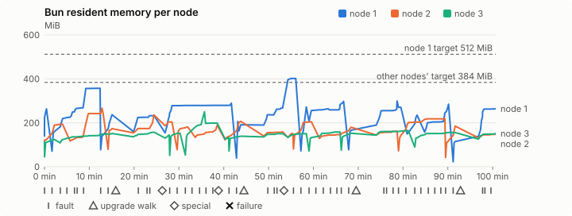
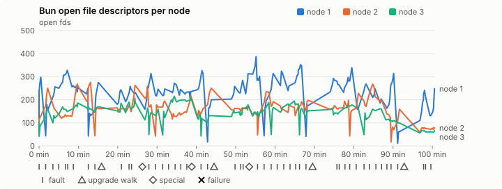
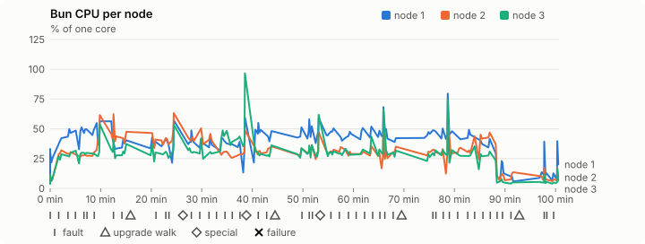
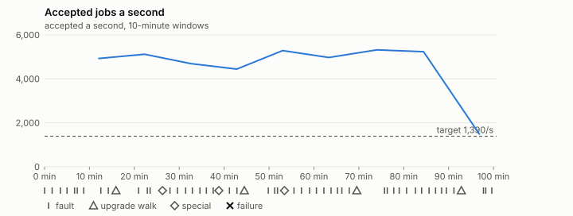

# Sustained soak (V02): PASS

15 October 2026. fast tier, compressed schedule, 1 h 40 min of soak on a three-node quickstart cluster.

**Fast tier: clean.** The iteration loop only, not acceptance: the V02 gate needs a clean final-tier run (8 h, full schedule) on the final candidate.

## Candidate and host

| | |
|---|---|
| Staged base URL | <https://github.com/reliaburger/reliaburger/releases/download/staging-v0.2.0-38674308323-1> |
| `candidate.json` SHA-256 | `a8188b1cb13a5ec798b05a5d338ccb6fa26d39253d465820d49f1ea8012a3e0a` |
| Running versions | v0.2.0 x3 |
| Soak build | `bun-v0.2.0-soak.1`, SHA-256 `8c6fb16b4e5c41db265201565fe3280fbd2726e15c132055c460fcdc35549d39` |
| Walks roll back to | 0.2.0 |
| Host | macOS 26.3.1, Apple M2 Max, 32 GiB |
| Lima | limactl version 2.1.0 |
| Guest | Ubuntu 24.04.5 LTS, kernel 6.8.0-139-generic |
| RELIABURGER_HOME | `/tmp/rbq.FsflrR` |
| Evidence | `/var/tmp/reliaburger-v02.oCWdMs` |

## Configuration deviations

- node.toml `[testing] allowed_operations` adds `provision_isolated_workloads` (quickstart allows only inject_workload_faults and alter_node_state), so the catalogue pulse can lease test namespaces
- node.toml `[logs]`/`[metrics]` export to file:///var/lib/reliaburger/soak-export every 60 s with max_storage_mb = 8, `[storage.snapshots]` every 900 s (compressed: 120 s), retain 4, uploaded to the same directory
- node.toml `[ingress] tls_cert/tls_key` point at an operator pair from a soak CA, 45-minute leaves rotated by the harness
- Bun runs with auto/mixed; host jobs opt in to a single pinned BusyBox copy under /var/lib/reliaburger/soak-jobs, mount_isolation=false. The independent verifier listens on each private VM address, TCP 8189, with a separate run token
- node.toml `[node.labels] soak-volume` = "writer" on node 2 and "redis" on node 3, to pin the volume apps
- node.toml `[upgrades] external_signing_key` = a throwaway operator key the harness made for this run (`ed25519:SiyJQaiiQdOxDv2SgvC27WnpsnFimQZKCYxlz623ilo=`); the soak build's `.sig` gets that key's external signature beside the release one (D2)
- node.toml `[security] leaf_lifetime_override_secs = 3600` (D1)

## Timeline

- Started 2026-10-15 18:08:27 UTC, finished 2026-10-15 19:49:08 UTC
- Cycles completed: 8
- Teardown: `relish local destroy --yes` and `relish uninstall --yes` succeeded

## Faults and slots

| Class | Runs | Settled/ok | Failed | Skipped | Settle (median / max) |
|---|---|---|---|---|---|
| fault:bun-kill-follower | 8 | 8 | 0 | 0 | 37 s / 46 s |
| fault:bun-kill-leader | 8 | 8 | 0 | 0 | 37 s / 44 s |
| fault:chaos-delay | 3 | 6 | 0 | 0 | 20 s / 30 s |
| fault:chaos-dns | 2 | 4 | 0 | 0 | 20 s / 20 s |
| fault:chaos-drop | 2 | 4 | 0 | 0 | 26 s / 26 s |
| fault:chaos-kill | 3 | 6 | 0 | 0 | 35 s / 36 s |
| fault:chaos-partition | 2 | 4 | 0 | 0 | 21 s / 21 s |
| fault:chaos-pause | 2 | 4 | 0 | 0 | 21 s / 21 s |
| fault:chaos-scenario | 2 | 4 | 0 | 0 | 36 s / 36 s |
| fault:deploy-kill | 4 | 4 | 0 | 0 | 37 s / 41 s |
| fault:node-delay | 3 | 3 | 0 | 0 | 36 s / 36 s |
| fault:node-disk-full | 3 | 3 | 0 | 0 | 21 s / 21 s |
| fault:node-slow-fsync | 2 | 2 | 0 | 0 | 21 s / 21 s |
| fault:power-off | 4 | 4 | 0 | 0 | 42 s / 50 s |
| pulse | 1 | 1 | 0 | 0 | n/a |
| pulse:settle | 0 | 1 | 0 | 0 | 26 s / 26 s |
| special:all-off | 1 | 1 | 0 | 0 | 72 s / 72 s |
| special:graceful-stop | 1 | 1 | 0 | 0 | 60 s / 60 s |
| special:quorum-back | 1 | 1 | 0 | 0 | n/a |
| special:quorum-loss | 1 | 1 | 0 | 0 | 51 s / 51 s |
| storage:offline-export | 4 | 4 | 0 | 0 | n/a |
| storage:registry-push | 8 | 0 | 0 | 0 | n/a |
| tls:invalid-expired | 6 | 6 | 0 | 0 | n/a |
| tls:invalid-torn | 6 | 6 | 0 | 0 | n/a |
| tls:reload | 47 | 47 | 0 | 0 | n/a |
| upgrade:rollback | 4 | 4 | 0 | 0 | n/a |
| upgrade:settle | 0 | 4 | 0 | 0 | 64 s / 70 s |
| upgrade:upgrade | 4 | 4 | 0 | 0 | n/a |

## Renewals and rotations

| Measure | Observed | Required | Verdict |
|---|---|---|---|
| workload identity rotations (soak-identity, per node) | 13 | ≥ 2 | PASS |
| node leaf renewals (per node) | 3 | ≥ 2 | PASS |
| operator ingress reloads (all nodes) | 47 | ≥ 19 | PASS |
| mixed job campaign and positive drain | 0 missing/failing checks | 0 | PASS |

## Jobs

| Runtime | Accepted successes | Retries | Last accepted progress |
|---|---|---|---|
| runc | 6338 | 1 | 1792092991 |
| shared-runc | 6821926 | 1 | 1792092994 |
| process | 19652324 | 1 | 1792092991 |

The bounded campaign shares the app soak's fault schedule. These counts are reliability evidence, not a saturation rate or a 100-million-per-day qualification.

- Independent verifier execution attempts: 24
- Explicit test-operator acknowledgements for known replay-safe fenced fixtures: 160

- rb-26dbc3df1042-1: latest complete job storage (KiB) {'instances': 3604, 'job-state': 8, 'task-arrays': 35108}; free 5205652 KiB; live/peak owners 0/31; peak storage {'instances': 33048, 'job-state': 8, 'task-arrays': 55588}
- rb-26dbc3df1042-2: latest complete job storage (KiB) {'instances': 4480, 'job-state': 8, 'task-arrays': 39436}; free 6255196 KiB; live/peak owners 0/32; peak storage {'instances': 29900, 'job-state': 8, 'task-arrays': 57976}
- rb-26dbc3df1042-3: latest complete job storage (KiB) {'instances': 2648, 'job-state': 8, 'task-arrays': 39828}; free 6320712 KiB; live/peak owners 0/31; peak storage {'instances': 30916, 'job-state': 8, 'task-arrays': 58784}

Complete disk inventories are recorded. Global retention bounds and the 12-hour job qualification remain #668; this gate cannot certify an unimplemented retention policy.

## Job qualification (D18-C)

Load: target; 3 nodes; accepted 5,001.1/s against a 1390.0/s target: PASS.

The September plan set its targets for one 1M-task batch on a quiet cluster. A soak runs for hours with restarts, upgrades and apps, so its storage, Bun memory and Raft targets are restated (maintainer decision, 15 October 2026, [#668](https://github.com/reliaburger/reliaburger/issues/668)). Bun's steady state is the median RSS of each process once it has been seen for 10 minutes; the gated memory checks are unchanged (`leak-rss`, and Mayo's 70% `memory_high` alert through `wtf`).

| Measure (recorded, not gated) | Observed | Target |
|---|---|---|
| Wall time of a 1,048,576-task array (median / max of 24) | 278 s / 856 s | ≤ 600 s |
| p99 start lag, pooled executors | 32 ms (bucket upper bound) | < 1,000 ms |
| Raft entries per second, all cluster writes | 8.74 | recorded only; the batch target counts only task-array writes |
| Raft state of one run, largest seen | 6,259 B | ≤ 256 KiB per 1M tasks |
| Bun steady-state RSS per process, worst node against its target | rb-26dbc3df1042-1: 356.97 MiB steady, 402.01 MiB peak | ≤ 512 MiB (≤ 512 MiB on node 1, which serves the API) |
| Bun CPU, busiest node | 0.37 cores | ≤ 1 core (leader batch control) |
| Executor helper CPU, busiest node | 0.02 cores | ≤ 0.5 core |
| Node task-array storage per 1M accepted tasks (peaks summed) | 6.36 MiB | ≤ 64 MiB, deleted after retirement |
| Retained log volume, all nodes | 10.19 MB | ≤ 50 MB |

- Bun RSS on rb-26dbc3df1042-1 (serves the API, target ≤ 512 MiB): pid 7839: 263.33 MiB peak (seen for under 10 minutes); pid 175686: 356.97 MiB steady, 356.97 MiB peak; pid 1603477: 236.98 MiB peak (seen for under 10 minutes); pid 1603477: 232.25 MiB peak (seen for under 10 minutes); pid 674: 279.47 MiB steady, 289.41 MiB peak; pid 1995769: 205.96 MiB peak (seen for under 10 minutes); pid 1995769: 266.95 MiB peak (seen for under 10 minutes); pid 674: 402.01 MiB peak (seen for under 10 minutes); pid 432087: 297.65 MiB peak (seen for under 10 minutes); pid 1951573: 166.20 MiB peak (seen for under 10 minutes); pid 1951573: 299.34 MiB peak (seen for under 10 minutes); pid 3771636: 234.84 MiB peak (seen for under 10 minutes); pid 671: 284.82 MiB peak (seen for under 10 minutes); pid 459450: 114.69 MiB peak (seen for under 10 minutes); pid 459450: 264.13 MiB peak (seen for under 10 minutes)
- Bun RSS on rb-26dbc3df1042-2 (node, target ≤ 384 MiB): pid 2340: 193.47 MiB peak (seen for under 10 minutes); pid 672: 266.88 MiB peak (seen for under 10 minutes); pid 1213550: 173.42 MiB peak (seen for under 10 minutes); pid 1612679: 235.39 MiB peak (seen for under 10 minutes); pid 672: 203.97 MiB peak (seen for under 10 minutes); pid 435567: 181.02 MiB peak (seen for under 10 minutes); pid 663: 188.95 MiB peak (seen for under 10 minutes); pid 674: 206.64 MiB peak (seen for under 10 minutes); pid 675: 159.27 MiB peak (seen for under 10 minutes); pid 676: 151.18 MiB peak (seen for under 10 minutes); pid 200181: 204.91 MiB peak (seen for under 10 minutes); pid 669: 179.96 MiB peak (seen for under 10 minutes); pid 669: 161.49 MiB peak (seen for under 10 minutes); pid 2437879: 218.08 MiB steady, 218.08 MiB peak; pid 3734135: 184.89 MiB peak (seen for under 10 minutes); pid 676: 147.57 MiB peak (seen for under 10 minutes)
- Bun RSS on rb-26dbc3df1042-3 (node, target ≤ 384 MiB): pid 2149: 114.64 MiB peak (seen for under 10 minutes); pid 3507: 124.24 MiB peak (seen for under 10 minutes); pid 454158: 148.96 MiB steady, 151.50 MiB peak; pid 454158: 157.31 MiB peak (seen for under 10 minutes); pid 672: 144.46 MiB peak (seen for under 10 minutes); pid 184459: 152.21 MiB peak (seen for under 10 minutes); pid 705604: 250.04 MiB peak (seen for under 10 minutes); pid 672: 133.99 MiB peak (seen for under 10 minutes); pid 161068: 139.09 MiB peak (seen for under 10 minutes); pid 161068: 151.36 MiB peak (seen for under 10 minutes); pid 675: 150.76 MiB peak (seen for under 10 minutes); pid 724047: 158.20 MiB peak (seen for under 10 minutes); pid 1785769: 152.44 MiB peak (seen for under 10 minutes); pid 675: 164.30 MiB peak (seen for under 10 minutes); pid 1648233: 155.91 MiB peak (seen for under 10 minutes); pid 1648233: 151.53 MiB peak (seen for under 10 minutes)

- runc retry causes: exit_code 1, launch 0, signal 0, timeout 0, unknown 0, unrecorded 0
- shared-runc retry causes: exit_code 1, launch 0, signal 0, timeout 0, unknown 0, unrecorded 0
- process retry causes: exit_code 1, launch 0, signal 0, timeout 0, unknown 0, unrecorded 0
- Audited executions: 24; operator replay decisions: 160

## Data

- Volume writer: highest ACK 51155 in the log view; the writer file checks (writer-lost, writer-regression) decide data loss, and `*-log-order` failures are about the order the log view returned lines in
- Redis counter: highest INCR 5211 in the log view
- Export rb-26dbc3df1042-1: 162 source files, 153 at the destination
- Export rb-26dbc3df1042-2: 207 source files, 206 at the destination
- Export rb-26dbc3df1042-3: 176 source files, 169 at the destination
- Registry images pushed and re-verified: 9
- Agent-loop turns over the 1 s budget: rb-26dbc3df1042-1 0, rb-26dbc3df1042-2 0, rb-26dbc3df1042-3 0
- Guest clock steps by Lima's guest agent: rb-26dbc3df1042-1 4, rb-26dbc3df1042-2 8, rb-26dbc3df1042-3 5
- Checks evaluated: 277 (heavy 24, light 100, settle 153)
- Last observed progress: redis-counter 5211, writer-ack 51155

## Resource trends

| Node | Measure | First | Last | Max |
|---|---|---|---|---|
| rb-26dbc3df1042-1 | disk_kb data | 1370660 | 967572 | 1520152 |
| rb-26dbc3df1042-1 | disk_kb images | 328964 | 444724 | 444724 |
| rb-26dbc3df1042-1 | disk_kb logs | 40 | 2460 | 2460 |
| rb-26dbc3df1042-1 | disk_kb metrics | 56 | 5836 | 5836 |
| rb-26dbc3df1042-1 | disk_kb soak-export | 4 | 8024 | 8024 |
| rb-26dbc3df1042-1 | disk_kb volumes | 200 | 36 | 228 |
| rb-26dbc3df1042-1 | fd | 118 | 248 | 387 |
| rb-26dbc3df1042-1 | rss_kb | 143176 | 270472 | 411656 |
| rb-26dbc3df1042-2 | disk_kb data | 68616 | 594644 | 621404 |
| rb-26dbc3df1042-2 | disk_kb images | 105892 | 329080 | 329080 |
| rb-26dbc3df1042-2 | disk_kb logs | 28 | 4352 | 4352 |
| rb-26dbc3df1042-2 | disk_kb metrics | 52 | 5556 | 5556 |
| rb-26dbc3df1042-2 | disk_kb soak-export | 4 | 11932 | 11932 |
| rb-26dbc3df1042-2 | disk_kb volumes | 16736 | 18064 | 18064 |
| rb-26dbc3df1042-2 | fd | 60 | 78 | 275 |
| rb-26dbc3df1042-2 | rss_kb | 105196 | 151112 | 273280 |
| rb-26dbc3df1042-3 | disk_kb data | 231248 | 286616 | 668448 |
| rb-26dbc3df1042-3 | disk_kb images | 316644 | 316824 | 316824 |
| rb-26dbc3df1042-3 | disk_kb logs | 28 | 3144 | 3144 |
| rb-26dbc3df1042-3 | disk_kb metrics | 52 | 5452 | 5452 |
| rb-26dbc3df1042-3 | disk_kb soak-export | 4 | 11484 | 11484 |
| rb-26dbc3df1042-3 | disk_kb volumes | 16760 | 17160 | 17164 |
| rb-26dbc3df1042-3 | fd | 60 | 66 | 215 |
| rb-26dbc3df1042-3 | rss_kb | 110920 | 155164 | 256040 |

## Charts

Time runs from the start of the soak. The marks under each chart are its faults, upgrade walks, specials and recorded failures; the dashed lines are targets.

## Failures

None.

Evidence: `/var/tmp/reliaburger-v02.oCWdMs` (events.jsonl, snapshots/, failures/<n>/).
