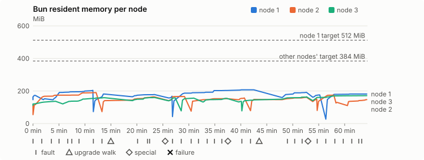
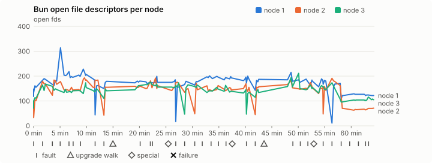
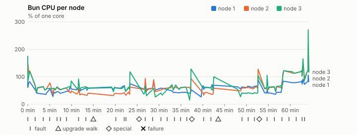
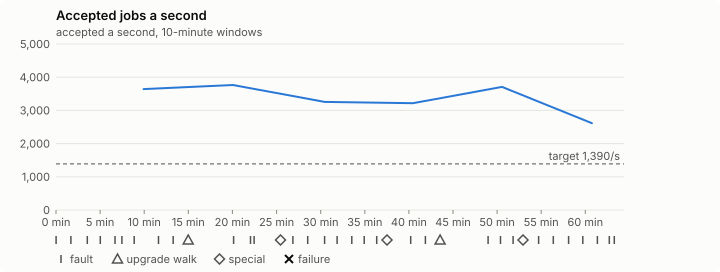

# Sustained soak (V02): PASS

20 October 2026. fast tier, compressed schedule, 1 h 04 min of soak on a three-node quickstart cluster.

**Fast tier: clean.** The iteration loop only, not acceptance: the V02 gate needs a clean final-tier run (8 h, full schedule) on the final candidate.

## Candidate and host

| | |
|---|---|
| Staged base URL | <https://github.com/reliaburger/reliaburger/releases/download/staging-v0.2.1-39340788164-1> |
| `candidate.json` SHA-256 | `2470c93e0ec58d1b6d0504a8daef85f21ab1120e400761ecc903eb661353e3e0` |
| Running versions | v0.2.1 x3 |
| Soak build | `bun-v0.2.1-soak.1`, SHA-256 `44e723b90918571f7ce0ef99b9d3396d2a188a59b5c52354436fe9c1b045ca5b` |
| Walks roll back to | 0.2.1 |
| Host | macOS 26.3.1, Apple M2 Max, 32 GiB |
| Lima | limactl version 2.2.1 |
| Guest | Ubuntu 24.04.5 LTS, kernel 6.8.0-139-generic |
| RELIABURGER_HOME | `/tmp/rbq.uyen5L` |
| Evidence | `/var/tmp/reliaburger-v02.wuOs1K` |

## Configuration deviations

- node.toml `[testing] allowed_operations` adds `provision_isolated_workloads` (quickstart allows only inject_workload_faults and alter_node_state), so the catalogue pulse can lease test namespaces
- node.toml `[logs]`/`[metrics]` export to file:///var/lib/reliaburger/soak-export every 60 s with max_storage_mb = 8, `[storage.snapshots]` every 900 s (compressed: 120 s), retain 4, uploaded to the same directory
- node.toml `[ingress] tls_cert/tls_key` point at an operator pair from a soak CA, 45-minute leaves rotated by the harness
- Bun runs with auto/mixed; host jobs opt in to a single pinned BusyBox copy under /var/lib/reliaburger/soak-jobs, mount_isolation=false. The independent verifier listens on each private VM address, TCP 8189, with a separate run token
- node.toml `[node.labels] soak-volume` = "writer" on node 2 and "redis" on node 3, to pin the volume apps
- node.toml `[upgrades] external_signing_key` = a throwaway operator key the harness made for this run (`ed25519:ymTxF+0uQCnqaD4eAdqf/UknS5yriyKq3LR2V4L0P9I=`); the soak build's `.sig` gets that key's external signature beside the release one (D2)
- node.toml `[security] leaf_lifetime_override_secs = 3600` (D1)

## Timeline

- Started 2026-10-20 01:54:55 UTC, finished 2026-10-20 02:59:18 UTC
- Cycles completed: 5
- Teardown: `relish local destroy --yes` and `relish uninstall --yes` succeeded

## Faults and slots

| Class | Runs | Settled/ok | Failed | Skipped | Settle (median / max) |
|---|---|---|---|---|---|
| fault:bun-kill-follower | 5 | 5 | 0 | 0 | 35 s / 36 s |
| fault:bun-kill-leader | 5 | 5 | 0 | 0 | 36 s / 42 s |
| fault:chaos-cpu | 1 | 2 | 0 | 0 | 20 s / 20 s |
| fault:chaos-delay | 1 | 2 | 0 | 0 | 19 s / 19 s |
| fault:chaos-dns | 1 | 2 | 0 | 0 | 19 s / 19 s |
| fault:chaos-drop | 1 | 2 | 0 | 0 | 19 s / 19 s |
| fault:chaos-kill | 2 | 4 | 0 | 0 | 46 s / 46 s |
| fault:chaos-memory | 1 | 2 | 0 | 0 | 15 s / 15 s |
| fault:chaos-partition | 1 | 2 | 0 | 0 | 19 s / 19 s |
| fault:chaos-pause | 1 | 2 | 0 | 0 | 19 s / 19 s |
| fault:chaos-scenario | 1 | 2 | 0 | 0 | 21 s / 21 s |
| fault:deploy-kill | 3 | 3 | 0 | 0 | 34 s / 52 s |
| fault:node-delay | 2 | 2 | 0 | 0 | 33 s / 33 s |
| fault:node-disk-full | 2 | 2 | 0 | 0 | 20 s / 20 s |
| fault:node-slow-fsync | 1 | 1 | 0 | 0 | 18 s / 18 s |
| fault:power-off | 3 | 3 | 0 | 0 | 33 s / 33 s |
| pulse | 1 | 1 | 0 | 0 | n/a |
| pulse:settle | 0 | 1 | 0 | 0 | 23 s / 23 s |
| special:all-off | 1 | 1 | 0 | 0 | 50 s / 50 s |
| special:graceful-stop | 1 | 1 | 0 | 0 | 44 s / 44 s |
| special:quorum-back | 1 | 1 | 0 | 0 | n/a |
| special:quorum-loss | 1 | 1 | 0 | 0 | 33 s / 33 s |
| storage:offline-export | 2 | 2 | 0 | 0 | n/a |
| storage:registry-push | 5 | 0 | 0 | 0 | n/a |
| tls:invalid-expired | 3 | 3 | 0 | 0 | n/a |
| tls:invalid-torn | 3 | 3 | 0 | 0 | n/a |
| tls:reload | 29 | 29 | 0 | 0 | n/a |
| upgrade:rollback | 2 | 2 | 0 | 0 | n/a |
| upgrade:settle | 0 | 2 | 0 | 0 | 61 s / 61 s |
| upgrade:upgrade | 2 | 2 | 0 | 0 | n/a |

## Renewals and rotations

| Measure | Observed | Required | Verdict |
|---|---|---|---|
| workload identity rotations (soak-identity, per node) | 7 | ≥ 1 | PASS |
| node leaf renewals (per node) | 2 | ≥ 1 | PASS |
| operator ingress reloads (all nodes) | 29 | ≥ 11 | PASS |
| mixed job campaign and positive drain | 0 missing/failing checks | 0 | PASS |

## Jobs

| Runtime | Accepted successes | Retries | Last accepted progress |
|---|---|---|---|
| runc | 7322 | 1 | 1792464780 |
| shared-runc | 3146614 | 1 | 1792464775 |
| process | 9138167 | 1 | 1792464778 |

The bounded campaign shares the app soak's fault schedule. These counts are reliability evidence, not a saturation rate or a 100-million-per-day qualification.

- Independent verifier execution attempts: 24
- Explicit test-operator acknowledgements for known replay-safe fenced fixtures: 106

- rb-62e5a71c7c53-1: latest complete job storage (KiB) {'instances': 328, 'job-state': 8, 'task-arrays': 14580}; free 5278156 KiB; live/peak owners 0/30; peak storage {'instances': 32164, 'job-state': 8, 'task-arrays': 35604}
- rb-62e5a71c7c53-2: latest complete job storage (KiB) {'instances': 328, 'job-state': 8, 'task-arrays': 14292}; free 6322664 KiB; live/peak owners 0/31; peak storage {'instances': 25292, 'job-state': 8, 'task-arrays': 35584}
- rb-62e5a71c7c53-3: latest complete job storage (KiB) {'instances': 10700, 'job-state': 8, 'task-arrays': 14812}; free 6312716 KiB; live/peak owners 0/31; peak storage {'instances': 27592, 'job-state': 8, 'task-arrays': 37084}

Complete disk inventories are recorded. Global retention bounds and the 12-hour job qualification remain #668; this gate cannot certify an unimplemented retention policy.

## Job qualification (D18-C)

Load: target; 3 nodes; accepted 3,520.1/s against a 1390.0/s target: PASS.

The September plan set its targets for one 1M-task batch on a quiet cluster. A soak runs for hours with restarts, upgrades and apps, so its storage, Bun memory and Raft targets are restated (maintainer decision, 15 October 2026, [#668](https://github.com/reliaburger/reliaburger/issues/668)). Bun's steady state is the median RSS of each process once it has been seen for 10 minutes; the gated memory checks are unchanged (`leak-rss`, and Mayo's 70% `memory_high` alert through `wtf`).

| Measure (recorded, not gated) | Observed | Target |
|---|---|---|
| Wall time of a 1,048,576-task array (median / max of 11) | 412 s / 1,173 s | ≤ 600 s |
| p99 start lag, pooled executors | 64 ms (bucket upper bound) | < 1,000 ms |
| Raft entries per second, all cluster writes | 2.07 | recorded only; the batch target counts only task-array writes |
| Raft state of one run, largest seen | 6,223 B | ≤ 256 KiB per 1M tasks |
| Bun steady-state RSS per process, worst node against its target | rb-62e5a71c7c53-2: 189.72 MiB steady, 190.18 MiB peak | ≤ 384 MiB (≤ 512 MiB on node 1, which serves the API) |
| Bun CPU, busiest node | 0.63 cores | ≤ 1 core (leader batch control) |
| Executor helper CPU, busiest node | 0.02 cores | ≤ 0.5 core |
| Node task-array storage per 1M accepted tasks (peaks summed) | 8.60 MiB | ≤ 64 MiB, deleted after retirement |
| Retained log volume, all nodes | 6.58 MB | ≤ 50 MB |

- Bun RSS on rb-62e5a71c7c53-1 (serves the API, target ≤ 512 MiB): pid 7999: 172.82 MiB peak (seen for under 10 minutes); pid 131864: 152.12 MiB peak (seen for under 10 minutes); pid 327204: 203.79 MiB peak (seen for under 10 minutes); pid 1231466: 181.14 MiB peak (seen for under 10 minutes); pid 1231466: 178.16 MiB peak (seen for under 10 minutes); pid 674: 167.70 MiB peak (seen for under 10 minutes); pid 100298: 207.16 MiB steady, 207.17 MiB peak; pid 100298: 191.43 MiB peak (seen for under 10 minutes); pid 677: 175.54 MiB peak (seen for under 10 minutes); pid 304687: 181.52 MiB peak (seen for under 10 minutes)
- Bun RSS on rb-62e5a71c7c53-2 (node, target ≤ 384 MiB): pid 2361: 115.81 MiB peak (seen for under 10 minutes); pid 4780: 189.72 MiB steady, 190.18 MiB peak; pid 1425415: 140.54 MiB peak (seen for under 10 minutes); pid 1661973: 163.79 MiB peak (seen for under 10 minutes); pid 673: 165.79 MiB peak (seen for under 10 minutes); pid 490379: 152.95 MiB peak (seen for under 10 minutes); pid 670: 157.22 MiB peak (seen for under 10 minutes); pid 339167: 148.34 MiB peak (seen for under 10 minutes); pid 664: 161.22 MiB peak (seen for under 10 minutes); pid 677: 150.11 MiB peak (seen for under 10 minutes); pid 114081: 173.73 MiB peak (seen for under 10 minutes); pid 475384: 130.29 MiB peak (seen for under 10 minutes); pid 674: 146.59 MiB peak (seen for under 10 minutes)
- Bun RSS on rb-62e5a71c7c53-3 (node, target ≤ 384 MiB): pid 2171: 136.70 MiB peak (seen for under 10 minutes); pid 677: 158.63 MiB peak (seen for under 10 minutes); pid 677: 160.05 MiB peak (seen for under 10 minutes); pid 674: 157.61 MiB peak (seen for under 10 minutes); pid 289292: 155.98 MiB peak (seen for under 10 minutes); pid 674: 154.22 MiB peak (seen for under 10 minutes); pid 672: 136.49 MiB peak (seen for under 10 minutes); pid 62058: 145.18 MiB peak (seen for under 10 minutes); pid 62058: 163.96 MiB peak (seen for under 10 minutes); pid 674: 171.48 MiB steady, 171.48 MiB peak

- runc retry causes: exit_code 1, launch 0, signal 0, timeout 0, unknown 0, unrecorded 0
- shared-runc retry causes: exit_code 1, launch 0, signal 0, timeout 0, unknown 0, unrecorded 0
- process retry causes: exit_code 1, launch 0, signal 0, timeout 0, unknown 0, unrecorded 0
- Audited executions: 24; operator replay decisions: 106
- Job controller API fallbacks: rb-62e5a71c7c53-1 missed 195, rb-62e5a71c7c53-2 missed 2; rb-62e5a71c7c53-2 answered 193, rb-62e5a71c7c53-3 answered 2 (requests a node didn't answer, and the node that took them instead)

## Data

- Volume writer: highest ACK 31113 in the log view; the writer file checks (writer-lost, writer-regression) decide data loss, and `*-log-order` failures are about the order the log view returned lines in
- Redis counter: highest INCR 3178 in the log view
- Export rb-62e5a71c7c53-1: 128 source files, 124 at the destination
- Export rb-62e5a71c7c53-2: 137 source files, 124 at the destination
- Export rb-62e5a71c7c53-3: 107 source files, 107 at the destination
- Registry images pushed and re-verified: 6
- Agent-loop turns over the 1 s budget: rb-62e5a71c7c53-1 0, rb-62e5a71c7c53-2 0, rb-62e5a71c7c53-3 0
- Guest clock steps by Lima's guest agent: rb-62e5a71c7c53-1 3, rb-62e5a71c7c53-2 6, rb-62e5a71c7c53-3 6
- Checks evaluated: 185 (heavy 15, light 69, settle 101)
- Last observed progress: redis-counter 3178, writer-ack 31113

## Resource trends

| Node | Measure | First | Last | Max |
|---|---|---|---|---|
| rb-62e5a71c7c53-1 | disk_kb data | 1369384 | 993596 | 1494892 |
| rb-62e5a71c7c53-1 | disk_kb images | 328964 | 445880 | 445880 |
| rb-62e5a71c7c53-1 | disk_kb logs | 40 | 3396 | 3396 |
| rb-62e5a71c7c53-1 | disk_kb metrics | 52 | 4756 | 4756 |
| rb-62e5a71c7c53-1 | disk_kb soak-export | 4 | 8016 | 8016 |
| rb-62e5a71c7c53-1 | disk_kb volumes | 200 | 60 | 228 |
| rb-62e5a71c7c53-1 | fd | 118 | 122 | 314 |
| rb-62e5a71c7c53-1 | rss_kb | 149728 | 185872 | 212144 |
| rb-62e5a71c7c53-2 | disk_kb data | 67388 | 38204 | 486824 |
| rb-62e5a71c7c53-2 | disk_kb images | 161940 | 329020 | 329020 |
| rb-62e5a71c7c53-2 | disk_kb logs | 28 | 1176 | 1176 |
| rb-62e5a71c7c53-2 | disk_kb metrics | 60 | 3436 | 3436 |
| rb-62e5a71c7c53-2 | disk_kb soak-export | 4 | 5240 | 5240 |
| rb-62e5a71c7c53-2 | disk_kb volumes | 16736 | 17264 | 17372 |
| rb-62e5a71c7c53-2 | fd | 74 | 71 | 193 |
| rb-62e5a71c7c53-2 | rss_kb | 108888 | 150104 | 194744 |
| rb-62e5a71c7c53-3 | disk_kb data | 230144 | 731668 | 731668 |
| rb-62e5a71c7c53-3 | disk_kb images | 316524 | 322608 | 322608 |
| rb-62e5a71c7c53-3 | disk_kb logs | 24 | 1852 | 1852 |
| rb-62e5a71c7c53-3 | disk_kb metrics | 56 | 3320 | 3320 |
| rb-62e5a71c7c53-3 | disk_kb soak-export | 4 | 5688 | 5688 |
| rb-62e5a71c7c53-3 | disk_kb volumes | 16752 | 17188 | 17188 |
| rb-62e5a71c7c53-3 | fd | 94 | 105 | 211 |
| rb-62e5a71c7c53-3 | rss_kb | 113972 | 175600 | 175600 |

## Charts

Time runs from the start of the soak. The marks under each chart are its faults, upgrade walks, specials and recorded failures; the dashed lines are targets.

## Failures

None.

Evidence: `/var/tmp/reliaburger-v02.wuOs1K` (events.jsonl, snapshots/, failures/<n>/).
