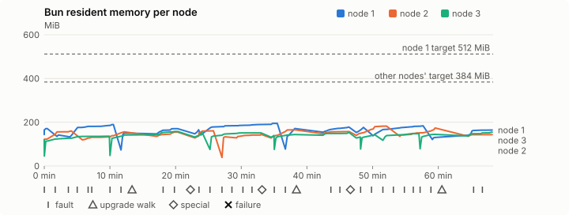
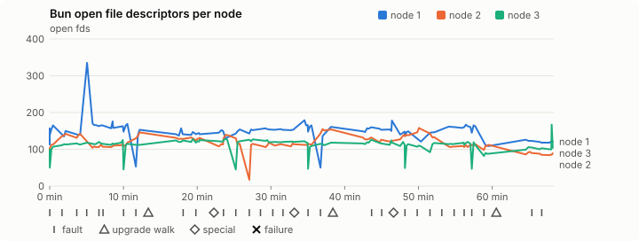
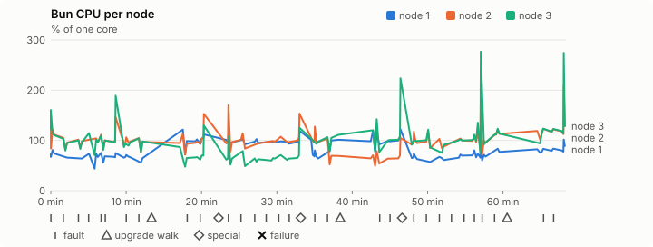
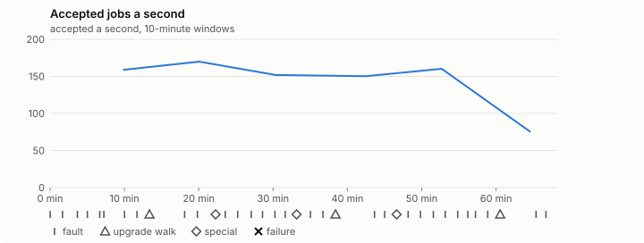

# Sustained soak (V02): PASS

20 October 2026. fast tier, compressed schedule, 1 h 08 min of soak on a three-node quickstart cluster.

**Fast tier: clean.** The iteration loop only, not acceptance: the V02 gate needs a clean final-tier run (8 h, full schedule) on the final candidate.

## Candidate and host

| | |
|---|---|
| Staged base URL | <https://github.com/reliaburger/reliaburger/releases/download/staging-v0.2.1-39340788164-1> |
| `candidate.json` SHA-256 | `2470c93e0ec58d1b6d0504a8daef85f21ab1120e400761ecc903eb661353e3e0` |
| Running versions | v0.2.1 x3 |
| Soak build | `bun-v0.2.1-soak.1`, SHA-256 `44e723b90918571f7ce0ef99b9d3396d2a188a59b5c52354436fe9c1b045ca5b` |
| Walks roll back to | 0.2.1 |
| Host | macOS 26.3.1, Apple M2 Max, 32 GiB |
| Lima | limactl version 2.2.1 |
| Guest | Ubuntu 24.04.5 LTS, kernel 6.8.0-139-generic |
| RELIABURGER_HOME | `/tmp/rbq.DlUdos` |
| Evidence | `/var/tmp/reliaburger-v02.OXAD7W` |

## Configuration deviations

- node.toml `[testing] allowed_operations` adds `provision_isolated_workloads` (quickstart allows only inject_workload_faults and alter_node_state), so the catalogue pulse can lease test namespaces
- node.toml `[logs]`/`[metrics]` export to file:///var/lib/reliaburger/soak-export every 60 s with max_storage_mb = 8, `[storage.snapshots]` every 900 s (compressed: 120 s), retain 4, uploaded to the same directory
- node.toml `[ingress] tls_cert/tls_key` point at an operator pair from a soak CA, 45-minute leaves rotated by the harness
- Bun runs with auto/mixed; host jobs opt in to a single pinned BusyBox copy under /var/lib/reliaburger/soak-jobs, mount_isolation=false. The independent verifier listens on each private VM address, TCP 8189, with a separate run token
- node.toml `[node.labels] soak-volume` = "writer" on node 2 and "redis" on node 3, to pin the volume apps
- node.toml `[upgrades] external_signing_key` = a throwaway operator key the harness made for this run (`ed25519:kJCgfYCeNeN5D/tPkBRFWOZd3F/Xg1BmM2QT9gd83K8=`); the soak build's `.sig` gets that key's external signature beside the release one (D2)
- node.toml `[security] leaf_lifetime_override_secs = 3600` (D1)

## Timeline

- Started 2026-10-20 00:41:34 UTC, finished 2026-10-20 01:49:55 UTC
- Cycles completed: 6
- Teardown: `relish local destroy --yes` and `relish uninstall --yes` succeeded

## Faults and slots

| Class | Runs | Settled/ok | Failed | Skipped | Settle (median / max) |
|---|---|---|---|---|---|
| fault:bun-kill-follower | 6 | 6 | 0 | 0 | 30 s / 34 s |
| fault:bun-kill-leader | 6 | 6 | 0 | 0 | 34 s / 40 s |
| fault:chaos-cpu | 1 | 2 | 0 | 0 | 17 s / 17 s |
| fault:chaos-delay | 2 | 4 | 0 | 0 | 16 s / 16 s |
| fault:chaos-dns | 1 | 2 | 0 | 0 | 16 s / 16 s |
| fault:chaos-drop | 1 | 2 | 0 | 0 | 17 s / 17 s |
| fault:chaos-kill | 2 | 4 | 0 | 0 | 51 s / 51 s |
| fault:chaos-memory | 1 | 2 | 0 | 0 | 17 s / 17 s |
| fault:chaos-partition | 2 | 4 | 0 | 0 | 16 s / 16 s |
| fault:chaos-pause | 1 | 2 | 0 | 0 | 17 s / 17 s |
| fault:chaos-scenario | 1 | 2 | 0 | 0 | 30 s / 30 s |
| fault:deploy-kill | 3 | 3 | 0 | 0 | 31 s / 37 s |
| fault:power-off | 3 | 3 | 0 | 0 | 29 s / 30 s |
| pulse | 1 | 1 | 0 | 0 | n/a |
| pulse:settle | 0 | 1 | 0 | 0 | 16 s / 16 s |
| special:all-off | 1 | 1 | 0 | 0 | 38 s / 38 s |
| special:graceful-stop | 1 | 1 | 0 | 0 | 37 s / 37 s |
| special:quorum-back | 1 | 1 | 0 | 0 | n/a |
| special:quorum-loss | 1 | 1 | 0 | 0 | 28 s / 28 s |
| storage:offline-export | 3 | 3 | 0 | 0 | n/a |
| storage:registry-push | 6 | 0 | 0 | 0 | n/a |
| tls:invalid-expired | 3 | 3 | 0 | 0 | n/a |
| tls:invalid-torn | 3 | 3 | 0 | 0 | n/a |
| tls:reload | 30 | 30 | 0 | 0 | n/a |
| upgrade:rollback | 3 | 3 | 0 | 0 | n/a |
| upgrade:settle | 0 | 3 | 0 | 0 | 57 s / 71 s |
| upgrade:upgrade | 3 | 3 | 0 | 0 | n/a |

## Renewals and rotations

| Measure | Observed | Required | Verdict |
|---|---|---|---|
| workload identity rotations (soak-identity, per node) | 8 | ≥ 1 | PASS |
| node leaf renewals (per node) | 2 | ≥ 1 | PASS |
| operator ingress reloads (all nodes) | 30 | ≥ 12 | PASS |
| mixed job campaign and positive drain | 0 missing/failing checks | 0 | PASS |

## Jobs

| Runtime | Accepted successes | Retries | Last accepted progress |
|---|---|---|---|
| runc | 11275 | 2 | 1792460378 |
| shared-runc | 226946 | 1 | 1792460378 |
| process | 315880 | 1 | 1792460378 |

The bounded campaign shares the app soak's fault schedule. These counts are reliability evidence, not a saturation rate or a 100-million-per-day qualification.

- Independent verifier execution attempts: 24
- Explicit test-operator acknowledgements for known replay-safe fenced fixtures: 114

- rb-62edfc85567f-1: latest complete job storage (KiB) {'instances': 172, 'job-state': 8, 'task-arrays': 4100}; free 5232860 KiB; live/peak owners 0/11; peak storage {'instances': 15764, 'job-state': 8, 'task-arrays': 13608}
- rb-62edfc85567f-2: latest complete job storage (KiB) {'instances': 528, 'job-state': 8, 'task-arrays': 3940}; free 6340040 KiB; live/peak owners 0/9; peak storage {'instances': 9204, 'job-state': 8, 'task-arrays': 13524}
- rb-62edfc85567f-3: latest complete job storage (KiB) {'instances': 3780, 'job-state': 8, 'task-arrays': 4040}; free 6358904 KiB; live/peak owners 0/8; peak storage {'instances': 5776, 'job-state': 8, 'task-arrays': 13920}

Complete disk inventories are recorded. Global retention bounds and the 12-hour job qualification remain #668; this gate cannot certify an unimplemented retention policy.

## Job qualification (D18-C)

Load: calibration; 3 nodes; accepted 158.6/s (calibration load: not gated).

The September plan set its targets for one 1M-task batch on a quiet cluster. A soak runs for hours with restarts, upgrades and apps, so its storage, Bun memory and Raft targets are restated (maintainer decision, 15 October 2026, [#668](https://github.com/reliaburger/reliaburger/issues/668)). Bun's steady state is the median RSS of each process once it has been seen for 10 minutes; the gated memory checks are unchanged (`leak-rss`, and Mayo's 70% `memory_high` alert through `wtf`).

| Measure (recorded, not gated) | Observed | Target |
|---|---|---|
| Wall time of a 1,048,576-task array (median / max of 0) | not measured / not measured | ≤ 600 s |
| p99 start lag, pooled executors | 4 ms (bucket upper bound) | < 1,000 ms |
| Raft entries per second, all cluster writes | 2.45 | recorded only; the batch target counts only task-array writes |
| Raft state of one run, largest seen | 36,867 B | ≤ 256 KiB per 1M tasks |
| Bun steady-state RSS per process, worst node against its target | rb-62edfc85567f-1: 194.78 MiB steady, 194.78 MiB peak | ≤ 512 MiB (≤ 512 MiB on node 1, which serves the API) |
| Bun CPU, busiest node | 0.96 cores | ≤ 1 core (leader batch control) |
| Executor helper CPU, busiest node | 0.00 cores | ≤ 0.5 core |
| Node task-array storage per 1M accepted tasks (peaks summed) | 72.35 MiB | ≤ 64 MiB, deleted after retirement |
| Retained log volume, all nodes | 7.00 MB | ≤ 50 MB |

- Bun RSS on rb-62edfc85567f-1 (serves the API, target ≤ 512 MiB): pid 8511: 171.20 MiB peak (seen for under 10 minutes); pid 32418: 141.71 MiB peak (seen for under 10 minutes); pid 60058: 189.44 MiB peak (seen for under 10 minutes); pid 178794: 150.60 MiB peak (seen for under 10 minutes); pid 208207: 170.50 MiB peak (seen for under 10 minutes); pid 673: 165.53 MiB peak (seen for under 10 minutes); pid 14772: 194.78 MiB steady, 194.78 MiB peak; pid 200319: 171.15 MiB peak (seen for under 10 minutes); pid 200319: 178.00 MiB peak (seen for under 10 minutes); pid 678: 176.36 MiB peak (seen for under 10 minutes); pid 38320: 183.74 MiB peak (seen for under 10 minutes); pid 158741: 130.39 MiB peak (seen for under 10 minutes); pid 158741: 164.61 MiB peak (seen for under 10 minutes)
- Bun RSS on rb-62edfc85567f-2 (node, target ≤ 384 MiB): pid 2355: 160.00 MiB peak (seen for under 10 minutes); pid 674: 156.19 MiB peak (seen for under 10 minutes); pid 674: 155.04 MiB peak (seen for under 10 minutes); pid 677: 160.68 MiB peak (seen for under 10 minutes); pid 67221: 133.29 MiB peak (seen for under 10 minutes); pid 679: 145.00 MiB peak (seen for under 10 minutes); pid 679: 165.64 MiB peak (seen for under 10 minutes); pid 679: 157.43 MiB peak (seen for under 10 minutes); pid 664: 182.12 MiB peak (seen for under 10 minutes); pid 664: 173.69 MiB peak (seen for under 10 minutes); pid 664: 143.51 MiB peak (seen for under 10 minutes)
- Bun RSS on rb-62edfc85567f-3 (node, target ≤ 384 MiB): pid 2171: 119.22 MiB peak (seen for under 10 minutes); pid 3565: 136.36 MiB peak (seen for under 10 minutes); pid 136443: 141.78 MiB peak (seen for under 10 minutes); pid 136443: 157.90 MiB peak (seen for under 10 minutes); pid 673: 153.00 MiB peak (seen for under 10 minutes); pid 36041: 151.33 MiB peak (seen for under 10 minutes); pid 677: 139.54 MiB peak (seen for under 10 minutes); pid 10202: 143.95 MiB peak (seen for under 10 minutes); pid 661: 153.12 MiB peak (seen for under 10 minutes); pid 675: 132.36 MiB peak (seen for under 10 minutes); pid 13106: 142.86 MiB peak (seen for under 10 minutes); pid 58387: 148.25 MiB peak (seen for under 10 minutes); pid 135388: 144.55 MiB peak (seen for under 10 minutes); pid 673: 154.87 MiB peak (seen for under 10 minutes)

- runc retry causes: exit_code 1, launch 1, signal 0, timeout 0, unknown 0, unrecorded 0
- shared-runc retry causes: exit_code 1, launch 0, signal 0, timeout 0, unknown 0, unrecorded 0
- process retry causes: exit_code 1, launch 0, signal 0, timeout 0, unknown 0, unrecorded 0
- Audited executions: 24; operator replay decisions: 114
- Job controller API fallbacks: rb-62edfc85567f-1 missed 154, rb-62edfc85567f-2 missed 8; rb-62edfc85567f-2 answered 146, rb-62edfc85567f-3 answered 8 (requests a node didn't answer, and the node that took them instead)

## Data

- Volume writer: highest ACK 32820 in the log view; the writer file checks (writer-lost, writer-regression) decide data loss, and `*-log-order` failures are about the order the log view returned lines in
- Redis counter: highest INCR 3445 in the log view
- Export rb-62edfc85567f-1: 135 source files, 122 at the destination
- Export rb-62edfc85567f-2: 137 source files, 128 at the destination
- Export rb-62edfc85567f-3: 110 source files, 109 at the destination
- Registry images pushed and re-verified: 7
- Agent-loop turns over the 1 s budget: rb-62edfc85567f-1 0, rb-62edfc85567f-2 0, rb-62edfc85567f-3 0
- Guest clock steps by Lima's guest agent: rb-62edfc85567f-1 3, rb-62edfc85567f-2 7, rb-62edfc85567f-3 5
- Checks evaluated: 197 (heavy 17, light 76, settle 104)
- Last observed progress: redis-counter 3445, writer-ack 32820

## Resource trends

| Node | Measure | First | Last | Max |
|---|---|---|---|---|
| rb-62edfc85567f-1 | disk_kb data | 1369404 | 924064 | 1520116 |
| rb-62edfc85567f-1 | disk_kb images | 328964 | 445844 | 445844 |
| rb-62edfc85567f-1 | disk_kb logs | 36 | 4136 | 4136 |
| rb-62edfc85567f-1 | disk_kb metrics | 52 | 4808 | 4808 |
| rb-62edfc85567f-1 | disk_kb soak-export | 4 | 8240 | 8240 |
| rb-62edfc85567f-1 | disk_kb volumes | 200 | 36 | 252 |
| rb-62edfc85567f-1 | fd | 113 | 121 | 335 |
| rb-62edfc85567f-1 | rss_kb | 147380 | 168556 | 199456 |
| rb-62edfc85567f-2 | disk_kb data | 67452 | 82780 | 618220 |
| rb-62edfc85567f-2 | disk_kb images | 161940 | 329052 | 329052 |
| rb-62edfc85567f-2 | disk_kb logs | 24 | 1820 | 1820 |
| rb-62edfc85567f-2 | disk_kb metrics | 80 | 3320 | 3320 |
| rb-62edfc85567f-2 | disk_kb soak-export | 4 | 6708 | 6708 |
| rb-62edfc85567f-2 | disk_kb volumes | 16736 | 17316 | 17316 |
| rb-62edfc85567f-2 | fd | 70 | 89 | 158 |
| rb-62edfc85567f-2 | rss_kb | 114784 | 146952 | 186492 |
| rb-62edfc85567f-3 | disk_kb data | 230204 | 712604 | 712604 |
| rb-62edfc85567f-3 | disk_kb images | 316524 | 322608 | 322608 |
| rb-62edfc85567f-3 | disk_kb logs | 24 | 884 | 884 |
| rb-62edfc85567f-3 | disk_kb metrics | 60 | 3212 | 3212 |
| rb-62edfc85567f-3 | disk_kb soak-export | 4 | 4292 | 4292 |
| rb-62edfc85567f-3 | disk_kb volumes | 16748 | 17208 | 17208 |
| rb-62edfc85567f-3 | fd | 75 | 104 | 167 |
| rb-62edfc85567f-3 | rss_kb | 113312 | 158588 | 161688 |

## Charts

Time runs from the start of the soak. The marks under each chart are its faults, upgrade walks, specials and recorded failures; the dashed lines are targets.

## Failures

None.

Evidence: `/var/tmp/reliaburger-v02.OXAD7W` (events.jsonl, snapshots/, failures/<n>/).
