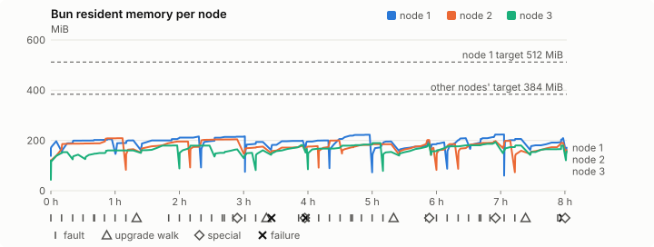
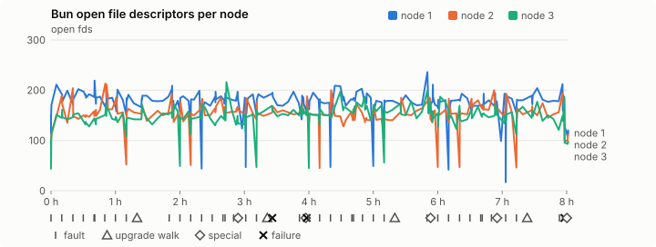
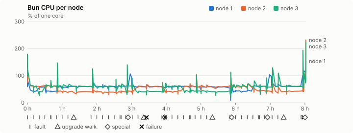
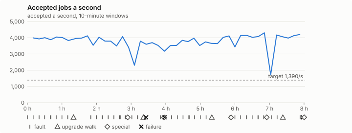

# Sustained soak (V02): FAIL

20 October 2026. final tier, full schedule, 8 h 01 min of soak on a three-node quickstart cluster.

**Final tier: not clean. The V02 gate does not pass.** A product fix means a fresh fast-tier run, then a fresh final-tier run.

## Candidate and host

| | |
|---|---|
| Staged base URL | <https://github.com/reliaburger/reliaburger/releases/download/staging-v0.2.1-39340788164-1> |
| `candidate.json` SHA-256 | `2470c93e0ec58d1b6d0504a8daef85f21ab1120e400761ecc903eb661353e3e0` |
| Running versions | v0.2.1 x3 |
| Soak build | `bun-v0.2.1-soak.1`, SHA-256 `44e723b90918571f7ce0ef99b9d3396d2a188a59b5c52354436fe9c1b045ca5b` |
| Walks roll back to | 0.2.1 |
| Host | macOS 26.3.1, Apple M2 Max, 32 GiB |
| Lima | limactl version 2.2.1 |
| Guest | Ubuntu 24.04.5 LTS, kernel 6.8.0-139-generic |
| RELIABURGER_HOME | `/tmp/rbq.AV308n` |
| Evidence | `/var/tmp/reliaburger-v02.pHPnxw` |

## Configuration deviations

- node.toml `[testing] allowed_operations` adds `provision_isolated_workloads` (quickstart allows only inject_workload_faults and alter_node_state), so the catalogue pulse can lease test namespaces
- node.toml `[logs]`/`[metrics]` export to file:///var/lib/reliaburger/soak-export every 60 s with max_storage_mb = 8, `[storage.snapshots]` every 900 s (compressed: 120 s), retain 4, uploaded to the same directory
- node.toml `[ingress] tls_cert/tls_key` point at an operator pair from a soak CA, 45-minute leaves rotated by the harness
- Bun runs with auto/mixed; host jobs opt in to a single pinned BusyBox copy under /var/lib/reliaburger/soak-jobs, mount_isolation=false. The independent verifier listens on each private VM address, TCP 8189, with a separate run token
- node.toml `[node.labels] soak-volume` = "writer" on node 2 and "redis" on node 3, to pin the volume apps
- node.toml `[upgrades] external_signing_key` = a throwaway operator key the harness made for this run (`ed25519:kV+4pABWDobZYTa6bmf24dAO4IVCIeJRtEOZOT7ebU8=`); the soak build's `.sig` gets that key's external signature beside the release one (D2)
- node.toml `[security] leaf_lifetime_override_secs = 3600` (D1)

## Timeline

- Started 2026-10-20 12:03:35 UTC, finished 2026-10-20 20:05:20 UTC
- Cycles completed: 8
- Teardown: `relish local destroy --yes` and `relish uninstall --yes` succeeded

## Faults and slots

| Class | Runs | Settled/ok | Failed | Skipped | Settle (median / max) |
|---|---|---|---|---|---|
| fault:bun-kill-follower | 8 | 8 | 0 | 0 | 35 s / 46 s |
| fault:bun-kill-leader | 8 | 8 | 0 | 0 | 36 s / 41 s |
| fault:chaos-cpu | 1 | 2 | 0 | 0 | 19 s / 19 s |
| fault:chaos-delay | 1 | 2 | 0 | 0 | 17 s / 17 s |
| fault:chaos-dns | 1 | 2 | 0 | 0 | 20 s / 20 s |
| fault:chaos-drop | 1 | 2 | 0 | 0 | 19 s / 19 s |
| fault:chaos-kill | 1 | 2 | 0 | 0 | 39 s / 39 s |
| fault:chaos-partition | 1 | 2 | 0 | 0 | 21 s / 21 s |
| fault:chaos-pause | 1 | 2 | 0 | 0 | 28 s / 28 s |
| fault:chaos-scenario | 1 | 2 | 0 | 0 | 35 s / 35 s |
| fault:deploy-kill | 4 | 4 | 0 | 0 | 39 s / 40 s |
| fault:node-delay | 3 | 3 | 0 | 0 | 33 s / 37 s |
| fault:node-disk-full | 3 | 3 | 0 | 0 | 20 s / 20 s |
| fault:node-slow-fsync | 2 | 2 | 0 | 0 | 21 s / 21 s |
| fault:power-off | 4 | 4 | 0 | 0 | 35 s / 57 s |
| pulse | 8 | 8 | 0 | 0 | n/a |
| pulse:settle | 0 | 8 | 0 | 0 | 20 s / 37 s |
| special:all-off | 1 | 1 | 0 | 0 | 63 s / 63 s |
| special:graceful-stop | 2 | 2 | 0 | 0 | 43 s / 43 s |
| special:quorum-back | 2 | 2 | 0 | 0 | n/a |
| special:quorum-loss | 2 | 2 | 0 | 0 | 65 s / 65 s |
| storage:offline-export | 1 | 1 | 0 | 0 | n/a |
| storage:registry-push | 8 | 0 | 0 | 0 | n/a |
| tls:invalid-expired | 9 | 9 | 0 | 0 | n/a |
| tls:invalid-torn | 12 | 12 | 0 | 0 | n/a |
| tls:reload | 91 | 91 | 0 | 0 | n/a |
| upgrade:rollback | 4 | 4 | 0 | 0 | n/a |
| upgrade:settle | 0 | 4 | 0 | 0 | 58 s / 61 s |
| upgrade:upgrade | 4 | 4 | 0 | 0 | n/a |

## Renewals and rotations

| Measure | Observed | Required | Verdict |
|---|---|---|---|
| workload identity rotations (soak-identity, per node) | 17 | ≥ 15 | PASS |
| node leaf renewals (per node) | 17 | ≥ 15 | PASS |
| operator ingress reloads (all nodes) | 91 | ≥ 31 | PASS |
| mixed job campaign and positive drain | 0 missing/failing checks | 0 | PASS |

## Jobs

| Runtime | Accepted successes | Retries | Last accepted progress |
|---|---|---|---|
| runc | 63675 | 3 | 1792526500 |
| shared-runc | 28002479 | 1 | 1792526500 |
| process | 79940669 | 1 | 1792526500 |

The bounded campaign shares the app soak's fault schedule. These counts are reliability evidence, not a saturation rate or a 100-million-per-day qualification.

- Independent verifier execution attempts: 24
- Explicit test-operator acknowledgements for known replay-safe fenced fixtures: 189

- rb-1536ef3742de-1: latest complete job storage (KiB) {'instances': 332, 'job-state': 8, 'task-arrays': 8468}; free 4948496 KiB; live/peak owners 0/31; peak storage {'instances': 73448, 'job-state': 8, 'task-arrays': 37224}
- rb-1536ef3742de-2: latest complete job storage (KiB) {'instances': 1824, 'job-state': 8, 'task-arrays': 12760}; free 6046900 KiB; live/peak owners 0/32; peak storage {'instances': 61232, 'job-state': 8, 'task-arrays': 39720}
- rb-1536ef3742de-3: latest complete job storage (KiB) {'instances': 304, 'job-state': 8, 'task-arrays': 12172}; free 6074316 KiB; live/peak owners 0/32; peak storage {'instances': 23384, 'job-state': 8, 'task-arrays': 40908}

Complete disk inventories are recorded. Global retention bounds and the 12-hour job qualification remain #668; this gate cannot certify an unimplemented retention policy.

## Job qualification (D18-C)

Load: target; 3 nodes; accepted 3,764.1/s against a 1390.0/s target: PASS.

The September plan set its targets for one 1M-task batch on a quiet cluster. A soak runs for hours with restarts, upgrades and apps, so its storage, Bun memory and Raft targets are restated (maintainer decision, 15 October 2026, [#668](https://github.com/reliaburger/reliaburger/issues/668)). Bun's steady state is the median RSS of each process once it has been seen for 10 minutes; the gated memory checks are unchanged (`leak-rss`, and Mayo's 70% `memory_high` alert through `wtf`).

| Measure (recorded, not gated) | Observed | Target |
|---|---|---|
| Wall time of a 1,048,576-task array (median / max of 64) | 381 s / 1,398 s | ≤ 600 s |
| p99 start lag, pooled executors | 32 ms (bucket upper bound) | < 1,000 ms |
| Raft entries per second, all cluster writes | 1.54 | recorded only; the batch target counts only task-array writes |
| Raft state of one run, largest seen | 6,141 B | ≤ 256 KiB per 1M tasks |
| Bun steady-state RSS per process, worst node against its target | rb-1536ef3742de-2: 203.81 MiB steady, 208.88 MiB peak | ≤ 384 MiB (≤ 512 MiB on node 1, which serves the API) |
| Bun CPU, busiest node | 0.59 cores | ≤ 1 core (leader batch control) |
| Executor helper CPU, busiest node | 0.01 cores | ≤ 0.5 core |
| Node task-array storage per 1M accepted tasks (peaks summed) | 1.07 MiB | ≤ 64 MiB, deleted after retirement |
| Retained log volume, all nodes | 20.50 MB | ≤ 50 MB |

- Bun RSS on rb-1536ef3742de-1 (serves the API, target ≤ 512 MiB): pid 8227: 196.94 MiB peak (seen for under 10 minutes); pid 1048267: 201.89 MiB steady, 205.21 MiB peak; pid 2300967: 198.45 MiB steady, 200.23 MiB peak; pid 2300967: 207.95 MiB steady, 215.79 MiB peak; pid 2192877: 214.15 MiB steady, 216.31 MiB peak; pid 1818723: 194.01 MiB steady, 194.01 MiB peak; pid 1818723: 198.21 MiB steady, 199.07 MiB peak; pid 715: 199.54 MiB steady, 199.82 MiB peak; pid 2149148: 221.08 MiB steady, 222.48 MiB peak; pid 2075006: 192.74 MiB steady, 195.80 MiB peak; pid 2075006: 179.18 MiB steady, 198.40 MiB peak; pid 677: 192.73 MiB steady, 192.73 MiB peak; pid 1776520: 201.19 MiB steady, 208.82 MiB peak; pid 677: 213.32 MiB steady, 223.91 MiB peak; pid 2934972: 206.05 MiB steady, 206.06 MiB peak; pid 2934972: 193.10 MiB steady, 208.98 MiB peak; pid 669: 171.22 MiB peak (seen for under 10 minutes)
- Bun RSS on rb-1536ef3742de-2 (node, target ≤ 384 MiB): pid 2340: 188.28 MiB steady, 208.88 MiB peak; pid 3656443: 165.04 MiB peak (seen for under 10 minutes); pid 721357: 191.99 MiB steady, 195.69 MiB peak; pid 1798915: 203.81 MiB steady, 204.50 MiB peak; pid 676: 173.52 MiB steady, 175.58 MiB peak; pid 676: 176.76 MiB steady, 178.77 MiB peak; pid 730: 177.41 MiB steady, 177.41 MiB peak; pid 1271941: 199.38 MiB steady, 200.32 MiB peak; pid 682: 183.55 MiB steady, 184.95 MiB peak; pid 667: 201.26 MiB steady, 202.06 MiB peak; pid 675: 170.61 MiB peak (seen for under 10 minutes); pid 616561: 179.73 MiB steady, 185.27 MiB peak; pid 2915803: 189.12 MiB steady, 197.77 MiB peak; pid 677: 198.54 MiB peak (seen for under 10 minutes); pid 1415398: 159.07 MiB peak (seen for under 10 minutes); pid 1415398: 187.69 MiB steady, 190.29 MiB peak; pid 673: 161.92 MiB peak (seen for under 10 minutes)
- Bun RSS on rb-1536ef3742de-3 (node, target ≤ 384 MiB): pid 2168: 119.56 MiB peak (seen for under 10 minutes); pid 3639: 151.58 MiB steady, 153.47 MiB peak; pid 2274755: 143.46 MiB peak (seen for under 10 minutes); pid 677: 160.03 MiB steady, 160.12 MiB peak; pid 677: 179.66 MiB steady, 179.95 MiB peak; pid 1286596: 179.54 MiB steady, 179.78 MiB peak; pid 675: 163.84 MiB steady, 164.88 MiB peak; pid 662: 150.79 MiB peak (seen for under 10 minutes); pid 1210011: 160.89 MiB peak (seen for under 10 minutes); pid 1210011: 179.72 MiB steady, 181.40 MiB peak; pid 679: 166.16 MiB peak (seen for under 10 minutes); pid 260585: 180.13 MiB steady, 189.59 MiB peak; pid 3233243: 154.17 MiB peak (seen for under 10 minutes); pid 3233243: 175.93 MiB steady, 186.73 MiB peak; pid 672: 180.78 MiB steady, 193.82 MiB peak; pid 670: 178.58 MiB steady, 179.87 MiB peak; pid 670: 165.39 MiB steady, 179.66 MiB peak; pid 678: 156.75 MiB peak (seen for under 10 minutes)

- runc retry causes: exit_code 1, launch 1, signal 0, timeout 0, unknown 1, unrecorded 0
- shared-runc retry causes: exit_code 1, launch 0, signal 0, timeout 0, unknown 0, unrecorded 0
- process retry causes: exit_code 1, launch 0, signal 0, timeout 0, unknown 0, unrecorded 0
- Audited executions: 24; operator replay decisions: 189
- Job controller API fallbacks: rb-1536ef3742de-1 missed 607, rb-1536ef3742de-2 missed 8; rb-1536ef3742de-2 answered 599, rb-1536ef3742de-3 answered 8 (requests a node didn't answer, and the node that took them instead)

## Data

- Volume writer: highest ACK 240228 in the log view; the writer file checks (writer-lost, writer-regression) decide data loss, and `*-log-order` failures are about the order the log view returned lines in
- Redis counter: highest INCR 26409 in the log view
- Export rb-1536ef3742de-1: 239 source files, 848 at the destination
- Export rb-1536ef3742de-2: 272 source files, 950 at the destination
- Export rb-1536ef3742de-3: 272 source files, 604 at the destination
- Registry images pushed and re-verified: 9
- Agent-loop turns over the 1 s budget: rb-1536ef3742de-1 2, rb-1536ef3742de-2 2, rb-1536ef3742de-3 0
- Guest clock steps by Lima's guest agent: rb-1536ef3742de-1 6, rb-1536ef3742de-2 7, rb-1536ef3742de-3 8
- Checks evaluated: 1030 (heavy 99, light 776, settle 155)
- Last observed progress: redis-counter 26409, writer-ack 240228

## Resource trends

| Node | Measure | First | Last | Max |
|---|---|---|---|---|
| rb-1536ef3742de-1 | disk_kb data | 1369452 | 1019364 | 1480752 |
| rb-1536ef3742de-1 | disk_kb images | 328964 | 458372 | 458372 |
| rb-1536ef3742de-1 | disk_kb logs | 40 | 8700 | 9124 |
| rb-1536ef3742de-1 | disk_kb metrics | 52 | 8740 | 8984 |
| rb-1536ef3742de-1 | disk_kb soak-export | 4 | 67472 | 67472 |
| rb-1536ef3742de-1 | disk_kb volumes | 200 | 60 | 204 |
| rb-1536ef3742de-1 | fd | 114 | 115 | 236 |
| rb-1536ef3742de-1 | rss_kb | 141772 | 175332 | 229280 |
| rb-1536ef3742de-2 | disk_kb data | 67444 | 616036 | 616036 |
| rb-1536ef3742de-2 | disk_kb images | 161940 | 341568 | 341568 |
| rb-1536ef3742de-2 | disk_kb logs | 28 | 8584 | 9256 |
| rb-1536ef3742de-2 | disk_kb metrics | 60 | 8648 | 9036 |
| rb-1536ef3742de-2 | disk_kb soak-export | 4 | 50912 | 50912 |
| rb-1536ef3742de-2 | disk_kb volumes | 16736 | 23840 | 23840 |
| rb-1536ef3742de-2 | fd | 69 | 112 | 213 |
| rb-1536ef3742de-2 | rss_kb | 114664 | 165808 | 213888 |
| rb-1536ef3742de-3 | disk_kb data | 230200 | 240712 | 557124 |
| rb-1536ef3742de-3 | disk_kb images | 316524 | 326864 | 326864 |
| rb-1536ef3742de-3 | disk_kb logs | 24 | 1644 | 1644 |
| rb-1536ef3742de-3 | disk_kb metrics | 44 | 8788 | 9208 |
| rb-1536ef3742de-3 | disk_kb soak-export | 4 | 34284 | 34284 |
| rb-1536ef3742de-3 | disk_kb volumes | 16760 | 18644 | 18700 |
| rb-1536ef3742de-3 | fd | 77 | 97 | 216 |
| rb-1536ef3742de-3 | rss_kb | 111072 | 160508 | 198476 |

## Charts

Time runs from the start of the soak. The marks under each chart are its faults, upgrade walks, specials and recorded failures; the dashed lines are targets.

## Failures

| # | First seen | Check | Symptom | Class | Cause | Action |
|---|---|---|---|---|---|---|
| 1 | 15:29:29 | heavy-check | fail: agent-loop-turn rb-1536ef3742de-2: 1 deploy_op turn(s) over the 1 s budget, the worst between 1 and 2.5 s; | unclassified | open | open |
| 2 | 16:01:28 | settle-check | fail: agent-loop-turn rb-1536ef3742de-2: 1 deploy_op turn(s) over the 1 s budget, the worst between 1 and 2.5 s; | unclassified | open | open |
| 3 | 20:01:27 | settle-check | fail: agent-loop-turn rb-1536ef3742de-1: 1 deploy_op turn(s) over the 1 s budget, the worst between 1 and 2.5 s; | unclassified | open | open |

Evidence: `/var/tmp/reliaburger-v02.pHPnxw` (events.jsonl, snapshots/, failures/<n>/).
