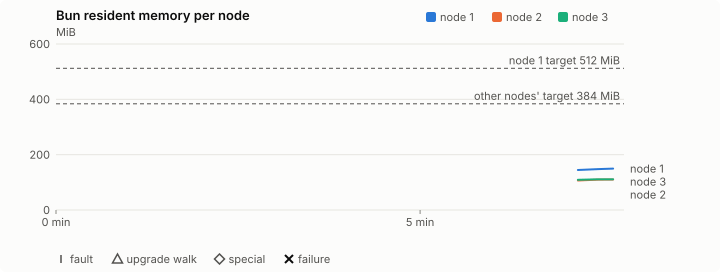
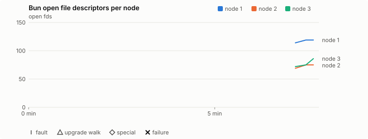
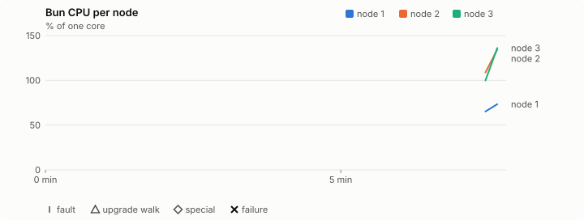

# Sustained soak (V02): FAIL

17 October 2026. fast tier, compressed schedule, 7 min 48 s of soak on a three-node quickstart cluster.

**Fast tier: not clean.** Fix what failed and run the fast tier again before a final-tier run.

## Candidate and host

| | |
|---|---|
| Staged base URL | <https://github.com/reliaburger/reliaburger/releases/download/staging-v0.2.1-39035030331-1> |
| `candidate.json` SHA-256 | `aaf5fa15d4d86dd2488555d0709360ff9c3be3180577c727ff8cf85fe4eebd69` |
| Running versions | v0.2.1 x3 |
| Soak build | `bun-v0.2.1-soak.1`, SHA-256 `9365debf6a571284ec5f159d7b8804115eef2ac3a46025485eb60d12d6d6016a` |
| Walks roll back to | 0.2.1 |
| Host | macOS 26.3.1, Apple M2 Max, 32 GiB |
| Lima | limactl version 2.2.1 |
| Guest | Ubuntu 24.04.5 LTS, kernel 6.8.0-139-generic |
| RELIABURGER_HOME | `/tmp/rbq.vSY0wf` |
| Evidence | `/var/tmp/reliaburger-v02.5tSIqD` |

## Configuration deviations

- node.toml `[testing] allowed_operations` adds `provision_isolated_workloads` (quickstart allows only inject_workload_faults and alter_node_state), so the catalogue pulse can lease test namespaces
- node.toml `[logs]`/`[metrics]` export to file:///var/lib/reliaburger/soak-export every 60 s with max_storage_mb = 8, `[storage.snapshots]` every 900 s (compressed: 120 s), retain 4, uploaded to the same directory
- node.toml `[ingress] tls_cert/tls_key` point at an operator pair from a soak CA, 45-minute leaves rotated by the harness
- Bun runs with auto/mixed; host jobs opt in to a single pinned BusyBox copy under /var/lib/reliaburger/soak-jobs, mount_isolation=false. The independent verifier listens on each private VM address, TCP 8189, with a separate run token
- node.toml `[node.labels] soak-volume` = "writer" on node 2 and "redis" on node 3, to pin the volume apps
- node.toml `[upgrades] external_signing_key` = a throwaway operator key the harness made for this run (`ed25519:fBWQN21ShbDI0H7yZbzR8dgUcTaq8SEWcZ/mCe8iqvI=`); the soak build's `.sig` gets that key's external signature beside the release one (D2)
- node.toml `[security] leaf_lifetime_override_secs = 3600` (D1)

## Timeline

- Started 2026-10-17 14:37:06 UTC, finished 2026-10-17 14:44:54 UTC
- Cycles completed: 0
- Teardown: `relish local destroy --yes` and `relish uninstall --yes` succeeded

## Faults and slots

| Class | Runs | Settled/ok | Failed | Skipped | Settle (median / max) |
|---|---|---|---|---|---|

## Renewals and rotations

| Measure | Observed | Required | Verdict |
|---|---|---|---|
| workload identity rotations (soak-identity, per node) | 0 | ≥ 0 | PASS |
| node leaf renewals (per node) | 0 | ≥ 0 | PASS |
| operator ingress reloads (all nodes) | 0 | ≥ 0 | PASS |
| mixed job campaign and positive drain | 7 missing/failing checks | 0 | FAIL |

## Jobs

| Runtime | Accepted successes | Retries | Last accepted progress |
|---|---|---|---|
| runc | 0 | 0 | missing |
| shared-runc | 6 | 0 | 1792248293 |
| process | 8 | 0 | 1792248293 |

The bounded campaign shares the app soak's fault schedule. These counts are reliability evidence, not a saturation rate or a 100-million-per-day qualification.

- runc missing coverage: audit, failure, timeout, limit, cancel, reuse, profiles, unknown, cron, hook, published-job, drain, active fault overlap on rb-7b24139af8c6-1, active fault overlap on rb-7b24139af8c6-2, active fault overlap on rb-7b24139af8c6-3, active leader-kill overlap, active follower-kill overlap, active power-off overlap
- shared-runc missing coverage: audit, failure, timeout, limit, cancel, reuse, profiles, unknown, cron, hook, published-job, drain, active fault overlap on rb-7b24139af8c6-1, active fault overlap on rb-7b24139af8c6-2, active fault overlap on rb-7b24139af8c6-3, active leader-kill overlap, active follower-kill overlap, active power-off overlap
- process missing coverage: failure, timeout, limit, cancel, reuse, profiles, unknown, cron, hook, published-job, active fault overlap on rb-7b24139af8c6-1, active fault overlap on rb-7b24139af8c6-2, active fault overlap on rb-7b24139af8c6-3, active leader-kill overlap, active follower-kill overlap, active power-off overlap
- job campaign did not positively drain before teardown
- rb-7b24139af8c6-1 lacks a complete empty owner inventory after campaign drain
- rb-7b24139af8c6-2 lacks a complete empty owner inventory after campaign drain
- rb-7b24139af8c6-3 lacks a complete empty owner inventory after campaign drain
- Independent verifier execution attempts: 8
- Explicit test-operator acknowledgements for known replay-safe fenced fixtures: 0

Complete disk inventories are recorded. Global retention bounds and the 12-hour job qualification remain #668; this gate cannot certify an unimplemented retention policy.

## Job qualification (D18-C)

Load: calibration; 3 nodes; accepted 2.0/s (calibration load: not gated).

The September plan set its targets for one 1M-task batch on a quiet cluster. A soak runs for hours with restarts, upgrades and apps, so its storage, Bun memory and Raft targets are restated (maintainer decision, 15 October 2026, [#668](https://github.com/reliaburger/reliaburger/issues/668)). Bun's steady state is the median RSS of each process once it has been seen for 10 minutes; the gated memory checks are unchanged (`leak-rss`, and Mayo's 70% `memory_high` alert through `wtf`).

| Measure (recorded, not gated) | Observed | Target |
|---|---|---|
| Wall time of a 1,048,576-task array (median / max of 0) | not measured / not measured | ≤ 600 s |
| p99 start lag, pooled executors | 128 ms (bucket upper bound) | < 1,000 ms |
| Raft entries per second, all cluster writes | not measured | recorded only; the batch target counts only task-array writes |
| Raft state of one run, largest seen | 619 B | ≤ 256 KiB per 1M tasks |
| Bun steady-state RSS per process, worst node against its target | not measured | ≤ 384 MiB (≤ 512 MiB on node 1, which serves the API) |
| Bun CPU, busiest node | not measured | ≤ 1 core (leader batch control) |
| Executor helper CPU, busiest node | not measured | ≤ 0.5 core |
| Node task-array storage per 1M accepted tasks (peaks summed) | not measured | ≤ 64 MiB, deleted after retirement |
| Retained log volume, all nodes | not measured | ≤ 50 MB |

- runc retry causes: exit_code 0, launch 0, signal 0, timeout 0, unknown 0, unrecorded 0
- shared-runc retry causes: exit_code 0, launch 0, signal 0, timeout 0, unknown 0, unrecorded 0
- process retry causes: exit_code 0, launch 0, signal 0, timeout 0, unknown 0, unrecorded 0
- Audited executions: 8; operator replay decisions: 0
- Job controller API fallbacks: none (requests a node didn't answer, and the node that took them instead)

## Data

- Volume writer: highest ACK 313 in the log view; the writer file checks (writer-lost, writer-regression) decide data loss, and `*-log-order` failures are about the order the log view returned lines in
- Redis counter: highest INCR 25 in the log view
- Export rb-7b24139af8c6-1: 6 source files, 0 at the destination
- Export rb-7b24139af8c6-2: 6 source files, 0 at the destination
- Export rb-7b24139af8c6-3: 6 source files, 0 at the destination
- Registry images pushed and re-verified: 1
- Agent-loop turns over the 1 s budget: rb-7b24139af8c6-1 0, rb-7b24139af8c6-2 0, rb-7b24139af8c6-3 0
- Guest clock steps by Lima's guest agent: rb-7b24139af8c6-1 1, rb-7b24139af8c6-2 1, rb-7b24139af8c6-3 1
- Checks evaluated: 3 (heavy 1, settle 2)
- Last observed progress: redis-counter 25, writer-ack 313

## Resource trends

| Node | Measure | First | Last | Max |
|---|---|---|---|---|
| rb-7b24139af8c6-1 | disk_kb data | 1370452 | 1370776 | 1370776 |
| rb-7b24139af8c6-1 | disk_kb images | 328964 | 328964 | 328964 |
| rb-7b24139af8c6-1 | disk_kb logs | 40 | 40 | 40 |
| rb-7b24139af8c6-1 | disk_kb metrics | 56 | 56 | 56 |
| rb-7b24139af8c6-1 | disk_kb soak-export | 4 | 4 | 4 |
| rb-7b24139af8c6-1 | disk_kb volumes | 200 | 200 | 200 |
| rb-7b24139af8c6-1 | fd | 114 | 119 | 119 |
| rb-7b24139af8c6-1 | rss_kb | 147924 | 153392 | 153392 |
| rb-7b24139af8c6-2 | disk_kb data | 68472 | 68504 | 68504 |
| rb-7b24139af8c6-2 | disk_kb images | 158836 | 158836 | 158836 |
| rb-7b24139af8c6-2 | disk_kb logs | 28 | 28 | 28 |
| rb-7b24139af8c6-2 | disk_kb metrics | 52 | 84 | 84 |
| rb-7b24139af8c6-2 | disk_kb soak-export | 4 | 4 | 4 |
| rb-7b24139af8c6-2 | disk_kb volumes | 16736 | 16736 | 16736 |
| rb-7b24139af8c6-2 | fd | 69 | 75 | 75 |
| rb-7b24139af8c6-2 | rss_kb | 109300 | 112716 | 112716 |
| rb-7b24139af8c6-3 | disk_kb data | 231236 | 231268 | 231268 |
| rb-7b24139af8c6-3 | disk_kb images | 316524 | 316524 | 316524 |
| rb-7b24139af8c6-3 | disk_kb logs | 32 | 32 | 32 |
| rb-7b24139af8c6-3 | disk_kb metrics | 60 | 92 | 92 |
| rb-7b24139af8c6-3 | disk_kb soak-export | 4 | 4 | 4 |
| rb-7b24139af8c6-3 | disk_kb volumes | 16760 | 16760 | 16760 |
| rb-7b24139af8c6-3 | fd | 72 | 86 | 86 |
| rb-7b24139af8c6-3 | rss_kb | 111696 | 113660 | 113660 |

## Charts

Time runs from the start of the soak. The marks under each chart are its faults, upgrade walks, specials and recorded failures; the dashed lines are targets.

## Failures

None.

## Notes

- Job controller was still running at teardown; positive drain must be present to pass
- The harness stopped early (exit 1) during setup

Evidence: `/var/tmp/reliaburger-v02.5tSIqD` (events.jsonl, snapshots/, failures/<n>/).
