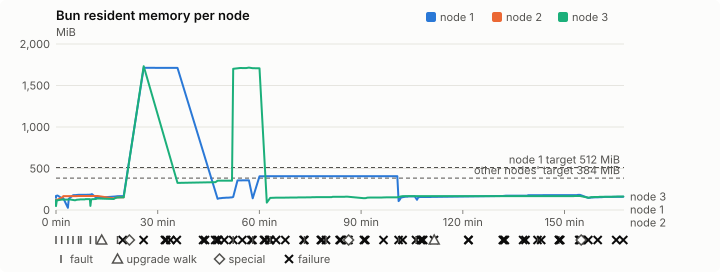
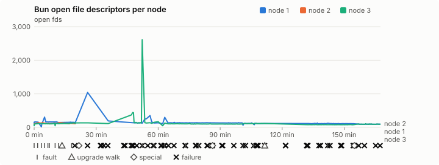
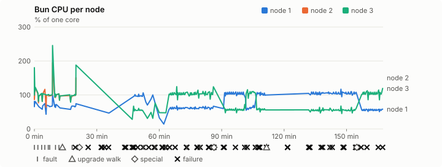
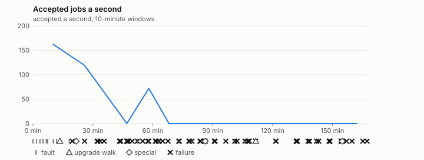

# Sustained soak (V02): FAIL

17 October 2026. fast tier, compressed schedule, 2 h 47 min of soak on a three-node quickstart cluster.

**Fast tier: not clean.** Fix what failed and run the fast tier again before a final-tier run.

## Candidate and host

| | |
|---|---|
| Staged base URL | <https://github.com/reliaburger/reliaburger/releases/download/staging-v0.2.1-39050295201-1> |
| `candidate.json` SHA-256 | `3cdd8a83fcdc763ccfe773a6021a02af27c2c25691d73f00278911e40f3b1d4d` |
| Running versions | v0.2.1 x3 |
| Soak build | `bun-v0.2.1-soak.1`, SHA-256 `27a178e39719944b6dd992b6b615eed40880f684ff5df0fb8db4dc996c3e9627` |
| Walks roll back to | 0.2.1 |
| Host | macOS 26.3.1, Apple M2 Max, 32 GiB |
| Lima | limactl version 2.2.1 |
| Guest | Ubuntu 24.04.5 LTS, kernel 6.8.0-139-generic |
| RELIABURGER_HOME | `/tmp/rbq.NVXjs2` |
| Evidence | `/var/tmp/reliaburger-v02.Ic9cO7` |

## Configuration deviations

- node.toml `[testing] allowed_operations` adds `provision_isolated_workloads` (quickstart allows only inject_workload_faults and alter_node_state), so the catalogue pulse can lease test namespaces
- node.toml `[logs]`/`[metrics]` export to file:///var/lib/reliaburger/soak-export every 60 s with max_storage_mb = 8, `[storage.snapshots]` every 900 s (compressed: 120 s), retain 4, uploaded to the same directory
- node.toml `[ingress] tls_cert/tls_key` point at an operator pair from a soak CA, 45-minute leaves rotated by the harness
- Bun runs with auto/mixed; host jobs opt in to a single pinned BusyBox copy under /var/lib/reliaburger/soak-jobs, mount_isolation=false. The independent verifier listens on each private VM address, TCP 8189, with a separate run token
- node.toml `[node.labels] soak-volume` = "writer" on node 2 and "redis" on node 3, to pin the volume apps
- node.toml `[upgrades] external_signing_key` = a throwaway operator key the harness made for this run (`ed25519:AgiOg33ZGXYcGBz2xwQpamchLpkNAJiTvvarfQJWLzA=`); the soak build's `.sig` gets that key's external signature beside the release one (D2)
- node.toml `[security] leaf_lifetime_override_secs = 3600` (D1)

## Timeline

- Started 2026-10-17 18:06:43 UTC, finished 2026-10-17 20:54:16 UTC
- Cycles completed: 4
- Teardown: `relish local destroy --yes` and `relish uninstall --yes` succeeded

## Faults and slots

| Class | Runs | Settled/ok | Failed | Skipped | Settle (median / max) |
|---|---|---|---|---|---|
| fault:bun-kill-follower | 4 | 2 | 2 | 0 | 303 s / 311 s |
| fault:bun-kill-leader | 4 | 2 | 2 | 0 | 314 s / 329 s |
| fault:chaos-cpu | 1 | 1 | 1 | 0 | 307 s / 307 s |
| fault:chaos-delay | 1 | 2 | 0 | 0 | 16 s / 16 s |
| fault:chaos-dns | 1 | 1 | 1 | 0 | 306 s / 306 s |
| fault:chaos-drop | 1 | 1 | 1 | 0 | 313 s / 313 s |
| fault:chaos-kill | 1 | 2 | 0 | 0 | 42 s / 42 s |
| fault:chaos-partition | 1 | 2 | 0 | 0 | 16 s / 16 s |
| fault:chaos-pause | 1 | 1 | 1 | 0 | 311 s / 311 s |
| fault:chaos-scenario | 1 | 1 | 1 | 0 | 16 s / 16 s |
| fault:deploy-kill | 2 | 1 | 1 | 0 | 304 s / 304 s |
| fault:power-off | 3 | 1 | 2 | 0 | 509 s / 509 s |
| pulse | 1 | 1 | 0 | 0 | n/a |
| pulse:settle | 0 | 1 | 0 | 0 | 20 s / 20 s |
| special:all-off | 1 | 0 | 1 | 0 | 615 s / 615 s |
| special:graceful-stop | 1 | 0 | 1 | 0 | 1114 s / 1114 s |
| special:quorum-loss | 1 | 0 | 1 | 0 | 610 s / 610 s |
| storage:offline-export | 2 | 2 | 0 | 0 | n/a |
| storage:registry-push | 4 | 0 | 0 | 0 | n/a |
| tls:invalid-expired | 6 | 4 | 2 | 0 | n/a |
| tls:invalid-torn | 9 | 6 | 3 | 0 | n/a |
| tls:reload | 68 | 44 | 24 | 0 | n/a |
| upgrade:rollback | 2 | 1 | 1 | 0 | n/a |
| upgrade:settle | 0 | 1 | 1 | 0 | 610 s / 610 s |
| upgrade:upgrade | 2 | 1 | 1 | 0 | n/a |

## Renewals and rotations

| Measure | Observed | Required | Verdict |
|---|---|---|---|
| workload identity rotations (soak-identity, per node) | 3 | ≥ 4 | FAIL |
| node leaf renewals (per node) | 0 | ≥ 4 | FAIL |
| operator ingress reloads (all nodes) | 44 | ≥ 32 | PASS |
| mixed job campaign and positive drain | 10 missing/failing checks | 0 | FAIL |

## Jobs

| Runtime | Accepted successes | Retries | Last accepted progress |
|---|---|---|---|
| runc | 5464 | 4 | 1792263877 |
| shared-runc | 103992 | 7 | 1792263880 |
| process | 150007 | 50 | 1792263880 |

The bounded campaign shares the app soak's fault schedule. These counts are reliability evidence, not a saturation rate or a 100-million-per-day qualification.

- process short work (28): unexpected terminal failure in ordinary campaign work
- runc long work (4): unexpected terminal failure in ordinary campaign work: task 195 after 3 attempt(s), exit 137
- job campaign drain deadline exceeded
- runc missing coverage: active fault overlap on rb-33047e836817-2
- shared-runc missing coverage: active fault overlap on rb-33047e836817-2
- process missing coverage: active fault overlap on rb-33047e836817-2
- job campaign did not positively drain before teardown
- rb-33047e836817-1 lacks a complete empty owner inventory after campaign drain
- rb-33047e836817-2 lacks a complete empty owner inventory after campaign drain
- rb-33047e836817-3 lacks a complete empty owner inventory after campaign drain
- Independent verifier execution attempts: 24
- Explicit test-operator acknowledgements for known replay-safe fenced fixtures: 56

- rb-33047e836817-1: latest complete job storage (KiB) {'instances': 1584, 'job-state': 8, 'task-arrays': 2976}; free 5133372 KiB; live/peak owners 1/9; peak storage {'instances': 72736, 'job-state': 8, 'task-arrays': 12312}
- rb-33047e836817-2: latest complete job storage (KiB) {'instances': 5224, 'job-state': 8, 'task-arrays': 6812}; free 6302844 KiB; live/peak owners 8/9; peak storage {'instances': 5800, 'job-state': 8, 'task-arrays': 6812}
- rb-33047e836817-3: latest complete job storage (KiB) {'instances': 10188, 'job-state': 8, 'task-arrays': 3720}; free 6264716 KiB; live/peak owners 1/9; peak storage {'instances': 10188, 'job-state': 8, 'task-arrays': 12780}

Complete disk inventories are recorded. Global retention bounds and the 12-hour job qualification remain #668; this gate cannot certify an unimplemented retention policy.

## Job qualification (D18-C)

Load: calibration; 3 nodes; accepted 74.3/s (calibration load: not gated).

The September plan set its targets for one 1M-task batch on a quiet cluster. A soak runs for hours with restarts, upgrades and apps, so its storage, Bun memory and Raft targets are restated (maintainer decision, 15 October 2026, [#668](https://github.com/reliaburger/reliaburger/issues/668)). Bun's steady state is the median RSS of each process once it has been seen for 10 minutes; the gated memory checks are unchanged (`leak-rss`, and Mayo's 70% `memory_high` alert through `wtf`).

| Measure (recorded, not gated) | Observed | Target |
|---|---|---|
| Wall time of a 1,048,576-task array (median / max of 0) | not measured / not measured | ≤ 600 s |
| p99 start lag, pooled executors | 2,048 ms (bucket upper bound) | < 1,000 ms |
| Raft entries per second, all cluster writes | 2.03 | recorded only; the batch target counts only task-array writes |
| Raft state of one run, largest seen | 625 B | ≤ 256 KiB per 1M tasks |
| Bun steady-state RSS per process, worst node against its target | rb-33047e836817-3: 352.72 MiB steady, 1,733.00 MiB peak | ≤ 384 MiB (≤ 512 MiB on node 1, which serves the API) |
| Bun CPU, busiest node | 0.99 cores | ≤ 1 core (leader batch control) |
| Executor helper CPU, busiest node | 0.00 cores | ≤ 0.5 core |
| Node task-array storage per 1M accepted tasks (peaks summed) | 120.08 MiB | ≤ 64 MiB, deleted after retirement |
| Retained log volume, all nodes | 10.95 MB | ≤ 50 MB |

- Bun RSS on rb-33047e836817-1 (serves the API, target ≤ 512 MiB): pid 8155: 174.92 MiB peak (seen for under 10 minutes); pid 31676: 142.52 MiB peak (seen for under 10 minutes); pid 58527: 190.99 MiB peak (seen for under 10 minutes); pid 181261: 148.05 MiB peak (seen for under 10 minutes); pid 219495: 170.44 MiB peak (seen for under 10 minutes); pid 671: 1,713.02 MiB peak (seen for under 10 minutes); pid 4933: 357.29 MiB peak (seen for under 10 minutes); pid 148750: 407.49 MiB steady, 407.64 MiB peak; pid 618420: 164.67 MiB peak (seen for under 10 minutes); pid 670126: 178.38 MiB steady, 182.36 MiB peak; pid 682: 159.89 MiB steady, 159.89 MiB peak
- Bun RSS on rb-33047e836817-2 (node, target ≤ 384 MiB): pid 2352: 168.14 MiB steady, 168.16 MiB peak; pid 2352: 153.37 MiB peak (seen for under 10 minutes)
- Bun RSS on rb-33047e836817-3 (node, target ≤ 384 MiB): pid 2176: 119.82 MiB peak (seen for under 10 minutes); pid 3654: 128.13 MiB peak (seen for under 10 minutes); pid 666: 131.35 MiB peak (seen for under 10 minutes); pid 65306: 138.75 MiB peak (seen for under 10 minutes); pid 65306: 153.38 MiB peak (seen for under 10 minutes); pid 679: 1,733.00 MiB peak (seen for under 10 minutes); pid 5473: 352.72 MiB steady, 352.91 MiB peak; pid 87164: 1,716.08 MiB peak (seen for under 10 minutes); pid 99988: 155.23 MiB steady, 160.56 MiB peak; pid 683: 167.52 MiB steady, 168.10 MiB peak; pid 676: 162.54 MiB steady, 162.54 MiB peak

- runc retry causes: exit_code 4, launch 0, signal 0, timeout 0, unknown 0, unrecorded 0
- shared-runc retry causes: exit_code 1, launch 0, signal 0, timeout 2, unknown 4, unrecorded 0
- process retry causes: exit_code 1, launch 1, signal 0, timeout 0, unknown 27, unrecorded 21
- Audited executions: 24; operator replay decisions: 56
- Job controller API fallbacks: rb-33047e836817-1 missed 217, rb-33047e836817-2 missed 137; rb-33047e836817-2 answered 80, rb-33047e836817-3 answered 137 (requests a node didn't answer, and the node that took them instead)

## Data

- Volume writer: highest ACK 10746 in the log view; the writer file checks (writer-lost, writer-regression) decide data loss, and `*-log-order` failures are about the order the log view returned lines in
- Redis counter: highest INCR 7164 in the log view
- Export rb-33047e836817-1: 236 source files, 294 at the destination
- Export rb-33047e836817-2: 47 source files, 36 at the destination
- Export rb-33047e836817-3: 218 source files, 215 at the destination
- Registry images pushed and re-verified: 5
- Agent-loop turns over the 1 s budget: rb-33047e836817-1 8, rb-33047e836817-2 0, rb-33047e836817-3 75
- Guest clock steps by Lima's guest agent: rb-33047e836817-1 61, rb-33047e836817-2 4, rb-33047e836817-3 43
- Checks evaluated: 326 (heavy 30, light 37, settle 259)
- Last observed progress: redis-counter 7164, writer-ack 10746

## Resource trends

| Node | Measure | First | Last | Max |
|---|---|---|---|---|
| rb-33047e836817-1 | disk_kb data | 1428888 | 927452 | 1576948 |
| rb-33047e836817-1 | disk_kb images | 328964 | 445632 | 445632 |
| rb-33047e836817-1 | disk_kb logs | 40 | 8316 | 8876 |
| rb-33047e836817-1 | disk_kb metrics | 52 | 8500 | 8840 |
| rb-33047e836817-1 | disk_kb soak-export | 4 | 20788 | 20788 |
| rb-33047e836817-1 | disk_kb volumes | 224 | 36 | 252 |
| rb-33047e836817-1 | fd | 117 | 97 | 1041 |
| rb-33047e836817-1 | rss_kb | 149628 | 163724 | 1754132 |
| rb-33047e836817-2 | disk_kb data | 68512 | 20868 | 86812 |
| rb-33047e836817-2 | disk_kb images | 158836 | 328988 | 328988 |
| rb-33047e836817-2 | disk_kb logs | 24 | 320 | 320 |
| rb-33047e836817-2 | disk_kb metrics | 40 | 1656 | 1656 |
| rb-33047e836817-2 | disk_kb soak-export | 4 | 1540 | 1540 |
| rb-33047e836817-2 | disk_kb volumes | 16736 | 16724 | 16840 |
| rb-33047e836817-2 | fd | 75 | 112 | 145 |
| rb-33047e836817-2 | rss_kb | 109740 | 157048 | 172196 |
| rb-33047e836817-3 | disk_kb data | 172856 | 782208 | 782208 |
| rb-33047e836817-3 | disk_kb images | 316524 | 322608 | 322608 |
| rb-33047e836817-3 | disk_kb logs | 24 | 1500 | 1500 |
| rb-33047e836817-3 | disk_kb metrics | 48 | 4680 | 4680 |
| rb-33047e836817-3 | disk_kb soak-export | 4 | 6584 | 6584 |
| rb-33047e836817-3 | disk_kb volumes | 16736 | 17504 | 17504 |
| rb-33047e836817-3 | fd | 72 | 95 | 2614 |
| rb-33047e836817-3 | rss_kb | 108976 | 166444 | 1774596 |

## Charts

Time runs from the start of the soak. The marks under each chart are its faults, upgrade walks, specials and recorded failures; the dashed lines are targets.

## Failures

| # | First seen | Check | Symptom | Class | Cause | Action |
|---|---|---|---|---|---|---|
| 1 | 18:26:18 | chaos-scenario |     }   ] }  | unclassified | open | open |
| 2 | 18:30:06 | graceful-start | relish local start exited 1 | unclassified | open | open |
| 3 | 18:37:01 | heavy-check | fail: agent-loop-turn rb-33047e836817-1: 1 snapshot turn(s) over the 1 s budget, the worst over 10 s;fail: bun-panic rb-33047e836817-2: 4 panic line(s) in the journal;fail: agent-loop-turn rb-33047e836817-3: 40 health_tick turn(s) over the 1 s budget, the worst over 10 s; | unclassified | open | open |
| 4 | 18:38:55 | ingress-invalid-pair | rb-33047e836817-2 served nothing after a torn pair; expected the last good 1003 | unclassified | open | open |
| 5 | 18:39:36 | ingress-reload | rb-33047e836817-1 served 1003 16 s after the 1005 pair landed | unclassified | open | open |
| 6 | 18:40:43 | ingress-reload | rb-33047e836817-2 served nothing 15 s after the 1005 pair landed | unclassified | open | open |
| 7 | 18:48:44 | heavy-check | fail: bun-restart rb-33047e836817-3: 18 systemd restart(s) of bun without a harness kill (NRestarts now 18); | unclassified | open | open |
| 8 | 18:51:09 | settle | special:graceful-stop did not settle within 600 s | unclassified | open | open |
| 9 | 18:54:10 | heavy-check | fail: no-leader: no leader for 1269 s with at most one node down; | unclassified | open | open |
| 10 | 18:54:32 | settle-check | fail: jobs: process short work (28): unexpected terminal failure in ordinary campaign work; | unclassified | open | open |
| 11 | 18:58:56 | settle | fault:bun-kill-follower did not settle within 300 s | unclassified | open | open |
| 12 | 19:01:55 | ingress-reload | rb-33047e836817-3 served nothing 15 s after the 1008 pair landed | unclassified | open | open |
| 13 | 19:04:02 | settle-check | fail: agent-loop-turn rb-33047e836817-3: 5 follow_up turn(s) over the 1 s budget, the worst between 5 and 10 s; | unclassified | open | open |
| 14 | 19:04:29 | settle | fault:bun-kill-leader did not settle within 300 s | unclassified | open | open |
| 15 | 19:09:35 | settle-check | fail: bun-restart rb-33047e836817-3: 1 systemd restart(s) of bun without a harness kill (NRestarts now 20); | unclassified | open | open |
| 16 | 19:09:49 | settle | fault:deploy-kill did not settle within 300 s | unclassified | open | open |
| 17 | 19:11:35 | settle-check | fail: bun-panic rb-33047e836817-2: 4 panic line(s) in the journal; | unclassified | open | open |
| 18 | 19:14:17 | ingress-reload | rb-33047e836817-2 served nothing 15 s after the 100B pair landed | unclassified | open | open |
| 19 | 19:19:56 | settle | fault:power-off did not settle within 480 s | unclassified | open | open |
| 20 | 19:24:46 | settle-check | fail: jobs: job controller heartbeat stale; | unclassified | open | open |
| 21 | 19:26:17 | settle | fault:chaos-pause did not settle within 300 s | unclassified | open | open |
| 22 | 19:30:19 | ingress-invalid-pair | rb-33047e836817-2 served nothing after a torn pair; expected the last good 100D | unclassified | open | open |
| 23 | 19:32:41 | settle | fault:chaos-drop did not settle within 300 s | unclassified | open | open |
| 24 | 19:32:56 | heavy-check | fail: wtf-critical app.soak-writer/default: volume-home-away for 1277 s: app soak-writer/default waits for rb-33047e836817-2, which holds its volume (0 of 1 replicas running);fail: wtf-warning council: council-member-down for 1560 s: 1 of 3 council members did not answer;fail: node-alive rb-33047e83 | unclassified | open | open |
| 25 | 19:37:28 | quorum | no quorum within 120 s of the second node returning | unclassified | open | open |
| 26 | 19:47:42 | settle | special:quorum-loss did not settle within 600 s | unclassified | open | open |
| 27 | 19:48:53 | ingress-reload | rb-33047e836817-2 served nothing 15 s after the 1012 pair landed | unclassified | open | open |
| 28 | 19:52:50 | settle | fault:bun-kill-follower did not settle within 300 s | unclassified | open | open |
| 29 | 19:54:58 | heavy-check | fail: jobs: job controller heartbeat stale; | unclassified | open | open |
| 30 | 19:58:09 | settle | fault:bun-kill-leader did not settle within 300 s | unclassified | open | open |
| 31 | 20:08:17 | upgrade-upgrade | versions after 600 s: 0.2.1 ?(host: refused; guest: refused) 0.2.1  (wanted 0.2.1-soak.1) | unclassified | open | open |
| 32 | 20:08:22 | upgrade | upgrade rollback failed | unclassified | open | open |
| 33 | 20:18:27 | upgrade-rollback | versions after 600 s: 0.2.1 ?(host: refused; guest: refused) 0.2.1  (wanted 0.2.1) | unclassified | open | open |
| 34 | 20:18:44 | heavy-check | fail: bun-panic rb-33047e836817-2: 4 panic line(s) in the journal; | unclassified | open | open |
| 35 | 20:19:04 | ingress-reload | rb-33047e836817-2 served nothing 15 s after the 1015 pair landed | unclassified | open | open |
| 36 | 20:25:08 | settle-check | fail: jobs: job controller heartbeat stale; | unclassified | open | open |
| 37 | 20:28:41 | settle | upgrade:settle did not settle within 600 s | unclassified | open | open |
| 38 | 20:34:59 | settle | fault:chaos-dns did not settle within 300 s | unclassified | open | open |
| 39 | 20:35:07 | ingress-invalid-pair | rb-33047e836817-2 served nothing after a torn pair; expected the last good 1017 | unclassified | open | open |
| 40 | 20:41:15 | settle | fault:chaos-cpu did not settle within 300 s | unclassified | open | open |
| 41 | 20:41:31 | heavy-check | fail: wtf-critical app.soak-writer/default: volume-home-away for 2868 s: app soak-writer/default waits for rb-33047e836817-2, which holds its volume (0 of 1 replicas running);fail: wtf-warning council: council-member-down for 2886 s: 1 of 3 council members did not answer;fail: node-alive rb-33047e83 | unclassified | open | open |
| 42 | 20:43:40 | all-off-start | relish local start exited 1 | unclassified | open | open |
| 43 | 20:51:54 | ingress-reload | rb-33047e836817-2 served nothing 15 s after the 101C pair landed | unclassified | open | open |
| 44 | 20:53:59 | settle | special:all-off did not settle within 600 s | unclassified | open | open |

## Notes

- The harness stopped early (exit 1) during final

Evidence: `/var/tmp/reliaburger-v02.Ic9cO7` (events.jsonl, snapshots/, failures/<n>/).
