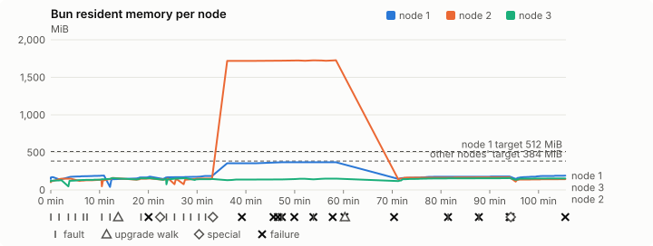
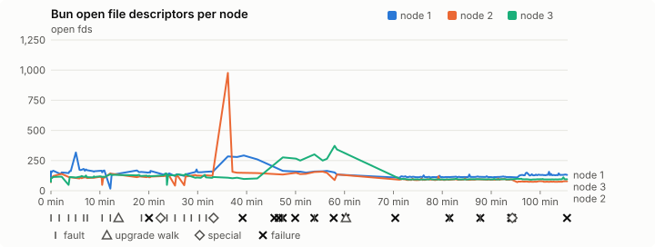
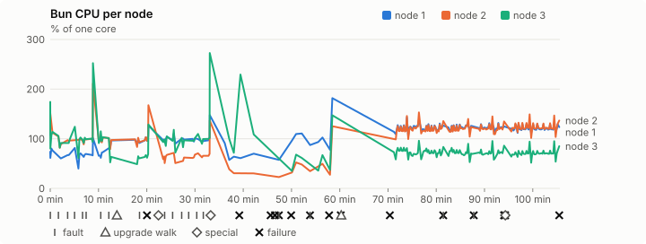
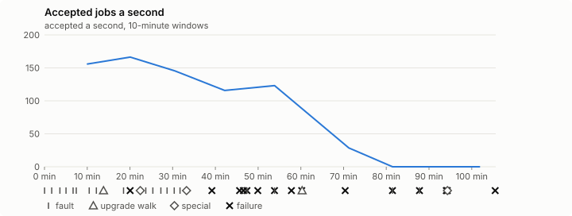

# Sustained soak (V02): FAIL

18 October 2026. fast tier, compressed schedule, 1 h 45 min of soak on a three-node quickstart cluster.

**Fast tier: not clean.** Fix what failed and run the fast tier again before a final-tier run.

## Candidate and host

| | |
|---|---|
| Staged base URL | <https://github.com/reliaburger/reliaburger/releases/download/staging-v0.2.1-39098892640-1> |
| `candidate.json` SHA-256 | `d224748d007ed3137f6b8eadc92c46b076b52fe8d0b4e155d58494b5380e56fa` |
| Running versions | v0.2.1 x3 |
| Soak build | `bun-v0.2.1-soak.1`, SHA-256 `73e4d4707b75d1c8c062250b92bb5389125657114b1cbaef08b27a2614cddd7b` |
| Walks roll back to | 0.2.1 |
| Host | macOS 26.3.1, Apple M2 Max, 32 GiB |
| Lima | limactl version 2.2.1 |
| Guest | Ubuntu 24.04.5 LTS, kernel 6.8.0-139-generic |
| RELIABURGER_HOME | `/tmp/rbq.ZfkHXk` |
| Evidence | `/var/tmp/reliaburger-v02.EcYRsT` |

## Configuration deviations

- node.toml `[testing] allowed_operations` adds `provision_isolated_workloads` (quickstart allows only inject_workload_faults and alter_node_state), so the catalogue pulse can lease test namespaces
- node.toml `[logs]`/`[metrics]` export to file:///var/lib/reliaburger/soak-export every 60 s with max_storage_mb = 8, `[storage.snapshots]` every 900 s (compressed: 120 s), retain 4, uploaded to the same directory
- node.toml `[ingress] tls_cert/tls_key` point at an operator pair from a soak CA, 45-minute leaves rotated by the harness
- Bun runs with auto/mixed; host jobs opt in to a single pinned BusyBox copy under /var/lib/reliaburger/soak-jobs, mount_isolation=false. The independent verifier listens on each private VM address, TCP 8189, with a separate run token
- node.toml `[node.labels] soak-volume` = "writer" on node 2 and "redis" on node 3, to pin the volume apps
- node.toml `[upgrades] external_signing_key` = a throwaway operator key the harness made for this run (`ed25519:bTRUNZ7f8ONF1ks94zXubQbO0Yz6Luegfe7+6KRueqw=`); the soak build's `.sig` gets that key's external signature beside the release one (D2)
- node.toml `[security] leaf_lifetime_override_secs = 3600` (D1)

## Timeline

- Started 2026-10-18 06:20:51 UTC, finished 2026-10-18 08:06:28 UTC
- Cycles completed: 4
- Teardown: `relish local destroy --yes` and `relish uninstall --yes` succeeded

## Faults and slots

| Class | Runs | Settled/ok | Failed | Skipped | Settle (median / max) |
|---|---|---|---|---|---|
| fault:bun-kill-follower | 4 | 3 | 1 | 0 | 31 s / 355 s |
| fault:bun-kill-leader | 4 | 3 | 1 | 0 | 36 s / 336 s |
| fault:chaos-cpu | 1 | 1 | 1 | 0 | 306 s / 306 s |
| fault:chaos-delay | 1 | 2 | 0 | 0 | 17 s / 17 s |
| fault:chaos-dns | 1 | 1 | 1 | 0 | 307 s / 307 s |
| fault:chaos-drop | 1 | 2 | 0 | 0 | 16 s / 16 s |
| fault:chaos-kill | 1 | 2 | 0 | 0 | 43 s / 43 s |
| fault:chaos-partition | 1 | 2 | 0 | 0 | 17 s / 17 s |
| fault:chaos-pause | 1 | 2 | 0 | 0 | 16 s / 16 s |
| fault:chaos-scenario | 1 | 1 | 1 | 0 | 17 s / 17 s |
| fault:deploy-kill | 2 | 2 | 0 | 0 | 32 s / 32 s |
| fault:power-off | 2 | 2 | 0 | 0 | 30 s / 30 s |
| pulse | 1 | 1 | 0 | 0 | n/a |
| pulse:settle | 0 | 1 | 0 | 0 | 23 s / 23 s |
| special:all-off | 1 | 0 | 1 | 0 | 604 s / 604 s |
| special:graceful-stop | 1 | 1 | 0 | 0 | 39 s / 39 s |
| special:quorum-back | 1 | 1 | 0 | 0 | n/a |
| special:quorum-loss | 1 | 0 | 1 | 0 | 635 s / 635 s |
| storage:offline-export | 2 | 2 | 0 | 0 | n/a |
| storage:registry-push | 4 | 0 | 0 | 0 | n/a |
| tls:invalid-expired | 6 | 5 | 1 | 0 | n/a |
| tls:invalid-torn | 6 | 6 | 0 | 0 | n/a |
| tls:reload | 48 | 45 | 2 | 1 | n/a |
| upgrade:rollback | 2 | 2 | 0 | 0 | n/a |
| upgrade:settle | 0 | 1 | 1 | 0 | 608 s / 608 s |
| upgrade:upgrade | 2 | 1 | 1 | 0 | n/a |

## Renewals and rotations

| Measure | Observed | Required | Verdict |
|---|---|---|---|
| workload identity rotations (soak-identity, per node) | 6 | ≥ 2 | PASS |
| node leaf renewals (per node) | 3 | ≥ 2 | PASS |
| operator ingress reloads (all nodes) | 45 | ≥ 20 | PASS |
| mixed job campaign and positive drain | 0 missing/failing checks | 0 | PASS |

## Jobs

| Runtime | Accepted successes | Retries | Last accepted progress |
|---|---|---|---|
| runc | 10053 | 1 | 1792307944 |
| shared-runc | 200381 | 1 | 1792307944 |
| process | 272936 | 1 | 1792307944 |

The bounded campaign shares the app soak's fault schedule. These counts are reliability evidence, not a saturation rate or a 100-million-per-day qualification.

- Independent verifier execution attempts: 24
- Explicit test-operator acknowledgements for known replay-safe fenced fixtures: 72

- rb-7e03a52755aa-1: latest complete job storage (KiB) {'instances': 7612, 'job-state': 8, 'task-arrays': 6692}; free 5213376 KiB; live/peak owners 0/11; peak storage {'instances': 24092, 'job-state': 8, 'task-arrays': 15096}
- rb-7e03a52755aa-2: latest complete job storage (KiB) {'instances': 172, 'job-state': 8, 'task-arrays': 4348}; free 6288192 KiB; live/peak owners 0/10; peak storage {'instances': 16324, 'job-state': 8, 'task-arrays': 10128}
- rb-7e03a52755aa-3: latest complete job storage (KiB) {'instances': 292, 'job-state': 8, 'task-arrays': 6600}; free 6334884 KiB; live/peak owners 0/9; peak storage {'instances': 9128, 'job-state': 8, 'task-arrays': 15356}

Complete disk inventories are recorded. Global retention bounds and the 12-hour job qualification remain #668; this gate cannot certify an unimplemented retention policy.

## Job qualification (D18-C)

Load: calibration; 3 nodes; accepted 138.3/s (calibration load: not gated).

The September plan set its targets for one 1M-task batch on a quiet cluster. A soak runs for hours with restarts, upgrades and apps, so its storage, Bun memory and Raft targets are restated (maintainer decision, 15 October 2026, [#668](https://github.com/reliaburger/reliaburger/issues/668)). Bun's steady state is the median RSS of each process once it has been seen for 10 minutes; the gated memory checks are unchanged (`leak-rss`, and Mayo's 70% `memory_high` alert through `wtf`).

| Measure (recorded, not gated) | Observed | Target |
|---|---|---|
| Wall time of a 1,048,576-task array (median / max of 0) | not measured / not measured | ≤ 600 s |
| p99 start lag, pooled executors | 8 ms (bucket upper bound) | < 1,000 ms |
| Raft entries per second, all cluster writes | 2.17 | recorded only; the batch target counts only task-array writes |
| Raft state of one run, largest seen | 36,265 B | ≤ 256 KiB per 1M tasks |
| Bun steady-state RSS per process, worst node against its target | rb-7e03a52755aa-2: 1,723.91 MiB steady, 1,727.80 MiB peak | ≤ 384 MiB (≤ 512 MiB on node 1, which serves the API) |
| Bun CPU, busiest node | 1.01 cores | ≤ 1 core (leader batch control) |
| Executor helper CPU, busiest node | 0.00 cores | ≤ 0.5 core |
| Node task-array storage per 1M accepted tasks (peaks summed) | 81.98 MiB | ≤ 64 MiB, deleted after retirement |
| Retained log volume, all nodes | 9.98 MB | ≤ 50 MB |

- Bun RSS on rb-7e03a52755aa-1 (serves the API, target ≤ 512 MiB): pid 8381: 169.75 MiB peak (seen for under 10 minutes); pid 30647: 191.46 MiB peak (seen for under 10 minutes); pid 179598: 142.02 MiB peak (seen for under 10 minutes); pid 179598: 177.69 MiB peak (seen for under 10 minutes); pid 676: 368.12 MiB steady, 368.19 MiB peak; pid 676: 175.80 MiB steady, 179.13 MiB peak; pid 680: 190.39 MiB steady, 190.39 MiB peak
- Bun RSS on rb-7e03a52755aa-2 (node, target ≤ 384 MiB): pid 2374: 120.16 MiB peak (seen for under 10 minutes); pid 4729: 150.16 MiB peak (seen for under 10 minutes); pid 674: 134.44 MiB peak (seen for under 10 minutes); pid 67442: 160.48 MiB peak (seen for under 10 minutes); pid 67442: 151.40 MiB peak (seen for under 10 minutes); pid 679: 149.98 MiB peak (seen for under 10 minutes); pid 39529: 138.00 MiB peak (seen for under 10 minutes); pid 66096: 152.01 MiB peak (seen for under 10 minutes); pid 681: 1,723.91 MiB steady, 1,727.80 MiB peak; pid 680: 167.15 MiB steady, 168.95 MiB peak; pid 679: 143.40 MiB steady, 143.40 MiB peak
- Bun RSS on rb-7e03a52755aa-3 (node, target ≤ 384 MiB): pid 2164: 129.46 MiB peak (seen for under 10 minutes); pid 44412: 156.83 MiB peak (seen for under 10 minutes); pid 186521: 156.50 MiB peak (seen for under 10 minutes); pid 675: 145.08 MiB peak (seen for under 10 minutes); pid 14465: 156.20 MiB peak (seen for under 10 minutes); pid 676: 145.25 MiB peak (seen for under 10 minutes); pid 676: 138.43 MiB peak (seen for under 10 minutes); pid 173809: 148.23 MiB peak (seen for under 10 minutes); pid 267455: 150.89 MiB peak (seen for under 10 minutes); pid 267455: 155.69 MiB steady, 157.25 MiB peak; pid 665: 152.89 MiB steady, 152.89 MiB peak

- runc retry causes: exit_code 1, launch 0, signal 0, timeout 0, unknown 0, unrecorded 0
- shared-runc retry causes: exit_code 1, launch 0, signal 0, timeout 0, unknown 0, unrecorded 0
- process retry causes: exit_code 1, launch 0, signal 0, timeout 0, unknown 0, unrecorded 0
- Audited executions: 24; operator replay decisions: 72
- Job controller API fallbacks: rb-7e03a52755aa-1 missed 141, rb-7e03a52755aa-2 missed 12; rb-7e03a52755aa-2 answered 129, rb-7e03a52755aa-3 answered 12 (requests a node didn't answer, and the node that took them instead)

## Data

- Volume writer: highest ACK 16294 in the log view; the writer file checks (writer-lost, writer-regression) decide data loss, and `*-log-order` failures are about the order the log view returned lines in
- Redis counter: highest INCR 5673 in the log view
- Export rb-7e03a52755aa-1: 200 source files, 199 at the destination
- Export rb-7e03a52755aa-2: 174 source files, 174 at the destination
- Export rb-7e03a52755aa-3: 146 source files, 146 at the destination
- Registry images pushed and re-verified: 5
- Agent-loop turns over the 1 s budget: rb-7e03a52755aa-1 0, rb-7e03a52755aa-2 92, rb-7e03a52755aa-3 0
- Guest clock steps by Lima's guest agent: rb-7e03a52755aa-1 2, rb-7e03a52755aa-2 47, rb-7e03a52755aa-3 4
- Checks evaluated: 259 (heavy 21, light 45, settle 193)
- Last observed progress: redis-counter 5673, writer-ack 15895

## Resource trends

| Node | Measure | First | Last | Max |
|---|---|---|---|---|
| rb-7e03a52755aa-1 | disk_kb data | 1369528 | 1512416 | 1533556 |
| rb-7e03a52755aa-1 | disk_kb images | 328964 | 445888 | 445888 |
| rb-7e03a52755aa-1 | disk_kb logs | 40 | 6300 | 6300 |
| rb-7e03a52755aa-1 | disk_kb metrics | 116 | 7624 | 7624 |
| rb-7e03a52755aa-1 | disk_kb soak-export | 4 | 13876 | 13876 |
| rb-7e03a52755aa-1 | disk_kb volumes | 200 | 252 | 252 |
| rb-7e03a52755aa-1 | fd | 110 | 131 | 317 |
| rb-7e03a52755aa-1 | rss_kb | 148832 | 194956 | 377024 |
| rb-7e03a52755aa-2 | disk_kb data | 67456 | 19960 | 557196 |
| rb-7e03a52755aa-2 | disk_kb images | 158836 | 329020 | 329020 |
| rb-7e03a52755aa-2 | disk_kb logs | 24 | 2516 | 2516 |
| rb-7e03a52755aa-2 | disk_kb metrics | 52 | 4356 | 4356 |
| rb-7e03a52755aa-2 | disk_kb soak-export | 4 | 7136 | 7136 |
| rb-7e03a52755aa-2 | disk_kb volumes | 16736 | 16824 | 17016 |
| rb-7e03a52755aa-2 | fd | 71 | 78 | 977 |
| rb-7e03a52755aa-2 | rss_kb | 104580 | 146840 | 1769272 |
| rb-7e03a52755aa-3 | disk_kb data | 230212 | 194164 | 775760 |
| rb-7e03a52755aa-3 | disk_kb images | 316524 | 322592 | 322592 |
| rb-7e03a52755aa-3 | disk_kb logs | 24 | 932 | 932 |
| rb-7e03a52755aa-3 | disk_kb metrics | 56 | 3464 | 3464 |
| rb-7e03a52755aa-3 | disk_kb soak-export | 4 | 5332 | 5332 |
| rb-7e03a52755aa-3 | disk_kb volumes | 16760 | 17192 | 17192 |
| rb-7e03a52755aa-3 | fd | 92 | 95 | 372 |
| rb-7e03a52755aa-3 | rss_kb | 115896 | 156560 | 161020 |

## Charts

Time runs from the start of the soak. The marks under each chart are its faults, upgrade walks, specials and recorded failures; the dashed lines are targets.

## Failures

| # | First seen | Check | Symptom | Class | Cause | Action |
|---|---|---|---|---|---|---|
| 1 | 06:40:49 | chaos-scenario |     }   ] }  | unclassified | open | open |
| 2 | 06:59:26 | settle-check | fail: agent-loop-turn rb-7e03a52755aa-2: 5 follow_up turn(s) over the 1 s budget, the worst over 10 s; | unclassified | open | open |
| 3 | 07:05:55 | ingress-invalid-pair | rb-7e03a52755aa-2 served nothing after a expired pair; expected the last good 1008 | unclassified | open | open |
| 4 | 07:06:49 | ingress-reload | rb-7e03a52755aa-2 served nothing 16 s after the 100A pair landed | unclassified | open | open |
| 5 | 07:07:36 | settle | special:quorum-loss did not settle within 600 s | unclassified | open | open |
| 6 | 07:10:05 | heavy-check | fail: export-lost rb-7e03a52755aa-2: metrics metrics_000002.parquet (39b72d36bfb1) left the source but is not at the destination; | unclassified | open | open |
| 7 | 07:14:10 | settle | fault:bun-kill-follower did not settle within 300 s | unclassified | open | open |
| 8 | 07:20:18 | settle | fault:bun-kill-leader did not settle within 300 s | unclassified | open | open |
| 9 | 07:31:09 | upgrade-upgrade | versions after 600 s: 0.2.1-soak.1 0.2.1 0.2.1-soak.1  (wanted 0.2.1-soak.1) | unclassified | open | open |
| 10 | 07:42:13 | settle | upgrade:settle did not settle within 600 s | unclassified | open | open |
| 11 | 07:48:32 | settle | fault:chaos-dns did not settle within 300 s | unclassified | open | open |
| 12 | 07:54:49 | settle | fault:chaos-cpu did not settle within 300 s | unclassified | open | open |
| 13 | 07:55:02 | heavy-check | fail: wtf-warning app.soak-identity/default: rollout-failed for 2135 s: app soak-identity/default's rollout failed on rb-7e03a52755aa-2; its other nodes stay on the previous spec;fail: wtf-warning app.soak-writer/default: rollout-failed for 2135 s: app soak-writer/default's rollout failed on rb-7e03 | unclassified | open | open |
| 14 | 08:06:14 | settle | special:all-off did not settle within 600 s | unclassified | open | open |

Evidence: `/var/tmp/reliaburger-v02.EcYRsT` (events.jsonl, snapshots/, failures/<n>/).
