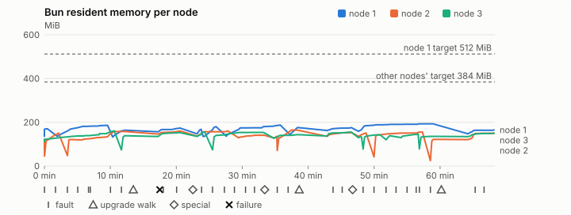
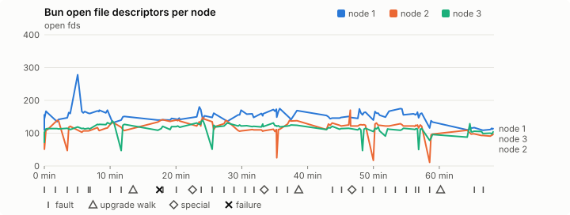
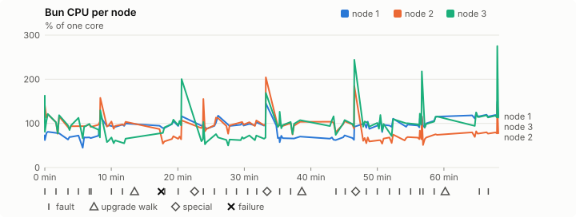
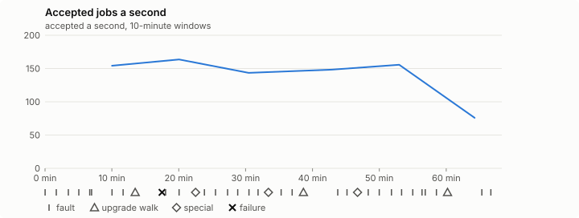

# Sustained soak (V02): FAIL

18 October 2026. fast tier, compressed schedule, 1 h 08 min of soak on a three-node quickstart cluster.

**Fast tier: not clean.** Fix what failed and run the fast tier again before a final-tier run.

## Candidate and host

| | |
|---|---|
| Staged base URL | <https://github.com/reliaburger/reliaburger/releases/download/staging-v0.2.1-39121125670-1> |
| `candidate.json` SHA-256 | `f505deb9cd86eec5dfa4ac8d6f35bc82e85fc515dee5f5901d0bf1e4f166448e` |
| Running versions | v0.2.1 x3 |
| Soak build | `bun-v0.2.1-soak.1`, SHA-256 `f31c0f4d92954f5f5531b731c80a2bbda501dd605bfebd425bc1e0da710822ee` |
| Walks roll back to | 0.2.1 |
| Host | macOS 26.3.1, Apple M2 Max, 32 GiB |
| Lima | limactl version 2.2.1 |
| Guest | Ubuntu 24.04.5 LTS, kernel 6.8.0-139-generic |
| RELIABURGER_HOME | `/tmp/rbq.e2Pax5` |
| Evidence | `/var/tmp/reliaburger-v02.qpuTPq` |

## Configuration deviations

- node.toml `[testing] allowed_operations` adds `provision_isolated_workloads` (quickstart allows only inject_workload_faults and alter_node_state), so the catalogue pulse can lease test namespaces
- node.toml `[logs]`/`[metrics]` export to file:///var/lib/reliaburger/soak-export every 60 s with max_storage_mb = 8, `[storage.snapshots]` every 900 s (compressed: 120 s), retain 4, uploaded to the same directory
- node.toml `[ingress] tls_cert/tls_key` point at an operator pair from a soak CA, 45-minute leaves rotated by the harness
- Bun runs with auto/mixed; host jobs opt in to a single pinned BusyBox copy under /var/lib/reliaburger/soak-jobs, mount_isolation=false. The independent verifier listens on each private VM address, TCP 8189, with a separate run token
- node.toml `[node.labels] soak-volume` = "writer" on node 2 and "redis" on node 3, to pin the volume apps
- node.toml `[upgrades] external_signing_key` = a throwaway operator key the harness made for this run (`ed25519:ye4huGTw40pReyHlpBfAqppuXanMg9JySplUBnlw9YM=`); the soak build's `.sig` gets that key's external signature beside the release one (D2)
- node.toml `[security] leaf_lifetime_override_secs = 3600` (D1)

## Timeline

- Started 2026-10-18 13:28:46 UTC, finished 2026-10-18 14:37:05 UTC
- Cycles completed: 6
- Teardown: `relish local destroy --yes` and `relish uninstall --yes` succeeded

## Faults and slots

| Class | Runs | Settled/ok | Failed | Skipped | Settle (median / max) |
|---|---|---|---|---|---|
| fault:bun-kill-follower | 6 | 6 | 0 | 0 | 31 s / 38 s |
| fault:bun-kill-leader | 6 | 6 | 0 | 0 | 33 s / 60 s |
| fault:chaos-cpu | 1 | 2 | 0 | 0 | 17 s / 17 s |
| fault:chaos-delay | 2 | 4 | 0 | 0 | 17 s / 17 s |
| fault:chaos-dns | 1 | 2 | 0 | 0 | 17 s / 17 s |
| fault:chaos-drop | 1 | 2 | 0 | 0 | 16 s / 16 s |
| fault:chaos-kill | 2 | 4 | 0 | 0 | 18 s / 18 s |
| fault:chaos-memory | 1 | 2 | 0 | 0 | 17 s / 17 s |
| fault:chaos-partition | 2 | 4 | 0 | 0 | 18 s / 18 s |
| fault:chaos-pause | 1 | 2 | 0 | 0 | 17 s / 17 s |
| fault:chaos-scenario | 1 | 2 | 0 | 0 | 31 s / 31 s |
| fault:deploy-kill | 3 | 3 | 0 | 0 | 32 s / 38 s |
| fault:power-off | 3 | 3 | 0 | 0 | 29 s / 31 s |
| pulse | 1 | 1 | 0 | 0 | n/a |
| pulse:settle | 0 | 1 | 0 | 0 | 18 s / 18 s |
| special:all-off | 1 | 1 | 0 | 0 | 41 s / 41 s |
| special:graceful-stop | 1 | 1 | 0 | 0 | 40 s / 40 s |
| special:quorum-back | 1 | 1 | 0 | 0 | n/a |
| special:quorum-loss | 1 | 1 | 0 | 0 | 30 s / 30 s |
| storage:offline-export | 3 | 3 | 0 | 0 | n/a |
| storage:registry-push | 6 | 0 | 0 | 0 | n/a |
| tls:invalid-expired | 3 | 3 | 0 | 0 | n/a |
| tls:invalid-torn | 3 | 3 | 0 | 0 | n/a |
| tls:reload | 29 | 29 | 0 | 0 | n/a |
| upgrade:rollback | 3 | 3 | 0 | 0 | n/a |
| upgrade:settle | 0 | 3 | 0 | 0 | 55 s / 64 s |
| upgrade:upgrade | 3 | 3 | 0 | 0 | n/a |

## Renewals and rotations

| Measure | Observed | Required | Verdict |
|---|---|---|---|
| workload identity rotations (soak-identity, per node) | 8 | ≥ 1 | PASS |
| node leaf renewals (per node) | 2 | ≥ 1 | PASS |
| operator ingress reloads (all nodes) | 29 | ≥ 12 | PASS |
| mixed job campaign and positive drain | 0 missing/failing checks | 0 | PASS |

## Jobs

| Runtime | Accepted successes | Retries | Last accepted progress |
|---|---|---|---|
| runc | 10874 | 5 | 1792333609 |
| shared-runc | 221755 | 1 | 1792333609 |
| process | 305438 | 1 | 1792333609 |

The bounded campaign shares the app soak's fault schedule. These counts are reliability evidence, not a saturation rate or a 100-million-per-day qualification.

- Independent verifier execution attempts: 24
- Explicit test-operator acknowledgements for known replay-safe fenced fixtures: 113

- rb-0fd1a75fe358-1: latest complete job storage (KiB) {'instances': 320, 'job-state': 8, 'task-arrays': 3924}; free 5234636 KiB; live/peak owners 0/11; peak storage {'instances': 15812, 'job-state': 8, 'task-arrays': 13836}
- rb-0fd1a75fe358-2: latest complete job storage (KiB) {'instances': 408, 'job-state': 8, 'task-arrays': 3748}; free 6375288 KiB; live/peak owners 0/8; peak storage {'instances': 8260, 'job-state': 8, 'task-arrays': 13268}
- rb-0fd1a75fe358-3: latest complete job storage (KiB) {'instances': 3656, 'job-state': 8, 'task-arrays': 3760}; free 6363108 KiB; live/peak owners 0/8; peak storage {'instances': 5680, 'job-state': 8, 'task-arrays': 13908}

Complete disk inventories are recorded. Global retention bounds and the 12-hour job qualification remain #668; this gate cannot certify an unimplemented retention policy.

## Job qualification (D18-C)

Load: calibration; 3 nodes; accepted 154.0/s (calibration load: not gated).

The September plan set its targets for one 1M-task batch on a quiet cluster. A soak runs for hours with restarts, upgrades and apps, so its storage, Bun memory and Raft targets are restated (maintainer decision, 15 October 2026, [#668](https://github.com/reliaburger/reliaburger/issues/668)). Bun's steady state is the median RSS of each process once it has been seen for 10 minutes; the gated memory checks are unchanged (`leak-rss`, and Mayo's 70% `memory_high` alert through `wtf`).

| Measure (recorded, not gated) | Observed | Target |
|---|---|---|
| Wall time of a 1,048,576-task array (median / max of 0) | not measured / not measured | ≤ 600 s |
| p99 start lag, pooled executors | 8 ms (bucket upper bound) | < 1,000 ms |
| Raft entries per second, all cluster writes | 2.14 | recorded only; the batch target counts only task-array writes |
| Raft state of one run, largest seen | 37,167 B | ≤ 256 KiB per 1M tasks |
| Bun steady-state RSS per process, worst node against its target | rb-0fd1a75fe358-3: 159.05 MiB steady, 160.88 MiB peak | ≤ 384 MiB (≤ 512 MiB on node 1, which serves the API) |
| Bun CPU, busiest node | 0.91 cores | ≤ 1 core (leader batch control) |
| Executor helper CPU, busiest node | 0.00 cores | ≤ 0.5 core |
| Node task-array storage per 1M accepted tasks (peaks summed) | 74.43 MiB | ≤ 64 MiB, deleted after retirement |
| Retained log volume, all nodes | 7.12 MB | ≤ 50 MB |

- Bun RSS on rb-0fd1a75fe358-1 (serves the API, target ≤ 512 MiB): pid 8602: 170.25 MiB peak (seen for under 10 minutes); pid 31265: 185.88 MiB peak (seen for under 10 minutes); pid 147342: 163.71 MiB peak (seen for under 10 minutes); pid 147342: 173.66 MiB peak (seen for under 10 minutes); pid 678: 167.59 MiB peak (seen for under 10 minutes); pid 14521: 179.68 MiB peak (seen for under 10 minutes); pid 62971: 187.29 MiB peak (seen for under 10 minutes); pid 198913: 176.03 MiB peak (seen for under 10 minutes); pid 198913: 175.49 MiB peak (seen for under 10 minutes); pid 680: 192.48 MiB steady, 192.48 MiB peak; pid 680: 165.18 MiB peak (seen for under 10 minutes)
- Bun RSS on rb-0fd1a75fe358-2 (node, target ≤ 384 MiB): pid 2314: 121.50 MiB peak (seen for under 10 minutes); pid 4873: 150.22 MiB peak (seen for under 10 minutes); pid 45848: 121.00 MiB peak (seen for under 10 minutes); pid 673: 157.87 MiB peak (seen for under 10 minutes); pid 673: 160.36 MiB peak (seen for under 10 minutes); pid 679: 160.96 MiB peak (seen for under 10 minutes); pid 661: 141.66 MiB peak (seen for under 10 minutes); pid 668: 135.94 MiB peak (seen for under 10 minutes); pid 10342: 164.18 MiB peak (seen for under 10 minutes); pid 671: 153.50 MiB peak (seen for under 10 minutes); pid 676: 150.66 MiB peak (seen for under 10 minutes); pid 39588: 155.05 MiB peak (seen for under 10 minutes); pid 154866: 121.93 MiB peak (seen for under 10 minutes); pid 154866: 149.31 MiB peak (seen for under 10 minutes)
- Bun RSS on rb-0fd1a75fe358-3 (node, target ≤ 384 MiB): pid 2132: 159.05 MiB steady, 160.88 MiB peak; pid 150353: 138.39 MiB peak (seen for under 10 minutes); pid 181678: 152.39 MiB peak (seen for under 10 minutes); pid 676: 155.21 MiB peak (seen for under 10 minutes); pid 35520: 153.45 MiB peak (seen for under 10 minutes); pid 680: 143.41 MiB peak (seen for under 10 minutes); pid 680: 154.70 MiB peak (seen for under 10 minutes); pid 680: 132.92 MiB peak (seen for under 10 minutes); pid 13576: 141.99 MiB peak (seen for under 10 minutes); pid 59653: 138.45 MiB peak (seen for under 10 minutes); pid 668: 146.23 MiB peak (seen for under 10 minutes); pid 39652: 135.48 MiB peak (seen for under 10 minutes); pid 678: 150.22 MiB peak (seen for under 10 minutes)

- runc retry causes: exit_code 1, launch 3, signal 0, timeout 0, unknown 1, unrecorded 0
- shared-runc retry causes: exit_code 1, launch 0, signal 0, timeout 0, unknown 0, unrecorded 0
- process retry causes: exit_code 1, launch 0, signal 0, timeout 0, unknown 0, unrecorded 0
- Audited executions: 24; operator replay decisions: 113
- Job controller API fallbacks: rb-0fd1a75fe358-1 missed 165, rb-0fd1a75fe358-2 missed 2; rb-0fd1a75fe358-2 answered 163, rb-0fd1a75fe358-3 answered 2 (requests a node didn't answer, and the node that took them instead)

## Data

- Volume writer: highest ACK 33100 in the log view; the writer file checks (writer-lost, writer-regression) decide data loss, and `*-log-order` failures are about the order the log view returned lines in
- Redis counter: highest INCR 3391 in the log view
- Export rb-0fd1a75fe358-1: 141 source files, 128 at the destination
- Export rb-0fd1a75fe358-2: 141 source files, 128 at the destination
- Export rb-0fd1a75fe358-3: 112 source files, 111 at the destination
- Registry images pushed and re-verified: 7
- Agent-loop turns over the 1 s budget: rb-0fd1a75fe358-1 0, rb-0fd1a75fe358-2 2, rb-0fd1a75fe358-3 0
- Guest clock steps by Lima's guest agent: rb-0fd1a75fe358-1 2, rb-0fd1a75fe358-2 7, rb-0fd1a75fe358-3 5
- Checks evaluated: 190 (heavy 17, light 72, settle 101)
- Last observed progress: redis-counter 3391, writer-ack 33100

## Resource trends

| Node | Measure | First | Last | Max |
|---|---|---|---|---|
| rb-0fd1a75fe358-1 | disk_kb data | 1369408 | 979608 | 1518628 |
| rb-0fd1a75fe358-1 | disk_kb images | 328964 | 445844 | 445844 |
| rb-0fd1a75fe358-1 | disk_kb logs | 40 | 4428 | 4428 |
| rb-0fd1a75fe358-1 | disk_kb metrics | 84 | 5248 | 5248 |
| rb-0fd1a75fe358-1 | disk_kb soak-export | 4 | 8880 | 8880 |
| rb-0fd1a75fe358-1 | disk_kb volumes | 200 | 60 | 252 |
| rb-0fd1a75fe358-1 | fd | 112 | 114 | 278 |
| rb-0fd1a75fe358-1 | rss_kb | 138740 | 169144 | 197096 |
| rb-0fd1a75fe358-2 | disk_kb data | 67412 | 25120 | 558808 |
| rb-0fd1a75fe358-2 | disk_kb images | 158836 | 329020 | 329020 |
| rb-0fd1a75fe358-2 | disk_kb logs | 24 | 1700 | 1700 |
| rb-0fd1a75fe358-2 | disk_kb metrics | 52 | 2844 | 2844 |
| rb-0fd1a75fe358-2 | disk_kb soak-export | 4 | 5516 | 5516 |
| rb-0fd1a75fe358-2 | disk_kb volumes | 16736 | 17232 | 17412 |
| rb-0fd1a75fe358-2 | fd | 70 | 97 | 170 |
| rb-0fd1a75fe358-2 | rss_kb | 109724 | 152896 | 168120 |
| rb-0fd1a75fe358-3 | disk_kb data | 230164 | 711524 | 711524 |
| rb-0fd1a75fe358-3 | disk_kb images | 316524 | 316652 | 316652 |
| rb-0fd1a75fe358-3 | disk_kb logs | 24 | 824 | 824 |
| rb-0fd1a75fe358-3 | disk_kb metrics | 68 | 3552 | 3552 |
| rb-0fd1a75fe358-3 | disk_kb soak-export | 4 | 5120 | 5120 |
| rb-0fd1a75fe358-3 | disk_kb volumes | 16760 | 17208 | 17208 |
| rb-0fd1a75fe358-3 | fd | 72 | 104 | 139 |
| rb-0fd1a75fe358-3 | rss_kb | 115744 | 153828 | 164740 |

## Charts

Time runs from the start of the soak. The marks under each chart are its faults, upgrade walks, specials and recorded failures; the dashed lines are targets.

## Failures

| # | First seen | Check | Symptom | Class | Cause | Action |
|---|---|---|---|---|---|---|
| 1 | 13:46:11 | heavy-check | fail: agent-loop-turn rb-0fd1a75fe358-2: 1 deploy_op turn(s) over the 1 s budget, the worst between 2.5 and 5 s; | unclassified | open | open |

Evidence: `/var/tmp/reliaburger-v02.qpuTPq` (events.jsonl, snapshots/, failures/<n>/).
