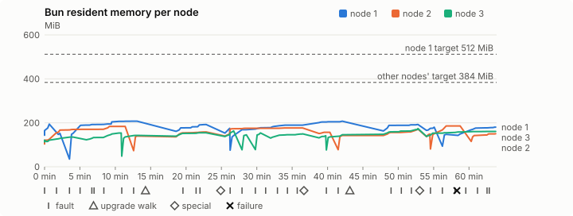
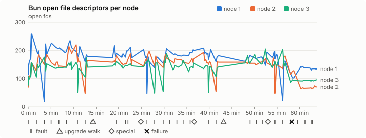
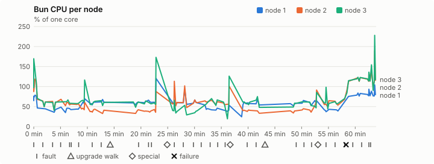
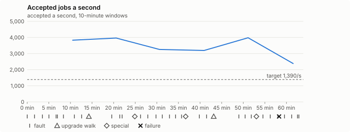

# Sustained soak (V02): FAIL

18 October 2026. fast tier, compressed schedule, 1 h 03 min of soak on a three-node quickstart cluster.

**Fast tier: not clean.** Fix what failed and run the fast tier again before a final-tier run.

## Candidate and host

| | |
|---|---|
| Staged base URL | <https://github.com/reliaburger/reliaburger/releases/download/staging-v0.2.1-39149688730-1> |
| `candidate.json` SHA-256 | `5b6101beed510b035417342072af0a948a6941d64aa8f51002c92c440aca3321` |
| Running versions | v0.2.1 x3 |
| Soak build | `bun-v0.2.1-soak.1`, SHA-256 `9093b4cfbfd099643ef66a3d58c643a096983b61338cc55b8d2cae1bf0123a24` |
| Walks roll back to | 0.2.1 |
| Host | macOS 26.3.1, Apple M2 Max, 32 GiB |
| Lima | limactl version 2.2.1 |
| Guest | Ubuntu 24.04.5 LTS, kernel 6.8.0-139-generic |
| RELIABURGER_HOME | `/tmp/rbq.kAg5mg` |
| Evidence | `/var/tmp/reliaburger-v02.yEzec0` |

## Configuration deviations

- node.toml `[testing] allowed_operations` adds `provision_isolated_workloads` (quickstart allows only inject_workload_faults and alter_node_state), so the catalogue pulse can lease test namespaces
- node.toml `[logs]`/`[metrics]` export to file:///var/lib/reliaburger/soak-export every 60 s with max_storage_mb = 8, `[storage.snapshots]` every 900 s (compressed: 120 s), retain 4, uploaded to the same directory
- node.toml `[ingress] tls_cert/tls_key` point at an operator pair from a soak CA, 45-minute leaves rotated by the harness
- Bun runs with auto/mixed; host jobs opt in to a single pinned BusyBox copy under /var/lib/reliaburger/soak-jobs, mount_isolation=false. The independent verifier listens on each private VM address, TCP 8189, with a separate run token
- node.toml `[node.labels] soak-volume` = "writer" on node 2 and "redis" on node 3, to pin the volume apps
- node.toml `[upgrades] external_signing_key` = a throwaway operator key the harness made for this run (`ed25519:+c/pN5kYlRT3ouj6147oMCbmVb0nn4O6oNOhi6zlTUQ=`); the soak build's `.sig` gets that key's external signature beside the release one (D2)
- node.toml `[security] leaf_lifetime_override_secs = 3600` (D1)

## Timeline

- Started 2026-10-18 20:25:30 UTC, finished 2026-10-18 21:29:24 UTC
- Cycles completed: 5
- Teardown: `relish local destroy --yes` and `relish uninstall --yes` succeeded

## Faults and slots

| Class | Runs | Settled/ok | Failed | Skipped | Settle (median / max) |
|---|---|---|---|---|---|
| fault:bun-kill-follower | 5 | 5 | 0 | 0 | 35 s / 44 s |
| fault:bun-kill-leader | 5 | 5 | 0 | 0 | 36 s / 42 s |
| fault:chaos-cpu | 1 | 2 | 0 | 0 | 19 s / 19 s |
| fault:chaos-delay | 1 | 2 | 0 | 0 | 18 s / 18 s |
| fault:chaos-dns | 1 | 2 | 0 | 0 | 20 s / 20 s |
| fault:chaos-drop | 1 | 2 | 0 | 0 | 18 s / 18 s |
| fault:chaos-kill | 2 | 4 | 0 | 0 | 18 s / 18 s |
| fault:chaos-memory | 1 | 2 | 0 | 0 | 15 s / 15 s |
| fault:chaos-partition | 1 | 2 | 0 | 0 | 18 s / 18 s |
| fault:chaos-pause | 1 | 2 | 0 | 0 | 19 s / 19 s |
| fault:chaos-scenario | 1 | 2 | 0 | 0 | 32 s / 32 s |
| fault:deploy-kill | 3 | 3 | 0 | 0 | 46 s / 48 s |
| fault:node-delay | 2 | 2 | 0 | 0 | 35 s / 35 s |
| fault:node-disk-full | 2 | 2 | 0 | 0 | 19 s / 19 s |
| fault:node-slow-fsync | 1 | 1 | 0 | 0 | 19 s / 19 s |
| fault:power-off | 3 | 3 | 0 | 0 | 32 s / 40 s |
| pulse | 1 | 1 | 0 | 0 | n/a |
| pulse:settle | 0 | 1 | 0 | 0 | 23 s / 23 s |
| special:all-off | 1 | 1 | 0 | 0 | 33 s / 33 s |
| special:graceful-stop | 1 | 1 | 0 | 0 | 44 s / 44 s |
| special:quorum-back | 1 | 1 | 0 | 0 | n/a |
| special:quorum-loss | 1 | 1 | 0 | 0 | 61 s / 61 s |
| storage:offline-export | 2 | 2 | 0 | 0 | n/a |
| storage:registry-push | 5 | 0 | 0 | 0 | n/a |
| tls:invalid-expired | 3 | 3 | 0 | 0 | n/a |
| tls:invalid-torn | 3 | 3 | 0 | 0 | n/a |
| tls:reload | 29 | 29 | 0 | 0 | n/a |
| upgrade:rollback | 2 | 2 | 0 | 0 | n/a |
| upgrade:settle | 0 | 2 | 0 | 0 | 65 s / 65 s |
| upgrade:upgrade | 2 | 2 | 0 | 0 | n/a |

## Renewals and rotations

| Measure | Observed | Required | Verdict |
|---|---|---|---|
| workload identity rotations (soak-identity, per node) | 7 | ≥ 1 | PASS |
| node leaf renewals (per node) | 2 | ≥ 1 | PASS |
| operator ingress reloads (all nodes) | 29 | ≥ 11 | PASS |
| mixed job campaign and positive drain | 0 missing/failing checks | 0 | PASS |

## Jobs

| Runtime | Accepted successes | Retries | Last accepted progress |
|---|---|---|---|
| runc | 7377 | 2 | 1792358619 |
| shared-runc | 3251434 | 1 | 1792358619 |
| process | 9438084 | 1 | 1792358616 |

The bounded campaign shares the app soak's fault schedule. These counts are reliability evidence, not a saturation rate or a 100-million-per-day qualification.

- Independent verifier execution attempts: 24
- Explicit test-operator acknowledgements for known replay-safe fenced fixtures: 106

- rb-4204c0856ba4-1: latest complete job storage (KiB) {'instances': 7272, 'job-state': 8, 'task-arrays': 11356}; free 5245788 KiB; live/peak owners 0/31; peak storage {'instances': 30616, 'job-state': 8, 'task-arrays': 35476}
- rb-4204c0856ba4-2: latest complete job storage (KiB) {'instances': 1660, 'job-state': 8, 'task-arrays': 14736}; free 6323016 KiB; live/peak owners 0/32; peak storage {'instances': 29292, 'job-state': 8, 'task-arrays': 35896}
- rb-4204c0856ba4-3: latest complete job storage (KiB) {'instances': 464, 'job-state': 8, 'task-arrays': 11576}; free 6344184 KiB; live/peak owners 0/31; peak storage {'instances': 25880, 'job-state': 8, 'task-arrays': 34664}

Complete disk inventories are recorded. Global retention bounds and the 12-hour job qualification remain #668; this gate cannot certify an unimplemented retention policy.

## Job qualification (D18-C)

Load: target; 3 nodes; accepted 3,635.0/s against a 1390.0/s target: PASS.

The September plan set its targets for one 1M-task batch on a quiet cluster. A soak runs for hours with restarts, upgrades and apps, so its storage, Bun memory and Raft targets are restated (maintainer decision, 15 October 2026, [#668](https://github.com/reliaburger/reliaburger/issues/668)). Bun's steady state is the median RSS of each process once it has been seen for 10 minutes; the gated memory checks are unchanged (`leak-rss`, and Mayo's 70% `memory_high` alert through `wtf`).

| Measure (recorded, not gated) | Observed | Target |
|---|---|---|
| Wall time of a 1,048,576-task array (median / max of 12) | 392 s / 1,235 s | ≤ 600 s |
| p99 start lag, pooled executors | 32 ms (bucket upper bound) | < 1,000 ms |
| Raft entries per second, all cluster writes | 2.05 | recorded only; the batch target counts only task-array writes |
| Raft state of one run, largest seen | 6,186 B | ≤ 256 KiB per 1M tasks |
| Bun steady-state RSS per process, worst node against its target | rb-4204c0856ba4-2: 183.56 MiB steady, 185.93 MiB peak | ≤ 384 MiB (≤ 512 MiB on node 1, which serves the API) |
| Bun CPU, busiest node | 0.66 cores | ≤ 1 core (leader batch control) |
| Executor helper CPU, busiest node | 0.02 cores | ≤ 0.5 core |
| Node task-array storage per 1M accepted tasks (peaks summed) | 8.16 MiB | ≤ 64 MiB, deleted after retirement |
| Retained log volume, all nodes | 6.32 MB | ≤ 50 MB |

- Bun RSS on rb-4204c0856ba4-1 (serves the API, target ≤ 512 MiB): pid 8567: 194.17 MiB peak (seen for under 10 minutes); pid 148047: 152.28 MiB peak (seen for under 10 minutes); pid 345093: 207.31 MiB peak (seen for under 10 minutes); pid 345093: 192.67 MiB peak (seen for under 10 minutes); pid 677: 174.90 MiB peak (seen for under 10 minutes); pid 98580: 203.79 MiB steady, 207.63 MiB peak; pid 98580: 192.43 MiB peak (seen for under 10 minutes); pid 675: 179.82 MiB peak (seen for under 10 minutes); pid 283051: 147.38 MiB peak (seen for under 10 minutes); pid 472889: 180.43 MiB peak (seen for under 10 minutes)
- Bun RSS on rb-4204c0856ba4-2 (node, target ≤ 384 MiB): pid 2353: 183.56 MiB steady, 183.57 MiB peak; pid 1427047: 139.86 MiB peak (seen for under 10 minutes); pid 1698067: 158.84 MiB peak (seen for under 10 minutes); pid 678: 176.80 MiB steady, 176.80 MiB peak; pid 684: 156.93 MiB peak (seen for under 10 minutes); pid 395275: 142.23 MiB peak (seen for under 10 minutes); pid 395275: 171.30 MiB peak (seen for under 10 minutes); pid 677: 148.82 MiB peak (seen for under 10 minutes); pid 86663: 185.93 MiB peak (seen for under 10 minutes); pid 673: 150.27 MiB peak (seen for under 10 minutes)
- Bun RSS on rb-4204c0856ba4-3 (node, target ≤ 384 MiB): pid 2160: 120.73 MiB peak (seen for under 10 minutes); pid 3635: 135.19 MiB peak (seen for under 10 minutes); pid 675: 153.63 MiB peak (seen for under 10 minutes); pid 603542: 142.79 MiB peak (seen for under 10 minutes); pid 603542: 154.87 MiB peak (seen for under 10 minutes); pid 676: 162.99 MiB peak (seen for under 10 minutes); pid 306451: 145.41 MiB peak (seen for under 10 minutes); pid 516116: 153.91 MiB peak (seen for under 10 minutes); pid 663: 149.89 MiB peak (seen for under 10 minutes); pid 677: 141.22 MiB peak (seen for under 10 minutes); pid 129263: 145.57 MiB peak (seen for under 10 minutes); pid 673: 173.89 MiB peak (seen for under 10 minutes); pid 678: 160.78 MiB peak (seen for under 10 minutes)

- runc retry causes: exit_code 2, launch 0, signal 0, timeout 0, unknown 0, unrecorded 0
- shared-runc retry causes: exit_code 1, launch 0, signal 0, timeout 0, unknown 0, unrecorded 0
- process retry causes: exit_code 1, launch 0, signal 0, timeout 0, unknown 0, unrecorded 0
- Audited executions: 24; operator replay decisions: 106
- Job controller API fallbacks: rb-4204c0856ba4-1 missed 194, rb-4204c0856ba4-2 missed 3; rb-4204c0856ba4-2 answered 191, rb-4204c0856ba4-3 answered 3 (requests a node didn't answer, and the node that took them instead)

## Data

- Volume writer: highest ACK 30923 in the log view; the writer file checks (writer-lost, writer-regression) decide data loss, and `*-log-order` failures are about the order the log view returned lines in
- Redis counter: highest INCR 3124 in the log view
- Export rb-4204c0856ba4-1: 127 source files, 127 at the destination
- Export rb-4204c0856ba4-2: 137 source files, 127 at the destination
- Export rb-4204c0856ba4-3: 105 source files, 105 at the destination
- Registry images pushed and re-verified: 6
- Agent-loop turns over the 1 s budget: rb-4204c0856ba4-1 0, rb-4204c0856ba4-2 0, rb-4204c0856ba4-3 0
- Guest clock steps by Lima's guest agent: rb-4204c0856ba4-1 2, rb-4204c0856ba4-2 5, rb-4204c0856ba4-3 3
- Checks evaluated: 183 (heavy 16, light 66, settle 101)
- Last observed progress: redis-counter 3124, writer-ack 30923

## Resource trends

| Node | Measure | First | Last | Max |
|---|---|---|---|---|
| rb-4204c0856ba4-1 | disk_kb data | 1369432 | 1460316 | 1491160 |
| rb-4204c0856ba4-1 | disk_kb images | 328964 | 445848 | 445848 |
| rb-4204c0856ba4-1 | disk_kb logs | 44 | 3084 | 3084 |
| rb-4204c0856ba4-1 | disk_kb metrics | 100 | 4372 | 4372 |
| rb-4204c0856ba4-1 | disk_kb soak-export | 4 | 7472 | 7472 |
| rb-4204c0856ba4-1 | disk_kb volumes | 200 | 228 | 228 |
| rb-4204c0856ba4-1 | fd | 113 | 134 | 258 |
| rb-4204c0856ba4-1 | rss_kb | 146988 | 184764 | 212616 |
| rb-4204c0856ba4-2 | disk_kb data | 67460 | 41404 | 485236 |
| rb-4204c0856ba4-2 | disk_kb images | 158836 | 328988 | 328988 |
| rb-4204c0856ba4-2 | disk_kb logs | 28 | 2032 | 2032 |
| rb-4204c0856ba4-2 | disk_kb metrics | 80 | 3796 | 3796 |
| rb-4204c0856ba4-2 | disk_kb soak-export | 4 | 7088 | 7088 |
| rb-4204c0856ba4-2 | disk_kb volumes | 16736 | 17284 | 17416 |
| rb-4204c0856ba4-2 | fd | 69 | 70 | 220 |
| rb-4204c0856ba4-2 | rss_kb | 106184 | 153876 | 190392 |
| rb-4204c0856ba4-3 | disk_kb data | 230212 | 254600 | 587236 |
| rb-4204c0856ba4-3 | disk_kb images | 316524 | 322608 | 322608 |
| rb-4204c0856ba4-3 | disk_kb logs | 28 | 1060 | 1060 |
| rb-4204c0856ba4-3 | disk_kb metrics | 68 | 3156 | 3156 |
| rb-4204c0856ba4-3 | disk_kb soak-export | 4 | 4508 | 4508 |
| rb-4204c0856ba4-3 | disk_kb volumes | 16760 | 17016 | 17092 |
| rb-4204c0856ba4-3 | fd | 76 | 95 | 205 |
| rb-4204c0856ba4-3 | rss_kb | 115940 | 164640 | 178068 |

## Charts

Time runs from the start of the soak. The marks under each chart are its faults, upgrade walks, specials and recorded failures; the dashed lines are targets.

## Failures

| # | First seen | Check | Symptom | Class | Cause | Action |
|---|---|---|---|---|---|---|
| 1 | 21:23:42 | heavy-check | fail: ingress-serial rb-4204c0856ba4-1: serves 100B, not the 100A reloaded 590 s ago;fail: ingress-serial rb-4204c0856ba4-2: serves 100B, not the 100A reloaded 588 s ago;fail: ingress-serial rb-4204c0856ba4-3: serves 100B, not the 100A reloaded 586 s ago; | unclassified | open | open |

Evidence: `/var/tmp/reliaburger-v02.yEzec0` (events.jsonl, snapshots/, failures/<n>/).
