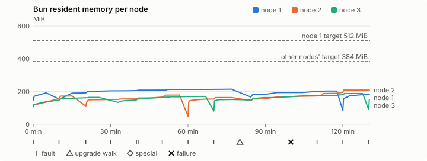
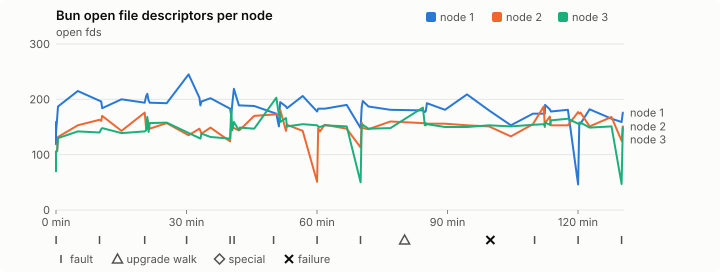
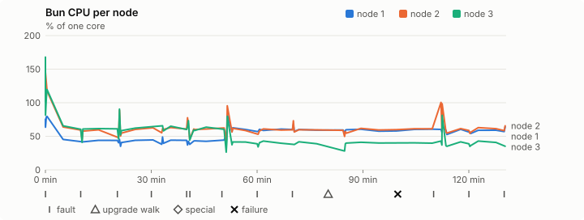
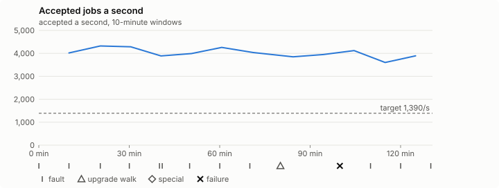

# Sustained soak (V02): FAIL

18 October 2026. final tier, full schedule, 2 h 10 min of soak on a three-node quickstart cluster.

**Final tier: not clean. The V02 gate does not pass.** A product fix means a fresh fast-tier run, then a fresh final-tier run.

## Candidate and host

| | |
|---|---|
| Staged base URL | <https://github.com/reliaburger/reliaburger/releases/download/staging-v0.2.1-39149688730-1> |
| `candidate.json` SHA-256 | `5b6101beed510b035417342072af0a948a6941d64aa8f51002c92c440aca3321` |
| Running versions | v0.2.1 x3 |
| Soak build | `bun-v0.2.1-soak.1`, SHA-256 `9093b4cfbfd099643ef66a3d58c643a096983b61338cc55b8d2cae1bf0123a24` |
| Walks roll back to | 0.2.1 |
| Host | macOS 26.3.1, Apple M2 Max, 32 GiB |
| Lima | limactl version 2.2.1 |
| Guest | Ubuntu 24.04.5 LTS, kernel 6.8.0-139-generic |
| RELIABURGER_HOME | `/tmp/rbq.XJTijo` |
| Evidence | `/var/tmp/reliaburger-v02.LrsZDD` |

## Configuration deviations

- node.toml `[testing] allowed_operations` adds `provision_isolated_workloads` (quickstart allows only inject_workload_faults and alter_node_state), so the catalogue pulse can lease test namespaces
- node.toml `[logs]`/`[metrics]` export to file:///var/lib/reliaburger/soak-export every 60 s with max_storage_mb = 8, `[storage.snapshots]` every 900 s (compressed: 120 s), retain 4, uploaded to the same directory
- node.toml `[ingress] tls_cert/tls_key` point at an operator pair from a soak CA, 45-minute leaves rotated by the harness
- Bun runs with auto/mixed; host jobs opt in to a single pinned BusyBox copy under /var/lib/reliaburger/soak-jobs, mount_isolation=false. The independent verifier listens on each private VM address, TCP 8189, with a separate run token
- node.toml `[node.labels] soak-volume` = "writer" on node 2 and "redis" on node 3, to pin the volume apps
- node.toml `[upgrades] external_signing_key` = a throwaway operator key the harness made for this run (`ed25519:Qi6vOQjGsEcS8Qy3I0GDYmjhSYqNzS4EIqouGCBXo5U=`); the soak build's `.sig` gets that key's external signature beside the release one (D2)
- node.toml `[security] leaf_lifetime_override_secs = 3600` (D1)

## Timeline

- Started 2026-10-18 22:57:31 UTC, finished 2026-10-19 01:08:05 UTC
- Cycles completed: 2
- Teardown: `relish local destroy --yes` and `relish uninstall --yes` succeeded

## Faults and slots

| Class | Runs | Settled/ok | Failed | Skipped | Settle (median / max) |
|---|---|---|---|---|---|
| fault:bun-kill-follower | 3 | 3 | 0 | 0 | 37 s / 43 s |
| fault:bun-kill-leader | 3 | 2 | 0 | 0 | 41 s / 41 s |
| fault:chaos-delay | 1 | 2 | 0 | 0 | 19 s / 19 s |
| fault:chaos-kill | 1 | 2 | 0 | 0 | 56 s / 56 s |
| fault:deploy-kill | 1 | 1 | 0 | 0 | 72 s / 72 s |
| fault:node-delay | 1 | 1 | 0 | 0 | 18 s / 18 s |
| fault:node-disk-full | 1 | 1 | 0 | 0 | 20 s / 20 s |
| fault:power-off | 1 | 1 | 0 | 0 | 32 s / 32 s |
| pulse | 2 | 2 | 0 | 0 | n/a |
| pulse:settle | 0 | 2 | 0 | 0 | 20 s / 20 s |
| storage:registry-push | 2 | 0 | 0 | 0 | n/a |
| tls:invalid-expired | 3 | 3 | 0 | 0 | n/a |
| tls:invalid-torn | 3 | 3 | 0 | 0 | n/a |
| tls:reload | 23 | 23 | 0 | 0 | n/a |
| upgrade:rollback | 1 | 1 | 0 | 0 | n/a |
| upgrade:settle | 0 | 1 | 0 | 0 | 59 s / 59 s |
| upgrade:upgrade | 1 | 1 | 0 | 0 | n/a |

## Renewals and rotations

| Measure | Observed | Required | Verdict |
|---|---|---|---|
| workload identity rotations (soak-identity, per node) | 4 | ≥ 3 | PASS |
| node leaf renewals (per node) | 4 | ≥ 3 | PASS |
| operator ingress reloads (all nodes) | 23 | ≥ 7 | PASS |
| mixed job campaign and positive drain | 8 missing/failing checks | 0 | FAIL |

## Jobs

| Runtime | Accepted successes | Retries | Last accepted progress |
|---|---|---|---|
| runc | 17702 | 4 | 1792372085 |
| shared-runc | 8228310 | 1 | 1792372085 |
| process | 23157956 | 1 | 1792372085 |

The bounded campaign shares the app soak's fault schedule. These counts are reliability evidence, not a saturation rate or a 100-million-per-day qualification.

- runc missing coverage: active power-off overlap, active disk-full overlap, active slow-fsync overlap
- shared-runc missing coverage: active slow-fsync overlap
- process missing coverage: active slow-fsync overlap
- job campaign did not positively drain before teardown
- job campaign requested drain before the final two-minute interval
- rb-944203885cb1-1 lacks a complete empty owner inventory after campaign drain
- rb-944203885cb1-2 lacks a complete empty owner inventory after campaign drain
- rb-944203885cb1-3 lacks a complete empty owner inventory after campaign drain
- Independent verifier execution attempts: 24
- Explicit test-operator acknowledgements for known replay-safe fenced fixtures: 46

- rb-944203885cb1-1: latest complete job storage (KiB) {'instances': 51676, 'job-state': 8, 'task-arrays': 20952}; free 5111336 KiB; live/peak owners 30/30; peak storage {'instances': 71788, 'job-state': 8, 'task-arrays': 35700}
- rb-944203885cb1-2: latest complete job storage (KiB) {'instances': 22604, 'job-state': 8, 'task-arrays': 20792}; free 6166836 KiB; live/peak owners 30/31; peak storage {'instances': 22732, 'job-state': 8, 'task-arrays': 36868}
- rb-944203885cb1-3: latest complete job storage (KiB) {'instances': 21496, 'job-state': 8, 'task-arrays': 22092}; free 6168964 KiB; live/peak owners 30/31; peak storage {'instances': 22304, 'job-state': 8, 'task-arrays': 34772}

Complete disk inventories are recorded. Global retention bounds and the 12-hour job qualification remain #668; this gate cannot certify an unimplemented retention policy.

## Job qualification (D18-C)

Load: target; 3 nodes; accepted 4,001.0/s against a 1390.0/s target: PASS.

The September plan set its targets for one 1M-task batch on a quiet cluster. A soak runs for hours with restarts, upgrades and apps, so its storage, Bun memory and Raft targets are restated (maintainer decision, 15 October 2026, [#668](https://github.com/reliaburger/reliaburger/issues/668)). Bun's steady state is the median RSS of each process once it has been seen for 10 minutes; the gated memory checks are unchanged (`leak-rss`, and Mayo's 70% `memory_high` alert through `wtf`).

| Measure (recorded, not gated) | Observed | Target |
|---|---|---|
| Wall time of a 1,048,576-task array (median / max of 29) | 362 s / 1,056 s | ≤ 600 s |
| p99 start lag, pooled executors | 32 ms (bucket upper bound) | < 1,000 ms |
| Raft entries per second, all cluster writes | 2.11 | recorded only; the batch target counts only task-array writes |
| Raft state of one run, largest seen | 6,068 B | ≤ 256 KiB per 1M tasks |
| Bun steady-state RSS per process, worst node against its target | rb-944203885cb1-2: 188.59 MiB steady, 209.40 MiB peak | ≤ 384 MiB (≤ 512 MiB on node 1, which serves the API) |
| Bun CPU, busiest node | 0.61 cores | ≤ 1 core (leader batch control) |
| Executor helper CPU, busiest node | 0.01 cores | ≤ 0.5 core |
| Node task-array storage per 1M accepted tasks (peaks summed) | 3.34 MiB | ≤ 64 MiB, deleted after retirement |
| Retained log volume, all nodes | 10.94 MB | ≤ 50 MB |

- Bun RSS on rb-944203885cb1-1 (serves the API, target ≤ 512 MiB): pid 8469: 192.18 MiB peak (seen for under 10 minutes); pid 1081141: 209.05 MiB steady, 214.55 MiB peak; pid 1081141: 201.56 MiB steady, 203.23 MiB peak; pid 569189: 182.61 MiB steady, 183.70 MiB peak
- Bun RSS on rb-944203885cb1-2 (node, target ≤ 384 MiB): pid 2376: 122.91 MiB peak (seen for under 10 minutes); pid 4993: 172.13 MiB steady, 172.79 MiB peak; pid 2351093: 160.55 MiB steady, 178.55 MiB peak; pid 2725625: 162.94 MiB steady, 163.38 MiB peak; pid 2725625: 188.59 MiB steady, 209.40 MiB peak
- Bun RSS on rb-944203885cb1-3 (node, target ≤ 384 MiB): pid 2171: 162.04 MiB steady, 164.34 MiB peak; pid 673: 168.20 MiB steady, 170.17 MiB peak; pid 77541: 151.32 MiB peak (seen for under 10 minutes); pid 1327898: 176.13 MiB steady, 188.01 MiB peak; pid 2588440: 152.38 MiB peak (seen for under 10 minutes)

- runc retry causes: exit_code 1, launch 2, signal 0, timeout 0, unknown 1, unrecorded 0
- shared-runc retry causes: exit_code 1, launch 0, signal 0, timeout 0, unknown 0, unrecorded 0
- process retry causes: exit_code 1, launch 0, signal 0, timeout 0, unknown 0, unrecorded 0
- Audited executions: 24; operator replay decisions: 46
- Job controller API fallbacks: rb-944203885cb1-1 missed 140; rb-944203885cb1-2 answered 140 (requests a node didn't answer, and the node that took them instead)

## Data

- Volume writer: highest ACK 67557 in the log view; the writer file checks (writer-lost, writer-regression) decide data loss, and `*-log-order` failures are about the order the log view returned lines in
- Redis counter: highest INCR 7390 in the log view
- Export rb-944203885cb1-1: 190 source files, 263 at the destination
- Export rb-944203885cb1-2: 248 source files, 265 at the destination
- Export rb-944203885cb1-3: 163 source files, 160 at the destination
- Registry images pushed and re-verified: 3
- Agent-loop turns over the 1 s budget: rb-944203885cb1-1 0, rb-944203885cb1-2 0, rb-944203885cb1-3 0
- Guest clock steps by Lima's guest agent: rb-944203885cb1-1 1, rb-944203885cb1-2 1, rb-944203885cb1-3 2
- Checks evaluated: 289 (heavy 28, light 220, settle 41)
- Last observed progress: redis-counter 7390, writer-ack 67557

## Resource trends

| Node | Measure | First | Last | Max |
|---|---|---|---|---|
| rb-944203885cb1-1 | disk_kb data | 1427824 | 1411876 | 1545444 |
| rb-944203885cb1-1 | disk_kb images | 328964 | 445720 | 445720 |
| rb-944203885cb1-1 | disk_kb logs | 40 | 8528 | 8884 |
| rb-944203885cb1-1 | disk_kb metrics | 56 | 8348 | 8640 |
| rb-944203885cb1-1 | disk_kb soak-export | 4 | 24520 | 24520 |
| rb-944203885cb1-1 | disk_kb volumes | 224 | 180 | 228 |
| rb-944203885cb1-1 | fd | 119 | 176 | 245 |
| rb-944203885cb1-1 | rss_kb | 147984 | 188108 | 219704 |
| rb-944203885cb1-2 | disk_kb data | 67444 | 245640 | 252228 |
| rb-944203885cb1-2 | disk_kb images | 158836 | 333160 | 333160 |
| rb-944203885cb1-2 | disk_kb logs | 24 | 1460 | 1460 |
| rb-944203885cb1-2 | disk_kb metrics | 80 | 8508 | 8820 |
| rb-944203885cb1-2 | disk_kb soak-export | 4 | 11636 | 11636 |
| rb-944203885cb1-2 | disk_kb volumes | 16736 | 17564 | 17564 |
| rb-944203885cb1-2 | fd | 71 | 151 | 187 |
| rb-944203885cb1-2 | rss_kb | 109120 | 214424 | 214424 |
| rb-944203885cb1-3 | disk_kb data | 171788 | 248324 | 255296 |
| rb-944203885cb1-3 | disk_kb images | 316524 | 316596 | 316596 |
| rb-944203885cb1-3 | disk_kb logs | 24 | 336 | 336 |
| rb-944203885cb1-3 | disk_kb metrics | 52 | 7432 | 7432 |
| rb-944203885cb1-3 | disk_kb soak-export | 4 | 7776 | 7776 |
| rb-944203885cb1-3 | disk_kb volumes | 16736 | 17324 | 17324 |
| rb-944203885cb1-3 | fd | 70 | 149 | 203 |
| rb-944203885cb1-3 | rss_kb | 114308 | 156036 | 192520 |

## Charts

Time runs from the start of the soak. The marks under each chart are its faults, upgrade walks, specials and recorded failures; the dashed lines are targets.

## Failures

| # | First seen | Check | Symptom | Class | Cause | Action |
|---|---|---|---|---|---|---|
| 1 | 00:37:18 | heavy-check | fail: wtf-warning cluster: alerts-firing for 607 s: cpu_throttle: CPU usage above 90% for 5 minutes;fail: wtf-warning app.frontend/default: rollout-failed for 852 s: app frontend/default's rollout failed on rb-944203885cb1-1; its other nodes stay on the previous spec; | unclassified | open | open |

## Notes

- Job controller was still running at teardown; positive drain must be present to pass
- The harness stopped early (exit 1) during 2:leader-kill

Evidence: `/var/tmp/reliaburger-v02.LrsZDD` (events.jsonl, snapshots/, failures/<n>/).
