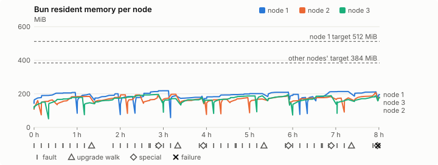
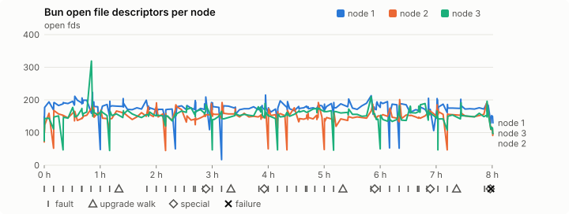
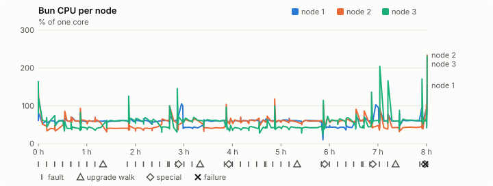
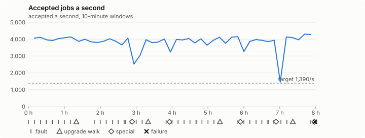

# Sustained soak (V02): FAIL

19 October 2026. final tier, full schedule, 8 h 01 min of soak on a three-node quickstart cluster.

**Final tier: not clean. The V02 gate does not pass.** A product fix means a fresh fast-tier run, then a fresh final-tier run.

## Candidate and host

| | |
|---|---|
| Staged base URL | <https://github.com/reliaburger/reliaburger/releases/download/staging-v0.2.1-39189431910-2> |
| `candidate.json` SHA-256 | `f9dde3ebbd152894962f56d4245759d580d551a0cb45ff84f7110c6e4ff17d4e` |
| Running versions | v0.2.1 x3 |
| Soak build | `bun-v0.2.1-soak.1`, SHA-256 `8948bd7e4d7099506fb60ef477b199c72d33a2503406ceb140a4efc05e94b056` |
| Walks roll back to | 0.2.1 |
| Host | macOS 26.3.1, Apple M2 Max, 32 GiB |
| Lima | limactl version 2.2.1 |
| Guest | Ubuntu 24.04.5 LTS, kernel 6.8.0-139-generic |
| RELIABURGER_HOME | `/tmp/rbq.5mfx7c` |
| Evidence | `/var/tmp/reliaburger-v02.4lzinp` |

## Configuration deviations

- node.toml `[testing] allowed_operations` adds `provision_isolated_workloads` (quickstart allows only inject_workload_faults and alter_node_state), so the catalogue pulse can lease test namespaces
- node.toml `[logs]`/`[metrics]` export to file:///var/lib/reliaburger/soak-export every 60 s with max_storage_mb = 8, `[storage.snapshots]` every 900 s (compressed: 120 s), retain 4, uploaded to the same directory
- node.toml `[ingress] tls_cert/tls_key` point at an operator pair from a soak CA, 45-minute leaves rotated by the harness
- Bun runs with auto/mixed; host jobs opt in to a single pinned BusyBox copy under /var/lib/reliaburger/soak-jobs, mount_isolation=false. The independent verifier listens on each private VM address, TCP 8189, with a separate run token
- node.toml `[node.labels] soak-volume` = "writer" on node 2 and "redis" on node 3, to pin the volume apps
- node.toml `[upgrades] external_signing_key` = a throwaway operator key the harness made for this run (`ed25519:kyenreLe4vsXdQOJkta/wUTSh0kUJU+RGJb1qnRXgZU=`); the soak build's `.sig` gets that key's external signature beside the release one (D2)
- node.toml `[security] leaf_lifetime_override_secs = 3600` (D1)

## Timeline

- Started 2026-10-19 07:59:19 UTC, finished 2026-10-19 16:00:21 UTC
- Cycles completed: 8
- Teardown: `relish local destroy --yes` and `relish uninstall --yes` succeeded

## Faults and slots

| Class | Runs | Settled/ok | Failed | Skipped | Settle (median / max) |
|---|---|---|---|---|---|
| fault:bun-kill-follower | 8 | 8 | 0 | 0 | 36 s / 47 s |
| fault:bun-kill-leader | 8 | 8 | 0 | 0 | 36 s / 38 s |
| fault:chaos-cpu | 1 | 2 | 0 | 0 | 19 s / 19 s |
| fault:chaos-delay | 1 | 2 | 0 | 0 | 21 s / 21 s |
| fault:chaos-dns | 1 | 2 | 0 | 0 | 20 s / 20 s |
| fault:chaos-drop | 1 | 2 | 0 | 0 | 21 s / 21 s |
| fault:chaos-kill | 1 | 2 | 0 | 0 | 21 s / 21 s |
| fault:chaos-partition | 1 | 2 | 0 | 0 | 20 s / 20 s |
| fault:chaos-pause | 1 | 2 | 0 | 0 | 20 s / 20 s |
| fault:chaos-scenario | 1 | 2 | 0 | 0 | 35 s / 35 s |
| fault:deploy-kill | 4 | 4 | 0 | 0 | 39 s / 40 s |
| fault:node-delay | 3 | 3 | 0 | 0 | 21 s / 36 s |
| fault:node-disk-full | 3 | 3 | 0 | 0 | 20 s / 20 s |
| fault:node-slow-fsync | 2 | 2 | 0 | 0 | 21 s / 21 s |
| fault:power-off | 4 | 4 | 0 | 0 | 47 s / 51 s |
| pulse | 8 | 8 | 0 | 0 | n/a |
| pulse:settle | 0 | 8 | 0 | 0 | 20 s / 24 s |
| special:all-off | 1 | 1 | 0 | 0 | 52 s / 52 s |
| special:graceful-stop | 2 | 2 | 0 | 0 | 138 s / 138 s |
| special:quorum-back | 2 | 2 | 0 | 0 | n/a |
| special:quorum-loss | 2 | 2 | 0 | 0 | 64 s / 64 s |
| storage:offline-export | 1 | 1 | 0 | 0 | n/a |
| storage:registry-push | 8 | 0 | 0 | 0 | n/a |
| tls:invalid-expired | 9 | 9 | 0 | 0 | n/a |
| tls:invalid-torn | 12 | 12 | 0 | 0 | n/a |
| tls:reload | 91 | 91 | 0 | 0 | n/a |
| upgrade:rollback | 4 | 4 | 0 | 0 | n/a |
| upgrade:settle | 0 | 4 | 0 | 0 | 64 s / 69 s |
| upgrade:upgrade | 4 | 4 | 0 | 0 | n/a |

## Renewals and rotations

| Measure | Observed | Required | Verdict |
|---|---|---|---|
| workload identity rotations (soak-identity, per node) | 17 | ≥ 15 | PASS |
| node leaf renewals (per node) | 17 | ≥ 15 | PASS |
| operator ingress reloads (all nodes) | 91 | ≥ 31 | PASS |
| mixed job campaign and positive drain | 1 missing/failing checks | 0 | FAIL |

## Jobs

| Runtime | Accepted successes | Retries | Last accepted progress |
|---|---|---|---|
| runc | 64375 | 7 | 1792425467 |
| shared-runc | 28725582 | 4 | 1792425463 |
| process | 80811394 | 1 | 1792425463 |

The bounded campaign shares the app soak's fault schedule. These counts are reliability evidence, not a saturation rate or a 100-million-per-day qualification.

- process short work (1589): the candidate no longer has this run (candidate API refused POST /v1/batch/1589/cancel (HTTP 404)); last seen 63000/1048576 succeeded, not drained, so its outcome is unknown
- Independent verifier execution attempts: 24
- Explicit test-operator acknowledgements for known replay-safe fenced fixtures: 189

- rb-def1b04591a9-1: latest complete job storage (KiB) {'instances': 2764, 'job-state': 8, 'task-arrays': 20400}; free 4977504 KiB; live/peak owners 0/32; peak storage {'instances': 72076, 'job-state': 8, 'task-arrays': 38148}
- rb-def1b04591a9-2: latest complete job storage (KiB) {'instances': 324, 'job-state': 8, 'task-arrays': 14356}; free 6019980 KiB; live/peak owners 0/31; peak storage {'instances': 43480, 'job-state': 8, 'task-arrays': 38956}
- rb-def1b04591a9-3: latest complete job storage (KiB) {'instances': 968, 'job-state': 8, 'task-arrays': 27260}; free 6026604 KiB; live/peak owners 0/31; peak storage {'instances': 79500, 'job-state': 8, 'task-arrays': 40316}

Complete disk inventories are recorded. Global retention bounds and the 12-hour job qualification remain #668; this gate cannot certify an unimplemented retention policy.

## Job qualification (D18-C)

Load: target; 3 nodes; accepted 3,819.4/s against a 1390.0/s target: PASS.

The September plan set its targets for one 1M-task batch on a quiet cluster. A soak runs for hours with restarts, upgrades and apps, so its storage, Bun memory and Raft targets are restated (maintainer decision, 15 October 2026, [#668](https://github.com/reliaburger/reliaburger/issues/668)). Bun's steady state is the median RSS of each process once it has been seen for 10 minutes; the gated memory checks are unchanged (`leak-rss`, and Mayo's 70% `memory_high` alert through `wtf`).

| Measure (recorded, not gated) | Observed | Target |
|---|---|---|
| Wall time of a 1,048,576-task array (median / max of 64) | 366 s / 1,391 s | ≤ 600 s |
| p99 start lag, pooled executors | 32 ms (bucket upper bound) | < 1,000 ms |
| Raft entries per second, all cluster writes | 1.37 | recorded only; the batch target counts only task-array writes |
| Raft state of one run, largest seen | 6,282 B | ≤ 256 KiB per 1M tasks |
| Bun steady-state RSS per process, worst node against its target | rb-def1b04591a9-2: 199.88 MiB steady, 206.87 MiB peak | ≤ 384 MiB (≤ 512 MiB on node 1, which serves the API) |
| Bun CPU, busiest node | 0.60 cores | ≤ 1 core (leader batch control) |
| Executor helper CPU, busiest node | 0.01 cores | ≤ 0.5 core |
| Node task-array storage per 1M accepted tasks (peaks summed) | 1.05 MiB | ≤ 64 MiB, deleted after retirement |
| Retained log volume, all nodes | 28.05 MB | ≤ 50 MB |

- Bun RSS on rb-def1b04591a9-1 (serves the API, target ≤ 512 MiB): pid 8325: 203.72 MiB steady, 208.33 MiB peak; pid 2270620: 193.54 MiB steady, 198.62 MiB peak; pid 2270620: 191.64 MiB steady, 200.26 MiB peak; pid 214922: 183.66 MiB steady, 183.66 MiB peak; pid 2396666: 213.74 MiB steady, 218.47 MiB peak; pid 2960586: 188.95 MiB peak (seen for under 10 minutes); pid 2960586: 179.30 MiB steady, 185.61 MiB peak; pid 670: 195.30 MiB steady, 201.42 MiB peak; pid 670: 209.28 MiB steady, 209.86 MiB peak; pid 674: 196.63 MiB steady, 196.63 MiB peak; pid 1644447: 178.38 MiB peak (seen for under 10 minutes); pid 2755037: 183.14 MiB peak (seen for under 10 minutes); pid 669: 212.99 MiB steady, 213.49 MiB peak; pid 669: 210.59 MiB steady, 211.71 MiB peak; pid 678: 195.36 MiB peak (seen for under 10 minutes)
- Bun RSS on rb-def1b04591a9-2 (node, target ≤ 384 MiB): pid 2347: 119.08 MiB peak (seen for under 10 minutes); pid 4873: 159.67 MiB peak (seen for under 10 minutes); pid 1139300: 157.14 MiB steady, 163.75 MiB peak; pid 676: 183.58 MiB steady, 184.41 MiB peak; pid 1385138: 177.83 MiB steady, 193.96 MiB peak; pid 2448842: 192.37 MiB steady, 193.27 MiB peak; pid 675: 179.48 MiB steady, 187.37 MiB peak; pid 680: 196.44 MiB steady, 197.21 MiB peak; pid 680: 171.90 MiB steady, 173.44 MiB peak; pid 678: 159.18 MiB peak (seen for under 10 minutes); pid 394703: 164.31 MiB steady, 164.80 MiB peak; pid 2599268: 168.27 MiB peak (seen for under 10 minutes); pid 663: 174.36 MiB steady, 177.46 MiB peak; pid 3050312: 167.62 MiB steady, 169.11 MiB peak; pid 673: 186.19 MiB steady, 188.75 MiB peak; pid 677: 175.98 MiB steady, 182.20 MiB peak; pid 674: 174.73 MiB peak (seen for under 10 minutes); pid 1394584: 175.91 MiB peak (seen for under 10 minutes); pid 1394584: 199.88 MiB steady, 206.87 MiB peak; pid 675: 175.39 MiB peak (seen for under 10 minutes)
- Bun RSS on rb-def1b04591a9-3 (node, target ≤ 384 MiB): pid 2124: 149.78 MiB steady, 150.68 MiB peak; pid 2304390: 172.61 MiB steady, 179.09 MiB peak; pid 3922580: 146.80 MiB peak (seen for under 10 minutes); pid 3922580: 183.07 MiB steady, 196.32 MiB peak; pid 675: 154.89 MiB peak (seen for under 10 minutes); pid 150832: 169.68 MiB steady, 171.57 MiB peak; pid 150832: 169.14 MiB steady, 176.95 MiB peak; pid 679: 162.56 MiB steady, 162.56 MiB peak; pid 1541096: 183.54 MiB steady, 187.07 MiB peak; pid 3951265: 188.14 MiB peak (seen for under 10 minutes); pid 3951265: 188.18 MiB steady, 193.86 MiB peak; pid 675: 145.75 MiB peak (seen for under 10 minutes); pid 500456: 185.91 MiB steady, 189.03 MiB peak; pid 676: 152.39 MiB peak (seen for under 10 minutes); pid 142172: 160.75 MiB steady, 165.88 MiB peak; pid 142172: 181.84 MiB steady, 187.52 MiB peak; pid 672: 180.05 MiB peak (seen for under 10 minutes)

- runc retry causes: exit_code 2, launch 0, signal 0, timeout 1, unknown 4, unrecorded 0
- shared-runc retry causes: exit_code 1, launch 0, signal 0, timeout 3, unknown 0, unrecorded 0
- process retry causes: exit_code 1, launch 0, signal 0, timeout 0, unknown 0, unrecorded 0
- Audited executions: 24; operator replay decisions: 189
- Job controller API fallbacks: rb-def1b04591a9-1 missed 887, rb-def1b04591a9-2 missed 19; rb-def1b04591a9-2 answered 868, rb-def1b04591a9-3 answered 19 (requests a node didn't answer, and the node that took them instead)

## Data

- Volume writer: highest ACK 236849 in the log view; the writer file checks (writer-lost, writer-regression) decide data loss, and `*-log-order` failures are about the order the log view returned lines in
- Redis counter: highest INCR 26682 in the log view
- Export rb-def1b04591a9-1: 240 source files, 726 at the destination
- Export rb-def1b04591a9-2: 499 source files, 936 at the destination
- Export rb-def1b04591a9-3: 256 source files, 758 at the destination
- Registry images pushed and re-verified: 9
- Agent-loop turns over the 1 s budget: rb-def1b04591a9-1 0, rb-def1b04591a9-2 0, rb-def1b04591a9-3 0
- Guest clock steps by Lima's guest agent: rb-def1b04591a9-1 6, rb-def1b04591a9-2 9, rb-def1b04591a9-3 6
- Checks evaluated: 1034 (heavy 99, light 779, settle 156)
- Last observed progress: redis-counter 26682, writer-ack 236849

## Resource trends

| Node | Measure | First | Last | Max |
|---|---|---|---|---|
| rb-def1b04591a9-1 | disk_kb data | 1369508 | 1544136 | 1555532 |
| rb-def1b04591a9-1 | disk_kb images | 328964 | 454180 | 454180 |
| rb-def1b04591a9-1 | disk_kb logs | 40 | 8764 | 9152 |
| rb-def1b04591a9-1 | disk_kb metrics | 52 | 8888 | 9188 |
| rb-def1b04591a9-1 | disk_kb soak-export | 4 | 57016 | 57016 |
| rb-def1b04591a9-1 | disk_kb volumes | 200 | 252 | 252 |
| rb-def1b04591a9-1 | fd | 114 | 130 | 223 |
| rb-def1b04591a9-1 | rss_kb | 146952 | 200052 | 223712 |
| rb-def1b04591a9-2 | disk_kb data | 67452 | 89932 | 478632 |
| rb-def1b04591a9-2 | disk_kb images | 158836 | 329100 | 329100 |
| rb-def1b04591a9-2 | disk_kb logs | 24 | 9108 | 9164 |
| rb-def1b04591a9-2 | disk_kb metrics | 52 | 8572 | 9188 |
| rb-def1b04591a9-2 | disk_kb soak-export | 4 | 37796 | 37796 |
| rb-def1b04591a9-2 | disk_kb volumes | 16736 | 23320 | 23320 |
| rb-def1b04591a9-2 | fd | 71 | 96 | 201 |
| rb-def1b04591a9-2 | rss_kb | 110692 | 179604 | 211832 |
| rb-def1b04591a9-3 | disk_kb data | 230212 | 275320 | 672592 |
| rb-def1b04591a9-3 | disk_kb images | 316524 | 343516 | 343516 |
| rb-def1b04591a9-3 | disk_kb logs | 24 | 8572 | 9080 |
| rb-def1b04591a9-3 | disk_kb metrics | 44 | 8780 | 9236 |
| rb-def1b04591a9-3 | disk_kb soak-export | 4 | 65240 | 65240 |
| rb-def1b04591a9-3 | disk_kb volumes | 16760 | 18744 | 18800 |
| rb-def1b04591a9-3 | fd | 75 | 98 | 319 |
| rb-def1b04591a9-3 | rss_kb | 115684 | 184372 | 201036 |

## Charts

Time runs from the start of the soak. The marks under each chart are its faults, upgrade walks, specials and recorded failures; the dashed lines are targets.

## Failures

| # | First seen | Check | Symptom | Class | Cause | Action |
|---|---|---|---|---|---|---|
| 1 | 15:57:56 | settle-check | fail: jobs: process short work (1589): the candidate no longer has this run (candidate API refused POST /v1/batch/1589/cancel (HTTP 404)); last seen 63000/1048576 succeeded, not drained, so its outcome is unknown; | unclassified | open | open |

## Notes

- The harness stopped early (exit 1) during final

Evidence: `/var/tmp/reliaburger-v02.4lzinp` (events.jsonl, snapshots/, failures/<n>/).
