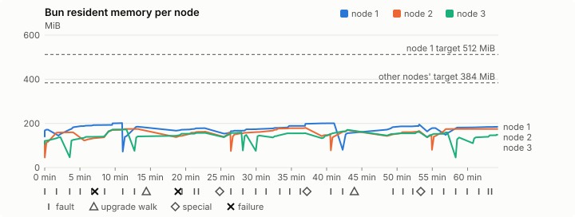
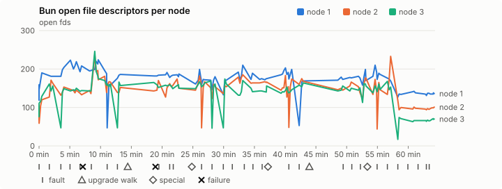
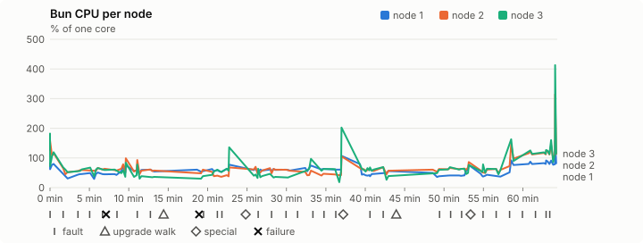
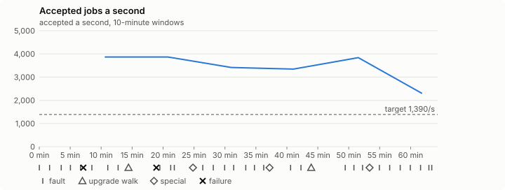

# Sustained soak (V02): FAIL

19 October 2026. fast tier, compressed schedule, 1 h 04 min of soak on a three-node quickstart cluster.

**Fast tier: not clean.** Fix what failed and run the fast tier again before a final-tier run.

## Candidate and host

| | |
|---|---|
| Staged base URL | <https://github.com/reliaburger/reliaburger/releases/download/staging-v0.2.1-39298268079-1> |
| `candidate.json` SHA-256 | `45c610515784e7e1110d838761c4981c3551bdde9cd293094ad67619c6228048` |
| Running versions | v0.2.1 x3 |
| Soak build | `bun-v0.2.1-soak.1`, SHA-256 `14bc087482199213f7174d11a199e9bed67add477e74abd4885c23ec82192765` |
| Walks roll back to | 0.2.1 |
| Host | macOS 26.3.1, Apple M2 Max, 32 GiB |
| Lima | limactl version 2.2.1 |
| Guest | Ubuntu 24.04.5 LTS, kernel 6.8.0-139-generic |
| RELIABURGER_HOME | `/tmp/rbq.hVfjKe` |
| Evidence | `/var/tmp/reliaburger-v02.1VaCiz` |

## Configuration deviations

- node.toml `[testing] allowed_operations` adds `provision_isolated_workloads` (quickstart allows only inject_workload_faults and alter_node_state), so the catalogue pulse can lease test namespaces
- node.toml `[logs]`/`[metrics]` export to file:///var/lib/reliaburger/soak-export every 60 s with max_storage_mb = 8, `[storage.snapshots]` every 900 s (compressed: 120 s), retain 4, uploaded to the same directory
- node.toml `[ingress] tls_cert/tls_key` point at an operator pair from a soak CA, 45-minute leaves rotated by the harness
- Bun runs with auto/mixed; host jobs opt in to a single pinned BusyBox copy under /var/lib/reliaburger/soak-jobs, mount_isolation=false. The independent verifier listens on each private VM address, TCP 8189, with a separate run token
- node.toml `[node.labels] soak-volume` = "writer" on node 2 and "redis" on node 3, to pin the volume apps
- node.toml `[upgrades] external_signing_key` = a throwaway operator key the harness made for this run (`ed25519:Iejsye0vMTCQ+KVb5BT5jDXcx9QojSe1Ek4x0Wr4znY=`); the soak build's `.sig` gets that key's external signature beside the release one (D2)
- node.toml `[security] leaf_lifetime_override_secs = 3600` (D1)

## Timeline

- Started 2026-10-19 20:58:56 UTC, finished 2026-10-19 22:03:18 UTC
- Cycles completed: 5
- Teardown: `relish local destroy --yes` and `relish uninstall --yes` succeeded

## Faults and slots

| Class | Runs | Settled/ok | Failed | Skipped | Settle (median / max) |
|---|---|---|---|---|---|
| fault:bun-kill-follower | 5 | 5 | 0 | 0 | 34 s / 36 s |
| fault:bun-kill-leader | 5 | 5 | 0 | 0 | 36 s / 42 s |
| fault:chaos-cpu | 1 | 2 | 0 | 0 | 19 s / 19 s |
| fault:chaos-delay | 1 | 1 | 1 | 0 | 17 s / 17 s |
| fault:chaos-dns | 1 | 2 | 0 | 0 | 19 s / 19 s |
| fault:chaos-drop | 1 | 2 | 0 | 0 | 24 s / 24 s |
| fault:chaos-kill | 2 | 4 | 0 | 0 | 27 s / 27 s |
| fault:chaos-memory | 1 | 2 | 0 | 0 | 15 s / 15 s |
| fault:chaos-partition | 1 | 2 | 0 | 0 | 18 s / 18 s |
| fault:chaos-pause | 1 | 2 | 0 | 0 | 19 s / 19 s |
| fault:chaos-scenario | 1 | 2 | 0 | 0 | 34 s / 34 s |
| fault:deploy-kill | 3 | 3 | 0 | 0 | 33 s / 34 s |
| fault:node-delay | 2 | 2 | 0 | 0 | 34 s / 34 s |
| fault:node-disk-full | 2 | 2 | 0 | 0 | 18 s / 18 s |
| fault:node-slow-fsync | 1 | 1 | 0 | 0 | 17 s / 17 s |
| fault:power-off | 3 | 3 | 0 | 0 | 32 s / 58 s |
| pulse | 1 | 1 | 0 | 0 | n/a |
| pulse:settle | 0 | 1 | 0 | 0 | 23 s / 23 s |
| special:all-off | 1 | 1 | 0 | 0 | 40 s / 40 s |
| special:graceful-stop | 1 | 1 | 0 | 0 | 58 s / 58 s |
| special:quorum-back | 1 | 1 | 0 | 0 | n/a |
| special:quorum-loss | 1 | 1 | 0 | 0 | 75 s / 75 s |
| storage:offline-export | 2 | 2 | 0 | 0 | n/a |
| storage:registry-push | 5 | 0 | 0 | 0 | n/a |
| tls:invalid-expired | 3 | 3 | 0 | 0 | n/a |
| tls:invalid-torn | 3 | 3 | 0 | 0 | n/a |
| tls:reload | 29 | 29 | 0 | 0 | n/a |
| upgrade:rollback | 2 | 2 | 0 | 0 | n/a |
| upgrade:settle | 0 | 2 | 0 | 0 | 51 s / 51 s |
| upgrade:upgrade | 2 | 2 | 0 | 0 | n/a |

## Renewals and rotations

| Measure | Observed | Required | Verdict |
|---|---|---|---|
| workload identity rotations (soak-identity, per node) | 7 | ≥ 1 | PASS |
| node leaf renewals (per node) | 2 | ≥ 1 | PASS |
| operator ingress reloads (all nodes) | 29 | ≥ 11 | PASS |
| mixed job campaign and positive drain | 0 missing/failing checks | 0 | PASS |

## Jobs

| Runtime | Accepted successes | Retries | Last accepted progress |
|---|---|---|---|
| runc | 7527 | 4 | 1792447022 |
| shared-runc | 3356103 | 1 | 1792447022 |
| process | 9430341 | 1 | 1792447020 |

The bounded campaign shares the app soak's fault schedule. These counts are reliability evidence, not a saturation rate or a 100-million-per-day qualification.

- Independent verifier execution attempts: 24
- Explicit test-operator acknowledgements for known replay-safe fenced fixtures: 105

- rb-c5f9b473b5e4-1: latest complete job storage (KiB) {'instances': 8164, 'job-state': 8, 'task-arrays': 15792}; free 5235184 KiB; live/peak owners 0/31; peak storage {'instances': 30552, 'job-state': 8, 'task-arrays': 35080}
- rb-c5f9b473b5e4-2: latest complete job storage (KiB) {'instances': 660, 'job-state': 8, 'task-arrays': 15552}; free 6313584 KiB; live/peak owners 0/32; peak storage {'instances': 29084, 'job-state': 8, 'task-arrays': 35144}
- rb-c5f9b473b5e4-3: latest complete job storage (KiB) {'instances': 300, 'job-state': 8, 'task-arrays': 11808}; free 6343408 KiB; live/peak owners 0/31; peak storage {'instances': 23256, 'job-state': 8, 'task-arrays': 34944}

Complete disk inventories are recorded. Global retention bounds and the 12-hour job qualification remain #668; this gate cannot certify an unimplemented retention policy.

## Job qualification (D18-C)

Load: target; 3 nodes; accepted 3,663.8/s against a 1390.0/s target: PASS.

The September plan set its targets for one 1M-task batch on a quiet cluster. A soak runs for hours with restarts, upgrades and apps, so its storage, Bun memory and Raft targets are restated (maintainer decision, 15 October 2026, [#668](https://github.com/reliaburger/reliaburger/issues/668)). Bun's steady state is the median RSS of each process once it has been seen for 10 minutes; the gated memory checks are unchanged (`leak-rss`, and Mayo's 70% `memory_high` alert through `wtf`).

| Measure (recorded, not gated) | Observed | Target |
|---|---|---|
| Wall time of a 1,048,576-task array (median / max of 11) | 385 s / 1,147 s | ≤ 600 s |
| p99 start lag, pooled executors | 32 ms (bucket upper bound) | < 1,000 ms |
| Raft entries per second, all cluster writes | 2.02 | recorded only; the batch target counts only task-array writes |
| Raft state of one run, largest seen | 6,207 B | ≤ 256 KiB per 1M tasks |
| Bun steady-state RSS per process, worst node against its target | rb-c5f9b473b5e4-2: 179.26 MiB steady, 180.39 MiB peak | ≤ 384 MiB (≤ 512 MiB on node 1, which serves the API) |
| Bun CPU, busiest node | 0.65 cores | ≤ 1 core (leader batch control) |
| Executor helper CPU, busiest node | 0.02 cores | ≤ 0.5 core |
| Node task-array storage per 1M accepted tasks (peaks summed) | 8.03 MiB | ≤ 64 MiB, deleted after retirement |
| Retained log volume, all nodes | 6.32 MB | ≤ 50 MB |

- Bun RSS on rb-c5f9b473b5e4-1 (serves the API, target ≤ 512 MiB): pid 8102: 171.87 MiB peak (seen for under 10 minutes); pid 151065: 201.64 MiB peak (seen for under 10 minutes); pid 1221822: 185.05 MiB peak (seen for under 10 minutes); pid 1221822: 178.05 MiB peak (seen for under 10 minutes); pid 676: 200.21 MiB steady, 200.49 MiB peak; pid 1775859: 155.39 MiB peak (seen for under 10 minutes); pid 1775859: 195.30 MiB peak (seen for under 10 minutes); pid 674: 178.94 MiB peak (seen for under 10 minutes); pid 309770: 184.67 MiB peak (seen for under 10 minutes)
- Bun RSS on rb-c5f9b473b5e4-2 (node, target ≤ 384 MiB): pid 2381: 114.75 MiB peak (seen for under 10 minutes); pid 4754: 159.57 MiB peak (seen for under 10 minutes); pid 675: 174.54 MiB peak (seen for under 10 minutes); pid 1430263: 163.13 MiB peak (seen for under 10 minutes); pid 685: 158.47 MiB peak (seen for under 10 minutes); pid 119952: 179.26 MiB steady, 180.39 MiB peak; pid 676: 147.31 MiB peak (seen for under 10 minutes); pid 229540: 169.52 MiB peak (seen for under 10 minutes); pid 229540: 165.92 MiB peak (seen for under 10 minutes); pid 674: 148.23 MiB peak (seen for under 10 minutes); pid 93820: 174.74 MiB peak (seen for under 10 minutes)
- Bun RSS on rb-c5f9b473b5e4-3 (node, target ≤ 384 MiB): pid 2164: 137.31 MiB peak (seen for under 10 minutes); pid 377811: 172.45 MiB peak (seen for under 10 minutes); pid 1459863: 140.99 MiB peak (seen for under 10 minutes); pid 1735834: 157.05 MiB peak (seen for under 10 minutes); pid 681: 158.56 MiB peak (seen for under 10 minutes); pid 331528: 147.91 MiB peak (seen for under 10 minutes); pid 553759: 144.79 MiB peak (seen for under 10 minutes); pid 671: 155.48 MiB peak (seen for under 10 minutes); pid 676: 171.14 MiB peak (seen for under 10 minutes); pid 675: 161.63 MiB peak (seen for under 10 minutes); pid 672: 159.02 MiB peak (seen for under 10 minutes); pid 456982: 135.80 MiB peak (seen for under 10 minutes); pid 678: 148.61 MiB peak (seen for under 10 minutes)

- runc retry causes: exit_code 3, launch 1, signal 0, timeout 0, unknown 0, unrecorded 0
- shared-runc retry causes: exit_code 1, launch 0, signal 0, timeout 0, unknown 0, unrecorded 0
- process retry causes: exit_code 1, launch 0, signal 0, timeout 0, unknown 0, unrecorded 0
- Audited executions: 24; operator replay decisions: 105
- Job controller API fallbacks: rb-c5f9b473b5e4-1 missed 207, rb-c5f9b473b5e4-2 missed 2; rb-c5f9b473b5e4-2 answered 205, rb-c5f9b473b5e4-3 answered 2 (requests a node didn't answer, and the node that took them instead)

## Data

- Volume writer: highest ACK 30764 in the log view; the writer file checks (writer-lost, writer-regression) decide data loss, and `*-log-order` failures are about the order the log view returned lines in
- Redis counter: highest INCR 3053 in the log view
- Export rb-c5f9b473b5e4-1: 121 source files, 118 at the destination
- Export rb-c5f9b473b5e4-2: 137 source files, 132 at the destination
- Export rb-c5f9b473b5e4-3: 101 source files, 90 at the destination
- Registry images pushed and re-verified: 6
- Agent-loop turns over the 1 s budget: rb-c5f9b473b5e4-1 0, rb-c5f9b473b5e4-2 0, rb-c5f9b473b5e4-3 0
- Guest clock steps by Lima's guest agent: rb-c5f9b473b5e4-1 2, rb-c5f9b473b5e4-2 4, rb-c5f9b473b5e4-3 6
- Checks evaluated: 183 (heavy 15, light 67, settle 101)
- Last observed progress: redis-counter 3053, writer-ack 30764

## Resource trends

| Node | Measure | First | Last | Max |
|---|---|---|---|---|
| rb-c5f9b473b5e4-1 | disk_kb data | 1427844 | 1407864 | 1491732 |
| rb-c5f9b473b5e4-1 | disk_kb images | 328964 | 445824 | 445824 |
| rb-c5f9b473b5e4-1 | disk_kb logs | 40 | 3680 | 3680 |
| rb-c5f9b473b5e4-1 | disk_kb metrics | 56 | 4416 | 4416 |
| rb-c5f9b473b5e4-1 | disk_kb soak-export | 4 | 7908 | 7908 |
| rb-c5f9b473b5e4-1 | disk_kb volumes | 224 | 204 | 228 |
| rb-c5f9b473b5e4-1 | fd | 133 | 136 | 224 |
| rb-c5f9b473b5e4-1 | rss_kb | 143472 | 189100 | 206484 |
| rb-c5f9b473b5e4-2 | disk_kb data | 9012 | 155060 | 597476 |
| rb-c5f9b473b5e4-2 | disk_kb images | 161940 | 329036 | 329036 |
| rb-c5f9b473b5e4-2 | disk_kb logs | 28 | 2120 | 2120 |
| rb-c5f9b473b5e4-2 | disk_kb metrics | 64 | 3616 | 3616 |
| rb-c5f9b473b5e4-2 | disk_kb soak-export | 4 | 7520 | 7520 |
| rb-c5f9b473b5e4-2 | disk_kb volumes | 16712 | 17328 | 17328 |
| rb-c5f9b473b5e4-2 | fd | 67 | 101 | 237 |
| rb-c5f9b473b5e4-2 | rss_kb | 113324 | 178936 | 184716 |
| rb-c5f9b473b5e4-3 | disk_kb data | 230172 | 198052 | 470212 |
| rb-c5f9b473b5e4-3 | disk_kb images | 316524 | 322560 | 322560 |
| rb-c5f9b473b5e4-3 | disk_kb logs | 24 | 372 | 372 |
| rb-c5f9b473b5e4-3 | disk_kb metrics | 60 | 2940 | 2940 |
| rb-c5f9b473b5e4-3 | disk_kb soak-export | 4 | 2976 | 2976 |
| rb-c5f9b473b5e4-3 | disk_kb volumes | 16760 | 16988 | 17028 |
| rb-c5f9b473b5e4-3 | fd | 77 | 70 | 246 |
| rb-c5f9b473b5e4-3 | rss_kb | 109328 | 152172 | 176584 |

## Charts

Time runs from the start of the soak. The marks under each chart are its faults, upgrade walks, specials and recorded failures; the dashed lines are targets.

## Failures

| # | First seen | Check | Symptom | Class | Cause | Action |
|---|---|---|---|---|---|---|
| 1 | 21:05:57 | chaos-delay | error: API error (status 400): {"error":"fault rejected: cannot delay traffic: programming the delay did not finish within the turn; the next tick retries"}  | unclassified | open | open |
| 2 | 21:17:46 | heavy-check | fail: bun-restart rb-c5f9b473b5e4-2: 1 systemd restart(s) of bun without a harness kill (NRestarts now 1); | unclassified | open | open |

Evidence: `/var/tmp/reliaburger-v02.1VaCiz` (events.jsonl, snapshots/, failures/<n>/).
