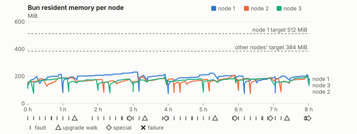
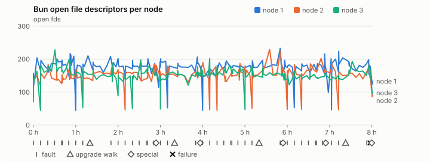
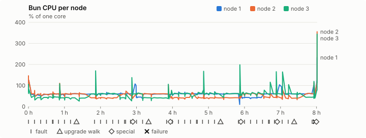
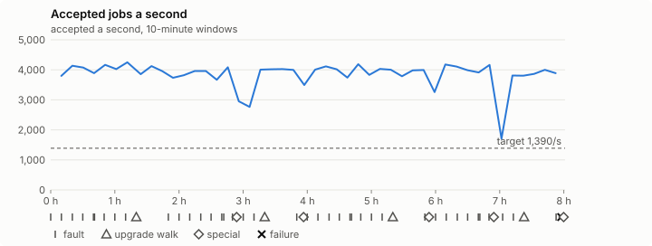

# Sustained soak (V02): FAIL

20 October 2026. final tier, full schedule, 8 h 01 min of soak on a three-node quickstart cluster.

**Final tier: not clean. The V02 gate does not pass.** A product fix means a fresh fast-tier run, then a fresh final-tier run.

## Candidate and host

| | |
|---|---|
| Staged base URL | <https://github.com/reliaburger/reliaburger/releases/download/staging-v0.2.1-39340788164-1> |
| `candidate.json` SHA-256 | `2470c93e0ec58d1b6d0504a8daef85f21ab1120e400761ecc903eb661353e3e0` |
| Running versions | v0.2.1 x3 |
| Soak build | `bun-v0.2.1-soak.1`, SHA-256 `44e723b90918571f7ce0ef99b9d3396d2a188a59b5c52354436fe9c1b045ca5b` |
| Walks roll back to | 0.2.1 |
| Host | macOS 26.3.1, Apple M2 Max, 32 GiB |
| Lima | limactl version 2.2.1 |
| Guest | Ubuntu 24.04.5 LTS, kernel 6.8.0-139-generic |
| RELIABURGER_HOME | `/tmp/rbq.LTJEuR` |
| Evidence | `/var/tmp/reliaburger-v02.VpPMS3` |

## Configuration deviations

- node.toml `[testing] allowed_operations` adds `provision_isolated_workloads` (quickstart allows only inject_workload_faults and alter_node_state), so the catalogue pulse can lease test namespaces
- node.toml `[logs]`/`[metrics]` export to file:///var/lib/reliaburger/soak-export every 60 s with max_storage_mb = 8, `[storage.snapshots]` every 900 s (compressed: 120 s), retain 4, uploaded to the same directory
- node.toml `[ingress] tls_cert/tls_key` point at an operator pair from a soak CA, 45-minute leaves rotated by the harness
- Bun runs with auto/mixed; host jobs opt in to a single pinned BusyBox copy under /var/lib/reliaburger/soak-jobs, mount_isolation=false. The independent verifier listens on each private VM address, TCP 8189, with a separate run token
- node.toml `[node.labels] soak-volume` = "writer" on node 2 and "redis" on node 3, to pin the volume apps
- node.toml `[upgrades] external_signing_key` = a throwaway operator key the harness made for this run (`ed25519:ezTem5lMU33YtD9O9s2orJ+JlhzOjxZ4Q7Rlb+kLfjE=`); the soak build's `.sig` gets that key's external signature beside the release one (D2)
- node.toml `[security] leaf_lifetime_override_secs = 3600` (D1)

## Timeline

- Started 2026-10-20 03:03:59 UTC, finished 2026-10-20 11:05:09 UTC
- Cycles completed: 8
- Teardown: `relish local destroy --yes` and `relish uninstall --yes` succeeded

## Faults and slots

| Class | Runs | Settled/ok | Failed | Skipped | Settle (median / max) |
|---|---|---|---|---|---|
| fault:bun-kill-follower | 8 | 8 | 0 | 0 | 36 s / 47 s |
| fault:bun-kill-leader | 8 | 8 | 0 | 0 | 37 s / 42 s |
| fault:chaos-cpu | 1 | 2 | 0 | 0 | 19 s / 19 s |
| fault:chaos-delay | 1 | 2 | 0 | 0 | 17 s / 17 s |
| fault:chaos-dns | 1 | 2 | 0 | 0 | 19 s / 19 s |
| fault:chaos-drop | 1 | 2 | 0 | 0 | 19 s / 19 s |
| fault:chaos-kill | 1 | 2 | 0 | 0 | 57 s / 57 s |
| fault:chaos-partition | 1 | 2 | 0 | 0 | 20 s / 20 s |
| fault:chaos-pause | 1 | 2 | 0 | 0 | 19 s / 19 s |
| fault:chaos-scenario | 1 | 2 | 0 | 0 | 44 s / 44 s |
| fault:deploy-kill | 4 | 4 | 0 | 0 | 37 s / 43 s |
| fault:node-delay | 3 | 3 | 0 | 0 | 32 s / 35 s |
| fault:node-disk-full | 3 | 3 | 0 | 0 | 20 s / 20 s |
| fault:node-slow-fsync | 2 | 2 | 0 | 0 | 21 s / 21 s |
| fault:power-off | 4 | 4 | 0 | 0 | 36 s / 40 s |
| pulse | 8 | 8 | 0 | 0 | n/a |
| pulse:settle | 0 | 8 | 0 | 0 | 20 s / 40 s |
| special:all-off | 1 | 1 | 0 | 0 | 52 s / 52 s |
| special:graceful-stop | 2 | 2 | 0 | 0 | 49 s / 49 s |
| special:quorum-back | 2 | 2 | 0 | 0 | n/a |
| special:quorum-loss | 2 | 2 | 0 | 0 | 65 s / 65 s |
| storage:offline-export | 1 | 1 | 0 | 0 | n/a |
| storage:registry-push | 8 | 0 | 0 | 0 | n/a |
| tls:invalid-expired | 9 | 9 | 0 | 0 | n/a |
| tls:invalid-torn | 12 | 12 | 0 | 0 | n/a |
| tls:reload | 91 | 91 | 0 | 0 | n/a |
| upgrade:rollback | 4 | 4 | 0 | 0 | n/a |
| upgrade:settle | 0 | 4 | 0 | 0 | 64 s / 65 s |
| upgrade:upgrade | 4 | 4 | 0 | 0 | n/a |

## Renewals and rotations

| Measure | Observed | Required | Verdict |
|---|---|---|---|
| workload identity rotations (soak-identity, per node) | 17 | ≥ 15 | PASS |
| node leaf renewals (per node) | 17 | ≥ 15 | PASS |
| operator ingress reloads (all nodes) | 91 | ≥ 31 | PASS |
| mixed job campaign and positive drain | 0 missing/failing checks | 0 | PASS |

## Jobs

| Runtime | Accepted successes | Retries | Last accepted progress |
|---|---|---|---|
| runc | 64264 | 6 | 1792494123 |
| shared-runc | 28577160 | 1 | 1792494123 |
| process | 81549949 | 1 | 1792494123 |

The bounded campaign shares the app soak's fault schedule. These counts are reliability evidence, not a saturation rate or a 100-million-per-day qualification.

- Independent verifier execution attempts: 24
- Explicit test-operator acknowledgements for known replay-safe fenced fixtures: 191

- rb-5801eebe25b7-1: latest complete job storage (KiB) {'instances': 1728, 'job-state': 8, 'task-arrays': 4152}; free 4965524 KiB; live/peak owners 0/32; peak storage {'instances': 72160, 'job-state': 8, 'task-arrays': 40120}
- rb-5801eebe25b7-2: latest complete job storage (KiB) {'instances': 316, 'job-state': 8, 'task-arrays': 7348}; free 6035936 KiB; live/peak owners 0/32; peak storage {'instances': 59948, 'job-state': 8, 'task-arrays': 41640}
- rb-5801eebe25b7-3: latest complete job storage (KiB) {'instances': 300, 'job-state': 8, 'task-arrays': 7576}; free 5641856 KiB; live/peak owners 0/32; peak storage {'instances': 73700, 'job-state': 8, 'task-arrays': 38540}

Complete disk inventories are recorded. Global retention bounds and the 12-hour job qualification remain #668; this gate cannot certify an unimplemented retention policy.

## Job qualification (D18-C)

Load: target; 3 nodes; accepted 3,840.2/s against a 1390.0/s target: PASS.

The September plan set its targets for one 1M-task batch on a quiet cluster. A soak runs for hours with restarts, upgrades and apps, so its storage, Bun memory and Raft targets are restated (maintainer decision, 15 October 2026, [#668](https://github.com/reliaburger/reliaburger/issues/668)). Bun's steady state is the median RSS of each process once it has been seen for 10 minutes; the gated memory checks are unchanged (`leak-rss`, and Mayo's 70% `memory_high` alert through `wtf`).

| Measure (recorded, not gated) | Observed | Target |
|---|---|---|
| Wall time of a 1,048,576-task array (median / max of 64) | 360 s / 1,499 s | ≤ 600 s |
| p99 start lag, pooled executors | 32 ms (bucket upper bound) | < 1,000 ms |
| Raft entries per second, all cluster writes | 1.66 | recorded only; the batch target counts only task-array writes |
| Raft state of one run, largest seen | 6,360 B | ≤ 256 KiB per 1M tasks |
| Bun steady-state RSS per process, worst node against its target | rb-5801eebe25b7-2: 203.87 MiB steady, 207.34 MiB peak | ≤ 384 MiB (≤ 512 MiB on node 1, which serves the API) |
| Bun CPU, busiest node | 0.60 cores | ≤ 1 core (leader batch control) |
| Executor helper CPU, busiest node | 0.01 cores | ≤ 0.5 core |
| Node task-array storage per 1M accepted tasks (peaks summed) | 1.07 MiB | ≤ 64 MiB, deleted after retirement |
| Retained log volume, all nodes | 27.98 MB | ≤ 50 MB |

- Bun RSS on rb-5801eebe25b7-1 (serves the API, target ≤ 512 MiB): pid 8359: 157.40 MiB peak (seen for under 10 minutes); pid 11627: 180.56 MiB steady, 196.38 MiB peak; pid 1947726: 199.45 MiB steady, 212.56 MiB peak; pid 1910482: 182.60 MiB steady, 193.77 MiB peak; pid 1910482: 215.56 MiB steady, 229.91 MiB peak; pid 2656377: 205.96 MiB peak (seen for under 10 minutes); pid 2656377: 207.94 MiB steady, 213.52 MiB peak; pid 671: 172.27 MiB peak (seen for under 10 minutes); pid 325636: 190.69 MiB steady, 221.99 MiB peak; pid 325636: 203.90 MiB steady, 208.75 MiB peak; pid 678: 201.04 MiB steady, 201.04 MiB peak; pid 1721518: 177.51 MiB steady, 177.98 MiB peak; pid 670: 188.28 MiB steady, 195.15 MiB peak; pid 2740935: 200.88 MiB steady, 200.89 MiB peak; pid 2740935: 200.35 MiB steady, 212.24 MiB peak; pid 674: 180.26 MiB peak (seen for under 10 minutes)
- Bun RSS on rb-5801eebe25b7-2 (node, target ≤ 384 MiB): pid 2365: 169.04 MiB steady, 181.53 MiB peak; pid 674: 187.70 MiB steady, 187.79 MiB peak; pid 674: 169.94 MiB steady, 176.00 MiB peak; pid 2304672: 165.04 MiB steady, 165.23 MiB peak; pid 674: 174.04 MiB steady, 176.37 MiB peak; pid 677: 192.46 MiB steady, 192.52 MiB peak; pid 677: 182.97 MiB steady, 183.14 MiB peak; pid 683: 180.22 MiB steady, 180.22 MiB peak; pid 1493880: 154.81 MiB peak (seen for under 10 minutes); pid 2660598: 161.60 MiB peak (seen for under 10 minutes); pid 675: 169.63 MiB steady, 176.90 MiB peak; pid 165792: 168.08 MiB peak (seen for under 10 minutes); pid 165792: 203.87 MiB steady, 207.34 MiB peak; pid 679: 178.66 MiB peak (seen for under 10 minutes); pid 522817: 183.07 MiB steady, 183.68 MiB peak; pid 2752478: 183.13 MiB steady, 189.20 MiB peak; pid 680: 181.96 MiB peak (seen for under 10 minutes); pid 1341010: 164.52 MiB peak (seen for under 10 minutes); pid 1341010: 194.48 MiB steady, 195.54 MiB peak; pid 673: 151.73 MiB peak (seen for under 10 minutes)
- Bun RSS on rb-5801eebe25b7-3 (node, target ≤ 384 MiB): pid 2168: 171.81 MiB peak (seen for under 10 minutes); pid 1124061: 178.30 MiB steady, 186.48 MiB peak; pid 4153370: 162.12 MiB peak (seen for under 10 minutes); pid 1231588: 172.75 MiB steady, 175.12 MiB peak; pid 1313583: 155.18 MiB steady, 158.46 MiB peak; pid 3512955: 174.31 MiB steady, 180.92 MiB peak; pid 675: 147.74 MiB peak (seen for under 10 minutes); pid 104095: 170.86 MiB steady, 171.63 MiB peak; pid 104095: 182.82 MiB steady, 191.50 MiB peak; pid 676: 176.54 MiB steady, 180.50 MiB peak; pid 2546427: 170.37 MiB steady, 174.22 MiB peak; pid 675: 181.57 MiB steady, 188.75 MiB peak; pid 673: 181.64 MiB steady, 182.75 MiB peak; pid 676: 158.61 MiB steady, 159.89 MiB peak; pid 676: 192.15 MiB steady, 200.65 MiB peak; pid 676: 164.25 MiB peak (seen for under 10 minutes)

- runc retry causes: exit_code 1, launch 3, signal 0, timeout 0, unknown 2, unrecorded 0
- shared-runc retry causes: exit_code 1, launch 0, signal 0, timeout 0, unknown 0, unrecorded 0
- process retry causes: exit_code 1, launch 0, signal 0, timeout 0, unknown 0, unrecorded 0
- Audited executions: 24; operator replay decisions: 191
- Job controller API fallbacks: rb-5801eebe25b7-1 missed 734, rb-5801eebe25b7-2 missed 16; rb-5801eebe25b7-2 answered 718, rb-5801eebe25b7-3 answered 16 (requests a node didn't answer, and the node that took them instead)

## Data

- Volume writer: highest ACK 238358 in the log view; the writer file checks (writer-lost, writer-regression) decide data loss, and `*-log-order` failures are about the order the log view returned lines in
- Redis counter: highest INCR 26610 in the log view
- Export rb-5801eebe25b7-1: 255 source files, 776 at the destination
- Export rb-5801eebe25b7-2: 438 source files, 928 at the destination
- Export rb-5801eebe25b7-3: 258 source files, 714 at the destination
- Registry images pushed and re-verified: 9
- Agent-loop turns over the 1 s budget: rb-5801eebe25b7-1 0, rb-5801eebe25b7-2 0, rb-5801eebe25b7-3 2
- Guest clock steps by Lima's guest agent: rb-5801eebe25b7-1 6, rb-5801eebe25b7-2 7, rb-5801eebe25b7-3 8
- Checks evaluated: 1036 (heavy 97, light 783, settle 156)
- Last observed progress: redis-counter 26610, writer-ack 238358

## Resource trends

| Node | Measure | First | Last | Max |
|---|---|---|---|---|
| rb-5801eebe25b7-1 | disk_kb data | 1369432 | 1527160 | 1575916 |
| rb-5801eebe25b7-1 | disk_kb images | 328964 | 458340 | 458340 |
| rb-5801eebe25b7-1 | disk_kb logs | 40 | 8488 | 8876 |
| rb-5801eebe25b7-1 | disk_kb metrics | 84 | 8692 | 9068 |
| rb-5801eebe25b7-1 | disk_kb soak-export | 4 | 63468 | 63468 |
| rb-5801eebe25b7-1 | disk_kb volumes | 200 | 252 | 252 |
| rb-5801eebe25b7-1 | fd | 113 | 133 | 233 |
| rb-5801eebe25b7-1 | rss_kb | 146552 | 184588 | 235432 |
| rb-5801eebe25b7-2 | disk_kb data | 67428 | 82620 | 674868 |
| rb-5801eebe25b7-2 | disk_kb images | 161940 | 333256 | 333256 |
| rb-5801eebe25b7-2 | disk_kb logs | 28 | 9052 | 9556 |
| rb-5801eebe25b7-2 | disk_kb metrics | 52 | 8536 | 9272 |
| rb-5801eebe25b7-2 | disk_kb soak-export | 4 | 43116 | 43116 |
| rb-5801eebe25b7-2 | disk_kb volumes | 16736 | 23564 | 23564 |
| rb-5801eebe25b7-2 | fd | 82 | 91 | 230 |
| rb-5801eebe25b7-2 | rss_kb | 116236 | 155376 | 212316 |
| rb-5801eebe25b7-3 | disk_kb data | 230184 | 235036 | 781788 |
| rb-5801eebe25b7-3 | disk_kb images | 316524 | 335144 | 335144 |
| rb-5801eebe25b7-3 | disk_kb logs | 24 | 8888 | 8888 |
| rb-5801eebe25b7-3 | disk_kb metrics | 60 | 8868 | 9012 |
| rb-5801eebe25b7-3 | disk_kb soak-export | 4 | 54760 | 54760 |
| rb-5801eebe25b7-3 | disk_kb volumes | 16756 | 18708 | 18844 |
| rb-5801eebe25b7-3 | fd | 85 | 98 | 228 |
| rb-5801eebe25b7-3 | rss_kb | 113792 | 168192 | 205464 |

## Charts

Time runs from the start of the soak. The marks under each chart are its faults, upgrade walks, specials and recorded failures; the dashed lines are targets.

## Failures

| # | First seen | Check | Symptom | Class | Cause | Action |
|---|---|---|---|---|---|---|
| 1 | 11:01:22 | settle-check | fail: agent-loop-turn rb-5801eebe25b7-3: 1 deploy_op turn(s) over the 1 s budget, the worst between 2.5 and 5 s; | unclassified | open | open |

Evidence: `/var/tmp/reliaburger-v02.VpPMS3` (events.jsonl, snapshots/, failures/<n>/).
