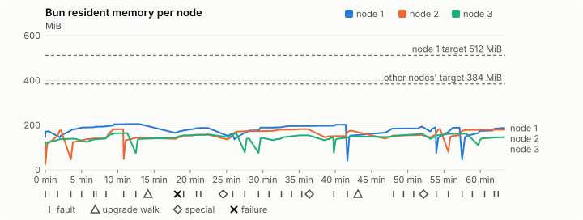
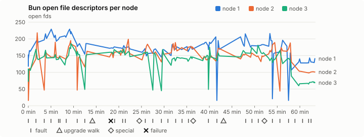
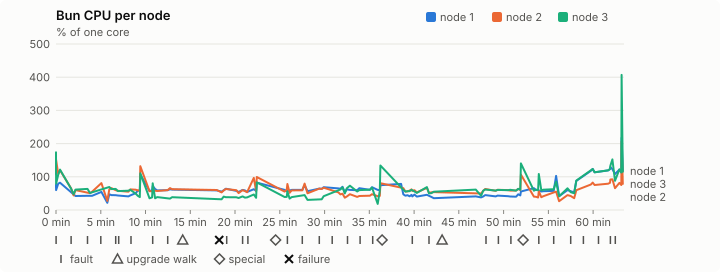
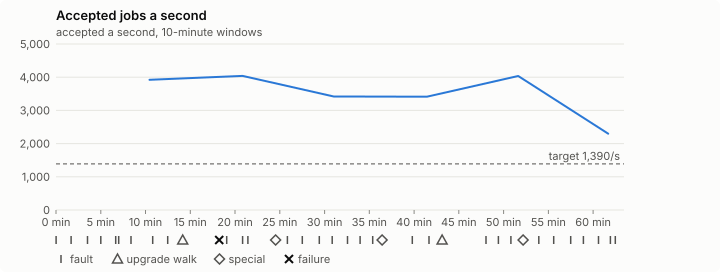

# Sustained soak (V02): FAIL

24 October 2026. fast tier, compressed schedule, 1 h 03 min of soak on a three-node quickstart cluster.

**Fast tier: not clean.** Fix what failed and run the fast tier again before a final-tier run.

## Candidate and host

| | |
|---|---|
| Staged base URL | <https://github.com/reliaburger/reliaburger/releases/download/staging-v0.2.2-40114420545-1> |
| `candidate.json` SHA-256 | `928caac0e8d0e7c52e1062bd62d91047b8b8bcd28b68a3df657f742881ca4f73` |
| Running versions | v0.2.2 x3 |
| Soak build | `bun-v0.2.2-soak.1`, SHA-256 `0879ab36f11d9bde655d549462c879d024e6d7bb1305a4ea043b88b472be4ff2` |
| Walks roll back to | 0.2.2 |
| Host | macOS 26.3.1, Apple M2 Max, 32 GiB |
| Lima | limactl version 2.2.1 |
| Guest | Ubuntu 24.04.5 LTS, kernel 6.8.0-139-generic |
| RELIABURGER_HOME | `/tmp/rbq.UVbOmR` |
| Evidence | `/var/tmp/reliaburger-v02.tEhU1C` |

## Configuration deviations

- node.toml `[testing] allowed_operations` adds `provision_isolated_workloads` (quickstart allows only inject_workload_faults and alter_node_state), so the catalogue pulse can lease test namespaces
- node.toml `[logs]`/`[metrics]` export to file:///var/lib/reliaburger/soak-export every 60 s with max_storage_mb = 8, `[storage.snapshots]` every 900 s (compressed: 120 s), retain 4, uploaded to the same directory
- node.toml `[ingress] tls_cert/tls_key` point at an operator pair from a soak CA, 45-minute leaves rotated by the harness
- Bun runs with auto/mixed; host jobs opt in to a single pinned BusyBox copy under /var/lib/reliaburger/soak-jobs, mount_isolation=false. The independent verifier listens on each private VM address, TCP 8189, with a separate run token
- node.toml `[node.labels] soak-volume` = "writer" on node 2 and "redis" on node 3, to pin the volume apps
- node.toml `[upgrades] external_signing_key` = a throwaway operator key the harness made for this run (`ed25519:HDjaQSgC+iLCPJG8zIVEWijwIRIQFBEgC7nQL4t6Ijg=`); the soak build's `.sig` gets that key's external signature beside the release one (D2)
- node.toml `[security] leaf_lifetime_override_secs = 3600` (D1)

## Timeline

- Started 2026-10-24 21:05:03 UTC, finished 2026-10-24 22:08:30 UTC
- Cycles completed: 5
- Teardown: `relish local destroy --yes` and `relish uninstall --yes` succeeded

## Faults and slots

| Class | Runs | Settled/ok | Failed | Skipped | Settle (median / max) |
|---|---|---|---|---|---|
| fault:bun-kill-follower | 5 | 5 | 0 | 0 | 33 s / 35 s |
| fault:bun-kill-leader | 5 | 5 | 0 | 0 | 35 s / 41 s |
| fault:chaos-cpu | 1 | 2 | 0 | 0 | 18 s / 18 s |
| fault:chaos-delay | 1 | 2 | 0 | 0 | 17 s / 17 s |
| fault:chaos-dns | 1 | 2 | 0 | 0 | 17 s / 17 s |
| fault:chaos-drop | 1 | 2 | 0 | 0 | 18 s / 18 s |
| fault:chaos-kill | 2 | 4 | 0 | 0 | 33 s / 33 s |
| fault:chaos-memory | 1 | 2 | 0 | 0 | 15 s / 15 s |
| fault:chaos-partition | 1 | 2 | 0 | 0 | 19 s / 19 s |
| fault:chaos-pause | 1 | 2 | 0 | 0 | 18 s / 18 s |
| fault:chaos-scenario | 1 | 2 | 0 | 0 | 34 s / 34 s |
| fault:deploy-kill | 3 | 3 | 0 | 0 | 35 s / 40 s |
| fault:node-delay | 2 | 2 | 0 | 0 | 32 s / 32 s |
| fault:node-disk-full | 2 | 2 | 0 | 0 | 20 s / 20 s |
| fault:node-slow-fsync | 1 | 1 | 0 | 0 | 18 s / 18 s |
| fault:power-off | 3 | 3 | 0 | 0 | 31 s / 60 s |
| pulse | 1 | 1 | 0 | 0 | n/a |
| pulse:settle | 0 | 1 | 0 | 0 | 20 s / 20 s |
| special:all-off | 1 | 1 | 0 | 0 | 47 s / 47 s |
| special:graceful-stop | 1 | 1 | 0 | 0 | 42 s / 42 s |
| special:quorum-back | 1 | 1 | 0 | 0 | n/a |
| special:quorum-loss | 1 | 1 | 0 | 0 | 74 s / 74 s |
| storage:offline-export | 2 | 2 | 0 | 0 | n/a |
| storage:registry-push | 5 | 0 | 0 | 0 | n/a |
| tls:invalid-expired | 3 | 3 | 0 | 0 | n/a |
| tls:invalid-torn | 3 | 3 | 0 | 0 | n/a |
| tls:reload | 29 | 29 | 0 | 0 | n/a |
| upgrade:rollback | 2 | 2 | 0 | 0 | n/a |
| upgrade:settle | 0 | 2 | 0 | 0 | 68 s / 68 s |
| upgrade:upgrade | 2 | 2 | 0 | 0 | n/a |

## Renewals and rotations

| Measure | Observed | Required | Verdict |
|---|---|---|---|
| workload identity rotations (soak-identity, per node) | 8 | ≥ 1 | PASS |
| node leaf renewals (per node) | 2 | ≥ 1 | PASS |
| operator ingress reloads (all nodes) | 29 | ≥ 11 | PASS |
| mixed job campaign and positive drain | 0 missing/failing checks | 0 | PASS |

## Jobs

| Runtime | Accepted successes | Retries | Last accepted progress |
|---|---|---|---|
| runc | 7530 | 1 | 1792879386 |
| shared-runc | 3391010 | 1 | 1792879386 |
| process | 9682419 | 1 | 1792879386 |

The bounded campaign shares the app soak's fault schedule. These counts are reliability evidence, not a saturation rate or a 100-million-per-day qualification.

- Independent verifier execution attempts: 24
- Explicit test-operator acknowledgements for known replay-safe fenced fixtures: 111

- rb-43eea9d11661-1: latest complete job storage (KiB) {'instances': 8140, 'job-state': 8, 'task-arrays': 16920}; free 5245688 KiB; live/peak owners 0/32; peak storage {'instances': 30540, 'job-state': 8, 'task-arrays': 33952}
- rb-43eea9d11661-2: latest complete job storage (KiB) {'instances': 2100, 'job-state': 8, 'task-arrays': 13756}; free 6356224 KiB; live/peak owners 0/31; peak storage {'instances': 30104, 'job-state': 8, 'task-arrays': 33980}
- rb-43eea9d11661-3: latest complete job storage (KiB) {'instances': 3012, 'job-state': 8, 'task-arrays': 18752}; free 6343140 KiB; live/peak owners 0/30; peak storage {'instances': 28716, 'job-state': 8, 'task-arrays': 33392}

Complete disk inventories are recorded. Global retention bounds and the 12-hour job qualification remain #668; this gate cannot certify an unimplemented retention policy.

## Job qualification (D18-C)

Load: target; 3 nodes; accepted 3,744.9/s against a 1390.0/s target: PASS.

The September plan set its targets for one 1M-task batch on a quiet cluster. A soak runs for hours with restarts, upgrades and apps, so its storage, Bun memory and Raft targets are restated (maintainer decision, 15 October 2026, [#668](https://github.com/reliaburger/reliaburger/issues/668)). Bun's steady state is the median RSS of each process once it has been seen for 10 minutes; the gated memory checks are unchanged (`leak-rss`, and Mayo's 70% `memory_high` alert through `wtf`).

| Measure (recorded, not gated) | Observed | Target |
|---|---|---|
| Wall time of a 1,048,576-task array (median / max of 12) | 378 s / 1,170 s | ≤ 600 s |
| p99 start lag, pooled executors | 32 ms (bucket upper bound) | < 1,000 ms |
| Raft entries per second, all cluster writes | 2.02 | recorded only; the batch target counts only task-array writes |
| Raft state of one run, largest seen | 5,957 B | ≤ 256 KiB per 1M tasks |
| Bun steady-state RSS per process, worst node against its target | rb-43eea9d11661-2: 181.87 MiB steady, 183.75 MiB peak | ≤ 384 MiB (≤ 512 MiB on node 1, which serves the API) |
| Bun CPU, busiest node | 0.61 cores | ≤ 1 core (leader batch control) |
| Executor helper CPU, busiest node | 0.02 cores | ≤ 0.5 core |
| Node task-array storage per 1M accepted tasks (peaks summed) | 7.56 MiB | ≤ 64 MiB, deleted after retirement |
| Retained log volume, all nodes | 6.31 MB | ≤ 50 MB |

- Bun RSS on rb-43eea9d11661-1 (serves the API, target ≤ 512 MiB): pid 8202: 172.90 MiB peak (seen for under 10 minutes); pid 150659: 204.70 MiB steady, 204.71 MiB peak; pid 150659: 187.14 MiB peak (seen for under 10 minutes); pid 678: 162.64 MiB peak (seen for under 10 minutes); pid 103516: 196.93 MiB steady, 201.72 MiB peak; pid 1688198: 153.34 MiB peak (seen for under 10 minutes); pid 1688198: 193.67 MiB peak (seen for under 10 minutes); pid 674: 190.71 MiB peak (seen for under 10 minutes); pid 101170: 188.73 MiB peak (seen for under 10 minutes); pid 481762: 187.02 MiB peak (seen for under 10 minutes)
- Bun RSS on rb-43eea9d11661-2 (node, target ≤ 384 MiB): pid 2312: 121.87 MiB peak (seen for under 10 minutes); pid 4778: 175.81 MiB peak (seen for under 10 minutes); pid 363634: 181.55 MiB peak (seen for under 10 minutes); pid 1264603: 143.20 MiB peak (seen for under 10 minutes); pid 1264603: 157.49 MiB peak (seen for under 10 minutes); pid 674: 181.87 MiB steady, 181.88 MiB peak; pid 674: 175.45 MiB peak (seen for under 10 minutes); pid 672: 155.69 MiB peak (seen for under 10 minutes); pid 674: 183.75 MiB peak (seen for under 10 minutes); pid 317863: 179.34 MiB peak (seen for under 10 minutes)
- Bun RSS on rb-43eea9d11661-3 (node, target ≤ 384 MiB): pid 2118: 139.00 MiB peak (seen for under 10 minutes); pid 672: 163.68 MiB peak (seen for under 10 minutes); pid 815670: 138.10 MiB peak (seen for under 10 minutes); pid 1054002: 158.55 MiB peak (seen for under 10 minutes); pid 676: 164.64 MiB peak (seen for under 10 minutes); pid 306911: 140.68 MiB peak (seen for under 10 minutes); pid 506336: 142.78 MiB peak (seen for under 10 minutes); pid 678: 154.59 MiB peak (seen for under 10 minutes); pid 675: 144.48 MiB peak (seen for under 10 minutes); pid 153100: 149.91 MiB peak (seen for under 10 minutes); pid 153100: 162.38 MiB peak (seen for under 10 minutes); pid 673: 161.27 MiB peak (seen for under 10 minutes); pid 677: 146.48 MiB peak (seen for under 10 minutes)

- runc retry causes: exit_code 1, launch 0, signal 0, timeout 0, unknown 0, unrecorded 0
- shared-runc retry causes: exit_code 1, launch 0, signal 0, timeout 0, unknown 0, unrecorded 0
- process retry causes: exit_code 1, launch 0, signal 0, timeout 0, unknown 0, unrecorded 0
- Audited executions: 24; operator replay decisions: 111
- Job controller API fallbacks: rb-43eea9d11661-1 missed 209, rb-43eea9d11661-2 missed 4; rb-43eea9d11661-2 answered 205, rb-43eea9d11661-3 answered 4 (requests a node didn't answer, and the node that took them instead)

## Data

- Volume writer: highest ACK 30591 in the log view; the writer file checks (writer-lost, writer-regression) decide data loss, and `*-log-order` failures are about the order the log view returned lines in
- Redis counter: highest INCR 3064 in the log view
- Export rb-43eea9d11661-1: 113 source files, 112 at the destination
- Export rb-43eea9d11661-2: 129 source files, 126 at the destination
- Export rb-43eea9d11661-3: 103 source files, 99 at the destination
- Registry images pushed and re-verified: 6
- Agent-loop turns over the 1 s budget: rb-43eea9d11661-1 0, rb-43eea9d11661-2 1, rb-43eea9d11661-3 0
- Guest clock steps by Lima's guest agent: rb-43eea9d11661-1 3, rb-43eea9d11661-2 3, rb-43eea9d11661-3 6
- Checks evaluated: 187 (heavy 16, light 66, settle 105)
- Last observed progress: redis-counter 3064, writer-ack 30591

## Resource trends

| Node | Measure | First | Last | Max |
|---|---|---|---|---|
| rb-43eea9d11661-1 | disk_kb data | 1427840 | 1294648 | 1490736 |
| rb-43eea9d11661-1 | disk_kb images | 328964 | 444860 | 444860 |
| rb-43eea9d11661-1 | disk_kb logs | 36 | 3004 | 3004 |
| rb-43eea9d11661-1 | disk_kb metrics | 56 | 4092 | 4092 |
| rb-43eea9d11661-1 | disk_kb soak-export | 4 | 7028 | 7028 |
| rb-43eea9d11661-1 | disk_kb volumes | 224 | 180 | 248 |
| rb-43eea9d11661-1 | fd | 118 | 141 | 229 |
| rb-43eea9d11661-1 | rss_kb | 149804 | 191512 | 209624 |
| rb-43eea9d11661-2 | disk_kb data | 67440 | 267008 | 654076 |
| rb-43eea9d11661-2 | disk_kb images | 158836 | 329036 | 329036 |
| rb-43eea9d11661-2 | disk_kb logs | 28 | 2332 | 2332 |
| rb-43eea9d11661-2 | disk_kb metrics | 48 | 3848 | 3848 |
| rb-43eea9d11661-2 | disk_kb soak-export | 4 | 8292 | 8292 |
| rb-43eea9d11661-2 | disk_kb volumes | 16736 | 17324 | 17324 |
| rb-43eea9d11661-2 | fd | 68 | 101 | 218 |
| rb-43eea9d11661-2 | rss_kb | 114796 | 183644 | 188156 |
| rb-43eea9d11661-3 | disk_kb data | 171780 | 206796 | 701484 |
| rb-43eea9d11661-3 | disk_kb images | 316524 | 316620 | 316620 |
| rb-43eea9d11661-3 | disk_kb logs | 28 | 824 | 824 |
| rb-43eea9d11661-3 | disk_kb metrics | 48 | 2824 | 2824 |
| rb-43eea9d11661-3 | disk_kb soak-export | 4 | 3780 | 3780 |
| rb-43eea9d11661-3 | disk_kb volumes | 16736 | 16984 | 17096 |
| rb-43eea9d11661-3 | fd | 73 | 69 | 186 |
| rb-43eea9d11661-3 | rss_kb | 116976 | 149992 | 168592 |

## Charts

Time runs from the start of the soak. The marks under each chart are its faults, upgrade walks, specials and recorded failures; the dashed lines are targets.

## Failures

| # | First seen | Check | Symptom | Class | Cause | Action |
|---|---|---|---|---|---|---|
| 1 | 21:23:11 | heavy-check | fail: agent-loop-turn rb-43eea9d11661-2: 1 command turn(s) over the 1 s budget, the worst between 1 and 2.5 s; | unclassified | open | open |

Evidence: `/var/tmp/reliaburger-v02.tEhU1C` (events.jsonl, snapshots/, failures/<n>/).
