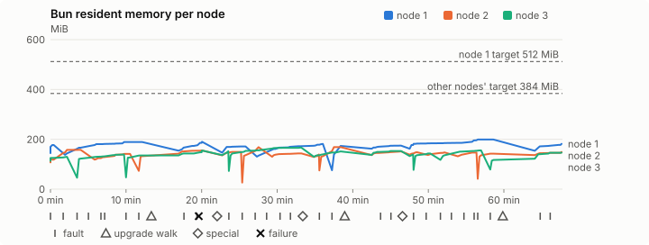
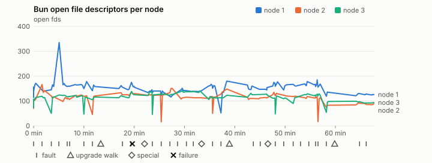
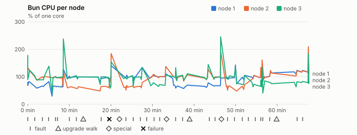
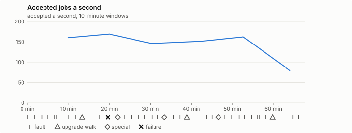

# Sustained soak (V02): FAIL

24 October 2026. fast tier, compressed schedule, 1 h 07 min of soak on a three-node quickstart cluster.

**Fast tier: not clean.** Fix what failed and run the fast tier again before a final-tier run.

## Candidate and host

| | |
|---|---|
| Staged base URL | <https://github.com/reliaburger/reliaburger/releases/download/staging-v0.2.2-40114420545-1> |
| `candidate.json` SHA-256 | `928caac0e8d0e7c52e1062bd62d91047b8b8bcd28b68a3df657f742881ca4f73` |
| Running versions | v0.2.2 x3 |
| Soak build | `bun-v0.2.2-soak.1`, SHA-256 `0879ab36f11d9bde655d549462c879d024e6d7bb1305a4ea043b88b472be4ff2` |
| Walks roll back to | 0.2.2 |
| Host | macOS 26.3.1, Apple M2 Max, 32 GiB |
| Lima | limactl version 2.2.1 |
| Guest | Ubuntu 24.04.5 LTS, kernel 6.8.0-139-generic |
| RELIABURGER_HOME | `/tmp/rbq.81HbzL` |
| Evidence | `/var/tmp/reliaburger-v02.FhgUup` |

## Configuration deviations

- node.toml `[testing] allowed_operations` adds `provision_isolated_workloads` (quickstart allows only inject_workload_faults and alter_node_state), so the catalogue pulse can lease test namespaces
- node.toml `[logs]`/`[metrics]` export to file:///var/lib/reliaburger/soak-export every 60 s with max_storage_mb = 8, `[storage.snapshots]` every 900 s (compressed: 120 s), retain 4, uploaded to the same directory
- node.toml `[ingress] tls_cert/tls_key` point at an operator pair from a soak CA, 45-minute leaves rotated by the harness
- Bun runs with auto/mixed; host jobs opt in to a single pinned BusyBox copy under /var/lib/reliaburger/soak-jobs, mount_isolation=false. The independent verifier listens on each private VM address, TCP 8189, with a separate run token
- node.toml `[node.labels] soak-volume` = "writer" on node 2 and "redis" on node 3, to pin the volume apps
- node.toml `[upgrades] external_signing_key` = a throwaway operator key the harness made for this run (`ed25519:ASrRG1RjfRhaWQh0Vi+BLyVhPUcvizQguxnBzoHD5Gg=`); the soak build's `.sig` gets that key's external signature beside the release one (D2)
- node.toml `[security] leaf_lifetime_override_secs = 3600` (D1)

## Timeline

- Started 2026-10-24 18:35:35 UTC, finished 2026-10-24 19:43:20 UTC
- Cycles completed: 6
- Teardown: `relish local destroy --yes` and `relish uninstall --yes` succeeded

## Faults and slots

| Class | Runs | Settled/ok | Failed | Skipped | Settle (median / max) |
|---|---|---|---|---|---|
| fault:bun-kill-follower | 6 | 6 | 0 | 0 | 31 s / 35 s |
| fault:bun-kill-leader | 6 | 6 | 0 | 0 | 33 s / 36 s |
| fault:chaos-cpu | 1 | 2 | 0 | 0 | 16 s / 16 s |
| fault:chaos-delay | 2 | 4 | 0 | 0 | 16 s / 16 s |
| fault:chaos-dns | 1 | 2 | 0 | 0 | 16 s / 16 s |
| fault:chaos-drop | 1 | 2 | 0 | 0 | 22 s / 22 s |
| fault:chaos-kill | 2 | 4 | 0 | 0 | 29 s / 29 s |
| fault:chaos-memory | 1 | 2 | 0 | 0 | 16 s / 16 s |
| fault:chaos-partition | 2 | 4 | 0 | 0 | 16 s / 16 s |
| fault:chaos-pause | 1 | 2 | 0 | 0 | 16 s / 16 s |
| fault:chaos-scenario | 1 | 2 | 0 | 0 | 36 s / 36 s |
| fault:deploy-kill | 3 | 3 | 0 | 0 | 34 s / 35 s |
| fault:power-off | 3 | 3 | 0 | 0 | 29 s / 34 s |
| pulse | 1 | 1 | 0 | 0 | n/a |
| pulse:settle | 0 | 1 | 0 | 0 | 16 s / 16 s |
| special:all-off | 1 | 1 | 0 | 0 | 30 s / 30 s |
| special:graceful-stop | 1 | 1 | 0 | 0 | 52 s / 52 s |
| special:quorum-back | 1 | 1 | 0 | 0 | n/a |
| special:quorum-loss | 1 | 1 | 0 | 0 | 42 s / 42 s |
| storage:offline-export | 3 | 3 | 0 | 0 | n/a |
| storage:registry-push | 6 | 0 | 0 | 0 | n/a |
| tls:invalid-expired | 3 | 3 | 0 | 0 | n/a |
| tls:invalid-torn | 6 | 6 | 0 | 0 | n/a |
| tls:reload | 35 | 35 | 0 | 0 | n/a |
| upgrade:rollback | 3 | 3 | 0 | 0 | n/a |
| upgrade:settle | 0 | 3 | 0 | 0 | 43 s / 69 s |
| upgrade:upgrade | 3 | 3 | 0 | 0 | n/a |

## Renewals and rotations

| Measure | Observed | Required | Verdict |
|---|---|---|---|
| workload identity rotations (soak-identity, per node) | 7 | ≥ 1 | PASS |
| node leaf renewals (per node) | 2 | ≥ 1 | PASS |
| operator ingress reloads (all nodes) | 35 | ≥ 12 | PASS |
| mixed job campaign and positive drain | 0 missing/failing checks | 0 | PASS |

## Jobs

| Runtime | Accepted successes | Retries | Last accepted progress |
|---|---|---|---|
| runc | 11483 | 5 | 1792870421 |
| shared-runc | 227171 | 1 | 1792870419 |
| process | 314184 | 1 | 1792870419 |

The bounded campaign shares the app soak's fault schedule. These counts are reliability evidence, not a saturation rate or a 100-million-per-day qualification.

- Independent verifier execution attempts: 24
- Explicit test-operator acknowledgements for known replay-safe fenced fixtures: 115

- rb-e3f305819c17-1: latest complete job storage (KiB) {'instances': 3520, 'job-state': 8, 'task-arrays': 4128}; free 5235076 KiB; live/peak owners 0/11; peak storage {'instances': 14248, 'job-state': 8, 'task-arrays': 13300}
- rb-e3f305819c17-2: latest complete job storage (KiB) {'instances': 488, 'job-state': 8, 'task-arrays': 3884}; free 6312068 KiB; live/peak owners 0/8; peak storage {'instances': 6516, 'job-state': 8, 'task-arrays': 13316}
- rb-e3f305819c17-3: latest complete job storage (KiB) {'instances': 292, 'job-state': 8, 'task-arrays': 4072}; free 6356892 KiB; live/peak owners 0/8; peak storage {'instances': 12676, 'job-state': 8, 'task-arrays': 13576}

Complete disk inventories are recorded. Global retention bounds and the 12-hour job qualification remain #668; this gate cannot certify an unimplemented retention policy.

## Job qualification (D18-C)

Load: calibration; 3 nodes; accepted 158.2/s (calibration load: not gated).

The September plan set its targets for one 1M-task batch on a quiet cluster. A soak runs for hours with restarts, upgrades and apps, so its storage, Bun memory and Raft targets are restated (maintainer decision, 15 October 2026, [#668](https://github.com/reliaburger/reliaburger/issues/668)). Bun's steady state is the median RSS of each process once it has been seen for 10 minutes; the gated memory checks are unchanged (`leak-rss`, and Mayo's 70% `memory_high` alert through `wtf`).

| Measure (recorded, not gated) | Observed | Target |
|---|---|---|
| Wall time of a 1,048,576-task array (median / max of 0) | not measured / not measured | ≤ 600 s |
| p99 start lag, pooled executors | 8 ms (bucket upper bound) | < 1,000 ms |
| Raft entries per second, all cluster writes | 1.92 | recorded only; the batch target counts only task-array writes |
| Raft state of one run, largest seen | 37,141 B | ≤ 256 KiB per 1M tasks |
| Bun steady-state RSS per process, worst node against its target | rb-e3f305819c17-1: 199.20 MiB steady, 199.20 MiB peak | ≤ 512 MiB (≤ 512 MiB on node 1, which serves the API) |
| Bun CPU, busiest node | 0.92 cores | ≤ 1 core (leader batch control) |
| Executor helper CPU, busiest node | 0.00 cores | ≤ 0.5 core |
| Node task-array storage per 1M accepted tasks (peaks summed) | 71.00 MiB | ≤ 64 MiB, deleted after retirement |
| Retained log volume, all nodes | 6.74 MB | ≤ 50 MB |

- Bun RSS on rb-e3f305819c17-1 (serves the API, target ≤ 512 MiB): pid 8089: 177.23 MiB peak (seen for under 10 minutes); pid 31394: 188.91 MiB steady, 188.91 MiB peak; pid 31394: 190.08 MiB peak (seen for under 10 minutes); pid 676: 171.42 MiB peak (seen for under 10 minutes); pid 65502: 181.61 MiB peak (seen for under 10 minutes); pid 201892: 173.47 MiB peak (seen for under 10 minutes); pid 201892: 174.75 MiB peak (seen for under 10 minutes); pid 670: 199.20 MiB steady, 199.20 MiB peak; pid 670: 181.64 MiB peak (seen for under 10 minutes)
- Bun RSS on rb-e3f305819c17-2 (node, target ≤ 384 MiB): pid 2280: 122.28 MiB peak (seen for under 10 minutes); pid 4840: 157.96 MiB peak (seen for under 10 minutes); pid 670: 141.42 MiB peak (seen for under 10 minutes); pid 88774: 132.16 MiB peak (seen for under 10 minutes); pid 117475: 155.28 MiB peak (seen for under 10 minutes); pid 676: 149.39 MiB peak (seen for under 10 minutes); pid 44599: 168.27 MiB peak (seen for under 10 minutes); pid 669: 143.57 MiB peak (seen for under 10 minutes); pid 675: 138.99 MiB peak (seen for under 10 minutes); pid 15757: 168.91 MiB peak (seen for under 10 minutes); pid 660: 151.36 MiB peak (seen for under 10 minutes); pid 674: 148.32 MiB peak (seen for under 10 minutes); pid 37807: 147.49 MiB peak (seen for under 10 minutes); pid 663: 147.10 MiB peak (seen for under 10 minutes); pid 43353: 142.32 MiB peak (seen for under 10 minutes); pid 677: 149.27 MiB peak (seen for under 10 minutes)
- Bun RSS on rb-e3f305819c17-3 (node, target ≤ 384 MiB): pid 2149: 129.59 MiB peak (seen for under 10 minutes); pid 44699: 138.93 MiB peak (seen for under 10 minutes); pid 133459: 135.09 MiB peak (seen for under 10 minutes); pid 133459: 155.11 MiB peak (seen for under 10 minutes); pid 675: 152.34 MiB peak (seen for under 10 minutes); pid 17942: 166.48 MiB peak (seen for under 10 minutes); pid 680: 151.40 MiB peak (seen for under 10 minutes); pid 680: 152.94 MiB peak (seen for under 10 minutes); pid 676: 138.92 MiB peak (seen for under 10 minutes); pid 12054: 143.02 MiB peak (seen for under 10 minutes); pid 59135: 155.51 MiB peak (seen for under 10 minutes); pid 150824: 117.00 MiB peak (seen for under 10 minutes); pid 150824: 146.35 MiB peak (seen for under 10 minutes)

- runc retry causes: exit_code 1, launch 2, signal 0, timeout 0, unknown 1, unrecorded 1
- shared-runc retry causes: exit_code 1, launch 0, signal 0, timeout 0, unknown 0, unrecorded 0
- process retry causes: exit_code 1, launch 0, signal 0, timeout 0, unknown 0, unrecorded 0
- Audited executions: 24; operator replay decisions: 115
- Job controller API fallbacks: rb-e3f305819c17-1 missed 153, rb-e3f305819c17-2 missed 17; rb-e3f305819c17-2 answered 136, rb-e3f305819c17-3 answered 17 (requests a node didn't answer, and the node that took them instead)

## Data

- Volume writer: highest ACK 32226 in the log view; the writer file checks (writer-lost, writer-regression) decide data loss, and `*-log-order` failures are about the order the log view returned lines in
- Redis counter: highest INCR 3393 in the log view
- Export rb-e3f305819c17-1: 129 source files, 118 at the destination
- Export rb-e3f305819c17-2: 133 source files, 85 at the destination
- Export rb-e3f305819c17-3: 113 source files, 104 at the destination
- Registry images pushed and re-verified: 7
- Agent-loop turns over the 1 s budget: rb-e3f305819c17-1 1, rb-e3f305819c17-2 0, rb-e3f305819c17-3 0
- Guest clock steps by Lima's guest agent: rb-e3f305819c17-1 2, rb-e3f305819c17-2 8, rb-e3f305819c17-3 3
- Checks evaluated: 194 (heavy 17, light 75, settle 102)
- Last observed progress: redis-counter 3393, writer-ack 32226

## Resource trends

| Node | Measure | First | Last | Max |
|---|---|---|---|---|
| rb-e3f305819c17-1 | disk_kb data | 1369412 | 1446240 | 1517380 |
| rb-e3f305819c17-1 | disk_kb images | 328964 | 444884 | 444884 |
| rb-e3f305819c17-1 | disk_kb logs | 32 | 3868 | 3868 |
| rb-e3f305819c17-1 | disk_kb metrics | 52 | 4840 | 4840 |
| rb-e3f305819c17-1 | disk_kb soak-export | 4 | 7884 | 7884 |
| rb-e3f305819c17-1 | disk_kb volumes | 200 | 228 | 252 |
| rb-e3f305819c17-1 | fd | 114 | 126 | 335 |
| rb-e3f305819c17-1 | rss_kb | 148208 | 185996 | 203980 |
| rb-e3f305819c17-2 | disk_kb data | 67428 | 83588 | 94812 |
| rb-e3f305819c17-2 | disk_kb images | 161940 | 329020 | 329020 |
| rb-e3f305819c17-2 | disk_kb logs | 28 | 988 | 988 |
| rb-e3f305819c17-2 | disk_kb metrics | 60 | 2744 | 2744 |
| rb-e3f305819c17-2 | disk_kb soak-export | 4 | 2244 | 2244 |
| rb-e3f305819c17-2 | disk_kb volumes | 16736 | 17252 | 17252 |
| rb-e3f305819c17-2 | fd | 78 | 90 | 166 |
| rb-e3f305819c17-2 | rss_kb | 109964 | 152856 | 172960 |
| rb-e3f305819c17-3 | disk_kb data | 230180 | 187600 | 722928 |
| rb-e3f305819c17-3 | disk_kb images | 316524 | 322636 | 322636 |
| rb-e3f305819c17-3 | disk_kb logs | 24 | 1724 | 1724 |
| rb-e3f305819c17-3 | disk_kb metrics | 60 | 3428 | 3428 |
| rb-e3f305819c17-3 | disk_kb soak-export | 4 | 6668 | 6668 |
| rb-e3f305819c17-3 | disk_kb volumes | 16748 | 17028 | 17140 |
| rb-e3f305819c17-3 | fd | 85 | 94 | 142 |
| rb-e3f305819c17-3 | rss_kb | 116236 | 149864 | 170472 |

## Charts

Time runs from the start of the soak. The marks under each chart are its faults, upgrade walks, specials and recorded failures; the dashed lines are targets.

## Failures

| # | First seen | Check | Symptom | Class | Cause | Action |
|---|---|---|---|---|---|---|
| 1 | 18:55:06 | settle-check | fail: agent-loop-turn rb-e3f305819c17-1: 1 restart_step turn(s) over the 1 s budget, the worst between 5 and 10 s; | unclassified | open | open |

Evidence: `/var/tmp/reliaburger-v02.FhgUup` (events.jsonl, snapshots/, failures/<n>/).
