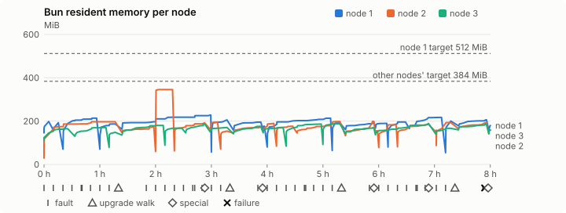
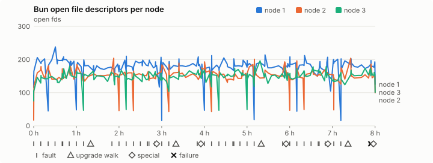
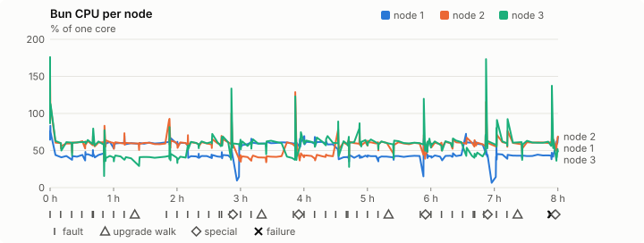
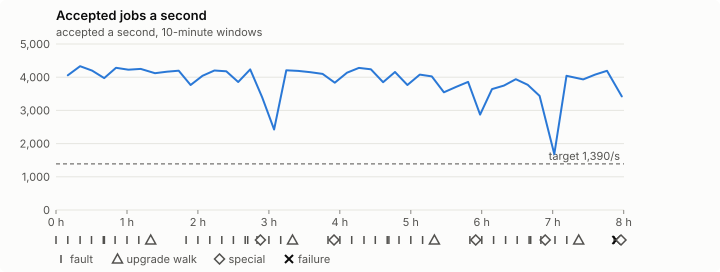

# Sustained soak (V02): FAIL

25 October 2026. final tier, full schedule, 8 h 00 min of soak on a three-node quickstart cluster.

**Final tier: not clean. The V02 gate does not pass.** A product fix means a fresh fast-tier run, then a fresh final-tier run.

## Candidate and host

| | |
|---|---|
| Staged base URL | <https://github.com/reliaburger/reliaburger/releases/download/staging-v0.2.2-40114420545-1> |
| `candidate.json` SHA-256 | `928caac0e8d0e7c52e1062bd62d91047b8b8bcd28b68a3df657f742881ca4f73` |
| Running versions | v0.2.2 x3 |
| Soak build | `bun-v0.2.2-soak.1`, SHA-256 `0879ab36f11d9bde655d549462c879d024e6d7bb1305a4ea043b88b472be4ff2` |
| Walks roll back to | 0.2.2 |
| Host | macOS 26.3.1, Apple M2 Max, 32 GiB |
| Lima | limactl version 2.2.1 |
| Guest | Ubuntu 24.04.5 LTS, kernel 6.8.0-139-generic |
| RELIABURGER_HOME | `/tmp/rbq.KRtozL` |
| Evidence | `/var/tmp/reliaburger-v02.WYcG9N` |

## Configuration deviations

- node.toml `[testing] allowed_operations` adds `provision_isolated_workloads` (quickstart allows only inject_workload_faults and alter_node_state), so the catalogue pulse can lease test namespaces
- node.toml `[logs]`/`[metrics]` export to file:///var/lib/reliaburger/soak-export every 60 s with max_storage_mb = 8, `[storage.snapshots]` every 900 s (compressed: 120 s), retain 4, uploaded to the same directory
- node.toml `[ingress] tls_cert/tls_key` point at an operator pair from a soak CA, 45-minute leaves rotated by the harness
- Bun runs with auto/mixed; host jobs opt in to a single pinned BusyBox copy under /var/lib/reliaburger/soak-jobs, mount_isolation=false. The independent verifier listens on each private VM address, TCP 8189, with a separate run token
- node.toml `[node.labels] soak-volume` = "writer" on node 2 and "redis" on node 3, to pin the volume apps
- node.toml `[upgrades] external_signing_key` = a throwaway operator key the harness made for this run (`ed25519:V3XzWIg9q/eoBxq1NgGCfvIhGlom/IE4ir7A8QECbss=`); the soak build's `.sig` gets that key's external signature beside the release one (D2)
- node.toml `[security] leaf_lifetime_override_secs = 3600` (D1)

## Timeline

- Started 2026-10-25 15:18:43 UTC, finished 2026-10-25 23:19:00 UTC
- Cycles completed: 8
- Teardown: `relish local destroy --yes` and `relish uninstall --yes` succeeded

## Faults and slots

| Class | Runs | Settled/ok | Failed | Skipped | Settle (median / max) |
|---|---|---|---|---|---|
| fault:bun-kill-follower | 8 | 8 | 0 | 0 | 37 s / 47 s |
| fault:bun-kill-leader | 8 | 8 | 0 | 0 | 37 s / 52 s |
| fault:chaos-cpu | 1 | 2 | 0 | 0 | 21 s / 21 s |
| fault:chaos-delay | 1 | 2 | 0 | 0 | 19 s / 19 s |
| fault:chaos-dns | 1 | 2 | 0 | 0 | 19 s / 19 s |
| fault:chaos-drop | 1 | 2 | 0 | 0 | 20 s / 20 s |
| fault:chaos-kill | 1 | 2 | 0 | 0 | 54 s / 54 s |
| fault:chaos-partition | 1 | 2 | 0 | 0 | 20 s / 20 s |
| fault:chaos-pause | 1 | 2 | 0 | 0 | 20 s / 20 s |
| fault:chaos-scenario | 1 | 2 | 0 | 0 | 34 s / 34 s |
| fault:deploy-kill | 4 | 4 | 0 | 0 | 41 s / 50 s |
| fault:node-delay | 3 | 3 | 0 | 0 | 20 s / 39 s |
| fault:node-disk-full | 3 | 3 | 0 | 0 | 30 s / 43 s |
| fault:node-slow-fsync | 2 | 2 | 0 | 0 | 24 s / 24 s |
| fault:power-off | 4 | 4 | 0 | 0 | 35 s / 48 s |
| pulse | 8 | 8 | 0 | 0 | n/a |
| pulse:settle | 0 | 8 | 0 | 0 | 19 s / 22 s |
| special:all-off | 1 | 1 | 0 | 0 | 50 s / 50 s |
| special:graceful-stop | 2 | 2 | 0 | 0 | 50 s / 50 s |
| special:quorum-back | 2 | 2 | 0 | 0 | n/a |
| special:quorum-loss | 2 | 2 | 0 | 0 | 48 s / 48 s |
| storage:offline-export | 1 | 1 | 0 | 0 | n/a |
| storage:registry-push | 8 | 0 | 0 | 0 | n/a |
| tls:invalid-expired | 9 | 9 | 0 | 0 | n/a |
| tls:invalid-torn | 12 | 12 | 0 | 0 | n/a |
| tls:reload | 91 | 91 | 0 | 0 | n/a |
| upgrade:rollback | 4 | 4 | 0 | 0 | n/a |
| upgrade:settle | 0 | 4 | 0 | 0 | 63 s / 65 s |
| upgrade:upgrade | 4 | 4 | 0 | 0 | n/a |

## Renewals and rotations

| Measure | Observed | Required | Verdict |
|---|---|---|---|
| workload identity rotations (soak-identity, per node) | 20 | ≥ 15 | PASS |
| node leaf renewals (per node) | 17 | ≥ 15 | PASS |
| operator ingress reloads (all nodes) | 91 | ≥ 31 | PASS |
| mixed job campaign and positive drain | 0 missing/failing checks | 0 | PASS |

## Jobs

| Runtime | Accepted successes | Retries | Last accepted progress |
|---|---|---|---|
| runc | 63414 | 3 | 1792970328 |
| shared-runc | 29034591 | 1 | 1792970328 |
| process | 82619335 | 1 | 1792970328 |

The bounded campaign shares the app soak's fault schedule. These counts are reliability evidence, not a saturation rate or a 100-million-per-day qualification.

- Independent verifier execution attempts: 24
- Explicit test-operator acknowledgements for known replay-safe fenced fixtures: 195

- rb-4816ef430b2e-1: latest complete job storage (KiB) {'instances': 4880, 'job-state': 8, 'task-arrays': 8416}; free 4528136 KiB; live/peak owners 0/32; peak storage {'instances': 70816, 'job-state': 8, 'task-arrays': 39768}
- rb-4816ef430b2e-2: latest complete job storage (KiB) {'instances': 620, 'job-state': 8, 'task-arrays': 18168}; free 5625388 KiB; live/peak owners 0/32; peak storage {'instances': 73496, 'job-state': 8, 'task-arrays': 40848}
- rb-4816ef430b2e-3: latest complete job storage (KiB) {'instances': 452, 'job-state': 8, 'task-arrays': 9312}; free 5639552 KiB; live/peak owners 0/32; peak storage {'instances': 54360, 'job-state': 8, 'task-arrays': 40872}

Complete disk inventories are recorded. Global retention bounds and the 12-hour job qualification remain #668; this gate cannot certify an unimplemented retention policy.

## Job qualification (D18-C)

Load: target; 3 nodes; accepted 3,877.2/s against a 1390.0/s target: PASS.

The September plan set its targets for one 1M-task batch on a quiet cluster. A soak runs for hours with restarts, upgrades and apps, so its storage, Bun memory and Raft targets are restated (maintainer decision, 15 October 2026, [#668](https://github.com/reliaburger/reliaburger/issues/668)). Bun's steady state is the median RSS of each process once it has been seen for 10 minutes; the gated memory checks are unchanged (`leak-rss`, and Mayo's 70% `memory_high` alert through `wtf`).

| Measure (recorded, not gated) | Observed | Target |
|---|---|---|
| Wall time of a 1,048,576-task array (median / max of 64) | 371 s / 1,421 s | ≤ 600 s |
| p99 start lag, pooled executors | 32 ms (bucket upper bound) | < 1,000 ms |
| Raft entries per second, all cluster writes | 1.79 | recorded only; the batch target counts only task-array writes |
| Raft state of one run, largest seen | 6,217 B | ≤ 256 KiB per 1M tasks |
| Bun steady-state RSS per process, worst node against its target | rb-4816ef430b2e-2: 345.66 MiB steady, 345.66 MiB peak | ≤ 384 MiB (≤ 512 MiB on node 1, which serves the API) |
| Bun CPU, busiest node | 0.57 cores | ≤ 1 core (leader batch control) |
| Executor helper CPU, busiest node | 0.01 cores | ≤ 0.5 core |
| Node task-array storage per 1M accepted tasks (peaks summed) | 1.06 MiB | ≤ 64 MiB, deleted after retirement |
| Retained log volume, all nodes | 27.39 MB | ≤ 50 MB |

- Bun RSS on rb-4816ef430b2e-1 (serves the API, target ≤ 512 MiB): pid 8276: 198.12 MiB peak (seen for under 10 minutes); pid 1072853: 192.57 MiB peak (seen for under 10 minutes); pid 2218577: 208.40 MiB steady, 213.68 MiB peak; pid 2598713: 186.23 MiB steady, 186.71 MiB peak; pid 2598713: 217.88 MiB steady, 227.95 MiB peak; pid 2961553: 196.08 MiB steady, 205.55 MiB peak; pid 2961553: 195.25 MiB steady, 195.96 MiB peak; pid 679: 176.54 MiB peak (seen for under 10 minutes); pid 499469: 202.38 MiB steady, 213.14 MiB peak; pid 79919: 191.36 MiB peak (seen for under 10 minutes); pid 79919: 187.83 MiB steady, 195.59 MiB peak; pid 675: 189.59 MiB steady, 189.59 MiB peak; pid 1431779: 195.84 MiB steady, 195.84 MiB peak; pid 676: 215.98 MiB steady, 217.28 MiB peak; pid 3330339: 200.23 MiB peak (seen for under 10 minutes); pid 3330339: 201.54 MiB steady, 206.46 MiB peak; pid 674: 179.74 MiB peak (seen for under 10 minutes)
- Bun RSS on rb-4816ef430b2e-2 (node, target ≤ 384 MiB): pid 2289: 120.39 MiB peak (seen for under 10 minutes); pid 4559: 187.25 MiB steady, 197.08 MiB peak; pid 4559: 163.86 MiB steady, 173.82 MiB peak; pid 1105761: 345.66 MiB steady, 345.66 MiB peak; pid 3380247: 187.56 MiB steady, 191.96 MiB peak; pid 670: 195.56 MiB peak (seen for under 10 minutes); pid 1366136: 153.85 MiB peak (seen for under 10 minutes); pid 1366136: 169.67 MiB steady, 174.86 MiB peak; pid 678: 189.35 MiB steady, 189.35 MiB peak; pid 1694560: 172.16 MiB steady, 176.25 MiB peak; pid 672: 175.56 MiB steady, 198.45 MiB peak; pid 674: 191.84 MiB steady, 198.83 MiB peak; pid 676: 155.26 MiB peak (seen for under 10 minutes); pid 370805: 182.86 MiB steady, 182.86 MiB peak; pid 2348982: 177.22 MiB steady, 184.97 MiB peak; pid 676: 158.40 MiB peak (seen for under 10 minutes); pid 143219: 192.89 MiB steady, 193.54 MiB peak; pid 143219: 191.29 MiB steady, 191.79 MiB peak; pid 673: 158.47 MiB peak (seen for under 10 minutes)
- Bun RSS on rb-4816ef430b2e-3 (node, target ≤ 384 MiB): pid 2096: 162.74 MiB steady, 164.73 MiB peak; pid 660: 169.03 MiB steady, 170.36 MiB peak; pid 185535: 148.13 MiB peak (seen for under 10 minutes); pid 1426814: 176.77 MiB steady, 180.03 MiB peak; pid 2930733: 167.30 MiB steady, 167.30 MiB peak; pid 666: 179.10 MiB steady, 186.71 MiB peak; pid 675: 168.64 MiB steady, 170.46 MiB peak; pid 675: 175.50 MiB steady, 175.83 MiB peak; pid 679: 169.32 MiB steady, 169.32 MiB peak; pid 2876579: 184.19 MiB steady, 186.51 MiB peak; pid 2785486: 187.57 MiB steady, 187.70 MiB peak; pid 2785486: 167.29 MiB steady, 169.58 MiB peak; pid 675: 177.14 MiB steady, 188.97 MiB peak; pid 662: 166.38 MiB steady, 166.51 MiB peak; pid 662: 181.92 MiB steady, 186.13 MiB peak; pid 676: 159.27 MiB peak (seen for under 10 minutes)

- runc retry causes: exit_code 1, launch 1, signal 0, timeout 0, unknown 1, unrecorded 0
- shared-runc retry causes: exit_code 1, launch 0, signal 0, timeout 0, unknown 0, unrecorded 0
- process retry causes: exit_code 1, launch 0, signal 0, timeout 0, unknown 0, unrecorded 0
- Audited executions: 24; operator replay decisions: 195
- Job controller API fallbacks: rb-4816ef430b2e-1 missed 838, rb-4816ef430b2e-2 missed 31; rb-4816ef430b2e-2 answered 807, rb-4816ef430b2e-3 answered 31 (requests a node didn't answer, and the node that took them instead)

## Data

- Volume writer: highest ACK 239027 in the log view; the writer file checks (writer-lost, writer-regression) decide data loss, and `*-log-order` failures are about the order the log view returned lines in
- Redis counter: highest INCR 26328 in the log view
- Export rb-4816ef430b2e-1: 302 source files, 710 at the destination
- Export rb-4816ef430b2e-2: 413 source files, 855 at the destination
- Export rb-4816ef430b2e-3: 275 source files, 641 at the destination
- Registry images pushed and re-verified: 9
- Agent-loop turns over the 1 s budget: rb-4816ef430b2e-1 1, rb-4816ef430b2e-2 0, rb-4816ef430b2e-3 0
- Guest clock steps by Lima's guest agent: rb-4816ef430b2e-1 6, rb-4816ef430b2e-2 7, rb-4816ef430b2e-3 7
- Checks evaluated: 1034 (heavy 100, light 783, settle 151)
- Last observed progress: redis-counter 26328, writer-ack 239027

## Resource trends

| Node | Measure | First | Last | Max |
|---|---|---|---|---|
| rb-4816ef430b2e-1 | disk_kb data | 1369500 | 1401032 | 1616628 |
| rb-4816ef430b2e-1 | disk_kb images | 328964 | 453220 | 453220 |
| rb-4816ef430b2e-1 | disk_kb logs | 40 | 8632 | 9196 |
| rb-4816ef430b2e-1 | disk_kb metrics | 52 | 8604 | 9132 |
| rb-4816ef430b2e-1 | disk_kb soak-export | 4 | 52572 | 52572 |
| rb-4816ef430b2e-1 | disk_kb volumes | 200 | 180 | 252 |
| rb-4816ef430b2e-1 | fd | 116 | 125 | 238 |
| rb-4816ef430b2e-1 | rss_kb | 149188 | 184052 | 233420 |
| rb-4816ef430b2e-2 | disk_kb data | 67432 | 190284 | 592512 |
| rb-4816ef430b2e-2 | disk_kb images | 158836 | 337412 | 337412 |
| rb-4816ef430b2e-2 | disk_kb logs | 32 | 8740 | 9080 |
| rb-4816ef430b2e-2 | disk_kb metrics | 60 | 8836 | 8940 |
| rb-4816ef430b2e-2 | disk_kb soak-export | 4 | 57812 | 57812 |
| rb-4816ef430b2e-2 | disk_kb volumes | 16736 | 22420 | 22436 |
| rb-4816ef430b2e-2 | fd | 71 | 100 | 204 |
| rb-4816ef430b2e-2 | rss_kb | 111340 | 162272 | 353952 |
| rb-4816ef430b2e-3 | disk_kb data | 230184 | 290304 | 648452 |
| rb-4816ef430b2e-3 | disk_kb images | 316524 | 335112 | 335112 |
| rb-4816ef430b2e-3 | disk_kb logs | 24 | 8472 | 8472 |
| rb-4816ef430b2e-3 | disk_kb metrics | 60 | 8768 | 9148 |
| rb-4816ef430b2e-3 | disk_kb soak-export | 4 | 42508 | 42508 |
| rb-4816ef430b2e-3 | disk_kb volumes | 16760 | 18676 | 18780 |
| rb-4816ef430b2e-3 | fd | 75 | 101 | 196 |
| rb-4816ef430b2e-3 | rss_kb | 113392 | 163088 | 193508 |

## Charts

Time runs from the start of the soak. The marks under each chart are its faults, upgrade walks, specials and recorded failures; the dashed lines are targets.

## Failures

| # | First seen | Check | Symptom | Class | Cause | Action |
|---|---|---|---|---|---|---|
| 1 | 23:12:28 | settle-check | fail: agent-loop-turn rb-4816ef430b2e-1: 1 command turn(s) over the 1 s budget, the worst between 2.5 and 5 s; | unclassified | open | open |

Evidence: `/var/tmp/reliaburger-v02.WYcG9N` (events.jsonl, snapshots/, failures/<n>/).
