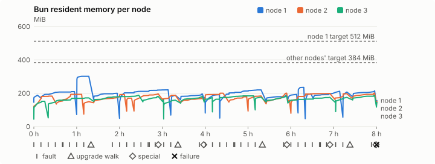
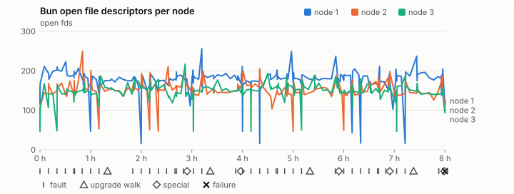
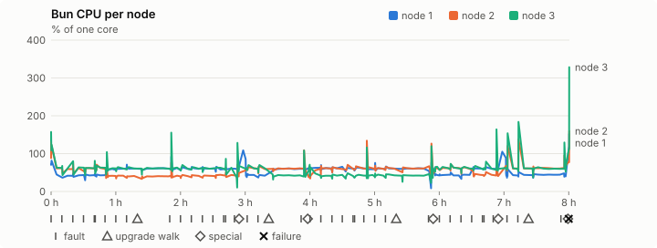
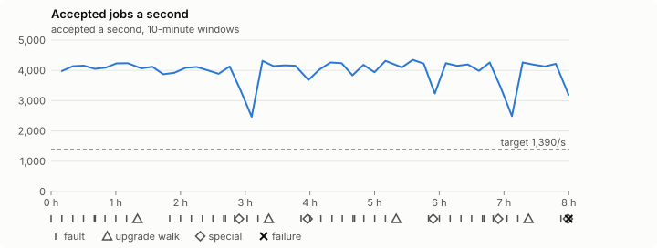

# Sustained soak (V02): FAIL

25 October 2026. final tier, full schedule, 8 h 00 min of soak on a three-node quickstart cluster.

**Final tier: not clean. The V02 gate does not pass.** A product fix means a fresh fast-tier run, then a fresh final-tier run.

## Candidate and host

| | |
|---|---|
| Staged base URL | <https://github.com/reliaburger/reliaburger/releases/download/staging-v0.2.2-40114420545-1> |
| `candidate.json` SHA-256 | `928caac0e8d0e7c52e1062bd62d91047b8b8bcd28b68a3df657f742881ca4f73` |
| Running versions | v0.2.2 x3 |
| Soak build | `bun-v0.2.2-soak.1`, SHA-256 `0879ab36f11d9bde655d549462c879d024e6d7bb1305a4ea043b88b472be4ff2` |
| Walks roll back to | 0.2.2 |
| Host | macOS 26.3.1, Apple M2 Max, 32 GiB |
| Lima | limactl version 2.2.1 |
| Guest | Ubuntu 24.04.5 LTS, kernel 6.8.0-139-generic |
| RELIABURGER_HOME | `/tmp/rbq.KoAJAJ` |
| Evidence | `/var/tmp/reliaburger-v02.bvYwAW` |

## Configuration deviations

- node.toml `[testing] allowed_operations` adds `provision_isolated_workloads` (quickstart allows only inject_workload_faults and alter_node_state), so the catalogue pulse can lease test namespaces
- node.toml `[logs]`/`[metrics]` export to file:///var/lib/reliaburger/soak-export every 60 s with max_storage_mb = 8, `[storage.snapshots]` every 900 s (compressed: 120 s), retain 4, uploaded to the same directory
- node.toml `[ingress] tls_cert/tls_key` point at an operator pair from a soak CA, 45-minute leaves rotated by the harness
- Bun runs with auto/mixed; host jobs opt in to a single pinned BusyBox copy under /var/lib/reliaburger/soak-jobs, mount_isolation=false. The independent verifier listens on each private VM address, TCP 8189, with a separate run token
- node.toml `[node.labels] soak-volume` = "writer" on node 2 and "redis" on node 3, to pin the volume apps
- node.toml `[upgrades] external_signing_key` = a throwaway operator key the harness made for this run (`ed25519:h0rUBAARz16rJ2RGrEgx5szcQjLi/8gW6EsuLtyW0/E=`); the soak build's `.sig` gets that key's external signature beside the release one (D2)
- node.toml `[security] leaf_lifetime_override_secs = 3600` (D1)

## Timeline

- Started 2026-10-25 06:19:27 UTC, finished 2026-10-25 14:20:05 UTC
- Cycles completed: 8
- Teardown: `relish local destroy --yes` and `relish uninstall --yes` succeeded

## Faults and slots

| Class | Runs | Settled/ok | Failed | Skipped | Settle (median / max) |
|---|---|---|---|---|---|
| fault:bun-kill-follower | 8 | 8 | 0 | 0 | 35 s / 66 s |
| fault:bun-kill-leader | 8 | 8 | 0 | 0 | 36 s / 40 s |
| fault:chaos-cpu | 1 | 2 | 0 | 0 | 20 s / 20 s |
| fault:chaos-delay | 1 | 2 | 0 | 0 | 18 s / 18 s |
| fault:chaos-dns | 1 | 2 | 0 | 0 | 20 s / 20 s |
| fault:chaos-drop | 1 | 2 | 0 | 0 | 19 s / 19 s |
| fault:chaos-kill | 1 | 2 | 0 | 0 | 55 s / 55 s |
| fault:chaos-partition | 1 | 2 | 0 | 0 | 20 s / 20 s |
| fault:chaos-pause | 1 | 2 | 0 | 0 | 19 s / 19 s |
| fault:chaos-scenario | 1 | 2 | 0 | 0 | 41 s / 41 s |
| fault:deploy-kill | 4 | 4 | 0 | 0 | 37 s / 40 s |
| fault:node-delay | 3 | 3 | 0 | 0 | 20 s / 35 s |
| fault:node-disk-full | 3 | 3 | 0 | 0 | 19 s / 21 s |
| fault:node-slow-fsync | 2 | 2 | 0 | 0 | 20 s / 20 s |
| fault:power-off | 4 | 4 | 0 | 0 | 34 s / 35 s |
| pulse | 8 | 8 | 0 | 0 | n/a |
| pulse:settle | 0 | 8 | 0 | 0 | 19 s / 20 s |
| special:all-off | 1 | 1 | 0 | 0 | 36 s / 36 s |
| special:graceful-stop | 2 | 2 | 0 | 0 | 35 s / 35 s |
| special:quorum-back | 2 | 2 | 0 | 0 | n/a |
| special:quorum-loss | 2 | 2 | 0 | 0 | 84 s / 84 s |
| storage:offline-export | 1 | 1 | 0 | 0 | n/a |
| storage:registry-push | 8 | 0 | 0 | 0 | n/a |
| tls:invalid-expired | 9 | 9 | 0 | 0 | n/a |
| tls:invalid-torn | 12 | 12 | 0 | 0 | n/a |
| tls:reload | 90 | 90 | 0 | 0 | n/a |
| upgrade:rollback | 4 | 4 | 0 | 0 | n/a |
| upgrade:settle | 0 | 4 | 0 | 0 | 63 s / 77 s |
| upgrade:upgrade | 4 | 4 | 0 | 0 | n/a |

## Renewals and rotations

| Measure | Observed | Required | Verdict |
|---|---|---|---|
| workload identity rotations (soak-identity, per node) | 18 | ≥ 15 | PASS |
| node leaf renewals (per node) | 17 | ≥ 15 | PASS |
| operator ingress reloads (all nodes) | 90 | ≥ 31 | PASS |
| mixed job campaign and positive drain | 2 missing/failing checks | 0 | FAIL |

## Jobs

| Runtime | Accepted successes | Retries | Last accepted progress |
|---|---|---|---|
| runc | 65106 | 7 | 1792937853 |
| shared-runc | 29540166 | 1 | 1792937850 |
| process | 84763845 | 1 | 1792937853 |

The bounded campaign shares the app soak's fault schedule. These counts are reliability evidence, not a saturation rate or a 100-million-per-day qualification.

- job campaign drain deadline exceeded
- job campaign did not positively drain before teardown
- Independent verifier execution attempts: 24
- Explicit test-operator acknowledgements for known replay-safe fenced fixtures: 194

- rb-c28ed78fe93b-1: latest complete job storage (KiB) {'instances': 3812, 'job-state': 8, 'task-arrays': 10408}; free 4940320 KiB; live/peak owners 0/31; peak storage {'instances': 71668, 'job-state': 8, 'task-arrays': 41108}
- rb-c28ed78fe93b-2: latest complete job storage (KiB) {'instances': 1700, 'job-state': 8, 'task-arrays': 14388}; free 6038684 KiB; live/peak owners 0/32; peak storage {'instances': 40708, 'job-state': 8, 'task-arrays': 39188}
- rb-c28ed78fe93b-3: latest complete job storage (KiB) {'instances': 300, 'job-state': 8, 'task-arrays': 13952}; free 6068040 KiB; live/peak owners 0/32; peak storage {'instances': 63392, 'job-state': 8, 'task-arrays': 42988}

Complete disk inventories are recorded. Global retention bounds and the 12-hour job qualification remain #668; this gate cannot certify an unimplemented retention policy.

## Job qualification (D18-C)

Load: target; 3 nodes; accepted 3,986.0/s against a 1390.0/s target: PASS.

The September plan set its targets for one 1M-task batch on a quiet cluster. A soak runs for hours with restarts, upgrades and apps, so its storage, Bun memory and Raft targets are restated (maintainer decision, 15 October 2026, [#668](https://github.com/reliaburger/reliaburger/issues/668)). Bun's steady state is the median RSS of each process once it has been seen for 10 minutes; the gated memory checks are unchanged (`leak-rss`, and Mayo's 70% `memory_high` alert through `wtf`).

| Measure (recorded, not gated) | Observed | Target |
|---|---|---|
| Wall time of a 1,048,576-task array (median / max of 64) | 339 s / 1,352 s | ≤ 600 s |
| p99 start lag, pooled executors | 32 ms (bucket upper bound) | < 1,000 ms |
| Raft entries per second, all cluster writes | 1.43 | recorded only; the batch target counts only task-array writes |
| Raft state of one run, largest seen | 6,172 B | ≤ 256 KiB per 1M tasks |
| Bun steady-state RSS per process, worst node against its target | rb-c28ed78fe93b-1: 301.43 MiB steady, 301.43 MiB peak | ≤ 512 MiB (≤ 512 MiB on node 1, which serves the API) |
| Bun CPU, busiest node | 0.56 cores | ≤ 1 core (leader batch control) |
| Executor helper CPU, busiest node | 0.01 cores | ≤ 0.5 core |
| Node task-array storage per 1M accepted tasks (peaks summed) | 1.05 MiB | ≤ 64 MiB, deleted after retirement |
| Retained log volume, all nodes | 27.88 MB | ≤ 50 MB |

- Bun RSS on rb-c28ed78fe93b-1 (serves the API, target ≤ 512 MiB): pid 8225: 188.34 MiB peak (seen for under 10 minutes); pid 1106503: 206.96 MiB steady, 209.73 MiB peak; pid 2670051: 301.43 MiB steady, 301.43 MiB peak; pid 2670051: 197.55 MiB steady, 199.87 MiB peak; pid 793425: 216.76 MiB steady, 220.46 MiB peak; pid 4088866: 188.39 MiB peak (seen for under 10 minutes); pid 4088866: 189.62 MiB steady, 195.57 MiB peak; pid 674: 175.46 MiB peak (seen for under 10 minutes); pid 175780: 186.80 MiB steady, 191.43 MiB peak; pid 2429315: 212.37 MiB steady, 220.08 MiB peak; pid 2429315: 179.61 MiB steady, 190.80 MiB peak; pid 678: 193.07 MiB steady, 193.07 MiB peak; pid 1737502: 235.82 MiB peak (seen for under 10 minutes); pid 2859763: 196.97 MiB peak (seen for under 10 minutes); pid 679: 201.27 MiB steady, 212.10 MiB peak; pid 4042291: 207.45 MiB peak (seen for under 10 minutes); pid 4042291: 209.20 MiB steady, 214.53 MiB peak; pid 677: 156.93 MiB peak (seen for under 10 minutes)
- Bun RSS on rb-c28ed78fe93b-2 (node, target ≤ 384 MiB): pid 2362: 180.98 MiB steady, 182.78 MiB peak; pid 661: 193.17 MiB steady, 193.32 MiB peak; pid 239116: 149.70 MiB peak (seen for under 10 minutes); pid 1446132: 171.24 MiB steady, 191.84 MiB peak; pid 2685739: 170.53 MiB peak (seen for under 10 minutes); pid 3827413: 189.89 MiB steady, 196.21 MiB peak; pid 678: 188.06 MiB steady, 188.07 MiB peak; pid 678: 167.57 MiB steady, 173.23 MiB peak; pid 674: 192.18 MiB steady, 200.12 MiB peak; pid 676: 174.99 MiB steady, 178.82 MiB peak; pid 3087039: 181.63 MiB steady, 184.05 MiB peak; pid 678: 199.19 MiB steady, 200.54 MiB peak; pid 679: 158.93 MiB peak (seen for under 10 minutes); pid 490484: 197.48 MiB steady, 198.73 MiB peak; pid 675: 196.72 MiB steady, 196.83 MiB peak; pid 675: 193.46 MiB steady, 200.95 MiB peak; pid 675: 150.22 MiB peak (seen for under 10 minutes)
- Bun RSS on rb-c28ed78fe93b-3 (node, target ≤ 384 MiB): pid 2174: 117.52 MiB peak (seen for under 10 minutes); pid 3611: 149.74 MiB steady, 151.63 MiB peak; pid 2266055: 160.37 MiB steady, 172.23 MiB peak; pid 2266055: 180.05 MiB steady, 188.42 MiB peak; pid 674: 179.89 MiB steady, 181.04 MiB peak; pid 673: 161.11 MiB peak (seen for under 10 minutes); pid 172265: 151.91 MiB steady, 158.77 MiB peak; pid 172265: 178.32 MiB steady, 182.06 MiB peak; pid 680: 174.37 MiB steady, 174.37 MiB peak; pid 1371758: 181.49 MiB steady, 184.50 MiB peak; pid 4029435: 176.87 MiB peak (seen for under 10 minutes); pid 4029435: 182.38 MiB steady, 182.45 MiB peak; pid 674: 169.56 MiB steady, 175.54 MiB peak; pid 673: 157.13 MiB peak (seen for under 10 minutes); pid 133076: 169.29 MiB steady, 175.46 MiB peak; pid 133076: 182.03 MiB steady, 186.58 MiB peak; pid 675: 145.41 MiB peak (seen for under 10 minutes)

- runc retry causes: exit_code 4, launch 1, signal 0, timeout 0, unknown 2, unrecorded 0
- shared-runc retry causes: exit_code 1, launch 0, signal 0, timeout 0, unknown 0, unrecorded 0
- process retry causes: exit_code 1, launch 0, signal 0, timeout 0, unknown 0, unrecorded 0
- Audited executions: 24; operator replay decisions: 194
- Job controller API fallbacks: rb-c28ed78fe93b-1 missed 789, rb-c28ed78fe93b-2 missed 8; rb-c28ed78fe93b-2 answered 781, rb-c28ed78fe93b-3 answered 8 (requests a node didn't answer, and the node that took them instead)

## Data

- Volume writer: highest ACK 237742 in the log view; the writer file checks (writer-lost, writer-regression) decide data loss, and `*-log-order` failures are about the order the log view returned lines in
- Redis counter: highest INCR 26600 in the log view
- Export rb-c28ed78fe93b-1: 217 source files, 747 at the destination
- Export rb-c28ed78fe93b-2: 409 source files, 829 at the destination
- Export rb-c28ed78fe93b-3: 298 source files, 652 at the destination
- Registry images pushed and re-verified: 9
- Agent-loop turns over the 1 s budget: rb-c28ed78fe93b-1 0, rb-c28ed78fe93b-2 0, rb-c28ed78fe93b-3 0
- Guest clock steps by Lima's guest agent: rb-c28ed78fe93b-1 6, rb-c28ed78fe93b-2 7, rb-c28ed78fe93b-3 6
- Checks evaluated: 1048 (heavy 98, light 793, settle 157)
- Last observed progress: redis-counter 26600, writer-ack 237742

## Resource trends

| Node | Measure | First | Last | Max |
|---|---|---|---|---|
| rb-c28ed78fe93b-1 | disk_kb data | 1427804 | 1031752 | 1546240 |
| rb-c28ed78fe93b-1 | disk_kb images | 328964 | 465692 | 465692 |
| rb-c28ed78fe93b-1 | disk_kb logs | 36 | 8444 | 9428 |
| rb-c28ed78fe93b-1 | disk_kb metrics | 52 | 8560 | 9172 |
| rb-c28ed78fe93b-1 | disk_kb soak-export | 4 | 63088 | 63088 |
| rb-c28ed78fe93b-1 | disk_kb volumes | 224 | 60 | 228 |
| rb-c28ed78fe93b-1 | fd | 116 | 124 | 256 |
| rb-c28ed78fe93b-1 | rss_kb | 149280 | 160692 | 308664 |
| rb-c28ed78fe93b-2 | disk_kb data | 67420 | 600700 | 651848 |
| rb-c28ed78fe93b-2 | disk_kb images | 161940 | 337412 | 337412 |
| rb-c28ed78fe93b-2 | disk_kb logs | 28 | 8720 | 8876 |
| rb-c28ed78fe93b-2 | disk_kb metrics | 56 | 8784 | 9040 |
| rb-c28ed78fe93b-2 | disk_kb soak-export | 4 | 38768 | 38768 |
| rb-c28ed78fe93b-2 | disk_kb volumes | 16736 | 23352 | 23352 |
| rb-c28ed78fe93b-2 | fd | 69 | 118 | 250 |
| rb-c28ed78fe93b-2 | rss_kb | 110976 | 153828 | 205772 |
| rb-c28ed78fe93b-3 | disk_kb data | 171764 | 239960 | 636108 |
| rb-c28ed78fe93b-3 | disk_kb images | 316524 | 322656 | 322656 |
| rb-c28ed78fe93b-3 | disk_kb logs | 24 | 8812 | 8920 |
| rb-c28ed78fe93b-3 | disk_kb metrics | 56 | 8768 | 9056 |
| rb-c28ed78fe93b-3 | disk_kb soak-export | 4 | 49000 | 49000 |
| rb-c28ed78fe93b-3 | disk_kb volumes | 16736 | 18728 | 18788 |
| rb-c28ed78fe93b-3 | fd | 68 | 99 | 217 |
| rb-c28ed78fe93b-3 | rss_kb | 107836 | 148896 | 192940 |

## Charts

Time runs from the start of the soak. The marks under each chart are its faults, upgrade walks, specials and recorded failures; the dashed lines are targets.

## Failures

| # | First seen | Check | Symptom | Class | Cause | Action |
|---|---|---|---|---|---|---|
| 1 | 14:19:25 | settle-check | fail: jobs: job campaign drain deadline exceeded; | unclassified | open | open |

## Notes

- Job controller exited with status 1
- The harness stopped early (exit 1) during final

Evidence: `/var/tmp/reliaburger-v02.bvYwAW` (events.jsonl, snapshots/, failures/<n>/).
