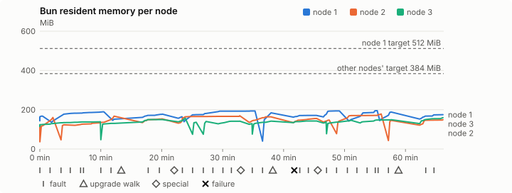
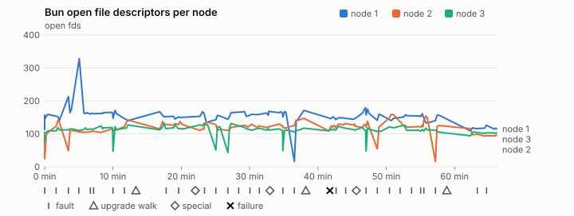
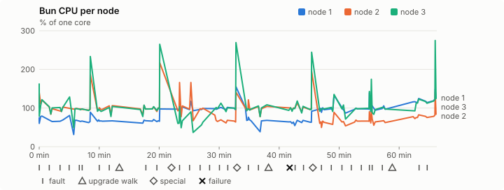
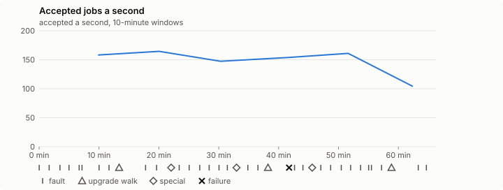

# Sustained soak (V02): FAIL

24 October 2026. fast tier, compressed schedule, 1 h 06 min of soak on a three-node quickstart cluster.

**Fast tier: not clean.** Fix what failed and run the fast tier again before a final-tier run.

## Candidate and host

| | |
|---|---|
| Staged base URL | <https://github.com/reliaburger/reliaburger/releases/download/staging-v0.2.2-40114420545-1> |
| `candidate.json` SHA-256 | `928caac0e8d0e7c52e1062bd62d91047b8b8bcd28b68a3df657f742881ca4f73` |
| Running versions | v0.2.2 x3 |
| Soak build | `bun-v0.2.2-soak.1`, SHA-256 `0879ab36f11d9bde655d549462c879d024e6d7bb1305a4ea043b88b472be4ff2` |
| Walks roll back to | 0.2.2 |
| Host | macOS 26.3.1, Apple M2 Max, 32 GiB |
| Lima | limactl version 2.2.1 |
| Guest | Ubuntu 24.04.5 LTS, kernel 6.8.0-139-generic |
| RELIABURGER_HOME | `/tmp/rbq.lwPOGi` |
| Evidence | `/var/tmp/reliaburger-v02.7Jev24` |

## Configuration deviations

- node.toml `[testing] allowed_operations` adds `provision_isolated_workloads` (quickstart allows only inject_workload_faults and alter_node_state), so the catalogue pulse can lease test namespaces
- node.toml `[logs]`/`[metrics]` export to file:///var/lib/reliaburger/soak-export every 60 s with max_storage_mb = 8, `[storage.snapshots]` every 900 s (compressed: 120 s), retain 4, uploaded to the same directory
- node.toml `[ingress] tls_cert/tls_key` point at an operator pair from a soak CA, 45-minute leaves rotated by the harness
- Bun runs with auto/mixed; host jobs opt in to a single pinned BusyBox copy under /var/lib/reliaburger/soak-jobs, mount_isolation=false. The independent verifier listens on each private VM address, TCP 8189, with a separate run token
- node.toml `[node.labels] soak-volume` = "writer" on node 2 and "redis" on node 3, to pin the volume apps
- node.toml `[upgrades] external_signing_key` = a throwaway operator key the harness made for this run (`ed25519:86/CO7CBUyYicIIKwPfUSJ3fTaZ0N3GOLnaGt+7oje0=`); the soak build's `.sig` gets that key's external signature beside the release one (D2)
- node.toml `[security] leaf_lifetime_override_secs = 3600` (D1)

## Timeline

- Started 2026-10-24 19:50:43 UTC, finished 2026-10-24 20:57:00 UTC
- Cycles completed: 6
- Teardown: `relish local destroy --yes` and `relish uninstall --yes` succeeded

## Faults and slots

| Class | Runs | Settled/ok | Failed | Skipped | Settle (median / max) |
|---|---|---|---|---|---|
| fault:bun-kill-follower | 6 | 6 | 0 | 0 | 31 s / 33 s |
| fault:bun-kill-leader | 6 | 6 | 0 | 0 | 34 s / 39 s |
| fault:chaos-cpu | 1 | 2 | 0 | 0 | 16 s / 16 s |
| fault:chaos-delay | 2 | 4 | 0 | 0 | 16 s / 16 s |
| fault:chaos-dns | 1 | 2 | 0 | 0 | 17 s / 17 s |
| fault:chaos-drop | 1 | 2 | 0 | 0 | 17 s / 17 s |
| fault:chaos-kill | 2 | 4 | 0 | 0 | 29 s / 29 s |
| fault:chaos-memory | 1 | 2 | 0 | 0 | 16 s / 16 s |
| fault:chaos-partition | 2 | 4 | 0 | 0 | 17 s / 17 s |
| fault:chaos-pause | 1 | 2 | 0 | 0 | 16 s / 16 s |
| fault:chaos-scenario | 1 | 2 | 0 | 0 | 29 s / 29 s |
| fault:deploy-kill | 3 | 3 | 0 | 0 | 30 s / 39 s |
| fault:power-off | 3 | 3 | 0 | 0 | 29 s / 29 s |
| pulse | 1 | 1 | 0 | 0 | n/a |
| pulse:settle | 0 | 1 | 0 | 0 | 16 s / 16 s |
| special:all-off | 1 | 1 | 0 | 0 | 30 s / 30 s |
| special:graceful-stop | 1 | 1 | 0 | 0 | 39 s / 39 s |
| special:quorum-back | 1 | 1 | 0 | 0 | n/a |
| special:quorum-loss | 1 | 1 | 0 | 0 | 30 s / 30 s |
| storage:offline-export | 3 | 3 | 0 | 0 | n/a |
| storage:registry-push | 6 | 0 | 0 | 0 | n/a |
| tls:invalid-expired | 3 | 3 | 0 | 0 | n/a |
| tls:invalid-torn | 6 | 6 | 0 | 0 | n/a |
| tls:reload | 33 | 33 | 0 | 0 | n/a |
| upgrade:rollback | 3 | 3 | 0 | 0 | n/a |
| upgrade:settle | 0 | 3 | 0 | 0 | 59 s / 62 s |
| upgrade:upgrade | 3 | 3 | 0 | 0 | n/a |

## Renewals and rotations

| Measure | Observed | Required | Verdict |
|---|---|---|---|
| workload identity rotations (soak-identity, per node) | 7 | ≥ 1 | PASS |
| node leaf renewals (per node) | 2 | ≥ 1 | PASS |
| operator ingress reloads (all nodes) | 33 | ≥ 12 | PASS |
| mixed job campaign and positive drain | 0 missing/failing checks | 0 | PASS |

## Jobs

| Runtime | Accepted successes | Retries | Last accepted progress |
|---|---|---|---|
| runc | 11562 | 1 | 1792874927 |
| shared-runc | 227933 | 1 | 1792874927 |
| process | 314516 | 1 | 1792874927 |

The bounded campaign shares the app soak's fault schedule. These counts are reliability evidence, not a saturation rate or a 100-million-per-day qualification.

- Independent verifier execution attempts: 24
- Explicit test-operator acknowledgements for known replay-safe fenced fixtures: 120

- rb-a545617a7898-1: latest complete job storage (KiB) {'instances': 320, 'job-state': 8, 'task-arrays': 4124}; free 5236160 KiB; live/peak owners 0/11; peak storage {'instances': 16544, 'job-state': 8, 'task-arrays': 13912}
- rb-a545617a7898-2: latest complete job storage (KiB) {'instances': 404, 'job-state': 8, 'task-arrays': 4036}; free 6336396 KiB; live/peak owners 0/9; peak storage {'instances': 8392, 'job-state': 8, 'task-arrays': 13728}
- rb-a545617a7898-3: latest complete job storage (KiB) {'instances': 3760, 'job-state': 8, 'task-arrays': 3960}; free 6358060 KiB; live/peak owners 0/8; peak storage {'instances': 5868, 'job-state': 8, 'task-arrays': 13996}

Complete disk inventories are recorded. Global retention bounds and the 12-hour job qualification remain #668; this gate cannot certify an unimplemented retention policy.

## Job qualification (D18-C)

Load: calibration; 3 nodes; accepted 158.7/s (calibration load: not gated).

The September plan set its targets for one 1M-task batch on a quiet cluster. A soak runs for hours with restarts, upgrades and apps, so its storage, Bun memory and Raft targets are restated (maintainer decision, 15 October 2026, [#668](https://github.com/reliaburger/reliaburger/issues/668)). Bun's steady state is the median RSS of each process once it has been seen for 10 minutes; the gated memory checks are unchanged (`leak-rss`, and Mayo's 70% `memory_high` alert through `wtf`).

| Measure (recorded, not gated) | Observed | Target |
|---|---|---|
| Wall time of a 1,048,576-task array (median / max of 0) | not measured / not measured | ≤ 600 s |
| p99 start lag, pooled executors | 8 ms (bucket upper bound) | < 1,000 ms |
| Raft entries per second, all cluster writes | 2.57 | recorded only; the batch target counts only task-array writes |
| Raft state of one run, largest seen | 36,615 B | ≤ 256 KiB per 1M tasks |
| Bun steady-state RSS per process, worst node against its target | rb-a545617a7898-2: 167.96 MiB steady, 178.59 MiB peak | ≤ 384 MiB (≤ 512 MiB on node 1, which serves the API) |
| Bun CPU, busiest node | 0.98 cores | ≤ 1 core (leader batch control) |
| Executor helper CPU, busiest node | 0.00 cores | ≤ 0.5 core |
| Node task-array storage per 1M accepted tasks (peaks summed) | 73.39 MiB | ≤ 64 MiB, deleted after retirement |
| Retained log volume, all nodes | 6.84 MB | ≤ 50 MB |

- Bun RSS on rb-a545617a7898-1 (serves the API, target ≤ 512 MiB): pid 8179: 167.37 MiB peak (seen for under 10 minutes); pid 32283: 189.54 MiB peak (seen for under 10 minutes); pid 180807: 151.90 MiB peak (seen for under 10 minutes); pid 217544: 177.68 MiB peak (seen for under 10 minutes); pid 675: 164.60 MiB peak (seen for under 10 minutes); pid 15533: 193.60 MiB steady, 193.60 MiB peak; pid 201043: 184.18 MiB peak (seen for under 10 minutes); pid 201043: 171.10 MiB peak (seen for under 10 minutes); pid 678: 194.21 MiB peak (seen for under 10 minutes); pid 64379: 195.18 MiB peak (seen for under 10 minutes); pid 144088: 188.43 MiB peak (seen for under 10 minutes); pid 144088: 174.92 MiB peak (seen for under 10 minutes)
- Bun RSS on rb-a545617a7898-2 (node, target ≤ 384 MiB): pid 2360: 122.76 MiB peak (seen for under 10 minutes); pid 4788: 160.61 MiB peak (seen for under 10 minutes); pid 48421: 123.29 MiB peak (seen for under 10 minutes); pid 675: 167.45 MiB peak (seen for under 10 minutes); pid 675: 153.12 MiB peak (seen for under 10 minutes); pid 673: 167.96 MiB steady, 169.58 MiB peak; pid 670: 163.77 MiB peak (seen for under 10 minutes); pid 674: 155.93 MiB peak (seen for under 10 minutes); pid 673: 147.51 MiB peak (seen for under 10 minutes); pid 37927: 178.59 MiB peak (seen for under 10 minutes); pid 166670: 145.53 MiB peak (seen for under 10 minutes); pid 166670: 149.25 MiB peak (seen for under 10 minutes)
- Bun RSS on rb-a545617a7898-3 (node, target ≤ 384 MiB): pid 2135: 138.67 MiB steady, 138.67 MiB peak; pid 136832: 130.57 MiB peak (seen for under 10 minutes); pid 136832: 149.86 MiB peak (seen for under 10 minutes); pid 677: 157.20 MiB peak (seen for under 10 minutes); pid 37367: 136.21 MiB peak (seen for under 10 minutes); pid 61915: 140.18 MiB peak (seen for under 10 minutes); pid 663: 142.01 MiB peak (seen for under 10 minutes); pid 672: 129.16 MiB peak (seen for under 10 minutes); pid 10012: 141.98 MiB peak (seen for under 10 minutes); pid 10012: 142.83 MiB peak (seen for under 10 minutes); pid 678: 138.68 MiB peak (seen for under 10 minutes); pid 11306: 146.35 MiB peak (seen for under 10 minutes); pid 674: 149.41 MiB peak (seen for under 10 minutes); pid 678: 159.94 MiB peak (seen for under 10 minutes)

- runc retry causes: exit_code 1, launch 0, signal 0, timeout 0, unknown 0, unrecorded 0
- shared-runc retry causes: exit_code 1, launch 0, signal 0, timeout 0, unknown 0, unrecorded 0
- process retry causes: exit_code 1, launch 0, signal 0, timeout 0, unknown 0, unrecorded 0
- Audited executions: 24; operator replay decisions: 120
- Job controller API fallbacks: rb-a545617a7898-1 missed 124, rb-a545617a7898-2 missed 10; rb-a545617a7898-2 answered 114, rb-a545617a7898-3 answered 10 (requests a node didn't answer, and the node that took them instead)

## Data

- Volume writer: highest ACK 32632 in the log view; the writer file checks (writer-lost, writer-regression) decide data loss, and `*-log-order` failures are about the order the log view returned lines in
- Redis counter: highest INCR 3255 in the log view
- Export rb-a545617a7898-1: 134 source files, 103 at the destination
- Export rb-a545617a7898-2: 134 source files, 121 at the destination
- Export rb-a545617a7898-3: 101 source files, 101 at the destination
- Registry images pushed and re-verified: 7
- Agent-loop turns over the 1 s budget: rb-a545617a7898-1 0, rb-a545617a7898-2 0, rb-a545617a7898-3 1
- Guest clock steps by Lima's guest agent: rb-a545617a7898-1 3, rb-a545617a7898-2 5, rb-a545617a7898-3 6
- Checks evaluated: 196 (heavy 17, light 76, settle 103)
- Last observed progress: redis-counter 3255, writer-ack 32632

## Resource trends

| Node | Measure | First | Last | Max |
|---|---|---|---|---|
| rb-a545617a7898-1 | disk_kb data | 1369444 | 982296 | 1521460 |
| rb-a545617a7898-1 | disk_kb images | 328964 | 444884 | 444884 |
| rb-a545617a7898-1 | disk_kb logs | 40 | 4376 | 4376 |
| rb-a545617a7898-1 | disk_kb metrics | 60 | 5120 | 5120 |
| rb-a545617a7898-1 | disk_kb soak-export | 4 | 7164 | 7164 |
| rb-a545617a7898-1 | disk_kb volumes | 200 | 60 | 252 |
| rb-a545617a7898-1 | fd | 113 | 115 | 328 |
| rb-a545617a7898-1 | rss_kb | 146836 | 179116 | 199860 |
| rb-a545617a7898-2 | disk_kb data | 67440 | 25684 | 559544 |
| rb-a545617a7898-2 | disk_kb images | 161940 | 329116 | 329116 |
| rb-a545617a7898-2 | disk_kb logs | 28 | 1528 | 1528 |
| rb-a545617a7898-2 | disk_kb metrics | 60 | 2832 | 2832 |
| rb-a545617a7898-2 | disk_kb soak-export | 4 | 4300 | 4300 |
| rb-a545617a7898-2 | disk_kb volumes | 16736 | 17240 | 17412 |
| rb-a545617a7898-2 | fd | 71 | 96 | 159 |
| rb-a545617a7898-2 | rss_kb | 112076 | 152832 | 182872 |
| rb-a545617a7898-3 | disk_kb data | 230192 | 710944 | 710944 |
| rb-a545617a7898-3 | disk_kb images | 316524 | 322608 | 322608 |
| rb-a545617a7898-3 | disk_kb logs | 28 | 780 | 780 |
| rb-a545617a7898-3 | disk_kb metrics | 60 | 3176 | 3176 |
| rb-a545617a7898-3 | disk_kb soak-export | 4 | 4736 | 4736 |
| rb-a545617a7898-3 | disk_kb volumes | 16760 | 17200 | 17200 |
| rb-a545617a7898-3 | fd | 72 | 103 | 132 |
| rb-a545617a7898-3 | rss_kb | 117864 | 163776 | 163776 |

## Charts

Time runs from the start of the soak. The marks under each chart are its faults, upgrade walks, specials and recorded failures; the dashed lines are targets.

## Failures

| # | First seen | Check | Symptom | Class | Cause | Action |
|---|---|---|---|---|---|---|
| 1 | 20:32:23 | settle-check | fail: agent-loop-turn rb-a545617a7898-3: 1 command turn(s) over the 1 s budget, the worst between 2.5 and 5 s; | unclassified | open | open |

Evidence: `/var/tmp/reliaburger-v02.7Jev24` (events.jsonl, snapshots/, failures/<n>/).
