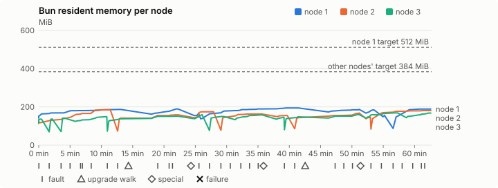
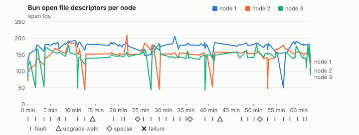
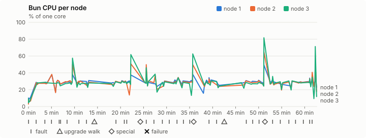
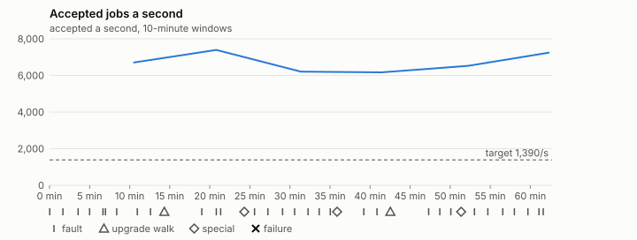

# Sustained soak (V02): PASS

27 October 2026. fast tier, compressed schedule, 1 h 02 min of soak on a three-node quickstart cluster.

**Fast tier: clean.** The iteration loop only, not acceptance: the V02 gate needs a clean final-tier run (8 h, full schedule) on the final candidate.

## Candidate and host

| | |
|---|---|
| Staged base URL | <https://github.com/reliaburger/reliaburger/releases/download/staging-v0.2.3-40376399802-1> |
| `candidate.json` SHA-256 | `64c0fe5b06b61d25184ab44267a72ac2b0ad9195eb564112a39f409e3c9c5769` |
| Running versions | v0.2.3 x3 |
| Soak build | `bun-v0.2.3-soak.1`, SHA-256 `dcbc3149f58f48ed60b74ceea72be8e28d911d188b102654284884c097706556` |
| Walks roll back to | 0.2.3 |
| Host | macOS 26.3.1, Apple M2 Max, 32 GiB |
| Lima | limactl version 2.2.1 |
| Guest | Ubuntu 24.04.5 LTS, kernel 6.8.0-139-generic |
| RELIABURGER_HOME | `/tmp/rbq.RVx93r` |
| Evidence | `/var/tmp/reliaburger-v02.iHBGXN` |

## Configuration deviations

- node.toml `[testing] allowed_operations` adds `provision_isolated_workloads` (quickstart allows only inject_workload_faults and alter_node_state), so the catalogue pulse can lease test namespaces
- node.toml `[logs]`/`[metrics]` export to file:///var/lib/reliaburger/soak-export every 60 s with max_storage_mb = 8, `[storage.snapshots]` every 900 s (compressed: 120 s), retain 4, uploaded to the same directory
- node.toml `[ingress] tls_cert/tls_key` point at an operator pair from a soak CA, 45-minute leaves rotated by the harness
- Bun runs with auto/mixed; host jobs opt in to a single pinned BusyBox copy under /var/lib/reliaburger/soak-jobs, mount_isolation=false. The independent verifier listens on each private VM address, TCP 8189, with a separate run token
- node.toml `[node.labels] soak-volume` = "writer" on node 2 and "redis" on node 3, to pin the volume apps
- node.toml `[upgrades] external_signing_key` = a throwaway operator key the harness made for this run (`ed25519:YYU9pcTkC72XgT6+G4b1NsLJcJFFL00679xVeuhLOwo=`); the soak build's `.sig` gets that key's external signature beside the release one (D2)
- node.toml `[security] leaf_lifetime_override_secs = 3600` (D1)

## Timeline

- Started 2026-10-27 00:14:36 UTC, finished 2026-10-27 01:17:19 UTC
- Cycles completed: 5
- Fault and node choices: 27, from seed 2967977417 (`--seed 2967977417` repeats them)
- Teardown: `relish local destroy --yes` and `relish uninstall --yes` succeeded

## Faults and slots

| Class | Runs | Settled/ok | Failed | Skipped | Settle (median / max) |
|---|---|---|---|---|---|
| fault:bun-kill-follower | 5 | 5 | 0 | 0 | 33 s / 33 s |
| fault:bun-kill-leader | 5 | 5 | 0 | 0 | 34 s / 43 s |
| fault:chaos-cpu | 1 | 2 | 0 | 0 | 17 s / 17 s |
| fault:chaos-delay | 1 | 2 | 0 | 0 | 18 s / 18 s |
| fault:chaos-dns | 1 | 2 | 0 | 0 | 18 s / 18 s |
| fault:chaos-drop | 1 | 2 | 0 | 0 | 17 s / 17 s |
| fault:chaos-kill | 2 | 4 | 0 | 0 | 32 s / 32 s |
| fault:chaos-memory | 1 | 2 | 0 | 0 | 18 s / 18 s |
| fault:chaos-partition | 1 | 2 | 0 | 0 | 17 s / 17 s |
| fault:chaos-pause | 1 | 2 | 0 | 0 | 17 s / 17 s |
| fault:chaos-scenario | 1 | 2 | 0 | 0 | 31 s / 31 s |
| fault:deploy-kill | 3 | 3 | 0 | 0 | 33 s / 46 s |
| fault:node-delay | 2 | 2 | 0 | 0 | 31 s / 31 s |
| fault:node-disk-full | 2 | 2 | 0 | 0 | 19 s / 19 s |
| fault:node-slow-fsync | 1 | 1 | 0 | 0 | 18 s / 18 s |
| fault:power-off | 3 | 3 | 0 | 0 | 45 s / 45 s |
| pulse | 1 | 1 | 0 | 0 | n/a |
| pulse:settle | 0 | 1 | 0 | 0 | 24 s / 24 s |
| special:all-off | 1 | 1 | 0 | 0 | 46 s / 46 s |
| special:graceful-stop | 1 | 1 | 0 | 0 | 41 s / 41 s |
| special:quorum-back | 1 | 1 | 0 | 0 | n/a |
| special:quorum-loss | 1 | 1 | 0 | 0 | 72 s / 72 s |
| storage:offline-export | 2 | 2 | 0 | 0 | n/a |
| storage:registry-push | 5 | 0 | 0 | 0 | n/a |
| tls:invalid-expired | 3 | 3 | 0 | 0 | n/a |
| tls:invalid-torn | 3 | 3 | 0 | 0 | n/a |
| tls:reload | 29 | 29 | 0 | 0 | n/a |
| upgrade:rollback | 2 | 2 | 0 | 0 | n/a |
| upgrade:settle | 0 | 2 | 0 | 0 | 62 s / 62 s |
| upgrade:upgrade | 2 | 2 | 0 | 0 | n/a |

## Execution inventory (recorded, not gated)

What the run completed, from its events and kept bytes, against what its schedule owes. A fault counts once it was injected and the cluster settled after it.

| Item | Required | Completed | Verdict |
|---|---|---|---|
| candidate.json bytes match the qualified digest | 1 | 1 | ok |
| app workloads settled at the baseline | 1 | 1 | ok |
| upgrade walk (to the soak build and back) | 2 | 2 | ok |
| fault:bun-kill-follower | 1 | 5 | ok |
| fault:bun-kill-leader | 1 | 5 | ok |
| fault:deploy-kill | 1 | 3 | ok |
| fault:power-off | 1 | 3 | ok |
| fault:chaos-kill | 1 | 2 | ok |
| fault:chaos-delay | 1 | 1 | ok |
| fault:chaos-partition | 1 | 1 | ok |
| fault:chaos-scenario | 1 | 1 | ok |
| fault:chaos-pause | 1 | 1 | ok |
| fault:chaos-drop | 1 | 1 | ok |
| fault:chaos-dns | 1 | 1 | ok |
| fault:chaos-cpu | 1 | 1 | ok |
| fault:node-delay | 1 | 2 | ok |
| fault:node-disk-full | 1 | 2 | ok |
| fault:node-slow-fsync | 1 | 1 | ok |
| special:graceful-stop | 1 | 1 | ok |
| special:quorum-loss | 1 | 1 | ok |
| special:all-off | 1 | 1 | ok |
| catalogue pulse | 1 | 1 | ok |
| offline export | 2 | 2 | ok |
| job campaign drained in its final two minutes | 1 | 1 | ok |

## Observed fault effects

What each injected fault was seen to do, read back from the node.

| Fault | Target | Observed |
|---|---|---|
| effect:bun-kill-follower | rb-f4617fad0405-2 | MainPID 2492 -> 4811 |
| effect:bun-kill-leader | rb-f4617fad0405-3 | MainPID 2250 -> 236687 |
| effect:deploy-kill | rb-f4617fad0405-3 | MainPID 236687 -> 607066 |
| effect:power-off | rb-f4617fad0405-3 | Lima status Stopped |
| effect:node-delay | rb-f4617fad0405-1 | netem 8001: root refcnt 2 limit 1000 delay 200ms  50ms  |
| effect:bun-kill-follower | rb-f4617fad0405-3 | MainPID 676 -> 1012395 |
| effect:bun-kill-leader | rb-f4617fad0405-2 | MainPID 4811 -> 2324428 |
| effect:node-disk-full | rb-f4617fad0405-2 | available 67072000 bytes  |
| effect:bun-kill-follower | rb-f4617fad0405-1 | MainPID 681 -> 156899 |
| effect:bun-kill-leader | rb-f4617fad0405-3 | MainPID 682 -> 500931 |
| effect:deploy-kill | rb-f4617fad0405-2 | MainPID 674 -> 832600 |
| effect:power-off | rb-f4617fad0405-3 | Lima status Stopped |
| effect:node-slow-fsync | rb-f4617fad0405-3 | IOWriteBandwidthMax=/dev/vda 1000000 IOWriteIOPSMax=/dev/vda 20  |
| effect:bun-kill-follower | rb-f4617fad0405-3 | MainPID 680 -> 243683 |
| effect:bun-kill-leader | rb-f4617fad0405-2 | MainPID 680 -> 708458 |
| effect:node-delay | rb-f4617fad0405-2 | netem 8001: root refcnt 2 limit 1000 delay 200ms  50ms  |
| effect:bun-kill-follower | rb-f4617fad0405-2 | MainPID 682 -> 188194 |
| effect:bun-kill-leader | rb-f4617fad0405-1 | MainPID 676 -> 511127 |
| effect:deploy-kill | rb-f4617fad0405-1 | MainPID 511127 -> 849860 |
| effect:power-off | rb-f4617fad0405-3 | Lima status Stopped |
| effect:node-disk-full | rb-f4617fad0405-3 | available 67080192 bytes  |

## Renewals and rotations

| Measure | Observed | Required | Verdict |
|---|---|---|---|
| workload identity rotations (soak-identity, per node) | 6 | ≥ 1 | PASS |
| node leaf renewals (per node) | 2 | ≥ 1 | PASS |
| operator ingress reloads (all nodes) | 29 | ≥ 11 | PASS |
| mixed job campaign and positive drain | 0 missing/failing checks | 0 | PASS |

## Jobs

| Runtime | Accepted successes | Retries | Last accepted progress |
|---|---|---|---|
| runc | 10746 | 3 | 1793063830 |
| shared-runc | 5939818 | 1 | 1793063830 |
| process | 19260383 | 1 | 1793063830 |

The bounded campaign shares the app soak's fault schedule. These counts are reliability evidence, not a saturation rate or a 100-million-per-day qualification.

- Independent verifier execution attempts: 24
- Explicit test-operator acknowledgements for known replay-safe fenced fixtures: 112

- rb-f4617fad0405-1: latest complete job storage (KiB) {'instances': 584, 'job-state': 8, 'task-arrays': 12424}; free 5200920 KiB; live/peak owners 0/30; peak storage {'instances': 30524, 'job-state': 8, 'task-arrays': 39204}
- rb-f4617fad0405-2: latest complete job storage (KiB) {'instances': 4660, 'job-state': 8, 'task-arrays': 12508}; free 6309932 KiB; live/peak owners 0/32; peak storage {'instances': 30676, 'job-state': 8, 'task-arrays': 40256}
- rb-f4617fad0405-3: latest complete job storage (KiB) {'instances': 300, 'job-state': 8, 'task-arrays': 10468}; free 6325452 KiB; live/peak owners 0/32; peak storage {'instances': 25520, 'job-state': 8, 'task-arrays': 40772}

Complete disk inventories are recorded. Global retention bounds and the 12-hour job qualification remain #668; this gate cannot certify an unimplemented retention policy.

## Job qualification (D18-C)

Load: target; 3 nodes; accepted 6,701.5/s against a 1390.0/s target: PASS.

The September plan set its targets for one 1M-task batch on a quiet cluster. A soak runs for hours with restarts, upgrades and apps, so its storage, Bun memory and Raft targets are restated (maintainer decision, 15 October 2026, [#668](https://github.com/reliaburger/reliaburger/issues/668)). Bun's steady state is the median RSS of each process once it has been seen for 10 minutes; the gated memory checks are unchanged (`leak-rss`, and Mayo's 70% `memory_high` alert through `wtf`).

| Measure (recorded, not gated) | Observed | Target |
|---|---|---|
| Wall time of a 1,048,576-task array (median / max of 23) | 189 s / 714 s | ≤ 600 s |
| p99 start lag, pooled executors | 32 ms (bucket upper bound) | < 1,000 ms |
| Raft entries per second, all cluster writes | 1.97 | recorded only; the batch target counts only task-array writes |
| Raft state of one run, largest seen | 10,161 B | ≤ 256 KiB per 1M tasks |
| Bun steady-state RSS per process, worst node against its target | rb-f4617fad0405-2: 185.12 MiB steady, 185.20 MiB peak | ≤ 384 MiB (≤ 512 MiB on node 1, which serves the API) |
| Bun CPU, busiest node | 0.28 cores | ≤ 1 core (leader batch control) |
| Executor helper CPU, busiest node | 0.08 cores | ≤ 0.5 core |
| Node task-array storage per 1M accepted tasks (peaks summed) | 4.66 MiB | ≤ 64 MiB, deleted after retirement |
| Retained log volume, all nodes | 5.90 MB | ≤ 50 MB |

- Bun RSS on rb-f4617fad0405-1 (serves the API, target ≤ 512 MiB): pid 9427: 185.55 MiB steady, 186.94 MiB peak; pid 9427: 188.96 MiB peak (seen for under 10 minutes); pid 681: 165.95 MiB peak (seen for under 10 minutes); pid 156899: 193.53 MiB steady, 194.61 MiB peak; pid 156899: 187.07 MiB peak (seen for under 10 minutes); pid 676: 184.16 MiB peak (seen for under 10 minutes); pid 511127: 155.46 MiB peak (seen for under 10 minutes); pid 849860: 188.82 MiB peak (seen for under 10 minutes)
- Bun RSS on rb-f4617fad0405-2 (node, target ≤ 384 MiB): pid 2492: 120.92 MiB peak (seen for under 10 minutes); pid 4811: 185.12 MiB steady, 185.20 MiB peak; pid 2324428: 141.27 MiB peak (seen for under 10 minutes); pid 2796778: 158.74 MiB peak (seen for under 10 minutes); pid 674: 174.52 MiB peak (seen for under 10 minutes); pid 832600: 162.71 MiB peak (seen for under 10 minutes); pid 680: 154.59 MiB peak (seen for under 10 minutes); pid 708458: 143.35 MiB peak (seen for under 10 minutes); pid 680: 168.29 MiB peak (seen for under 10 minutes); pid 682: 146.98 MiB peak (seen for under 10 minutes); pid 188194: 180.62 MiB peak (seen for under 10 minutes)
- Bun RSS on rb-f4617fad0405-3 (node, target ≤ 384 MiB): pid 2250: 135.93 MiB peak (seen for under 10 minutes); pid 236687: 136.81 MiB peak (seen for under 10 minutes); pid 607066: 142.25 MiB peak (seen for under 10 minutes); pid 676: 148.49 MiB peak (seen for under 10 minutes); pid 1012395: 137.57 MiB peak (seen for under 10 minutes); pid 1012395: 151.47 MiB peak (seen for under 10 minutes); pid 682: 159.91 MiB peak (seen for under 10 minutes); pid 500931: 149.68 MiB peak (seen for under 10 minutes); pid 677: 158.11 MiB peak (seen for under 10 minutes); pid 680: 145.84 MiB peak (seen for under 10 minutes); pid 243683: 148.14 MiB peak (seen for under 10 minutes); pid 243683: 159.77 MiB peak (seen for under 10 minutes); pid 678: 168.63 MiB peak (seen for under 10 minutes); pid 680: 167.58 MiB peak (seen for under 10 minutes)

- runc retry causes: exit_code 2, launch 0, signal 0, timeout 0, unknown 0, unrecorded 1
- shared-runc retry causes: exit_code 1, launch 0, signal 0, timeout 0, unknown 0, unrecorded 0
- process retry causes: exit_code 1, launch 0, signal 0, timeout 0, unknown 0, unrecorded 0
- Audited executions: 24; operator replay decisions: 112
- Job controller API fallbacks: rb-f4617fad0405-1 missed 215, rb-f4617fad0405-2 missed 10; rb-f4617fad0405-2 answered 205, rb-f4617fad0405-3 answered 10 (requests a node didn't answer, and the node that took them instead)

## Data

- Volume writer: highest ACK 30645 in the log view; the writer file checks (writer-lost, writer-regression) decide data loss, and `*-log-order` failures are about the order the log view returned lines in
- Redis counter: highest INCR 3033 in the log view
- Export rb-f4617fad0405-1: 120 source files, 119 at the destination
- Export rb-f4617fad0405-2: 127 source files, 121 at the destination
- Export rb-f4617fad0405-3: 97 source files, 92 at the destination
- Registry images pushed and re-verified: 6
- Agent-loop turns over the 1 s budget: rb-f4617fad0405-1 0, rb-f4617fad0405-2 0, rb-f4617fad0405-3 0
- Guest clock steps by Lima's guest agent: rb-f4617fad0405-1 2, rb-f4617fad0405-2 5, rb-f4617fad0405-3 7
- Checks evaluated: 187 (heavy 16, light 68, settle 103)
- Last observed progress: redis-counter 3033, writer-ack 30645

## Leak-checker exposure (recorded, not gated)

How long each leak checker could judge each node's Bun. `leak-rss` arms after 60 minutes in one process and `leak-fd` after 50; a restart, kill or upgrade exec starts the warm-up again. A final needs each armed for 60 minutes on every node, with one unbroken window of 30 (#1062); its quiet tail gives them that.

| Node | Checker | Armed | Longest armed window | Evaluated samples | Processes armed | Verdict |
|---|---|---|---|---|---|---|
| rb-f4617fad0405-1 | leak-rss | 0 min | 0 min | 0 | 0 | short |
| rb-f4617fad0405-1 | leak-fd | 0 min | 0 min | 0 | 0 | short |
| rb-f4617fad0405-2 | leak-rss | 0 min | 0 min | 0 | 0 | short |
| rb-f4617fad0405-2 | leak-fd | 0 min | 0 min | 0 | 0 | short |
| rb-f4617fad0405-3 | leak-rss | 0 min | 0 min | 0 | 0 | short |
| rb-f4617fad0405-3 | leak-fd | 0 min | 0 min | 0 | 0 | short |

## Resource trends

| Node | Measure | First | Last | Max |
|---|---|---|---|---|
| rb-f4617fad0405-1 | disk_kb data | 1378504 | 1176164 | 1502952 |
| rb-f4617fad0405-1 | disk_kb images | 342456 | 458448 | 458448 |
| rb-f4617fad0405-1 | disk_kb logs | 40 | 3068 | 3068 |
| rb-f4617fad0405-1 | disk_kb metrics | 60 | 5020 | 5020 |
| rb-f4617fad0405-1 | disk_kb soak-export | 4 | 8060 | 8060 |
| rb-f4617fad0405-1 | disk_kb volumes | 200 | 108 | 228 |
| rb-f4617fad0405-1 | fd | 111 | 129 | 206 |
| rb-f4617fad0405-1 | rss_kb | 144916 | 193356 | 199276 |
| rb-f4617fad0405-2 | disk_kb data | 67484 | 397488 | 438692 |
| rb-f4617fad0405-2 | disk_kb images | 175368 | 342448 | 342448 |
| rb-f4617fad0405-2 | disk_kb logs | 32 | 1736 | 1736 |
| rb-f4617fad0405-2 | disk_kb metrics | 60 | 3584 | 3584 |
| rb-f4617fad0405-2 | disk_kb soak-export | 4 | 6092 | 6092 |
| rb-f4617fad0405-2 | disk_kb volumes | 16736 | 17452 | 17452 |
| rb-f4617fad0405-2 | fd | 71 | 102 | 210 |
| rb-f4617fad0405-2 | rss_kb | 115784 | 184960 | 189644 |
| rb-f4617fad0405-3 | disk_kb data | 230240 | 201024 | 597948 |
| rb-f4617fad0405-3 | disk_kb images | 339124 | 342448 | 342448 |
| rb-f4617fad0405-3 | disk_kb logs | 28 | 956 | 956 |
| rb-f4617fad0405-3 | disk_kb metrics | 60 | 3060 | 3060 |
| rb-f4617fad0405-3 | disk_kb soak-export | 4 | 4036 | 4036 |
| rb-f4617fad0405-3 | disk_kb volumes | 16760 | 16988 | 17112 |
| rb-f4617fad0405-3 | fd | 86 | 90 | 185 |
| rb-f4617fad0405-3 | rss_kb | 117076 | 171604 | 172680 |

## Charts

Time runs from the start of the soak. The marks under each chart are its faults, upgrade walks, specials and recorded failures; the dashed lines are targets.

## Failures

None.

Evidence: `/var/tmp/reliaburger-v02.iHBGXN` (events.jsonl, snapshots/, failures/<n>/).
