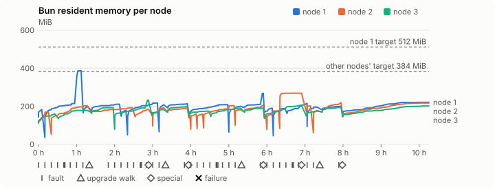
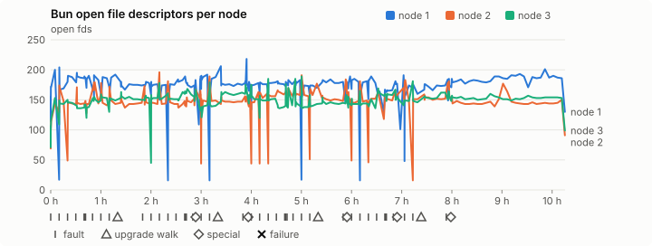
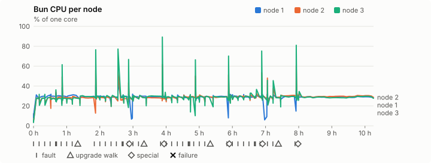
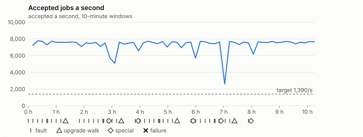

# Sustained soak (V02): PASS

27 October 2026. final tier, full schedule, 10 h 15 min of soak on a three-node quickstart cluster.

**Final job tier: clean. The release gate's final soak passes** for the candidate whose `candidate.json` has SHA-256 `64c0fe5b06b61d25184ab44267a72ac2b0ad9195eb564112a39f409e3c9c5769`, if it is the final candidate.

## Candidate and host

| | |
|---|---|
| Staged base URL | <https://github.com/reliaburger/reliaburger/releases/download/staging-v0.2.3-40376399802-1> |
| `candidate.json` SHA-256 | `64c0fe5b06b61d25184ab44267a72ac2b0ad9195eb564112a39f409e3c9c5769` |
| Running versions | v0.2.3 x3 |
| Soak build | `bun-v0.2.3-soak.1`, SHA-256 `dcbc3149f58f48ed60b74ceea72be8e28d911d188b102654284884c097706556` |
| Walks roll back to | 0.2.3 |
| Host | macOS 26.3.1, Apple M2 Max, 32 GiB |
| Lima | limactl version 2.2.1 |
| Guest | Ubuntu 24.04.5 LTS, kernel 6.8.0-139-generic |
| RELIABURGER_HOME | `/tmp/rbq.4bykA7` |
| Evidence | `/var/tmp/reliaburger-v02.1dwuoX` |

## Configuration deviations

- node.toml `[testing] allowed_operations` adds `provision_isolated_workloads` (quickstart allows only inject_workload_faults and alter_node_state), so the catalogue pulse can lease test namespaces
- node.toml `[logs]`/`[metrics]` export to file:///var/lib/reliaburger/soak-export every 60 s with max_storage_mb = 8, `[storage.snapshots]` every 900 s (compressed: 120 s), retain 4, uploaded to the same directory
- node.toml `[ingress] tls_cert/tls_key` point at an operator pair from a soak CA, 45-minute leaves rotated by the harness
- Bun runs with auto/mixed; host jobs opt in to a single pinned BusyBox copy under /var/lib/reliaburger/soak-jobs, mount_isolation=false. The independent verifier listens on each private VM address, TCP 8189, with a separate run token
- node.toml `[node.labels] soak-volume` = "writer" on node 2 and "redis" on node 3, to pin the volume apps
- node.toml `[upgrades] external_signing_key` = a throwaway operator key the harness made for this run (`ed25519:dobAXk7Ya5GQxepKHD2m/sPyJTIzzTABMfgEUjt7GCU=`); the soak build's `.sig` gets that key's external signature beside the release one (D2)
- node.toml `[security] leaf_lifetime_override_secs = 3600` (D1)

## Timeline

- Started 2026-10-27 01:22:40 UTC, finished 2026-10-27 11:38:10 UTC
- Cycles completed: 8
- Fault and node choices: 35, from seed 476004882 (`--seed 476004882` repeats them)
- Teardown: `relish local destroy --yes` and `relish uninstall --yes` succeeded

## Faults and slots

| Class | Runs | Settled/ok | Failed | Skipped | Settle (median / max) |
|---|---|---|---|---|---|
| fault:bun-kill-follower | 8 | 8 | 0 | 0 | 36 s / 56 s |
| fault:bun-kill-leader | 8 | 8 | 0 | 0 | 35 s / 47 s |
| fault:chaos-cpu | 1 | 2 | 0 | 0 | 18 s / 18 s |
| fault:chaos-delay | 2 | 4 | 0 | 0 | 18 s / 18 s |
| fault:chaos-dns | 1 | 2 | 0 | 0 | 18 s / 18 s |
| fault:chaos-drop | 1 | 2 | 0 | 0 | 18 s / 18 s |
| fault:chaos-kill | 2 | 4 | 0 | 0 | 19 s / 19 s |
| fault:chaos-memory | 1 | 2 | 0 | 0 | 18 s / 18 s |
| fault:chaos-partition | 2 | 4 | 0 | 0 | 19 s / 19 s |
| fault:chaos-pause | 1 | 2 | 0 | 0 | 19 s / 19 s |
| fault:chaos-scenario | 1 | 2 | 0 | 0 | 32 s / 32 s |
| fault:deploy-kill | 4 | 4 | 0 | 0 | 35 s / 38 s |
| fault:node-delay | 3 | 3 | 0 | 0 | 34 s / 35 s |
| fault:node-disk-full | 3 | 3 | 0 | 0 | 18 s / 20 s |
| fault:node-slow-fsync | 2 | 2 | 0 | 0 | 19 s / 19 s |
| fault:power-off | 4 | 4 | 0 | 0 | 34 s / 38 s |
| pulse | 8 | 8 | 0 | 0 | n/a |
| pulse:settle | 0 | 8 | 0 | 0 | 19 s / 19 s |
| special:all-off | 1 | 1 | 0 | 0 | 48 s / 48 s |
| special:graceful-stop | 2 | 2 | 0 | 0 | 48 s / 48 s |
| special:quorum-back | 2 | 2 | 0 | 0 | n/a |
| special:quorum-loss | 2 | 2 | 0 | 0 | 62 s / 62 s |
| storage:offline-export | 1 | 1 | 0 | 0 | n/a |
| storage:registry-push | 8 | 0 | 0 | 0 | n/a |
| tls:invalid-expired | 15 | 15 | 0 | 0 | n/a |
| tls:invalid-torn | 15 | 15 | 0 | 0 | n/a |
| tls:reload | 118 | 118 | 0 | 0 | n/a |
| upgrade:rollback | 4 | 4 | 0 | 0 | n/a |
| upgrade:settle | 0 | 4 | 0 | 0 | 58 s / 59 s |
| upgrade:upgrade | 4 | 4 | 0 | 0 | n/a |

## Execution inventory (gated)

What the run completed, from its events and kept bytes, against what its schedule owes. A fault counts once it was injected and the cluster settled after it.

| Item | Required | Completed | Verdict |
|---|---|---|---|
| candidate.json bytes match the qualified digest | 1 | 1 | ok |
| app workloads settled at the baseline | 1 | 1 | ok |
| upgrade walk (to the soak build and back) | 4 | 4 | ok |
| fault:bun-kill-follower | 1 | 8 | ok |
| fault:bun-kill-leader | 1 | 8 | ok |
| fault:deploy-kill | 1 | 4 | ok |
| fault:power-off | 1 | 4 | ok |
| fault:chaos-kill | 1 | 2 | ok |
| fault:chaos-delay | 1 | 2 | ok |
| fault:chaos-partition | 1 | 2 | ok |
| fault:chaos-scenario | 1 | 1 | ok |
| fault:chaos-pause | 1 | 1 | ok |
| fault:chaos-drop | 1 | 1 | ok |
| fault:chaos-dns | 1 | 1 | ok |
| fault:chaos-cpu | 1 | 1 | ok |
| fault:chaos-memory | 1 | 1 | ok |
| fault:node-delay | 1 | 3 | ok |
| fault:node-disk-full | 1 | 3 | ok |
| fault:node-slow-fsync | 1 | 2 | ok |
| special:graceful-stop | 2 | 2 | ok |
| special:quorum-loss | 2 | 2 | ok |
| special:all-off | 1 | 1 | ok |
| catalogue pulse | 8 | 8 | ok |
| offline export | 1 | 1 | ok |
| quiet tail with no faults, walks or specials | 1 | 1 | ok |
| job campaign drained in its final two minutes | 1 | 1 | ok |

## Observed fault effects

What each injected fault was seen to do, read back from the node.

| Fault | Target | Observed |
|---|---|---|
| effect:bun-kill-follower | rb-8c66e41a9de7-2 | MainPID 2599 -> 4856 |
| effect:bun-kill-leader | rb-8c66e41a9de7-1 | MainPID 9364 -> 1804146 |
| effect:deploy-kill | rb-8c66e41a9de7-2 | MainPID 4856 -> 3973095 |
| effect:power-off | rb-8c66e41a9de7-3 | Lima status Stopped |
| effect:node-delay | rb-8c66e41a9de7-1 | netem 8001: root refcnt 2 limit 1000 delay 200ms  50ms  |
| effect:bun-kill-follower | rb-8c66e41a9de7-1 | MainPID 1804146 -> 2875209 |
| effect:bun-kill-leader | rb-8c66e41a9de7-1 | MainPID 2875209 -> 538925 |
| effect:node-disk-full | rb-8c66e41a9de7-2 | available 67104768 bytes  |
| effect:bun-kill-follower | rb-8c66e41a9de7-3 | MainPID 674 -> 1183637 |
| effect:bun-kill-leader | rb-8c66e41a9de7-1 | MainPID 2499033 -> 3567580 |
| effect:deploy-kill | rb-8c66e41a9de7-1 | MainPID 3567580 -> 1336447 |
| effect:power-off | rb-8c66e41a9de7-2 | Lima status Stopped |
| effect:node-slow-fsync | rb-8c66e41a9de7-3 | IOWriteBandwidthMax=/dev/vda 1000000 IOWriteIOPSMax=/dev/vda 20  |
| effect:bun-kill-follower | rb-8c66e41a9de7-2 | MainPID 675 -> 263450 |
| effect:bun-kill-leader | rb-8c66e41a9de7-1 | MainPID 1336447 -> 1466053 |
| effect:node-delay | rb-8c66e41a9de7-2 | netem 8001: root refcnt 2 limit 1000 delay 200ms  50ms  |
| effect:bun-kill-follower | rb-8c66e41a9de7-2 | MainPID 680 -> 613466 |
| effect:bun-kill-leader | rb-8c66e41a9de7-2 | MainPID 613466 -> 2586326 |
| effect:deploy-kill | rb-8c66e41a9de7-2 | MainPID 2586326 -> 434434 |
| effect:power-off | rb-8c66e41a9de7-3 | Lima status Stopped |
| effect:node-disk-full | rb-8c66e41a9de7-3 | available 67100672 bytes  |
| effect:bun-kill-follower | rb-8c66e41a9de7-1 | MainPID 677 -> 4054640 |
| effect:bun-kill-leader | rb-8c66e41a9de7-2 | MainPID 434434 -> 1899777 |
| effect:node-slow-fsync | rb-8c66e41a9de7-1 | IOWriteBandwidthMax=/dev/vda 1000000 IOWriteIOPSMax=/dev/vda 20  |
| effect:bun-kill-follower | rb-8c66e41a9de7-2 | MainPID 677 -> 818936 |
| effect:bun-kill-leader | rb-8c66e41a9de7-1 | MainPID 679 -> 2786307 |
| effect:deploy-kill | rb-8c66e41a9de7-2 | MainPID 818936 -> 586391 |
| effect:power-off | rb-8c66e41a9de7-1 | Lima status Stopped |
| effect:node-delay | rb-8c66e41a9de7-3 | netem 8001: root refcnt 2 limit 1000 delay 200ms  50ms  |
| effect:bun-kill-follower | rb-8c66e41a9de7-1 | MainPID 676 -> 695019 |
| effect:bun-kill-leader | rb-8c66e41a9de7-2 | MainPID 675 -> 2323729 |
| effect:node-disk-full | rb-8c66e41a9de7-1 | available 67080192 bytes  |

## Renewals and rotations

| Measure | Observed | Required | Verdict |
|---|---|---|---|
| workload identity rotations (soak-identity, per node) | 23 | ≥ 19 | PASS |
| node leaf renewals (per node) | 22 | ≥ 19 | PASS |
| operator ingress reloads (all nodes) | 118 | ≥ 40 | PASS |
| mixed job campaign and positive drain | 0 missing/failing checks | 0 | PASS |

## Jobs

| Runtime | Accepted successes | Retries | Last accepted progress |
|---|---|---|---|
| runc | 112464 | 14 | 1793101078 |
| shared-runc | 64513582 | 1 | 1793101078 |
| process | 204945293 | 1 | 1793101078 |

The bounded campaign shares the app soak's fault schedule. These counts are reliability evidence, not a saturation rate or a 100-million-per-day qualification.

- Independent verifier execution attempts: 24
- Explicit test-operator acknowledgements for known replay-safe fenced fixtures: 194

- rb-8c66e41a9de7-1: latest complete job storage (KiB) {'instances': 89136, 'job-state': 8, 'task-arrays': 23628}; free 4450420 KiB; live/peak owners 0/32; peak storage {'instances': 107960, 'job-state': 8, 'task-arrays': 50008}
- rb-8c66e41a9de7-2: latest complete job storage (KiB) {'instances': 1348, 'job-state': 8, 'task-arrays': 19836}; free 5959136 KiB; live/peak owners 0/32; peak storage {'instances': 60280, 'job-state': 8, 'task-arrays': 46852}
- rb-8c66e41a9de7-3: latest complete job storage (KiB) {'instances': 464, 'job-state': 8, 'task-arrays': 24196}; free 5901292 KiB; live/peak owners 0/32; peak storage {'instances': 80480, 'job-state': 8, 'task-arrays': 52452}

Complete disk inventories are recorded. Global retention bounds and the 12-hour job qualification remain #668; this gate cannot certify an unimplemented retention policy.

## Job qualification (D18-C)

Load: target; 3 nodes; accepted 7,300.5/s against a 1390.0/s target: PASS.

The September plan set its targets for one 1M-task batch on a quiet cluster. A soak runs for hours with restarts, upgrades and apps, so its storage, Bun memory and Raft targets are restated (maintainer decision, 15 October 2026, [#668](https://github.com/reliaburger/reliaburger/issues/668)). Bun's steady state is the median RSS of each process once it has been seen for 10 minutes; the gated memory checks are unchanged (`leak-rss`, and Mayo's 70% `memory_high` alert through `wtf`).

| Measure (recorded, not gated) | Observed | Target |
|---|---|---|
| Wall time of a 1,048,576-task array (median / max of 64) | 179 s / 688 s | ≤ 600 s |
| p99 start lag, pooled executors | 32 ms (bucket upper bound) | < 1,000 ms |
| Raft entries per second, all cluster writes | 1.42 | recorded only; the batch target counts only task-array writes |
| Raft state of one run, largest seen | 18,526 B | ≤ 256 KiB per 1M tasks |
| Bun steady-state RSS per process, worst node against its target | rb-8c66e41a9de7-2: 268.79 MiB steady, 269.28 MiB peak | ≤ 384 MiB (≤ 512 MiB on node 1, which serves the API) |
| Bun CPU, busiest node | 0.29 cores | ≤ 1 core (leader batch control) |
| Executor helper CPU, busiest node | 0.04 cores | ≤ 0.5 core |
| Node task-array storage per 1M accepted tasks (peaks summed) | 0.54 MiB | ≤ 64 MiB, deleted after retirement |
| Retained log volume, all nodes | 27.43 MB | ≤ 50 MB |

- Bun RSS on rb-8c66e41a9de7-1 (serves the API, target ≤ 512 MiB): pid 9364: 183.61 MiB peak (seen for under 10 minutes); pid 1804146: 203.56 MiB steady, 214.67 MiB peak; pid 2875209: 386.68 MiB peak (seen for under 10 minutes); pid 538925: 198.56 MiB peak (seen for under 10 minutes); pid 2499033: 206.93 MiB steady, 211.11 MiB peak; pid 3567580: 179.41 MiB peak (seen for under 10 minutes); pid 1336447: 203.41 MiB steady, 217.46 MiB peak; pid 1466053: 208.31 MiB peak (seen for under 10 minutes); pid 1466053: 212.35 MiB steady, 213.51 MiB peak; pid 677: 199.65 MiB steady, 208.86 MiB peak; pid 4054640: 194.14 MiB steady, 200.57 MiB peak; pid 4054640: 266.75 MiB steady, 268.88 MiB peak; pid 679: 190.45 MiB steady, 190.45 MiB peak; pid 2786307: 186.41 MiB steady, 188.62 MiB peak; pid 676: 204.73 MiB steady, 215.25 MiB peak; pid 695019: 196.00 MiB steady, 196.02 MiB peak; pid 695019: 198.81 MiB steady, 201.79 MiB peak; pid 677: 212.50 MiB steady, 221.19 MiB peak
- Bun RSS on rb-8c66e41a9de7-2 (node, target ≤ 384 MiB): pid 2599: 119.44 MiB peak (seen for under 10 minutes); pid 4856: 169.48 MiB steady, 169.72 MiB peak; pid 3973095: 186.22 MiB steady, 202.30 MiB peak; pid 3973095: 183.23 MiB steady, 192.15 MiB peak; pid 674: 183.41 MiB steady, 185.56 MiB peak; pid 675: 165.07 MiB peak (seen for under 10 minutes); pid 263450: 189.56 MiB steady, 191.44 MiB peak; pid 263450: 188.93 MiB steady, 189.66 MiB peak; pid 680: 155.01 MiB peak (seen for under 10 minutes); pid 613466: 159.86 MiB peak (seen for under 10 minutes); pid 2586326: 158.75 MiB peak (seen for under 10 minutes); pid 434434: 183.34 MiB steady, 203.26 MiB peak; pid 1899777: 181.78 MiB peak (seen for under 10 minutes); pid 1899777: 203.74 MiB steady, 204.16 MiB peak; pid 677: 156.25 MiB peak (seen for under 10 minutes); pid 818936: 175.55 MiB steady, 175.57 MiB peak; pid 586391: 268.79 MiB steady, 269.28 MiB peak; pid 675: 201.88 MiB peak (seen for under 10 minutes); pid 2323729: 177.86 MiB peak (seen for under 10 minutes); pid 2323729: 215.30 MiB steady, 219.14 MiB peak; pid 677: 200.99 MiB steady, 217.48 MiB peak
- Bun RSS on rb-8c66e41a9de7-3 (node, target ≤ 384 MiB): pid 2260: 149.54 MiB steady, 160.38 MiB peak; pid 674: 175.01 MiB steady, 178.14 MiB peak; pid 674: 192.53 MiB steady, 192.95 MiB peak; pid 1183637: 186.04 MiB steady, 233.18 MiB peak; pid 676: 175.91 MiB steady, 183.54 MiB peak; pid 676: 197.66 MiB steady, 200.17 MiB peak; pid 682: 173.21 MiB steady, 174.57 MiB peak; pid 678: 182.20 MiB steady, 190.02 MiB peak; pid 672: 190.59 MiB steady, 190.77 MiB peak; pid 669: 198.60 MiB steady, 205.23 MiB peak; pid 676: 171.96 MiB steady, 175.11 MiB peak; pid 676: 194.21 MiB steady, 195.82 MiB peak; pid 679: 185.33 MiB steady, 202.17 MiB peak

- runc retry causes: exit_code 1, launch 8, signal 0, timeout 0, unknown 5, unrecorded 0
- shared-runc retry causes: exit_code 1, launch 0, signal 0, timeout 0, unknown 0, unrecorded 0
- process retry causes: exit_code 1, launch 0, signal 0, timeout 0, unknown 0, unrecorded 0
- Audited executions: 24; operator replay decisions: 194
- Job controller API fallbacks: rb-8c66e41a9de7-1 missed 737, rb-8c66e41a9de7-2 missed 5; rb-8c66e41a9de7-2 answered 732, rb-8c66e41a9de7-3 answered 5 (requests a node didn't answer, and the node that took them instead)

## Data

- Volume writer: highest ACK 285114 in the log view; the writer file checks (writer-lost, writer-regression) decide data loss, and `*-log-order` failures are about the order the log view returned lines in
- Redis counter: highest INCR 29910 in the log view
- Export rb-8c66e41a9de7-1: 153 source files, 993 at the destination
- Export rb-8c66e41a9de7-2: 444 source files, 1015 at the destination
- Export rb-8c66e41a9de7-3: 188 source files, 846 at the destination
- Registry images pushed and re-verified: 9
- Agent-loop turns over the 1 s budget: rb-8c66e41a9de7-1 0, rb-8c66e41a9de7-2 0, rb-8c66e41a9de7-3 0
- Guest clock steps by Lima's guest agent: rb-8c66e41a9de7-1 6, rb-8c66e41a9de7-2 7, rb-8c66e41a9de7-3 7
- Checks evaluated: 1340 (heavy 125, light 1053, settle 162)
- Last observed progress: redis-counter 29910, writer-ack 285114

## Leak-checker exposure (gated)

How long each leak checker could judge each node's Bun. `leak-rss` arms after 60 minutes in one process and `leak-fd` after 50; a restart, kill or upgrade exec starts the warm-up again. A final needs each armed for 60 minutes on every node, with one unbroken window of 30 (#1062); its quiet tail gives them that.

| Node | Checker | Armed | Longest armed window | Evaluated samples | Processes armed | Verdict |
|---|---|---|---|---|---|---|
| rb-8c66e41a9de7-1 | leak-rss | 74 min | 74 min | 17 | 2 | ok |
| rb-8c66e41a9de7-1 | leak-fd | 93 min | 84 min | 25 | 2 | ok |
| rb-8c66e41a9de7-2 | leak-rss | 74 min | 74 min | 17 | 2 | ok |
| rb-8c66e41a9de7-2 | leak-fd | 101 min | 84 min | 28 | 3 | ok |
| rb-8c66e41a9de7-3 | leak-rss | 74 min | 74 min | 16 | 1 | ok |
| rb-8c66e41a9de7-3 | leak-fd | 91 min | 84 min | 30 | 3 | ok |

## Resource trends

| Node | Measure | First | Last | Max |
|---|---|---|---|---|
| rb-8c66e41a9de7-1 | disk_kb data | 1378500 | 1474532 | 1580216 |
| rb-8c66e41a9de7-1 | disk_kb images | 342456 | 351000 | 462568 |
| rb-8c66e41a9de7-1 | disk_kb logs | 40 | 7648 | 9516 |
| rb-8c66e41a9de7-1 | disk_kb metrics | 60 | 8396 | 9056 |
| rb-8c66e41a9de7-1 | disk_kb soak-export | 4 | 84596 | 84596 |
| rb-8c66e41a9de7-1 | disk_kb volumes | 200 | 180 | 228 |
| rb-8c66e41a9de7-1 | fd | 114 | 130 | 218 |
| rb-8c66e41a9de7-1 | rss_kb | 147576 | 226500 | 395960 |
| rb-8c66e41a9de7-2 | disk_kb data | 67488 | 277768 | 582432 |
| rb-8c66e41a9de7-2 | disk_kb images | 175368 | 346688 | 346688 |
| rb-8c66e41a9de7-2 | disk_kb logs | 32 | 8448 | 8448 |
| rb-8c66e41a9de7-2 | disk_kb metrics | 60 | 8480 | 9188 |
| rb-8c66e41a9de7-2 | disk_kb soak-export | 4 | 64880 | 64880 |
| rb-8c66e41a9de7-2 | disk_kb volumes | 16736 | 23384 | 23384 |
| rb-8c66e41a9de7-2 | fd | 69 | 91 | 196 |
| rb-8c66e41a9de7-2 | rss_kb | 114612 | 222696 | 275740 |
| rb-8c66e41a9de7-3 | disk_kb data | 230240 | 350356 | 674328 |
| rb-8c66e41a9de7-3 | disk_kb images | 339124 | 363336 | 363336 |
| rb-8c66e41a9de7-3 | disk_kb logs | 28 | 8496 | 8820 |
| rb-8c66e41a9de7-3 | disk_kb metrics | 60 | 8516 | 9080 |
| rb-8c66e41a9de7-3 | disk_kb soak-export | 4 | 74872 | 74872 |
| rb-8c66e41a9de7-3 | disk_kb volumes | 16760 | 19232 | 19232 |
| rb-8c66e41a9de7-3 | fd | 71 | 99 | 189 |
| rb-8c66e41a9de7-3 | rss_kb | 114980 | 207020 | 238772 |

## Charts

Time runs from the start of the soak. The marks under each chart are its faults, upgrade walks, specials and recorded failures; the dashed lines are targets.

## Failures

None.

Evidence: `/var/tmp/reliaburger-v02.1dwuoX` (events.jsonl, snapshots/, failures/<n>/).
