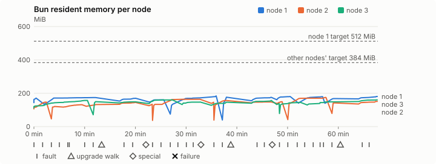
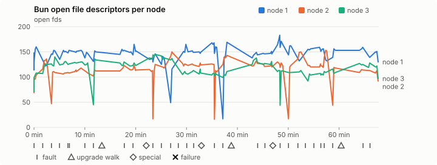
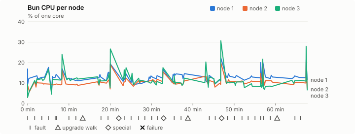
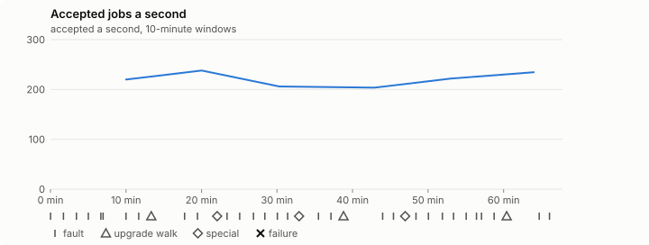

# Sustained soak (V02): PASS

27 October 2026. fast tier, compressed schedule, 1 h 07 min of soak on a three-node quickstart cluster.

**Fast tier: clean.** The iteration loop only, not acceptance: the V02 gate needs a clean final-tier run (8 h, full schedule) on the final candidate.

## Candidate and host

| | |
|---|---|
| Staged base URL | <https://github.com/reliaburger/reliaburger/releases/download/staging-v0.2.3-40376399802-1> |
| `candidate.json` SHA-256 | `64c0fe5b06b61d25184ab44267a72ac2b0ad9195eb564112a39f409e3c9c5769` |
| Running versions | v0.2.3 x3 |
| Soak build | `bun-v0.2.3-soak.1`, SHA-256 `dcbc3149f58f48ed60b74ceea72be8e28d911d188b102654284884c097706556` |
| Walks roll back to | 0.2.3 |
| Host | macOS 26.3.1, Apple M2 Max, 32 GiB |
| Lima | limactl version 2.2.1 |
| Guest | Ubuntu 24.04.5 LTS, kernel 6.8.0-139-generic |
| RELIABURGER_HOME | `/tmp/rbq.5BYqFg` |
| Evidence | `/var/tmp/reliaburger-v02.0mJORU` |

## Configuration deviations

- node.toml `[testing] allowed_operations` adds `provision_isolated_workloads` (quickstart allows only inject_workload_faults and alter_node_state), so the catalogue pulse can lease test namespaces
- node.toml `[logs]`/`[metrics]` export to file:///var/lib/reliaburger/soak-export every 60 s with max_storage_mb = 8, `[storage.snapshots]` every 900 s (compressed: 120 s), retain 4, uploaded to the same directory
- node.toml `[ingress] tls_cert/tls_key` point at an operator pair from a soak CA, 45-minute leaves rotated by the harness
- Bun runs with auto/mixed; host jobs opt in to a single pinned BusyBox copy under /var/lib/reliaburger/soak-jobs, mount_isolation=false. The independent verifier listens on each private VM address, TCP 8189, with a separate run token
- node.toml `[node.labels] soak-volume` = "writer" on node 2 and "redis" on node 3, to pin the volume apps
- node.toml `[upgrades] external_signing_key` = a throwaway operator key the harness made for this run (`ed25519:mu+K5Z5C5oLQGUutF2TGiNCGR18yVNHPyIXhugGQ27o=`); the soak build's `.sig` gets that key's external signature beside the release one (D2)
- node.toml `[security] leaf_lifetime_override_secs = 3600` (D1)

## Timeline

- Started 2026-10-27 12:32:15 UTC, finished 2026-10-27 13:40:03 UTC
- Cycles completed: 6
- Fault and node choices: 26, from seed 1226345253 (`--seed 1226345253` repeats them)
- Teardown: `relish local destroy --yes` and `relish uninstall --yes` succeeded

## Faults and slots

| Class | Runs | Settled/ok | Failed | Skipped | Settle (median / max) |
|---|---|---|---|---|---|
| fault:bun-kill-follower | 6 | 6 | 0 | 0 | 34 s / 36 s |
| fault:bun-kill-leader | 6 | 6 | 0 | 0 | 35 s / 48 s |
| fault:chaos-cpu | 1 | 2 | 0 | 0 | 17 s / 17 s |
| fault:chaos-delay | 2 | 4 | 0 | 0 | 16 s / 16 s |
| fault:chaos-dns | 1 | 2 | 0 | 0 | 19 s / 19 s |
| fault:chaos-drop | 1 | 2 | 0 | 0 | 17 s / 17 s |
| fault:chaos-kill | 2 | 4 | 0 | 0 | 30 s / 30 s |
| fault:chaos-memory | 1 | 2 | 0 | 0 | 16 s / 16 s |
| fault:chaos-partition | 2 | 4 | 0 | 0 | 16 s / 16 s |
| fault:chaos-pause | 1 | 2 | 0 | 0 | 16 s / 16 s |
| fault:chaos-scenario | 1 | 2 | 0 | 0 | 34 s / 34 s |
| fault:deploy-kill | 3 | 3 | 0 | 0 | 38 s / 43 s |
| fault:power-off | 3 | 3 | 0 | 0 | 34 s / 42 s |
| pulse | 1 | 1 | 0 | 0 | n/a |
| pulse:settle | 0 | 1 | 0 | 0 | 16 s / 16 s |
| special:all-off | 1 | 1 | 0 | 0 | 30 s / 30 s |
| special:graceful-stop | 1 | 1 | 0 | 0 | 40 s / 40 s |
| special:quorum-back | 1 | 1 | 0 | 0 | n/a |
| special:quorum-loss | 1 | 1 | 0 | 0 | 29 s / 29 s |
| storage:offline-export | 3 | 3 | 0 | 0 | n/a |
| storage:registry-push | 6 | 0 | 0 | 0 | n/a |
| tls:invalid-expired | 3 | 3 | 0 | 0 | n/a |
| tls:invalid-torn | 6 | 6 | 0 | 0 | n/a |
| tls:reload | 33 | 33 | 0 | 0 | n/a |
| upgrade:rollback | 3 | 3 | 0 | 0 | n/a |
| upgrade:settle | 0 | 3 | 0 | 0 | 52 s / 64 s |
| upgrade:upgrade | 3 | 3 | 0 | 0 | n/a |

## Execution inventory (recorded, not gated)

What the run completed, from its events and kept bytes, against what its schedule owes. A fault counts once it was injected and the cluster settled after it.

| Item | Required | Completed | Verdict |
|---|---|---|---|
| candidate.json bytes match the qualified digest | 1 | 1 | ok |
| app workloads settled at the baseline | 1 | 1 | ok |
| upgrade walk (to the soak build and back) | 2 | 3 | ok |
| fault:bun-kill-follower | 1 | 6 | ok |
| fault:bun-kill-leader | 1 | 6 | ok |
| fault:deploy-kill | 1 | 3 | ok |
| fault:power-off | 1 | 3 | ok |
| fault:chaos-kill | 1 | 2 | ok |
| fault:chaos-delay | 1 | 2 | ok |
| fault:chaos-partition | 1 | 2 | ok |
| fault:chaos-scenario | 1 | 1 | ok |
| fault:chaos-pause | 1 | 1 | ok |
| fault:chaos-drop | 1 | 1 | ok |
| fault:chaos-dns | 1 | 1 | ok |
| fault:chaos-cpu | 1 | 1 | ok |
| special:graceful-stop | 1 | 1 | ok |
| special:quorum-loss | 1 | 1 | ok |
| special:all-off | 1 | 1 | ok |
| catalogue pulse | 1 | 1 | ok |
| offline export | 2 | 3 | ok |
| job campaign drained in its final two minutes | 1 | 1 | ok |

## Observed fault effects

What each injected fault was seen to do, read back from the node.

| Fault | Target | Observed |
|---|---|---|
| effect:bun-kill-follower | rb-74323da3816d-2 | MainPID 2537 -> 4698 |
| effect:bun-kill-leader | rb-74323da3816d-1 | MainPID 9637 -> 35847 |
| effect:deploy-kill | rb-74323da3816d-2 | MainPID 4698 -> 56127 |
| effect:power-off | rb-74323da3816d-2 | Lima status Stopped |
| effect:bun-kill-follower | rb-74323da3816d-2 | MainPID 660 -> 76853 |
| effect:bun-kill-leader | rb-74323da3816d-3 | MainPID 2258 -> 203219 |
| effect:bun-kill-follower | rb-74323da3816d-2 | MainPID 669 -> 17560 |
| effect:bun-kill-leader | rb-74323da3816d-2 | MainPID 17560 -> 46513 |
| effect:deploy-kill | rb-74323da3816d-1 | MainPID 673 -> 76385 |
| effect:power-off | rb-74323da3816d-3 | Lima status Stopped |
| effect:bun-kill-follower | rb-74323da3816d-2 | MainPID 681 -> 21969 |
| effect:bun-kill-leader | rb-74323da3816d-1 | MainPID 76385 -> 245057 |
| effect:bun-kill-follower | rb-74323da3816d-3 | MainPID 681 -> 13962 |
| effect:bun-kill-leader | rb-74323da3816d-2 | MainPID 678 -> 44882 |
| effect:deploy-kill | rb-74323da3816d-1 | MainPID 677 -> 79540 |
| effect:power-off | rb-74323da3816d-3 | Lima status Stopped |
| effect:bun-kill-follower | rb-74323da3816d-1 | MainPID 79540 -> 173714 |
| effect:bun-kill-leader | rb-74323da3816d-2 | MainPID 44882 -> 199913 |

## Renewals and rotations

| Measure | Observed | Required | Verdict |
|---|---|---|---|
| workload identity rotations (soak-identity, per node) | 8 | ≥ 1 | PASS |
| node leaf renewals (per node) | 2 | ≥ 1 | PASS |
| operator ingress reloads (all nodes) | 33 | ≥ 12 | PASS |
| mixed job campaign and positive drain | 0 missing/failing checks | 0 | PASS |

## Jobs

| Runtime | Accepted successes | Retries | Last accepted progress |
|---|---|---|---|
| runc | 17427 | 3 | 1793108395 |
| shared-runc | 431890 | 1 | 1793108395 |
| process | 453088 | 1 | 1793108395 |

The bounded campaign shares the app soak's fault schedule. These counts are reliability evidence, not a saturation rate or a 100-million-per-day qualification.

- Independent verifier execution attempts: 24
- Explicit test-operator acknowledgements for known replay-safe fenced fixtures: 129

- rb-74323da3816d-1: latest complete job storage (KiB) {'instances': 3628, 'job-state': 8, 'task-arrays': 6192}; free 5200920 KiB; live/peak owners 0/10; peak storage {'instances': 13544, 'job-state': 8, 'task-arrays': 15772}
- rb-74323da3816d-2: latest complete job storage (KiB) {'instances': 1952, 'job-state': 8, 'task-arrays': 5304}; free 6322220 KiB; live/peak owners 0/8; peak storage {'instances': 6644, 'job-state': 8, 'task-arrays': 15664}
- rb-74323da3816d-3: latest complete job storage (KiB) {'instances': 296, 'job-state': 8, 'task-arrays': 5632}; free 6304208 KiB; live/peak owners 0/8; peak storage {'instances': 12612, 'job-state': 8, 'task-arrays': 15432}

Complete disk inventories are recorded. Global retention bounds and the 12-hour job qualification remain #668; this gate cannot certify an unimplemented retention policy.

## Job qualification (D18-C)

Load: calibration; 3 nodes; accepted 221.8/s (calibration load: not gated).

The September plan set its targets for one 1M-task batch on a quiet cluster. A soak runs for hours with restarts, upgrades and apps, so its storage, Bun memory and Raft targets are restated (maintainer decision, 15 October 2026, [#668](https://github.com/reliaburger/reliaburger/issues/668)). Bun's steady state is the median RSS of each process once it has been seen for 10 minutes; the gated memory checks are unchanged (`leak-rss`, and Mayo's 70% `memory_high` alert through `wtf`).

| Measure (recorded, not gated) | Observed | Target |
|---|---|---|
| Wall time of a 1,048,576-task array (median / max of 0) | not measured / not measured | ≤ 600 s |
| p99 start lag, pooled executors | 2 ms (bucket upper bound) | < 1,000 ms |
| Raft entries per second, all cluster writes | 1.97 | recorded only; the batch target counts only task-array writes |
| Raft state of one run, largest seen | 45,122 B | ≤ 256 KiB per 1M tasks |
| Bun steady-state RSS per process, worst node against its target | rb-74323da3816d-3: 156.97 MiB steady, 160.26 MiB peak | ≤ 384 MiB (≤ 512 MiB on node 1, which serves the API) |
| Bun CPU, busiest node | 0.12 cores | ≤ 1 core (leader batch control) |
| Executor helper CPU, busiest node | 0.00 cores | ≤ 0.5 core |
| Node task-array storage per 1M accepted tasks (peaks summed) | 50.72 MiB | ≤ 64 MiB, deleted after retirement |
| Retained log volume, all nodes | 6.78 MB | ≤ 50 MB |

- Bun RSS on rb-74323da3816d-1 (serves the API, target ≤ 512 MiB): pid 9637: 170.88 MiB peak (seen for under 10 minutes); pid 35847: 174.27 MiB steady, 174.27 MiB peak; pid 238041: 170.06 MiB peak (seen for under 10 minutes); pid 673: 160.55 MiB peak (seen for under 10 minutes); pid 76385: 184.10 MiB peak (seen for under 10 minutes); pid 245057: 176.47 MiB peak (seen for under 10 minutes); pid 245057: 175.68 MiB peak (seen for under 10 minutes); pid 677: 180.25 MiB peak (seen for under 10 minutes); pid 79540: 179.36 MiB peak (seen for under 10 minutes); pid 173714: 168.12 MiB peak (seen for under 10 minutes); pid 173714: 180.89 MiB peak (seen for under 10 minutes)
- Bun RSS on rb-74323da3816d-2 (node, target ≤ 384 MiB): pid 2537: 117.98 MiB peak (seen for under 10 minutes); pid 4698: 146.77 MiB peak (seen for under 10 minutes); pid 56127: 120.71 MiB peak (seen for under 10 minutes); pid 660: 131.27 MiB peak (seen for under 10 minutes); pid 76853: 132.14 MiB peak (seen for under 10 minutes); pid 76853: 144.88 MiB peak (seen for under 10 minutes); pid 669: 133.99 MiB peak (seen for under 10 minutes); pid 17560: 133.36 MiB peak (seen for under 10 minutes); pid 46513: 163.90 MiB peak (seen for under 10 minutes); pid 681: 146.02 MiB peak (seen for under 10 minutes); pid 21969: 156.59 MiB peak (seen for under 10 minutes); pid 678: 147.93 MiB peak (seen for under 10 minutes); pid 678: 149.35 MiB peak (seen for under 10 minutes); pid 44882: 174.62 MiB peak (seen for under 10 minutes); pid 199913: 142.13 MiB peak (seen for under 10 minutes); pid 682: 151.24 MiB peak (seen for under 10 minutes)
- Bun RSS on rb-74323da3816d-3 (node, target ≤ 384 MiB): pid 2258: 156.97 MiB steady, 156.98 MiB peak; pid 203219: 149.66 MiB peak (seen for under 10 minutes); pid 203219: 148.59 MiB peak (seen for under 10 minutes); pid 672: 159.68 MiB peak (seen for under 10 minutes); pid 678: 147.33 MiB peak (seen for under 10 minutes); pid 679: 146.37 MiB peak (seen for under 10 minutes); pid 679: 156.93 MiB peak (seen for under 10 minutes); pid 681: 138.00 MiB peak (seen for under 10 minutes); pid 13962: 145.93 MiB peak (seen for under 10 minutes); pid 681: 148.71 MiB peak (seen for under 10 minutes); pid 681: 160.26 MiB peak (seen for under 10 minutes)

- runc retry causes: exit_code 1, launch 1, signal 0, timeout 0, unknown 1, unrecorded 0
- shared-runc retry causes: exit_code 1, launch 0, signal 0, timeout 0, unknown 0, unrecorded 0
- process retry causes: exit_code 1, launch 0, signal 0, timeout 0, unknown 0, unrecorded 0
- Audited executions: 24; operator replay decisions: 129
- Job controller API fallbacks: rb-74323da3816d-1 missed 182, rb-74323da3816d-2 missed 10; rb-74323da3816d-2 answered 172, rb-74323da3816d-3 answered 10 (requests a node didn't answer, and the node that took them instead)

## Data

- Volume writer: highest ACK 30982 in the log view; the writer file checks (writer-lost, writer-regression) decide data loss, and `*-log-order` failures are about the order the log view returned lines in
- Redis counter: highest INCR 3281 in the log view
- Export rb-74323da3816d-1: 127 source files, 126 at the destination
- Export rb-74323da3816d-2: 134 source files, 123 at the destination
- Export rb-74323da3816d-3: 119 source files, 111 at the destination
- Registry images pushed and re-verified: 7
- Agent-loop turns over the 1 s budget: rb-74323da3816d-1 0, rb-74323da3816d-2 0, rb-74323da3816d-3 0
- Guest clock steps by Lima's guest agent: rb-74323da3816d-1 3, rb-74323da3816d-2 7, rb-74323da3816d-3 5
- Checks evaluated: 191 (heavy 16, light 73, settle 102)
- Last observed progress: redis-counter 3281, writer-ack 30982

## Leak-checker exposure (recorded, not gated)

How long each leak checker could judge each node's Bun. `leak-rss` arms after 60 minutes in one process and `leak-fd` after 50; a restart, kill or upgrade exec starts the warm-up again. A final needs each armed for 60 minutes on every node, with one unbroken window of 30 (#1062); its quiet tail gives them that.

| Node | Checker | Armed | Longest armed window | Evaluated samples | Processes armed | Verdict |
|---|---|---|---|---|---|---|
| rb-74323da3816d-1 | leak-rss | 0 min | 0 min | 0 | 0 | short |
| rb-74323da3816d-1 | leak-fd | 0 min | 0 min | 0 | 0 | short |
| rb-74323da3816d-2 | leak-rss | 0 min | 0 min | 0 | 0 | short |
| rb-74323da3816d-2 | leak-fd | 0 min | 0 min | 0 | 0 | short |
| rb-74323da3816d-3 | leak-rss | 0 min | 0 min | 0 | 0 | short |
| rb-74323da3816d-3 | leak-fd | 0 min | 0 min | 0 | 0 | short |

## Resource trends

| Node | Measure | First | Last | Max |
|---|---|---|---|---|
| rb-74323da3816d-1 | disk_kb data | 1378544 | 1461148 | 1531620 |
| rb-74323da3816d-1 | disk_kb images | 342456 | 454284 | 454284 |
| rb-74323da3816d-1 | disk_kb logs | 44 | 3340 | 3340 |
| rb-74323da3816d-1 | disk_kb metrics | 60 | 4896 | 4896 |
| rb-74323da3816d-1 | disk_kb soak-export | 4 | 8160 | 8160 |
| rb-74323da3816d-1 | disk_kb volumes | 200 | 228 | 252 |
| rb-74323da3816d-1 | fd | 114 | 130 | 183 |
| rb-74323da3816d-1 | rss_kb | 146960 | 185228 | 188520 |
| rb-74323da3816d-2 | disk_kb data | 67516 | 89340 | 101468 |
| rb-74323da3816d-2 | disk_kb images | 175368 | 342448 | 342448 |
| rb-74323da3816d-2 | disk_kb logs | 32 | 940 | 940 |
| rb-74323da3816d-2 | disk_kb metrics | 60 | 2700 | 2700 |
| rb-74323da3816d-2 | disk_kb soak-export | 4 | 3944 | 3944 |
| rb-74323da3816d-2 | disk_kb volumes | 16736 | 17324 | 17324 |
| rb-74323da3816d-2 | fd | 69 | 92 | 153 |
| rb-74323da3816d-2 | rss_kb | 108904 | 154868 | 178808 |
| rb-74323da3816d-3 | disk_kb data | 230268 | 191868 | 722796 |
| rb-74323da3816d-3 | disk_kb images | 339124 | 346636 | 346636 |
| rb-74323da3816d-3 | disk_kb logs | 28 | 2344 | 2344 |
| rb-74323da3816d-3 | disk_kb metrics | 60 | 3996 | 3996 |
| rb-74323da3816d-3 | disk_kb soak-export | 4 | 8308 | 8308 |
| rb-74323da3816d-3 | disk_kb volumes | 16760 | 17004 | 17128 |
| rb-74323da3816d-3 | fd | 72 | 97 | 145 |
| rb-74323da3816d-3 | rss_kb | 115000 | 164108 | 164108 |

## Charts

Time runs from the start of the soak. The marks under each chart are its faults, upgrade walks, specials and recorded failures; the dashed lines are targets.

## Failures

None.

Evidence: `/var/tmp/reliaburger-v02.0mJORU` (events.jsonl, snapshots/, failures/<n>/).
