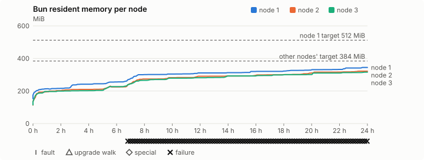
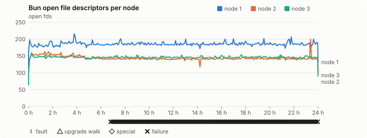
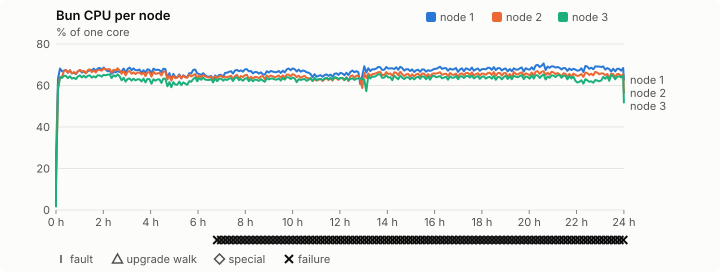
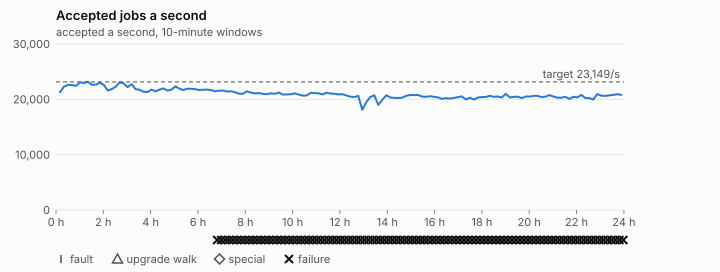

# Sustained soak (V02): FAIL

27 October 2026. day tier, no fault schedule, 24 h 00 min of soak on a three-node quickstart cluster.

**Day tier: not clean.** The day run doesn't hold; the record says what failed.

## The maintainer's verdict

The maintainer accepted this run as 0.2.3's day-run record on **28 October
2026**, and 0.2.3 shipped on it. This page publishes the harness's own FAIL
verdict unchanged. The rest of this section says what failed and why each
failure was accepted.

- **Throughput: 1,807,742,226 host-job tasks in one real 24-hour day on three
  nodes (20,920 a second).** That's 1.81 billion, not the 2 billion target
  (23,149 a second). The host was a 2023 MacBook Pro (M2 Max), whose 12 cores
  the three 4-vCPU VMs fill. The same candidate ran 29,350 a second on three
  nodes in the [throughput benchmark](2026-10-27-v0.2.3-candidate-throughput/README.md),
  so the gap is this host's sustained throughput, not a 3-node limit.
  The maintainer accepted the measured number before the run ended. The
  billion-a-day floor held, and the slowdown check passed: the last hour was
  6.9% slower than the first, within the 10% allowed.
- **Bun's memory grew for the whole run (failures 1–103, `leak-rss`).** Each
  node's Bun went from about 200 MiB at the one-hour mark to 316–345 MiB at
  the end. The growth slowed but didn't stop (about 3 MiB an hour on node 1
  late in the run). It stayed under the job targets, 384 MiB per node and
  512 MiB on node 1. The 8-hour jobs final, at about a third of this rate,
  passed the same check. Whether this is a leak or a working set that settles
  higher at 20,000 a second is open:
  [#1417](https://github.com/reliaburger/reliaburger/issues/1417), 0.2.4.
- **One 1–2.5 s `follow_up` turn on node 3 (failure 30),** between about
  05:00 and 05:11 GMT. No log line names it. At 05:16 all three nodes logged
  discovery journal writes of about one second, which suggests the host-stall
  class accepted for 0.2.3's V02 fast run, but that isn't proven:
  [#1419](https://github.com/reliaburger/reliaburger/issues/1419), 0.2.4.
- **Node 1's disk filled up near the end (failures 92 and 100).** The
  cluster's `disk_high` alert (over 80%) fired at 15:37 UTC, two hours before
  the end, and the node's `disk-high` warning at 16:58, at 85.7%. Its job instance
  storage grew to 949 MiB, against under 35 MiB on the other nodes, on a
  10 GiB VM disk that also held the soak's own exports:
  [#1418](https://github.com/reliaburger/reliaburger/issues/1418), 0.2.4.
- **Node 3 is marked "restarted" in the per-node table, but its Bun didn't
  restart.** Its process (pid 1670) ran from 17:28:57 UTC, before the
  campaign started, to the end. One reading of its success counter went
  backwards, which the harness counts as a restart. The per-node totals still
  add up to the campaign's total.
- **The job campaign check (`mixed job campaign and positive drain`) fails
  only on the throughput target.** The drain itself passed.

## Repeat it

From the commit that added the day tier's BusyBox
([#1386](https://github.com/reliaburger/reliaburger/pull/1386), `0f652c58`),
on a quiet Apple silicon Mac with Lima 2.2 and at least 15 GiB free:

```sh
scripts/release/qualify-jobs-sustained.sh --tier day \
  --base-url https://github.com/reliaburger/reliaburger/releases/download/staging-v0.2.3-40376399802-1 \
  --qualified-digest 64c0fe5b06b61d25184ab44267a72ac2b0ad9195eb564112a39f409e3c9c5769 \
  --record day-run.md
```

The staged pre-release is deleted once 0.2.3 is promoted. To repeat the run
on the released binaries, use the published release's base URL and its
`candidate.json` digest.

## Candidate and host

| | |
|---|---|
| Staged base URL | <https://github.com/reliaburger/reliaburger/releases/download/staging-v0.2.3-40376399802-1> |
| `candidate.json` SHA-256 | `64c0fe5b06b61d25184ab44267a72ac2b0ad9195eb564112a39f409e3c9c5769` |
| Running versions | v0.2.3 x3 |
| Soak build | not supplied: upgrade slots skipped |
| Host | macOS 26.3.1, Apple M2 Max, 32 GiB |
| Lima | limactl version 2.2.1 |
| Guest | Ubuntu 24.04.5 LTS, kernel 6.8.0-139-generic |
| RELIABURGER_HOME | `/tmp/rbq.RXi6KY` |
| Evidence | `/var/tmp/reliaburger-v02.3Lw7E5` |

## Configuration deviations

- Each quickstart VM resized from 2 vCPU / 2 GiB to 4 vCPU / 6 GiB before configuring, the size the scale-out record measured (maintainer decision, 27 October 2026)
- node.toml `[testing] allowed_operations` adds `provision_isolated_workloads` (quickstart allows only inject_workload_faults and alter_node_state), so the catalogue pulse can lease test namespaces
- node.toml `[logs]`/`[metrics]` export to file:///var/lib/reliaburger/soak-export every 60 s with max_storage_mb = 8, `[storage.snapshots]` every 900 s (compressed: 120 s), retain 4, uploaded to the same directory
- node.toml `[ingress] tls_cert/tls_key` point at an operator pair from a soak CA, 45-minute leaves rotated by the harness
- Bun runs with auto/mixed; host jobs opt in to a single pinned BusyBox copy under /var/lib/reliaburger/soak-jobs, mount_isolation=false. The independent verifier listens on each private VM address, TCP 8189, with a separate run token
- node.toml `[node.labels] soak-volume` = "writer" on node 2 and "redis" on node 3, to pin the volume apps
- node.toml `[security] leaf_lifetime_override_secs = 3600` (D1)
- Host jobs run Ubuntu's busybox-static 1:1.36.1-6ubuntu3.1 (`52151e7f…`), the scale-out record's binary, instead of the image's

## Timeline

- Started 2026-10-27 17:30:06 UTC, finished 2026-10-28 17:30:26 UTC
- Cycles completed: 0
- Fault and node choices: 0, from seed 2333161135 (`--seed 2333161135` repeats them)
- Teardown: `relish local destroy --yes` and `relish uninstall --yes` succeeded

## Faults and slots

| Class | Runs | Settled/ok | Failed | Skipped | Settle (median / max) |
|---|---|---|---|---|---|
| tls:invalid-expired | 33 | 33 | 0 | 0 | n/a |
| tls:invalid-torn | 36 | 36 | 0 | 0 | n/a |
| tls:reload | 285 | 285 | 0 | 0 | n/a |

## Execution inventory (gated)

What the run completed, from its events and kept bytes, against what its schedule owes. A fault counts once it was injected and the cluster settled after it.

| Item | Required | Completed | Verdict |
|---|---|---|---|
| candidate.json bytes match the qualified digest | 1 | 1 | ok |
| app workloads settled at the baseline | 1 | 1 | ok |
| job campaign drained in its final two minutes | 1 | 1 | ok |

## Renewals and rotations

| Measure | Observed | Required | Verdict |
|---|---|---|---|
| workload identity rotations (soak-identity, per node) | 48 | ≥ 47 | PASS |
| node leaf renewals (per node) | 52 | ≥ 47 | PASS |
| operator ingress reloads (all nodes) | 285 | ≥ 95 | PASS |
| mixed job campaign and positive drain | 1 missing/failing checks | 0 | FAIL |

## Jobs

| Runtime | Accepted successes | Retries | Last accepted progress |
|---|---|---|---|
| runc | 194226 | 6 | 1793208611 |
| shared-runc | 9372592 | 1 | 1793208611 |
| process | 1807742226 | 1 | 1793208609 |

The bounded campaign shares the app soak's fault schedule. These counts are reliability evidence, not a saturation rate or a 100-million-per-day qualification.

- host-job rate 20,920.0/s is below the 23149.0/s target (the billion-a-day floor holds: 1,807,491,185 a day)
- Independent verifier execution attempts: 24
- Explicit test-operator acknowledgements for known replay-safe fenced fixtures: 11

- rb-de121468bcc1-1: latest complete job storage (KiB) {'instances': 948320, 'job-state': 8, 'task-arrays': 63420}; free 1313376 KiB; live/peak owners 0/37; peak storage {'instances': 971344, 'job-state': 8, 'task-arrays': 337372}
- rb-de121468bcc1-2: latest complete job storage (KiB) {'instances': 8468, 'job-state': 8, 'task-arrays': 65824}; free 4861656 KiB; live/peak owners 0/34; peak storage {'instances': 32788, 'job-state': 8, 'task-arrays': 266844}
- rb-de121468bcc1-3: latest complete job storage (KiB) {'instances': 440, 'job-state': 8, 'task-arrays': 65120}; free 4925544 KiB; live/peak owners 0/34; peak storage {'instances': 24792, 'job-state': 8, 'task-arrays': 269176}

Complete disk inventories are recorded. Global retention bounds and the 12-hour job qualification remain #668; this gate cannot certify an unimplemented retention policy.

## Job qualification (D18-C)

Load: day; 3 nodes; accepted 21,030.7/s against a 23149.0/s target: FAIL.

The September plan set its targets for one 1M-task batch on a quiet cluster. A soak runs for hours with restarts, upgrades and apps, so its storage, Bun memory and Raft targets are restated (maintainer decision, 15 October 2026, [#668](https://github.com/reliaburger/reliaburger/issues/668)). Bun's steady state is the median RSS of each process once it has been seen for 10 minutes; the gated memory checks are unchanged (`leak-rss`, and Mayo's 70% `memory_high` alert through `wtf`).

| Measure (recorded, not gated) | Observed | Target |
|---|---|---|
| Wall time of a 1,048,576-task array (median / max of 0) | not measured / not measured | ≤ 600 s |
| p99 start lag, pooled executors | 16 ms (bucket upper bound) | < 1,000 ms |
| Raft entries per second, all cluster writes | 2.17 | recorded only; the batch target counts only task-array writes |
| Raft state of one run, largest seen | 45,984 B | ≤ 256 KiB per 1M tasks |
| Bun steady-state RSS per process, worst node against its target | rb-de121468bcc1-2: 290.65 MiB steady, 321.79 MiB peak | ≤ 384 MiB (≤ 512 MiB on node 1, which serves the API) |
| Bun CPU, busiest node | 0.67 cores | ≤ 1 core (leader batch control) |
| Executor helper CPU, busiest node | 0.44 cores | ≤ 0.5 core |
| Node task-array storage per 1M accepted tasks (peaks summed) | 0.47 MiB | ≤ 64 MiB, deleted after retirement |
| Retained log volume, all nodes | 6.12 MB | ≤ 50 MB |

- Bun RSS on rb-de121468bcc1-1 (serves the API, target ≤ 512 MiB): pid 3265: 310.91 MiB steady, 344.54 MiB peak
- Bun RSS on rb-de121468bcc1-2 (node, target ≤ 384 MiB): pid 1811: 290.65 MiB steady, 321.79 MiB peak
- Bun RSS on rb-de121468bcc1-3 (node, target ≤ 384 MiB): pid 1670: 281.53 MiB steady, 315.71 MiB peak

- runc retry causes: exit_code 2, launch 3, signal 0, timeout 0, unknown 1, unrecorded 0
- shared-runc retry causes: exit_code 1, launch 0, signal 0, timeout 0, unknown 0, unrecorded 0
- process retry causes: exit_code 1, launch 0, signal 0, timeout 0, unknown 0, unrecorded 0
- Audited executions: 24; operator replay decisions: 11
- Job controller API fallbacks: rb-de121468bcc1-1 missed 31, rb-de121468bcc1-2 missed 11; rb-de121468bcc1-2 answered 20, rb-de121468bcc1-3 answered 11 (requests a node didn't answer, and the node that took them instead)

## Day run (#1032)

1,807,742,226 accepted host-job tasks in 24 h 00 min: 20,920.0/s against the 23149.0/s target (FAIL). The billion-a-day floor is 11,575/s (met). At this rate a day is 1,807,491,185 tasks.

| Node | Slots | Host-job successes | Rate | Share | Fair share | Verdict |
|---|---|---|---|---|---|---|
| rb-de121468bcc1-1 | 27 | 587,122,548 | 6,794.5/s | 32.5% | 33.3% | ok |
| rb-de121468bcc1-2 | 27 | 611,847,922 | 7,080.6/s | 33.8% | 33.3% | ok |
| rb-de121468bcc1-3 | 27 | 608,771,850 | 7,045.0/s | 33.7% | 33.3% | ok (restarted) |

A node may take up to 20% more than its fair share by slots, as `relish bench` allows (#1362).

| Hour | Host jobs a second | |
|---|---|---|
| Hour 1 | 22,226.6 | ████████████████████ |
| Hour 2 | 22,734.5 | ████████████████████ |
| Hour 3 | 22,186.8 | ████████████████████ |
| Hour 4 | 21,719.6 | ███████████████████ |
| Hour 5 | 21,664.2 | ███████████████████ |
| Hour 6 | 21,728.2 | ███████████████████ |
| Hour 7 | 21,539.5 | ███████████████████ |
| Hour 8 | 21,181.3 | ███████████████████ |
| Hour 9 | 20,963.1 | ██████████████████ |
| Hour 10 | 20,921.6 | ██████████████████ |
| Hour 11 | 20,803.2 | ██████████████████ |
| Hour 12 | 20,903.9 | ██████████████████ |
| Hour 13 | 20,055.3 | ██████████████████ |
| Hour 14 | 19,903.9 | ██████████████████ |
| Hour 15 | 20,386.7 | ██████████████████ |
| Hour 16 | 20,466.5 | ██████████████████ |
| Hour 17 | 20,099.0 | ██████████████████ |
| Hour 18 | 20,150.8 | ██████████████████ |
| Hour 19 | 20,451.1 | ██████████████████ |
| Hour 20 | 20,293.9 | ██████████████████ |
| Hour 21 | 20,451.4 | ██████████████████ |
| Hour 22 | 20,246.9 | ██████████████████ |
| Hour 23 | 20,305.6 | ██████████████████ |
| Hour 24 | 20,689.6 | ██████████████████ |

Last hour against the first: 20,689.6/s against 22,226.6/s, ok (at most 10% slower; the first hour includes the campaign's start and its host-job probes).

## Data

- Volume writer: highest ACK 3026 in the log view; the writer file checks (writer-lost, writer-regression) decide data loss, and `*-log-order` failures are about the order the log view returned lines in
- Redis counter: highest INCR 17049 in the log view
- Export rb-de121468bcc1-1: 309 source files, 1780 at the destination
- Export rb-de121468bcc1-2: 23 source files, 1518 at the destination
- Export rb-de121468bcc1-3: 20 source files, 1452 at the destination
- Registry images pushed and re-verified: 1
- Agent-loop turns over the 1 s budget: rb-de121468bcc1-1 0, rb-de121468bcc1-2 0, rb-de121468bcc1-3 1
- Guest clock steps by Lima's guest agent: rb-de121468bcc1-1 10, rb-de121468bcc1-2 10, rb-de121468bcc1-3 10
- Checks evaluated: 2920 (heavy 288, light 2630, settle 2)
- Last observed progress: redis-counter 17049, writer-ack 3026

## Leak-checker exposure (gated)

How long each leak checker could judge each node's Bun. `leak-rss` arms after 60 minutes in one process and `leak-fd` after 50; a restart, kill or upgrade exec starts the warm-up again. A final needs each armed for 60 minutes on every node, with one unbroken window of 30 (#1062); its quiet tail gives them that.

| Node | Checker | Armed | Longest armed window | Evaluated samples | Processes armed | Verdict |
|---|---|---|---|---|---|---|
| rb-de121468bcc1-1 | leak-rss | 1379 min | 1379 min | 275 | 1 | ok |
| rb-de121468bcc1-1 | leak-fd | 1389 min | 1389 min | 277 | 1 | ok |
| rb-de121468bcc1-2 | leak-rss | 1379 min | 1379 min | 275 | 1 | ok |
| rb-de121468bcc1-2 | leak-fd | 1389 min | 1389 min | 277 | 1 | ok |
| rb-de121468bcc1-3 | leak-rss | 1379 min | 1379 min | 275 | 1 | ok |
| rb-de121468bcc1-3 | leak-fd | 1389 min | 1389 min | 277 | 1 | ok |

## Resource trends

| Node | Measure | First | Last | Max |
|---|---|---|---|---|
| rb-de121468bcc1-1 | disk_kb data | 1437104 | 4215732 | 4381420 |
| rb-de121468bcc1-1 | disk_kb images | 342456 | 342480 | 342516 |
| rb-de121468bcc1-1 | disk_kb logs | 76 | 5828 | 5828 |
| rb-de121468bcc1-1 | disk_kb metrics | 128 | 8456 | 10736 |
| rb-de121468bcc1-1 | disk_kb soak-export | 4 | 652380 | 652380 |
| rb-de121468bcc1-1 | disk_kb volumes | 224 | 224 | 224 |
| rb-de121468bcc1-1 | fd | 116 | 132 | 216 |
| rb-de121468bcc1-1 | rss_kb | 155668 | 352812 | 352812 |
| rb-de121468bcc1-2 | disk_kb data | 67588 | 261016 | 503552 |
| rb-de121468bcc1-2 | disk_kb images | 342304 | 342400 | 342400 |
| rb-de121468bcc1-2 | disk_kb logs | 36 | 88 | 88 |
| rb-de121468bcc1-2 | disk_kb metrics | 104 | 8788 | 10960 |
| rb-de121468bcc1-2 | disk_kb soak-export | 4 | 597276 | 597276 |
| rb-de121468bcc1-2 | disk_kb volumes | 16736 | 26824 | 26824 |
| rb-de121468bcc1-2 | fd | 67 | 90 | 200 |
| rb-de121468bcc1-2 | rss_kb | 115760 | 329516 | 329516 |
| rb-de121468bcc1-3 | disk_kb data | 171980 | 328592 | 550000 |
| rb-de121468bcc1-3 | disk_kb images | 339124 | 339196 | 339196 |
| rb-de121468bcc1-3 | disk_kb logs | 44 | 56 | 56 |
| rb-de121468bcc1-3 | disk_kb metrics | 132 | 8512 | 10940 |
| rb-de121468bcc1-3 | disk_kb soak-export | 4 | 565936 | 565936 |
| rb-de121468bcc1-3 | disk_kb volumes | 16736 | 23352 | 23352 |
| rb-de121468bcc1-3 | fd | 64 | 93 | 158 |
| rb-de121468bcc1-3 | rss_kb | 117640 | 323284 | 323284 |

## Charts

Time runs from the start of the soak. The marks under each chart are its faults, upgrade walks, specials and recorded failures; the dashed lines are targets.









## Failures

| # | First seen | Check | Symptom | Class | Cause | Action |
|---|---|---|---|---|---|---|
| 1 | 00:18:50 | heavy-check | fail: leak-rss rb-de121468bcc1-1: bun RSS 275888 kB is over 125% of the warm 218620 kB; | product, open | Bun RSS growth across the run, under the job targets | accepted; [#1417](https://github.com/reliaburger/reliaburger/issues/1417) |
| 2 | 00:28:54 | heavy-check | fail: leak-rss rb-de121468bcc1-2: bun RSS 250840 kB is over 125% of the warm 199724 kB; | product, open | Bun RSS growth across the run, under the job targets | accepted; [#1417](https://github.com/reliaburger/reliaburger/issues/1417) |
| 3 | 00:39:00 | heavy-check | fail: leak-rss rb-de121468bcc1-3: bun RSS 253988 kB is over 125% of the warm 201608 kB; | product, open | Bun RSS growth across the run, under the job targets | accepted; [#1417](https://github.com/reliaburger/reliaburger/issues/1417) |
| 4 | 00:49:06 | heavy-check | fail: leak-rss rb-de121468bcc1-1: bun RSS 297688 kB is over 125% of the warm 218620 kB; | product, open | Bun RSS growth across the run, under the job targets | accepted; [#1417](https://github.com/reliaburger/reliaburger/issues/1417) |
| 5 | 00:59:11 | heavy-check | fail: leak-rss rb-de121468bcc1-2: bun RSS 274700 kB is over 125% of the warm 199724 kB; | product, open | Bun RSS growth across the run, under the job targets | accepted; [#1417](https://github.com/reliaburger/reliaburger/issues/1417) |
| 6 | 01:09:14 | heavy-check | fail: leak-rss rb-de121468bcc1-3: bun RSS 270336 kB is over 125% of the warm 201608 kB; | product, open | Bun RSS growth across the run, under the job targets | accepted; [#1417](https://github.com/reliaburger/reliaburger/issues/1417) |
| 7 | 01:19:19 | heavy-check | fail: leak-rss rb-de121468bcc1-1: bun RSS 307300 kB is over 125% of the warm 218620 kB; | product, open | Bun RSS growth across the run, under the job targets | accepted; [#1417](https://github.com/reliaburger/reliaburger/issues/1417) |
| 8 | 01:29:23 | heavy-check | fail: leak-rss rb-de121468bcc1-2: bun RSS 280300 kB is over 125% of the warm 199724 kB; | product, open | Bun RSS growth across the run, under the job targets | accepted; [#1417](https://github.com/reliaburger/reliaburger/issues/1417) |
| 9 | 01:39:35 | heavy-check | fail: leak-rss rb-de121468bcc1-3: bun RSS 272144 kB is over 125% of the warm 201608 kB; | product, open | Bun RSS growth across the run, under the job targets | accepted; [#1417](https://github.com/reliaburger/reliaburger/issues/1417) |
| 10 | 01:49:38 | heavy-check | fail: leak-rss rb-de121468bcc1-1: bun RSS 308468 kB is over 125% of the warm 218620 kB; | product, open | Bun RSS growth across the run, under the job targets | accepted; [#1417](https://github.com/reliaburger/reliaburger/issues/1417) |
| 11 | 01:59:45 | heavy-check | fail: leak-rss rb-de121468bcc1-2: bun RSS 280332 kB is over 125% of the warm 199724 kB; | product, open | Bun RSS growth across the run, under the job targets | accepted; [#1417](https://github.com/reliaburger/reliaburger/issues/1417) |
| 12 | 02:09:53 | heavy-check | fail: leak-rss rb-de121468bcc1-3: bun RSS 276596 kB is over 125% of the warm 201608 kB; | product, open | Bun RSS growth across the run, under the job targets | accepted; [#1417](https://github.com/reliaburger/reliaburger/issues/1417) |
| 13 | 02:19:58 | heavy-check | fail: leak-rss rb-de121468bcc1-1: bun RSS 308476 kB is over 125% of the warm 218620 kB; | product, open | Bun RSS growth across the run, under the job targets | accepted; [#1417](https://github.com/reliaburger/reliaburger/issues/1417) |
| 14 | 02:30:06 | heavy-check | fail: leak-rss rb-de121468bcc1-2: bun RSS 280368 kB is over 125% of the warm 199724 kB; | product, open | Bun RSS growth across the run, under the job targets | accepted; [#1417](https://github.com/reliaburger/reliaburger/issues/1417) |
| 15 | 02:40:17 | heavy-check | fail: leak-rss rb-de121468bcc1-3: bun RSS 277360 kB is over 125% of the warm 201608 kB; | product, open | Bun RSS growth across the run, under the job targets | accepted; [#1417](https://github.com/reliaburger/reliaburger/issues/1417) |
| 16 | 02:50:18 | heavy-check | fail: leak-rss rb-de121468bcc1-1: bun RSS 308572 kB is over 125% of the warm 218620 kB; | product, open | Bun RSS growth across the run, under the job targets | accepted; [#1417](https://github.com/reliaburger/reliaburger/issues/1417) |
| 17 | 03:00:22 | heavy-check | fail: leak-rss rb-de121468bcc1-2: bun RSS 282440 kB is over 125% of the warm 199724 kB; | product, open | Bun RSS growth across the run, under the job targets | accepted; [#1417](https://github.com/reliaburger/reliaburger/issues/1417) |
| 18 | 03:10:23 | heavy-check | fail: leak-rss rb-de121468bcc1-3: bun RSS 282144 kB is over 125% of the warm 201608 kB; | product, open | Bun RSS growth across the run, under the job targets | accepted; [#1417](https://github.com/reliaburger/reliaburger/issues/1417) |
| 19 | 03:20:31 | heavy-check | fail: leak-rss rb-de121468bcc1-1: bun RSS 311104 kB is over 125% of the warm 218620 kB; | product, open | Bun RSS growth across the run, under the job targets | accepted; [#1417](https://github.com/reliaburger/reliaburger/issues/1417) |
| 20 | 03:30:36 | heavy-check | fail: leak-rss rb-de121468bcc1-2: bun RSS 288732 kB is over 125% of the warm 199724 kB; | product, open | Bun RSS growth across the run, under the job targets | accepted; [#1417](https://github.com/reliaburger/reliaburger/issues/1417) |
| 21 | 03:40:44 | heavy-check | fail: leak-rss rb-de121468bcc1-3: bun RSS 285276 kB is over 125% of the warm 201608 kB; | product, open | Bun RSS growth across the run, under the job targets | accepted; [#1417](https://github.com/reliaburger/reliaburger/issues/1417) |
| 22 | 03:50:52 | heavy-check | fail: leak-rss rb-de121468bcc1-1: bun RSS 311544 kB is over 125% of the warm 218620 kB; | product, open | Bun RSS growth across the run, under the job targets | accepted; [#1417](https://github.com/reliaburger/reliaburger/issues/1417) |
| 23 | 04:00:52 | heavy-check | fail: leak-rss rb-de121468bcc1-2: bun RSS 289344 kB is over 125% of the warm 199724 kB; | product, open | Bun RSS growth across the run, under the job targets | accepted; [#1417](https://github.com/reliaburger/reliaburger/issues/1417) |
| 24 | 04:10:57 | heavy-check | fail: leak-rss rb-de121468bcc1-3: bun RSS 285288 kB is over 125% of the warm 201608 kB; | product, open | Bun RSS growth across the run, under the job targets | accepted; [#1417](https://github.com/reliaburger/reliaburger/issues/1417) |
| 25 | 04:21:02 | heavy-check | fail: leak-rss rb-de121468bcc1-1: bun RSS 312372 kB is over 125% of the warm 218620 kB; | product, open | Bun RSS growth across the run, under the job targets | accepted; [#1417](https://github.com/reliaburger/reliaburger/issues/1417) |
| 26 | 04:31:07 | heavy-check | fail: leak-rss rb-de121468bcc1-2: bun RSS 289356 kB is over 125% of the warm 199724 kB; | product, open | Bun RSS growth across the run, under the job targets | accepted; [#1417](https://github.com/reliaburger/reliaburger/issues/1417) |
| 27 | 04:41:16 | heavy-check | fail: leak-rss rb-de121468bcc1-3: bun RSS 285880 kB is over 125% of the warm 201608 kB; | product, open | Bun RSS growth across the run, under the job targets | accepted; [#1417](https://github.com/reliaburger/reliaburger/issues/1417) |
| 28 | 04:51:24 | heavy-check | fail: leak-rss rb-de121468bcc1-1: bun RSS 313300 kB is over 125% of the warm 218620 kB; | product, open | Bun RSS growth across the run, under the job targets | accepted; [#1417](https://github.com/reliaburger/reliaburger/issues/1417) |
| 29 | 05:01:25 | heavy-check | fail: leak-rss rb-de121468bcc1-2: bun RSS 289368 kB is over 125% of the warm 199724 kB; | product, open | Bun RSS growth across the run, under the job targets | accepted; [#1417](https://github.com/reliaburger/reliaburger/issues/1417) |
| 30 | 05:11:30 | heavy-check | fail: leak-rss rb-de121468bcc1-3: bun RSS 288112 kB is over 125% of the warm 201608 kB;fail: agent-loop-turn rb-de121468bcc1-3: 1 follow_up turn(s) over the 1 s budget, the worst between 1 and 2.5 s; | product or host, unproven | an unnamed follow_up turn of 1–2.5 s; discovery journal writes of about 1 s on every node at 05:16 | accepted; [#1419](https://github.com/reliaburger/reliaburger/issues/1419), [#1417](https://github.com/reliaburger/reliaburger/issues/1417) |
| 31 | 05:21:36 | heavy-check | fail: leak-rss rb-de121468bcc1-1: bun RSS 318364 kB is over 125% of the warm 218620 kB; | product, open | Bun RSS growth across the run, under the job targets | accepted; [#1417](https://github.com/reliaburger/reliaburger/issues/1417) |
| 32 | 05:31:36 | heavy-check | fail: leak-rss rb-de121468bcc1-2: bun RSS 297628 kB is over 125% of the warm 199724 kB; | product, open | Bun RSS growth across the run, under the job targets | accepted; [#1417](https://github.com/reliaburger/reliaburger/issues/1417) |
| 33 | 05:41:46 | heavy-check | fail: leak-rss rb-de121468bcc1-3: bun RSS 288344 kB is over 125% of the warm 201608 kB; | product, open | Bun RSS growth across the run, under the job targets | accepted; [#1417](https://github.com/reliaburger/reliaburger/issues/1417) |
| 34 | 05:51:54 | heavy-check | fail: leak-rss rb-de121468bcc1-1: bun RSS 318368 kB is over 125% of the warm 218620 kB; | product, open | Bun RSS growth across the run, under the job targets | accepted; [#1417](https://github.com/reliaburger/reliaburger/issues/1417) |
| 35 | 06:01:58 | heavy-check | fail: leak-rss rb-de121468bcc1-2: bun RSS 297652 kB is over 125% of the warm 199724 kB; | product, open | Bun RSS growth across the run, under the job targets | accepted; [#1417](https://github.com/reliaburger/reliaburger/issues/1417) |
| 36 | 06:12:02 | heavy-check | fail: leak-rss rb-de121468bcc1-3: bun RSS 289300 kB is over 125% of the warm 201608 kB; | product, open | Bun RSS growth across the run, under the job targets | accepted; [#1417](https://github.com/reliaburger/reliaburger/issues/1417) |
| 37 | 06:22:14 | heavy-check | fail: leak-rss rb-de121468bcc1-1: bun RSS 318380 kB is over 125% of the warm 218620 kB; | product, open | Bun RSS growth across the run, under the job targets | accepted; [#1417](https://github.com/reliaburger/reliaburger/issues/1417) |
| 38 | 06:32:20 | heavy-check | fail: leak-rss rb-de121468bcc1-2: bun RSS 297900 kB is over 125% of the warm 199724 kB; | product, open | Bun RSS growth across the run, under the job targets | accepted; [#1417](https://github.com/reliaburger/reliaburger/issues/1417) |
| 39 | 06:42:24 | heavy-check | fail: leak-rss rb-de121468bcc1-3: bun RSS 289632 kB is over 125% of the warm 201608 kB; | product, open | Bun RSS growth across the run, under the job targets | accepted; [#1417](https://github.com/reliaburger/reliaburger/issues/1417) |
| 40 | 06:52:31 | heavy-check | fail: leak-rss rb-de121468bcc1-1: bun RSS 318384 kB is over 125% of the warm 218620 kB; | product, open | Bun RSS growth across the run, under the job targets | accepted; [#1417](https://github.com/reliaburger/reliaburger/issues/1417) |
| 41 | 07:02:36 | heavy-check | fail: leak-rss rb-de121468bcc1-2: bun RSS 297904 kB is over 125% of the warm 199724 kB; | product, open | Bun RSS growth across the run, under the job targets | accepted; [#1417](https://github.com/reliaburger/reliaburger/issues/1417) |
| 42 | 07:12:39 | heavy-check | fail: leak-rss rb-de121468bcc1-3: bun RSS 290704 kB is over 125% of the warm 201608 kB; | product, open | Bun RSS growth across the run, under the job targets | accepted; [#1417](https://github.com/reliaburger/reliaburger/issues/1417) |
| 43 | 07:22:52 | heavy-check | fail: leak-rss rb-de121468bcc1-1: bun RSS 318768 kB is over 125% of the warm 218620 kB; | product, open | Bun RSS growth across the run, under the job targets | accepted; [#1417](https://github.com/reliaburger/reliaburger/issues/1417) |
| 44 | 07:32:58 | heavy-check | fail: leak-rss rb-de121468bcc1-2: bun RSS 299132 kB is over 125% of the warm 199724 kB; | product, open | Bun RSS growth across the run, under the job targets | accepted; [#1417](https://github.com/reliaburger/reliaburger/issues/1417) |
| 45 | 07:43:02 | heavy-check | fail: leak-rss rb-de121468bcc1-3: bun RSS 299244 kB is over 125% of the warm 201608 kB; | product, open | Bun RSS growth across the run, under the job targets | accepted; [#1417](https://github.com/reliaburger/reliaburger/issues/1417) |
| 46 | 07:53:13 | heavy-check | fail: leak-rss rb-de121468bcc1-1: bun RSS 320092 kB is over 125% of the warm 218620 kB; | product, open | Bun RSS growth across the run, under the job targets | accepted; [#1417](https://github.com/reliaburger/reliaburger/issues/1417) |
| 47 | 08:03:20 | heavy-check | fail: leak-rss rb-de121468bcc1-2: bun RSS 299140 kB is over 125% of the warm 199724 kB; | product, open | Bun RSS growth across the run, under the job targets | accepted; [#1417](https://github.com/reliaburger/reliaburger/issues/1417) |
| 48 | 08:13:25 | heavy-check | fail: leak-rss rb-de121468bcc1-3: bun RSS 299244 kB is over 125% of the warm 201608 kB; | product, open | Bun RSS growth across the run, under the job targets | accepted; [#1417](https://github.com/reliaburger/reliaburger/issues/1417) |
| 49 | 08:23:29 | heavy-check | fail: leak-rss rb-de121468bcc1-1: bun RSS 320316 kB is over 125% of the warm 218620 kB; | product, open | Bun RSS growth across the run, under the job targets | accepted; [#1417](https://github.com/reliaburger/reliaburger/issues/1417) |
| 50 | 08:33:31 | heavy-check | fail: leak-rss rb-de121468bcc1-2: bun RSS 299564 kB is over 125% of the warm 199724 kB; | product, open | Bun RSS growth across the run, under the job targets | accepted; [#1417](https://github.com/reliaburger/reliaburger/issues/1417) |
| 51 | 08:43:39 | heavy-check | fail: leak-rss rb-de121468bcc1-3: bun RSS 299244 kB is over 125% of the warm 201608 kB; | product, open | Bun RSS growth across the run, under the job targets | accepted; [#1417](https://github.com/reliaburger/reliaburger/issues/1417) |
| 52 | 08:53:47 | heavy-check | fail: leak-rss rb-de121468bcc1-1: bun RSS 321272 kB is over 125% of the warm 218620 kB; | product, open | Bun RSS growth across the run, under the job targets | accepted; [#1417](https://github.com/reliaburger/reliaburger/issues/1417) |
| 53 | 09:03:53 | heavy-check | fail: leak-rss rb-de121468bcc1-2: bun RSS 299576 kB is over 125% of the warm 199724 kB; | product, open | Bun RSS growth across the run, under the job targets | accepted; [#1417](https://github.com/reliaburger/reliaburger/issues/1417) |
| 54 | 09:13:55 | heavy-check | fail: leak-rss rb-de121468bcc1-3: bun RSS 299244 kB is over 125% of the warm 201608 kB; | product, open | Bun RSS growth across the run, under the job targets | accepted; [#1417](https://github.com/reliaburger/reliaburger/issues/1417) |
| 55 | 09:24:03 | heavy-check | fail: leak-rss rb-de121468bcc1-1: bun RSS 327696 kB is over 125% of the warm 218620 kB; | product, open | Bun RSS growth across the run, under the job targets | accepted; [#1417](https://github.com/reliaburger/reliaburger/issues/1417) |
| 56 | 09:34:07 | heavy-check | fail: leak-rss rb-de121468bcc1-2: bun RSS 305400 kB is over 125% of the warm 199724 kB; | product, open | Bun RSS growth across the run, under the job targets | accepted; [#1417](https://github.com/reliaburger/reliaburger/issues/1417) |
| 57 | 09:44:17 | heavy-check | fail: leak-rss rb-de121468bcc1-3: bun RSS 301952 kB is over 125% of the warm 201608 kB; | product, open | Bun RSS growth across the run, under the job targets | accepted; [#1417](https://github.com/reliaburger/reliaburger/issues/1417) |
| 58 | 09:54:22 | heavy-check | fail: leak-rss rb-de121468bcc1-1: bun RSS 328120 kB is over 125% of the warm 218620 kB; | product, open | Bun RSS growth across the run, under the job targets | accepted; [#1417](https://github.com/reliaburger/reliaburger/issues/1417) |
| 59 | 10:04:28 | heavy-check | fail: leak-rss rb-de121468bcc1-2: bun RSS 305836 kB is over 125% of the warm 199724 kB; | product, open | Bun RSS growth across the run, under the job targets | accepted; [#1417](https://github.com/reliaburger/reliaburger/issues/1417) |
| 60 | 10:14:36 | heavy-check | fail: leak-rss rb-de121468bcc1-3: bun RSS 302380 kB is over 125% of the warm 201608 kB; | product, open | Bun RSS growth across the run, under the job targets | accepted; [#1417](https://github.com/reliaburger/reliaburger/issues/1417) |
| 61 | 10:24:41 | heavy-check | fail: leak-rss rb-de121468bcc1-1: bun RSS 328120 kB is over 125% of the warm 218620 kB; | product, open | Bun RSS growth across the run, under the job targets | accepted; [#1417](https://github.com/reliaburger/reliaburger/issues/1417) |
| 62 | 10:34:47 | heavy-check | fail: leak-rss rb-de121468bcc1-2: bun RSS 306540 kB is over 125% of the warm 199724 kB; | product, open | Bun RSS growth across the run, under the job targets | accepted; [#1417](https://github.com/reliaburger/reliaburger/issues/1417) |
| 63 | 10:44:52 | heavy-check | fail: leak-rss rb-de121468bcc1-3: bun RSS 305676 kB is over 125% of the warm 201608 kB; | product, open | Bun RSS growth across the run, under the job targets | accepted; [#1417](https://github.com/reliaburger/reliaburger/issues/1417) |
| 64 | 10:54:58 | heavy-check | fail: leak-rss rb-de121468bcc1-1: bun RSS 328120 kB is over 125% of the warm 218620 kB; | product, open | Bun RSS growth across the run, under the job targets | accepted; [#1417](https://github.com/reliaburger/reliaburger/issues/1417) |
| 65 | 11:05:08 | heavy-check | fail: leak-rss rb-de121468bcc1-2: bun RSS 306672 kB is over 125% of the warm 199724 kB; | product, open | Bun RSS growth across the run, under the job targets | accepted; [#1417](https://github.com/reliaburger/reliaburger/issues/1417) |
| 66 | 11:15:10 | heavy-check | fail: leak-rss rb-de121468bcc1-3: bun RSS 305824 kB is over 125% of the warm 201608 kB; | product, open | Bun RSS growth across the run, under the job targets | accepted; [#1417](https://github.com/reliaburger/reliaburger/issues/1417) |
| 67 | 11:25:13 | heavy-check | fail: leak-rss rb-de121468bcc1-1: bun RSS 328120 kB is over 125% of the warm 218620 kB; | product, open | Bun RSS growth across the run, under the job targets | accepted; [#1417](https://github.com/reliaburger/reliaburger/issues/1417) |
| 68 | 11:35:20 | heavy-check | fail: leak-rss rb-de121468bcc1-2: bun RSS 307616 kB is over 125% of the warm 199724 kB; | product, open | Bun RSS growth across the run, under the job targets | accepted; [#1417](https://github.com/reliaburger/reliaburger/issues/1417) |
| 69 | 11:45:31 | heavy-check | fail: leak-rss rb-de121468bcc1-3: bun RSS 307620 kB is over 125% of the warm 201608 kB; | product, open | Bun RSS growth across the run, under the job targets | accepted; [#1417](https://github.com/reliaburger/reliaburger/issues/1417) |
| 70 | 11:55:37 | heavy-check | fail: leak-rss rb-de121468bcc1-1: bun RSS 333136 kB is over 125% of the warm 218620 kB; | product, open | Bun RSS growth across the run, under the job targets | accepted; [#1417](https://github.com/reliaburger/reliaburger/issues/1417) |
| 71 | 12:05:45 | heavy-check | fail: leak-rss rb-de121468bcc1-2: bun RSS 308308 kB is over 125% of the warm 199724 kB; | product, open | Bun RSS growth across the run, under the job targets | accepted; [#1417](https://github.com/reliaburger/reliaburger/issues/1417) |
| 72 | 12:15:48 | heavy-check | fail: leak-rss rb-de121468bcc1-3: bun RSS 307620 kB is over 125% of the warm 201608 kB; | product, open | Bun RSS growth across the run, under the job targets | accepted; [#1417](https://github.com/reliaburger/reliaburger/issues/1417) |
| 73 | 12:25:54 | heavy-check | fail: leak-rss rb-de121468bcc1-1: bun RSS 334360 kB is over 125% of the warm 218620 kB; | product, open | Bun RSS growth across the run, under the job targets | accepted; [#1417](https://github.com/reliaburger/reliaburger/issues/1417) |
| 74 | 12:35:57 | heavy-check | fail: leak-rss rb-de121468bcc1-2: bun RSS 309200 kB is over 125% of the warm 199724 kB; | product, open | Bun RSS growth across the run, under the job targets | accepted; [#1417](https://github.com/reliaburger/reliaburger/issues/1417) |
| 75 | 12:46:09 | heavy-check | fail: leak-rss rb-de121468bcc1-3: bun RSS 307620 kB is over 125% of the warm 201608 kB; | product, open | Bun RSS growth across the run, under the job targets | accepted; [#1417](https://github.com/reliaburger/reliaburger/issues/1417) |
| 76 | 12:56:15 | heavy-check | fail: leak-rss rb-de121468bcc1-1: bun RSS 334544 kB is over 125% of the warm 218620 kB; | product, open | Bun RSS growth across the run, under the job targets | accepted; [#1417](https://github.com/reliaburger/reliaburger/issues/1417) |
| 77 | 13:06:23 | heavy-check | fail: leak-rss rb-de121468bcc1-2: bun RSS 313224 kB is over 125% of the warm 199724 kB; | product, open | Bun RSS growth across the run, under the job targets | accepted; [#1417](https://github.com/reliaburger/reliaburger/issues/1417) |
| 78 | 13:16:23 | heavy-check | fail: leak-rss rb-de121468bcc1-3: bun RSS 308256 kB is over 125% of the warm 201608 kB; | product, open | Bun RSS growth across the run, under the job targets | accepted; [#1417](https://github.com/reliaburger/reliaburger/issues/1417) |
| 79 | 13:26:31 | heavy-check | fail: leak-rss rb-de121468bcc1-1: bun RSS 336208 kB is over 125% of the warm 218620 kB; | product, open | Bun RSS growth across the run, under the job targets | accepted; [#1417](https://github.com/reliaburger/reliaburger/issues/1417) |
| 80 | 13:36:39 | heavy-check | fail: leak-rss rb-de121468bcc1-2: bun RSS 318780 kB is over 125% of the warm 199724 kB; | product, open | Bun RSS growth across the run, under the job targets | accepted; [#1417](https://github.com/reliaburger/reliaburger/issues/1417) |
| 81 | 13:46:47 | heavy-check | fail: leak-rss rb-de121468bcc1-3: bun RSS 317504 kB is over 125% of the warm 201608 kB; | product, open | Bun RSS growth across the run, under the job targets | accepted; [#1417](https://github.com/reliaburger/reliaburger/issues/1417) |
| 82 | 13:56:55 | heavy-check | fail: leak-rss rb-de121468bcc1-1: bun RSS 339060 kB is over 125% of the warm 218620 kB; | product, open | Bun RSS growth across the run, under the job targets | accepted; [#1417](https://github.com/reliaburger/reliaburger/issues/1417) |
| 83 | 14:07:03 | heavy-check | fail: leak-rss rb-de121468bcc1-2: bun RSS 323516 kB is over 125% of the warm 199724 kB; | product, open | Bun RSS growth across the run, under the job targets | accepted; [#1417](https://github.com/reliaburger/reliaburger/issues/1417) |
| 84 | 14:17:04 | heavy-check | fail: leak-rss rb-de121468bcc1-3: bun RSS 317872 kB is over 125% of the warm 201608 kB; | product, open | Bun RSS growth across the run, under the job targets | accepted; [#1417](https://github.com/reliaburger/reliaburger/issues/1417) |
| 85 | 14:27:11 | heavy-check | fail: leak-rss rb-de121468bcc1-1: bun RSS 339236 kB is over 125% of the warm 218620 kB; | product, open | Bun RSS growth across the run, under the job targets | accepted; [#1417](https://github.com/reliaburger/reliaburger/issues/1417) |
| 86 | 14:37:12 | heavy-check | fail: leak-rss rb-de121468bcc1-2: bun RSS 323572 kB is over 125% of the warm 199724 kB; | product, open | Bun RSS growth across the run, under the job targets | accepted; [#1417](https://github.com/reliaburger/reliaburger/issues/1417) |
| 87 | 14:47:17 | heavy-check | fail: leak-rss rb-de121468bcc1-3: bun RSS 317900 kB is over 125% of the warm 201608 kB; | product, open | Bun RSS growth across the run, under the job targets | accepted; [#1417](https://github.com/reliaburger/reliaburger/issues/1417) |
| 88 | 14:57:19 | heavy-check | fail: leak-rss rb-de121468bcc1-1: bun RSS 339292 kB is over 125% of the warm 218620 kB; | product, open | Bun RSS growth across the run, under the job targets | accepted; [#1417](https://github.com/reliaburger/reliaburger/issues/1417) |
| 89 | 15:07:19 | heavy-check | fail: leak-rss rb-de121468bcc1-2: bun RSS 323604 kB is over 125% of the warm 199724 kB; | product, open | Bun RSS growth across the run, under the job targets | accepted; [#1417](https://github.com/reliaburger/reliaburger/issues/1417) |
| 90 | 15:17:25 | heavy-check | fail: leak-rss rb-de121468bcc1-3: bun RSS 317956 kB is over 125% of the warm 201608 kB; | product, open | Bun RSS growth across the run, under the job targets | accepted; [#1417](https://github.com/reliaburger/reliaburger/issues/1417) |
| 91 | 15:27:31 | heavy-check | fail: leak-rss rb-de121468bcc1-1: bun RSS 340496 kB is over 125% of the warm 218620 kB; | product, open | Bun RSS growth across the run, under the job targets | accepted; [#1417](https://github.com/reliaburger/reliaburger/issues/1417) |
| 92 | 15:37:36 | heavy-check | fail: wtf-warning cluster: alerts-firing for 605 s: disk_high: Disk usage above 80% for 5 minutes;fail: leak-rss rb-de121468bcc1-2: bun RSS 323912 kB is over 125% of the warm 199724 kB; | product and harness | node 1 job instance storage at 949 MiB plus soak exports on a 10 GiB disk | accepted; [#1418](https://github.com/reliaburger/reliaburger/issues/1418), [#1417](https://github.com/reliaburger/reliaburger/issues/1417) |
| 93 | 15:47:48 | heavy-check | fail: leak-rss rb-de121468bcc1-3: bun RSS 320588 kB is over 125% of the warm 201608 kB; | product, open | Bun RSS growth across the run, under the job targets | accepted; [#1417](https://github.com/reliaburger/reliaburger/issues/1417) |
| 94 | 15:57:51 | heavy-check | fail: leak-rss rb-de121468bcc1-1: bun RSS 349320 kB is over 125% of the warm 218620 kB; | product, open | Bun RSS growth across the run, under the job targets | accepted; [#1417](https://github.com/reliaburger/reliaburger/issues/1417) |
| 95 | 16:07:54 | heavy-check | fail: leak-rss rb-de121468bcc1-2: bun RSS 325052 kB is over 125% of the warm 199724 kB; | product, open | Bun RSS growth across the run, under the job targets | accepted; [#1417](https://github.com/reliaburger/reliaburger/issues/1417) |
| 96 | 16:18:02 | heavy-check | fail: leak-rss rb-de121468bcc1-3: bun RSS 320700 kB is over 125% of the warm 201608 kB; | product, open | Bun RSS growth across the run, under the job targets | accepted; [#1417](https://github.com/reliaburger/reliaburger/issues/1417) |
| 97 | 16:28:07 | heavy-check | fail: leak-rss rb-de121468bcc1-1: bun RSS 349348 kB is over 125% of the warm 218620 kB; | product, open | Bun RSS growth across the run, under the job targets | accepted; [#1417](https://github.com/reliaburger/reliaburger/issues/1417) |
| 98 | 16:38:10 | heavy-check | fail: leak-rss rb-de121468bcc1-2: bun RSS 326984 kB is over 125% of the warm 199724 kB; | product, open | Bun RSS growth across the run, under the job targets | accepted; [#1417](https://github.com/reliaburger/reliaburger/issues/1417) |
| 99 | 16:48:23 | heavy-check | fail: leak-rss rb-de121468bcc1-3: bun RSS 320748 kB is over 125% of the warm 201608 kB; | product, open | Bun RSS growth across the run, under the job targets | accepted; [#1417](https://github.com/reliaburger/reliaburger/issues/1417) |
| 100 | 16:58:23 | heavy-check | fail: wtf-warning node.rb-de121468bcc1-1: disk-high for 602 s: node rb-de121468bcc1-1 filesystem for data, images, logs, metrics, volumes is 85.7% full;fail: leak-rss rb-de121468bcc1-1: bun RSS 349364 kB is over 125% of the warm 218620 kB; | product and harness | node 1 job instance storage at 949 MiB plus soak exports on a 10 GiB disk | accepted; [#1418](https://github.com/reliaburger/reliaburger/issues/1418), [#1417](https://github.com/reliaburger/reliaburger/issues/1417) |
| 101 | 17:08:23 | heavy-check | fail: leak-rss rb-de121468bcc1-2: bun RSS 329508 kB is over 125% of the warm 199724 kB; | product, open | Bun RSS growth across the run, under the job targets | accepted; [#1417](https://github.com/reliaburger/reliaburger/issues/1417) |
| 102 | 17:18:35 | heavy-check | fail: leak-rss rb-de121468bcc1-3: bun RSS 323272 kB is over 125% of the warm 201608 kB; | product, open | Bun RSS growth across the run, under the job targets | accepted; [#1417](https://github.com/reliaburger/reliaburger/issues/1417) |
| 103 | 17:28:39 | heavy-check | fail: leak-rss rb-de121468bcc1-1: bun RSS 352812 kB is over 125% of the warm 218620 kB; | product, open | Bun RSS growth across the run, under the job targets | accepted; [#1417](https://github.com/reliaburger/reliaburger/issues/1417) |

## Notes

- Job controller exited with status 1
- The harness stopped early (exit 1) during final

Evidence: `/var/tmp/reliaburger-v02.3Lw7E5` (events.jsonl, snapshots/, failures/<n>/).
