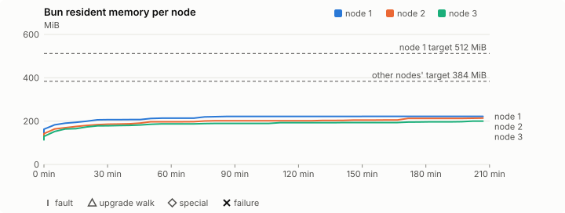
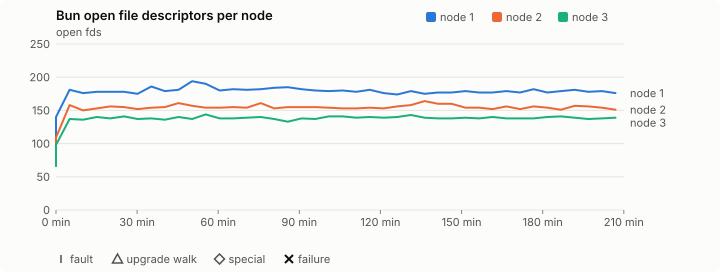
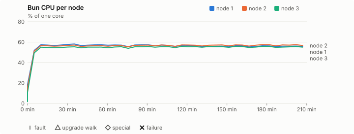
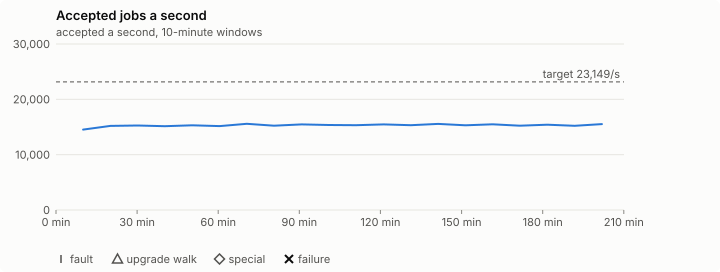

# Sustained soak (V02): FAIL

27 October 2026. day tier, no fault schedule, 3 h 30 min of soak on a three-node quickstart cluster.

**Day tier: not clean.** The day run doesn't hold; the record says what failed. It is incomplete too: missing from the execution inventory: job campaign drained in its final two minutes; it ran for 3 h 30 min, not a whole day.

## Candidate and host

| | |
|---|---|
| Staged base URL | <https://github.com/reliaburger/reliaburger/releases/download/staging-v0.2.3-40376399802-1> |
| `candidate.json` SHA-256 | `64c0fe5b06b61d25184ab44267a72ac2b0ad9195eb564112a39f409e3c9c5769` |
| Running versions | v0.2.3 x3 |
| Soak build | not supplied: upgrade slots skipped |
| Host | macOS 26.3.1, Apple M2 Max, 32 GiB |
| Lima | limactl version 2.2.1 |
| Guest | Ubuntu 24.04.5 LTS, kernel 6.8.0-139-generic |
| RELIABURGER_HOME | `/tmp/rbq.5EtwcQ` |
| Evidence | `/var/tmp/reliaburger-v02.61WQva` |

## Configuration deviations

- Each quickstart VM resized from 2 vCPU / 2 GiB to 4 vCPU / 6 GiB before configuring, the size the scale-out record measured (maintainer decision, 27 October 2026)
- node.toml `[testing] allowed_operations` adds `provision_isolated_workloads` (quickstart allows only inject_workload_faults and alter_node_state), so the catalogue pulse can lease test namespaces
- node.toml `[logs]`/`[metrics]` export to file:///var/lib/reliaburger/soak-export every 60 s with max_storage_mb = 8, `[storage.snapshots]` every 900 s (compressed: 120 s), retain 4, uploaded to the same directory
- node.toml `[ingress] tls_cert/tls_key` point at an operator pair from a soak CA, 45-minute leaves rotated by the harness
- Bun runs with auto/mixed; host jobs opt in to a single pinned BusyBox copy under /var/lib/reliaburger/soak-jobs, mount_isolation=false. The independent verifier listens on each private VM address, TCP 8189, with a separate run token
- node.toml `[node.labels] soak-volume` = "writer" on node 2 and "redis" on node 3, to pin the volume apps
- node.toml `[security] leaf_lifetime_override_secs = 3600` (D1)

## Timeline

- Started 2026-10-27 13:47:35 UTC, finished 2026-10-27 17:17:40 UTC
- Cycles completed: 0
- Fault and node choices: 0, from seed 1981549077 (`--seed 1981549077` repeats them)
- Teardown: `relish local destroy --yes` and `relish uninstall --yes` succeeded

## Faults and slots

| Class | Runs | Settled/ok | Failed | Skipped | Settle (median / max) |
|---|---|---|---|---|---|
| tls:invalid-expired | 3 | 3 | 0 | 0 | n/a |
| tls:invalid-torn | 6 | 6 | 0 | 0 | n/a |
| tls:reload | 39 | 39 | 0 | 0 | n/a |

## Execution inventory (gated)

What the run completed, from its events and kept bytes, against what its schedule owes. A fault counts once it was injected and the cluster settled after it.

| Item | Required | Completed | Verdict |
|---|---|---|---|
| candidate.json bytes match the qualified digest | 1 | 1 | ok |
| app workloads settled at the baseline | 1 | 1 | ok |
| job campaign drained in its final two minutes | 1 | 0 | MISSING |

## Renewals and rotations

| Measure | Observed | Required | Verdict |
|---|---|---|---|
| workload identity rotations (soak-identity, per node) | 6 | ≥ 6 | PASS |
| node leaf renewals (per node) | 7 | ≥ 6 | PASS |
| operator ingress reloads (all nodes) | 39 | ≥ 13 | PASS |
| mixed job campaign and positive drain | 6 missing/failing checks | 0 | FAIL |

## Jobs

| Runtime | Accepted successes | Retries | Last accepted progress |
|---|---|---|---|
| runc | 26704 | 1 | 1793121458 |
| shared-runc | 1379678 | 1 | 1793121461 |
| process | 191582124 | 1 | 1793121461 |

The bounded campaign shares the app soak's fault schedule. These counts are reliability evidence, not a saturation rate or a 100-million-per-day qualification.

- job campaign did not positively drain before teardown
- host-job rate 15,183.2/s is below the 23149.0/s target (the billion-a-day floor holds: 1,311,831,947 a day)
- the harness never asked the job campaign to drain
- rb-75bfff25606d-1 lacks a complete empty owner inventory after campaign drain
- rb-75bfff25606d-2 lacks a complete empty owner inventory after campaign drain
- rb-75bfff25606d-3 lacks a complete empty owner inventory after campaign drain
- Independent verifier execution attempts: 24
- Explicit test-operator acknowledgements for known replay-safe fenced fixtures: 0

- rb-75bfff25606d-1: latest complete job storage (KiB) {'instances': 160412, 'job-state': 8, 'task-arrays': 145000}; free 5175976 KiB; live/peak owners 34/37; peak storage {'instances': 160412, 'job-state': 8, 'task-arrays': 251212}
- rb-75bfff25606d-2: latest complete job storage (KiB) {'instances': 25892, 'job-state': 8, 'task-arrays': 146460}; free 6150236 KiB; live/peak owners 34/34; peak storage {'instances': 25892, 'job-state': 8, 'task-arrays': 254688}
- rb-75bfff25606d-3: latest complete job storage (KiB) {'instances': 24624, 'job-state': 8, 'task-arrays': 152792}; free 6224028 KiB; live/peak owners 34/34; peak storage {'instances': 24676, 'job-state': 8, 'task-arrays': 264536}

Complete disk inventories are recorded. Global retention bounds and the 12-hour job qualification remain #668; this gate cannot certify an unimplemented retention policy.

## Job qualification (D18-C)

Load: day; 3 nodes; accepted 15,294.7/s against a 23149.0/s target: FAIL.

The September plan set its targets for one 1M-task batch on a quiet cluster. A soak runs for hours with restarts, upgrades and apps, so its storage, Bun memory and Raft targets are restated (maintainer decision, 15 October 2026, [#668](https://github.com/reliaburger/reliaburger/issues/668)). Bun's steady state is the median RSS of each process once it has been seen for 10 minutes; the gated memory checks are unchanged (`leak-rss`, and Mayo's 70% `memory_high` alert through `wtf`).

| Measure (recorded, not gated) | Observed | Target |
|---|---|---|
| Wall time of a 1,048,576-task array (median / max of 0) | not measured / not measured | ≤ 600 s |
| p99 start lag, pooled executors | 16 ms (bucket upper bound) | < 1,000 ms |
| Raft entries per second, all cluster writes | 5.70 | recorded only; the batch target counts only task-array writes |
| Raft state of one run, largest seen | 45,829 B | ≤ 256 KiB per 1M tasks |
| Bun steady-state RSS per process, worst node against its target | rb-75bfff25606d-2: 201.64 MiB steady, 213.95 MiB peak | ≤ 384 MiB (≤ 512 MiB on node 1, which serves the API) |
| Bun CPU, busiest node | 0.57 cores | ≤ 1 core (leader batch control) |
| Executor helper CPU, busiest node | 0.38 cores | ≤ 0.5 core |
| Node task-array storage per 1M accepted tasks (peaks summed) | 3.90 MiB | ≤ 64 MiB, deleted after retirement |
| Retained log volume, all nodes | 8.80 MB | ≤ 50 MB |

- Bun RSS on rb-75bfff25606d-1 (serves the API, target ≤ 512 MiB): pid 3276: 221.51 MiB steady, 222.00 MiB peak
- Bun RSS on rb-75bfff25606d-2 (node, target ≤ 384 MiB): pid 1816: 201.64 MiB steady, 213.95 MiB peak
- Bun RSS on rb-75bfff25606d-3 (node, target ≤ 384 MiB): pid 1673: 191.17 MiB steady, 199.76 MiB peak

- runc retry causes: exit_code 1, launch 0, signal 0, timeout 0, unknown 0, unrecorded 0
- shared-runc retry causes: exit_code 1, launch 0, signal 0, timeout 0, unknown 0, unrecorded 0
- process retry causes: exit_code 1, launch 0, signal 0, timeout 0, unknown 0, unrecorded 0
- Audited executions: 24; operator replay decisions: 0
- Job controller API fallbacks: rb-75bfff25606d-1 missed 26; rb-75bfff25606d-2 answered 26 (requests a node didn't answer, and the node that took them instead)

## Day run (#1032)

191,582,124 accepted host-job tasks in 3 h 30 min: 15,183.2/s against the 23149.0/s target (FAIL). The billion-a-day floor is 11,575/s (met). At this rate a day is 1,311,831,947 tasks.

| Node | Slots | Host-job successes | Rate | Share | Fair share | Verdict |
|---|---|---|---|---|---|---|
| rb-75bfff25606d-1 | 27 | 62,575,792 | 4,959.2/s | 32.7% | 33.3% | ok |
| rb-75bfff25606d-2 | 27 | 63,210,861 | 5,009.6/s | 33.0% | 33.3% | ok |
| rb-75bfff25606d-3 | 27 | 65,797,584 | 5,214.6/s | 34.3% | 33.3% | ok |

A node may take up to 20% more than its fair share by slots, as `relish bench` allows (#1362).

| Hour | Host jobs a second | |
|---|---|---|
| Hour 1 | 14,971.9 | ████████████████████ |
| Hour 2 | 15,303.2 | ████████████████████ |
| Hour 3 | 15,261.7 | ████████████████████ |

Last hour against the first: 15,261.7/s against 14,971.9/s, ok (at most 10% slower; the first hour includes the campaign's start and its host-job probes).

## Data

- Volume writer: highest ACK 17030 in the log view; the writer file checks (writer-lost, writer-regression) decide data loss, and `*-log-order` failures are about the order the log view returned lines in
- Redis counter: highest INCR 3552 in the log view
- Export rb-75bfff25606d-1: 147 source files, 338 at the destination
- Export rb-75bfff25606d-2: 91 source files, 265 at the destination
- Export rb-75bfff25606d-3: 72 source files, 220 at the destination
- Registry images pushed and re-verified: 1
- Agent-loop turns over the 1 s budget: rb-75bfff25606d-1 0, rb-75bfff25606d-2 0, rb-75bfff25606d-3 0
- Guest clock steps by Lima's guest agent: rb-75bfff25606d-1 3, rb-75bfff25606d-2 1, rb-75bfff25606d-3 3
- Checks evaluated: 445 (heavy 43, light 401, settle 1)
- Last observed progress: redis-counter 3552, writer-ack 17030

## Leak-checker exposure (gated)

How long each leak checker could judge each node's Bun. `leak-rss` arms after 60 minutes in one process and `leak-fd` after 50; a restart, kill or upgrade exec starts the warm-up again. A final needs each armed for 60 minutes on every node, with one unbroken window of 30 (#1062); its quiet tail gives them that.

| Node | Checker | Armed | Longest armed window | Evaluated samples | Processes armed | Verdict |
|---|---|---|---|---|---|---|
| rb-75bfff25606d-1 | leak-rss | 146 min | 146 min | 30 | 1 | ok |
| rb-75bfff25606d-1 | leak-fd | 156 min | 156 min | 32 | 1 | ok |
| rb-75bfff25606d-2 | leak-rss | 146 min | 146 min | 30 | 1 | ok |
| rb-75bfff25606d-2 | leak-fd | 156 min | 156 min | 32 | 1 | ok |
| rb-75bfff25606d-3 | leak-rss | 146 min | 146 min | 30 | 1 | ok |
| rb-75bfff25606d-3 | leak-fd | 156 min | 156 min | 32 | 1 | ok |

## Resource trends

| Node | Measure | First | Last | Max |
|---|---|---|---|---|
| rb-75bfff25606d-1 | disk_kb data | 1437044 | 1767680 | 1870580 |
| rb-75bfff25606d-1 | disk_kb images | 342456 | 342428 | 342516 |
| rb-75bfff25606d-1 | disk_kb logs | 52 | 8220 | 8220 |
| rb-75bfff25606d-1 | disk_kb metrics | 112 | 8600 | 8700 |
| rb-75bfff25606d-1 | disk_kb soak-export | 4 | 43188 | 43188 |
| rb-75bfff25606d-1 | disk_kb volumes | 224 | 224 | 224 |
| rb-75bfff25606d-1 | fd | 106 | 176 | 194 |
| rb-75bfff25606d-1 | rss_kb | 149136 | 227328 | 227328 |
| rb-75bfff25606d-2 | disk_kb data | 67664 | 340876 | 445400 |
| rb-75bfff25606d-2 | disk_kb images | 342304 | 342324 | 342324 |
| rb-75bfff25606d-2 | disk_kb logs | 36 | 304 | 304 |
| rb-75bfff25606d-2 | disk_kb metrics | 100 | 8752 | 8788 |
| rb-75bfff25606d-2 | disk_kb soak-export | 4 | 28132 | 28132 |
| rb-75bfff25606d-2 | disk_kb volumes | 16736 | 18016 | 18016 |
| rb-75bfff25606d-2 | fd | 78 | 151 | 164 |
| rb-75bfff25606d-2 | rss_kb | 123036 | 219080 | 219080 |
| rb-75bfff25606d-3 | disk_kb data | 172036 | 373960 | 485640 |
| rb-75bfff25606d-3 | disk_kb images | 339124 | 339168 | 339168 |
| rb-75bfff25606d-3 | disk_kb logs | 48 | 72 | 72 |
| rb-75bfff25606d-3 | disk_kb metrics | 140 | 8776 | 8776 |
| rb-75bfff25606d-3 | disk_kb soak-export | 4 | 23652 | 23652 |
| rb-75bfff25606d-3 | disk_kb volumes | 16736 | 17696 | 17696 |
| rb-75bfff25606d-3 | fd | 66 | 139 | 144 |
| rb-75bfff25606d-3 | rss_kb | 116228 | 204556 | 204556 |

## Charts

Time runs from the start of the soak. The marks under each chart are its faults, upgrade walks, specials and recorded failures; the dashed lines are targets.

## Failures

None.

## Notes

- Job controller was still running at teardown; positive drain must be present to pass
- The harness stopped early (exit 1) during final

Evidence: `/var/tmp/reliaburger-v02.61WQva` (events.jsonl, snapshots/, failures/<n>/).
