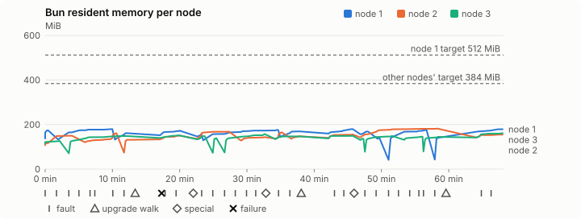
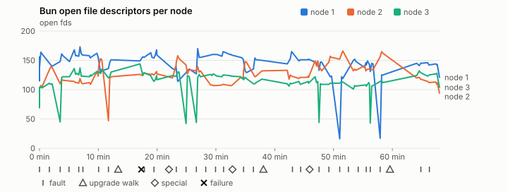
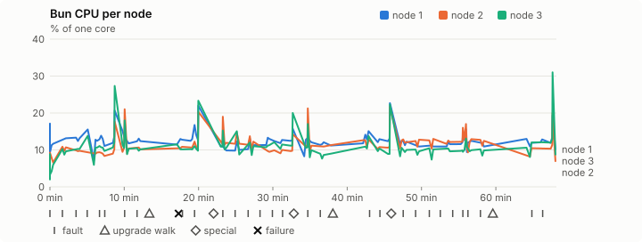
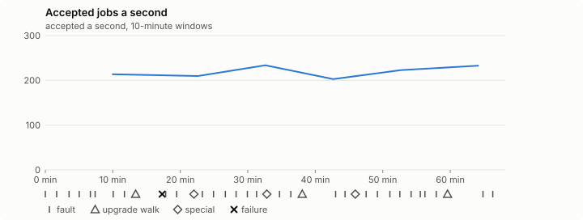

# Sustained soak (V02): FAIL

26 October 2026. fast tier, compressed schedule, 1 h 08 min of soak on a three-node quickstart cluster.

**Fast tier: not clean.** Fix what failed and run the fast tier again before a final-tier run.

## Candidate and host

| | |
|---|---|
| Staged base URL | <https://github.com/reliaburger/reliaburger/releases/download/staging-v0.2.3-40376399802-1> |
| `candidate.json` SHA-256 | `64c0fe5b06b61d25184ab44267a72ac2b0ad9195eb564112a39f409e3c9c5769` |
| Running versions | v0.2.3 x3 |
| Soak build | `bun-v0.2.3-soak.1`, SHA-256 `dcbc3149f58f48ed60b74ceea72be8e28d911d188b102654284884c097706556` |
| Walks roll back to | 0.2.3 |
| Host | macOS 26.3.1, Apple M2 Max, 32 GiB |
| Lima | limactl version 2.2.1 |
| Guest | Ubuntu 24.04.5 LTS, kernel 6.8.0-139-generic |
| RELIABURGER_HOME | `/tmp/rbq.hi20PE` |
| Evidence | `/var/tmp/reliaburger-v02.hpAiy7` |

## Configuration deviations

- node.toml `[testing] allowed_operations` adds `provision_isolated_workloads` (quickstart allows only inject_workload_faults and alter_node_state), so the catalogue pulse can lease test namespaces
- node.toml `[logs]`/`[metrics]` export to file:///var/lib/reliaburger/soak-export every 60 s with max_storage_mb = 8, `[storage.snapshots]` every 900 s (compressed: 120 s), retain 4, uploaded to the same directory
- node.toml `[ingress] tls_cert/tls_key` point at an operator pair from a soak CA, 45-minute leaves rotated by the harness
- Bun runs with auto/mixed; host jobs opt in to a single pinned BusyBox copy under /var/lib/reliaburger/soak-jobs, mount_isolation=false. The independent verifier listens on each private VM address, TCP 8189, with a separate run token
- node.toml `[node.labels] soak-volume` = "writer" on node 2 and "redis" on node 3, to pin the volume apps
- node.toml `[upgrades] external_signing_key` = a throwaway operator key the harness made for this run (`ed25519:6t6vWWbhuhWJS6zVjO907Q4/NDJWR3ljGLVUngSOXm8=`); the soak build's `.sig` gets that key's external signature beside the release one (D2)
- node.toml `[security] leaf_lifetime_override_secs = 3600` (D1)

## Timeline

- Started 2026-10-26 23:01:06 UTC, finished 2026-10-27 00:09:15 UTC
- Cycles completed: 6
- Fault and node choices: 26, from seed 2439633665 (`--seed 2439633665` repeats them)
- Teardown: `relish local destroy --yes` and `relish uninstall --yes` succeeded

## Faults and slots

| Class | Runs | Settled/ok | Failed | Skipped | Settle (median / max) |
|---|---|---|---|---|---|
| fault:bun-kill-follower | 6 | 6 | 0 | 0 | 30 s / 35 s |
| fault:bun-kill-leader | 6 | 6 | 0 | 0 | 32 s / 39 s |
| fault:chaos-cpu | 1 | 2 | 0 | 0 | 16 s / 16 s |
| fault:chaos-delay | 2 | 4 | 0 | 0 | 16 s / 16 s |
| fault:chaos-dns | 1 | 2 | 0 | 0 | 17 s / 17 s |
| fault:chaos-drop | 1 | 2 | 0 | 0 | 17 s / 17 s |
| fault:chaos-kill | 2 | 4 | 0 | 0 | 43 s / 43 s |
| fault:chaos-memory | 1 | 2 | 0 | 0 | 16 s / 16 s |
| fault:chaos-partition | 2 | 4 | 0 | 0 | 16 s / 16 s |
| fault:chaos-pause | 1 | 2 | 0 | 0 | 16 s / 16 s |
| fault:chaos-scenario | 1 | 2 | 0 | 0 | 30 s / 30 s |
| fault:deploy-kill | 3 | 3 | 0 | 0 | 35 s / 46 s |
| fault:power-off | 3 | 3 | 0 | 0 | 29 s / 30 s |
| pulse | 1 | 1 | 0 | 0 | n/a |
| pulse:settle | 0 | 1 | 0 | 0 | 16 s / 16 s |
| special:all-off | 1 | 1 | 0 | 0 | 39 s / 39 s |
| special:graceful-stop | 1 | 1 | 0 | 0 | 39 s / 39 s |
| special:quorum-back | 1 | 1 | 0 | 0 | n/a |
| special:quorum-loss | 1 | 1 | 0 | 0 | 28 s / 28 s |
| storage:offline-export | 3 | 3 | 0 | 0 | n/a |
| storage:registry-push | 6 | 0 | 0 | 0 | n/a |
| tls:invalid-expired | 3 | 3 | 0 | 0 | n/a |
| tls:invalid-torn | 3 | 3 | 0 | 0 | n/a |
| tls:reload | 29 | 29 | 0 | 0 | n/a |
| upgrade:rollback | 3 | 3 | 0 | 0 | n/a |
| upgrade:settle | 0 | 3 | 0 | 0 | 44 s / 53 s |
| upgrade:upgrade | 3 | 3 | 0 | 0 | n/a |

## Execution inventory (recorded, not gated)

What the run completed, from its events and kept bytes, against what its schedule owes. A fault counts once it was injected and the cluster settled after it.

| Item | Required | Completed | Verdict |
|---|---|---|---|
| candidate.json bytes match the qualified digest | 1 | 1 | ok |
| app workloads settled at the baseline | 1 | 1 | ok |
| upgrade walk (to the soak build and back) | 2 | 3 | ok |
| fault:bun-kill-follower | 1 | 6 | ok |
| fault:bun-kill-leader | 1 | 6 | ok |
| fault:deploy-kill | 1 | 3 | ok |
| fault:power-off | 1 | 3 | ok |
| fault:chaos-kill | 1 | 2 | ok |
| fault:chaos-delay | 1 | 2 | ok |
| fault:chaos-partition | 1 | 2 | ok |
| fault:chaos-scenario | 1 | 1 | ok |
| fault:chaos-pause | 1 | 1 | ok |
| fault:chaos-drop | 1 | 1 | ok |
| fault:chaos-dns | 1 | 1 | ok |
| fault:chaos-cpu | 1 | 1 | ok |
| special:graceful-stop | 1 | 1 | ok |
| special:quorum-loss | 1 | 1 | ok |
| special:all-off | 1 | 1 | ok |
| catalogue pulse | 1 | 1 | ok |
| offline export | 2 | 3 | ok |
| job campaign drained in its final two minutes | 1 | 1 | ok |

## Observed fault effects

What each injected fault was seen to do, read back from the node.

| Fault | Target | Observed |
|---|---|---|
| effect:bun-kill-follower | rb-dd12b2ae6553-2 | MainPID 2569 -> 4872 |
| effect:bun-kill-leader | rb-dd12b2ae6553-1 | MainPID 9400 -> 33475 |
| effect:deploy-kill | rb-dd12b2ae6553-3 | MainPID 2275 -> 51370 |
| effect:power-off | rb-dd12b2ae6553-2 | Lima status Stopped |
| effect:bun-kill-follower | rb-dd12b2ae6553-1 | MainPID 33475 -> 181791 |
| effect:bun-kill-leader | rb-dd12b2ae6553-2 | MainPID 662 -> 104571 |
| effect:bun-kill-follower | rb-dd12b2ae6553-1 | MainPID 679 -> 15733 |
| effect:bun-kill-leader | rb-dd12b2ae6553-3 | MainPID 678 -> 42675 |
| effect:deploy-kill | rb-dd12b2ae6553-3 | MainPID 42675 -> 71197 |
| effect:power-off | rb-dd12b2ae6553-2 | Lima status Stopped |
| effect:bun-kill-follower | rb-dd12b2ae6553-1 | MainPID 15733 -> 202841 |
| effect:bun-kill-leader | rb-dd12b2ae6553-2 | MainPID 681 -> 42046 |
| effect:bun-kill-follower | rb-dd12b2ae6553-3 | MainPID 680 -> 16361 |
| effect:bun-kill-leader | rb-dd12b2ae6553-1 | MainPID 679 -> 44512 |
| effect:deploy-kill | rb-dd12b2ae6553-1 | MainPID 44512 -> 75690 |
| effect:power-off | rb-dd12b2ae6553-3 | Lima status Stopped |
| effect:bun-kill-follower | rb-dd12b2ae6553-3 | MainPID 681 -> 49366 |
| effect:bun-kill-leader | rb-dd12b2ae6553-1 | MainPID 75690 -> 192537 |

## Renewals and rotations

| Measure | Observed | Required | Verdict |
|---|---|---|---|
| workload identity rotations (soak-identity, per node) | 8 | ≥ 1 | PASS |
| node leaf renewals (per node) | 2 | ≥ 1 | PASS |
| operator ingress reloads (all nodes) | 29 | ≥ 12 | PASS |
| mixed job campaign and positive drain | 0 missing/failing checks | 0 | PASS |

## Jobs

| Runtime | Accepted successes | Retries | Last accepted progress |
|---|---|---|---|
| runc | 17384 | 8 | 1793059746 |
| shared-runc | 431246 | 1 | 1793059746 |
| process | 452268 | 1 | 1793059746 |

The bounded campaign shares the app soak's fault schedule. These counts are reliability evidence, not a saturation rate or a 100-million-per-day qualification.

- Independent verifier execution attempts: 24
- Explicit test-operator acknowledgements for known replay-safe fenced fixtures: 138

- rb-dd12b2ae6553-1: latest complete job storage (KiB) {'instances': 176, 'job-state': 8, 'task-arrays': 5432}; free 5199672 KiB; live/peak owners 0/12; peak storage {'instances': 14136, 'job-state': 8, 'task-arrays': 15268}
- rb-dd12b2ae6553-2: latest complete job storage (KiB) {'instances': 484, 'job-state': 8, 'task-arrays': 5268}; free 6295480 KiB; live/peak owners 0/9; peak storage {'instances': 13656, 'job-state': 8, 'task-arrays': 15228}
- rb-dd12b2ae6553-3: latest complete job storage (KiB) {'instances': 3792, 'job-state': 8, 'task-arrays': 5992}; free 6330012 KiB; live/peak owners 0/8; peak storage {'instances': 8212, 'job-state': 8, 'task-arrays': 15776}

Complete disk inventories are recorded. Global retention bounds and the 12-hour job qualification remain #668; this gate cannot certify an unimplemented retention policy.

## Job qualification (D18-C)

Load: calibration; 3 nodes; accepted 220.3/s (calibration load: not gated).

The September plan set its targets for one 1M-task batch on a quiet cluster. A soak runs for hours with restarts, upgrades and apps, so its storage, Bun memory and Raft targets are restated (maintainer decision, 15 October 2026, [#668](https://github.com/reliaburger/reliaburger/issues/668)). Bun's steady state is the median RSS of each process once it has been seen for 10 minutes; the gated memory checks are unchanged (`leak-rss`, and Mayo's 70% `memory_high` alert through `wtf`).

| Measure (recorded, not gated) | Observed | Target |
|---|---|---|
| Wall time of a 1,048,576-task array (median / max of 0) | not measured / not measured | ≤ 600 s |
| p99 start lag, pooled executors | 2 ms (bucket upper bound) | < 1,000 ms |
| Raft entries per second, all cluster writes | 1.81 | recorded only; the batch target counts only task-array writes |
| Raft state of one run, largest seen | 45,048 B | ≤ 256 KiB per 1M tasks |
| Bun steady-state RSS per process, worst node against its target | rb-dd12b2ae6553-2: 181.36 MiB steady, 181.36 MiB peak | ≤ 384 MiB (≤ 512 MiB on node 1, which serves the API) |
| Bun CPU, busiest node | 0.12 cores | ≤ 1 core (leader batch control) |
| Executor helper CPU, busiest node | 0.00 cores | ≤ 0.5 core |
| Node task-array storage per 1M accepted tasks (peaks summed) | 50.16 MiB | ≤ 64 MiB, deleted after retirement |
| Retained log volume, all nodes | 6.80 MB | ≤ 50 MB |

- Bun RSS on rb-dd12b2ae6553-1 (serves the API, target ≤ 512 MiB): pid 9400: 174.01 MiB peak (seen for under 10 minutes); pid 33475: 179.38 MiB peak (seen for under 10 minutes); pid 181791: 161.19 MiB peak (seen for under 10 minutes); pid 181791: 172.85 MiB peak (seen for under 10 minutes); pid 679: 156.19 MiB peak (seen for under 10 minutes); pid 15733: 175.48 MiB steady, 175.49 MiB peak; pid 202841: 169.07 MiB peak (seen for under 10 minutes); pid 202841: 179.18 MiB peak (seen for under 10 minutes); pid 679: 168.97 MiB peak (seen for under 10 minutes); pid 44512: 142.66 MiB peak (seen for under 10 minutes); pid 75690: 175.02 MiB peak (seen for under 10 minutes); pid 192537: 140.07 MiB peak (seen for under 10 minutes); pid 192537: 179.03 MiB peak (seen for under 10 minutes)
- Bun RSS on rb-dd12b2ae6553-2 (node, target ≤ 384 MiB): pid 2569: 120.81 MiB peak (seen for under 10 minutes); pid 4872: 149.69 MiB peak (seen for under 10 minutes); pid 662: 160.83 MiB peak (seen for under 10 minutes); pid 104571: 131.16 MiB peak (seen for under 10 minutes); pid 137931: 150.31 MiB peak (seen for under 10 minutes); pid 680: 168.13 MiB peak (seen for under 10 minutes); pid 679: 143.36 MiB peak (seen for under 10 minutes); pid 681: 165.26 MiB peak (seen for under 10 minutes); pid 42046: 147.04 MiB peak (seen for under 10 minutes); pid 42046: 154.93 MiB peak (seen for under 10 minutes); pid 678: 181.36 MiB steady, 181.36 MiB peak; pid 676: 155.09 MiB peak (seen for under 10 minutes)
- Bun RSS on rb-dd12b2ae6553-3 (node, target ≤ 384 MiB): pid 2275: 126.63 MiB peak (seen for under 10 minutes); pid 51370: 148.03 MiB peak (seen for under 10 minutes); pid 51370: 151.04 MiB peak (seen for under 10 minutes); pid 678: 147.82 MiB peak (seen for under 10 minutes); pid 42675: 137.97 MiB peak (seen for under 10 minutes); pid 71197: 156.87 MiB peak (seen for under 10 minutes); pid 679: 146.71 MiB peak (seen for under 10 minutes); pid 680: 149.16 MiB peak (seen for under 10 minutes); pid 680: 136.21 MiB peak (seen for under 10 minutes); pid 16361: 148.76 MiB peak (seen for under 10 minutes); pid 681: 145.12 MiB peak (seen for under 10 minutes); pid 49366: 144.62 MiB peak (seen for under 10 minutes); pid 49366: 161.05 MiB peak (seen for under 10 minutes)

- runc retry causes: exit_code 2, launch 3, signal 0, timeout 0, unknown 2, unrecorded 1
- shared-runc retry causes: exit_code 1, launch 0, signal 0, timeout 0, unknown 0, unrecorded 0
- process retry causes: exit_code 1, launch 0, signal 0, timeout 0, unknown 0, unrecorded 0
- Audited executions: 24; operator replay decisions: 138
- Job controller API fallbacks: rb-dd12b2ae6553-1 missed 163, rb-dd12b2ae6553-2 missed 3; rb-dd12b2ae6553-2 answered 160, rb-dd12b2ae6553-3 answered 3 (requests a node didn't answer, and the node that took them instead)

## Data

- Volume writer: highest ACK 31048 in the log view; the writer file checks (writer-lost, writer-regression) decide data loss, and `*-log-order` failures are about the order the log view returned lines in
- Redis counter: highest INCR 3313 in the log view
- Export rb-dd12b2ae6553-1: 123 source files, 112 at the destination
- Export rb-dd12b2ae6553-2: 137 source files, 128 at the destination
- Export rb-dd12b2ae6553-3: 114 source files, 113 at the destination
- Registry images pushed and re-verified: 7
- Agent-loop turns over the 1 s budget: rb-dd12b2ae6553-1 0, rb-dd12b2ae6553-2 1, rb-dd12b2ae6553-3 0
- Guest clock steps by Lima's guest agent: rb-dd12b2ae6553-1 3, rb-dd12b2ae6553-2 6, rb-dd12b2ae6553-3 5
- Checks evaluated: 190 (heavy 17, light 73, settle 100)
- Last observed progress: redis-counter 3313, writer-ack 31048

## Leak-checker exposure (recorded, not gated)

How long each leak checker could judge each node's Bun. `leak-rss` arms after 60 minutes in one process and `leak-fd` after 50; a restart, kill or upgrade exec starts the warm-up again. A final needs each armed for 60 minutes on every node, with one unbroken window of 30 (#1062); its quiet tail gives them that.

| Node | Checker | Armed | Longest armed window | Evaluated samples | Processes armed | Verdict |
|---|---|---|---|---|---|---|
| rb-dd12b2ae6553-1 | leak-rss | 0 min | 0 min | 0 | 0 | short |
| rb-dd12b2ae6553-1 | leak-fd | 0 min | 0 min | 0 | 0 | short |
| rb-dd12b2ae6553-2 | leak-rss | 0 min | 0 min | 0 | 0 | short |
| rb-dd12b2ae6553-2 | leak-fd | 0 min | 0 min | 0 | 0 | short |
| rb-dd12b2ae6553-3 | leak-rss | 0 min | 0 min | 0 | 0 | short |
| rb-dd12b2ae6553-3 | leak-fd | 0 min | 0 min | 0 | 0 | short |

## Resource trends

| Node | Measure | First | Last | Max |
|---|---|---|---|---|
| rb-dd12b2ae6553-1 | disk_kb data | 1436876 | 935060 | 1470312 |
| rb-dd12b2ae6553-1 | disk_kb images | 342456 | 458440 | 458440 |
| rb-dd12b2ae6553-1 | disk_kb logs | 44 | 3156 | 3156 |
| rb-dd12b2ae6553-1 | disk_kb metrics | 52 | 4072 | 4072 |
| rb-dd12b2ae6553-1 | disk_kb soak-export | 4 | 6652 | 6652 |
| rb-dd12b2ae6553-1 | disk_kb volumes | 224 | 36 | 228 |
| rb-dd12b2ae6553-1 | fd | 115 | 121 | 173 |
| rb-dd12b2ae6553-1 | rss_kb | 140668 | 183324 | 183688 |
| rb-dd12b2ae6553-2 | disk_kb data | 67468 | 87416 | 624216 |
| rb-dd12b2ae6553-2 | disk_kb images | 175368 | 342496 | 342496 |
| rb-dd12b2ae6553-2 | disk_kb logs | 32 | 2664 | 2664 |
| rb-dd12b2ae6553-2 | disk_kb metrics | 60 | 4228 | 4228 |
| rb-dd12b2ae6553-2 | disk_kb soak-export | 4 | 8860 | 8860 |
| rb-dd12b2ae6553-2 | disk_kb volumes | 16736 | 17288 | 17308 |
| rb-dd12b2ae6553-2 | fd | 70 | 94 | 166 |
| rb-dd12b2ae6553-2 | rss_kb | 109820 | 158812 | 185708 |
| rb-dd12b2ae6553-3 | disk_kb data | 171812 | 716976 | 727588 |
| rb-dd12b2ae6553-3 | disk_kb images | 339124 | 342448 | 342448 |
| rb-dd12b2ae6553-3 | disk_kb logs | 24 | 824 | 824 |
| rb-dd12b2ae6553-3 | disk_kb metrics | 60 | 3220 | 3220 |
| rb-dd12b2ae6553-3 | disk_kb soak-export | 4 | 4400 | 4400 |
| rb-dd12b2ae6553-3 | disk_kb volumes | 16736 | 17200 | 17200 |
| rb-dd12b2ae6553-3 | fd | 69 | 104 | 144 |
| rb-dd12b2ae6553-3 | rss_kb | 117352 | 164916 | 164916 |

## Charts

Time runs from the start of the soak. The marks under each chart are its faults, upgrade walks, specials and recorded failures; the dashed lines are targets.

## Failures

| # | First seen | Check | Symptom | Class | Cause | Action |
|---|---|---|---|---|---|---|
| 1 | 23:18:19 | heavy-check | fail: agent-loop-turn rb-dd12b2ae6553-2: 1 command turn(s) over the 1 s budget, the worst between 1 and 2.5 s; | unclassified | open | open |

Evidence: `/var/tmp/reliaburger-v02.hpAiy7` (events.jsonl, snapshots/, failures/<n>/).
