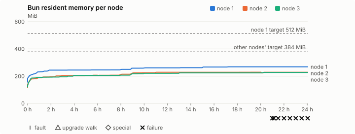
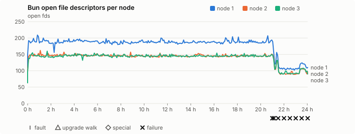
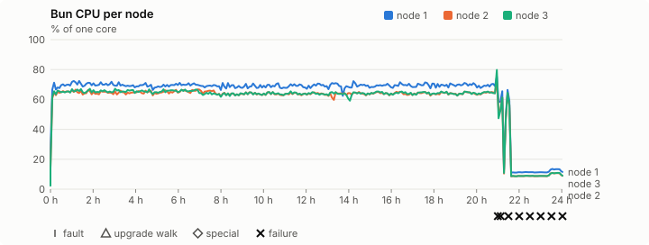
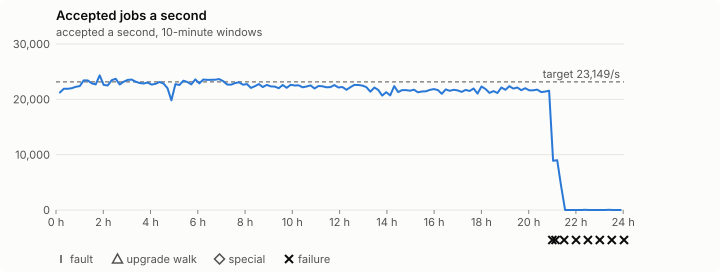

# Sustained soak (V02): FAIL

30 October 2026. day tier, no fault schedule, 24 h 02 min of soak on a three-node quickstart cluster.

**Day tier: not clean.** The day run doesn't hold; the record says what failed. It is incomplete too: missing from the execution inventory: job campaign drained in its final two minutes.

## What this run shows

**It failed, and most likely not because of the product.** Read the table below before the generated sections: the verdicts after 13:52 on 31 October describe a harness that had lost the cluster.

| Time (GMT, 31 October) | What happened |
|---|---|
| 13:46–13:56 | Seven coding agents built Rust on the same Mac and one booted a spare VM, against the [no host load rule](../releasing.md#performance-records-after-the-tag). Host load reached 155, about 20.9 h into the run. |
| 13:52 | First gated failure: `runc` made no accepted progress. |
| 14:00 | Every forward from the Mac to all three VMs failed with `Can't assign requested address`, within 15 s of each other, while each VM still answered inside the guest. They stayed down to the end, apart from a moment at 14:25. |
| 14:10 | The job controller could no longer submit work, and throughput fell to almost nothing as running work finished. |
| 16:55 | The drain deadline passed. The rotation, renewal and drain checks failed for the same reason. |

All three Buns kept the same process IDs throughout. The cause of the forward failure isn't proven: it began four minutes after the builds stopped, and the Mac restarted at about 22:03 that evening, before the port state was looked at. The record's four unobserved runs answered 404. Their 3,600 s detail retention would explain that, because the harness couldn't see them finish, but it hasn't been confirmed.

**The results that stand are up to hour 20, when the host was quiet:**

- **No slowdown ([#1403](https://github.com/reliaburger/reliaburger/issues/1403)).** Hours 1 to 20 ran at 21,400–23,400 host jobs a second, and hour 20 matched hour 1 at 21,800. 0.2.3 lost about 1% an hour.
- **Memory levels off ([#1417](https://github.com/reliaburger/reliaburger/issues/1417)).** Bun's steady RSS was 261, 229 and 221 MiB, with peaks of 269, 229 and 228, against 320–350 MiB in 0.2.3. A side probe called `malloc_trim(0)` on node 2: at hour 6 it took heap from 132 to 116 MiB, and at hour 20 from 154 to 131 MiB. So most of the heap is in use, not held by the allocator. The probe's raw files were lost in that restart; these figures were read from them during the run.
- **Node 1's job storage isn't fixed ([#1418](https://github.com/reliaburger/reliaburger/issues/1418)).** It ended at 858 MiB of instance storage, against about 9 MiB on node 2, with 3.4 GiB of the disk free.

The rate and last-hour checks below can't judge the release: the total of 1,677,744,622 tasks stopped at about 21 hours. A 12-hour run on 0.2.5 repeats the memory check.

## Candidate and host

| | |
|---|---|
| Staged base URL | <https://github.com/reliaburger/reliaburger/releases/download/v0.2.4> |
| `candidate.json` SHA-256 | `340eaeba513c9740f058e51684713654f3df7c392ea8f19993ae1b5d12727d09` |
| Running versions | v0.2.4 x3 |
| Soak build | not supplied: upgrade slots skipped |
| Host | macOS 26.3.1, Apple M2 Max, 32 GiB |
| Lima | limactl version 2.2.1 |
| Guest | Ubuntu 24.04.5 LTS, kernel 6.8.0-139-generic |
| RELIABURGER_HOME | `/tmp/rbq.48xnNQ` |
| Evidence | `/var/tmp/reliaburger-v02.NynFBl` |

## Configuration deviations

- Each quickstart VM resized from 2 vCPU / 2 GiB to 4 vCPU / 6 GiB before configuring, the size the scale-out record measured (maintainer decision, 27 October 2026)
- node.toml `[testing] allowed_operations` adds `provision_isolated_workloads` (quickstart allows only inject_workload_faults and alter_node_state), so the catalogue pulse can lease test namespaces
- node.toml `[logs]`/`[metrics]` export to file:///var/lib/reliaburger/soak-export every 60 s with max_storage_mb = 8 (the harness deletes a metrics export 30 minutes after its source has gone), `[storage.snapshots]` every 900 s (compressed: 120 s), retain 4, uploaded to the same directory
- node.toml `[ingress] tls_cert/tls_key` point at an operator pair from a soak CA, 45-minute leaves rotated by the harness
- Bun runs with auto/mixed; host jobs opt in to a single pinned BusyBox copy under /var/lib/reliaburger/soak-jobs, mount_isolation=false. The independent verifier listens on each private VM address, TCP 8189, with a separate run token
- node.toml `[node.labels] soak-volume` = "writer" on node 2 and "redis" on node 3, to pin the volume apps
- node.toml `[security] leaf_lifetime_override_secs = 3600` (D1)
- Host jobs run Ubuntu's busybox-static 1:1.36.1-6ubuntu3.1 (`52151e7f…`), the scale-out record's binary, instead of the image's

## Timeline

- Started 2026-10-30 16:53:13 UTC, finished 2026-10-31 16:55:13 UTC
- Cycles completed: 0
- Fault and node choices: 0, from seed 1711209576 (`--seed 1711209576` repeats them)
- Teardown: `relish local destroy --yes` and `relish uninstall --yes` succeeded

## Faults and slots

| Class | Runs | Settled/ok | Failed | Skipped | Settle (median / max) |
|---|---|---|---|---|---|
| tls:invalid-expired | 33 | 33 | 0 | 0 | n/a |
| tls:invalid-torn | 36 | 36 | 0 | 0 | n/a |
| tls:reload | 285 | 285 | 0 | 0 | n/a |

## Execution inventory (gated)

What the run completed, from its events and kept bytes, against what its schedule owes. A fault counts once it was injected and the cluster settled after it.

| Item | Required | Completed | Verdict |
|---|---|---|---|
| candidate.json bytes match the qualified digest | 1 | 1 | ok |
| app workloads settled at the baseline | 1 | 1 | ok |
| job campaign drained in its final two minutes | 1 | 0 | MISSING |

## Renewals and rotations

| Measure | Observed | Required | Verdict |
|---|---|---|---|
| workload identity rotations (soak-identity, per node) | 42 | ≥ 47 | FAIL |
| node leaf renewals (per node) | 46 | ≥ 47 | FAIL |
| operator ingress reloads (all nodes) | 285 | ≥ 95 | PASS |
| mixed job campaign and positive drain | 11 missing/failing checks | 0 | FAIL |

## Latency SLOs

What a user should feel on a quiet three-node cluster (#1400). Every sample is taken outside fault windows and through a host forward that works; each p99 is the upper bound of its histogram bucket.

| SLO | p99 | Threshold | Samples | Mode | Verdict |
|---|---|---|---|---|---|
| API read p99 | 150 ms | ≤ 1,000 ms | 15,374 (4 failed) | record only | PASS |
| API write p99 | 500 ms | ≤ 2,000 ms | 42 | record only | PASS |
| App start p99 | 1 ms | ≤ 5,000 ms | 126 | record only | PASS |
| Rolling update p99 | 100,000 ms | ≤ 30,000 ms | 42 | record only | over (record only) |
| Job task start p99 | 16 ms | ≤ 256 ms | 1,686,415,382 | record only | PASS |

- API read p99: `GET /v1/status?cluster=true` and `GET /v1/cluster/nodes` on every node, at every light check
- API write p99: `relish apply` of the soak workloads, from the call to the commit
- App start p99: each node's deploy of a new `soak-identity` instance, from its start to the instance running
- Rolling update p99: from `relish apply` returning to every node's `soak-identity` running the new spec
- Job task start p99: a job task's start lag on a pooled executor, from the job campaign's buckets, in runs no fault window overlapped
- Record only from 28 October 2026 (#1400): no soak before 0.2.4 measured it. The threshold is provisional; the first 0.2.4 fast and final records set the gate.
- api-read failed call: rb-7d210f99063e-2 /v1/cluster/nodes: OSError: [Errno 49] Can't assign requested address
- api-read failed call: rb-7d210f99063e-1 /v1/cluster/nodes: OSError: [Errno 49] Can't assign requested address
- api-read failed call: rb-7d210f99063e-3 /v1/cluster/nodes: OSError: [Errno 49] Can't assign requested address

## Jobs

| Runtime | Accepted successes | Retries | Last accepted progress |
|---|---|---|---|
| runc | 196286 | 251 | 1793464056 |
| shared-runc | 8902030 | 1 | 1793464056 |
| process | 1677744622 | 1 | 1793456718 |

The bounded campaign shares the app soak's fault schedule. These counts are reliability evidence, not a saturation rate or a 100-million-per-day qualification.

- shared-runc short work (3930): the candidate no longer has this run (candidate API refused GET /v1/batch/3930 (HTTP 404)); last seen 229824/262144 succeeded, not drained, so its outcome is unknown
- process long work (4017): the candidate no longer has this run (candidate API refused GET /v1/batch/4017 (HTTP 404)); last seen 486/512 succeeded, not drained, so its outcome is unknown
- process short work (4060): the candidate no longer has this run (candidate API refused GET /v1/batch/4060 (HTTP 404)); never observed, so its outcome is unknown
- shared-runc long work (4010): the candidate no longer has this run (candidate API refused GET /v1/batch/4010 (HTTP 404)); last seen 192/512 succeeded, not drained, so its outcome is unknown
- job campaign drain deadline exceeded
- job campaign did not positively drain before teardown
- host-job rate 19,415.6/s is below the 23149.0/s target (the billion-a-day floor holds: 1,677,511,634 a day)
- the last hour ran at 0.0/s, more than 10% below the first hour's 21,801.6/s
- rb-7d210f99063e-1 lacks a complete empty owner inventory after campaign drain
- rb-7d210f99063e-2 lacks a complete empty owner inventory after campaign drain
- rb-7d210f99063e-3 lacks a complete empty owner inventory after campaign drain
- Independent verifier execution attempts: 24
- Explicit test-operator acknowledgements for known replay-safe fenced fixtures: 9

- rb-7d210f99063e-1: latest complete job storage (KiB) {'instances': 878896, 'job-state': 8, 'task-arrays': 6580}; free 3584604 KiB; live/peak owners 1/36; peak storage {'instances': 878896, 'job-state': 8, 'task-arrays': 263756}
- rb-7d210f99063e-2: latest complete job storage (KiB) {'instances': 8764, 'job-state': 8, 'task-arrays': 7860}; free 5490364 KiB; live/peak owners 1/34; peak storage {'instances': 31984, 'job-state': 8, 'task-arrays': 267640}
- rb-7d210f99063e-3: latest complete job storage (KiB) {'instances': 620, 'job-state': 8, 'task-arrays': 7288}; free 5543292 KiB; live/peak owners 1/34; peak storage {'instances': 24820, 'job-state': 8, 'task-arrays': 273848}

Complete disk inventories are recorded. Global retention bounds and the 12-hour job qualification remain #668; this gate cannot certify an unimplemented retention policy.

## Job qualification (D18-C)

Load: day; 3 nodes; accepted 19,520.9/s against a 23149.0/s target: FAIL.

The September plan set its targets for one 1M-task batch on a quiet cluster. A soak runs for hours with restarts, upgrades and apps, so its storage, Bun memory and Raft targets are restated (maintainer decision, 15 October 2026, [#668](https://github.com/reliaburger/reliaburger/issues/668)). Bun's steady state is the median RSS of each process once it has been seen for 10 minutes; the gated memory checks are unchanged (`leak-rss`, and Mayo's 70% `memory_high` alert through `wtf`).

| Measure (recorded, not gated) | Observed | Target |
|---|---|---|
| Wall time of a 1,048,576-task array (median / max of 0) | not measured / not measured | ≤ 600 s |
| p99 start lag, pooled executors | 16 ms (bucket upper bound) | < 1,000 ms |
| Raft entries per second, all cluster writes | 3.32 | recorded only; the batch target counts only task-array writes |
| Raft state of one run, largest seen | 45,473 B | ≤ 256 KiB per 1M tasks |
| Bun steady-state RSS per process, worst node against its target | rb-7d210f99063e-2: 228.82 MiB steady, 229.43 MiB peak | ≤ 384 MiB (≤ 512 MiB on node 1, which serves the API) |
| Bun CPU, busiest node | 0.63 cores | ≤ 1 core (leader batch control) |
| Executor helper CPU, busiest node | 0.39 cores | ≤ 0.5 core |
| Node task-array storage per 1M accepted tasks (peaks summed) | 0.47 MiB | ≤ 64 MiB, deleted after retirement |
| Retained log volume, all nodes | 10.04 MB | ≤ 50 MB |

- Bun RSS on rb-7d210f99063e-1 (serves the API, target ≤ 512 MiB): pid 3686: 261.46 MiB steady, 268.87 MiB peak
- Bun RSS on rb-7d210f99063e-2 (node, target ≤ 384 MiB): pid 1821: 228.82 MiB steady, 229.43 MiB peak
- Bun RSS on rb-7d210f99063e-3 (node, target ≤ 384 MiB): pid 1673: 220.91 MiB steady, 227.51 MiB peak

- runc retry causes: exit_code 1, launch 2, signal 0, timeout 246, unknown 2, unrecorded 0
- shared-runc retry causes: exit_code 1, launch 0, signal 0, timeout 0, unknown 0, unrecorded 0
- process retry causes: exit_code 1, launch 0, signal 0, timeout 0, unknown 0, unrecorded 0
- Audited executions: 24; operator replay decisions: 9
- Job controller API fallbacks: rb-7d210f99063e-1 missed 89, rb-7d210f99063e-2 missed 38; rb-7d210f99063e-2 answered 51, rb-7d210f99063e-3 answered 38 (requests a node didn't answer, and the node that took them instead)

## Day run (#1032)

1,677,744,622 accepted host-job tasks in 24 h 00 min: 19,415.6/s against the 23149.0/s target (FAIL). The billion-a-day floor is 11,575/s (met). At this rate a day is 1,677,511,634 tasks.

| Node | Slots | Host-job successes | Rate | Share | Fair share | Verdict |
|---|---|---|---|---|---|---|
| rb-7d210f99063e-1 | 27 | 539,994,716 | 6,249.1/s | 32.2% | 33.3% | ok (restarted) |
| rb-7d210f99063e-2 | 27 | 563,235,274 | 6,518.0/s | 33.6% | 33.3% | ok (restarted) |
| rb-7d210f99063e-3 | 27 | 574,515,082 | 6,648.6/s | 34.2% | 33.3% | ok (restarted) |

A node may take up to 20% more than its fair share by slots, as `relish bench` allows (#1362).

| Hour | Host jobs a second | |
|---|---|---|
| Hour 1 | 21,801.6 | ███████████████████ |
| Hour 2 | 23,125.8 | ████████████████████ |
| Hour 3 | 23,013.7 | ████████████████████ |
| Hour 4 | 22,980.9 | ████████████████████ |
| Hour 5 | 22,082.0 | ███████████████████ |
| Hour 6 | 22,925.1 | ████████████████████ |
| Hour 7 | 23,436.6 | ████████████████████ |
| Hour 8 | 22,596.3 | ███████████████████ |
| Hour 9 | 22,391.4 | ███████████████████ |
| Hour 10 | 22,237.8 | ███████████████████ |
| Hour 11 | 22,185.9 | ███████████████████ |
| Hour 12 | 22,141.7 | ███████████████████ |
| Hour 13 | 22,220.8 | ███████████████████ |
| Hour 14 | 21,360.1 | ██████████████████ |
| Hour 15 | 21,490.0 | ██████████████████ |
| Hour 16 | 21,441.5 | ██████████████████ |
| Hour 17 | 21,434.8 | ██████████████████ |
| Hour 18 | 21,535.0 | ██████████████████ |
| Hour 19 | 21,483.1 | ██████████████████ |
| Hour 20 | 21,821.4 | ███████████████████ |
| Hour 21 | 19,849.4 | █████████████████ |
| Hour 22 | 2,478.8 | ██ |
| Hour 23 | 0.0 |  |
| Hour 24 | 0.0 |  |

Last hour against the first: 0.0/s against 21,801.6/s, FAIL (at most 10% slower; the first hour includes the campaign's start and its host-job probes).

## Data

- Volume writer: highest ACK 61022 in the log view; the writer file checks (writer-lost, writer-regression) decide data loss, and `*-log-order` failures are about the order the log view returned lines in
- Redis counter: highest INCR 1628 in the log view
- Export rb-7d210f99063e-1: 214 source files, 269 at the destination
- Export rb-7d210f99063e-2: 327 source files, 353 at the destination
- Export rb-7d210f99063e-3: 345 source files, 367 at the destination
- Registry images pushed and re-verified: 1
- Agent-loop turns over the 1 s budget: rb-7d210f99063e-1 0, rb-7d210f99063e-2 0, rb-7d210f99063e-3 0
- Soak policies checked in force: 254 times, policy generation 132 at the last check
- Guest clock steps by Lima's guest agent: rb-7d210f99063e-1 13, rb-7d210f99063e-2 14, rb-7d210f99063e-3 13
- Checks evaluated: 2926 (heavy 288, light 2636, settle 2)
- Last observed progress: redis-counter 1628, writer-ack 61022

## Leak-checker exposure (gated)

How long each leak checker could judge each node's Bun. `leak-rss` arms after 60 minutes in one process and `leak-fd` after 50; a restart, kill or upgrade exec starts the warm-up again. A final needs each armed for 60 minutes on every node, with one unbroken window of 30 (#1062); its quiet tail gives them that.

| Node | Checker | Armed | Longest armed window | Evaluated samples | Processes armed | Verdict |
|---|---|---|---|---|---|---|
| rb-7d210f99063e-1 | leak-rss | 1381 min | 1381 min | 275 | 1 | ok |
| rb-7d210f99063e-1 | leak-fd | 1391 min | 1391 min | 277 | 1 | ok |
| rb-7d210f99063e-2 | leak-rss | 1381 min | 1381 min | 275 | 1 | ok |
| rb-7d210f99063e-2 | leak-fd | 1391 min | 1391 min | 277 | 1 | ok |
| rb-7d210f99063e-3 | leak-rss | 1381 min | 1381 min | 275 | 1 | ok |
| rb-7d210f99063e-3 | leak-fd | 1391 min | 1391 min | 277 | 1 | ok |

## Resource trends

| Node | Measure | First | Last | Max |
|---|---|---|---|---|
| rb-7d210f99063e-1 | disk_kb data | 1441368 | 2574628 | 2655680 |
| rb-7d210f99063e-1 | disk_kb images | 342456 | 342480 | 342516 |
| rb-7d210f99063e-1 | disk_kb logs | 56 | 8456 | 8688 |
| rb-7d210f99063e-1 | disk_kb metrics | 68 | 8440 | 8820 |
| rb-7d210f99063e-1 | disk_kb soak-export | 4 | 20828 | 21776 |
| rb-7d210f99063e-1 | disk_kb volumes | 248 | 248 | 248 |
| rb-7d210f99063e-1 | fd | 113 | 110 | 209 |
| rb-7d210f99063e-1 | rss_anon_kb | 87612 | 197288 | 197288 |
| rb-7d210f99063e-1 | rss_file_kb | 72532 | 78036 | 78036 |
| rb-7d210f99063e-1 | rss_kb | 160144 | 275324 | 275324 |
| rb-7d210f99063e-2 | disk_kb data | 71972 | 150544 | 421852 |
| rb-7d210f99063e-2 | disk_kb images | 342304 | 342400 | 342400 |
| rb-7d210f99063e-2 | disk_kb logs | 52 | 984 | 984 |
| rb-7d210f99063e-2 | disk_kb metrics | 108 | 8732 | 8832 |
| rb-7d210f99063e-2 | disk_kb soak-export | 4 | 11152 | 11724 |
| rb-7d210f99063e-2 | disk_kb volumes | 16760 | 27008 | 27008 |
| rb-7d210f99063e-2 | fd | 68 | 97 | 162 |
| rb-7d210f99063e-2 | rss_anon_kb | 47504 | 157308 | 157936 |
| rb-7d210f99063e-2 | rss_file_kb | 71200 | 77064 | 77064 |
| rb-7d210f99063e-2 | rss_kb | 118704 | 234372 | 234932 |
| rb-7d210f99063e-3 | disk_kb data | 176248 | 246828 | 526116 |
| rb-7d210f99063e-3 | disk_kb images | 339124 | 339196 | 339196 |
| rb-7d210f99063e-3 | disk_kb logs | 48 | 128 | 128 |
| rb-7d210f99063e-3 | disk_kb metrics | 152 | 8788 | 9040 |
| rb-7d210f99063e-3 | disk_kb soak-export | 4 | 9752 | 10412 |
| rb-7d210f99063e-3 | disk_kb volumes | 16760 | 23392 | 23392 |
| rb-7d210f99063e-3 | fd | 63 | 90 | 160 |
| rb-7d210f99063e-3 | rss_anon_kb | 53084 | 155620 | 155620 |
| rb-7d210f99063e-3 | rss_file_kb | 70560 | 77344 | 77344 |
| rb-7d210f99063e-3 | rss_kb | 123644 | 232964 | 232968 |

## Charts

Time runs from the start of the soak. The marks under each chart are its faults, upgrade walks, specials and recorded failures; the dashed lines are targets.

## Failures

| # | First seen | Check | Symptom | Class | Cause | Action |
|---|---|---|---|---|---|---|
| 1 | 13:52:55 | light-check | fail: jobs: runc has no accepted progress in a healthy recovery interval; | unclassified | open | open |
| 2 | 14:01:13 | light-check | fail: host-forward rb-7d210f99063e-3 29119: api port 29119 error Can't assign requested address from the host since 1793455206 while rb-7d210f99063e-3 serves it inside the guest; checks through it are excused; | unclassified | open | open |
| 3 | 14:01:47 | light-check | fail: host-forward rb-7d210f99063e-1 29117: api port 29117 error Can't assign requested address from the host since 1793455221 while rb-7d210f99063e-1 serves it inside the guest; checks through it are excused;fail: host-forward rb-7d210f99063e-1 28080: ingress port 28080 error Can't assign requested | unclassified | open | open |
| 4 | 14:23:05 | light-check | fail: jobs: runc has no accepted progress in a healthy recovery interval; | unclassified | open | open |
| 5 | 14:53:16 | light-check | fail: jobs: runc has no accepted progress in a healthy recovery interval; | unclassified | open | open |
| 6 | 15:23:27 | light-check | fail: jobs: runc has no accepted progress in a healthy recovery interval; | unclassified | open | open |
| 7 | 15:53:49 | light-check | fail: jobs: runc has no accepted progress in a healthy recovery interval; | unclassified | open | open |
| 8 | 16:24:08 | light-check | fail: jobs: runc has no accepted progress in a healthy recovery interval; | unclassified | open | open |
| 9 | 16:55:12 | heavy-check | fail: jobs: job campaign drain deadline exceeded; | unclassified | open | open |

## Notes

- Job controller exited with status 1
- The harness stopped early (exit 1) during final

Evidence: `/var/tmp/reliaburger-v02.NynFBl` (events.jsonl, snapshots/, failures/<n>/).
