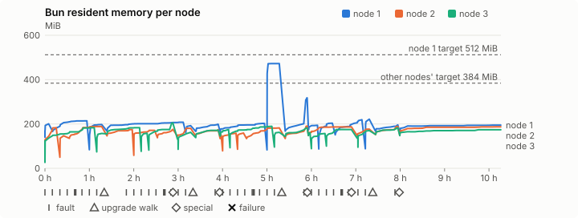
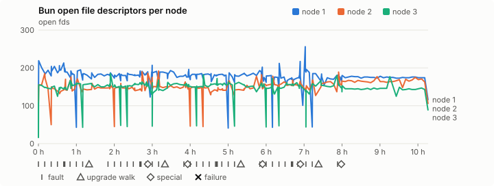
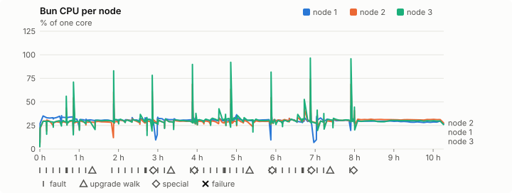
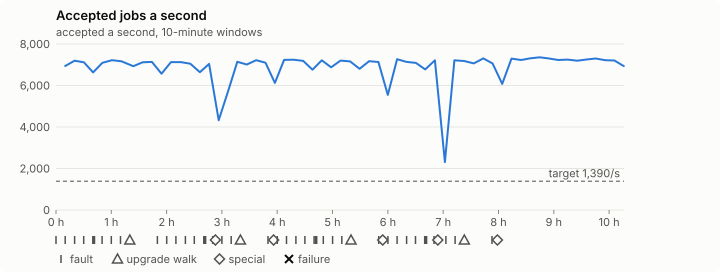

# Sustained soak (V02): PASS

29 October 2026. final tier, full schedule, 10 h 16 min of soak on a three-node quickstart cluster.

**Final job tier: clean. The release gate's final soak passes** for the candidate whose `candidate.json` has SHA-256 `340eaeba513c9740f058e51684713654f3df7c392ea8f19993ae1b5d12727d09`, if it is the final candidate.

## Candidate and host

| | |
|---|---|
| Staged base URL | <https://github.com/reliaburger/reliaburger/releases/download/staging-v0.2.4-40870779000-1> |
| `candidate.json` SHA-256 | `340eaeba513c9740f058e51684713654f3df7c392ea8f19993ae1b5d12727d09` |
| Running versions | v0.2.4 x3 |
| Soak build | `bun-v0.2.4-soak.1`, SHA-256 `50d279fccf1b1abb1d6593b57f50f889f7aee6bb4f45acba30d218a004abf716` |
| Walks roll back to | 0.2.4 |
| Host | macOS 26.3.1, Apple M2 Max, 32 GiB |
| Lima | limactl version 2.2.1 |
| Guest | Ubuntu 24.04.5 LTS, kernel 6.8.0-139-generic |
| RELIABURGER_HOME | `/tmp/rbq.jfehxq` |
| Evidence | `/var/tmp/reliaburger-v02.dPlAt9` |

## Configuration deviations

- node.toml `[testing] allowed_operations` adds `provision_isolated_workloads` (quickstart allows only inject_workload_faults and alter_node_state), so the catalogue pulse can lease test namespaces
- node.toml `[logs]`/`[metrics]` export to file:///var/lib/reliaburger/soak-export every 60 s with max_storage_mb = 8 (the harness deletes a metrics export 30 minutes after its source has gone), `[storage.snapshots]` every 900 s (compressed: 120 s), retain 4, uploaded to the same directory
- node.toml `[ingress] tls_cert/tls_key` point at an operator pair from a soak CA, 45-minute leaves rotated by the harness
- Bun runs with auto/mixed; host jobs opt in to a single pinned BusyBox copy under /var/lib/reliaburger/soak-jobs, mount_isolation=false. The independent verifier listens on each private VM address, TCP 8189, with a separate run token
- node.toml `[node.labels] soak-volume` = "writer" on node 2 and "redis" on node 3, to pin the volume apps
- node.toml `[upgrades] external_signing_key` = a throwaway operator key the harness made for this run (`ed25519:jpkWcOCGgaPWHry0qOjSOh1Ys5V+lGH0lS8rGYBJlcg=`); the soak build's `.sig` gets that key's external signature beside the release one (D2)
- node.toml `[security] leaf_lifetime_override_secs = 3600` (D1)

## Timeline

- Started 2026-10-29 16:44:10 UTC, finished 2026-10-30 03:00:20 UTC
- Cycles completed: 8
- Fault and node choices: 35, from seed 3693666603 (`--seed 3693666603` repeats them)
- Teardown: `relish local destroy --yes` and `relish uninstall --yes` succeeded

## Faults and slots

| Class | Runs | Settled/ok | Failed | Skipped | Settle (median / max) |
|---|---|---|---|---|---|
| fault:bun-kill-follower | 8 | 8 | 0 | 0 | 35 s / 53 s |
| fault:bun-kill-leader | 8 | 8 | 0 | 0 | 35 s / 48 s |
| fault:chaos-cpu | 1 | 2 | 0 | 0 | 18 s / 18 s |
| fault:chaos-delay | 2 | 4 | 0 | 0 | 18 s / 18 s |
| fault:chaos-dns | 1 | 2 | 0 | 0 | 18 s / 18 s |
| fault:chaos-drop | 1 | 2 | 0 | 0 | 18 s / 18 s |
| fault:chaos-kill | 2 | 4 | 0 | 0 | 33 s / 33 s |
| fault:chaos-memory | 1 | 2 | 0 | 0 | 18 s / 18 s |
| fault:chaos-partition | 2 | 4 | 0 | 0 | 19 s / 19 s |
| fault:chaos-pause | 1 | 2 | 0 | 0 | 18 s / 18 s |
| fault:chaos-scenario | 1 | 2 | 0 | 0 | 33 s / 33 s |
| fault:deploy-kill | 4 | 4 | 0 | 0 | 36 s / 36 s |
| fault:node-delay | 3 | 3 | 0 | 0 | 33 s / 33 s |
| fault:node-disk-full | 3 | 3 | 0 | 0 | 19 s / 19 s |
| fault:node-slow-fsync | 2 | 2 | 0 | 0 | 20 s / 20 s |
| fault:power-off | 4 | 4 | 0 | 0 | 38 s / 47 s |
| pulse | 8 | 8 | 0 | 0 | n/a |
| pulse:settle | 0 | 8 | 0 | 0 | 19 s / 20 s |
| special:all-off | 1 | 1 | 0 | 0 | 47 s / 47 s |
| special:graceful-stop | 2 | 2 | 0 | 0 | 61 s / 61 s |
| special:quorum-back | 2 | 2 | 0 | 0 | n/a |
| special:quorum-loss | 2 | 2 | 0 | 0 | 63 s / 63 s |
| storage:offline-export | 1 | 1 | 0 | 0 | n/a |
| storage:registry-push | 8 | 0 | 0 | 0 | n/a |
| tls:invalid-expired | 15 | 15 | 0 | 0 | n/a |
| tls:invalid-torn | 15 | 15 | 0 | 0 | n/a |
| tls:reload | 118 | 118 | 0 | 0 | n/a |
| upgrade:rollback | 4 | 4 | 0 | 0 | n/a |
| upgrade:settle | 0 | 4 | 0 | 0 | 73 s / 76 s |
| upgrade:upgrade | 4 | 4 | 0 | 0 | n/a |

## Execution inventory (gated)

What the run completed, from its events and kept bytes, against what its schedule owes. A fault counts once it was injected and the cluster settled after it.

| Item | Required | Completed | Verdict |
|---|---|---|---|
| candidate.json bytes match the qualified digest | 1 | 1 | ok |
| app workloads settled at the baseline | 1 | 1 | ok |
| upgrade walk (to the soak build and back) | 4 | 4 | ok |
| fault:bun-kill-follower | 1 | 8 | ok |
| fault:bun-kill-leader | 1 | 8 | ok |
| fault:deploy-kill | 1 | 4 | ok |
| fault:power-off | 1 | 4 | ok |
| fault:chaos-kill | 1 | 2 | ok |
| fault:chaos-delay | 1 | 2 | ok |
| fault:chaos-partition | 1 | 2 | ok |
| fault:chaos-scenario | 1 | 1 | ok |
| fault:chaos-pause | 1 | 1 | ok |
| fault:chaos-drop | 1 | 1 | ok |
| fault:chaos-dns | 1 | 1 | ok |
| fault:chaos-cpu | 1 | 1 | ok |
| fault:chaos-memory | 1 | 1 | ok |
| fault:node-delay | 1 | 3 | ok |
| fault:node-disk-full | 1 | 3 | ok |
| fault:node-slow-fsync | 1 | 2 | ok |
| special:graceful-stop | 2 | 2 | ok |
| special:quorum-loss | 2 | 2 | ok |
| special:all-off | 1 | 1 | ok |
| catalogue pulse | 8 | 8 | ok |
| offline export | 1 | 1 | ok |
| quiet tail with no faults, walks or specials | 1 | 1 | ok |
| job campaign drained in its final two minutes | 1 | 1 | ok |

## Observed fault effects

What each injected fault was seen to do, read back from the node.

| Fault | Target | Observed |
|---|---|---|
| effect:bun-kill-follower | rb-55c729f28c3c-3 | MainPID 2316 -> 3876 |
| effect:bun-kill-leader | rb-55c729f28c3c-1 | MainPID 9400 -> 1744840 |
| effect:deploy-kill | rb-55c729f28c3c-2 | MainPID 2565 -> 3855769 |
| effect:power-off | rb-55c729f28c3c-2 | Lima status Stopped |
| effect:node-delay | rb-55c729f28c3c-1 | netem 8001: root refcnt 2 limit 1000 delay 200ms  50ms  |
| effect:bun-kill-follower | rb-55c729f28c3c-1 | MainPID 1744840 -> 2429708 |
| effect:bun-kill-leader | rb-55c729f28c3c-3 | MainPID 3876 -> 1316842 |
| effect:node-disk-full | rb-55c729f28c3c-2 | available 67096576 bytes  |
| effect:bun-kill-follower | rb-55c729f28c3c-2 | MainPID 675 -> 3659626 |
| effect:bun-kill-leader | rb-55c729f28c3c-3 | MainPID 3318443 -> 80849 |
| effect:deploy-kill | rb-55c729f28c3c-3 | MainPID 80849 -> 2036385 |
| effect:power-off | rb-55c729f28c3c-2 | Lima status Stopped |
| effect:node-slow-fsync | rb-55c729f28c3c-3 | IOWriteBandwidthMax=/dev/vda 1000000 IOWriteIOPSMax=/dev/vda 20  |
| effect:bun-kill-follower | rb-55c729f28c3c-3 | MainPID 672 -> 201333 |
| effect:bun-kill-leader | rb-55c729f28c3c-1 | MainPID 2429708 -> 172594 |
| effect:node-delay | rb-55c729f28c3c-2 | netem 8001: root refcnt 2 limit 1000 delay 200ms  50ms  |
| effect:bun-kill-follower | rb-55c729f28c3c-2 | MainPID 676 -> 685090 |
| effect:bun-kill-leader | rb-55c729f28c3c-3 | MainPID 683 -> 2611830 |
| effect:deploy-kill | rb-55c729f28c3c-2 | MainPID 685090 -> 391039 |
| effect:power-off | rb-55c729f28c3c-2 | Lima status Stopped |
| effect:node-disk-full | rb-55c729f28c3c-3 | available 67047424 bytes  |
| effect:bun-kill-follower | rb-55c729f28c3c-1 | MainPID 678 -> 3690482 |
| effect:bun-kill-leader | rb-55c729f28c3c-3 | MainPID 2611830 -> 1308015 |
| effect:node-slow-fsync | rb-55c729f28c3c-1 | IOWriteBandwidthMax=/dev/vda 1000000 IOWriteIOPSMax=/dev/vda 20  |
| effect:bun-kill-follower | rb-55c729f28c3c-3 | MainPID 679 -> 825645 |
| effect:bun-kill-leader | rb-55c729f28c3c-1 | MainPID 674 -> 2706388 |
| effect:deploy-kill | rb-55c729f28c3c-3 | MainPID 825645 -> 555134 |
| effect:power-off | rb-55c729f28c3c-1 | Lima status Stopped |
| effect:node-delay | rb-55c729f28c3c-3 | Dump was interrupted and may be inconsistent. netem 8001: root refcnt 2 limit 1000 delay 200ms  50ms  |
| effect:bun-kill-follower | rb-55c729f28c3c-3 | MainPID 677 -> 231264 |
| effect:bun-kill-leader | rb-55c729f28c3c-1 | MainPID 673 -> 2135905 |
| effect:node-disk-full | rb-55c729f28c3c-1 | available 67072000 bytes  |

## Renewals and rotations

| Measure | Observed | Required | Verdict |
|---|---|---|---|
| workload identity rotations (soak-identity, per node) | 23 | ≥ 19 | PASS |
| node leaf renewals (per node) | 22 | ≥ 19 | PASS |
| operator ingress reloads (all nodes) | 118 | ≥ 40 | PASS |
| mixed job campaign and positive drain | 0 missing/failing checks | 0 | PASS |

## Latency SLOs

What a user should feel on a quiet three-node cluster (#1400). Every sample is taken outside fault windows and through a host forward that works; each p99 is the upper bound of its histogram bucket.

| SLO | p99 | Threshold | Samples | Mode | Verdict |
|---|---|---|---|---|---|
| API read p99 | 150 ms | ≤ 1,000 ms | 6,354 | record only | PASS |
| API write p99 | 500 ms | ≤ 2,000 ms | 20 | record only | PASS |
| App start p99 | 1 ms | ≤ 5,000 ms | 60 | record only | PASS |
| Rolling update p99 | 30,000 ms | ≤ 30,000 ms | 20 | record only | PASS |
| Job task start p99 | 32 ms | ≤ 256 ms | 137,306,923 | gated | PASS |

- API read p99: `GET /v1/status?cluster=true` and `GET /v1/cluster/nodes` on every node, at every light check
- API write p99: `relish apply` of the soak workloads, from the call to the commit
- App start p99: each node's deploy of a new `soak-identity` instance, from its start to the instance running
- Rolling update p99: from `relish apply` returning to every node's `soak-identity` running the new spec
- Job task start p99: a job task's start lag on a pooled executor, from the job campaign's buckets, in runs no fault window overlapped
- Record only from 28 October 2026 (#1400): no soak before 0.2.4 measured it. The threshold is provisional; the first 0.2.4 fast and final records set the gate.

## Jobs

| Runtime | Accepted successes | Retries | Last accepted progress |
|---|---|---|---|
| runc | 108693 | 1 | 1793329183 |
| shared-runc | 69164706 | 1 | 1793329181 |
| process | 185599102 | 1 | 1793329181 |

The bounded campaign shares the app soak's fault schedule. These counts are reliability evidence, not a saturation rate or a 100-million-per-day qualification.

- Independent verifier execution attempts: 24
- Explicit test-operator acknowledgements for known replay-safe fenced fixtures: 192

- rb-55c729f28c3c-1: latest complete job storage (KiB) {'instances': 716, 'job-state': 8, 'task-arrays': 18448}; free 5067576 KiB; live/peak owners 0/32; peak storage {'instances': 63500, 'job-state': 8, 'task-arrays': 46096}
- rb-55c729f28c3c-2: latest complete job storage (KiB) {'instances': 77596, 'job-state': 8, 'task-arrays': 20156}; free 5528896 KiB; live/peak owners 0/32; peak storage {'instances': 95424, 'job-state': 8, 'task-arrays': 46592}
- rb-55c729f28c3c-3: latest complete job storage (KiB) {'instances': 452, 'job-state': 8, 'task-arrays': 18436}; free 6031052 KiB; live/peak owners 0/32; peak storage {'instances': 24196, 'job-state': 8, 'task-arrays': 47288}

Complete disk inventories are recorded. Global retention bounds and the 12-hour job qualification remain #668; this gate cannot certify an unimplemented retention policy.

## Job qualification (D18-C)

Load: target; 3 nodes; accepted 6,899.6/s against a 1390.0/s target: PASS.

The September plan set its targets for one 1M-task batch on a quiet cluster. A soak runs for hours with restarts, upgrades and apps, so its storage, Bun memory and Raft targets are restated (maintainer decision, 15 October 2026, [#668](https://github.com/reliaburger/reliaburger/issues/668)). Bun's steady state is the median RSS of each process once it has been seen for 10 minutes; the gated memory checks are unchanged (`leak-rss`, and Mayo's 70% `memory_high` alert through `wtf`).

| Measure (recorded, not gated) | Observed | Target |
|---|---|---|
| Wall time of a 1,048,576-task array (median / max of 64) | 197 s / 651 s | ≤ 600 s |
| p99 start lag, pooled executors | 32 ms (bucket upper bound) | < 1,000 ms |
| Raft entries per second, all cluster writes | 5.37 | recorded only; the batch target counts only task-array writes |
| Raft state of one run, largest seen | 17,810 B | ≤ 256 KiB per 1M tasks |
| Bun steady-state RSS per process, worst node against its target | rb-55c729f28c3c-1: 472.36 MiB steady, 472.59 MiB peak | ≤ 512 MiB (≤ 512 MiB on node 1, which serves the API) |
| Bun CPU, busiest node | 0.30 cores | ≤ 1 core (leader batch control) |
| Executor helper CPU, busiest node | 0.04 cores | ≤ 0.5 core |
| Node task-array storage per 1M accepted tasks (peaks summed) | 0.54 MiB | ≤ 64 MiB, deleted after retirement |
| Retained log volume, all nodes | 27.13 MB | ≤ 50 MB |

- Bun RSS on rb-55c729f28c3c-1 (serves the API, target ≤ 512 MiB): pid 9400: 200.62 MiB peak (seen for under 10 minutes); pid 1744840: 212.71 MiB steady, 213.93 MiB peak; pid 2429708: 195.51 MiB steady, 197.52 MiB peak; pid 2429708: 201.44 MiB steady, 207.81 MiB peak; pid 172594: 192.11 MiB peak (seen for under 10 minutes); pid 172594: 196.72 MiB steady, 198.29 MiB peak; pid 678: 195.39 MiB steady, 202.41 MiB peak; pid 3690482: 472.36 MiB steady, 472.59 MiB peak; pid 3690482: 308.52 MiB steady, 317.54 MiB peak; pid 674: 194.24 MiB steady, 194.24 MiB peak; pid 2706388: 199.43 MiB steady, 203.55 MiB peak; pid 673: 200.46 MiB steady, 219.03 MiB peak; pid 2135905: 221.45 MiB peak (seen for under 10 minutes); pid 2135905: 189.54 MiB steady, 195.48 MiB peak; pid 673: 192.38 MiB steady, 195.00 MiB peak
- Bun RSS on rb-55c729f28c3c-2 (node, target ≤ 384 MiB): pid 2565: 182.09 MiB steady, 183.01 MiB peak; pid 3855769: 146.67 MiB peak (seen for under 10 minutes); pid 675: 184.94 MiB steady, 188.29 MiB peak; pid 675: 170.84 MiB steady, 174.46 MiB peak; pid 3659626: 168.52 MiB steady, 170.91 MiB peak; pid 676: 164.77 MiB steady, 175.64 MiB peak; pid 676: 180.08 MiB steady, 180.23 MiB peak; pid 676: 169.29 MiB steady, 174.34 MiB peak; pid 676: 149.44 MiB peak (seen for under 10 minutes); pid 685090: 155.58 MiB steady, 158.31 MiB peak; pid 391039: 159.17 MiB peak (seen for under 10 minutes); pid 678: 168.82 MiB steady, 182.26 MiB peak; pid 679: 182.82 MiB steady, 190.77 MiB peak; pid 678: 186.65 MiB steady, 187.14 MiB peak; pid 671: 174.34 MiB steady, 176.57 MiB peak; pid 671: 185.73 MiB steady, 188.80 MiB peak; pid 679: 185.05 MiB steady, 187.37 MiB peak
- Bun RSS on rb-55c729f28c3c-3 (node, target ≤ 384 MiB): pid 2316: 124.05 MiB peak (seen for under 10 minutes); pid 3876: 164.56 MiB steady, 183.36 MiB peak; pid 1316842: 157.20 MiB peak (seen for under 10 minutes); pid 3318443: 181.04 MiB steady, 183.32 MiB peak; pid 80849: 158.46 MiB peak (seen for under 10 minutes); pid 2036385: 175.03 MiB steady, 204.43 MiB peak; pid 672: 136.48 MiB peak (seen for under 10 minutes); pid 201333: 155.46 MiB steady, 162.20 MiB peak; pid 201333: 170.99 MiB steady, 172.09 MiB peak; pid 683: 174.99 MiB steady, 174.99 MiB peak; pid 2611830: 180.89 MiB steady, 189.52 MiB peak; pid 1308015: 162.26 MiB peak (seen for under 10 minutes); pid 1308015: 181.14 MiB steady, 181.83 MiB peak; pid 679: 159.99 MiB peak (seen for under 10 minutes); pid 825645: 153.50 MiB steady, 157.04 MiB peak; pid 555134: 174.91 MiB steady, 174.98 MiB peak; pid 677: 144.82 MiB peak (seen for under 10 minutes); pid 231264: 166.67 MiB steady, 170.10 MiB peak; pid 231264: 178.14 MiB steady, 182.13 MiB peak; pid 667: 170.15 MiB steady, 173.81 MiB peak

- runc retry causes: exit_code 1, launch 0, signal 0, timeout 0, unknown 0, unrecorded 0
- shared-runc retry causes: exit_code 1, launch 0, signal 0, timeout 0, unknown 0, unrecorded 0
- process retry causes: exit_code 1, launch 0, signal 0, timeout 0, unknown 0, unrecorded 0
- Audited executions: 24; operator replay decisions: 192
- Job controller API fallbacks: rb-55c729f28c3c-1 missed 705, rb-55c729f28c3c-2 missed 16; rb-55c729f28c3c-2 answered 689, rb-55c729f28c3c-3 answered 16 (requests a node didn't answer, and the node that took them instead)

## Data

- Volume writer: highest ACK 293589 in the log view; the writer file checks (writer-lost, writer-regression) decide data loss, and `*-log-order` failures are about the order the log view returned lines in
- Redis counter: highest INCR 27111 in the log view
- Export rb-55c729f28c3c-1: 191 source files, 383 at the destination
- Export rb-55c729f28c3c-2: 271 source files, 540 at the destination
- Export rb-55c729f28c3c-3: 329 source files, 366 at the destination
- Registry images pushed and re-verified: 9
- Agent-loop turns over the 1 s budget: rb-55c729f28c3c-1 0, rb-55c729f28c3c-2 0, rb-55c729f28c3c-3 0
- Soak policies checked in force: 290 times, policy generation 78 at the last check
- Guest clock steps by Lima's guest agent: rb-55c729f28c3c-1 6, rb-55c729f28c3c-2 9, rb-55c729f28c3c-3 6
- Checks evaluated: 1323 (heavy 125, light 1033, settle 165)
- Last observed progress: redis-counter 27111, writer-ack 293589

## Council history (linearizability)

Every test-lease grant, renew, read and release the history client made, checked against a model of the council's leases. A write with no answer may or may not have happened; the check allows both.

- Operations checked: 222423 of 222423, in 2 namespaces; 5397 writes had no answer
- Verdict: linearizable

## Leak-checker exposure (gated)

How long each leak checker could judge each node's Bun. `leak-rss` arms after 60 minutes in one process and `leak-fd` after 50; a restart, kill or upgrade exec starts the warm-up again. A final needs each armed for 60 minutes on every node, with one unbroken window of 30 (#1062); its quiet tail gives them that.

| Node | Checker | Armed | Longest armed window | Evaluated samples | Processes armed | Verdict |
|---|---|---|---|---|---|---|
| rb-55c729f28c3c-1 | leak-rss | 114 min | 75 min | 47 | 2 | ok |
| rb-55c729f28c3c-1 | leak-fd | 142 min | 85 min | 61 | 3 | ok |
| rb-55c729f28c3c-2 | leak-rss | 75 min | 75 min | 16 | 1 | ok |
| rb-55c729f28c3c-2 | leak-fd | 91 min | 85 min | 25 | 2 | ok |
| rb-55c729f28c3c-3 | leak-rss | 82 min | 75 min | 21 | 2 | ok |
| rb-55c729f28c3c-3 | leak-fd | 108 min | 85 min | 35 | 3 | ok |

## Resource trends

| Node | Measure | First | Last | Max |
|---|---|---|---|---|
| rb-55c729f28c3c-1 | disk_kb data | 1382848 | 1215540 | 1607656 |
| rb-55c729f28c3c-1 | disk_kb images | 342456 | 363468 | 478044 |
| rb-55c729f28c3c-1 | disk_kb logs | 40 | 5056 | 13260 |
| rb-55c729f28c3c-1 | disk_kb metrics | 48 | 8580 | 8896 |
| rb-55c729f28c3c-1 | disk_kb soak-export | 4 | 32824 | 33104 |
| rb-55c729f28c3c-1 | disk_kb volumes | 224 | 132 | 276 |
| rb-55c729f28c3c-1 | fd | 107 | 116 | 256 |
| rb-55c729f28c3c-1 | rss_anon_kb | 70840 | 121912 | 406488 |
| rb-55c729f28c3c-1 | rss_file_kb | 72660 | 77768 | 78304 |
| rb-55c729f28c3c-1 | rss_kb | 143500 | 199680 | 483932 |
| rb-55c729f28c3c-2 | disk_kb data | 71816 | 513748 | 543096 |
| rb-55c729f28c3c-2 | disk_kb images | 172188 | 350868 | 350868 |
| rb-55c729f28c3c-2 | disk_kb logs | 24 | 8632 | 9308 |
| rb-55c729f28c3c-2 | disk_kb metrics | 40 | 8548 | 8940 |
| rb-55c729f28c3c-2 | disk_kb soak-export | 4 | 24840 | 24960 |
| rb-55c729f28c3c-2 | disk_kb volumes | 16760 | 24496 | 24496 |
| rb-55c729f28c3c-2 | fd | 68 | 106 | 192 |
| rb-55c729f28c3c-2 | rss_anon_kb | 41336 | 114016 | 117744 |
| rb-55c729f28c3c-2 | rss_file_kb | 71072 | 77848 | 78112 |
| rb-55c729f28c3c-2 | rss_kb | 112408 | 191864 | 195344 |
| rb-55c729f28c3c-3 | disk_kb data | 234564 | 271228 | 703452 |
| rb-55c729f28c3c-3 | disk_kb images | 339124 | 346684 | 346684 |
| rb-55c729f28c3c-3 | disk_kb logs | 24 | 3928 | 3928 |
| rb-55c729f28c3c-3 | disk_kb metrics | 40 | 8624 | 8952 |
| rb-55c729f28c3c-3 | disk_kb soak-export | 4 | 17732 | 17988 |
| rb-55c729f28c3c-3 | disk_kb volumes | 16784 | 19328 | 19328 |
| rb-55c729f28c3c-3 | fd | 71 | 89 | 185 |
| rb-55c729f28c3c-3 | rss_anon_kb | 47228 | 101072 | 131160 |
| rb-55c729f28c3c-3 | rss_file_kb | 70752 | 76904 | 78176 |
| rb-55c729f28c3c-3 | rss_kb | 117980 | 177976 | 209336 |

## Charts

Time runs from the start of the soak. The marks under each chart are its faults, upgrade walks, specials and recorded failures; the dashed lines are targets.

## Failures

None.

Evidence: `/var/tmp/reliaburger-v02.dPlAt9` (events.jsonl, snapshots/, failures/<n>/).
