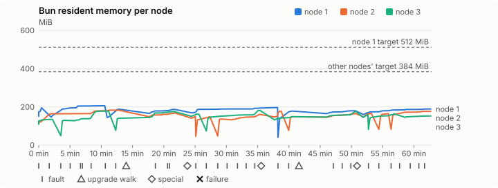
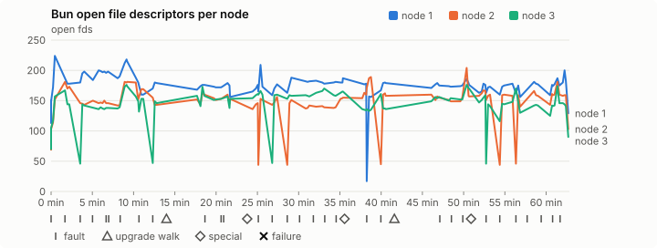
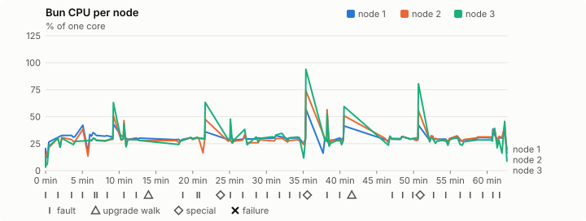
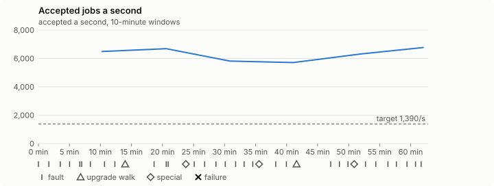

# Sustained soak (V02): PASS

2 November 2026. fast tier, compressed schedule, 1 h 02 min of soak on a three-node quickstart cluster.

**Fast tier: clean.** The iteration loop only, not acceptance: the V02 gate needs a clean final-tier run (8 h, full schedule) on the final candidate.

## Candidate and host

| | |
|---|---|
| Staged base URL | <https://github.com/reliaburger/reliaburger/releases/download/staging-v0.2.5-41365546843-1> |
| `candidate.json` SHA-256 | `c6bd5e3f72c3d8b03ba9e161f5eec287daef3ab1e878e3d928ab56efa700a19b` |
| Running versions | v0.2.5 x3 |
| Soak build | `bun-v0.2.5-soak.1`, SHA-256 `e18f53b19663b5c99bdf6ec6d4d1bd1595d5843191b2fd7890b543a085fc636c` |
| Walks roll back to | 0.2.5 |
| Host | macOS 26.3.1, Apple M2 Max, 32 GiB |
| Lima | limactl version 2.2.1 |
| Guest | Ubuntu 24.04.5 LTS, kernel 6.8.0-139-generic |
| RELIABURGER_HOME | `/tmp/rbq.LnSdXS` |
| Evidence | `/var/tmp/reliaburger-v02.t6eGFx` |

## Configuration deviations

- node.toml `[testing] allowed_operations` adds `provision_isolated_workloads` (quickstart allows only inject_workload_faults and alter_node_state), so the catalogue pulse can lease test namespaces
- node.toml `[logs]`/`[metrics]` export to file:///var/lib/reliaburger/soak-export every 60 s with max_storage_mb = 8 (the harness deletes a metrics export 30 minutes after its source has gone), `[storage.snapshots]` every 900 s (compressed: 120 s), retain 4, uploaded to the same directory
- node.toml `[ingress] tls_cert/tls_key` point at an operator pair from a soak CA, 45-minute leaves rotated by the harness
- Bun runs with auto/mixed; host jobs opt in to a single pinned BusyBox copy under /var/lib/reliaburger/soak-jobs, mount_isolation=false. The independent verifier listens on each private VM address, TCP 8189, with a separate run token
- node.toml `[node.labels] soak-volume` = "writer" on node 2 and "redis" on node 3, to pin the volume apps
- node.toml `[upgrades] external_signing_key` = a throwaway operator key the harness made for this run (`ed25519:EjxEaO87FBRsND8PMkTwgqBbX060vwq1etEuV4uCEPc=`); the soak build's `.sig` gets that key's external signature beside the release one (D2)
- node.toml `[security] leaf_lifetime_override_secs = 3600` (D1)

## Timeline

- Started 2026-11-02 02:48:37 UTC, finished 2026-11-02 03:51:26 UTC
- Cycles completed: 5
- Fault and node choices: 27, from seed 1708225282 (`--seed 1708225282` repeats them)
- Teardown: `relish local destroy --yes` and `relish uninstall --yes` succeeded

## Faults and slots

| Class | Runs | Settled/ok | Failed | Skipped | Settle (median / max) |
|---|---|---|---|---|---|
| fault:bun-kill-follower | 5 | 5 | 0 | 0 | 33 s / 34 s |
| fault:bun-kill-leader | 5 | 5 | 0 | 0 | 35 s / 40 s |
| fault:chaos-cpu | 1 | 2 | 0 | 0 | 18 s / 18 s |
| fault:chaos-delay | 1 | 2 | 0 | 0 | 18 s / 18 s |
| fault:chaos-dns | 1 | 2 | 0 | 0 | 17 s / 17 s |
| fault:chaos-drop | 1 | 2 | 0 | 0 | 17 s / 17 s |
| fault:chaos-kill | 2 | 4 | 0 | 0 | 53 s / 53 s |
| fault:chaos-memory | 1 | 2 | 0 | 0 | 18 s / 18 s |
| fault:chaos-partition | 1 | 2 | 0 | 0 | 18 s / 18 s |
| fault:chaos-pause | 1 | 2 | 0 | 0 | 17 s / 17 s |
| fault:chaos-scenario | 1 | 2 | 0 | 0 | 18 s / 18 s |
| fault:deploy-kill | 3 | 3 | 0 | 0 | 34 s / 34 s |
| fault:node-delay | 2 | 2 | 0 | 0 | 18 s / 18 s |
| fault:node-disk-full | 2 | 2 | 0 | 0 | 22 s / 22 s |
| fault:node-slow-fsync | 1 | 1 | 0 | 0 | 17 s / 17 s |
| fault:power-off | 3 | 3 | 0 | 0 | 32 s / 45 s |
| pulse | 1 | 1 | 0 | 0 | n/a |
| pulse:settle | 0 | 1 | 0 | 0 | 22 s / 22 s |
| special:all-off | 1 | 1 | 0 | 0 | 50 s / 50 s |
| special:graceful-stop | 1 | 1 | 0 | 0 | 41 s / 41 s |
| special:quorum-back | 1 | 1 | 0 | 0 | n/a |
| special:quorum-loss | 1 | 1 | 0 | 0 | 32 s / 32 s |
| storage:offline-export | 2 | 2 | 0 | 0 | n/a |
| storage:registry-push | 5 | 0 | 0 | 0 | n/a |
| tls:invalid-expired | 3 | 3 | 0 | 0 | n/a |
| tls:invalid-torn | 3 | 3 | 0 | 0 | n/a |
| tls:reload | 32 | 32 | 0 | 0 | n/a |
| upgrade:rollback | 2 | 2 | 0 | 0 | n/a |
| upgrade:settle | 0 | 2 | 0 | 0 | 61 s / 61 s |
| upgrade:upgrade | 2 | 2 | 0 | 0 | n/a |

## Execution inventory (recorded, not gated)

What the run completed, from its events and kept bytes, against what its schedule owes. A fault counts once it was injected and the cluster settled after it.

| Item | Required | Completed | Verdict |
|---|---|---|---|
| candidate.json bytes match the qualified digest | 1 | 1 | ok |
| app workloads settled at the baseline | 1 | 1 | ok |
| upgrade walk (to the soak build and back) | 2 | 2 | ok |
| fault:bun-kill-follower | 1 | 5 | ok |
| fault:bun-kill-leader | 1 | 5 | ok |
| fault:deploy-kill | 1 | 3 | ok |
| fault:power-off | 1 | 3 | ok |
| fault:chaos-kill | 1 | 2 | ok |
| fault:chaos-delay | 1 | 1 | ok |
| fault:chaos-partition | 1 | 1 | ok |
| fault:chaos-scenario | 1 | 1 | ok |
| fault:chaos-pause | 1 | 1 | ok |
| fault:chaos-drop | 1 | 1 | ok |
| fault:chaos-dns | 1 | 1 | ok |
| fault:chaos-cpu | 1 | 1 | ok |
| fault:node-delay | 1 | 2 | ok |
| fault:node-disk-full | 1 | 2 | ok |
| fault:node-slow-fsync | 1 | 1 | ok |
| special:graceful-stop | 1 | 1 | ok |
| special:quorum-loss | 1 | 1 | ok |
| special:all-off | 1 | 1 | ok |
| catalogue pulse | 1 | 1 | ok |
| offline export | 2 | 2 | ok |
| job campaign drained in its final two minutes | 1 | 1 | ok |

## Observed fault effects

What each injected fault was seen to do, read back from the node.

| Fault | Target | Observed |
|---|---|---|
| effect:bun-kill-follower | rb-56c62571a5aa-2 | MainPID 2473 -> 4843 |
| effect:bun-kill-leader | rb-56c62571a5aa-1 | MainPID 9313 -> 241832 |
| effect:deploy-kill | rb-56c62571a5aa-3 | MainPID 2318 -> 622571 |
| effect:power-off | rb-56c62571a5aa-3 | Lima status Stopped |
| effect:node-delay | rb-56c62571a5aa-1 | netem 8001: root refcnt 2 limit 1000 delay 200ms  50ms  |
| effect:bun-kill-follower | rb-56c62571a5aa-1 | MainPID 241832 -> 1800484 |
| effect:bun-kill-leader | rb-56c62571a5aa-3 | MainPID 678 -> 1280559 |
| effect:node-disk-full | rb-56c62571a5aa-2 | available 67047424 bytes  |
| effect:bun-kill-follower | rb-56c62571a5aa-2 | MainPID 679 -> 168046 |
| effect:bun-kill-leader | rb-56c62571a5aa-3 | MainPID 674 -> 489630 |
| effect:deploy-kill | rb-56c62571a5aa-2 | MainPID 168046 -> 825019 |
| effect:power-off | rb-56c62571a5aa-2 | Lima status Stopped |
| effect:node-slow-fsync | rb-56c62571a5aa-3 | IOWriteBandwidthMax=/dev/vda 1000000 IOWriteIOPSMax=/dev/vda 20  |
| effect:bun-kill-follower | rb-56c62571a5aa-1 | MainPID 675 -> 2296821 |
| effect:bun-kill-leader | rb-56c62571a5aa-2 | MainPID 680 -> 567174 |
| effect:node-delay | rb-56c62571a5aa-2 | netem 8001: root refcnt 2 limit 1000 delay 200ms  50ms  |
| effect:bun-kill-follower | rb-56c62571a5aa-3 | MainPID 681 -> 199232 |
| effect:bun-kill-leader | rb-56c62571a5aa-2 | MainPID 680 -> 507205 |
| effect:deploy-kill | rb-56c62571a5aa-2 | MainPID 507205 -> 852781 |
| effect:power-off | rb-56c62571a5aa-3 | Lima status Stopped |
| effect:node-disk-full | rb-56c62571a5aa-3 | available 67096576 bytes  |

## Renewals and rotations

| Measure | Observed | Required | Verdict |
|---|---|---|---|
| workload identity rotations (soak-identity, per node) | 7 | ≥ 1 | PASS |
| node leaf renewals (per node) | 2 | ≥ 1 | PASS |
| operator ingress reloads (all nodes) | 32 | ≥ 11 | PASS |
| mixed job campaign and positive drain | 0 missing/failing checks | 0 | PASS |

## Latency SLOs

What a user should feel on a quiet three-node cluster (#1400). Every sample is taken outside fault windows and through a host forward that works; each p99 is the upper bound of its histogram bucket.

| SLO | p99 | Threshold | Samples | Mode | Verdict |
|---|---|---|---|---|---|
| API read p99 | 150 ms | ≤ 1,000 ms | 240 | record only | PASS |
| API write p99 | 150 ms | ≤ 2,000 ms | 7 | record only | PASS |
| App start p99 | 1 ms | ≤ 5,000 ms | 21 | record only | PASS |
| Rolling update p99 | 30,000 ms | ≤ 30,000 ms | 7 | record only | PASS |
| Job task start p99 | 2,048 ms | ≤ 256 ms | 20 | record only | too few samples |

- API read p99: `GET /v1/status?cluster=true` and `GET /v1/cluster/nodes` on every node, at every light check
- API write p99: `relish apply` of the soak workloads, from the call to the commit
- App start p99: each node's deploy of a new `soak-identity` instance, from its start to the instance running
- Rolling update p99: from `relish apply` returning to every node's `soak-identity` running the new spec
- Job task start p99: a job task's start lag on a pooled executor, from the job campaign's buckets, in runs no fault window overlapped
- Record only from 28 October 2026 (#1400): no soak before 0.2.4 measured it. The threshold is provisional; the first 0.2.4 fast and final records set the gate.
- Job task start p99 not judged: only 20 job task start samples, fewer than the 1,000 a p99 needs

## Jobs

| Runtime | Accepted successes | Retries | Last accepted progress |
|---|---|---|---|
| runc | 10512 | 3 | 1793591475 |
| shared-runc | 6324735 | 1 | 1793591475 |
| process | 17416876 | 1 | 1793591475 |

The bounded campaign shares the app soak's fault schedule. These counts are reliability evidence, not a saturation rate or a 100-million-per-day qualification.

- Independent verifier execution attempts: 24
- Explicit test-operator acknowledgements for known replay-safe fenced fixtures: 112

- rb-56c62571a5aa-1: latest complete job storage (KiB) {'instances': 756, 'job-state': 8, 'task-arrays': 18456}; free 5187956 KiB; live/peak owners 0/32; peak storage {'instances': 24192, 'job-state': 8, 'task-arrays': 40112}
- rb-56c62571a5aa-2: latest complete job storage (KiB) {'instances': 3196, 'job-state': 8, 'task-arrays': 16788}; free 6327472 KiB; live/peak owners 0/32; peak storage {'instances': 25096, 'job-state': 8, 'task-arrays': 40584}
- rb-56c62571a5aa-3: latest complete job storage (KiB) {'instances': 5212, 'job-state': 8, 'task-arrays': 13920}; free 6286808 KiB; live/peak owners 0/32; peak storage {'instances': 28876, 'job-state': 8, 'task-arrays': 39664}

Complete disk inventories are recorded. Global retention bounds and the 12-hour job qualification remain #668; this gate cannot certify an unimplemented retention policy.

## Job qualification (D18-C)

Load: target; 3 nodes; accepted 6,307.0/s against a 1390.0/s target: PASS.

The September plan set its targets for one 1M-task batch on a quiet cluster. A soak runs for hours with restarts, upgrades and apps, so its storage, Bun memory and Raft targets are restated (maintainer decision, 15 October 2026, [#668](https://github.com/reliaburger/reliaburger/issues/668)). Bun's steady state is the median RSS of each process once it has been seen for 10 minutes; the gated memory checks are unchanged (`leak-rss`, and Mayo's 70% `memory_high` alert through `wtf`).

| Measure (recorded, not gated) | Observed | Target |
|---|---|---|
| Wall time of a 1,048,576-task array (median / max of 22) | 215 s / 675 s | ≤ 600 s |
| p99 start lag, pooled executors | 32 ms (bucket upper bound) | < 1,000 ms |
| Raft entries per second, all cluster writes | 5.59 | recorded only; the batch target counts only task-array writes |
| Raft state of one run, largest seen | 10,062 B | ≤ 256 KiB per 1M tasks |
| Bun steady-state RSS per process, worst node against its target | rb-56c62571a5aa-2: 181.29 MiB steady, 182.79 MiB peak | ≤ 384 MiB (≤ 512 MiB on node 1, which serves the API) |
| Bun CPU, busiest node | 0.29 cores | ≤ 1 core (leader batch control) |
| Executor helper CPU, busiest node | 0.08 cores | ≤ 0.5 core |
| Node task-array storage per 1M accepted tasks (peaks summed) | 4.95 MiB | ≤ 64 MiB, deleted after retirement |
| Retained log volume, all nodes | 6.32 MB | ≤ 50 MB |

- Bun RSS on rb-56c62571a5aa-1 (serves the API, target ≤ 512 MiB): pid 9313: 195.35 MiB peak (seen for under 10 minutes); pid 241832: 205.98 MiB peak (seen for under 10 minutes); pid 1800484: 188.14 MiB peak (seen for under 10 minutes); pid 1800484: 187.16 MiB peak (seen for under 10 minutes); pid 675: 194.22 MiB steady, 196.13 MiB peak; pid 2296821: 178.24 MiB peak (seen for under 10 minutes); pid 2296821: 179.54 MiB peak (seen for under 10 minutes); pid 674: 188.97 MiB steady, 189.04 MiB peak
- Bun RSS on rb-56c62571a5aa-2 (node, target ≤ 384 MiB): pid 2473: 121.67 MiB peak (seen for under 10 minutes); pid 4843: 181.29 MiB steady, 182.79 MiB peak; pid 4843: 169.58 MiB peak (seen for under 10 minutes); pid 679: 149.78 MiB peak (seen for under 10 minutes); pid 168046: 148.69 MiB peak (seen for under 10 minutes); pid 825019: 136.69 MiB peak (seen for under 10 minutes); pid 683: 161.01 MiB peak (seen for under 10 minutes); pid 680: 178.00 MiB peak (seen for under 10 minutes); pid 567174: 148.56 MiB peak (seen for under 10 minutes); pid 567174: 165.93 MiB peak (seen for under 10 minutes); pid 680: 166.03 MiB peak (seen for under 10 minutes); pid 507205: 164.71 MiB peak (seen for under 10 minutes); pid 852781: 176.61 MiB peak (seen for under 10 minutes)
- Bun RSS on rb-56c62571a5aa-3 (node, target ≤ 384 MiB): pid 2318: 134.55 MiB peak (seen for under 10 minutes); pid 622571: 129.93 MiB peak (seen for under 10 minutes); pid 678: 178.16 MiB peak (seen for under 10 minutes); pid 1280559: 140.46 MiB peak (seen for under 10 minutes); pid 1670344: 175.68 MiB peak (seen for under 10 minutes); pid 674: 162.00 MiB peak (seen for under 10 minutes); pid 489630: 181.78 MiB peak (seen for under 10 minutes); pid 680: 149.04 MiB peak (seen for under 10 minutes); pid 681: 178.62 MiB peak (seen for under 10 minutes); pid 681: 158.89 MiB peak (seen for under 10 minutes); pid 199232: 163.63 MiB peak (seen for under 10 minutes); pid 683: 152.16 MiB peak (seen for under 10 minutes)

- runc retry causes: exit_code 1, launch 1, signal 0, timeout 0, unknown 0, unrecorded 1
- shared-runc retry causes: exit_code 1, launch 0, signal 0, timeout 0, unknown 0, unrecorded 0
- process retry causes: exit_code 1, launch 0, signal 0, timeout 0, unknown 0, unrecorded 0
- Audited executions: 24; operator replay decisions: 112
- Job controller API fallbacks: rb-56c62571a5aa-1 missed 235, rb-56c62571a5aa-2 missed 6; rb-56c62571a5aa-2 answered 229, rb-56c62571a5aa-3 answered 6 (requests a node didn't answer, and the node that took them instead)

## Data

- Volume writer: highest ACK 31781 in the log view; the writer file checks (writer-lost, writer-regression) decide data loss, and `*-log-order` failures are about the order the log view returned lines in
- Redis counter: highest INCR 3053 in the log view
- Export rb-56c62571a5aa-1: 123 source files, 122 at the destination
- Export rb-56c62571a5aa-2: 130 source files, 128 at the destination
- Export rb-56c62571a5aa-3: 102 source files, 90 at the destination
- Registry images pushed and re-verified: 6
- Agent-loop turns over the 1 s budget: rb-56c62571a5aa-1 0, rb-56c62571a5aa-2 0, rb-56c62571a5aa-3 0
- Soak policies checked in force: 114 times, policy generation 36 at the last check
- Guest clock steps by Lima's guest agent: rb-56c62571a5aa-1 3, rb-56c62571a5aa-2 4, rb-56c62571a5aa-3 5
- Checks evaluated: 174 (heavy 15, light 60, settle 99)
- Last observed progress: redis-counter 3053, writer-ack 31781

## Council history (linearizability)

Every test-lease grant, renew, read and release the history client made, checked against a model of the council's leases. A write with no answer may or may not have happened; the check allows both.

- Operations checked: 19568 of 19568, in 2 namespaces; 1343 writes had no answer
- Verdict: linearizable

## Leak-checker exposure (recorded, not gated)

How long each leak checker could judge each node's Bun. `leak-rss` arms after 60 minutes in one process and `leak-fd` after 50; a restart, kill or upgrade exec starts the warm-up again. A final needs each armed for 60 minutes on every node, with one unbroken window of 30 (#1062); its quiet tail gives them that.

| Node | Checker | Armed | Longest armed window | Evaluated samples | Processes armed | Verdict |
|---|---|---|---|---|---|---|
| rb-56c62571a5aa-1 | leak-rss | 0 min | 0 min | 0 | 0 | short |
| rb-56c62571a5aa-1 | leak-fd | 0 min | 0 min | 0 | 0 | short |
| rb-56c62571a5aa-2 | leak-rss | 0 min | 0 min | 0 | 0 | short |
| rb-56c62571a5aa-2 | leak-fd | 0 min | 0 min | 0 | 0 | short |
| rb-56c62571a5aa-3 | leak-rss | 0 min | 0 min | 0 | 0 | short |
| rb-56c62571a5aa-3 | leak-fd | 0 min | 0 min | 0 | 0 | short |

## Resource trends

| Node | Measure | First | Last | Max |
|---|---|---|---|---|
| rb-56c62571a5aa-1 | disk_kb data | 1382896 | 1125596 | 1504300 |
| rb-56c62571a5aa-1 | disk_kb images | 342456 | 461488 | 461488 |
| rb-56c62571a5aa-1 | disk_kb logs | 48 | 3204 | 3204 |
| rb-56c62571a5aa-1 | disk_kb metrics | 52 | 4644 | 4644 |
| rb-56c62571a5aa-1 | disk_kb soak-export | 4 | 7772 | 7772 |
| rb-56c62571a5aa-1 | disk_kb volumes | 224 | 132 | 252 |
| rb-56c62571a5aa-1 | fd | 113 | 129 | 224 |
| rb-56c62571a5aa-1 | rss_anon_kb | 82220 | 116212 | 133072 |
| rb-56c62571a5aa-1 | rss_file_kb | 72720 | 77368 | 77856 |
| rb-56c62571a5aa-1 | rss_kb | 154940 | 193580 | 210928 |
| rb-56c62571a5aa-2 | disk_kb data | 71824 | 455588 | 498544 |
| rb-56c62571a5aa-2 | disk_kb images | 175368 | 342432 | 342432 |
| rb-56c62571a5aa-2 | disk_kb logs | 28 | 2128 | 2128 |
| rb-56c62571a5aa-2 | disk_kb metrics | 68 | 3436 | 3436 |
| rb-56c62571a5aa-2 | disk_kb soak-export | 4 | 6592 | 6592 |
| rb-56c62571a5aa-2 | disk_kb volumes | 16760 | 17540 | 17540 |
| rb-56c62571a5aa-2 | fd | 70 | 103 | 204 |
| rb-56c62571a5aa-2 | rss_anon_kb | 46652 | 103256 | 110168 |
| rb-56c62571a5aa-2 | rss_file_kb | 71456 | 77592 | 77592 |
| rb-56c62571a5aa-2 | rss_kb | 118108 | 180848 | 187180 |
| rb-56c62571a5aa-3 | disk_kb data | 234572 | 213596 | 715800 |
| rb-56c62571a5aa-3 | disk_kb images | 339124 | 342448 | 342448 |
| rb-56c62571a5aa-3 | disk_kb logs | 24 | 840 | 840 |
| rb-56c62571a5aa-3 | disk_kb metrics | 64 | 2732 | 2732 |
| rb-56c62571a5aa-3 | disk_kb soak-export | 4 | 3064 | 3064 |
| rb-56c62571a5aa-3 | disk_kb volumes | 16784 | 17012 | 17120 |
| rb-56c62571a5aa-3 | fd | 70 | 90 | 176 |
| rb-56c62571a5aa-3 | rss_anon_kb | 40380 | 79724 | 108672 |
| rb-56c62571a5aa-3 | rss_file_kb | 71072 | 76088 | 77472 |
| rb-56c62571a5aa-3 | rss_kb | 111452 | 155812 | 186144 |

## Charts

Time runs from the start of the soak. The marks under each chart are its faults, upgrade walks, specials and recorded failures; the dashed lines are targets.

## Failures

None.

Evidence: `/var/tmp/reliaburger-v02.t6eGFx` (events.jsonl, snapshots/, failures/<n>/).
