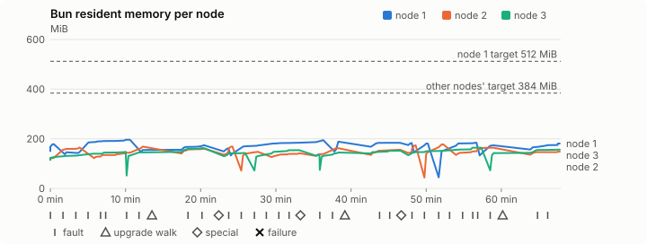
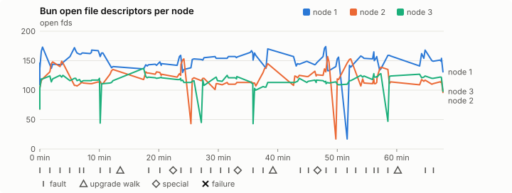
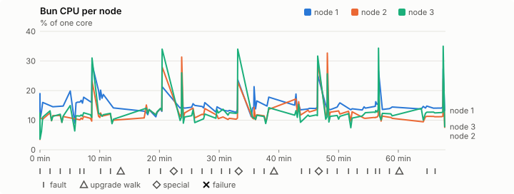
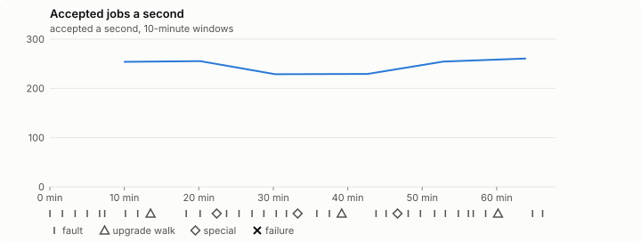

# Sustained soak (V02): PASS

2 November 2026. fast tier, compressed schedule, 1 h 07 min of soak on a three-node quickstart cluster.

**Fast tier: clean.** The iteration loop only, not acceptance: the V02 gate needs a clean final-tier run (8 h, full schedule) on the final candidate.

## Candidate and host

| | |
|---|---|
| Staged base URL | <https://github.com/reliaburger/reliaburger/releases/download/staging-v0.2.5-41365546843-1> |
| `candidate.json` SHA-256 | `c6bd5e3f72c3d8b03ba9e161f5eec287daef3ab1e878e3d928ab56efa700a19b` |
| Running versions | v0.2.5 x3 |
| Soak build | `bun-v0.2.5-soak.1`, SHA-256 `e18f53b19663b5c99bdf6ec6d4d1bd1595d5843191b2fd7890b543a085fc636c` |
| Walks roll back to | 0.2.5 |
| Host | macOS 26.3.1, Apple M2 Max, 32 GiB |
| Lima | limactl version 2.2.1 |
| Guest | Ubuntu 24.04.5 LTS, kernel 6.8.0-139-generic |
| RELIABURGER_HOME | `/tmp/rbq.c2y8SY` |
| Evidence | `/var/tmp/reliaburger-v02.p53JlC` |

## Configuration deviations

- node.toml `[testing] allowed_operations` adds `provision_isolated_workloads` (quickstart allows only inject_workload_faults and alter_node_state), so the catalogue pulse can lease test namespaces
- node.toml `[logs]`/`[metrics]` export to file:///var/lib/reliaburger/soak-export every 60 s with max_storage_mb = 8 (the harness deletes a metrics export 30 minutes after its source has gone), `[storage.snapshots]` every 900 s (compressed: 120 s), retain 4, uploaded to the same directory
- node.toml `[ingress] tls_cert/tls_key` point at an operator pair from a soak CA, 45-minute leaves rotated by the harness
- Bun runs with auto/mixed; host jobs opt in to a single pinned BusyBox copy under /var/lib/reliaburger/soak-jobs, mount_isolation=false. The independent verifier listens on each private VM address, TCP 8189, with a separate run token
- node.toml `[node.labels] soak-volume` = "writer" on node 2 and "redis" on node 3, to pin the volume apps
- node.toml `[upgrades] external_signing_key` = a throwaway operator key the harness made for this run (`ed25519:5AjJmPUYyzsxE3J5s19xG5LOMgD71WYU43MulpLAuyI=`); the soak build's `.sig` gets that key's external signature beside the release one (D2)
- node.toml `[security] leaf_lifetime_override_secs = 3600` (D1)

## Timeline

- Started 2026-11-02 01:35:50 UTC, finished 2026-11-02 02:43:44 UTC
- Cycles completed: 6
- Fault and node choices: 26, from seed 542494648 (`--seed 542494648` repeats them)
- Teardown: `relish local destroy --yes` and `relish uninstall --yes` succeeded

## Faults and slots

| Class | Runs | Settled/ok | Failed | Skipped | Settle (median / max) |
|---|---|---|---|---|---|
| fault:bun-kill-follower | 6 | 6 | 0 | 0 | 31 s / 32 s |
| fault:bun-kill-leader | 6 | 6 | 0 | 0 | 31 s / 34 s |
| fault:chaos-cpu | 1 | 2 | 0 | 0 | 16 s / 16 s |
| fault:chaos-delay | 2 | 4 | 0 | 0 | 16 s / 16 s |
| fault:chaos-dns | 1 | 2 | 0 | 0 | 16 s / 16 s |
| fault:chaos-drop | 1 | 2 | 0 | 0 | 16 s / 16 s |
| fault:chaos-kill | 2 | 4 | 0 | 0 | 41 s / 41 s |
| fault:chaos-memory | 1 | 2 | 0 | 0 | 16 s / 16 s |
| fault:chaos-partition | 2 | 4 | 0 | 0 | 16 s / 16 s |
| fault:chaos-pause | 1 | 2 | 0 | 0 | 16 s / 16 s |
| fault:chaos-scenario | 1 | 2 | 0 | 0 | 16 s / 16 s |
| fault:deploy-kill | 3 | 3 | 0 | 0 | 32 s / 39 s |
| fault:power-off | 3 | 3 | 0 | 0 | 29 s / 33 s |
| pulse | 1 | 1 | 0 | 0 | n/a |
| pulse:settle | 0 | 1 | 0 | 0 | 19 s / 19 s |
| special:all-off | 1 | 1 | 0 | 0 | 29 s / 29 s |
| special:graceful-stop | 1 | 1 | 0 | 0 | 38 s / 38 s |
| special:quorum-back | 1 | 1 | 0 | 0 | n/a |
| special:quorum-loss | 1 | 1 | 0 | 0 | 29 s / 29 s |
| storage:offline-export | 3 | 3 | 0 | 0 | n/a |
| storage:registry-push | 6 | 0 | 0 | 0 | n/a |
| tls:invalid-expired | 3 | 3 | 0 | 0 | n/a |
| tls:invalid-torn | 6 | 6 | 0 | 0 | n/a |
| tls:reload | 33 | 33 | 0 | 0 | n/a |
| upgrade:rollback | 3 | 3 | 0 | 0 | n/a |
| upgrade:settle | 0 | 3 | 0 | 0 | 58 s / 68 s |
| upgrade:upgrade | 3 | 3 | 0 | 0 | n/a |

## Execution inventory (recorded, not gated)

What the run completed, from its events and kept bytes, against what its schedule owes. A fault counts once it was injected and the cluster settled after it.

| Item | Required | Completed | Verdict |
|---|---|---|---|
| candidate.json bytes match the qualified digest | 1 | 1 | ok |
| app workloads settled at the baseline | 1 | 1 | ok |
| upgrade walk (to the soak build and back) | 2 | 3 | ok |
| fault:bun-kill-follower | 1 | 6 | ok |
| fault:bun-kill-leader | 1 | 6 | ok |
| fault:deploy-kill | 1 | 3 | ok |
| fault:power-off | 1 | 3 | ok |
| fault:chaos-kill | 1 | 2 | ok |
| fault:chaos-delay | 1 | 2 | ok |
| fault:chaos-partition | 1 | 2 | ok |
| fault:chaos-scenario | 1 | 1 | ok |
| fault:chaos-pause | 1 | 1 | ok |
| fault:chaos-drop | 1 | 1 | ok |
| fault:chaos-dns | 1 | 1 | ok |
| fault:chaos-cpu | 1 | 1 | ok |
| special:graceful-stop | 1 | 1 | ok |
| special:quorum-loss | 1 | 1 | ok |
| special:all-off | 1 | 1 | ok |
| catalogue pulse | 1 | 1 | ok |
| offline export | 2 | 3 | ok |
| job campaign drained in its final two minutes | 1 | 1 | ok |

## Observed fault effects

What each injected fault was seen to do, read back from the node.

| Fault | Target | Observed |
|---|---|---|
| effect:bun-kill-follower | rb-045d7f1c98dd-2 | MainPID 2491 -> 4795 |
| effect:bun-kill-leader | rb-045d7f1c98dd-1 | MainPID 9241 -> 38441 |
| effect:deploy-kill | rb-045d7f1c98dd-1 | MainPID 38441 -> 68556 |
| effect:power-off | rb-045d7f1c98dd-2 | Lima status Stopped |
| effect:bun-kill-follower | rb-045d7f1c98dd-3 | MainPID 2239 -> 172527 |
| effect:bun-kill-leader | rb-045d7f1c98dd-1 | MainPID 68556 -> 222330 |
| effect:bun-kill-follower | rb-045d7f1c98dd-1 | MainPID 674 -> 18556 |
| effect:bun-kill-leader | rb-045d7f1c98dd-2 | MainPID 679 -> 48747 |
| effect:deploy-kill | rb-045d7f1c98dd-3 | MainPID 673 -> 78162 |
| effect:power-off | rb-045d7f1c98dd-2 | Lima status Stopped |
| effect:bun-kill-follower | rb-045d7f1c98dd-3 | MainPID 682 -> 12180 |
| effect:bun-kill-leader | rb-045d7f1c98dd-1 | MainPID 18556 -> 259576 |
| effect:bun-kill-follower | rb-045d7f1c98dd-1 | MainPID 683 -> 15416 |
| effect:bun-kill-leader | rb-045d7f1c98dd-2 | MainPID 680 -> 45427 |
| effect:deploy-kill | rb-045d7f1c98dd-1 | MainPID 15416 -> 81775 |
| effect:power-off | rb-045d7f1c98dd-2 | Lima status Stopped |
| effect:bun-kill-follower | rb-045d7f1c98dd-1 | MainPID 81775 -> 174427 |
| effect:bun-kill-leader | rb-045d7f1c98dd-3 | MainPID 679 -> 191650 |

## Renewals and rotations

| Measure | Observed | Required | Verdict |
|---|---|---|---|
| workload identity rotations (soak-identity, per node) | 7 | ≥ 1 | PASS |
| node leaf renewals (per node) | 2 | ≥ 1 | PASS |
| operator ingress reloads (all nodes) | 33 | ≥ 12 | PASS |
| mixed job campaign and positive drain | 0 missing/failing checks | 0 | PASS |

## Latency SLOs

What a user should feel on a quiet three-node cluster (#1400). Every sample is taken outside fault windows and through a host forward that works; each p99 is the upper bound of its histogram bucket.

| SLO | p99 | Threshold | Samples | Mode | Verdict |
|---|---|---|---|---|---|
| API read p99 | 150 ms | ≤ 1,000 ms | 288 | record only | PASS |
| API write p99 | 200 ms | ≤ 2,000 ms | 8 | record only | PASS |
| App start p99 | 1 ms | ≤ 5,000 ms | 24 | record only | PASS |
| Rolling update p99 | 30,000 ms | ≤ 30,000 ms | 8 | record only | PASS |
| Job task start p99 | 2,048 ms | ≤ 256 ms | 20 | record only | too few samples |

- API read p99: `GET /v1/status?cluster=true` and `GET /v1/cluster/nodes` on every node, at every light check
- API write p99: `relish apply` of the soak workloads, from the call to the commit
- App start p99: each node's deploy of a new `soak-identity` instance, from its start to the instance running
- Rolling update p99: from `relish apply` returning to every node's `soak-identity` running the new spec
- Job task start p99: a job task's start lag on a pooled executor, from the job campaign's buckets, in runs no fault window overlapped
- Record only from 28 October 2026 (#1400): no soak before 0.2.4 measured it. The threshold is provisional; the first 0.2.4 fast and final records set the gate.
- Job task start p99 not judged: only 20 job task start samples, fewer than the 1,000 a p99 needs

## Jobs

| Runtime | Accepted successes | Retries | Last accepted progress |
|---|---|---|---|
| runc | 15844 | 3 | 1793587413 |
| shared-runc | 487815 | 1 | 1793587413 |
| process | 508435 | 1 | 1793587413 |

The bounded campaign shares the app soak's fault schedule. These counts are reliability evidence, not a saturation rate or a 100-million-per-day qualification.

- Independent verifier execution attempts: 24
- Explicit test-operator acknowledgements for known replay-safe fenced fixtures: 140

- rb-045d7f1c98dd-1: latest complete job storage (KiB) {'instances': 2600, 'job-state': 8, 'task-arrays': 7204}; free 5178176 KiB; live/peak owners 0/10; peak storage {'instances': 9056, 'job-state': 8, 'task-arrays': 16156}
- rb-045d7f1c98dd-2: latest complete job storage (KiB) {'instances': 612, 'job-state': 8, 'task-arrays': 6624}; free 6331444 KiB; live/peak owners 0/8; peak storage {'instances': 8496, 'job-state': 8, 'task-arrays': 15936}
- rb-045d7f1c98dd-3: latest complete job storage (KiB) {'instances': 1192, 'job-state': 8, 'task-arrays': 7156}; free 6311492 KiB; live/peak owners 0/8; peak storage {'instances': 7360, 'job-state': 8, 'task-arrays': 16488}

Complete disk inventories are recorded. Global retention bounds and the 12-hour job qualification remain #668; this gate cannot certify an unimplemented retention policy.

## Job qualification (D18-C)

Load: calibration; 3 nodes; accepted 248.6/s (calibration load: not gated).

The September plan set its targets for one 1M-task batch on a quiet cluster. A soak runs for hours with restarts, upgrades and apps, so its storage, Bun memory and Raft targets are restated (maintainer decision, 15 October 2026, [#668](https://github.com/reliaburger/reliaburger/issues/668)). Bun's steady state is the median RSS of each process once it has been seen for 10 minutes; the gated memory checks are unchanged (`leak-rss`, and Mayo's 70% `memory_high` alert through `wtf`).

| Measure (recorded, not gated) | Observed | Target |
|---|---|---|
| Wall time of a 1,048,576-task array (median / max of 0) | not measured / not measured | ≤ 600 s |
| p99 start lag, pooled executors | 2 ms (bucket upper bound) | < 1,000 ms |
| Raft entries per second, all cluster writes | 5.79 | recorded only; the batch target counts only task-array writes |
| Raft state of one run, largest seen | 44,268 B | ≤ 256 KiB per 1M tasks |
| Bun steady-state RSS per process, worst node against its target | rb-045d7f1c98dd-3: 147.63 MiB steady, 163.86 MiB peak | ≤ 384 MiB (≤ 512 MiB on node 1, which serves the API) |
| Bun CPU, busiest node | 0.14 cores | ≤ 1 core (leader batch control) |
| Executor helper CPU, busiest node | 0.01 cores | ≤ 0.5 core |
| Node task-array storage per 1M accepted tasks (peaks summed) | 46.87 MiB | ≤ 64 MiB, deleted after retirement |
| Retained log volume, all nodes | 6.80 MB | ≤ 50 MB |

- Bun RSS on rb-045d7f1c98dd-1 (serves the API, target ≤ 512 MiB): pid 9241: 178.53 MiB peak (seen for under 10 minutes); pid 38441: 145.55 MiB peak (seen for under 10 minutes); pid 68556: 196.03 MiB peak (seen for under 10 minutes); pid 222330: 154.79 MiB peak (seen for under 10 minutes); pid 222330: 173.73 MiB peak (seen for under 10 minutes); pid 674: 161.45 MiB peak (seen for under 10 minutes); pid 18556: 190.29 MiB steady, 194.48 MiB peak; pid 259576: 188.25 MiB peak (seen for under 10 minutes); pid 259576: 183.62 MiB peak (seen for under 10 minutes); pid 683: 182.84 MiB peak (seen for under 10 minutes); pid 15416: 180.82 MiB peak (seen for under 10 minutes); pid 81775: 184.52 MiB peak (seen for under 10 minutes); pid 174427: 173.52 MiB peak (seen for under 10 minutes); pid 174427: 180.80 MiB peak (seen for under 10 minutes)
- Bun RSS on rb-045d7f1c98dd-2 (node, target ≤ 384 MiB): pid 2491: 122.31 MiB peak (seen for under 10 minutes); pid 4795: 164.68 MiB peak (seen for under 10 minutes); pid 680: 168.36 MiB peak (seen for under 10 minutes); pid 680: 160.25 MiB peak (seen for under 10 minutes); pid 679: 168.79 MiB peak (seen for under 10 minutes); pid 48747: 147.29 MiB peak (seen for under 10 minutes); pid 678: 141.60 MiB peak (seen for under 10 minutes); pid 683: 161.81 MiB peak (seen for under 10 minutes); pid 677: 156.03 MiB peak (seen for under 10 minutes); pid 680: 173.25 MiB peak (seen for under 10 minutes); pid 45427: 177.48 MiB peak (seen for under 10 minutes); pid 663: 163.83 MiB peak (seen for under 10 minutes); pid 682: 148.32 MiB peak (seen for under 10 minutes)
- Bun RSS on rb-045d7f1c98dd-3 (node, target ≤ 384 MiB): pid 2239: 147.63 MiB steady, 147.63 MiB peak; pid 172527: 145.09 MiB peak (seen for under 10 minutes); pid 226905: 162.36 MiB peak (seen for under 10 minutes); pid 673: 142.43 MiB peak (seen for under 10 minutes); pid 78162: 153.87 MiB peak (seen for under 10 minutes); pid 682: 135.34 MiB peak (seen for under 10 minutes); pid 12180: 144.74 MiB peak (seen for under 10 minutes); pid 12180: 152.93 MiB peak (seen for under 10 minutes); pid 679: 163.86 MiB peak (seen for under 10 minutes); pid 191650: 142.17 MiB peak (seen for under 10 minutes); pid 191650: 156.05 MiB peak (seen for under 10 minutes)

- runc retry causes: exit_code 1, launch 1, signal 0, timeout 0, unknown 0, unrecorded 1
- shared-runc retry causes: exit_code 1, launch 0, signal 0, timeout 0, unknown 0, unrecorded 0
- process retry causes: exit_code 1, launch 0, signal 0, timeout 0, unknown 0, unrecorded 0
- Audited executions: 24; operator replay decisions: 140
- Job controller API fallbacks: rb-045d7f1c98dd-1 missed 195, rb-045d7f1c98dd-2 missed 14; rb-045d7f1c98dd-2 answered 181, rb-045d7f1c98dd-3 answered 14 (requests a node didn't answer, and the node that took them instead)

## Data

- Volume writer: highest ACK 29456 in the log view; the writer file checks (writer-lost, writer-regression) decide data loss, and `*-log-order` failures are about the order the log view returned lines in
- Redis counter: highest INCR 3440 in the log view
- Export rb-045d7f1c98dd-1: 138 source files, 137 at the destination
- Export rb-045d7f1c98dd-2: 132 source files, 125 at the destination
- Export rb-045d7f1c98dd-3: 106 source files, 95 at the destination
- Registry images pushed and re-verified: 7
- Agent-loop turns over the 1 s budget: rb-045d7f1c98dd-1 0, rb-045d7f1c98dd-2 0, rb-045d7f1c98dd-3 0
- Soak policies checked in force: 118 times, policy generation 39 at the last check
- Guest clock steps by Lima's guest agent: rb-045d7f1c98dd-1 2, rb-045d7f1c98dd-2 8, rb-045d7f1c98dd-3 2
- Checks evaluated: 187 (heavy 16, light 69, settle 102)
- Last observed progress: redis-counter 3440, writer-ack 29456

## Council history (linearizability)

Every test-lease grant, renew, read and release the history client made, checked against a model of the council's leases. A write with no answer may or may not have happened; the check allows both.

- Operations checked: 22071 of 22071, in 2 namespaces; 1378 writes had no answer
- Verdict: linearizable

## Leak-checker exposure (recorded, not gated)

How long each leak checker could judge each node's Bun. `leak-rss` arms after 60 minutes in one process and `leak-fd` after 50; a restart, kill or upgrade exec starts the warm-up again. A final needs each armed for 60 minutes on every node, with one unbroken window of 30 (#1062); its quiet tail gives them that.

| Node | Checker | Armed | Longest armed window | Evaluated samples | Processes armed | Verdict |
|---|---|---|---|---|---|---|
| rb-045d7f1c98dd-1 | leak-rss | 0 min | 0 min | 0 | 0 | short |
| rb-045d7f1c98dd-1 | leak-fd | 0 min | 0 min | 0 | 0 | short |
| rb-045d7f1c98dd-2 | leak-rss | 0 min | 0 min | 0 | 0 | short |
| rb-045d7f1c98dd-2 | leak-fd | 0 min | 0 min | 0 | 0 | short |
| rb-045d7f1c98dd-3 | leak-rss | 0 min | 0 min | 0 | 0 | short |
| rb-045d7f1c98dd-3 | leak-fd | 0 min | 0 min | 0 | 0 | short |

## Resource trends

| Node | Measure | First | Last | Max |
|---|---|---|---|---|
| rb-045d7f1c98dd-1 | disk_kb data | 1382860 | 1465408 | 1533608 |
| rb-045d7f1c98dd-1 | disk_kb images | 342456 | 461512 | 461512 |
| rb-045d7f1c98dd-1 | disk_kb logs | 48 | 4732 | 4732 |
| rb-045d7f1c98dd-1 | disk_kb metrics | 60 | 5432 | 5432 |
| rb-045d7f1c98dd-1 | disk_kb soak-export | 4 | 10100 | 10100 |
| rb-045d7f1c98dd-1 | disk_kb volumes | 224 | 252 | 276 |
| rb-045d7f1c98dd-1 | fd | 109 | 131 | 174 |
| rb-045d7f1c98dd-1 | rss_anon_kb | 81092 | 107800 | 123196 |
| rb-045d7f1c98dd-1 | rss_file_kb | 72800 | 77344 | 77648 |
| rb-045d7f1c98dd-1 | rss_kb | 153892 | 185144 | 200732 |
| rb-045d7f1c98dd-2 | disk_kb data | 71808 | 92736 | 563492 |
| rb-045d7f1c98dd-2 | disk_kb images | 175368 | 342480 | 342480 |
| rb-045d7f1c98dd-2 | disk_kb logs | 28 | 1292 | 1292 |
| rb-045d7f1c98dd-2 | disk_kb metrics | 68 | 2368 | 2368 |
| rb-045d7f1c98dd-2 | disk_kb soak-export | 4 | 4712 | 4712 |
| rb-045d7f1c98dd-2 | disk_kb volumes | 16760 | 17232 | 17236 |
| rb-045d7f1c98dd-2 | fd | 68 | 96 | 157 |
| rb-045d7f1c98dd-2 | rss_anon_kb | 47052 | 75368 | 104540 |
| rb-045d7f1c98dd-2 | rss_file_kb | 71456 | 76512 | 77200 |
| rb-045d7f1c98dd-2 | rss_kb | 118508 | 151880 | 181744 |
| rb-045d7f1c98dd-3 | disk_kb data | 234556 | 200448 | 721640 |
| rb-045d7f1c98dd-3 | disk_kb images | 339124 | 342480 | 342480 |
| rb-045d7f1c98dd-3 | disk_kb logs | 24 | 616 | 616 |
| rb-045d7f1c98dd-3 | disk_kb metrics | 64 | 2640 | 2640 |
| rb-045d7f1c98dd-3 | disk_kb soak-export | 4 | 3128 | 3128 |
| rb-045d7f1c98dd-3 | disk_kb volumes | 16784 | 17044 | 17152 |
| rb-045d7f1c98dd-3 | fd | 68 | 98 | 137 |
| rb-045d7f1c98dd-3 | rss_anon_kb | 46232 | 82640 | 90324 |
| rb-045d7f1c98dd-3 | rss_file_kb | 71072 | 77152 | 77468 |
| rb-045d7f1c98dd-3 | rss_kb | 117304 | 159792 | 167792 |

## Charts

Time runs from the start of the soak. The marks under each chart are its faults, upgrade walks, specials and recorded failures; the dashed lines are targets.

## Failures

None.

Evidence: `/var/tmp/reliaburger-v02.p53JlC` (events.jsonl, snapshots/, failures/<n>/).
