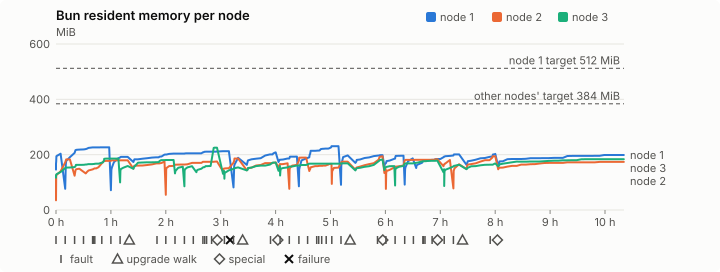
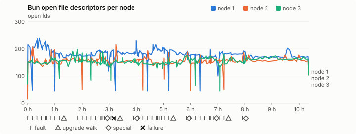
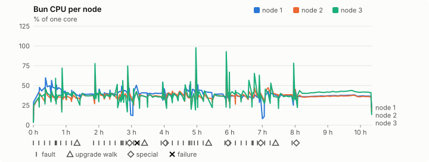
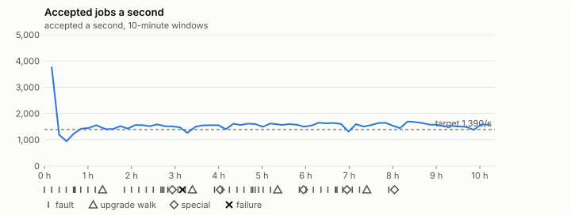

# Sustained soak (V02): FAIL

2 November 2026. final tier, full schedule, 10 h 20 min of soak on a three-node quickstart cluster.

**Final tier: not clean. The V02 gate does not pass.** A product fix means a fresh fast-tier run, then a fresh final-tier run.

## Candidate and host

| | |
|---|---|
| Staged base URL | <https://github.com/reliaburger/reliaburger/releases/download/staging-v0.2.5-41365546843-1> |
| `candidate.json` SHA-256 | `c6bd5e3f72c3d8b03ba9e161f5eec287daef3ab1e878e3d928ab56efa700a19b` |
| Running versions | v0.2.5 x3 |
| Soak build | `bun-v0.2.5-soak.1`, SHA-256 `e18f53b19663b5c99bdf6ec6d4d1bd1595d5843191b2fd7890b543a085fc636c` |
| Walks roll back to | 0.2.5 |
| Host | macOS 26.3.1, Apple M2 Max, 32 GiB |
| Lima | limactl version 2.2.1 |
| Guest | Ubuntu 24.04.5 LTS, kernel 6.8.0-139-generic |
| RELIABURGER_HOME | `/tmp/rbq.kisKLq` |
| Evidence | `/var/tmp/reliaburger-v02.L7M9Fm` |

## Configuration deviations

- node.toml `[testing] allowed_operations` adds `provision_isolated_workloads` (quickstart allows only inject_workload_faults and alter_node_state), so the catalogue pulse can lease test namespaces
- node.toml `[logs]`/`[metrics]` export to file:///var/lib/reliaburger/soak-export every 60 s with max_storage_mb = 8 (the harness deletes a metrics export 30 minutes after its source has gone), `[storage.snapshots]` every 900 s (compressed: 120 s), retain 4, uploaded to the same directory
- node.toml `[ingress] tls_cert/tls_key` point at an operator pair from a soak CA, 45-minute leaves rotated by the harness
- Bun runs with auto/mixed; host jobs opt in to a single pinned BusyBox copy under /var/lib/reliaburger/soak-jobs, mount_isolation=false. The independent verifier listens on each private VM address, TCP 8189, with a separate run token
- node.toml `[node.labels] soak-volume` = "writer" on node 2 and "redis" on node 3, to pin the volume apps
- node.toml `[upgrades] external_signing_key` = a throwaway operator key the harness made for this run (`ed25519:2lTFulD3PtLxh04L126wIjdaDORzbbG9tjQA+ZLlgj0=`); the soak build's `.sig` gets that key's external signature beside the release one (D2)
- node.toml `[security] leaf_lifetime_override_secs = 3600` (D1)

## Timeline

- Started 2026-11-02 21:18:51 UTC, finished 2026-11-03 07:39:39 UTC
- Cycles completed: 8
- Fault and node choices: 35, from seed 3162767017 (`--seed 3162767017` repeats them)
- Teardown: `relish local destroy --yes` and `relish uninstall --yes` succeeded

## Faults and slots

| Class | Runs | Settled/ok | Failed | Skipped | Settle (median / max) |
|---|---|---|---|---|---|
| fault:bun-kill-follower | 8 | 8 | 0 | 0 | 54 s / 78 s |
| fault:bun-kill-leader | 8 | 8 | 0 | 0 | 57 s / 77 s |
| fault:chaos-cpu | 1 | 2 | 0 | 0 | 131 s / 131 s |
| fault:chaos-delay | 2 | 4 | 0 | 0 | 37 s / 37 s |
| fault:chaos-dns | 1 | 2 | 0 | 0 | 61 s / 61 s |
| fault:chaos-drop | 1 | 2 | 0 | 0 | 36 s / 36 s |
| fault:chaos-kill | 2 | 4 | 0 | 0 | 38 s / 38 s |
| fault:chaos-memory | 1 | 2 | 0 | 0 | 34 s / 34 s |
| fault:chaos-partition | 2 | 4 | 0 | 0 | 34 s / 34 s |
| fault:chaos-pause | 1 | 2 | 0 | 0 | 59 s / 59 s |
| fault:chaos-scenario | 1 | 2 | 0 | 0 | 113 s / 113 s |
| fault:deploy-kill | 4 | 4 | 0 | 0 | 63 s / 136 s |
| fault:node-delay | 3 | 3 | 0 | 0 | 39 s / 45 s |
| fault:node-disk-full | 3 | 3 | 0 | 0 | 37 s / 38 s |
| fault:node-slow-fsync | 2 | 2 | 0 | 0 | 69 s / 69 s |
| fault:power-off | 4 | 4 | 0 | 0 | 66 s / 83 s |
| pulse | 8 | 8 | 0 | 0 | n/a |
| pulse:settle | 0 | 8 | 0 | 0 | 37 s / 45 s |
| special:all-off | 1 | 1 | 0 | 0 | 98 s / 98 s |
| special:graceful-stop | 2 | 2 | 0 | 0 | 104 s / 104 s |
| special:quorum-back | 2 | 2 | 0 | 0 | n/a |
| special:quorum-loss | 2 | 2 | 0 | 0 | 89 s / 89 s |
| storage:offline-export | 1 | 1 | 0 | 0 | n/a |
| storage:registry-push | 8 | 0 | 0 | 0 | n/a |
| tls:invalid-expired | 15 | 15 | 0 | 0 | n/a |
| tls:invalid-torn | 15 | 15 | 0 | 0 | n/a |
| tls:reload | 118 | 118 | 0 | 0 | n/a |
| upgrade:rollback | 4 | 4 | 0 | 0 | n/a |
| upgrade:settle | 0 | 4 | 0 | 0 | 93 s / 94 s |
| upgrade:upgrade | 4 | 4 | 0 | 0 | n/a |

## Execution inventory (gated)

What the run completed, from its events and kept bytes, against what its schedule owes. A fault counts once it was injected and the cluster settled after it.

| Item | Required | Completed | Verdict |
|---|---|---|---|
| candidate.json bytes match the qualified digest | 1 | 1 | ok |
| app workloads settled at the baseline | 1 | 1 | ok |
| upgrade walk (to the soak build and back) | 4 | 4 | ok |
| fault:bun-kill-follower | 1 | 8 | ok |
| fault:bun-kill-leader | 1 | 8 | ok |
| fault:deploy-kill | 1 | 4 | ok |
| fault:power-off | 1 | 4 | ok |
| fault:chaos-kill | 1 | 2 | ok |
| fault:chaos-delay | 1 | 2 | ok |
| fault:chaos-partition | 1 | 2 | ok |
| fault:chaos-scenario | 1 | 1 | ok |
| fault:chaos-pause | 1 | 1 | ok |
| fault:chaos-drop | 1 | 1 | ok |
| fault:chaos-dns | 1 | 1 | ok |
| fault:chaos-cpu | 1 | 1 | ok |
| fault:chaos-memory | 1 | 1 | ok |
| fault:node-delay | 1 | 3 | ok |
| fault:node-disk-full | 1 | 3 | ok |
| fault:node-slow-fsync | 1 | 2 | ok |
| special:graceful-stop | 2 | 2 | ok |
| special:quorum-loss | 2 | 2 | ok |
| special:all-off | 1 | 1 | ok |
| catalogue pulse | 8 | 8 | ok |
| offline export | 1 | 1 | ok |
| quiet tail with no faults, walks or specials | 1 | 1 | ok |
| job campaign drained in its final two minutes | 1 | 1 | ok |

## Observed fault effects

What each injected fault was seen to do, read back from the node.

| Fault | Target | Observed |
|---|---|---|
| effect:bun-kill-follower | rb-d5760cfecca5-2 | MainPID 2495 -> 4822 |
| effect:bun-kill-leader | rb-d5760cfecca5-1 | MainPID 9278 -> 951953 |
| effect:deploy-kill | rb-d5760cfecca5-2 | MainPID 4822 -> 1381476 |
| effect:power-off | rb-d5760cfecca5-2 | Lima status Stopped |
| effect:node-delay | rb-d5760cfecca5-1 | netem 8001: root refcnt 2 limit 1000 delay 200ms  50ms  |
| effect:bun-kill-follower | rb-d5760cfecca5-1 | MainPID 951953 -> 2473792 |
| effect:bun-kill-leader | rb-d5760cfecca5-3 | MainPID 2324 -> 3604859 |
| effect:node-disk-full | rb-d5760cfecca5-2 | available 67063808 bytes  |
| effect:bun-kill-follower | rb-d5760cfecca5-2 | MainPID 675 -> 3470843 |
| effect:bun-kill-leader | rb-d5760cfecca5-3 | MainPID 4095179 -> 1932440 |
| effect:deploy-kill | rb-d5760cfecca5-3 | MainPID 1932440 -> 2366755 |
| effect:power-off | rb-d5760cfecca5-3 | Lima status Stopped |
| effect:node-slow-fsync | rb-d5760cfecca5-3 | IOWriteBandwidthMax=/dev/vda 1000000 IOWriteIOPSMax=/dev/vda 20  |
| effect:bun-kill-follower | rb-d5760cfecca5-3 | MainPID 675 -> 237682 |
| effect:bun-kill-leader | rb-d5760cfecca5-1 | MainPID 2473792 -> 3880732 |
| effect:node-delay | rb-d5760cfecca5-2 | netem 8001: root refcnt 2 limit 1000 delay 200ms  50ms  |
| effect:bun-kill-follower | rb-d5760cfecca5-3 | MainPID 676 -> 93619 |
| effect:bun-kill-leader | rb-d5760cfecca5-2 | MainPID 673 -> 557932 |
| effect:deploy-kill | rb-d5760cfecca5-1 | MainPID 670 -> 1004292 |
| effect:power-off | rb-d5760cfecca5-2 | Lima status Stopped |
| effect:node-disk-full | rb-d5760cfecca5-3 | available 67026944 bytes  |
| effect:bun-kill-follower | rb-d5760cfecca5-2 | MainPID 676 -> 1140650 |
| effect:bun-kill-leader | rb-d5760cfecca5-1 | MainPID 1004292 -> 2897919 |
| effect:node-slow-fsync | rb-d5760cfecca5-1 | IOWriteBandwidthMax=/dev/vda 1000000 IOWriteIOPSMax=/dev/vda 20  |
| effect:bun-kill-follower | rb-d5760cfecca5-2 | MainPID 674 -> 114602 |
| effect:bun-kill-leader | rb-d5760cfecca5-3 | MainPID 674 -> 590751 |
| effect:deploy-kill | rb-d5760cfecca5-1 | MainPID 678 -> 967583 |
| effect:power-off | rb-d5760cfecca5-1 | Lima status Stopped |
| effect:node-delay | rb-d5760cfecca5-3 | netem 8001: root refcnt 2 limit 1000 delay 200ms  50ms  |
| effect:bun-kill-follower | rb-d5760cfecca5-3 | MainPID 676 -> 158330 |
| effect:bun-kill-leader | rb-d5760cfecca5-2 | MainPID 673 -> 677897 |
| effect:node-disk-full | rb-d5760cfecca5-1 | available 67059712 bytes  |

## Renewals and rotations

| Measure | Observed | Required | Verdict |
|---|---|---|---|
| workload identity rotations (soak-identity, per node) | 23 | ≥ 19 | PASS |
| node leaf renewals (per node) | 22 | ≥ 19 | PASS |
| operator ingress reloads (all nodes) | 118 | ≥ 40 | PASS |
| mixed job campaign and positive drain | 0 missing/failing checks | 0 | PASS |

## Latency SLOs

What a user should feel on a quiet three-node cluster (#1400). Every sample is taken outside fault windows and through a host forward that works; each p99 is the upper bound of its histogram bucket.

| SLO | p99 | Threshold | Samples | Mode | Verdict |
|---|---|---|---|---|---|
| API read p99 | 1,500 ms | ≤ 1,000 ms | 5,082 | record only | over (record only) |
| API write p99 | 1,500 ms | ≤ 2,000 ms | 20 | record only | PASS |
| App start p99 | 1 ms | ≤ 5,000 ms | 60 | record only | PASS |
| Rolling update p99 | 50,000 ms | ≤ 30,000 ms | 20 | record only | over (record only) |
| Job task start p99 | 128 ms | ≤ 256 ms | 14,735,315 | gated | PASS |

- API read p99: `GET /v1/status?cluster=true` and `GET /v1/cluster/nodes` on every node, at every light check
- API write p99: `relish apply` of the soak workloads, from the call to the commit
- App start p99: each node's deploy of a new `soak-identity` instance, from its start to the instance running
- Rolling update p99: from `relish apply` returning to every node's `soak-identity` running the new spec
- Job task start p99: a job task's start lag on a pooled executor, from the job campaign's buckets, in runs no fault window overlapped
- Record only from 28 October 2026 (#1400): no soak before 0.2.4 measured it. The threshold is provisional; the first 0.2.4 fast and final records set the gate.

## Jobs

| Runtime | Accepted successes | Retries | Last accepted progress |
|---|---|---|---|
| runc | 36809 | 1 | 1793691545 |
| shared-runc | 16063616 | 1 | 1793691545 |
| process | 41679693 | 1 | 1793691545 |

The bounded campaign shares the app soak's fault schedule. These counts are reliability evidence, not a saturation rate or a 100-million-per-day qualification.

- Independent verifier execution attempts: 24
- Explicit test-operator acknowledgements for known replay-safe fenced fixtures: 194

- rb-d5760cfecca5-1: latest complete job storage (KiB) {'instances': 1644, 'job-state': 8, 'task-arrays': 6996}; free 5141960 KiB; live/peak owners 0/32; peak storage {'instances': 26060, 'job-state': 8, 'task-arrays': 35296}
- rb-d5760cfecca5-2: latest complete job storage (KiB) {'instances': 1592, 'job-state': 8, 'task-arrays': 11384}; free 6130460 KiB; live/peak owners 0/32; peak storage {'instances': 24688, 'job-state': 8, 'task-arrays': 38080}
- rb-d5760cfecca5-3: latest complete job storage (KiB) {'instances': 2884, 'job-state': 8, 'task-arrays': 6740}; free 6133916 KiB; live/peak owners 0/32; peak storage {'instances': 24820, 'job-state': 8, 'task-arrays': 39200}

Complete disk inventories are recorded. Global retention bounds and the 12-hour job qualification remain #668; this gate cannot certify an unimplemented retention policy.

## Job qualification (D18-C)

Load: target; 3 nodes; accepted 1,552.4/s against a 1390.0/s target: PASS.

The September plan set its targets for one 1M-task batch on a quiet cluster. A soak runs for hours with restarts, upgrades and apps, so its storage, Bun memory and Raft targets are restated (maintainer decision, 15 October 2026, [#668](https://github.com/reliaburger/reliaburger/issues/668)). Bun's steady state is the median RSS of each process once it has been seen for 10 minutes; the gated memory checks are unchanged (`leak-rss`, and Mayo's 70% `memory_high` alert through `wtf`).

| Measure (recorded, not gated) | Observed | Target |
|---|---|---|
| Wall time of a 1,048,576-task array (median / max of 54) | 978 s / 2,593 s | ≤ 600 s |
| p99 start lag, pooled executors | 128 ms (bucket upper bound) | < 1,000 ms |
| Raft entries per second, all cluster writes | 4.60 | recorded only; the batch target counts only task-array writes |
| Raft state of one run, largest seen | 10,933 B | ≤ 256 KiB per 1M tasks |
| Bun steady-state RSS per process, worst node against its target | rb-d5760cfecca5-3: 191.69 MiB steady, 225.27 MiB peak | ≤ 384 MiB (≤ 512 MiB on node 1, which serves the API) |
| Bun CPU, busiest node | 0.38 cores | ≤ 1 core (leader batch control) |
| Executor helper CPU, busiest node | 0.08 cores | ≤ 0.5 core |
| Node task-array storage per 1M accepted tasks (peaks summed) | 1.90 MiB | ≤ 64 MiB, deleted after retirement |
| Retained log volume, all nodes | 27.30 MB | ≤ 50 MB |

- Bun RSS on rb-d5760cfecca5-1 (serves the API, target ≤ 512 MiB): pid 9278: 203.64 MiB peak (seen for under 10 minutes); pid 951953: 226.20 MiB steady, 226.80 MiB peak; pid 2473792: 191.88 MiB steady, 192.10 MiB peak; pid 2473792: 204.99 MiB steady, 212.64 MiB peak; pid 3880732: 188.80 MiB peak (seen for under 10 minutes); pid 3880732: 201.09 MiB steady, 208.11 MiB peak; pid 670: 190.90 MiB steady, 193.13 MiB peak; pid 1004292: 221.55 MiB steady, 230.50 MiB peak; pid 2897919: 197.22 MiB peak (seen for under 10 minutes); pid 2897919: 197.08 MiB steady, 198.34 MiB peak; pid 678: 193.22 MiB steady, 196.11 MiB peak; pid 967583: 186.66 MiB peak (seen for under 10 minutes); pid 677: 191.60 MiB steady, 201.03 MiB peak; pid 677: 193.68 MiB steady, 202.75 MiB peak; pid 675: 195.35 MiB steady, 198.86 MiB peak
- Bun RSS on rb-d5760cfecca5-2 (node, target ≤ 384 MiB): pid 2495: 121.71 MiB peak (seen for under 10 minutes); pid 4822: 180.66 MiB steady, 182.81 MiB peak; pid 1381476: 149.39 MiB peak (seen for under 10 minutes); pid 675: 177.57 MiB steady, 179.67 MiB peak; pid 675: 168.52 MiB steady, 175.37 MiB peak; pid 3470843: 174.16 MiB steady, 175.22 MiB peak; pid 678: 182.08 MiB steady, 186.16 MiB peak; pid 678: 169.52 MiB steady, 171.98 MiB peak; pid 673: 168.84 MiB steady, 168.84 MiB peak; pid 557932: 189.05 MiB steady, 189.52 MiB peak; pid 676: 162.33 MiB steady, 166.68 MiB peak; pid 1140650: 174.30 MiB steady, 174.57 MiB peak; pid 1140650: 186.57 MiB steady, 193.95 MiB peak; pid 674: 147.94 MiB peak (seen for under 10 minutes); pid 114602: 181.32 MiB steady, 183.49 MiB peak; pid 673: 180.74 MiB peak (seen for under 10 minutes); pid 677897: 165.29 MiB peak (seen for under 10 minutes); pid 677897: 189.56 MiB steady, 194.25 MiB peak; pid 677: 172.43 MiB steady, 173.86 MiB peak
- Bun RSS on rb-d5760cfecca5-3 (node, target ≤ 384 MiB): pid 2324: 166.11 MiB steady, 185.83 MiB peak; pid 3604859: 158.86 MiB peak (seen for under 10 minutes); pid 4095179: 180.52 MiB steady, 180.61 MiB peak; pid 1932440: 156.50 MiB peak (seen for under 10 minutes); pid 2366755: 158.24 MiB peak (seen for under 10 minutes); pid 674: 191.69 MiB steady, 225.27 MiB peak; pid 675: 140.94 MiB peak (seen for under 10 minutes); pid 237682: 151.10 MiB steady, 153.97 MiB peak; pid 237682: 170.95 MiB steady, 171.46 MiB peak; pid 676: 159.18 MiB peak (seen for under 10 minutes); pid 93619: 167.34 MiB steady, 168.87 MiB peak; pid 679: 177.63 MiB steady, 182.16 MiB peak; pid 674: 158.63 MiB steady, 158.63 MiB peak; pid 590751: 176.09 MiB steady, 178.62 MiB peak; pid 676: 147.13 MiB peak (seen for under 10 minutes); pid 158330: 159.85 MiB steady, 163.91 MiB peak; pid 158330: 163.61 MiB steady, 168.00 MiB peak; pid 677: 179.66 MiB steady, 183.49 MiB peak

- runc retry causes: exit_code 1, launch 0, signal 0, timeout 0, unknown 0, unrecorded 0
- shared-runc retry causes: exit_code 1, launch 0, signal 0, timeout 0, unknown 0, unrecorded 0
- process retry causes: exit_code 1, launch 0, signal 0, timeout 0, unknown 0, unrecorded 0
- Audited executions: 24; operator replay decisions: 194
- Job controller API fallbacks: rb-d5760cfecca5-1 missed 850, rb-d5760cfecca5-2 missed 18; rb-d5760cfecca5-2 answered 832, rb-d5760cfecca5-3 answered 18 (requests a node didn't answer, and the node that took them instead)

## Data

- Volume writer: highest ACK 280149 in the log view; the writer file checks (writer-lost, writer-regression) decide data loss, and `*-log-order` failures are about the order the log view returned lines in
- Redis counter: highest INCR 33469 in the log view
- Export rb-d5760cfecca5-1: 276 source files, 490 at the destination
- Export rb-d5760cfecca5-2: 563 source files, 743 at the destination
- Export rb-d5760cfecca5-3: 291 source files, 527 at the destination
- Registry images pushed and re-verified: 9
- Agent-loop turns over the 1 s budget: rb-d5760cfecca5-1 0, rb-d5760cfecca5-2 0, rb-d5760cfecca5-3 1
- Soak policies checked in force: 274 times, policy generation 78 at the last check
- Guest clock steps by Lima's guest agent: rb-d5760cfecca5-1 5, rb-d5760cfecca5-2 8, rb-d5760cfecca5-3 9
- Checks evaluated: 1100 (heavy 124, light 826, settle 150)
- Last observed progress: redis-counter 33469, writer-ack 280149

## Council history (linearizability)

Every test-lease grant, renew, read and release the history client made, checked against a model of the council's leases. A write with no answer may or may not have happened; the check allows both.

- Operations checked: 186368 of 186368, in 2 namespaces; 5657 writes had no answer
- Verdict: linearizable

## Leak-checker exposure (gated)

How long each leak checker could judge each node's Bun. `leak-rss` arms after 60 minutes in one process and `leak-fd` after 50; a restart, kill or upgrade exec starts the warm-up again. A final needs each armed for 60 minutes on every node, with one unbroken window of 30 (#1062); its quiet tail gives them that.

| Node | Checker | Armed | Longest armed window | Evaluated samples | Processes armed | Verdict |
|---|---|---|---|---|---|---|
| rb-d5760cfecca5-1 | leak-rss | 117 min | 76 min | 47 | 2 | ok |
| rb-d5760cfecca5-1 | leak-fd | 137 min | 86 min | 54 | 2 | ok |
| rb-d5760cfecca5-2 | leak-rss | 76 min | 76 min | 17 | 1 | ok |
| rb-d5760cfecca5-2 | leak-fd | 93 min | 86 min | 29 | 3 | ok |
| rb-d5760cfecca5-3 | leak-rss | 95 min | 76 min | 28 | 3 | ok |
| rb-d5760cfecca5-3 | leak-fd | 125 min | 86 min | 46 | 3 | ok |

## Resource trends

| Node | Measure | First | Last | Max |
|---|---|---|---|---|
| rb-d5760cfecca5-1 | disk_kb data | 1382884 | 973932 | 1508436 |
| rb-d5760cfecca5-1 | disk_kb images | 342456 | 355156 | 469792 |
| rb-d5760cfecca5-1 | disk_kb logs | 44 | 8312 | 8996 |
| rb-d5760cfecca5-1 | disk_kb metrics | 56 | 8592 | 9008 |
| rb-d5760cfecca5-1 | disk_kb soak-export | 4 | 33112 | 35828 |
| rb-d5760cfecca5-1 | disk_kb volumes | 224 | 60 | 252 |
| rb-d5760cfecca5-1 | fd | 111 | 116 | 239 |
| rb-d5760cfecca5-1 | rss_anon_kb | 76556 | 126464 | 157984 |
| rb-d5760cfecca5-1 | rss_file_kb | 72788 | 77168 | 78048 |
| rb-d5760cfecca5-1 | rss_kb | 149344 | 203632 | 236032 |
| rb-d5760cfecca5-2 | disk_kb data | 71828 | 229128 | 542192 |
| rb-d5760cfecca5-2 | disk_kb images | 175368 | 359164 | 359164 |
| rb-d5760cfecca5-2 | disk_kb logs | 28 | 8760 | 8900 |
| rb-d5760cfecca5-2 | disk_kb metrics | 72 | 8616 | 8892 |
| rb-d5760cfecca5-2 | disk_kb soak-export | 4 | 35284 | 35720 |
| rb-d5760cfecca5-2 | disk_kb volumes | 16760 | 22864 | 22864 |
| rb-d5760cfecca5-2 | fd | 67 | 104 | 216 |
| rb-d5760cfecca5-2 | rss_anon_kb | 45304 | 101528 | 121372 |
| rb-d5760cfecca5-2 | rss_file_kb | 71456 | 76500 | 77792 |
| rb-d5760cfecca5-2 | rss_kb | 116760 | 178028 | 198908 |
| rb-d5760cfecca5-3 | disk_kb data | 234568 | 646048 | 691604 |
| rb-d5760cfecca5-3 | disk_kb images | 339124 | 346684 | 346684 |
| rb-d5760cfecca5-3 | disk_kb logs | 24 | 8596 | 8760 |
| rb-d5760cfecca5-3 | disk_kb metrics | 60 | 8740 | 8916 |
| rb-d5760cfecca5-3 | disk_kb soak-export | 4 | 27484 | 27852 |
| rb-d5760cfecca5-3 | disk_kb volumes | 16784 | 19336 | 19336 |
| rb-d5760cfecca5-3 | fd | 73 | 104 | 198 |
| rb-d5760cfecca5-3 | rss_anon_kb | 48384 | 110372 | 154072 |
| rb-d5760cfecca5-3 | rss_file_kb | 71072 | 77524 | 78112 |
| rb-d5760cfecca5-3 | rss_kb | 119456 | 187896 | 230676 |

## Charts

Time runs from the start of the soak. The marks under each chart are its faults, upgrade walks, specials and recorded failures; the dashed lines are targets.

## Failures

| # | First seen | Check | Symptom | Class | Cause | Action |
|---|---|---|---|---|---|---|
| 1 | 00:28:56 | heavy-check | fail: agent-loop-turn rb-d5760cfecca5-3: 1 health_tick turn(s) over the 1 s budget, the worst between 1 and 2.5 s; | unclassified | open | open |

Evidence: `/var/tmp/reliaburger-v02.L7M9Fm` (events.jsonl, snapshots/, failures/<n>/).
