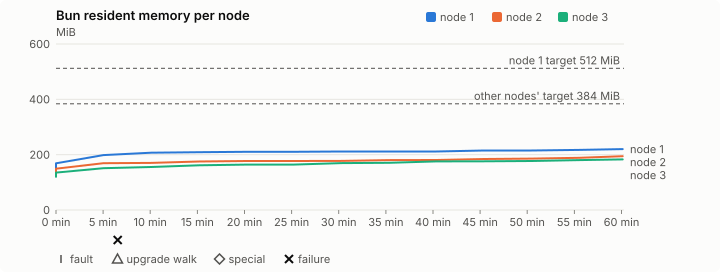
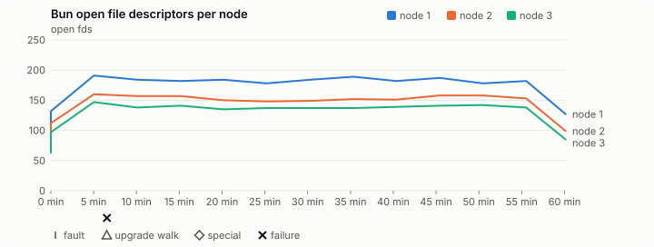
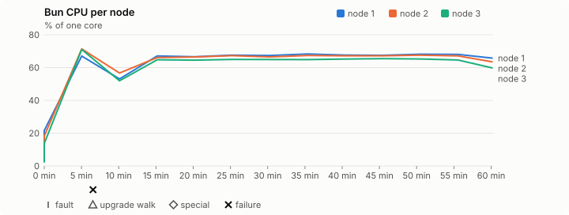
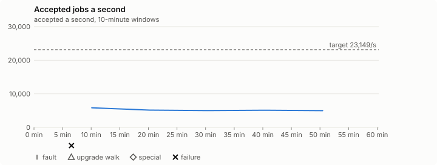

# Sustained soak (V02): FAIL

4 November 2026. day tier, no fault schedule, 1 h 00 min of soak on a three-node quickstart cluster.

**Day tier: not clean.** The day run doesn't hold; the record says what failed. It is incomplete too: leak-checker exposure too short: rb-a69d0f8bba14-1 leak-rss, rb-a69d0f8bba14-1 leak-fd, rb-a69d0f8bba14-2 leak-rss, rb-a69d0f8bba14-2 leak-fd, rb-a69d0f8bba14-3 leak-rss, rb-a69d0f8bba14-3 leak-fd; it ran for 1 h 00 min, not a whole day.

> **A check of the host, not of 0.2.4.** The 0.2.5 memory run ran host jobs
> at a fifth of 0.2.4's day-run rate
> ([record](2026-11-04-v0.2.5-memory-run.md)). This hour ran the published
> 0.2.4 at the same day load, on the same Mac, with the same harness, straight
> after it: 5,111 jobs a second against the 21,802 of the first hour of
> 0.2.4's day run on 30 October, with 5 agent-loop turns over 1 s against
> none. The release didn't change, so the host did. The verdict is FAIL for
> the same reason as the memory run's, and is not a finding against 0.2.4.

## Candidate and host

| | |
|---|---|
| Staged base URL | <https://github.com/reliaburger/reliaburger/releases/download/v0.2.4> |
| `candidate.json` SHA-256 | `340eaeba513c9740f058e51684713654f3df7c392ea8f19993ae1b5d12727d09` |
| Running versions | v0.2.4 x3 |
| Soak build | not supplied: upgrade slots skipped |
| Host | macOS 26.3.1, Apple M2 Max, 32 GiB |
| Lima | limactl version 2.2.1 |
| Guest | Ubuntu 24.04.5 LTS, kernel 6.8.0-139-generic |
| RELIABURGER_HOME | `/tmp/rbq.ICoDkL` |
| Evidence | `/var/tmp/reliaburger-v02.U9OapN` |

## Configuration deviations

- Each quickstart VM resized from 2 vCPU / 2 GiB to 4 vCPU / 6 GiB before configuring, the size the scale-out record measured (maintainer decision, 27 October 2026)
- node.toml `[testing] allowed_operations` adds `provision_isolated_workloads` (quickstart allows only inject_workload_faults and alter_node_state), so the catalogue pulse can lease test namespaces
- node.toml `[logs]`/`[metrics]` export to file:///var/lib/reliaburger/soak-export every 60 s with max_storage_mb = 8 (the harness deletes a metrics export 30 minutes after its source has gone), `[storage.snapshots]` every 900 s (compressed: 120 s), retain 4, uploaded to the same directory
- node.toml `[ingress] tls_cert/tls_key` point at an operator pair from a soak CA, 45-minute leaves rotated by the harness
- Bun runs with auto/mixed; host jobs opt in to a single pinned BusyBox copy under /var/lib/reliaburger/soak-jobs, mount_isolation=false. The independent verifier listens on each private VM address, TCP 8189, with a separate run token
- node.toml `[node.labels] soak-volume` = "writer" on node 2 and "redis" on node 3, to pin the volume apps
- node.toml `[security] leaf_lifetime_override_secs = 3600` (D1)
- Host jobs run Ubuntu's busybox-static 1:1.36.1-6ubuntu3.1 (`52151e7f…`), the scale-out record's binary, instead of the image's

## Timeline

- Started 2026-11-04 03:33:19 UTC, finished 2026-11-04 04:33:35 UTC
- Cycles completed: 0
- Fault and node choices: 0, from seed 3489132604 (`--seed 3489132604` repeats them)
- Teardown: `relish local destroy --yes` and `relish uninstall --yes` succeeded

## Faults and slots

| Class | Runs | Settled/ok | Failed | Skipped | Settle (median / max) |
|---|---|---|---|---|---|
| tls:reload | 9 | 9 | 0 | 0 | n/a |

## Execution inventory (gated)

What the run completed, from its events and kept bytes, against what its schedule owes. A fault counts once it was injected and the cluster settled after it.

| Item | Required | Completed | Verdict |
|---|---|---|---|
| candidate.json bytes match the qualified digest | 1 | 1 | ok |
| app workloads settled at the baseline | 1 | 1 | ok |
| job campaign drained in its final two minutes | 1 | 1 | ok |

## Renewals and rotations

| Measure | Observed | Required | Verdict |
|---|---|---|---|
| workload identity rotations (soak-identity, per node) | 2 | ≥ 1 | PASS |
| node leaf renewals (per node) | 2 | ≥ 1 | PASS |
| operator ingress reloads (all nodes) | 9 | ≥ 3 | PASS |
| mixed job campaign and positive drain | 2 missing/failing checks | 0 | FAIL |

## Latency SLOs

What a user should feel on a quiet three-node cluster (#1400). Every sample is taken outside fault windows and through a host forward that works; each p99 is the upper bound of its histogram bucket.

| SLO | p99 | Threshold | Samples | Mode | Verdict |
|---|---|---|---|---|---|
| API read p99 | 200 ms | ≤ 1,000 ms | 690 (690 failed) | record only | PASS |
| API write p99 | 1,000 ms | ≤ 2,000 ms | 2 | record only | PASS |
| App start p99 | 1 ms | ≤ 5,000 ms | 6 | record only | PASS |
| Rolling update p99 | 70,000 ms | ≤ 30,000 ms | 2 | record only | over (record only) |
| Job task start p99 | 128 ms | ≤ 256 ms | 18,686,010 | record only | PASS |

- API read p99: `GET /v1/status?cluster=true` and `GET /v1/cluster/nodes` on every node, at every light check
- API write p99: `relish apply` of the soak workloads, from the call to the commit
- App start p99: each node's deploy of a new `soak-identity` instance, from its start to the instance running
- Rolling update p99: from `relish apply` returning to every node's `soak-identity` running the new spec
- Job task start p99: a job task's start lag on a pooled executor, from the job campaign's buckets, in runs no fault window overlapped
- Record only from 28 October 2026 (#1400): no soak before 0.2.4 measured it. The threshold is provisional; the first 0.2.4 fast and final records set the gate.
- api-read failed call: rb-a69d0f8bba14-2 /v1/cluster/nodes: SSLCertVerificationError: [SSL: CERTIFICATE_VERIFY_FAILED] certificate verify failed: Missing Authority Key Identifier (_ssl.c:1028)
- api-read failed call: rb-a69d0f8bba14-3 /v1/status?cluster=true: SSLCertVerificationError: [SSL: CERTIFICATE_VERIFY_FAILED] certificate verify failed: Missing Authority Key Identifier (_ssl.c:1028)
- api-read failed call: rb-a69d0f8bba14-3 /v1/cluster/nodes: SSLCertVerificationError: [SSL: CERTIFICATE_VERIFY_FAILED] certificate verify failed: Missing Authority Key Identifier (_ssl.c:1028)

## Jobs

| Runtime | Accepted successes | Retries | Last accepted progress |
|---|---|---|---|
| runc | 2469 | 1 | 1793766806 |
| shared-runc | 220409 | 1 | 1793766806 |
| process | 18465572 | 1 | 1793766806 |

The bounded campaign shares the app soak's fault schedule. These counts are reliability evidence, not a saturation rate or a 100-million-per-day qualification.

- host-job rate 5,110.9/s is below the 23149.0/s target (below the billion-a-day floor too: 441,579,136 a day)
- fewer than two full hours of host-job rates, so no slowdown check
- Independent verifier execution attempts: 24
- Explicit test-operator acknowledgements for known replay-safe fenced fixtures: 0

- rb-a69d0f8bba14-1: latest complete job storage (KiB) {'instances': 2592, 'job-state': 8, 'task-arrays': 15252}; free 5560056 KiB; live/peak owners 0/34; peak storage {'instances': 27192, 'job-state': 8, 'task-arrays': 229436}
- rb-a69d0f8bba14-2: latest complete job storage (KiB) {'instances': 816, 'job-state': 8, 'task-arrays': 12440}; free 6439716 KiB; live/peak owners 0/34; peak storage {'instances': 25104, 'job-state': 8, 'task-arrays': 256260}
- rb-a69d0f8bba14-3: latest complete job storage (KiB) {'instances': 448, 'job-state': 8, 'task-arrays': 12924}; free 6451192 KiB; live/peak owners 0/34; peak storage {'instances': 24792, 'job-state': 8, 'task-arrays': 273180}

Complete disk inventories are recorded. Global retention bounds and the 12-hour job qualification remain #668; this gate cannot certify an unimplemented retention policy.

## Job qualification (D18-C)

Load: day; 3 nodes; accepted 5,172.6/s against a 23149.0/s target: FAIL.

The September plan set its targets for one 1M-task batch on a quiet cluster. A soak runs for hours with restarts, upgrades and apps, so its storage, Bun memory and Raft targets are restated (maintainer decision, 15 October 2026, [#668](https://github.com/reliaburger/reliaburger/issues/668)). Bun's steady state is the median RSS of each process once it has been seen for 10 minutes; the gated memory checks are unchanged (`leak-rss`, and Mayo's 70% `memory_high` alert through `wtf`).

| Measure (recorded, not gated) | Observed | Target |
|---|---|---|
| Wall time of a 1,048,576-task array (median / max of 0) | not measured / not measured | ≤ 600 s |
| p99 start lag, pooled executors | 128 ms (bucket upper bound) | < 1,000 ms |
| Raft entries per second, all cluster writes | 1.72 | recorded only; the batch target counts only task-array writes |
| Raft state of one run, largest seen | 49,097 B | ≤ 256 KiB per 1M tasks |
| Bun steady-state RSS per process, worst node against its target | rb-a69d0f8bba14-2: 180.38 MiB steady, 194.57 MiB peak | ≤ 384 MiB (≤ 512 MiB on node 1, which serves the API) |
| Bun CPU, busiest node | 0.66 cores | ≤ 1 core (leader batch control) |
| Executor helper CPU, busiest node | 0.43 cores | ≤ 0.5 core |
| Node task-array storage per 1M accepted tasks (peaks summed) | 39.65 MiB | ≤ 64 MiB, deleted after retirement |
| Retained log volume, all nodes | 5.82 MB | ≤ 50 MB |

- Bun RSS on rb-a69d0f8bba14-1 (serves the API, target ≤ 512 MiB): pid 2500: 211.47 MiB steady, 219.96 MiB peak
- Bun RSS on rb-a69d0f8bba14-2 (node, target ≤ 384 MiB): pid 1815: 180.38 MiB steady, 194.57 MiB peak
- Bun RSS on rb-a69d0f8bba14-3 (node, target ≤ 384 MiB): pid 1675: 170.59 MiB steady, 182.91 MiB peak

- runc retry causes: exit_code 1, launch 0, signal 0, timeout 0, unknown 0, unrecorded 0
- shared-runc retry causes: exit_code 1, launch 0, signal 0, timeout 0, unknown 0, unrecorded 0
- process retry causes: exit_code 1, launch 0, signal 0, timeout 0, unknown 0, unrecorded 0
- Audited executions: 24; operator replay decisions: 0
- Job controller API fallbacks: rb-a69d0f8bba14-1 missed 6; rb-a69d0f8bba14-2 answered 6 (requests a node didn't answer, and the node that took them instead)

## Day run (#1032)

18,465,572 accepted host-job tasks in 1 h 00 min: 5,110.9/s against the 23149.0/s target (FAIL). The billion-a-day floor is 11,575/s (not met). At this rate a day is 441,579,136 tasks.

| Node | Slots | Host-job successes | Rate | Share | Fair share | Verdict |
|---|---|---|---|---|---|---|
| rb-a69d0f8bba14-1 | 27 | 5,565,575 | 1,540.4/s | 30.1% | 33.3% | ok |
| rb-a69d0f8bba14-2 | 27 | 6,233,320 | 1,725.2/s | 33.8% | 33.3% | ok |
| rb-a69d0f8bba14-3 | 27 | 6,666,677 | 1,845.2/s | 36.1% | 33.3% | ok |

A node may take up to 20% more than its fair share by slots, as `relish bench` allows (#1362).

| Hour | Host jobs a second | |
|---|---|---|
| Hour 1 | 5,108.6 | ████████████████████ |

Last hour against the first: 5,108.6/s against 5,108.6/s, FAIL (at most 10% slower; the first hour includes the campaign's start and its host-job probes).

## Data

- Volume writer: highest ACK 21785 in the log view; the writer file checks (writer-lost, writer-regression) decide data loss, and `*-log-order` failures are about the order the log view returned lines in
- Redis counter: highest INCR 3325 in the log view
- Export rb-a69d0f8bba14-1: 132 source files, 130 at the destination
- Export rb-a69d0f8bba14-2: 132 source files, 130 at the destination
- Export rb-a69d0f8bba14-3: 85 source files, 83 at the destination
- Registry images pushed and re-verified: 0
- Agent-loop turns over the 1 s budget: rb-a69d0f8bba14-1 0, rb-a69d0f8bba14-2 2, rb-a69d0f8bba14-3 3
- Soak policies checked in force: 15 times, policy generation 12 at the last check
- Guest clock steps by Lima's guest agent: rb-a69d0f8bba14-1 5, rb-a69d0f8bba14-2 5, rb-a69d0f8bba14-3 3
- Checks evaluated: 117 (heavy 14, light 102, settle 1)
- Last observed progress: redis-counter 3325, writer-ack 21785

## Leak-checker exposure (gated)

How long each leak checker could judge each node's Bun. `leak-rss` arms after 60 minutes in one process and `leak-fd` after 50; a restart, kill or upgrade exec starts the warm-up again. A final needs each armed for 60 minutes on every node, with one unbroken window of 30 (#1062); its quiet tail gives them that.

| Node | Checker | Armed | Longest armed window | Evaluated samples | Processes armed | Verdict |
|---|---|---|---|---|---|---|
| rb-a69d0f8bba14-1 | leak-rss | 0 min | 0 min | 1 | 1 | SHORT |
| rb-a69d0f8bba14-1 | leak-fd | 9 min | 9 min | 3 | 1 | SHORT |
| rb-a69d0f8bba14-2 | leak-rss | 0 min | 0 min | 1 | 1 | SHORT |
| rb-a69d0f8bba14-2 | leak-fd | 9 min | 9 min | 3 | 1 | SHORT |
| rb-a69d0f8bba14-3 | leak-rss | 0 min | 0 min | 1 | 1 | SHORT |
| rb-a69d0f8bba14-3 | leak-fd | 9 min | 9 min | 3 | 1 | SHORT |

## Resource trends

| Node | Measure | First | Last | Max |
|---|---|---|---|---|
| rb-a69d0f8bba14-1 | disk_kb data | 1441364 | 1476608 | 1712392 |
| rb-a69d0f8bba14-1 | disk_kb images | 342456 | 342440 | 342528 |
| rb-a69d0f8bba14-1 | disk_kb logs | 56 | 5036 | 5036 |
| rb-a69d0f8bba14-1 | disk_kb metrics | 116 | 6232 | 6232 |
| rb-a69d0f8bba14-1 | disk_kb soak-export | 4 | 11112 | 11112 |
| rb-a69d0f8bba14-1 | disk_kb volumes | 248 | 248 | 248 |
| rb-a69d0f8bba14-1 | fd | 105 | 127 | 191 |
| rb-a69d0f8bba14-1 | rss_anon_kb | 82896 | 147508 | 147508 |
| rb-a69d0f8bba14-1 | rss_file_kb | 72160 | 77728 | 77728 |
| rb-a69d0f8bba14-1 | rss_kb | 155056 | 225236 | 225236 |
| rb-a69d0f8bba14-2 | disk_kb data | 71884 | 112020 | 375916 |
| rb-a69d0f8bba14-2 | disk_kb images | 342304 | 342376 | 342376 |
| rb-a69d0f8bba14-2 | disk_kb logs | 48 | 544 | 544 |
| rb-a69d0f8bba14-2 | disk_kb metrics | 92 | 3364 | 3364 |
| rb-a69d0f8bba14-2 | disk_kb soak-export | 4 | 3868 | 3868 |
| rb-a69d0f8bba14-2 | disk_kb volumes | 16760 | 17000 | 17000 |
| rb-a69d0f8bba14-2 | fd | 76 | 99 | 160 |
| rb-a69d0f8bba14-2 | rss_anon_kb | 60580 | 121572 | 121572 |
| rb-a69d0f8bba14-2 | rss_file_kb | 72352 | 77664 | 77664 |
| rb-a69d0f8bba14-2 | rss_kb | 132932 | 199236 | 199236 |
| rb-a69d0f8bba14-3 | disk_kb data | 176340 | 208200 | 489892 |
| rb-a69d0f8bba14-3 | disk_kb images | 339124 | 339196 | 339196 |
| rb-a69d0f8bba14-3 | disk_kb logs | 48 | 104 | 104 |
| rb-a69d0f8bba14-3 | disk_kb metrics | 136 | 2124 | 2124 |
| rb-a69d0f8bba14-3 | disk_kb soak-export | 4 | 2204 | 2204 |
| rb-a69d0f8bba14-3 | disk_kb volumes | 16760 | 17028 | 17028 |
| rb-a69d0f8bba14-3 | fd | 63 | 85 | 147 |
| rb-a69d0f8bba14-3 | rss_anon_kb | 52132 | 111432 | 111432 |
| rb-a69d0f8bba14-3 | rss_file_kb | 70816 | 75872 | 75872 |
| rb-a69d0f8bba14-3 | rss_kb | 122948 | 187304 | 187304 |

## Charts

Time runs from the start of the soak. The marks under each chart are its faults, upgrade walks, specials and recorded failures; the dashed lines are targets.

## Failures

| # | First seen | Check | Symptom | Class | Cause | Action |
|---|---|---|---|---|---|---|
| 1 | 03:39:27 | heavy-check | fail: agent-loop-turn rb-a69d0f8bba14-2: 1 follow_up turn(s) over the 1 s budget, the worst between 1 and 2.5 s;fail: agent-loop-turn rb-a69d0f8bba14-3: 1 follow_up turn(s) over the 1 s budget, the worst between 1 and 2.5 s; | unclassified | open | open |

## Notes

- Job controller exited with status 1
- The harness stopped early (exit 1) during final

Evidence: `/var/tmp/reliaburger-v02.U9OapN` (events.jsonl, snapshots/, failures/<n>/).
