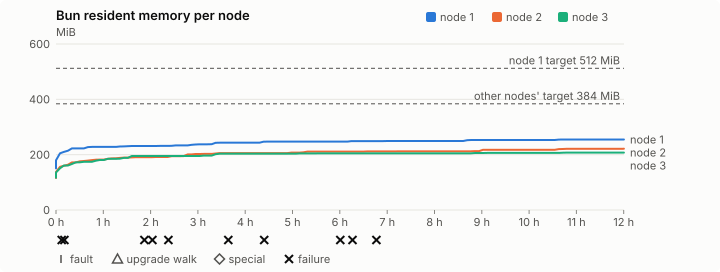
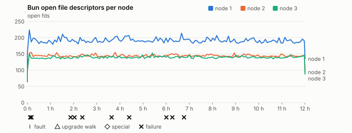
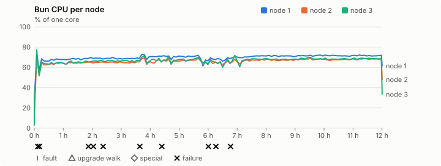
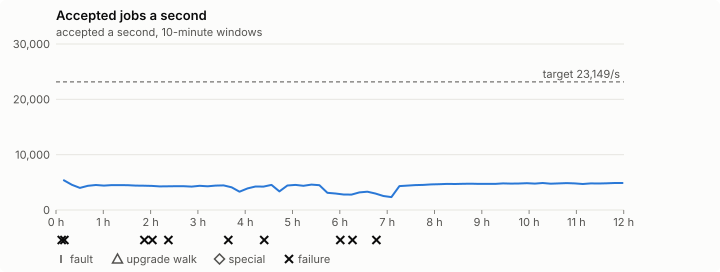

# Sustained soak (V02): FAIL

3 November 2026. day tier, no fault schedule, 12 h 00 min of soak on a three-node quickstart cluster.

**Day tier: not clean.** The day run doesn't hold; the record says what failed. It is incomplete too: it ran for 12 h 00 min, not a whole day.

> **What this run was for: Bun's memory on the published 0.2.5 under day
> load, which it passed.** `leak-rss` and `leak-fd` were armed for 659
> minutes on every node and passed, and each node's steady Bun RSS was 205 to
> 247 MiB against 384 MiB (512 MiB on node 1). It ran 12 hours, not the 24 a
> day run needs, so it doesn't stand in for one.
>
> **The FAIL is the host's, not 0.2.5's.** Host jobs ran at 4,254 a second
> against 0.2.4's 19,416 in its day run on the same Mac, from the first hour
> (4,494 against 21,802), and 20 agent-loop turns went over the 1 s budget
> against none. An hour of the published 0.2.4 straight afterwards, on the
> same Mac with the same harness, ran 5,111 a second with 5 slow turns
> ([record](2026-11-04-v0.2.4-day-load-check.md)), so the release that
> passed at 19,416 on 30 October is just as slow now. Lima, the guest kernel,
> macOS and the harness's job settings are the same in both 0.2.4 records.
> What changed is the Mac: its job rate fell at 21:24 GMT on 2 November,
> during the 0.2.5 final, and hasn't come back
> ([release closure](2026-11-03-v0.2.5-release-closure.md#a-quarter-of-the-job-throughput)).
> The slow turns' largest part was a wait of up to 2.9 s for the eBPF
> handle's lock, which job tasks also take, and once all three nodes stalled
> in the same second (19:00:01), which a fault in one node's Bun can't do. The
> 0.2.6 gate runs on a Mac Studio, where this is checked again.
>
> The two other failing checks, the mixed job campaign's (`process missing
> coverage: hook`) and the job qualification's rate, follow from the same
> rate: the run didn't reach the hook's coverage or 23,149 a second.

## Candidate and host

| | |
|---|---|
| Staged base URL | <https://github.com/reliaburger/reliaburger/releases/download/v0.2.5> |
| `candidate.json` SHA-256 | `c6bd5e3f72c3d8b03ba9e161f5eec287daef3ab1e878e3d928ab56efa700a19b` |
| Running versions | v0.2.5 x3 |
| Soak build | not supplied: upgrade slots skipped |
| Host | macOS 26.3.1, Apple M2 Max, 32 GiB |
| Lima | limactl version 2.2.1 |
| Guest | Ubuntu 24.04.5 LTS, kernel 6.8.0-139-generic |
| RELIABURGER_HOME | `/tmp/rbq.c7AQQN` |
| Evidence | `/var/tmp/reliaburger-v02.LRhyQO` |

## Configuration deviations

- Each quickstart VM resized from 2 vCPU / 2 GiB to 4 vCPU / 6 GiB before configuring, the size the scale-out record measured (maintainer decision, 27 October 2026)
- node.toml `[testing] allowed_operations` adds `provision_isolated_workloads` (quickstart allows only inject_workload_faults and alter_node_state), so the catalogue pulse can lease test namespaces
- node.toml `[logs]`/`[metrics]` export to file:///var/lib/reliaburger/soak-export every 60 s with max_storage_mb = 8 (the harness deletes a metrics export 30 minutes after its source has gone), `[storage.snapshots]` every 900 s (compressed: 120 s), retain 4, uploaded to the same directory
- node.toml `[ingress] tls_cert/tls_key` point at an operator pair from a soak CA, 45-minute leaves rotated by the harness
- Bun runs with auto/mixed; host jobs opt in to a single pinned BusyBox copy under /var/lib/reliaburger/soak-jobs, mount_isolation=false. The independent verifier listens on each private VM address, TCP 8189, with a separate run token
- node.toml `[node.labels] soak-volume` = "writer" on node 2 and "redis" on node 3, to pin the volume apps
- node.toml `[security] leaf_lifetime_override_secs = 3600` (D1)
- Host jobs run Ubuntu's busybox-static 1:1.36.1-6ubuntu3.1 (`52151e7f…`), the scale-out record's binary, instead of the image's

## Timeline

- Started 2026-11-03 15:22:48 UTC, finished 2026-11-04 03:23:11 UTC
- Cycles completed: 0
- Fault and node choices: 0, from seed 80035885 (`--seed 80035885` repeats them)
- Teardown: `relish local destroy --yes` and `relish uninstall --yes` succeeded

## Faults and slots

| Class | Runs | Settled/ok | Failed | Skipped | Settle (median / max) |
|---|---|---|---|---|---|
| tls:invalid-expired | 15 | 15 | 0 | 0 | n/a |
| tls:invalid-torn | 18 | 18 | 0 | 0 | n/a |
| tls:reload | 141 | 141 | 0 | 0 | n/a |

## Execution inventory (gated)

What the run completed, from its events and kept bytes, against what its schedule owes. A fault counts once it was injected and the cluster settled after it.

| Item | Required | Completed | Verdict |
|---|---|---|---|
| candidate.json bytes match the qualified digest | 1 | 1 | ok |
| app workloads settled at the baseline | 1 | 1 | ok |
| job campaign drained in its final two minutes | 1 | 1 | ok |

## Renewals and rotations

| Measure | Observed | Required | Verdict |
|---|---|---|---|
| workload identity rotations (soak-identity, per node) | 24 | ≥ 23 | PASS |
| node leaf renewals (per node) | 26 | ≥ 23 | PASS |
| operator ingress reloads (all nodes) | 141 | ≥ 47 | PASS |
| mixed job campaign and positive drain | 2 missing/failing checks | 0 | FAIL |

## Latency SLOs

What a user should feel on a quiet three-node cluster (#1400). Every sample is taken outside fault windows and through a host forward that works; each p99 is the upper bound of its histogram bucket.

| SLO | p99 | Threshold | Samples | Mode | Verdict |
|---|---|---|---|---|---|
| API read p99 | 1,000 ms | ≤ 1,000 ms | 7,548 | record only | PASS |
| API write p99 | 5,000 ms | ≤ 2,000 ms | 24 | record only | over (record only) |
| App start p99 | 1 ms | ≤ 5,000 ms | 72 | record only | PASS |
| Rolling update p99 | 100,000 ms | ≤ 30,000 ms | 24 | record only | over (record only) |
| Job task start p99 | 128 ms | ≤ 256 ms | 186,230,995 | record only | PASS |

- API read p99: `GET /v1/status?cluster=true` and `GET /v1/cluster/nodes` on every node, at every light check
- API write p99: `relish apply` of the soak workloads, from the call to the commit
- App start p99: each node's deploy of a new `soak-identity` instance, from its start to the instance running
- Rolling update p99: from `relish apply` returning to every node's `soak-identity` running the new spec
- Job task start p99: a job task's start lag on a pooled executor, from the job campaign's buckets, in runs no fault window overlapped
- Record only from 28 October 2026 (#1400): no soak before 0.2.4 measured it. The threshold is provisional; the first 0.2.4 fast and final records set the gate.

## Jobs

| Runtime | Accepted successes | Retries | Last accepted progress |
|---|---|---|---|
| runc | 24978 | 1 | 1793762580 |
| shared-runc | 2412461 | 1 | 1793762577 |
| process | 183818496 | 1 | 1793762573 |

The bounded campaign shares the app soak's fault schedule. These counts are reliability evidence, not a saturation rate or a 100-million-per-day qualification.

- process missing coverage: hook
- host-job rate 4,253.9/s is below the 23149.0/s target (below the billion-a-day floor too: 367,534,898 a day)
- Independent verifier execution attempts: 24
- Explicit test-operator acknowledgements for known replay-safe fenced fixtures: 2

- rb-d16d5f1e7af0-1: latest complete job storage (KiB) {'instances': 3008, 'job-state': 8, 'task-arrays': 74280}; free 4808572 KiB; live/peak owners 0/37; peak storage {'instances': 28712, 'job-state': 8, 'task-arrays': 226576}
- rb-d16d5f1e7af0-2: latest complete job storage (KiB) {'instances': 1636, 'job-state': 8, 'task-arrays': 88880}; free 5847436 KiB; live/peak owners 0/34; peak storage {'instances': 25992, 'job-state': 8, 'task-arrays': 287456}
- rb-d16d5f1e7af0-3: latest complete job storage (KiB) {'instances': 508, 'job-state': 8, 'task-arrays': 93740}; free 5858876 KiB; live/peak owners 0/34; peak storage {'instances': 24860, 'job-state': 8, 'task-arrays': 305468}

Complete disk inventories are recorded. Global retention bounds and the 12-hour job qualification remain #668; this gate cannot certify an unimplemented retention policy.

## Job qualification (D18-C)

Load: day; 3 nodes; accepted 4,310.3/s against a 23149.0/s target: FAIL.

The September plan set its targets for one 1M-task batch on a quiet cluster. A soak runs for hours with restarts, upgrades and apps, so its storage, Bun memory and Raft targets are restated (maintainer decision, 15 October 2026, [#668](https://github.com/reliaburger/reliaburger/issues/668)). Bun's steady state is the median RSS of each process once it has been seen for 10 minutes; the gated memory checks are unchanged (`leak-rss`, and Mayo's 70% `memory_high` alert through `wtf`).

| Measure (recorded, not gated) | Observed | Target |
|---|---|---|
| Wall time of a 1,048,576-task array (median / max of 0) | not measured / not measured | ≤ 600 s |
| p99 start lag, pooled executors | 128 ms (bucket upper bound) | < 1,000 ms |
| Raft entries per second, all cluster writes | 1.52 | recorded only; the batch target counts only task-array writes |
| Raft state of one run, largest seen | 47,193 B | ≤ 256 KiB per 1M tasks |
| Bun steady-state RSS per process, worst node against its target | rb-d16d5f1e7af0-2: 211.15 MiB steady, 221.44 MiB peak | ≤ 384 MiB (≤ 512 MiB on node 1, which serves the API) |
| Bun CPU, busiest node | 0.70 cores | ≤ 1 core (leader batch control) |
| Executor helper CPU, busiest node | 0.53 cores | ≤ 0.5 core |
| Node task-array storage per 1M accepted tasks (peaks summed) | 4.30 MiB | ≤ 64 MiB, deleted after retirement |
| Retained log volume, all nodes | 15.81 MB | ≤ 50 MB |

- Bun RSS on rb-d16d5f1e7af0-1 (serves the API, target ≤ 512 MiB): pid 3573: 247.10 MiB steady, 254.72 MiB peak
- Bun RSS on rb-d16d5f1e7af0-2 (node, target ≤ 384 MiB): pid 1816: 211.15 MiB steady, 221.44 MiB peak
- Bun RSS on rb-d16d5f1e7af0-3 (node, target ≤ 384 MiB): pid 1671: 204.77 MiB steady, 207.52 MiB peak

- runc retry causes: exit_code 1, launch 0, signal 0, timeout 0, unknown 0, unrecorded 0
- shared-runc retry causes: exit_code 1, launch 0, signal 0, timeout 0, unknown 0, unrecorded 0
- process retry causes: exit_code 1, launch 0, signal 0, timeout 0, unknown 0, unrecorded 0
- Audited executions: 24; operator replay decisions: 2
- Job controller API fallbacks: rb-d16d5f1e7af0-1 missed 8; rb-d16d5f1e7af0-2 answered 8 (requests a node didn't answer, and the node that took them instead)

## Day run (#1032)

183,818,496 accepted host-job tasks in 12 h 00 min: 4,253.9/s against the 23149.0/s target (FAIL). The billion-a-day floor is 11,575/s (not met). At this rate a day is 367,534,898 tasks.

| Node | Slots | Host-job successes | Rate | Share | Fair share | Verdict |
|---|---|---|---|---|---|---|
| rb-d16d5f1e7af0-1 | 27 | 50,902,069 | 1,178.0/s | 27.7% | 33.3% | ok |
| rb-d16d5f1e7af0-2 | 27 | 64,346,214 | 1,489.1/s | 35.0% | 33.3% | ok (restarted) |
| rb-d16d5f1e7af0-3 | 27 | 68,570,241 | 1,586.8/s | 37.3% | 33.3% | ok |

A node may take up to 20% more than its fair share by slots, as `relish bench` allows (#1362).

| Hour | Host jobs a second | |
|---|---|---|
| Hour 1 | 4,494.2 | ███████████████████ |
| Hour 2 | 4,375.4 | ██████████████████ |
| Hour 3 | 4,239.3 | ██████████████████ |
| Hour 4 | 4,036.2 | █████████████████ |
| Hour 5 | 4,145.3 | █████████████████ |
| Hour 6 | 3,765.6 | ████████████████ |
| Hour 7 | 2,832.7 | ████████████ |
| Hour 8 | 4,286.1 | ██████████████████ |
| Hour 9 | 4,657.4 | ████████████████████ |
| Hour 10 | 4,708.6 | ████████████████████ |
| Hour 11 | 4,745.6 | ████████████████████ |
| Hour 12 | 4,754.9 | ████████████████████ |

Last hour against the first: 4,754.9/s against 4,494.2/s, ok (at most 10% slower; the first hour includes the campaign's start and its host-job probes).

## Data

- Volume writer: highest ACK 246111 in the log view; the writer file checks (writer-lost, writer-regression) decide data loss, and `*-log-order` failures are about the order the log view returned lines in
- Redis counter: highest INCR 39438 in the log view
- Export rb-d16d5f1e7af0-1: 195 source files, 853 at the destination
- Export rb-d16d5f1e7af0-2: 893 source files, 921 at the destination
- Export rb-d16d5f1e7af0-3: 417 source files, 443 at the destination
- Registry images pushed and re-verified: 1
- Agent-loop turns over the 1 s budget: rb-d16d5f1e7af0-1 3, rb-d16d5f1e7af0-2 9, rb-d16d5f1e7af0-3 8
- Soak policies checked in force: 146 times, policy generation 78 at the last check
- Guest clock steps by Lima's guest agent: rb-d16d5f1e7af0-1 10, rb-d16d5f1e7af0-2 5, rb-d16d5f1e7af0-3 14
- Checks evaluated: 1260 (heavy 145, light 1114, settle 1)
- Last observed progress: redis-counter 39438, writer-ack 246111

## Leak-checker exposure (gated)

How long each leak checker could judge each node's Bun. `leak-rss` arms after 60 minutes in one process and `leak-fd` after 50; a restart, kill or upgrade exec starts the warm-up again. A final needs each armed for 60 minutes on every node, with one unbroken window of 30 (#1062); its quiet tail gives them that.

| Node | Checker | Armed | Longest armed window | Evaluated samples | Processes armed | Verdict |
|---|---|---|---|---|---|---|
| rb-d16d5f1e7af0-1 | leak-rss | 659 min | 659 min | 132 | 1 | ok |
| rb-d16d5f1e7af0-1 | leak-fd | 669 min | 669 min | 134 | 1 | ok |
| rb-d16d5f1e7af0-2 | leak-rss | 659 min | 659 min | 132 | 1 | ok |
| rb-d16d5f1e7af0-2 | leak-fd | 669 min | 669 min | 134 | 1 | ok |
| rb-d16d5f1e7af0-3 | leak-rss | 659 min | 659 min | 132 | 1 | ok |
| rb-d16d5f1e7af0-3 | leak-fd | 669 min | 669 min | 134 | 1 | ok |

## Resource trends

| Node | Measure | First | Last | Max |
|---|---|---|---|---|
| rb-d16d5f1e7af0-1 | disk_kb data | 1441480 | 1652136 | 1820768 |
| rb-d16d5f1e7af0-1 | disk_kb images | 342456 | 342480 | 342568 |
| rb-d16d5f1e7af0-1 | disk_kb logs | 60 | 8508 | 8876 |
| rb-d16d5f1e7af0-1 | disk_kb metrics | 112 | 8420 | 8824 |
| rb-d16d5f1e7af0-1 | disk_kb soak-export | 4 | 71060 | 71060 |
| rb-d16d5f1e7af0-1 | disk_kb volumes | 248 | 248 | 248 |
| rb-d16d5f1e7af0-1 | fd | 105 | 135 | 224 |
| rb-d16d5f1e7af0-1 | rss_anon_kb | 81188 | 183108 | 183108 |
| rb-d16d5f1e7af0-1 | rss_file_kb | 72736 | 77728 | 77728 |
| rb-d16d5f1e7af0-1 | rss_kb | 153924 | 260836 | 260836 |
| rb-d16d5f1e7af0-2 | disk_kb data | 71988 | 203308 | 417964 |
| rb-d16d5f1e7af0-2 | disk_kb images | 342304 | 342400 | 342400 |
| rb-d16d5f1e7af0-2 | disk_kb logs | 48 | 5920 | 5920 |
| rb-d16d5f1e7af0-2 | disk_kb metrics | 128 | 8648 | 8876 |
| rb-d16d5f1e7af0-2 | disk_kb soak-export | 4 | 16184 | 16396 |
| rb-d16d5f1e7af0-2 | disk_kb volumes | 16760 | 19912 | 19912 |
| rb-d16d5f1e7af0-2 | fd | 65 | 94 | 155 |
| rb-d16d5f1e7af0-2 | rss_anon_kb | 47100 | 150052 | 150052 |
| rb-d16d5f1e7af0-2 | rss_file_kb | 71328 | 76704 | 76704 |
| rb-d16d5f1e7af0-2 | rss_kb | 118428 | 226756 | 226756 |
| rb-d16d5f1e7af0-3 | disk_kb data | 176264 | 311868 | 547868 |
| rb-d16d5f1e7af0-3 | disk_kb images | 339124 | 339196 | 339196 |
| rb-d16d5f1e7af0-3 | disk_kb logs | 40 | 640 | 640 |
| rb-d16d5f1e7af0-3 | disk_kb metrics | 152 | 8748 | 8864 |
| rb-d16d5f1e7af0-3 | disk_kb soak-export | 4 | 10352 | 10704 |
| rb-d16d5f1e7af0-3 | disk_kb volumes | 16760 | 19880 | 19880 |
| rb-d16d5f1e7af0-3 | fd | 64 | 88 | 153 |
| rb-d16d5f1e7af0-3 | rss_anon_kb | 48788 | 136884 | 136884 |
| rb-d16d5f1e7af0-3 | rss_file_kb | 70688 | 75616 | 75616 |
| rb-d16d5f1e7af0-3 | rss_kb | 119476 | 212500 | 212500 |

## Charts

Time runs from the start of the soak. The marks under each chart are its faults, upgrade walks, specials and recorded failures; the dashed lines are targets.

## Failures

| # | First seen | Check | Symptom | Class | Cause | Action |
|---|---|---|---|---|---|---|
| 1 | 15:29:26 | heavy-check | fail: agent-loop-turn rb-d16d5f1e7af0-2: 1 health_tick turn(s) over the 1 s budget, the worst between 1 and 2.5 s; | unclassified | open | open |
| 2 | 15:33:16 | heavy-check | fail: agent-loop-turn rb-d16d5f1e7af0-3: 1 health_tick turn(s) over the 1 s budget, the worst between 1 and 2.5 s; | unclassified | open | open |
| 3 | 17:14:44 | heavy-check | fail: agent-loop-turn rb-d16d5f1e7af0-3: 1 health_tick turn(s) over the 1 s budget, the worst between 1 and 2.5 s; | unclassified | open | open |
| 4 | 17:24:58 | heavy-check | fail: agent-loop-turn rb-d16d5f1e7af0-2: 1 follow_up turn(s) over the 1 s budget, the worst between 1 and 2.5 s; | unclassified | open | open |
| 5 | 17:45:12 | heavy-check | fail: agent-loop-turn rb-d16d5f1e7af0-1: 1 follow_up turn(s) over the 1 s budget, the worst between 1 and 2.5 s; | unclassified | open | open |
| 6 | 19:01:08 | heavy-check | fail: agent-loop-turn rb-d16d5f1e7af0-1: 1 follow_up turn(s) over the 1 s budget, the worst between 1 and 2.5 s;fail: agent-loop-turn rb-d16d5f1e7af0-2: 1 follow_up turn(s) over the 1 s budget, the worst between 1 and 2.5 s;fail: agent-loop-turn rb-d16d5f1e7af0-3: 1 follow_up turn(s) over the 1 s bu | unclassified | open | open |
| 7 | 19:46:43 | heavy-check | fail: agent-loop-turn rb-d16d5f1e7af0-2: 1 follow_up turn(s) over the 1 s budget, the worst between 2.5 and 5 s; | unclassified | open | open |
| 8 | 21:23:12 | heavy-check | fail: agent-loop-turn rb-d16d5f1e7af0-3: 1 health_tick turn(s) over the 1 s budget, the worst between 1 and 2.5 s; | unclassified | open | open |
| 9 | 21:38:41 | heavy-check | fail: agent-loop-turn rb-d16d5f1e7af0-1: 1 follow_up turn(s) over the 1 s budget, the worst between 1 and 2.5 s; | unclassified | open | open |
| 10 | 22:08:58 | heavy-check | fail: agent-loop-turn rb-d16d5f1e7af0-3: 1 health_tick turn(s) over the 1 s budget, the worst between 1 and 2.5 s; | unclassified | open | open |

## Notes

- Job controller exited with status 1
- The harness stopped early (exit 1) during final

Evidence: `/var/tmp/reliaburger-v02.LRhyQO` (events.jsonl, snapshots/, failures/<n>/).
