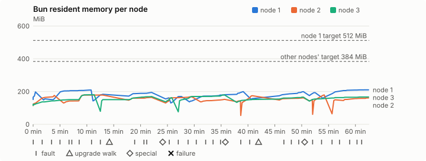
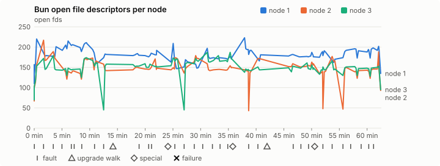
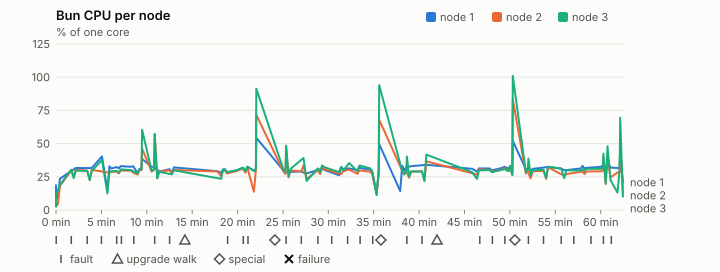
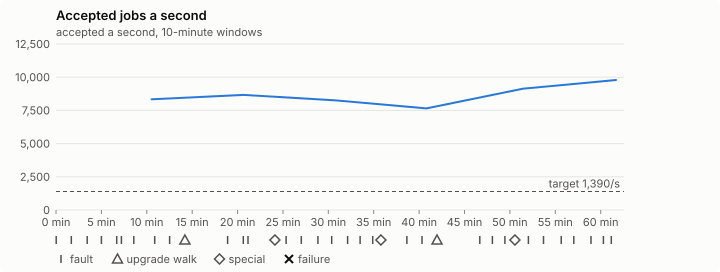

# Sustained soak (V02): PASS

5 November 2026. fast tier, compressed schedule, 1 h 02 min of soak on a three-node quickstart cluster.

**Fast tier: clean.** The iteration loop only, not acceptance: the V02 gate needs a clean final-tier run (8 h, full schedule) on the final candidate.

## Candidate and host

| | |
|---|---|
| Staged base URL | <https://github.com/reliaburger/reliaburger/releases/download/staging-v0.2.6-42011462991-1> |
| `candidate.json` SHA-256 | `a2f53404505c130fa2331b4c44ad4122f7f6a2e16bbeb09ae167a170313128c3` |
| Running versions | v0.2.6 x3 |
| Soak build | `bun-v0.2.6-soak.1`, SHA-256 `8bafddedfa976f7e816f3d2478fd78d27e2cce713f262eb6c611cbe7d7f82775` |
| Walks roll back to | 0.2.6 |
| Host | macOS 27.2, Apple M5 Max, 128 GiB |
| Lima | limactl version 2.2.1 |
| Guest | Ubuntu 24.04.5 LTS, kernel 6.8.0-139-generic |
| RELIABURGER_HOME | `/tmp/rbq.afLmDa` |
| Evidence | `/Users/miko/github/rb-wt/gate-026-data/qual/ev-jobs-fast` |

## Configuration deviations

- node.toml `[testing] allowed_operations` adds `provision_isolated_workloads` (quickstart allows only inject_workload_faults and alter_node_state), so the catalogue pulse can lease test namespaces
- node.toml `[logs]`/`[metrics]` export to file:///var/lib/reliaburger/soak-export every 60 s with max_storage_mb = 8 (the harness deletes a metrics export 30 minutes after its source has gone), `[storage.snapshots]` every 900 s (compressed: 120 s), retain 4, uploaded to the same directory
- node.toml `[ingress] tls_cert/tls_key` point at an operator pair from a soak CA, 45-minute leaves rotated by the harness
- Bun runs with auto/mixed; host jobs opt in to a single pinned BusyBox copy under /var/lib/reliaburger/soak-jobs, mount_isolation=false. The independent verifier listens on each private VM address, TCP 8189, with a separate run token
- node.toml `[node.labels] soak-volume` = "writer" on node 2 and "redis" on node 3, to pin the volume apps
- node.toml `[upgrades] external_signing_key` = a throwaway operator key the harness made for this run (`ed25519:DG9EkeLqFkihz9ukcp+TvhKkkKglcxLgrxWK+G5jZWE=`); the soak build's `.sig` gets that key's external signature beside the release one (D2)
- node.toml `[security] leaf_lifetime_override_secs = 3600` (D1)

## Timeline

- Started 2026-11-05 14:05:56 UTC, finished 2026-11-05 15:08:30 UTC
- Cycles completed: 5
- Fault and node choices: 27, from seed 2308038870 (`--seed 2308038870` repeats them)
- Teardown: `relish local destroy --yes` and `relish uninstall --yes` succeeded

## Faults and slots

| Class | Runs | Settled/ok | Failed | Skipped | Settle (median / max) |
|---|---|---|---|---|---|
| fault:bun-kill-follower | 5 | 5 | 0 | 0 | 31 s / 33 s |
| fault:bun-kill-leader | 5 | 5 | 0 | 0 | 33 s / 39 s |
| fault:chaos-cpu | 1 | 2 | 0 | 0 | 17 s / 17 s |
| fault:chaos-delay | 1 | 2 | 0 | 0 | 16 s / 16 s |
| fault:chaos-dns | 1 | 2 | 0 | 0 | 18 s / 18 s |
| fault:chaos-drop | 1 | 2 | 0 | 0 | 17 s / 17 s |
| fault:chaos-kill | 2 | 4 | 0 | 0 | 51 s / 51 s |
| fault:chaos-memory | 1 | 2 | 0 | 0 | 17 s / 17 s |
| fault:chaos-partition | 1 | 2 | 0 | 0 | 16 s / 16 s |
| fault:chaos-pause | 1 | 2 | 0 | 0 | 18 s / 18 s |
| fault:chaos-scenario | 1 | 2 | 0 | 0 | 31 s / 31 s |
| fault:deploy-kill | 3 | 3 | 0 | 0 | 37 s / 47 s |
| fault:node-delay | 2 | 2 | 0 | 0 | 30 s / 30 s |
| fault:node-disk-full | 2 | 2 | 0 | 0 | 18 s / 18 s |
| fault:node-slow-fsync | 1 | 1 | 0 | 0 | 17 s / 17 s |
| fault:power-off | 3 | 3 | 0 | 0 | 31 s / 43 s |
| pulse | 1 | 1 | 0 | 0 | n/a |
| pulse:settle | 0 | 1 | 0 | 0 | 19 s / 19 s |
| special:all-off | 1 | 1 | 0 | 0 | 35 s / 35 s |
| special:graceful-stop | 1 | 1 | 0 | 0 | 40 s / 40 s |
| special:quorum-back | 1 | 1 | 0 | 0 | n/a |
| special:quorum-loss | 1 | 1 | 0 | 0 | 43 s / 43 s |
| storage:offline-export | 2 | 2 | 0 | 0 | n/a |
| storage:registry-push | 5 | 0 | 0 | 0 | n/a |
| tls:invalid-expired | 3 | 3 | 0 | 0 | n/a |
| tls:invalid-torn | 3 | 3 | 0 | 0 | n/a |
| tls:reload | 32 | 32 | 0 | 0 | n/a |
| upgrade:rollback | 2 | 2 | 0 | 0 | n/a |
| upgrade:settle | 0 | 2 | 0 | 0 | 66 s / 66 s |
| upgrade:upgrade | 2 | 2 | 0 | 0 | n/a |

## Execution inventory (recorded, not gated)

What the run completed, from its events and kept bytes, against what its schedule owes. A fault counts once it was injected and the cluster settled after it.

| Item | Required | Completed | Verdict |
|---|---|---|---|
| candidate.json bytes match the qualified digest | 1 | 1 | ok |
| app workloads settled at the baseline | 1 | 1 | ok |
| upgrade walk (to the soak build and back) | 2 | 2 | ok |
| fault:bun-kill-follower | 1 | 5 | ok |
| fault:bun-kill-leader | 1 | 5 | ok |
| fault:deploy-kill | 1 | 3 | ok |
| fault:power-off | 1 | 3 | ok |
| fault:chaos-kill | 1 | 2 | ok |
| fault:chaos-delay | 1 | 1 | ok |
| fault:chaos-partition | 1 | 1 | ok |
| fault:chaos-scenario | 1 | 1 | ok |
| fault:chaos-pause | 1 | 1 | ok |
| fault:chaos-drop | 1 | 1 | ok |
| fault:chaos-dns | 1 | 1 | ok |
| fault:chaos-cpu | 1 | 1 | ok |
| fault:node-delay | 1 | 2 | ok |
| fault:node-disk-full | 1 | 2 | ok |
| fault:node-slow-fsync | 1 | 1 | ok |
| special:graceful-stop | 1 | 1 | ok |
| special:quorum-loss | 1 | 1 | ok |
| special:all-off | 1 | 1 | ok |
| catalogue pulse | 1 | 1 | ok |
| offline export | 2 | 2 | ok |
| job campaign drained in its final two minutes | 1 | 1 | ok |

## Observed fault effects

What each injected fault was seen to do, read back from the node.

| Fault | Target | Observed |
|---|---|---|
| effect:bun-kill-follower | rb-0b51f5441a6c-3 | MainPID 2323 -> 3909 |
| effect:bun-kill-leader | rb-0b51f5441a6c-1 | MainPID 9093 -> 313043 |
| effect:deploy-kill | rb-0b51f5441a6c-1 | MainPID 313043 -> 682379 |
| effect:power-off | rb-0b51f5441a6c-2 | Lima status Stopped |
| effect:node-delay | rb-0b51f5441a6c-1 | netem 8001: root refcnt 2 limit 1000 delay 200ms  50ms  |
| effect:bun-kill-follower | rb-0b51f5441a6c-1 | MainPID 682379 -> 2349721 |
| effect:bun-kill-leader | rb-0b51f5441a6c-3 | MainPID 3909 -> 3015780 |
| effect:node-disk-full | rb-0b51f5441a6c-2 | available 67043328 bytes  |
| effect:bun-kill-follower | rb-0b51f5441a6c-1 | MainPID 681 -> 218831 |
| effect:bun-kill-leader | rb-0b51f5441a6c-3 | MainPID 682 -> 647729 |
| effect:deploy-kill | rb-0b51f5441a6c-1 | MainPID 218831 -> 1088599 |
| effect:power-off | rb-0b51f5441a6c-2 | Lima status Stopped |
| effect:node-slow-fsync | rb-0b51f5441a6c-3 | IOWriteBandwidthMax=/dev/vda 1000000 IOWriteIOPSMax=/dev/vda 20  |
| effect:bun-kill-follower | rb-0b51f5441a6c-2 | MainPID 676 -> 403768 |
| effect:bun-kill-leader | rb-0b51f5441a6c-1 | MainPID 1088599 -> 3554430 |
| effect:node-delay | rb-0b51f5441a6c-2 | netem 8001: root refcnt 2 limit 1000 delay 200ms  50ms  |
| effect:bun-kill-follower | rb-0b51f5441a6c-2 | MainPID 678 -> 200577 |
| effect:bun-kill-leader | rb-0b51f5441a6c-1 | MainPID 680 -> 610244 |
| effect:deploy-kill | rb-0b51f5441a6c-2 | MainPID 200577 -> 1115067 |
| effect:power-off | rb-0b51f5441a6c-2 | Lima status Stopped |
| effect:node-disk-full | rb-0b51f5441a6c-3 | available 67096576 bytes  |

## Renewals and rotations

| Measure | Observed | Required | Verdict |
|---|---|---|---|
| workload identity rotations (soak-identity, per node) | 7 | ≥ 1 | PASS |
| node leaf renewals (per node) | 2 | ≥ 1 | PASS |
| operator ingress reloads (all nodes) | 32 | ≥ 11 | PASS |
| mixed job campaign and positive drain | 0 missing/failing checks | 0 | PASS |

## Latency SLOs

What a user should feel on a quiet three-node cluster (#1400). Every sample is taken outside fault windows and through a host forward that works; each p99 is the upper bound of its histogram bucket.

| SLO | p99 | Threshold | Samples | Mode | Verdict |
|---|---|---|---|---|---|
| API read p99 | 150 ms | ≤ 1,000 ms | 222 | record only | PASS |
| API write p99 | 150 ms | ≤ 2,000 ms | 7 | record only | PASS |
| App start p99 | 1 ms | ≤ 5,000 ms | 21 | record only | PASS |
| Rolling update p99 | 30,000 ms | ≤ 30,000 ms | 7 | record only | PASS |
| Job task start p99 | 1,024 ms | ≤ 256 ms | 20 | record only | too few samples |

- API read p99: `GET /v1/status?cluster=true` and `GET /v1/cluster/nodes` on every node, at every light check
- API write p99: `relish apply` of the soak workloads, from the call to the commit
- App start p99: each node's deploy of a new `soak-identity` instance, from its start to the instance running
- Rolling update p99: from `relish apply` returning to every node's `soak-identity` running the new spec
- Job task start p99: a job task's start lag on a pooled executor, from the job campaign's buckets, in runs no fault window overlapped
- Record only from 28 October 2026 (#1400): no soak before 0.2.4 measured it. The threshold is provisional; the first 0.2.4 fast and final records set the gate.
- Job task start p99 not judged: only 20 job task start samples, fewer than the 1,000 a p99 needs

## Jobs

| Runtime | Accepted successes | Retries | Last accepted progress |
|---|---|---|---|
| runc | 10937 | 2 | 1793891301 |
| shared-runc | 8618666 | 1 | 1793891298 |
| process | 23808844 | 1 | 1793891298 |

The bounded campaign shares the app soak's fault schedule. These counts are reliability evidence, not a saturation rate or a 100-million-per-day qualification.

- Independent verifier execution attempts: 24
- Explicit test-operator acknowledgements for known replay-safe fenced fixtures: 109

- rb-0b51f5441a6c-1: latest complete job storage (KiB) {'instances': 3288, 'job-state': 8, 'task-arrays': 17032}; free 5176268 KiB; live/peak owners 0/32; peak storage {'instances': 24752, 'job-state': 8, 'task-arrays': 44992}
- rb-0b51f5441a6c-2: latest complete job storage (KiB) {'instances': 464, 'job-state': 8, 'task-arrays': 17048}; free 6295336 KiB; live/peak owners 0/31; peak storage {'instances': 24892, 'job-state': 8, 'task-arrays': 42576}
- rb-0b51f5441a6c-3: latest complete job storage (KiB) {'instances': 1496, 'job-state': 8, 'task-arrays': 15324}; free 6336156 KiB; live/peak owners 0/30; peak storage {'instances': 24284, 'job-state': 8, 'task-arrays': 46596}

Complete disk inventories are recorded. Global retention bounds and the 12-hour job qualification remain #668; this gate cannot certify an unimplemented retention policy.

## Job qualification (D18-C)

Load: target; 3 nodes; accepted 8,647.9/s against a 1390.0/s target: PASS.

The September plan set its targets for one 1M-task batch on a quiet cluster. A soak runs for hours with restarts, upgrades and apps, so its storage, Bun memory and Raft targets are restated (maintainer decision, 15 October 2026, [#668](https://github.com/reliaburger/reliaburger/issues/668)). Bun's steady state is the median RSS of each process once it has been seen for 10 minutes; the gated memory checks are unchanged (`leak-rss`, and Mayo's 70% `memory_high` alert through `wtf`).

| Measure (recorded, not gated) | Observed | Target |
|---|---|---|
| Wall time of a 1,048,576-task array (median / max of 30) | 162 s / 512 s | ≤ 600 s |
| p99 start lag, pooled executors | 32 ms (bucket upper bound) | < 1,000 ms |
| Raft entries per second, all cluster writes | 5.60 | recorded only; the batch target counts only task-array writes |
| Raft state of one run, largest seen | 9,187 B | ≤ 256 KiB per 1M tasks |
| Bun steady-state RSS per process, worst node against its target | rb-0b51f5441a6c-3: 180.30 MiB steady, 180.32 MiB peak | ≤ 384 MiB (≤ 512 MiB on node 1, which serves the API) |
| Bun CPU, busiest node | 0.30 cores | ≤ 1 core (leader batch control) |
| Executor helper CPU, busiest node | 0.09 cores | ≤ 0.5 core |
| Node task-array storage per 1M accepted tasks (peaks summed) | 4.04 MiB | ≤ 64 MiB, deleted after retirement |
| Retained log volume, all nodes | 6.05 MB | ≤ 50 MB |

- Bun RSS on rb-0b51f5441a6c-1 (serves the API, target ≤ 512 MiB): pid 9093: 197.55 MiB peak (seen for under 10 minutes); pid 313043: 155.60 MiB peak (seen for under 10 minutes); pid 682379: 209.30 MiB peak (seen for under 10 minutes); pid 2349721: 183.20 MiB peak (seen for under 10 minutes); pid 2349721: 194.42 MiB peak (seen for under 10 minutes); pid 681: 161.46 MiB peak (seen for under 10 minutes); pid 218831: 169.73 MiB peak (seen for under 10 minutes); pid 1088599: 199.38 MiB steady, 199.38 MiB peak; pid 3554430: 156.74 MiB peak (seen for under 10 minutes); pid 3554430: 199.20 MiB peak (seen for under 10 minutes); pid 680: 193.47 MiB peak (seen for under 10 minutes); pid 610244: 210.54 MiB peak (seen for under 10 minutes)
- Bun RSS on rb-0b51f5441a6c-2 (node, target ≤ 384 MiB): pid 2525: 176.33 MiB peak (seen for under 10 minutes); pid 684: 178.54 MiB peak (seen for under 10 minutes); pid 684: 164.09 MiB peak (seen for under 10 minutes); pid 679: 167.79 MiB peak (seen for under 10 minutes); pid 682: 152.66 MiB peak (seen for under 10 minutes); pid 676: 143.34 MiB peak (seen for under 10 minutes); pid 403768: 174.71 MiB peak (seen for under 10 minutes); pid 685: 161.54 MiB peak (seen for under 10 minutes); pid 678: 151.70 MiB peak (seen for under 10 minutes); pid 200577: 179.40 MiB peak (seen for under 10 minutes); pid 1115067: 149.64 MiB peak (seen for under 10 minutes); pid 679: 161.00 MiB peak (seen for under 10 minutes)
- Bun RSS on rb-0b51f5441a6c-3 (node, target ≤ 384 MiB): pid 2323: 122.70 MiB peak (seen for under 10 minutes); pid 3909: 180.30 MiB steady, 180.32 MiB peak; pid 3015780: 150.79 MiB peak (seen for under 10 minutes); pid 3560940: 169.44 MiB peak (seen for under 10 minutes); pid 682: 161.99 MiB peak (seen for under 10 minutes); pid 647729: 179.50 MiB peak (seen for under 10 minutes); pid 681: 151.46 MiB peak (seen for under 10 minutes); pid 681: 165.74 MiB peak (seen for under 10 minutes); pid 679: 166.70 MiB steady, 167.04 MiB peak

- runc retry causes: exit_code 2, launch 0, signal 0, timeout 0, unknown 0, unrecorded 0
- shared-runc retry causes: exit_code 1, launch 0, signal 0, timeout 0, unknown 0, unrecorded 0
- process retry causes: exit_code 1, launch 0, signal 0, timeout 0, unknown 0, unrecorded 0
- Audited executions: 24; operator replay decisions: 109
- Job controller API fallbacks: rb-0b51f5441a6c-1 missed 229, rb-0b51f5441a6c-2 missed 8; rb-0b51f5441a6c-2 answered 221, rb-0b51f5441a6c-3 answered 8 (requests a node didn't answer, and the node that took them instead)

## Data

- Volume writer: highest ACK 28614 in the log view; the writer file checks (writer-lost, writer-regression) decide data loss, and `*-log-order` failures are about the order the log view returned lines in
- Redis counter: highest INCR 3159 in the log view
- Export rb-0b51f5441a6c-1: 119 source files, 115 at the destination
- Export rb-0b51f5441a6c-2: 125 source files, 114 at the destination
- Export rb-0b51f5441a6c-3: 101 source files, 99 at the destination
- Registry images pushed and re-verified: 6
- Agent-loop turns over the 1 s budget: rb-0b51f5441a6c-1 0, rb-0b51f5441a6c-2 0, rb-0b51f5441a6c-3 0
- Soak policies checked in force: 117 times, policy generation 36 at the last check
- Guest clock steps by Lima's guest agent: rb-0b51f5441a6c-1 2, rb-0b51f5441a6c-2 7, rb-0b51f5441a6c-3 3
- Checks evaluated: 178 (heavy 15, light 61, settle 102)
- Last observed progress: redis-counter 3159, writer-ack 28614

## Council history (linearizability)

Every test-lease grant, renew, read and release the history client made, checked against a model of the council's leases. A write with no answer may or may not have happened; the check allows both.

- Operations checked: 18725 of 18725, in 2 namespaces; 1252 writes had no answer
- Verdict: linearizable

## Leak-checker exposure (recorded, not gated)

How long each leak checker could judge each node's Bun. `leak-rss` arms after 60 minutes in one process and `leak-fd` after 50; a restart, kill or upgrade exec starts the warm-up again. A final needs each armed for 60 minutes on every node, with one unbroken window of 30 (#1062); its quiet tail gives them that.

| Node | Checker | Armed | Longest armed window | Evaluated samples | Processes armed | Verdict |
|---|---|---|---|---|---|---|
| rb-0b51f5441a6c-1 | leak-rss | 0 min | 0 min | 0 | 0 | short |
| rb-0b51f5441a6c-1 | leak-fd | 0 min | 0 min | 0 | 0 | short |
| rb-0b51f5441a6c-2 | leak-rss | 0 min | 0 min | 0 | 0 | short |
| rb-0b51f5441a6c-2 | leak-fd | 0 min | 0 min | 0 | 0 | short |
| rb-0b51f5441a6c-3 | leak-rss | 0 min | 0 min | 0 | 0 | short |
| rb-0b51f5441a6c-3 | leak-fd | 0 min | 0 min | 0 | 0 | short |

## Resource trends

| Node | Measure | First | Last | Max |
|---|---|---|---|---|
| rb-0b51f5441a6c-1 | disk_kb data | 1382872 | 1312056 | 1512888 |
| rb-0b51f5441a6c-1 | disk_kb images | 342456 | 461552 | 461552 |
| rb-0b51f5441a6c-1 | disk_kb logs | 44 | 3344 | 3344 |
| rb-0b51f5441a6c-1 | disk_kb metrics | 72 | 3956 | 3956 |
| rb-0b51f5441a6c-1 | disk_kb soak-export | 4 | 6960 | 6960 |
| rb-0b51f5441a6c-1 | disk_kb volumes | 248 | 228 | 276 |
| rb-0b51f5441a6c-1 | fd | 110 | 135 | 223 |
| rb-0b51f5441a6c-1 | rss_anon_kb | 81996 | 137412 | 137412 |
| rb-0b51f5441a6c-1 | rss_file_kb | 73160 | 78176 | 78176 |
| rb-0b51f5441a6c-1 | rss_kb | 155156 | 215588 | 215588 |
| rb-0b51f5441a6c-2 | disk_kb data | 71856 | 49468 | 444872 |
| rb-0b51f5441a6c-2 | disk_kb images | 175368 | 342464 | 342464 |
| rb-0b51f5441a6c-2 | disk_kb logs | 32 | 1088 | 1088 |
| rb-0b51f5441a6c-2 | disk_kb metrics | 60 | 2752 | 2752 |
| rb-0b51f5441a6c-2 | disk_kb soak-export | 4 | 4460 | 4460 |
| rb-0b51f5441a6c-2 | disk_kb volumes | 16760 | 17460 | 17460 |
| rb-0b51f5441a6c-2 | fd | 67 | 93 | 217 |
| rb-0b51f5441a6c-2 | rss_anon_kb | 44984 | 88376 | 106488 |
| rb-0b51f5441a6c-2 | rss_file_kb | 71520 | 76484 | 77600 |
| rb-0b51f5441a6c-2 | rss_kb | 116504 | 164860 | 183704 |
| rb-0b51f5441a6c-3 | disk_kb data | 234612 | 444256 | 609960 |
| rb-0b51f5441a6c-3 | disk_kb images | 339124 | 342400 | 342400 |
| rb-0b51f5441a6c-3 | disk_kb logs | 24 | 1472 | 1472 |
| rb-0b51f5441a6c-3 | disk_kb metrics | 60 | 3364 | 3364 |
| rb-0b51f5441a6c-3 | disk_kb soak-export | 4 | 4784 | 4784 |
| rb-0b51f5441a6c-3 | disk_kb volumes | 16784 | 17104 | 17104 |
| rb-0b51f5441a6c-3 | fd | 70 | 95 | 187 |
| rb-0b51f5441a6c-3 | rss_anon_kb | 47300 | 94332 | 107296 |
| rb-0b51f5441a6c-3 | rss_file_kb | 71136 | 76716 | 77856 |
| rb-0b51f5441a6c-3 | rss_kb | 118436 | 171048 | 184644 |

## Charts

Time runs from the start of the soak. The marks under each chart are its faults, upgrade walks, specials and recorded failures; the dashed lines are targets.

## Failures

None.

Evidence: `/Users/miko/github/rb-wt/gate-026-data/qual/ev-jobs-fast` (events.jsonl, snapshots/, failures/<n>/).
