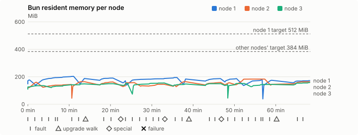
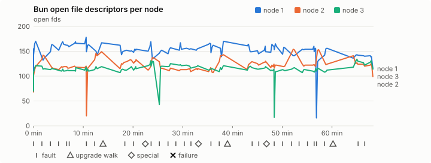
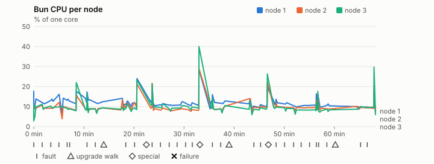
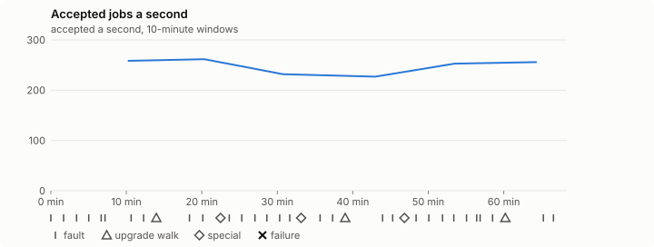

# Sustained soak (V02): PASS

5 November 2026. fast tier, compressed schedule, 1 h 08 min of soak on a three-node quickstart cluster.

**Fast tier: clean.** The iteration loop only, not acceptance: the V02 gate needs a clean final-tier run (8 h, full schedule) on the final candidate.

## Candidate and host

| | |
|---|---|
| Staged base URL | <https://github.com/reliaburger/reliaburger/releases/download/staging-v0.2.6-42011462991-1> |
| `candidate.json` SHA-256 | `a2f53404505c130fa2331b4c44ad4122f7f6a2e16bbeb09ae167a170313128c3` |
| Running versions | v0.2.6 x3 |
| Soak build | `bun-v0.2.6-soak.1`, SHA-256 `8bafddedfa976f7e816f3d2478fd78d27e2cce713f262eb6c611cbe7d7f82775` |
| Walks roll back to | 0.2.6 |
| Host | macOS 27.2, Apple M5 Max, 128 GiB |
| Lima | limactl version 2.2.1 |
| Guest | Ubuntu 24.04.5 LTS, kernel 6.8.0-139-generic |
| RELIABURGER_HOME | `/tmp/rbq.Wi260C` |
| Evidence | `/Users/miko/github/rb-wt/gate-026-data/qual/ev-v02-fast` |

## Configuration deviations

- node.toml `[testing] allowed_operations` adds `provision_isolated_workloads` (quickstart allows only inject_workload_faults and alter_node_state), so the catalogue pulse can lease test namespaces
- node.toml `[logs]`/`[metrics]` export to file:///var/lib/reliaburger/soak-export every 60 s with max_storage_mb = 8 (the harness deletes a metrics export 30 minutes after its source has gone), `[storage.snapshots]` every 900 s (compressed: 120 s), retain 4, uploaded to the same directory
- node.toml `[ingress] tls_cert/tls_key` point at an operator pair from a soak CA, 45-minute leaves rotated by the harness
- Bun runs with auto/mixed; host jobs opt in to a single pinned BusyBox copy under /var/lib/reliaburger/soak-jobs, mount_isolation=false. The independent verifier listens on each private VM address, TCP 8189, with a separate run token
- node.toml `[node.labels] soak-volume` = "writer" on node 2 and "redis" on node 3, to pin the volume apps
- node.toml `[upgrades] external_signing_key` = a throwaway operator key the harness made for this run (`ed25519:xvjGhjlZqzuOp3Xay33eQ7sZxaYAdMR0TDos+YySHDM=`); the soak build's `.sig` gets that key's external signature beside the release one (D2)
- node.toml `[security] leaf_lifetime_override_secs = 3600` (D1)

## Timeline

- Started 2026-11-05 12:53:24 UTC, finished 2026-11-05 14:01:45 UTC
- Cycles completed: 6
- Fault and node choices: 26, from seed 1820499521 (`--seed 1820499521` repeats them)
- Teardown: `relish local destroy --yes` and `relish uninstall --yes` succeeded

## Faults and slots

| Class | Runs | Settled/ok | Failed | Skipped | Settle (median / max) |
|---|---|---|---|---|---|
| fault:bun-kill-follower | 6 | 6 | 0 | 0 | 30 s / 33 s |
| fault:bun-kill-leader | 6 | 6 | 0 | 0 | 31 s / 35 s |
| fault:chaos-cpu | 1 | 2 | 0 | 0 | 15 s / 15 s |
| fault:chaos-delay | 2 | 4 | 0 | 0 | 15 s / 15 s |
| fault:chaos-dns | 1 | 2 | 0 | 0 | 15 s / 15 s |
| fault:chaos-drop | 1 | 2 | 0 | 0 | 15 s / 15 s |
| fault:chaos-kill | 2 | 4 | 0 | 0 | 29 s / 29 s |
| fault:chaos-memory | 1 | 2 | 0 | 0 | 15 s / 15 s |
| fault:chaos-partition | 2 | 4 | 0 | 0 | 14 s / 14 s |
| fault:chaos-pause | 1 | 2 | 0 | 0 | 15 s / 15 s |
| fault:chaos-scenario | 1 | 2 | 0 | 0 | 28 s / 28 s |
| fault:deploy-kill | 3 | 3 | 0 | 0 | 31 s / 34 s |
| fault:power-off | 3 | 3 | 0 | 0 | 27 s / 35 s |
| pulse | 1 | 1 | 0 | 0 | n/a |
| pulse:settle | 0 | 1 | 0 | 0 | 20 s / 20 s |
| special:all-off | 1 | 1 | 0 | 0 | 41 s / 41 s |
| special:graceful-stop | 1 | 1 | 0 | 0 | 35 s / 35 s |
| special:quorum-back | 1 | 1 | 0 | 0 | n/a |
| special:quorum-loss | 1 | 1 | 0 | 0 | 27 s / 27 s |
| storage:offline-export | 3 | 3 | 0 | 0 | n/a |
| storage:registry-push | 6 | 0 | 0 | 0 | n/a |
| tls:invalid-expired | 3 | 3 | 0 | 0 | n/a |
| tls:invalid-torn | 6 | 6 | 0 | 0 | n/a |
| tls:reload | 33 | 33 | 0 | 0 | n/a |
| upgrade:rollback | 3 | 3 | 0 | 0 | n/a |
| upgrade:settle | 0 | 3 | 0 | 0 | 58 s / 58 s |
| upgrade:upgrade | 3 | 3 | 0 | 0 | n/a |

## Execution inventory (recorded, not gated)

What the run completed, from its events and kept bytes, against what its schedule owes. A fault counts once it was injected and the cluster settled after it.

| Item | Required | Completed | Verdict |
|---|---|---|---|
| candidate.json bytes match the qualified digest | 1 | 1 | ok |
| app workloads settled at the baseline | 1 | 1 | ok |
| upgrade walk (to the soak build and back) | 2 | 3 | ok |
| fault:bun-kill-follower | 1 | 6 | ok |
| fault:bun-kill-leader | 1 | 6 | ok |
| fault:deploy-kill | 1 | 3 | ok |
| fault:power-off | 1 | 3 | ok |
| fault:chaos-kill | 1 | 2 | ok |
| fault:chaos-delay | 1 | 2 | ok |
| fault:chaos-partition | 1 | 2 | ok |
| fault:chaos-scenario | 1 | 1 | ok |
| fault:chaos-pause | 1 | 1 | ok |
| fault:chaos-drop | 1 | 1 | ok |
| fault:chaos-dns | 1 | 1 | ok |
| fault:chaos-cpu | 1 | 1 | ok |
| special:graceful-stop | 1 | 1 | ok |
| special:quorum-loss | 1 | 1 | ok |
| special:all-off | 1 | 1 | ok |
| catalogue pulse | 1 | 1 | ok |
| offline export | 2 | 3 | ok |
| job campaign drained in its final two minutes | 1 | 1 | ok |

## Observed fault effects

What each injected fault was seen to do, read back from the node.

| Fault | Target | Observed |
|---|---|---|
| effect:bun-kill-follower | rb-0816ed6971ab-2 | MainPID 2541 -> 4836 |
| effect:bun-kill-leader | rb-0816ed6971ab-1 | MainPID 8792 -> 41895 |
| effect:deploy-kill | rb-0816ed6971ab-2 | MainPID 4836 -> 68711 |
| effect:power-off | rb-0816ed6971ab-3 | Lima status Stopped |
| effect:bun-kill-follower | rb-0816ed6971ab-2 | MainPID 68711 -> 200401 |
| effect:bun-kill-leader | rb-0816ed6971ab-1 | MainPID 41895 -> 238627 |
| effect:bun-kill-follower | rb-0816ed6971ab-1 | MainPID 684 -> 19147 |
| effect:bun-kill-leader | rb-0816ed6971ab-3 | MainPID 680 -> 45174 |
| effect:deploy-kill | rb-0816ed6971ab-2 | MainPID 680 -> 76361 |
| effect:power-off | rb-0816ed6971ab-2 | Lima status Stopped |
| effect:bun-kill-follower | rb-0816ed6971ab-2 | MainPID 685 -> 23315 |
| effect:bun-kill-leader | rb-0816ed6971ab-1 | MainPID 19147 -> 252428 |
| effect:bun-kill-follower | rb-0816ed6971ab-3 | MainPID 678 -> 18935 |
| effect:bun-kill-leader | rb-0816ed6971ab-2 | MainPID 682 -> 53502 |
| effect:deploy-kill | rb-0816ed6971ab-1 | MainPID 680 -> 86814 |
| effect:power-off | rb-0816ed6971ab-3 | Lima status Stopped |
| effect:bun-kill-follower | rb-0816ed6971ab-1 | MainPID 86814 -> 173847 |
| effect:bun-kill-leader | rb-0816ed6971ab-2 | MainPID 53502 -> 195405 |

## Renewals and rotations

| Measure | Observed | Required | Verdict |
|---|---|---|---|
| workload identity rotations (soak-identity, per node) | 8 | ≥ 1 | PASS |
| node leaf renewals (per node) | 2 | ≥ 1 | PASS |
| operator ingress reloads (all nodes) | 33 | ≥ 12 | PASS |
| mixed job campaign and positive drain | 0 missing/failing checks | 0 | PASS |

## Latency SLOs

What a user should feel on a quiet three-node cluster (#1400). Every sample is taken outside fault windows and through a host forward that works; each p99 is the upper bound of its histogram bucket.

| SLO | p99 | Threshold | Samples | Mode | Verdict |
|---|---|---|---|---|---|
| API read p99 | 100 ms | ≤ 1,000 ms | 324 | record only | PASS |
| API write p99 | 150 ms | ≤ 2,000 ms | 8 | record only | PASS |
| App start p99 | 1 ms | ≤ 5,000 ms | 24 | record only | PASS |
| Rolling update p99 | 30,000 ms | ≤ 30,000 ms | 8 | record only | PASS |
| Job task start p99 | 2,048 ms | ≤ 256 ms | 20 | record only | too few samples |

- API read p99: `GET /v1/status?cluster=true` and `GET /v1/cluster/nodes` on every node, at every light check
- API write p99: `relish apply` of the soak workloads, from the call to the commit
- App start p99: each node's deploy of a new `soak-identity` instance, from its start to the instance running
- Rolling update p99: from `relish apply` returning to every node's `soak-identity` running the new spec
- Job task start p99: a job task's start lag on a pooled executor, from the job campaign's buckets, in runs no fault window overlapped
- Record only from 28 October 2026 (#1400): no soak before 0.2.4 measured it. The threshold is provisional; the first 0.2.4 fast and final records set the gate.
- Job task start p99 not judged: only 20 job task start samples, fewer than the 1,000 a p99 needs

## Jobs

| Runtime | Accepted successes | Retries | Last accepted progress |
|---|---|---|---|
| runc | 15519 | 1 | 1793887295 |
| shared-runc | 496183 | 1 | 1793887295 |
| process | 509387 | 1 | 1793887295 |

The bounded campaign shares the app soak's fault schedule. These counts are reliability evidence, not a saturation rate or a 100-million-per-day qualification.

- Independent verifier execution attempts: 24
- Explicit test-operator acknowledgements for known replay-safe fenced fixtures: 135

- rb-0816ed6971ab-1: latest complete job storage (KiB) {'instances': 452, 'job-state': 8, 'task-arrays': 7040}; free 5183228 KiB; live/peak owners 0/11; peak storage {'instances': 9168, 'job-state': 8, 'task-arrays': 16492}
- rb-0816ed6971ab-2: latest complete job storage (KiB) {'instances': 520, 'job-state': 8, 'task-arrays': 6888}; free 6328204 KiB; live/peak owners 0/8; peak storage {'instances': 8540, 'job-state': 8, 'task-arrays': 16384}
- rb-0816ed6971ab-3: latest complete job storage (KiB) {'instances': 2780, 'job-state': 8, 'task-arrays': 6832}; free 6296540 KiB; live/peak owners 0/8; peak storage {'instances': 7788, 'job-state': 8, 'task-arrays': 16236}

Complete disk inventories are recorded. Global retention bounds and the 12-hour job qualification remain #668; this gate cannot certify an unimplemented retention policy.

## Job qualification (D18-C)

Load: calibration; 3 nodes; accepted 249.2/s (calibration load: not gated).

The September plan set its targets for one 1M-task batch on a quiet cluster. A soak runs for hours with restarts, upgrades and apps, so its storage, Bun memory and Raft targets are restated (maintainer decision, 15 October 2026, [#668](https://github.com/reliaburger/reliaburger/issues/668)). Bun's steady state is the median RSS of each process once it has been seen for 10 minutes; the gated memory checks are unchanged (`leak-rss`, and Mayo's 70% `memory_high` alert through `wtf`).

| Measure (recorded, not gated) | Observed | Target |
|---|---|---|
| Wall time of a 1,048,576-task array (median / max of 0) | not measured / not measured | ≤ 600 s |
| p99 start lag, pooled executors | 2 ms (bucket upper bound) | < 1,000 ms |
| Raft entries per second, all cluster writes | 6.08 | recorded only; the batch target counts only task-array writes |
| Raft state of one run, largest seen | 43,294 B | ≤ 256 KiB per 1M tasks |
| Bun steady-state RSS per process, worst node against its target | rb-0816ed6971ab-1: 194.38 MiB steady, 202.77 MiB peak | ≤ 512 MiB (≤ 512 MiB on node 1, which serves the API) |
| Bun CPU, busiest node | 0.11 cores | ≤ 1 core (leader batch control) |
| Executor helper CPU, busiest node | 0.00 cores | ≤ 0.5 core |
| Node task-array storage per 1M accepted tasks (peaks summed) | 46.97 MiB | ≤ 64 MiB, deleted after retirement |
| Retained log volume, all nodes | 6.92 MB | ≤ 50 MB |

- Bun RSS on rb-0816ed6971ab-1 (serves the API, target ≤ 512 MiB): pid 8792: 176.33 MiB peak (seen for under 10 minutes); pid 41895: 202.77 MiB peak (seen for under 10 minutes); pid 238627: 187.61 MiB peak (seen for under 10 minutes); pid 271746: 190.55 MiB peak (seen for under 10 minutes); pid 684: 170.91 MiB peak (seen for under 10 minutes); pid 19147: 194.38 MiB steady, 194.38 MiB peak; pid 252428: 183.52 MiB peak (seen for under 10 minutes); pid 252428: 186.42 MiB peak (seen for under 10 minutes); pid 680: 186.67 MiB peak (seen for under 10 minutes); pid 86814: 177.62 MiB peak (seen for under 10 minutes); pid 173847: 174.55 MiB peak (seen for under 10 minutes); pid 173847: 171.94 MiB peak (seen for under 10 minutes)
- Bun RSS on rb-0816ed6971ab-2 (node, target ≤ 384 MiB): pid 2541: 121.19 MiB peak (seen for under 10 minutes); pid 4836: 159.50 MiB peak (seen for under 10 minutes); pid 68711: 143.54 MiB peak (seen for under 10 minutes); pid 200401: 164.11 MiB peak (seen for under 10 minutes); pid 200401: 161.79 MiB peak (seen for under 10 minutes); pid 680: 157.68 MiB peak (seen for under 10 minutes); pid 76361: 134.59 MiB peak (seen for under 10 minutes); pid 679: 145.23 MiB peak (seen for under 10 minutes); pid 685: 137.92 MiB peak (seen for under 10 minutes); pid 23315: 164.24 MiB peak (seen for under 10 minutes); pid 681: 159.20 MiB peak (seen for under 10 minutes); pid 682: 155.72 MiB peak (seen for under 10 minutes); pid 53502: 183.06 MiB peak (seen for under 10 minutes); pid 195405: 144.99 MiB peak (seen for under 10 minutes); pid 195405: 163.71 MiB peak (seen for under 10 minutes)
- Bun RSS on rb-0816ed6971ab-3 (node, target ≤ 384 MiB): pid 2235: 135.18 MiB peak (seen for under 10 minutes); pid 680: 148.27 MiB peak (seen for under 10 minutes); pid 680: 150.08 MiB peak (seen for under 10 minutes); pid 680: 152.90 MiB peak (seen for under 10 minutes); pid 45174: 155.10 MiB peak (seen for under 10 minutes); pid 682: 147.53 MiB peak (seen for under 10 minutes); pid 682: 150.77 MiB peak (seen for under 10 minutes); pid 678: 143.70 MiB peak (seen for under 10 minutes); pid 18935: 151.19 MiB peak (seen for under 10 minutes); pid 678: 144.35 MiB peak (seen for under 10 minutes); pid 680: 157.80 MiB peak (seen for under 10 minutes)

- runc retry causes: exit_code 1, launch 0, signal 0, timeout 0, unknown 0, unrecorded 0
- shared-runc retry causes: exit_code 1, launch 0, signal 0, timeout 0, unknown 0, unrecorded 0
- process retry causes: exit_code 1, launch 0, signal 0, timeout 0, unknown 0, unrecorded 0
- Audited executions: 24; operator replay decisions: 135
- Job controller API fallbacks: rb-0816ed6971ab-1 missed 126, rb-0816ed6971ab-2 missed 8; rb-0816ed6971ab-2 answered 118, rb-0816ed6971ab-3 answered 8 (requests a node didn't answer, and the node that took them instead)

## Data

- Volume writer: highest ACK 28064 in the log view; the writer file checks (writer-lost, writer-regression) decide data loss, and `*-log-order` failures are about the order the log view returned lines in
- Redis counter: highest INCR 3144 in the log view
- Export rb-0816ed6971ab-1: 133 source files, 102 at the destination
- Export rb-0816ed6971ab-2: 137 source files, 125 at the destination
- Export rb-0816ed6971ab-3: 106 source files, 106 at the destination
- Registry images pushed and re-verified: 7
- Agent-loop turns over the 1 s budget: rb-0816ed6971ab-1 0, rb-0816ed6971ab-2 0, rb-0816ed6971ab-3 0
- Soak policies checked in force: 120 times, policy generation 39 at the last check
- Guest clock steps by Lima's guest agent: rb-0816ed6971ab-1 3, rb-0816ed6971ab-2 6, rb-0816ed6971ab-3 7
- Checks evaluated: 192 (heavy 17, light 72, settle 103)
- Last observed progress: redis-counter 3144, writer-ack 28064

## Council history (linearizability)

Every test-lease grant, renew, read and release the history client made, checked against a model of the council's leases. A write with no answer may or may not have happened; the check allows both.

- Operations checked: 21597 of 21597, in 2 namespaces; 1174 writes had no answer
- Verdict: linearizable

## Leak-checker exposure (recorded, not gated)

How long each leak checker could judge each node's Bun. `leak-rss` arms after 60 minutes in one process and `leak-fd` after 50; a restart, kill or upgrade exec starts the warm-up again. A final needs each armed for 60 minutes on every node, with one unbroken window of 30 (#1062); its quiet tail gives them that.

| Node | Checker | Armed | Longest armed window | Evaluated samples | Processes armed | Verdict |
|---|---|---|---|---|---|---|
| rb-0816ed6971ab-1 | leak-rss | 0 min | 0 min | 0 | 0 | short |
| rb-0816ed6971ab-1 | leak-fd | 0 min | 0 min | 0 | 0 | short |
| rb-0816ed6971ab-2 | leak-rss | 0 min | 0 min | 0 | 0 | short |
| rb-0816ed6971ab-2 | leak-fd | 0 min | 0 min | 0 | 0 | short |
| rb-0816ed6971ab-3 | leak-rss | 0 min | 0 min | 0 | 0 | short |
| rb-0816ed6971ab-3 | leak-fd | 0 min | 0 min | 0 | 0 | short |

## Resource trends

| Node | Measure | First | Last | Max |
|---|---|---|---|---|
| rb-0816ed6971ab-1 | disk_kb data | 1382804 | 1001232 | 1534964 |
| rb-0816ed6971ab-1 | disk_kb images | 342456 | 461576 | 461576 |
| rb-0816ed6971ab-1 | disk_kb logs | 32 | 4564 | 4564 |
| rb-0816ed6971ab-1 | disk_kb metrics | 80 | 5344 | 5344 |
| rb-0816ed6971ab-1 | disk_kb soak-export | 4 | 7280 | 7280 |
| rb-0816ed6971ab-1 | disk_kb volumes | 248 | 96 | 324 |
| rb-0816ed6971ab-1 | fd | 110 | 115 | 178 |
| rb-0816ed6971ab-1 | rss_anon_kb | 79008 | 98412 | 129584 |
| rb-0816ed6971ab-1 | rss_file_kb | 72780 | 77652 | 78176 |
| rb-0816ed6971ab-1 | rss_kb | 151788 | 176064 | 207632 |
| rb-0816ed6971ab-2 | disk_kb data | 71792 | 36008 | 571808 |
| rb-0816ed6971ab-2 | disk_kb images | 172188 | 342464 | 342464 |
| rb-0816ed6971ab-2 | disk_kb logs | 24 | 1460 | 1460 |
| rb-0816ed6971ab-2 | disk_kb metrics | 28 | 2616 | 2616 |
| rb-0816ed6971ab-2 | disk_kb soak-export | 4 | 4768 | 4768 |
| rb-0816ed6971ab-2 | disk_kb volumes | 16760 | 17232 | 17428 |
| rb-0816ed6971ab-2 | fd | 69 | 99 | 154 |
| rb-0816ed6971ab-2 | rss_anon_kb | 46616 | 89912 | 109664 |
| rb-0816ed6971ab-2 | rss_file_kb | 71392 | 77728 | 77788 |
| rb-0816ed6971ab-2 | rss_kb | 118008 | 167640 | 187452 |
| rb-0816ed6971ab-3 | disk_kb data | 234544 | 720676 | 734492 |
| rb-0816ed6971ab-3 | disk_kb images | 339124 | 342448 | 342448 |
| rb-0816ed6971ab-3 | disk_kb logs | 24 | 732 | 732 |
| rb-0816ed6971ab-3 | disk_kb metrics | 32 | 2484 | 2484 |
| rb-0816ed6971ab-3 | disk_kb soak-export | 4 | 3960 | 3960 |
| rb-0816ed6971ab-3 | disk_kb volumes | 16784 | 17244 | 17244 |
| rb-0816ed6971ab-3 | fd | 70 | 114 | 134 |
| rb-0816ed6971ab-3 | rss_anon_kb | 41312 | 84752 | 84752 |
| rb-0816ed6971ab-3 | rss_file_kb | 71136 | 76832 | 77728 |
| rb-0816ed6971ab-3 | rss_kb | 112448 | 161584 | 161584 |

## Charts

Time runs from the start of the soak. The marks under each chart are its faults, upgrade walks, specials and recorded failures; the dashed lines are targets.

## Failures

None.

Evidence: `/Users/miko/github/rb-wt/gate-026-data/qual/ev-v02-fast` (events.jsonl, snapshots/, failures/<n>/).
