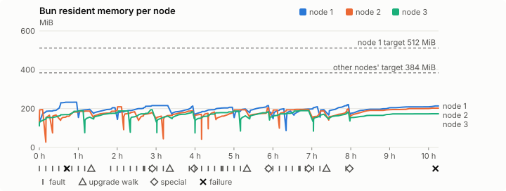
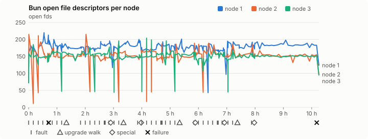
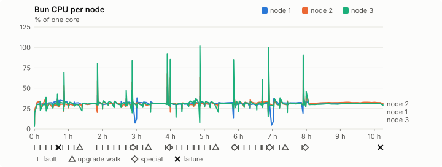
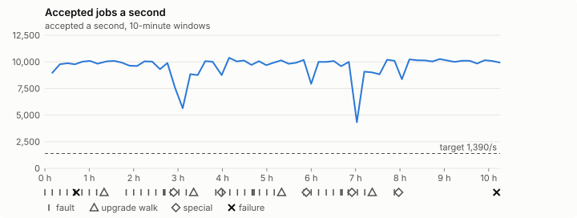

# Sustained soak (V02): FAIL

5 November 2026. final tier, full schedule, 10 h 15 min of soak on a three-node quickstart cluster.

**Final tier: not clean. The V02 gate does not pass.** A product fix means a fresh fast-tier run, then a fresh final-tier run.

## Candidate and host

| | |
|---|---|
| Staged base URL | <https://github.com/reliaburger/reliaburger/releases/download/staging-v0.2.6-42011462991-1> |
| `candidate.json` SHA-256 | `a2f53404505c130fa2331b4c44ad4122f7f6a2e16bbeb09ae167a170313128c3` |
| Running versions | v0.2.6 x3 |
| Soak build | `bun-v0.2.6-soak.1`, SHA-256 `8bafddedfa976f7e816f3d2478fd78d27e2cce713f262eb6c611cbe7d7f82775` |
| Walks roll back to | 0.2.6 |
| Host | macOS 27.2, Apple M5 Max, 128 GiB |
| Lima | limactl version 2.2.1 |
| Guest | Ubuntu 24.04.5 LTS, kernel 6.8.0-139-generic |
| RELIABURGER_HOME | `/tmp/rbq.GpF3A0` |
| Evidence | `/Users/miko/github/rb-wt/gate-026-data/qual/ev-jobs-final` |

## Configuration deviations

- node.toml `[testing] allowed_operations` adds `provision_isolated_workloads` (quickstart allows only inject_workload_faults and alter_node_state), so the catalogue pulse can lease test namespaces
- node.toml `[logs]`/`[metrics]` export to file:///var/lib/reliaburger/soak-export every 60 s with max_storage_mb = 8 (the harness deletes a metrics export 30 minutes after its source has gone), `[storage.snapshots]` every 900 s (compressed: 120 s), retain 4, uploaded to the same directory
- node.toml `[ingress] tls_cert/tls_key` point at an operator pair from a soak CA, 45-minute leaves rotated by the harness
- Bun runs with auto/mixed; host jobs opt in to a single pinned BusyBox copy under /var/lib/reliaburger/soak-jobs, mount_isolation=false. The independent verifier listens on each private VM address, TCP 8189, with a separate run token
- node.toml `[node.labels] soak-volume` = "writer" on node 2 and "redis" on node 3, to pin the volume apps
- node.toml `[upgrades] external_signing_key` = a throwaway operator key the harness made for this run (`ed25519:aid15zNRB493ga1I+6KvLzbToeWg2MdfLJ8SqJ0Y3Qw=`); the soak build's `.sig` gets that key's external signature beside the release one (D2)
- node.toml `[security] leaf_lifetime_override_secs = 3600` (D1)

## Timeline

- Started 2026-11-05 15:12:19 UTC, finished 2026-11-06 01:27:40 UTC
- Cycles completed: 8
- Fault and node choices: 35, from seed 1204485687 (`--seed 1204485687` repeats them)
- Teardown: `relish local destroy --yes` and `relish uninstall --yes` succeeded

## Faults and slots

| Class | Runs | Settled/ok | Failed | Skipped | Settle (median / max) |
|---|---|---|---|---|---|
| fault:bun-kill-follower | 8 | 8 | 0 | 0 | 33 s / 36 s |
| fault:bun-kill-leader | 8 | 8 | 0 | 0 | 33 s / 37 s |
| fault:chaos-cpu | 1 | 2 | 0 | 0 | 17 s / 17 s |
| fault:chaos-delay | 2 | 4 | 0 | 0 | 17 s / 17 s |
| fault:chaos-dns | 1 | 2 | 0 | 0 | 16 s / 16 s |
| fault:chaos-drop | 1 | 2 | 0 | 0 | 18 s / 18 s |
| fault:chaos-kill | 2 | 4 | 0 | 0 | 51 s / 51 s |
| fault:chaos-memory | 1 | 2 | 0 | 0 | 18 s / 18 s |
| fault:chaos-partition | 2 | 3 | 1 | 0 | 19 s / 19 s |
| fault:chaos-pause | 1 | 2 | 0 | 0 | 26 s / 26 s |
| fault:chaos-scenario | 1 | 2 | 0 | 0 | 18 s / 18 s |
| fault:deploy-kill | 4 | 4 | 0 | 0 | 36 s / 36 s |
| fault:node-delay | 3 | 3 | 0 | 0 | 31 s / 31 s |
| fault:node-disk-full | 3 | 3 | 0 | 0 | 17 s / 18 s |
| fault:node-slow-fsync | 2 | 2 | 0 | 0 | 71 s / 71 s |
| fault:power-off | 4 | 4 | 0 | 0 | 33 s / 36 s |
| pulse | 8 | 8 | 0 | 0 | n/a |
| pulse:settle | 0 | 8 | 0 | 0 | 17 s / 19 s |
| special:all-off | 1 | 1 | 0 | 0 | 58 s / 58 s |
| special:graceful-stop | 2 | 2 | 0 | 0 | 45 s / 45 s |
| special:quorum-back | 2 | 2 | 0 | 0 | n/a |
| special:quorum-loss | 2 | 2 | 0 | 0 | 44 s / 44 s |
| storage:offline-export | 1 | 1 | 0 | 0 | n/a |
| storage:registry-push | 8 | 0 | 0 | 0 | n/a |
| tls:invalid-expired | 15 | 15 | 0 | 0 | n/a |
| tls:invalid-torn | 15 | 15 | 0 | 0 | n/a |
| tls:reload | 118 | 118 | 0 | 0 | n/a |
| upgrade:rollback | 4 | 4 | 0 | 0 | n/a |
| upgrade:settle | 0 | 4 | 0 | 0 | 56 s / 59 s |
| upgrade:upgrade | 4 | 4 | 0 | 0 | n/a |

## Execution inventory (gated)

What the run completed, from its events and kept bytes, against what its schedule owes. A fault counts once it was injected and the cluster settled after it.

| Item | Required | Completed | Verdict |
|---|---|---|---|
| candidate.json bytes match the qualified digest | 1 | 1 | ok |
| app workloads settled at the baseline | 1 | 1 | ok |
| upgrade walk (to the soak build and back) | 4 | 4 | ok |
| fault:bun-kill-follower | 1 | 8 | ok |
| fault:bun-kill-leader | 1 | 8 | ok |
| fault:deploy-kill | 1 | 4 | ok |
| fault:power-off | 1 | 4 | ok |
| fault:chaos-kill | 1 | 2 | ok |
| fault:chaos-delay | 1 | 2 | ok |
| fault:chaos-partition | 1 | 1 | ok |
| fault:chaos-scenario | 1 | 1 | ok |
| fault:chaos-pause | 1 | 1 | ok |
| fault:chaos-drop | 1 | 1 | ok |
| fault:chaos-dns | 1 | 1 | ok |
| fault:chaos-cpu | 1 | 1 | ok |
| fault:chaos-memory | 1 | 1 | ok |
| fault:node-delay | 1 | 3 | ok |
| fault:node-disk-full | 1 | 3 | ok |
| fault:node-slow-fsync | 1 | 2 | ok |
| special:graceful-stop | 2 | 2 | ok |
| special:quorum-loss | 2 | 2 | ok |
| special:all-off | 1 | 1 | ok |
| catalogue pulse | 8 | 8 | ok |
| offline export | 1 | 1 | ok |
| quiet tail with no faults, walks or specials | 1 | 1 | ok |
| job campaign drained in its final two minutes | 1 | 1 | ok |

## Observed fault effects

What each injected fault was seen to do, read back from the node.

| Fault | Target | Observed |
|---|---|---|
| effect:bun-kill-follower | rb-d24ee089dfd0-1 | MainPID 8713 -> 12177 |
| effect:bun-kill-leader | rb-d24ee089dfd0-2 | MainPID 2474 -> 2319271 |
| effect:deploy-kill | rb-d24ee089dfd0-2 | MainPID 2319271 -> 751218 |
| effect:power-off | rb-d24ee089dfd0-2 | Lima status Stopped |
| effect:node-delay | rb-d24ee089dfd0-1 | netem 8001: root refcnt 2 limit 1000 delay 200ms  50ms  |
| effect:bun-kill-follower | rb-d24ee089dfd0-1 | MainPID 12177 -> 2503556 |
| effect:bun-kill-leader | rb-d24ee089dfd0-3 | MainPID 2257 -> 1830919 |
| effect:node-disk-full | rb-d24ee089dfd0-2 | available 67059712 bytes  |
| effect:bun-kill-follower | rb-d24ee089dfd0-1 | MainPID 2503556 -> 1109175 |
| effect:bun-kill-leader | rb-d24ee089dfd0-2 | MainPID 683 -> 254511 |
| effect:deploy-kill | rb-d24ee089dfd0-3 | MainPID 578893 -> 3378321 |
| effect:power-off | rb-d24ee089dfd0-2 | Lima status Stopped |
| effect:node-slow-fsync | rb-d24ee089dfd0-3 | IOWriteBandwidthMax=/dev/vda 1000000 IOWriteIOPSMax=/dev/vda 20  |
| effect:bun-kill-follower | rb-d24ee089dfd0-3 | MainPID 680 -> 204089 |
| effect:bun-kill-leader | rb-d24ee089dfd0-2 | MainPID 680 -> 2781395 |
| effect:node-delay | rb-d24ee089dfd0-2 | netem 8001: root refcnt 2 limit 1000 delay 200ms  50ms  |
| effect:bun-kill-follower | rb-d24ee089dfd0-3 | MainPID 677 -> 287272 |
| effect:bun-kill-leader | rb-d24ee089dfd0-2 | MainPID 683 -> 2985308 |
| effect:deploy-kill | rb-d24ee089dfd0-2 | MainPID 2985308 -> 1471420 |
| effect:power-off | rb-d24ee089dfd0-2 | Lima status Stopped |
| effect:node-disk-full | rb-d24ee089dfd0-3 | available 67010560 bytes  |
| effect:bun-kill-follower | rb-d24ee089dfd0-1 | MainPID 684 -> 3586137 |
| effect:bun-kill-leader | rb-d24ee089dfd0-3 | MainPID 287272 -> 1722852 |
| effect:node-slow-fsync | rb-d24ee089dfd0-1 | IOWriteBandwidthMax=/dev/vda 1000000 IOWriteIOPSMax=/dev/vda 20  |
| effect:bun-kill-follower | rb-d24ee089dfd0-1 | MainPID 680 -> 1330319 |
| effect:bun-kill-leader | rb-d24ee089dfd0-2 | MainPID 679 -> 4011449 |
| effect:deploy-kill | rb-d24ee089dfd0-1 | MainPID 1330319 -> 2358603 |
| effect:power-off | rb-d24ee089dfd0-1 | Lima status Stopped |
| effect:node-delay | rb-d24ee089dfd0-3 | netem 8001: root refcnt 2 limit 1000 delay 200ms  50ms  |
| effect:bun-kill-follower | rb-d24ee089dfd0-3 | MainPID 677 -> 220753 |
| effect:bun-kill-leader | rb-d24ee089dfd0-1 | MainPID 680 -> 327257 |
| effect:node-disk-full | rb-d24ee089dfd0-1 | available 67080192 bytes  |

## Renewals and rotations

| Measure | Observed | Required | Verdict |
|---|---|---|---|
| workload identity rotations (soak-identity, per node) | 24 | ≥ 19 | PASS |
| node leaf renewals (per node) | 22 | ≥ 19 | PASS |
| operator ingress reloads (all nodes) | 118 | ≥ 40 | PASS |
| mixed job campaign and positive drain | 0 missing/failing checks | 0 | PASS |

## Latency SLOs

What a user should feel on a quiet three-node cluster (#1400). Every sample is taken outside fault windows and through a host forward that works; each p99 is the upper bound of its histogram bucket.

| SLO | p99 | Threshold | Samples | Mode | Verdict |
|---|---|---|---|---|---|
| API read p99 | 150 ms | ≤ 1,000 ms | 6,384 | record only | PASS |
| API write p99 | 1,500 ms | ≤ 2,000 ms | 20 | record only | PASS |
| App start p99 | 1 ms | ≤ 5,000 ms | 60 | record only | PASS |
| Rolling update p99 | 50,000 ms | ≤ 30,000 ms | 20 | record only | over (record only) |
| Job task start p99 | 32 ms | ≤ 256 ms | 225,579,003 | gated | PASS |

- API read p99: `GET /v1/status?cluster=true` and `GET /v1/cluster/nodes` on every node, at every light check
- API write p99: `relish apply` of the soak workloads, from the call to the commit
- App start p99: each node's deploy of a new `soak-identity` instance, from its start to the instance running
- Rolling update p99: from `relish apply` returning to every node's `soak-identity` running the new spec
- Job task start p99: a job task's start lag on a pooled executor, from the job campaign's buckets, in runs no fault window overlapped
- Record only from 28 October 2026 (#1400): no soak before 0.2.4 measured it. The threshold is provisional; the first 0.2.4 fast and final records set the gate.

## Jobs

| Runtime | Accepted successes | Retries | Last accepted progress |
|---|---|---|---|
| runc | 102402 | 2 | 1793928442 |
| shared-runc | 94148512 | 1 | 1793928442 |
| process | 259373134 | 1 | 1793928442 |

The bounded campaign shares the app soak's fault schedule. These counts are reliability evidence, not a saturation rate or a 100-million-per-day qualification.

- Independent verifier execution attempts: 24
- Explicit test-operator acknowledgements for known replay-safe fenced fixtures: 187

- rb-d24ee089dfd0-1: latest complete job storage (KiB) {'instances': 2780, 'job-state': 8, 'task-arrays': 18228}; free 4603744 KiB; live/peak owners 0/31; peak storage {'instances': 24280, 'job-state': 8, 'task-arrays': 54168}
- rb-d24ee089dfd0-2: latest complete job storage (KiB) {'instances': 1124, 'job-state': 8, 'task-arrays': 32636}; free 5544300 KiB; live/peak owners 0/32; peak storage {'instances': 24400, 'job-state': 8, 'task-arrays': 55096}
- rb-d24ee089dfd0-3: latest complete job storage (KiB) {'instances': 2176, 'job-state': 8, 'task-arrays': 18564}; free 6026028 KiB; live/peak owners 0/30; peak storage {'instances': 25520, 'job-state': 8, 'task-arrays': 58804}

Complete disk inventories are recorded. Global retention bounds and the 12-hour job qualification remain #668; this gate cannot certify an unimplemented retention policy.

## Job qualification (D18-C)

Load: target; 3 nodes; accepted 9,580.2/s against a 1390.0/s target: PASS.

The September plan set its targets for one 1M-task batch on a quiet cluster. A soak runs for hours with restarts, upgrades and apps, so its storage, Bun memory and Raft targets are restated (maintainer decision, 15 October 2026, [#668](https://github.com/reliaburger/reliaburger/issues/668)). Bun's steady state is the median RSS of each process once it has been seen for 10 minutes; the gated memory checks are unchanged (`leak-rss`, and Mayo's 70% `memory_high` alert through `wtf`).

| Measure (recorded, not gated) | Observed | Target |
|---|---|---|
| Wall time of a 1,048,576-task array (median / max of 64) | 139 s / 414 s | ≤ 600 s |
| p99 start lag, pooled executors | 32 ms (bucket upper bound) | < 1,000 ms |
| Raft entries per second, all cluster writes | 5.20 | recorded only; the batch target counts only task-array writes |
| Raft state of one run, largest seen | 16,616 B | ≤ 256 KiB per 1M tasks |
| Bun steady-state RSS per process, worst node against its target | rb-d24ee089dfd0-2: 195.91 MiB steady, 209.38 MiB peak | ≤ 384 MiB (≤ 512 MiB on node 1, which serves the API) |
| Bun CPU, busiest node | 0.31 cores | ≤ 1 core (leader batch control) |
| Executor helper CPU, busiest node | 0.04 cores | ≤ 0.5 core |
| Node task-array storage per 1M accepted tasks (peaks summed) | 0.46 MiB | ≤ 64 MiB, deleted after retirement |
| Retained log volume, all nodes | 27.95 MB | ≤ 50 MB |

- Bun RSS on rb-d24ee089dfd0-1 (serves the API, target ≤ 512 MiB): pid 8713: 156.73 MiB peak (seen for under 10 minutes); pid 12177: 232.81 MiB steady, 232.96 MiB peak; pid 2503556: 194.13 MiB steady, 196.28 MiB peak; pid 2503556: 198.50 MiB steady, 204.83 MiB peak; pid 1109175: 212.36 MiB steady, 215.82 MiB peak; pid 1109175: 205.76 MiB steady, 213.57 MiB peak; pid 684: 201.61 MiB steady, 206.62 MiB peak; pid 3586137: 193.49 MiB steady, 198.14 MiB peak; pid 3586137: 214.35 MiB steady, 215.51 MiB peak; pid 680: 182.17 MiB peak (seen for under 10 minutes); pid 1330319: 196.27 MiB steady, 199.33 MiB peak; pid 2358603: 187.59 MiB peak (seen for under 10 minutes); pid 680: 197.88 MiB steady, 209.60 MiB peak; pid 327257: 194.62 MiB peak (seen for under 10 minutes); pid 327257: 215.24 MiB steady, 220.89 MiB peak; pid 686: 205.33 MiB steady, 213.70 MiB peak
- Bun RSS on rb-d24ee089dfd0-2 (node, target ≤ 384 MiB): pid 2474: 195.12 MiB peak (seen for under 10 minutes); pid 2319271: 166.43 MiB peak (seen for under 10 minutes); pid 751218: 167.51 MiB peak (seen for under 10 minutes); pid 683: 182.46 MiB steady, 187.28 MiB peak; pid 683: 186.38 MiB steady, 209.38 MiB peak; pid 254511: 180.03 MiB steady, 183.97 MiB peak; pid 687: 176.25 MiB steady, 179.68 MiB peak; pid 680: 161.15 MiB peak (seen for under 10 minutes); pid 2781395: 164.10 MiB peak (seen for under 10 minutes); pid 2781395: 187.95 MiB steady, 188.30 MiB peak; pid 683: 170.45 MiB steady, 170.45 MiB peak; pid 2985308: 175.89 MiB peak (seen for under 10 minutes); pid 1471420: 182.62 MiB peak (seen for under 10 minutes); pid 681: 175.62 MiB steady, 194.27 MiB peak; pid 681: 195.57 MiB steady, 204.04 MiB peak; pid 679: 193.11 MiB steady, 193.11 MiB peak; pid 4011449: 195.91 MiB steady, 196.06 MiB peak; pid 679: 187.41 MiB steady, 188.27 MiB peak; pid 679: 188.45 MiB steady, 198.39 MiB peak; pid 681: 195.23 MiB steady, 202.59 MiB peak
- Bun RSS on rb-d24ee089dfd0-3 (node, target ≤ 384 MiB): pid 2257: 169.30 MiB steady, 188.88 MiB peak; pid 1830919: 156.07 MiB peak (seen for under 10 minutes); pid 578893: 177.36 MiB steady, 187.84 MiB peak; pid 3378321: 174.65 MiB steady, 194.44 MiB peak; pid 680: 139.45 MiB peak (seen for under 10 minutes); pid 204089: 155.96 MiB steady, 161.23 MiB peak; pid 204089: 178.71 MiB steady, 183.97 MiB peak; pid 677: 155.43 MiB peak (seen for under 10 minutes); pid 287272: 179.27 MiB steady, 187.28 MiB peak; pid 1722852: 162.59 MiB peak (seen for under 10 minutes); pid 684: 181.18 MiB steady, 183.67 MiB peak; pid 684: 187.77 MiB steady, 189.62 MiB peak; pid 677: 143.63 MiB peak (seen for under 10 minutes); pid 220753: 163.37 MiB steady, 171.05 MiB peak; pid 220753: 175.46 MiB steady, 182.21 MiB peak; pid 681: 172.84 MiB steady, 173.49 MiB peak

- runc retry causes: exit_code 1, launch 0, signal 0, timeout 0, unknown 1, unrecorded 0
- shared-runc retry causes: exit_code 1, launch 0, signal 0, timeout 0, unknown 0, unrecorded 0
- process retry causes: exit_code 1, launch 0, signal 0, timeout 0, unknown 0, unrecorded 0
- Audited executions: 24; operator replay decisions: 187
- Job controller API fallbacks: rb-d24ee089dfd0-1 missed 893, rb-d24ee089dfd0-2 missed 28; rb-d24ee089dfd0-2 answered 865, rb-d24ee089dfd0-3 answered 28 (requests a node didn't answer, and the node that took them instead)

## Data

- Volume writer: highest ACK 282342 in the log view; the writer file checks (writer-lost, writer-regression) decide data loss, and `*-log-order` failures are about the order the log view returned lines in
- Redis counter: highest INCR 33342 in the log view
- Export rb-d24ee089dfd0-1: 187 source files, 553 at the destination
- Export rb-d24ee089dfd0-2: 550 source files, 770 at the destination
- Export rb-d24ee089dfd0-3: 310 source files, 431 at the destination
- Registry images pushed and re-verified: 9
- Agent-loop turns over the 1 s budget: rb-d24ee089dfd0-1 1, rb-d24ee089dfd0-2 0, rb-d24ee089dfd0-3 0
- Soak policies checked in force: 292 times, policy generation 78 at the last check
- Guest clock steps by Lima's guest agent: rb-d24ee089dfd0-1 4, rb-d24ee089dfd0-2 7, rb-d24ee089dfd0-3 5
- Checks evaluated: 1331 (heavy 126, light 1039, settle 166)
- Last observed progress: redis-counter 33342, writer-ack 282342

## Council history (linearizability)

Every test-lease grant, renew, read and release the history client made, checked against a model of the council's leases. A write with no answer may or may not have happened; the check allows both.

- Operations checked: 212068 of 212068, in 2 namespaces; 5295 writes had no answer
- Verdict: linearizable

## Leak-checker exposure (gated)

How long each leak checker could judge each node's Bun. `leak-rss` arms after 60 minutes in one process and `leak-fd` after 50; a restart, kill or upgrade exec starts the warm-up again. A final needs each armed for 60 minutes on every node, with one unbroken window of 30 (#1062); its quiet tail gives them that.

| Node | Checker | Armed | Longest armed window | Evaluated samples | Processes armed | Verdict |
|---|---|---|---|---|---|---|
| rb-d24ee089dfd0-1 | leak-rss | 92 min | 75 min | 30 | 2 | ok |
| rb-d24ee089dfd0-1 | leak-fd | 125 min | 85 min | 55 | 4 | ok |
| rb-d24ee089dfd0-2 | leak-rss | 75 min | 75 min | 16 | 1 | ok |
| rb-d24ee089dfd0-2 | leak-fd | 85 min | 85 min | 18 | 1 | ok |
| rb-d24ee089dfd0-3 | leak-rss | 90 min | 75 min | 27 | 4 | ok |
| rb-d24ee089dfd0-3 | leak-fd | 127 min | 85 min | 51 | 5 | ok |

## Resource trends

| Node | Measure | First | Last | Max |
|---|---|---|---|---|
| rb-d24ee089dfd0-1 | disk_kb data | 1382792 | 1339412 | 1470684 |
| rb-d24ee089dfd0-1 | disk_kb images | 342456 | 359312 | 474012 |
| rb-d24ee089dfd0-1 | disk_kb logs | 32 | 8540 | 8844 |
| rb-d24ee089dfd0-1 | disk_kb metrics | 76 | 8452 | 8976 |
| rb-d24ee089dfd0-1 | disk_kb soak-export | 4 | 46420 | 46420 |
| rb-d24ee089dfd0-1 | disk_kb volumes | 248 | 228 | 252 |
| rb-d24ee089dfd0-1 | fd | 109 | 124 | 220 |
| rb-d24ee089dfd0-1 | rss_anon_kb | 78440 | 140784 | 160384 |
| rb-d24ee089dfd0-1 | rss_file_kb | 72928 | 78048 | 78432 |
| rb-d24ee089dfd0-1 | rss_kb | 151368 | 218832 | 238548 |
| rb-d24ee089dfd0-2 | disk_kb data | 71808 | 143568 | 508716 |
| rb-d24ee089dfd0-2 | disk_kb images | 172188 | 346716 | 346716 |
| rb-d24ee089dfd0-2 | disk_kb logs | 24 | 8916 | 9396 |
| rb-d24ee089dfd0-2 | disk_kb metrics | 28 | 8488 | 8944 |
| rb-d24ee089dfd0-2 | disk_kb soak-export | 4 | 21420 | 21992 |
| rb-d24ee089dfd0-2 | disk_kb volumes | 16760 | 23428 | 23428 |
| rb-d24ee089dfd0-2 | fd | 80 | 97 | 215 |
| rb-d24ee089dfd0-2 | rss_anon_kb | 52696 | 129948 | 136416 |
| rb-d24ee089dfd0-2 | rss_file_kb | 72864 | 77504 | 78304 |
| rb-d24ee089dfd0-2 | rss_kb | 125560 | 207452 | 214400 |
| rb-d24ee089dfd0-3 | disk_kb data | 234548 | 467952 | 636652 |
| rb-d24ee089dfd0-3 | disk_kb images | 339124 | 354996 | 354996 |
| rb-d24ee089dfd0-3 | disk_kb logs | 24 | 8676 | 9056 |
| rb-d24ee089dfd0-3 | disk_kb metrics | 28 | 8444 | 8928 |
| rb-d24ee089dfd0-3 | disk_kb soak-export | 4 | 33552 | 33948 |
| rb-d24ee089dfd0-3 | disk_kb volumes | 16784 | 19320 | 19320 |
| rb-d24ee089dfd0-3 | fd | 72 | 95 | 204 |
| rb-d24ee089dfd0-3 | rss_anon_kb | 42492 | 101636 | 122020 |
| rb-d24ee089dfd0-3 | rss_file_kb | 71136 | 76020 | 78236 |
| rb-d24ee089dfd0-3 | rss_kb | 113628 | 177656 | 199108 |

## Charts

Time runs from the start of the soak. The marks under each chart are its faults, upgrade walks, specials and recorded failures; the dashed lines are targets.

## Failures

| # | First seen | Check | Symptom | Class | Cause | Action |
|---|---|---|---|---|---|---|
| 1 | 15:54:34 | chaos-partition | error: API error (status 400): {"error":"fault rejected: no running instance of source app soak-redis-client on this node has a verified workload cgroup"}  | unclassified | open | open |
| 2 | 01:22:57 | heavy-check | fail: agent-loop-turn rb-d24ee089dfd0-1: 1 follow_up turn(s) over the 1 s budget, the worst between 1 and 2.5 s; | unclassified | open | open |

Evidence: `/Users/miko/github/rb-wt/gate-026-data/qual/ev-jobs-final` (events.jsonl, snapshots/, failures/<n>/).
