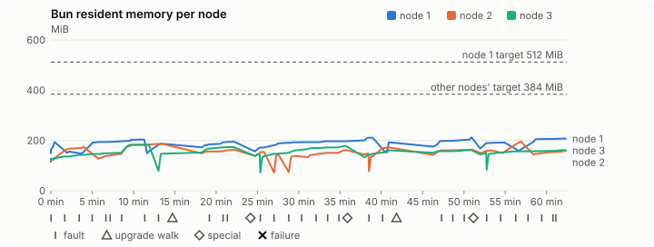
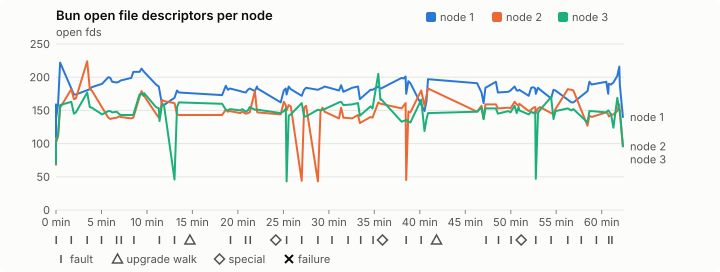
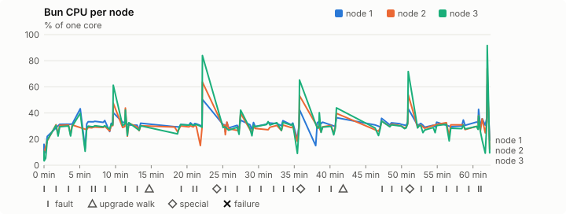
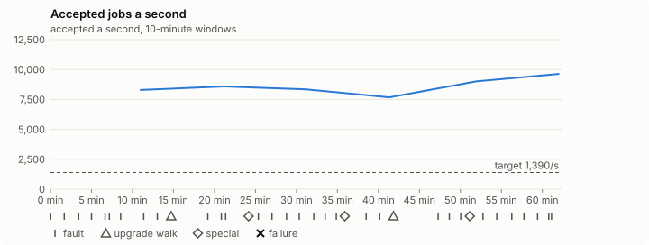

# Sustained soak (V02): PASS

7 November 2026. fast tier, compressed schedule, 1 h 02 min of soak on a three-node quickstart cluster.

**Fast tier: clean.** The iteration loop only, not acceptance: the V02 gate needs a clean final-tier run (8 h, full schedule) on the final candidate.

## Candidate and host

| | |
|---|---|
| Staged base URL | <https://github.com/reliaburger/reliaburger/releases/download/staging-v0.2.7-42320339626-1> |
| `candidate.json` SHA-256 | `4d7123125e8ad5999513c2d8990b01eefed58380cb8db292c75737e398bcc481` |
| Running versions | v0.2.7 x3 |
| Soak build | `bun-v0.2.7-soak.1`, SHA-256 `f6744cbea182fbc89b2c576862af6fbf33f448f4bedbb9e67b7afdd36345c71c` |
| Walks roll back to | 0.2.7 |
| Host | macOS 27.2, Apple M5 Max, 128 GiB |
| Lima | limactl version 2.2.1 |
| Guest | Ubuntu 24.04.5 LTS, kernel 6.8.0-139-generic |
| RELIABURGER_HOME | `/tmp/rbq.jBlsvQ` |
| Evidence | `/Users/miko/github/rb-wt/gate-027-data/qual/ev-jobs-fast` |

## Configuration deviations

- node.toml `[testing] allowed_operations` adds `provision_isolated_workloads` (quickstart allows only inject_workload_faults and alter_node_state), so the catalogue pulse can lease test namespaces
- node.toml `[logs]`/`[metrics]` export to file:///var/lib/reliaburger/soak-export every 60 s with max_storage_mb = 8 (the harness deletes a metrics export 30 minutes after its source has gone), `[storage.snapshots]` every 900 s (compressed: 120 s), retain 4, uploaded to the same directory
- node.toml `[ingress] tls_cert/tls_key` point at an operator pair from a soak CA, 45-minute leaves rotated by the harness
- Bun runs with auto/mixed; host jobs opt in to a single pinned BusyBox copy under /var/lib/reliaburger/soak-jobs, mount_isolation=false. The independent verifier listens on each private VM address, TCP 8189, with a separate run token
- node.toml `[node.labels] soak-volume` = "writer" on node 2 and "redis" on node 3, to pin the volume apps
- node.toml `[upgrades] external_signing_key` = a throwaway operator key the harness made for this run (`ed25519:XqmFElsBjxLBDhn+2gRveFyfmjqowxwP+pDcPey5DV0=`); the soak build's `.sig` gets that key's external signature beside the release one (D2)
- node.toml `[security] leaf_lifetime_override_secs = 3600` (D1)

## Timeline

- Started 2026-11-07 04:48:37 UTC, finished 2026-11-07 05:51:04 UTC
- Cycles completed: 5
- Fault and node choices: 27, from seed 254944835 (`--seed 254944835` repeats them)
- Teardown: `relish local destroy --yes` and `relish uninstall --yes` succeeded

## Faults and slots

| Class | Runs | Settled/ok | Failed | Skipped | Settle (median / max) |
|---|---|---|---|---|---|
| fault:bun-kill-follower | 5 | 5 | 0 | 0 | 32 s / 33 s |
| fault:bun-kill-leader | 5 | 5 | 0 | 0 | 33 s / 39 s |
| fault:chaos-cpu | 1 | 2 | 0 | 0 | 18 s / 18 s |
| fault:chaos-delay | 1 | 2 | 0 | 0 | 16 s / 16 s |
| fault:chaos-dns | 1 | 2 | 0 | 0 | 17 s / 17 s |
| fault:chaos-drop | 1 | 2 | 0 | 0 | 17 s / 17 s |
| fault:chaos-kill | 2 | 4 | 0 | 0 | 30 s / 30 s |
| fault:chaos-memory | 1 | 2 | 0 | 0 | 17 s / 17 s |
| fault:chaos-partition | 1 | 2 | 0 | 0 | 17 s / 17 s |
| fault:chaos-pause | 1 | 2 | 0 | 0 | 17 s / 17 s |
| fault:chaos-scenario | 1 | 2 | 0 | 0 | 31 s / 31 s |
| fault:deploy-kill | 3 | 3 | 0 | 0 | 40 s / 47 s |
| fault:node-delay | 2 | 2 | 0 | 0 | 31 s / 31 s |
| fault:node-disk-full | 2 | 2 | 0 | 0 | 17 s / 17 s |
| fault:node-slow-fsync | 1 | 1 | 0 | 0 | 17 s / 17 s |
| fault:power-off | 3 | 3 | 0 | 0 | 30 s / 34 s |
| pulse | 1 | 1 | 0 | 0 | n/a |
| pulse:settle | 0 | 1 | 0 | 0 | 22 s / 22 s |
| special:all-off | 1 | 1 | 0 | 0 | 47 s / 47 s |
| special:graceful-stop | 1 | 1 | 0 | 0 | 38 s / 38 s |
| special:quorum-back | 1 | 1 | 0 | 0 | n/a |
| special:quorum-loss | 1 | 1 | 0 | 0 | 29 s / 29 s |
| storage:offline-export | 2 | 2 | 0 | 0 | n/a |
| storage:registry-push | 5 | 0 | 0 | 0 | n/a |
| tls:invalid-expired | 3 | 3 | 0 | 0 | n/a |
| tls:invalid-torn | 3 | 3 | 0 | 0 | n/a |
| tls:reload | 29 | 29 | 0 | 0 | n/a |
| upgrade:rollback | 2 | 2 | 0 | 0 | n/a |
| upgrade:settle | 0 | 2 | 0 | 0 | 59 s / 59 s |
| upgrade:upgrade | 2 | 2 | 0 | 0 | n/a |

## Execution inventory (recorded, not gated)

What the run completed, from its events and kept bytes, against what its schedule owes. A fault counts once it was injected and the cluster settled after it.

| Item | Required | Completed | Verdict |
|---|---|---|---|
| candidate.json bytes match the qualified digest | 1 | 1 | ok |
| app workloads settled at the baseline | 1 | 1 | ok |
| upgrade walk (to the soak build and back) | 2 | 2 | ok |
| fault:bun-kill-follower | 1 | 5 | ok |
| fault:bun-kill-leader | 1 | 5 | ok |
| fault:deploy-kill | 1 | 3 | ok |
| fault:power-off | 1 | 3 | ok |
| fault:chaos-kill | 1 | 2 | ok |
| fault:chaos-delay | 1 | 1 | ok |
| fault:chaos-partition | 1 | 1 | ok |
| fault:chaos-scenario | 1 | 1 | ok |
| fault:chaos-pause | 1 | 1 | ok |
| fault:chaos-drop | 1 | 1 | ok |
| fault:chaos-dns | 1 | 1 | ok |
| fault:chaos-cpu | 1 | 1 | ok |
| fault:node-delay | 1 | 2 | ok |
| fault:node-disk-full | 1 | 2 | ok |
| fault:node-slow-fsync | 1 | 1 | ok |
| special:graceful-stop | 1 | 1 | ok |
| special:quorum-loss | 1 | 1 | ok |
| special:all-off | 1 | 1 | ok |
| catalogue pulse | 1 | 1 | ok |
| offline export | 2 | 2 | ok |
| job campaign drained in its final two minutes | 1 | 1 | ok |

## Observed fault effects

What each injected fault was seen to do, read back from the node.

| Fault | Target | Observed |
|---|---|---|
| effect:bun-kill-follower | rb-29064d3f1b57-2 | MainPID 2465 -> 4745 |
| effect:bun-kill-leader | rb-29064d3f1b57-1 | MainPID 8821 -> 315489 |
| effect:deploy-kill | rb-29064d3f1b57-1 | MainPID 315489 -> 683642 |
| effect:power-off | rb-29064d3f1b57-2 | Lima status Stopped |
| effect:node-delay | rb-29064d3f1b57-1 | netem 8001: root refcnt 2 limit 1000 delay 200ms  50ms  |
| effect:bun-kill-follower | rb-29064d3f1b57-1 | MainPID 683642 -> 2445534 |
| effect:bun-kill-leader | rb-29064d3f1b57-3 | MainPID 2241 -> 3134302 |
| effect:node-disk-full | rb-29064d3f1b57-2 | available 67072000 bytes  |
| effect:bun-kill-follower | rb-29064d3f1b57-3 | MainPID 683 -> 196400 |
| effect:bun-kill-leader | rb-29064d3f1b57-2 | MainPID 682 -> 627949 |
| effect:deploy-kill | rb-29064d3f1b57-2 | MainPID 627949 -> 1090412 |
| effect:power-off | rb-29064d3f1b57-2 | Lima status Stopped |
| effect:node-slow-fsync | rb-29064d3f1b57-3 | IOWriteBandwidthMax=/dev/vda 1000000 IOWriteIOPSMax=/dev/vda 20  |
| effect:bun-kill-follower | rb-29064d3f1b57-2 | MainPID 677 -> 321489 |
| effect:bun-kill-leader | rb-29064d3f1b57-1 | MainPID 683 -> 3591496 |
| effect:node-delay | rb-29064d3f1b57-2 | netem 8001: root refcnt 2 limit 1000 delay 200ms  50ms  |
| effect:bun-kill-follower | rb-29064d3f1b57-3 | MainPID 683 -> 231474 |
| effect:bun-kill-leader | rb-29064d3f1b57-2 | MainPID 677 -> 641933 |
| effect:deploy-kill | rb-29064d3f1b57-1 | MainPID 678 -> 1099791 |
| effect:power-off | rb-29064d3f1b57-2 | Lima status Stopped |
| effect:node-disk-full | rb-29064d3f1b57-3 | available 67067904 bytes  |

## Renewals and rotations

| Measure | Observed | Required | Verdict |
|---|---|---|---|
| workload identity rotations (soak-identity, per node) | 7 | ≥ 1 | PASS |
| node leaf renewals (per node) | 2 | ≥ 1 | PASS |
| operator ingress reloads (all nodes) | 29 | ≥ 11 | PASS |
| mixed job campaign and positive drain | 0 missing/failing checks | 0 | PASS |

## Latency SLOs

What a user should feel on a quiet three-node cluster (#1400). Every sample is taken outside fault windows and through a host forward that works; each p99 is the upper bound of its histogram bucket.

| SLO | p99 | Threshold | Samples | Mode | Verdict |
|---|---|---|---|---|---|
| API read p99 | 150 ms | ≤ 1,000 ms | 228 | record only | PASS |
| API write p99 | 150 ms | ≤ 2,000 ms | 7 | record only | PASS |
| App start p99 | 1 ms | ≤ 5,000 ms | 21 | record only | PASS |
| Rolling update p99 | 30,000 ms | ≤ 30,000 ms | 7 | record only | PASS |
| Job task start p99 | 1,024 ms | ≤ 256 ms | 20 | record only | too few samples |

- API read p99: `GET /v1/status?cluster=true` and `GET /v1/cluster/nodes` on every node, at every light check
- API write p99: `relish apply` of the soak workloads, from the call to the commit
- App start p99: each node's deploy of a new `soak-identity` instance, from its start to the instance running
- Rolling update p99: from `relish apply` returning to every node's `soak-identity` running the new spec
- Job task start p99: a job task's start lag on a pooled executor, from the job campaign's buckets, in runs no fault window overlapped
- Record only from 28 October 2026 (#1400): no soak before 0.2.4 measured it. The threshold is provisional; the first 0.2.4 fast and final records set the gate.
- Job task start p99 not judged: only 20 job task start samples, fewer than the 1,000 a p99 needs

## Jobs

| Runtime | Accepted successes | Retries | Last accepted progress |
|---|---|---|---|
| runc | 11057 | 2 | 1794030653 |
| shared-runc | 8424767 | 1 | 1794030653 |
| process | 23686975 | 1 | 1794030653 |

The bounded campaign shares the app soak's fault schedule. These counts are reliability evidence, not a saturation rate or a 100-million-per-day qualification.

- Independent verifier execution attempts: 24
- Explicit test-operator acknowledgements for known replay-safe fenced fixtures: 115

- rb-29064d3f1b57-1: latest complete job storage (KiB) {'instances': 2164, 'job-state': 8, 'task-arrays': 15232}; free 5196944 KiB; live/peak owners 0/31; peak storage {'instances': 24628, 'job-state': 8, 'task-arrays': 44276}
- rb-29064d3f1b57-2: latest complete job storage (KiB) {'instances': 460, 'job-state': 8, 'task-arrays': 15076}; free 6298888 KiB; live/peak owners 0/32; peak storage {'instances': 24080, 'job-state': 8, 'task-arrays': 43012}
- rb-29064d3f1b57-3: latest complete job storage (KiB) {'instances': 1496, 'job-state': 8, 'task-arrays': 13700}; free 6310636 KiB; live/peak owners 0/30; peak storage {'instances': 23040, 'job-state': 8, 'task-arrays': 44516}

Complete disk inventories are recorded. Global retention bounds and the 12-hour job qualification remain #668; this gate cannot certify an unimplemented retention policy.

## Job qualification (D18-C)

Load: target; 3 nodes; accepted 8,584.4/s against a 1390.0/s target: PASS.

The September plan set its targets for one 1M-task batch on a quiet cluster. A soak runs for hours with restarts, upgrades and apps, so its storage, Bun memory and Raft targets are restated (maintainer decision, 15 October 2026, [#668](https://github.com/reliaburger/reliaburger/issues/668)). Bun's steady state is the median RSS of each process once it has been seen for 10 minutes; the gated memory checks are unchanged (`leak-rss`, and Mayo's 70% `memory_high` alert through `wtf`).

| Measure (recorded, not gated) | Observed | Target |
|---|---|---|
| Wall time of a 1,048,576-task array (median / max of 30) | 166 s / 526 s | ≤ 600 s |
| p99 start lag, pooled executors | 32 ms (bucket upper bound) | < 1,000 ms |
| Raft entries per second, all cluster writes | 5.54 | recorded only; the batch target counts only task-array writes |
| Raft state of one run, largest seen | 9,153 B | ≤ 256 KiB per 1M tasks |
| Bun steady-state RSS per process, worst node against its target | rb-29064d3f1b57-3: 182.35 MiB steady, 182.36 MiB peak | ≤ 384 MiB (≤ 512 MiB on node 1, which serves the API) |
| Bun CPU, busiest node | 0.30 cores | ≤ 1 core (leader batch control) |
| Executor helper CPU, busiest node | 0.08 cores | ≤ 0.5 core |
| Node task-array storage per 1M accepted tasks (peaks summed) | 4.01 MiB | ≤ 64 MiB, deleted after retirement |
| Retained log volume, all nodes | 6.17 MB | ≤ 50 MB |

- Bun RSS on rb-29064d3f1b57-1 (serves the API, target ≤ 512 MiB): pid 8821: 193.59 MiB peak (seen for under 10 minutes); pid 315489: 155.64 MiB peak (seen for under 10 minutes); pid 683642: 203.54 MiB peak (seen for under 10 minutes); pid 2445534: 186.97 MiB peak (seen for under 10 minutes); pid 2445534: 195.60 MiB peak (seen for under 10 minutes); pid 683: 204.57 MiB steady, 210.62 MiB peak; pid 3591496: 192.80 MiB peak (seen for under 10 minutes); pid 3591496: 211.61 MiB peak (seen for under 10 minutes); pid 678: 191.50 MiB peak (seen for under 10 minutes); pid 1099791: 207.21 MiB peak (seen for under 10 minutes)
- Bun RSS on rb-29064d3f1b57-2 (node, target ≤ 384 MiB): pid 2465: 122.81 MiB peak (seen for under 10 minutes); pid 4745: 175.45 MiB peak (seen for under 10 minutes); pid 678: 186.12 MiB peak (seen for under 10 minutes); pid 678: 163.75 MiB peak (seen for under 10 minutes); pid 682: 153.98 MiB peak (seen for under 10 minutes); pid 627949: 146.34 MiB peak (seen for under 10 minutes); pid 1090412: 138.89 MiB peak (seen for under 10 minutes); pid 680: 161.94 MiB peak (seen for under 10 minutes); pid 677: 147.90 MiB peak (seen for under 10 minutes); pid 321489: 172.39 MiB peak (seen for under 10 minutes); pid 682: 164.55 MiB peak (seen for under 10 minutes); pid 677: 161.23 MiB peak (seen for under 10 minutes); pid 641933: 196.39 MiB peak (seen for under 10 minutes); pid 683: 158.27 MiB peak (seen for under 10 minutes)
- Bun RSS on rb-29064d3f1b57-3 (node, target ≤ 384 MiB): pid 2241: 182.35 MiB steady, 182.36 MiB peak; pid 3134302: 147.54 MiB peak (seen for under 10 minutes); pid 3645907: 173.49 MiB peak (seen for under 10 minutes); pid 683: 146.66 MiB peak (seen for under 10 minutes); pid 196400: 177.96 MiB steady, 177.96 MiB peak; pid 676: 160.80 MiB peak (seen for under 10 minutes); pid 676: 161.09 MiB peak (seen for under 10 minutes); pid 683: 152.66 MiB peak (seen for under 10 minutes); pid 231474: 161.63 MiB peak (seen for under 10 minutes)

- runc retry causes: exit_code 1, launch 1, signal 0, timeout 0, unknown 0, unrecorded 0
- shared-runc retry causes: exit_code 1, launch 0, signal 0, timeout 0, unknown 0, unrecorded 0
- process retry causes: exit_code 1, launch 0, signal 0, timeout 0, unknown 0, unrecorded 0
- Audited executions: 24; operator replay decisions: 115
- Job controller API fallbacks: rb-29064d3f1b57-1 missed 253, rb-29064d3f1b57-2 missed 14; rb-29064d3f1b57-2 answered 239, rb-29064d3f1b57-3 answered 14 (requests a node didn't answer, and the node that took them instead)

## Data

- Volume writer: highest ACK 28833 in the log view; the writer file checks (writer-lost, writer-regression) decide data loss, and `*-log-order` failures are about the order the log view returned lines in
- Redis counter: highest INCR 3139 in the log view
- Export rb-29064d3f1b57-1: 128 source files, 126 at the destination
- Export rb-29064d3f1b57-2: 122 source files, 112 at the destination
- Export rb-29064d3f1b57-3: 96 source files, 91 at the destination
- Registry images pushed and re-verified: 6
- Agent-loop turns over the 1 s budget: rb-29064d3f1b57-1 0, rb-29064d3f1b57-2 0, rb-29064d3f1b57-3 0
- Soak policies checked in force: 116 times, policy generation 36 at the last check
- Guest clock steps by Lima's guest agent: rb-29064d3f1b57-1 3, rb-29064d3f1b57-2 4, rb-29064d3f1b57-3 2
- Checks evaluated: 176 (heavy 15, light 60, settle 101)
- Last observed progress: redis-counter 3139, writer-ack 28833

## Council history (linearizability)

Every test-lease grant, renew, read and release the history client made, checked against a model of the council's leases. A write with no answer may or may not have happened; the check allows both.

- Operations checked: 20557 of 20557, in 2 namespaces; 1268 writes had no answer
- Verdict: linearizable

## Leak-checker exposure (recorded, not gated)

How long each leak checker could judge each node's Bun. `leak-rss` arms after 60 minutes in one process and `leak-fd` after 50; a restart, kill or upgrade exec starts the warm-up again. A final needs each armed for 60 minutes on every node, with one unbroken window of 30 (#1062); its quiet tail gives them that.

| Node | Checker | Armed | Longest armed window | Evaluated samples | Processes armed | Verdict |
|---|---|---|---|---|---|---|
| rb-29064d3f1b57-1 | leak-rss | 0 min | 0 min | 0 | 0 | short |
| rb-29064d3f1b57-1 | leak-fd | 0 min | 0 min | 0 | 0 | short |
| rb-29064d3f1b57-2 | leak-rss | 0 min | 0 min | 0 | 0 | short |
| rb-29064d3f1b57-2 | leak-fd | 0 min | 0 min | 0 | 0 | short |
| rb-29064d3f1b57-3 | leak-rss | 0 min | 0 min | 0 | 0 | short |
| rb-29064d3f1b57-3 | leak-fd | 0 min | 0 min | 0 | 0 | short |

## Resource trends

| Node | Measure | First | Last | Max |
|---|---|---|---|---|
| rb-29064d3f1b57-1 | disk_kb data | 1382832 | 1307988 | 1510792 |
| rb-29064d3f1b57-1 | disk_kb images | 342456 | 461684 | 461684 |
| rb-29064d3f1b57-1 | disk_kb logs | 32 | 4568 | 4568 |
| rb-29064d3f1b57-1 | disk_kb metrics | 72 | 4784 | 4784 |
| rb-29064d3f1b57-1 | disk_kb soak-export | 4 | 9208 | 9208 |
| rb-29064d3f1b57-1 | disk_kb volumes | 248 | 228 | 276 |
| rb-29064d3f1b57-1 | fd | 111 | 140 | 222 |
| rb-29064d3f1b57-1 | rss_anon_kb | 80508 | 133496 | 138380 |
| rb-29064d3f1b57-1 | rss_file_kb | 72796 | 78688 | 78688 |
| rb-29064d3f1b57-1 | rss_kb | 153304 | 212184 | 216684 |
| rb-29064d3f1b57-2 | disk_kb data | 71840 | 48464 | 441264 |
| rb-29064d3f1b57-2 | disk_kb images | 172188 | 342448 | 342448 |
| rb-29064d3f1b57-2 | disk_kb logs | 24 | 976 | 976 |
| rb-29064d3f1b57-2 | disk_kb metrics | 68 | 2612 | 2612 |
| rb-29064d3f1b57-2 | disk_kb soak-export | 4 | 4144 | 4144 |
| rb-29064d3f1b57-2 | disk_kb volumes | 16760 | 17312 | 17312 |
| rb-29064d3f1b57-2 | fd | 68 | 96 | 224 |
| rb-29064d3f1b57-2 | rss_anon_kb | 46440 | 85076 | 122928 |
| rb-29064d3f1b57-2 | rss_file_kb | 71328 | 76992 | 78176 |
| rb-29064d3f1b57-2 | rss_kb | 117768 | 162068 | 201104 |
| rb-29064d3f1b57-3 | disk_kb data | 234588 | 442144 | 488632 |
| rb-29064d3f1b57-3 | disk_kb images | 339124 | 342448 | 342448 |
| rb-29064d3f1b57-3 | disk_kb logs | 24 | 484 | 484 |
| rb-29064d3f1b57-3 | disk_kb metrics | 32 | 3460 | 3460 |
| rb-29064d3f1b57-3 | disk_kb soak-export | 4 | 3736 | 3736 |
| rb-29064d3f1b57-3 | disk_kb volumes | 16784 | 17112 | 17112 |
| rb-29064d3f1b57-3 | fd | 70 | 96 | 205 |
| rb-29064d3f1b57-3 | rss_anon_kb | 47372 | 88228 | 109212 |
| rb-29064d3f1b57-3 | rss_file_kb | 71188 | 77280 | 78560 |
| rb-29064d3f1b57-3 | rss_kb | 118560 | 165508 | 186736 |

## Charts

Time runs from the start of the soak. The marks under each chart are its faults, upgrade walks, specials and recorded failures; the dashed lines are targets.

## Failures

None.

Evidence: `/Users/miko/github/rb-wt/gate-027-data/qual/ev-jobs-fast` (events.jsonl, snapshots/, failures/<n>/).
