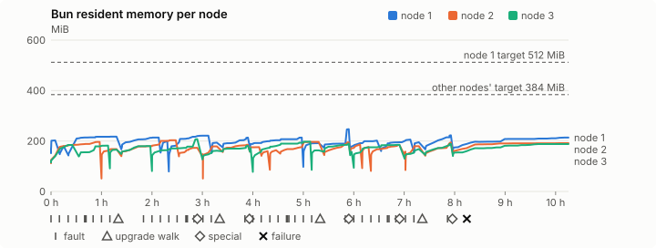
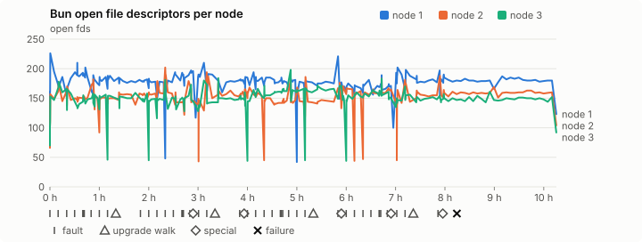
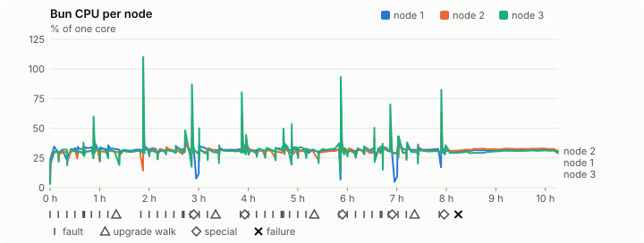
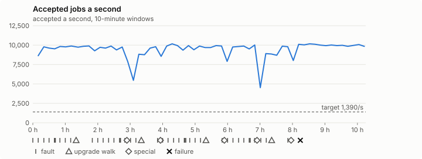

# Sustained soak (V02): FAIL

7 November 2026. final tier, full schedule, 10 h 15 min of soak on a three-node quickstart cluster.

**Final tier: not clean. The V02 gate does not pass.** A product fix means a fresh fast-tier run, then a fresh final-tier run.

## Candidate and host

| | |
|---|---|
| Staged base URL | <https://github.com/reliaburger/reliaburger/releases/download/staging-v0.2.7-42320339626-1> |
| `candidate.json` SHA-256 | `4d7123125e8ad5999513c2d8990b01eefed58380cb8db292c75737e398bcc481` |
| Running versions | v0.2.7 x3 |
| Soak build | `bun-v0.2.7-soak.1`, SHA-256 `f6744cbea182fbc89b2c576862af6fbf33f448f4bedbb9e67b7afdd36345c71c` |
| Walks roll back to | 0.2.7 |
| Host | macOS 27.2, Apple M5 Max, 128 GiB |
| Lima | limactl version 2.2.1 |
| Guest | Ubuntu 24.04.5 LTS, kernel 6.8.0-139-generic |
| RELIABURGER_HOME | `/tmp/rbq.mXBmcb` |
| Evidence | `/Users/miko/github/rb-wt/gate-027-data/qual/ev-jobs-final` |

## Configuration deviations

- node.toml `[testing] allowed_operations` adds `provision_isolated_workloads` (quickstart allows only inject_workload_faults and alter_node_state), so the catalogue pulse can lease test namespaces
- node.toml `[logs]`/`[metrics]` export to file:///var/lib/reliaburger/soak-export every 60 s with max_storage_mb = 8 (the harness deletes a metrics export 30 minutes after its source has gone), `[storage.snapshots]` every 900 s (compressed: 120 s), retain 4, uploaded to the same directory
- node.toml `[ingress] tls_cert/tls_key` point at an operator pair from a soak CA, 45-minute leaves rotated by the harness
- Bun runs with auto/mixed; host jobs opt in to a single pinned BusyBox copy under /var/lib/reliaburger/soak-jobs, mount_isolation=false. The independent verifier listens on each private VM address, TCP 8189, with a separate run token
- node.toml `[node.labels] soak-volume` = "writer" on node 2 and "redis" on node 3, to pin the volume apps
- node.toml `[upgrades] external_signing_key` = a throwaway operator key the harness made for this run (`ed25519:4SoyrSDUGDSnfIs1/LMhxbxyFkb8J+a1qU2u3IM4rao=`); the soak build's `.sig` gets that key's external signature beside the release one (D2)
- node.toml `[security] leaf_lifetime_override_secs = 3600` (D1)

## Timeline

- Started 2026-11-07 05:54:24 UTC, finished 2026-11-07 16:09:49 UTC
- Cycles completed: 8
- Fault and node choices: 35, from seed 1012599061 (`--seed 1012599061` repeats them)
- Teardown: `relish local destroy --yes` and `relish uninstall --yes` succeeded

## Faults and slots

| Class | Runs | Settled/ok | Failed | Skipped | Settle (median / max) |
|---|---|---|---|---|---|
| fault:bun-kill-follower | 8 | 8 | 0 | 0 | 33 s / 42 s |
| fault:bun-kill-leader | 8 | 8 | 0 | 0 | 34 s / 37 s |
| fault:chaos-cpu | 1 | 2 | 0 | 0 | 27 s / 27 s |
| fault:chaos-delay | 2 | 4 | 0 | 0 | 19 s / 19 s |
| fault:chaos-dns | 1 | 2 | 0 | 0 | 17 s / 17 s |
| fault:chaos-drop | 1 | 2 | 0 | 0 | 25 s / 25 s |
| fault:chaos-kill | 2 | 4 | 0 | 0 | 32 s / 32 s |
| fault:chaos-memory | 1 | 2 | 0 | 0 | 17 s / 17 s |
| fault:chaos-partition | 2 | 4 | 0 | 0 | 17 s / 17 s |
| fault:chaos-pause | 1 | 2 | 0 | 0 | 18 s / 18 s |
| fault:chaos-scenario | 1 | 2 | 0 | 0 | 18 s / 18 s |
| fault:deploy-kill | 4 | 4 | 0 | 0 | 38 s / 49 s |
| fault:node-delay | 3 | 3 | 0 | 0 | 31 s / 32 s |
| fault:node-disk-full | 3 | 3 | 0 | 0 | 17 s / 27 s |
| fault:node-slow-fsync | 2 | 2 | 0 | 0 | 19 s / 19 s |
| fault:power-off | 4 | 4 | 0 | 0 | 44 s / 47 s |
| pulse | 8 | 8 | 0 | 0 | n/a |
| pulse:settle | 0 | 8 | 0 | 0 | 18 s / 18 s |
| special:all-off | 1 | 1 | 0 | 0 | 45 s / 45 s |
| special:graceful-stop | 2 | 2 | 0 | 0 | 45 s / 45 s |
| special:quorum-back | 2 | 2 | 0 | 0 | n/a |
| special:quorum-loss | 2 | 2 | 0 | 0 | 58 s / 58 s |
| storage:offline-export | 1 | 1 | 0 | 0 | n/a |
| storage:registry-push | 8 | 0 | 0 | 0 | n/a |
| tls:invalid-expired | 15 | 15 | 0 | 0 | n/a |
| tls:invalid-torn | 15 | 15 | 0 | 0 | n/a |
| tls:reload | 118 | 118 | 0 | 0 | n/a |
| upgrade:rollback | 4 | 4 | 0 | 0 | n/a |
| upgrade:settle | 0 | 4 | 0 | 0 | 68 s / 69 s |
| upgrade:upgrade | 4 | 4 | 0 | 0 | n/a |

## Execution inventory (gated)

What the run completed, from its events and kept bytes, against what its schedule owes. A fault counts once it was injected and the cluster settled after it.

| Item | Required | Completed | Verdict |
|---|---|---|---|
| candidate.json bytes match the qualified digest | 1 | 1 | ok |
| app workloads settled at the baseline | 1 | 1 | ok |
| upgrade walk (to the soak build and back) | 4 | 4 | ok |
| fault:bun-kill-follower | 1 | 8 | ok |
| fault:bun-kill-leader | 1 | 8 | ok |
| fault:deploy-kill | 1 | 4 | ok |
| fault:power-off | 1 | 4 | ok |
| fault:chaos-kill | 1 | 2 | ok |
| fault:chaos-delay | 1 | 2 | ok |
| fault:chaos-partition | 1 | 2 | ok |
| fault:chaos-scenario | 1 | 1 | ok |
| fault:chaos-pause | 1 | 1 | ok |
| fault:chaos-drop | 1 | 1 | ok |
| fault:chaos-dns | 1 | 1 | ok |
| fault:chaos-cpu | 1 | 1 | ok |
| fault:chaos-memory | 1 | 1 | ok |
| fault:node-delay | 1 | 3 | ok |
| fault:node-disk-full | 1 | 3 | ok |
| fault:node-slow-fsync | 1 | 2 | ok |
| special:graceful-stop | 2 | 2 | ok |
| special:quorum-loss | 2 | 2 | ok |
| special:all-off | 1 | 1 | ok |
| catalogue pulse | 8 | 8 | ok |
| offline export | 1 | 1 | ok |
| quiet tail with no faults, walks or specials | 1 | 1 | ok |
| job campaign drained in its final two minutes | 1 | 1 | ok |

## Observed fault effects

What each injected fault was seen to do, read back from the node.

| Fault | Target | Observed |
|---|---|---|
| effect:bun-kill-follower | rb-10775b93d35b-3 | MainPID 2260 -> 3858 |
| effect:bun-kill-leader | rb-10775b93d35b-1 | MainPID 8726 -> 2195516 |
| effect:deploy-kill | rb-10775b93d35b-1 | MainPID 2195516 -> 570019 |
| effect:power-off | rb-10775b93d35b-3 | Lima status Stopped |
| effect:node-delay | rb-10775b93d35b-1 | netem 8001: root refcnt 2 limit 1000 delay 200ms  50ms  |
| effect:bun-kill-follower | rb-10775b93d35b-2 | MainPID 2469 -> 3081153 |
| effect:bun-kill-leader | rb-10775b93d35b-3 | MainPID 679 -> 1485278 |
| effect:node-disk-full | rb-10775b93d35b-2 | available 67055616 bytes  |
| effect:bun-kill-follower | rb-10775b93d35b-3 | MainPID 62297 -> 2017880 |
| effect:bun-kill-leader | rb-10775b93d35b-1 | MainPID 570019 -> 2780714 |
| effect:deploy-kill | rb-10775b93d35b-1 | MainPID 2780714 -> 1104858 |
| effect:power-off | rb-10775b93d35b-2 | Lima status Stopped |
| effect:node-slow-fsync | rb-10775b93d35b-3 | IOWriteBandwidthMax=/dev/vda 1000000 IOWriteIOPSMax=/dev/vda 20  |
| effect:bun-kill-follower | rb-10775b93d35b-2 | MainPID 681 -> 308281 |
| effect:bun-kill-leader | rb-10775b93d35b-1 | MainPID 1104858 -> 3801715 |
| effect:node-delay | rb-10775b93d35b-2 | netem 8001: root refcnt 2 limit 1000 delay 200ms  50ms  |
| effect:bun-kill-follower | rb-10775b93d35b-3 | MainPID 679 -> 923553 |
| effect:bun-kill-leader | rb-10775b93d35b-2 | MainPID 684 -> 3542016 |
| effect:deploy-kill | rb-10775b93d35b-2 | MainPID 3542016 -> 2072194 |
| effect:power-off | rb-10775b93d35b-2 | Lima status Stopped |
| effect:node-disk-full | rb-10775b93d35b-3 | available 67059712 bytes  |
| effect:bun-kill-follower | rb-10775b93d35b-1 | MainPID 678 -> 4073442 |
| effect:bun-kill-leader | rb-10775b93d35b-3 | MainPID 923553 -> 1678045 |
| effect:node-slow-fsync | rb-10775b93d35b-1 | IOWriteBandwidthMax=/dev/vda 1000000 IOWriteIOPSMax=/dev/vda 20  |
| effect:bun-kill-follower | rb-10775b93d35b-3 | MainPID 678 -> 1166357 |
| effect:bun-kill-leader | rb-10775b93d35b-2 | MainPID 683 -> 3632388 |
| effect:deploy-kill | rb-10775b93d35b-2 | MainPID 3632388 -> 2040016 |
| effect:power-off | rb-10775b93d35b-1 | Lima status Stopped |
| effect:node-delay | rb-10775b93d35b-3 | netem 8001: root refcnt 2 limit 1000 delay 200ms  50ms  |
| effect:bun-kill-follower | rb-10775b93d35b-2 | MainPID 682 -> 446588 |
| effect:bun-kill-leader | rb-10775b93d35b-1 | MainPID 681 -> 32533 |
| effect:node-disk-full | rb-10775b93d35b-1 | available 67051520 bytes  |

## Renewals and rotations

| Measure | Observed | Required | Verdict |
|---|---|---|---|
| workload identity rotations (soak-identity, per node) | 23 | ≥ 19 | PASS |
| node leaf renewals (per node) | 22 | ≥ 19 | PASS |
| operator ingress reloads (all nodes) | 118 | ≥ 40 | PASS |
| mixed job campaign and positive drain | 0 missing/failing checks | 0 | PASS |

## Latency SLOs

What a user should feel on a quiet three-node cluster (#1400). Every sample is taken outside fault windows and through a host forward that works; each p99 is the upper bound of its histogram bucket.

| SLO | p99 | Threshold | Samples | Mode | Verdict |
|---|---|---|---|---|---|
| API read p99 | 150 ms | ≤ 1,000 ms | 6,354 | record only | PASS |
| API write p99 | 200 ms | ≤ 2,000 ms | 20 | record only | PASS |
| App start p99 | 1 ms | ≤ 5,000 ms | 60 | record only | PASS |
| Rolling update p99 | 50,000 ms | ≤ 30,000 ms | 20 | record only | over (record only) |
| Job task start p99 | 32 ms | ≤ 256 ms | 217,247,435 | gated | PASS |

- API read p99: `GET /v1/status?cluster=true` and `GET /v1/cluster/nodes` on every node, at every light check
- API write p99: `relish apply` of the soak workloads, from the call to the commit
- App start p99: each node's deploy of a new `soak-identity` instance, from its start to the instance running
- Rolling update p99: from `relish apply` returning to every node's `soak-identity` running the new spec
- Job task start p99: a job task's start lag on a pooled executor, from the job campaign's buckets, in runs no fault window overlapped
- Record only from 28 October 2026 (#1400): no soak before 0.2.4 measured it. The threshold is provisional; the first 0.2.4 fast and final records set the gate.

## Jobs

| Runtime | Accepted successes | Retries | Last accepted progress |
|---|---|---|---|
| runc | 102468 | 2 | 1794067771 |
| shared-runc | 92495607 | 1 | 1794067771 |
| process | 255840190 | 1 | 1794067769 |

The bounded campaign shares the app soak's fault schedule. These counts are reliability evidence, not a saturation rate or a 100-million-per-day qualification.

- Independent verifier execution attempts: 24
- Explicit test-operator acknowledgements for known replay-safe fenced fixtures: 186

- rb-10775b93d35b-1: latest complete job storage (KiB) {'instances': 2732, 'job-state': 8, 'task-arrays': 18780}; free 4583108 KiB; live/peak owners 0/32; peak storage {'instances': 24092, 'job-state': 8, 'task-arrays': 49828}
- rb-10775b93d35b-2: latest complete job storage (KiB) {'instances': 1432, 'job-state': 8, 'task-arrays': 19196}; free 5562368 KiB; live/peak owners 0/32; peak storage {'instances': 24776, 'job-state': 8, 'task-arrays': 52764}
- rb-10775b93d35b-3: latest complete job storage (KiB) {'instances': 592, 'job-state': 8, 'task-arrays': 18704}; free 6029376 KiB; live/peak owners 0/32; peak storage {'instances': 23884, 'job-state': 8, 'task-arrays': 50012}

Complete disk inventories are recorded. Global retention bounds and the 12-hour job qualification remain #668; this gate cannot certify an unimplemented retention policy.

## Job qualification (D18-C)

Load: target; 3 nodes; accepted 9,439.4/s against a 1390.0/s target: PASS.

The September plan set its targets for one 1M-task batch on a quiet cluster. A soak runs for hours with restarts, upgrades and apps, so its storage, Bun memory and Raft targets are restated (maintainer decision, 15 October 2026, [#668](https://github.com/reliaburger/reliaburger/issues/668)). Bun's steady state is the median RSS of each process once it has been seen for 10 minutes; the gated memory checks are unchanged (`leak-rss`, and Mayo's 70% `memory_high` alert through `wtf`).

| Measure (recorded, not gated) | Observed | Target |
|---|---|---|
| Wall time of a 1,048,576-task array (median / max of 64) | 140 s / 417 s | ≤ 600 s |
| p99 start lag, pooled executors | 32 ms (bucket upper bound) | < 1,000 ms |
| Raft entries per second, all cluster writes | 5.19 | recorded only; the batch target counts only task-array writes |
| Raft state of one run, largest seen | 16,606 B | ≤ 256 KiB per 1M tasks |
| Bun steady-state RSS per process, worst node against its target | rb-10775b93d35b-2: 190.83 MiB steady, 203.12 MiB peak | ≤ 384 MiB (≤ 512 MiB on node 1, which serves the API) |
| Bun CPU, busiest node | 0.31 cores | ≤ 1 core (leader batch control) |
| Executor helper CPU, busiest node | 0.04 cores | ≤ 0.5 core |
| Node task-array storage per 1M accepted tasks (peaks summed) | 0.43 MiB | ≤ 64 MiB, deleted after retirement |
| Retained log volume, all nodes | 22.80 MB | ≤ 50 MB |

- Bun RSS on rb-10775b93d35b-1 (serves the API, target ≤ 512 MiB): pid 8726: 202.37 MiB peak (seen for under 10 minutes); pid 2195516: 179.73 MiB peak (seen for under 10 minutes); pid 570019: 214.51 MiB steady, 217.08 MiB peak; pid 570019: 209.12 MiB steady, 213.44 MiB peak; pid 2780714: 199.80 MiB peak (seen for under 10 minutes); pid 1104858: 217.11 MiB steady, 221.29 MiB peak; pid 3801715: 193.68 MiB peak (seen for under 10 minutes); pid 3801715: 208.21 MiB steady, 213.66 MiB peak; pid 678: 207.04 MiB steady, 213.56 MiB peak; pid 4073442: 190.99 MiB steady, 191.54 MiB peak; pid 4073442: 245.84 MiB steady, 246.91 MiB peak; pid 680: 199.14 MiB steady, 201.58 MiB peak; pid 681: 195.20 MiB steady, 205.55 MiB peak; pid 32533: 195.27 MiB peak (seen for under 10 minutes); pid 32533: 214.72 MiB steady, 222.80 MiB peak; pid 680: 208.03 MiB steady, 213.71 MiB peak
- Bun RSS on rb-10775b93d35b-2 (node, target ≤ 384 MiB): pid 2469: 187.98 MiB steady, 196.27 MiB peak; pid 3081153: 167.84 MiB steady, 168.06 MiB peak; pid 3081153: 182.62 MiB steady, 203.12 MiB peak; pid 684: 172.84 MiB steady, 173.13 MiB peak; pid 681: 147.32 MiB peak (seen for under 10 minutes); pid 308281: 177.72 MiB steady, 178.80 MiB peak; pid 308281: 183.03 MiB steady, 185.22 MiB peak; pid 684: 175.50 MiB steady, 175.50 MiB peak; pid 3542016: 159.89 MiB peak (seen for under 10 minutes); pid 2072194: 163.64 MiB peak (seen for under 10 minutes); pid 679: 182.92 MiB steady, 196.34 MiB peak; pid 679: 190.16 MiB steady, 194.69 MiB peak; pid 683: 186.13 MiB steady, 186.13 MiB peak; pid 3632388: 176.30 MiB peak (seen for under 10 minutes); pid 2040016: 176.22 MiB steady, 184.46 MiB peak; pid 682: 157.63 MiB peak (seen for under 10 minutes); pid 446588: 179.53 MiB steady, 179.80 MiB peak; pid 446588: 190.19 MiB steady, 194.38 MiB peak; pid 678: 190.83 MiB steady, 191.62 MiB peak
- Bun RSS on rb-10775b93d35b-3 (node, target ≤ 384 MiB): pid 2260: 121.67 MiB peak (seen for under 10 minutes); pid 3858: 184.22 MiB steady, 184.32 MiB peak; pid 679: 178.98 MiB steady, 181.87 MiB peak; pid 1485278: 165.86 MiB peak (seen for under 10 minutes); pid 62297: 179.57 MiB steady, 180.09 MiB peak; pid 2017880: 171.35 MiB steady, 207.57 MiB peak; pid 683: 153.12 MiB steady, 161.48 MiB peak; pid 683: 175.40 MiB steady, 181.09 MiB peak; pid 679: 172.38 MiB peak (seen for under 10 minutes); pid 923553: 189.75 MiB steady, 197.38 MiB peak; pid 1678045: 163.11 MiB peak (seen for under 10 minutes); pid 1678045: 184.66 MiB steady, 189.64 MiB peak; pid 678: 157.06 MiB peak (seen for under 10 minutes); pid 1166357: 183.77 MiB steady, 184.90 MiB peak; pid 681: 157.89 MiB steady, 168.23 MiB peak; pid 681: 183.32 MiB steady, 188.62 MiB peak; pid 681: 181.96 MiB steady, 187.84 MiB peak

- runc retry causes: exit_code 1, launch 0, signal 0, timeout 0, unknown 1, unrecorded 0
- shared-runc retry causes: exit_code 1, launch 0, signal 0, timeout 0, unknown 0, unrecorded 0
- process retry causes: exit_code 1, launch 0, signal 0, timeout 0, unknown 0, unrecorded 0
- Audited executions: 24; operator replay decisions: 186
- Job controller API fallbacks: rb-10775b93d35b-1 missed 874, rb-10775b93d35b-2 missed 18; rb-10775b93d35b-2 answered 856, rb-10775b93d35b-3 answered 18 (requests a node didn't answer, and the node that took them instead)

## Data

- Volume writer: highest ACK 286083 in the log view; the writer file checks (writer-lost, writer-regression) decide data loss, and `*-log-order` failures are about the order the log view returned lines in
- Redis counter: highest INCR 33366 in the log view
- Export rb-10775b93d35b-1: 243 source files, 596 at the destination
- Export rb-10775b93d35b-2: 349 source files, 751 at the destination
- Export rb-10775b93d35b-3: 313 source files, 350 at the destination
- Registry images pushed and re-verified: 9
- Agent-loop turns over the 1 s budget: rb-10775b93d35b-1 1, rb-10775b93d35b-2 0, rb-10775b93d35b-3 0
- Soak policies checked in force: 286 times, policy generation 78 at the last check
- Guest clock steps by Lima's guest agent: rb-10775b93d35b-1 5, rb-10775b93d35b-2 9, rb-10775b93d35b-3 5
- Checks evaluated: 1323 (heavy 125, light 1037, settle 161)
- Last observed progress: redis-counter 33366, writer-ack 286083

## Council history (linearizability)

Every test-lease grant, renew, read and release the history client made, checked against a model of the council's leases. A write with no answer may or may not have happened; the check allows both.

- Operations checked: 214757 of 214757, in 2 namespaces; 4974 writes had no answer
- Verdict: linearizable

## Leak-checker exposure (gated)

How long each leak checker could judge each node's Bun. `leak-rss` arms after 60 minutes in one process and `leak-fd` after 50; a restart, kill or upgrade exec starts the warm-up again. A final needs each armed for 60 minutes on every node, with one unbroken window of 30 (#1062); its quiet tail gives them that.

| Node | Checker | Armed | Longest armed window | Evaluated samples | Processes armed | Verdict |
|---|---|---|---|---|---|---|
| rb-10775b93d35b-1 | leak-rss | 75 min | 75 min | 17 | 2 | ok |
| rb-10775b93d35b-1 | leak-fd | 101 min | 85 min | 27 | 3 | ok |
| rb-10775b93d35b-2 | leak-rss | 75 min | 75 min | 17 | 2 | ok |
| rb-10775b93d35b-2 | leak-fd | 102 min | 85 min | 32 | 3 | ok |
| rb-10775b93d35b-3 | leak-rss | 84 min | 75 min | 21 | 2 | ok |
| rb-10775b93d35b-3 | leak-fd | 106 min | 85 min | 40 | 4 | ok |

## Resource trends

| Node | Measure | First | Last | Max |
|---|---|---|---|---|
| rb-10775b93d35b-1 | disk_kb data | 1382836 | 1413172 | 1470752 |
| rb-10775b93d35b-1 | disk_kb images | 342456 | 355156 | 469996 |
| rb-10775b93d35b-1 | disk_kb logs | 36 | 8652 | 9068 |
| rb-10775b93d35b-1 | disk_kb metrics | 92 | 8632 | 9024 |
| rb-10775b93d35b-1 | disk_kb soak-export | 4 | 44272 | 44272 |
| rb-10775b93d35b-1 | disk_kb volumes | 248 | 228 | 252 |
| rb-10775b93d35b-1 | fd | 113 | 123 | 226 |
| rb-10775b93d35b-1 | rss_anon_kb | 82532 | 140376 | 174408 |
| rb-10775b93d35b-1 | rss_file_kb | 72796 | 78468 | 78816 |
| rb-10775b93d35b-1 | rss_kb | 155328 | 218844 | 252840 |
| rb-10775b93d35b-2 | disk_kb data | 71808 | 215096 | 470820 |
| rb-10775b93d35b-2 | disk_kb images | 172188 | 354996 | 354996 |
| rb-10775b93d35b-2 | disk_kb logs | 24 | 8472 | 9332 |
| rb-10775b93d35b-2 | disk_kb metrics | 32 | 8548 | 9048 |
| rb-10775b93d35b-2 | disk_kb soak-export | 4 | 32896 | 32896 |
| rb-10775b93d35b-2 | disk_kb volumes | 16760 | 23544 | 23544 |
| rb-10775b93d35b-2 | fd | 66 | 104 | 202 |
| rb-10775b93d35b-2 | rss_anon_kb | 43388 | 118408 | 129628 |
| rb-10775b93d35b-2 | rss_file_kb | 71328 | 77812 | 78744 |
| rb-10775b93d35b-2 | rss_kb | 114716 | 196220 | 207992 |
| rb-10775b93d35b-3 | disk_kb data | 234556 | 315368 | 650204 |
| rb-10775b93d35b-3 | disk_kb images | 339124 | 350840 | 350840 |
| rb-10775b93d35b-3 | disk_kb logs | 24 | 3868 | 3868 |
| rb-10775b93d35b-3 | disk_kb metrics | 32 | 8564 | 9216 |
| rb-10775b93d35b-3 | disk_kb soak-export | 4 | 18368 | 18672 |
| rb-10775b93d35b-3 | disk_kb volumes | 16784 | 19216 | 19216 |
| rb-10775b93d35b-3 | fd | 70 | 92 | 198 |
| rb-10775b93d35b-3 | rss_anon_kb | 46492 | 114940 | 135736 |
| rb-10775b93d35b-3 | rss_file_kb | 71200 | 77404 | 78880 |
| rb-10775b93d35b-3 | rss_kb | 117692 | 192344 | 212552 |

## Charts

Time runs from the start of the soak. The marks under each chart are its faults, upgrade walks, specials and recorded failures; the dashed lines are targets.

## Failures

| # | First seen | Check | Symptom | Class | Cause | Action |
|---|---|---|---|---|---|---|
| 1 | 14:08:50 | heavy-check | fail: agent-loop-turn rb-10775b93d35b-1: 1 follow_up turn(s) over the 1 s budget, the worst between 1 and 2.5 s; | unclassified | open | open |

Evidence: `/Users/miko/github/rb-wt/gate-027-data/qual/ev-jobs-final` (events.jsonl, snapshots/, failures/<n>/).
