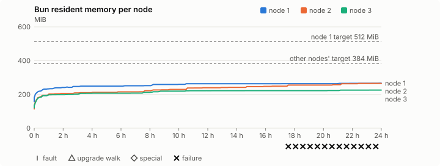
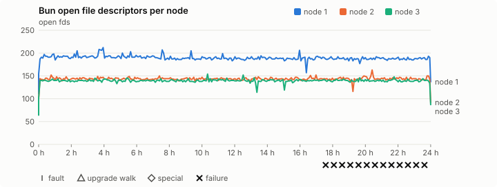
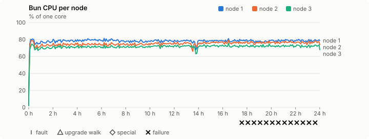
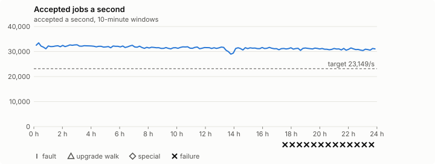

# Sustained soak (V02): FAIL

7 November 2026. day tier, no fault schedule, 24 h 00 min of soak on a three-node quickstart cluster.

**Day tier: not clean.** The day run doesn't hold; the record says what failed.

> **What this run was for: Bun's memory on the published 0.2.7 over a whole
> day at full load, for
> [#1417](https://github.com/reliaburger/reliaburger/issues/1417). It doesn't
> close the issue.** It ran the full 24 hours on the quiet Mac Studio, from
> 17:09 GMT on 7 November to 17:09 GMT on 8 November, with no restart, no
> fault schedule and nothing else on the host. 2,709,190,725 host-job tasks
> were accepted, 31,352 a second, and every check passed except one:
> `leak-rss` failed 13 times on node 2, from 10:43 to 16:46 GMT on
> 8 November, with Bun's RSS at 255–265 MiB (261,292–271,776 kB) against a
> limit of 125% of its warm sample of 206,896 kB.
>
> **Nodes 1 and 3 levelled off; node 2 was still growing at the end.** Over
> the last 12 hours nodes 1 and 3 grew 0.26 and 0.32 MiB an hour, and node 2
> 2.44 MiB an hour (1.83 over the last three). Every node ended under its
> target: 265.8, 265.4 and 225.4 MiB against 512, 384 and 384 MiB. All of the
> growth is malloc's (the main heap and glibc's thread arena); file-backed
> pages, stacks and other anonymous memory hardly moved.
>
> **Node 2's warm sample came too early to be its baseline.** `leak-rss`
> takes it an hour after it first sees Bun, the same minute on every node.
> At that point nodes 1 and 3 were at 88% of their final RSS; node 2 was at
> 76%. Node 2's growth follows its log store, which the volume writer fills
> slowly: 1 MiB of its 8 MiB cap at 2 hours, 90% of it after 15 hours.
> Node 1's store, which the log spammer fills, was full in an hour and a half.
> That's a correlation, not a cause, and node 2 grew another 8 MiB after its
> store stopped growing ([what the growth is](#what-the-growth-is)).
>
> **Next:** a store-aware warm sample with a slope check for `leak-rss`, and
> a run that settles whether node 2 levels off
> ([next steps](#next-steps)).

## Candidate and host

| | |
|---|---|
| Staged base URL | <https://github.com/reliaburger/reliaburger/releases/download/v0.2.7> |
| `candidate.json` SHA-256 | `4d7123125e8ad5999513c2d8990b01eefed58380cb8db292c75737e398bcc481` |
| Running versions | v0.2.7 x3 |
| Soak build | not supplied: upgrade slots skipped |
| Host | macOS 27.2, Apple M5 Max, 128 GiB |
| Lima | limactl version 2.2.1 |
| Guest | Ubuntu 24.04.5 LTS, kernel 6.8.0-139-generic |
| RELIABURGER_HOME | `/tmp/rbq.dr5Igv` |
| Evidence | `/Users/miko/github/rb-wt/mem-027/ev` |

## Configuration deviations

- Each quickstart VM resized from 2 vCPU / 2 GiB to 4 vCPU / 6 GiB before configuring, the size the scale-out record measured (maintainer decision, 27 October 2026)
- node.toml `[testing] allowed_operations` adds `provision_isolated_workloads` (quickstart allows only inject_workload_faults and alter_node_state), so the catalogue pulse can lease test namespaces
- node.toml `[logs]`/`[metrics]` export to file:///var/lib/reliaburger/soak-export every 60 s with max_storage_mb = 8 (the harness deletes a metrics export 30 minutes after its source has gone), `[storage.snapshots]` every 900 s (compressed: 120 s), retain 4, uploaded to the same directory
- node.toml `[ingress] tls_cert/tls_key` point at an operator pair from a soak CA, 45-minute leaves rotated by the harness
- Bun runs with auto/mixed; host jobs opt in to a single pinned BusyBox copy under /var/lib/reliaburger/soak-jobs, mount_isolation=false. The independent verifier listens on each private VM address, TCP 8189, with a separate run token
- node.toml `[node.labels] soak-volume` = "writer" on node 2 and "redis" on node 3, to pin the volume apps
- node.toml `[security] leaf_lifetime_override_secs = 3600` (D1)
- Host jobs run Ubuntu's busybox-static 1:1.36.1-6ubuntu3.1 (`52151e7f…`), the scale-out record's binary, instead of the image's

## Timeline

- Started 2026-11-07 17:09:08 UTC, finished 2026-11-08 17:09:22 UTC
- Cycles completed: 0
- Fault and node choices: 0, from seed 2720021009 (`--seed 2720021009` repeats them)
- Teardown: `relish local destroy --yes` and `relish uninstall --yes` succeeded

## Faults and slots

| Class | Runs | Settled/ok | Failed | Skipped | Settle (median / max) |
|---|---|---|---|---|---|
| tls:invalid-expired | 33 | 33 | 0 | 0 | n/a |
| tls:invalid-torn | 36 | 36 | 0 | 0 | n/a |
| tls:reload | 285 | 285 | 0 | 0 | n/a |

## Execution inventory (gated)

What the run completed, from its events and kept bytes, against what its schedule owes. A fault counts once it was injected and the cluster settled after it.

| Item | Required | Completed | Verdict |
|---|---|---|---|
| candidate.json bytes match the qualified digest | 1 | 1 | ok |
| app workloads settled at the baseline | 1 | 1 | ok |
| job campaign drained in its final two minutes | 1 | 1 | ok |

## Renewals and rotations

| Measure | Observed | Required | Verdict |
|---|---|---|---|
| workload identity rotations (soak-identity, per node) | 47 | ≥ 47 | PASS |
| node leaf renewals (per node) | 52 | ≥ 47 | PASS |
| operator ingress reloads (all nodes) | 285 | ≥ 95 | PASS |
| mixed job campaign and positive drain | 0 missing/failing checks | 0 | PASS |

## Latency SLOs

What a user should feel on a quiet three-node cluster (#1400). Every sample is taken outside fault windows and through a host forward that works; each p99 is the upper bound of its histogram bucket.

| SLO | p99 | Threshold | Samples | Mode | Verdict |
|---|---|---|---|---|---|
| API read p99 | 150 ms | ≤ 1,000 ms | 17,754 | record only | PASS |
| API write p99 | 1,500 ms | ≤ 2,000 ms | 48 | record only | PASS |
| App start p99 | 1 ms | ≤ 5,000 ms | 144 | record only | PASS |
| Rolling update p99 | 30,000 ms | ≤ 30,000 ms | 48 | record only | PASS |
| Job task start p99 | 8 ms | ≤ 256 ms | 2,720,168,206 | record only | PASS |

- API read p99: `GET /v1/status?cluster=true` and `GET /v1/cluster/nodes` on every node, at every light check
- API write p99: `relish apply` of the soak workloads, from the call to the commit
- App start p99: each node's deploy of a new `soak-identity` instance, from its start to the instance running
- Rolling update p99: from `relish apply` returning to every node's `soak-identity` running the new spec
- Job task start p99: a job task's start lag on a pooled executor, from the job campaign's buckets, in runs no fault window overlapped
- Record only from 28 October 2026 (#1400): no soak before 0.2.4 measured it. The threshold is provisional; the first 0.2.4 fast and final records set the gate.

## Jobs

| Runtime | Accepted successes | Retries | Last accepted progress |
|---|---|---|---|
| runc | 218414 | 1 | 1794157751 |
| shared-runc | 10977471 | 1 | 1794157751 |
| process | 2709190725 | 1 | 1794157751 |

The bounded campaign shares the app soak's fault schedule. These counts are reliability evidence, not a saturation rate or a 100-million-per-day qualification.

- Independent verifier execution attempts: 24
- Explicit test-operator acknowledgements for known replay-safe fenced fixtures: 1

- rb-ff0253160ea8-1: latest complete job storage (KiB) {'instances': 3912, 'job-state': 8, 'task-arrays': 41896}; free 4238972 KiB; live/peak owners 0/37; peak storage {'instances': 29028, 'job-state': 8, 'task-arrays': 268548}
- rb-ff0253160ea8-2: latest complete job storage (KiB) {'instances': 1648, 'job-state': 8, 'task-arrays': 44416}; free 5479744 KiB; live/peak owners 0/34; peak storage {'instances': 25996, 'job-state': 8, 'task-arrays': 351096}
- rb-ff0253160ea8-3: latest complete job storage (KiB) {'instances': 572, 'job-state': 8, 'task-arrays': 43860}; free 5505460 KiB; live/peak owners 0/34; peak storage {'instances': 24916, 'job-state': 8, 'task-arrays': 281200}

Complete disk inventories are recorded. Global retention bounds and the 12-hour job qualification remain #668; this gate cannot certify an unimplemented retention policy.

## Job qualification (D18-C)

Load: day; 3 nodes; accepted 31,481.9/s against a 23149.0/s target: PASS.

The September plan set its targets for one 1M-task batch on a quiet cluster. A soak runs for hours with restarts, upgrades and apps, so its storage, Bun memory and Raft targets are restated (maintainer decision, 15 October 2026, [#668](https://github.com/reliaburger/reliaburger/issues/668)). Bun's steady state is the median RSS of each process once it has been seen for 10 minutes; the gated memory checks are unchanged (`leak-rss`, and Mayo's 70% `memory_high` alert through `wtf`).

| Measure (recorded, not gated) | Observed | Target |
|---|---|---|
| Wall time of a 1,048,576-task array (median / max of 0) | not measured / not measured | ≤ 600 s |
| p99 start lag, pooled executors | 8 ms (bucket upper bound) | < 1,000 ms |
| Raft entries per second, all cluster writes | 5.29 | recorded only; the batch target counts only task-array writes |
| Raft state of one run, largest seen | 44,656 B | ≤ 256 KiB per 1M tasks |
| Bun steady-state RSS per process, worst node against its target | rb-ff0253160ea8-2: 239.11 MiB steady, 265.41 MiB peak | ≤ 384 MiB (≤ 512 MiB on node 1, which serves the API) |
| Bun CPU, busiest node | 0.78 cores | ≤ 1 core (leader batch control) |
| Executor helper CPU, busiest node | 0.30 cores | ≤ 0.5 core |
| Node task-array storage per 1M accepted tasks (peaks summed) | 0.32 MiB | ≤ 64 MiB, deleted after retirement |
| Retained log volume, all nodes | 20.58 MB | ≤ 50 MB |

- Bun RSS on rb-ff0253160ea8-1 (serves the API, target ≤ 512 MiB): pid 2504: 263.01 MiB steady, 265.84 MiB peak
- Bun RSS on rb-ff0253160ea8-2 (node, target ≤ 384 MiB): pid 1813: 239.11 MiB steady, 265.41 MiB peak
- Bun RSS on rb-ff0253160ea8-3 (node, target ≤ 384 MiB): pid 1673: 221.75 MiB steady, 225.42 MiB peak

- runc retry causes: exit_code 1, launch 0, signal 0, timeout 0, unknown 0, unrecorded 0
- shared-runc retry causes: exit_code 1, launch 0, signal 0, timeout 0, unknown 0, unrecorded 0
- process retry causes: exit_code 1, launch 0, signal 0, timeout 0, unknown 0, unrecorded 0
- Audited executions: 24; operator replay decisions: 1
- Job controller API fallbacks: none (requests a node didn't answer, and the node that took them instead)

## Day run (#1032)

2,709,190,725 accepted host-job tasks in 24 h 00 min: 31,352.4/s against the 23149.0/s target (PASS). The billion-a-day floor is 11,575/s (met). At this rate a day is 2,708,845,848 tasks.

| Node | Slots | Host-job successes | Rate | Share | Fair share | Verdict |
|---|---|---|---|---|---|---|
| rb-ff0253160ea8-1 | 27 | 865,346,613 | 10,014.3/s | 31.9% | 33.3% | ok |
| rb-ff0253160ea8-2 | 27 | 937,107,573 | 10,844.8/s | 34.6% | 33.3% | ok |
| rb-ff0253160ea8-3 | 27 | 906,736,539 | 10,493.3/s | 33.5% | 33.3% | ok |

A node may take up to 20% more than its fair share by slots, as `relish bench` allows (#1362).

| Hour | Host jobs a second | |
|---|---|---|
| Hour 1 | 32,045.4 | ████████████████████ |
| Hour 2 | 32,011.0 | ████████████████████ |
| Hour 3 | 32,349.7 | ████████████████████ |
| Hour 4 | 32,097.4 | ████████████████████ |
| Hour 5 | 31,908.2 | ████████████████████ |
| Hour 6 | 31,788.2 | ████████████████████ |
| Hour 7 | 31,904.1 | ████████████████████ |
| Hour 8 | 31,577.9 | ████████████████████ |
| Hour 9 | 31,388.6 | ███████████████████ |
| Hour 10 | 31,198.6 | ███████████████████ |
| Hour 11 | 31,534.6 | ███████████████████ |
| Hour 12 | 31,382.2 | ███████████████████ |
| Hour 13 | 31,328.8 | ███████████████████ |
| Hour 14 | 30,204.5 | ███████████████████ |
| Hour 15 | 31,095.4 | ███████████████████ |
| Hour 16 | 31,240.2 | ███████████████████ |
| Hour 17 | 31,110.7 | ███████████████████ |
| Hour 18 | 31,060.9 | ███████████████████ |
| Hour 19 | 30,972.1 | ███████████████████ |
| Hour 20 | 31,055.2 | ███████████████████ |
| Hour 21 | 30,853.1 | ███████████████████ |
| Hour 22 | 30,760.8 | ███████████████████ |
| Hour 23 | 30,784.3 | ███████████████████ |
| Hour 24 | 30,790.4 | ███████████████████ |

Last hour against the first: 30,790.4/s against 32,045.4/s, ok (at most 10% slower; the first hour includes the campaign's start and its host-job probes).

## Data

- Volume writer: highest ACK 682957 in the log view; the writer file checks (writer-lost, writer-regression) decide data loss, and `*-log-order` failures are about the order the log view returned lines in
- Redis counter: highest INCR 82475 in the log view
- Export rb-ff0253160ea8-1: 200 source files, 1592 at the destination
- Export rb-ff0253160ea8-2: 1399 source files, 1665 at the destination
- Export rb-ff0253160ea8-3: 538 source files, 570 at the destination
- Registry images pushed and re-verified: 1
- Agent-loop turns over the 1 s budget: rb-ff0253160ea8-1 0, rb-ff0253160ea8-2 0, rb-ff0253160ea8-3 0
- Soak policies checked in force: 289 times, policy generation 150 at the last check
- Guest clock steps by Lima's guest agent: rb-ff0253160ea8-1 4, rb-ff0253160ea8-2 4, rb-ff0253160ea8-3 4
- Checks evaluated: 2961 (heavy 288, light 2672, settle 1)
- Last observed progress: redis-counter 82475, writer-ack 682957

## Leak-checker exposure (gated)

How long each leak checker could judge each node's Bun. `leak-rss` arms after 60 minutes in one process and `leak-fd` after 50; a restart, kill or upgrade exec starts the warm-up again. A final needs each armed for 60 minutes on every node, with one unbroken window of 30 (#1062); its quiet tail gives them that.

| Node | Checker | Armed | Longest armed window | Evaluated samples | Processes armed | Verdict |
|---|---|---|---|---|---|---|
| rb-ff0253160ea8-1 | leak-rss | 1379 min | 1379 min | 275 | 1 | ok |
| rb-ff0253160ea8-1 | leak-fd | 1389 min | 1389 min | 277 | 1 | ok |
| rb-ff0253160ea8-2 | leak-rss | 1379 min | 1379 min | 275 | 1 | ok |
| rb-ff0253160ea8-2 | leak-fd | 1389 min | 1389 min | 277 | 1 | ok |
| rb-ff0253160ea8-3 | leak-rss | 1379 min | 1379 min | 275 | 1 | ok |
| rb-ff0253160ea8-3 | leak-fd | 1389 min | 1389 min | 277 | 1 | ok |

## Resource trends

| Node | Measure | First | Last | Max |
|---|---|---|---|---|
| rb-ff0253160ea8-1 | disk_kb data | 1441308 | 1739556 | 1969328 |
| rb-ff0253160ea8-1 | disk_kb images | 342456 | 342480 | 342516 |
| rb-ff0253160ea8-1 | disk_kb logs | 56 | 8452 | 8824 |
| rb-ff0253160ea8-1 | disk_kb metrics | 100 | 8412 | 8892 |
| rb-ff0253160ea8-1 | disk_kb soak-export | 4 | 138724 | 138724 |
| rb-ff0253160ea8-1 | disk_kb volumes | 272 | 272 | 272 |
| rb-ff0253160ea8-1 | fd | 112 | 137 | 212 |
| rb-ff0253160ea8-1 | rss_anon_kb | 87892 | 193856 | 193856 |
| rb-ff0253160ea8-1 | rss_file_kb | 73184 | 78368 | 78368 |
| rb-ff0253160ea8-1 | rss_kb | 161076 | 272224 | 272224 |
| rb-ff0253160ea8-2 | disk_kb data | 71872 | 173744 | 493132 |
| rb-ff0253160ea8-2 | disk_kb images | 342304 | 342348 | 342348 |
| rb-ff0253160ea8-2 | disk_kb logs | 32 | 9908 | 10028 |
| rb-ff0253160ea8-2 | disk_kb metrics | 124 | 8584 | 8844 |
| rb-ff0253160ea8-2 | disk_kb soak-export | 4 | 22468 | 22468 |
| rb-ff0253160ea8-2 | disk_kb volumes | 16776 | 25888 | 25888 |
| rb-ff0253160ea8-2 | fd | 65 | 92 | 163 |
| rb-ff0253160ea8-2 | rss_anon_kb | 44912 | 194496 | 194496 |
| rb-ff0253160ea8-2 | rss_file_kb | 71456 | 77280 | 77280 |
| rb-ff0253160ea8-2 | rss_kb | 116368 | 271776 | 271776 |
| rb-ff0253160ea8-3 | disk_kb data | 176216 | 267868 | 529560 |
| rb-ff0253160ea8-3 | disk_kb images | 339124 | 339144 | 339144 |
| rb-ff0253160ea8-3 | disk_kb logs | 36 | 1244 | 1244 |
| rb-ff0253160ea8-3 | disk_kb metrics | 104 | 8780 | 8952 |
| rb-ff0253160ea8-3 | disk_kb soak-export | 4 | 11292 | 11324 |
| rb-ff0253160ea8-3 | disk_kb volumes | 16784 | 23256 | 23256 |
| rb-ff0253160ea8-3 | fd | 64 | 87 | 154 |
| rb-ff0253160ea8-3 | rss_anon_kb | 52840 | 154508 | 154508 |
| rb-ff0253160ea8-3 | rss_file_kb | 70880 | 76320 | 76320 |
| rb-ff0253160ea8-3 | rss_kb | 123720 | 230828 | 230832 |

## Bun memory by kind

From each node's `/proc/PID/smaps` at the settle and heavy checks (`memory.jsonl`, #1417). Sizes in MiB; arenas are glibc thread arenas, with the number of 64 MiB arena heaps in brackets. Time is h:mm since the node's first sample.

### rb-ff0253160ea8-1

| Time | Pid | RSS | Heap | Arenas | Stacks | Other anonymous | File | Threads |
|---|---|---|---|---|---|---|---|---|
| 0:00 | 2504 | 157.3 | 48.9 | 30.0 (1) | 3.2 | 0.1 | 75.2 | 52 |
| 1:01 | 2504 | 232.8 | 82.8 | 61.0 (1) | 8.2 | 0.6 | 80.2 | 104 |
| 2:01 | 2504 | 241.2 | 88.7 | 63.5 (1) | 8.2 | 0.6 | 80.2 | 104 |
| 3:02 | 2504 | 246.8 | 88.7 | 69.0 (2) | 8.2 | 0.6 | 80.2 | 104 |
| 4:02 | 2504 | 249.1 | 91.1 | 69.0 (2) | 8.2 | 0.6 | 80.2 | 104 |
| 5:02 | 2504 | 249.1 | 91.1 | 69.0 (2) | 8.2 | 0.6 | 80.2 | 104 |
| 6:03 | 2504 | 249.2 | 91.2 | 69.0 (2) | 8.2 | 0.6 | 80.2 | 104 |
| 7:04 | 2504 | 251.1 | 91.2 | 70.9 (2) | 8.2 | 0.6 | 80.2 | 104 |
| 8:04 | 2504 | 252.0 | 91.2 | 71.8 (2) | 8.2 | 0.6 | 80.2 | 104 |
| 9:00 | 2504 | 258.8 | 98.0 | 71.8 (2) | 8.2 | 0.6 | 80.2 | 104 |
| 10:00 | 2504 | 259.6 | 98.0 | 72.6 (2) | 8.2 | 0.6 | 80.2 | 104 |
| 11:01 | 2504 | 263.0 | 98.0 | 76.0 (2) | 8.2 | 0.6 | 80.2 | 104 |
| 12:01 | 2504 | 263.0 | 98.0 | 76.0 (2) | 8.2 | 0.6 | 80.2 | 104 |
| 13:02 | 2504 | 263.0 | 98.0 | 76.0 (2) | 8.2 | 0.6 | 80.2 | 104 |
| 14:02 | 2504 | 263.0 | 98.0 | 76.0 (2) | 8.2 | 0.6 | 80.2 | 104 |
| 15:03 | 2504 | 263.1 | 98.0 | 76.0 (2) | 8.2 | 0.6 | 80.2 | 105 |
| 16:03 | 2504 | 263.1 | 98.0 | 76.0 (2) | 8.2 | 0.6 | 80.2 | 105 |
| 17:04 | 2504 | 263.1 | 98.0 | 76.0 (2) | 8.2 | 0.6 | 80.2 | 105 |
| 18:04 | 2504 | 263.4 | 98.0 | 76.0 (2) | 8.6 | 0.6 | 80.2 | 114 |
| 19:04 | 2504 | 263.4 | 98.0 | 76.0 (2) | 8.6 | 0.6 | 80.2 | 114 |
| 20:00 | 2504 | 263.4 | 98.0 | 76.0 (2) | 8.6 | 0.6 | 80.2 | 114 |
| 21:00 | 2504 | 263.8 | 98.0 | 76.4 (2) | 8.6 | 0.6 | 80.2 | 114 |
| 22:01 | 2504 | 265.8 | 98.0 | 78.4 (2) | 8.6 | 0.6 | 80.2 | 114 |
| 23:01 | 2504 | 265.8 | 98.0 | 78.4 (2) | 8.6 | 0.6 | 80.2 | 114 |
| 24:00 | 2504 | 265.8 | 98.0 | 78.4 (2) | 8.6 | 0.6 | 80.2 | 114 |

- rb-ff0253160ea8-1: **arenas** grew most after the first hour: +17.4 MiB over 22:59 h:mm (others, MiB: heap +15.2, stacks +0.4, other anonymous +0.0, file +0.0).

### rb-ff0253160ea8-2

| Time | Pid | RSS | Heap | Arenas | Stacks | Other anonymous | File | Threads |
|---|---|---|---|---|---|---|---|---|
| 0:00 | 1813 | 113.6 | 9.9 | 28.1 (1) | 2.0 | 0.1 | 73.5 | 30 |
| 1:01 | 1813 | 202.0 | 55.0 | 60.2 (1) | 7.1 | 0.6 | 79.2 | 90 |
| 2:01 | 1813 | 205.6 | 57.9 | 60.8 (1) | 7.1 | 0.6 | 79.2 | 90 |
| 3:02 | 1813 | 208.8 | 58.1 | 63.8 (1) | 7.1 | 0.7 | 79.2 | 90 |
| 4:02 | 1813 | 212.1 | 61.4 | 63.8 (1) | 7.1 | 0.7 | 79.2 | 90 |
| 5:02 | 1813 | 212.2 | 61.4 | 63.8 (1) | 7.2 | 0.7 | 79.2 | 91 |
| 6:03 | 1813 | 215.1 | 61.4 | 66.5 (2) | 7.3 | 0.7 | 79.2 | 93 |
| 7:04 | 1813 | 215.1 | 61.4 | 66.5 (2) | 7.3 | 0.7 | 79.2 | 93 |
| 8:04 | 1813 | 222.0 | 63.4 | 71.4 (2) | 7.3 | 0.7 | 79.2 | 93 |
| 9:00 | 1813 | 227.0 | 67.7 | 72.1 (2) | 7.3 | 0.7 | 79.2 | 93 |
| 10:00 | 1813 | 229.3 | 69.0 | 73.1 (2) | 7.3 | 0.7 | 79.2 | 93 |
| 11:01 | 1813 | 237.9 | 77.6 | 73.1 (2) | 7.3 | 0.7 | 79.2 | 93 |
| 12:01 | 1813 | 239.1 | 77.7 | 74.2 (2) | 7.3 | 0.7 | 79.2 | 93 |
| 13:02 | 1813 | 240.6 | 77.7 | 75.7 (2) | 7.3 | 0.7 | 79.2 | 93 |
| 14:02 | 1813 | 241.4 | 77.7 | 76.5 (2) | 7.3 | 0.7 | 79.2 | 93 |
| 15:03 | 1813 | 246.2 | 81.0 | 78.0 (2) | 7.3 | 0.7 | 79.2 | 93 |
| 16:03 | 1813 | 247.7 | 81.0 | 79.6 (2) | 7.3 | 0.7 | 79.2 | 93 |
| 17:04 | 1813 | 248.6 | 81.9 | 79.6 (2) | 7.3 | 0.7 | 79.2 | 93 |
| 18:04 | 1813 | 255.2 | 81.9 | 86.1 (2) | 7.3 | 0.7 | 79.2 | 93 |
| 19:04 | 1813 | 255.2 | 81.9 | 86.1 (2) | 7.3 | 0.7 | 79.2 | 93 |
| 20:00 | 1813 | 255.2 | 81.9 | 86.1 (2) | 7.3 | 0.7 | 79.2 | 93 |
| 21:00 | 1813 | 257.4 | 84.1 | 86.1 (2) | 7.3 | 0.7 | 79.2 | 93 |
| 22:01 | 1813 | 263.2 | 89.9 | 86.1 (2) | 7.3 | 0.7 | 79.2 | 93 |
| 23:01 | 1813 | 264.9 | 89.9 | 87.8 (2) | 7.3 | 0.7 | 79.2 | 93 |
| 24:00 | 1813 | 265.4 | 89.9 | 87.8 (2) | 7.9 | 0.7 | 79.2 | 100 |

- rb-ff0253160ea8-2: **heap** grew most after the first hour: +34.9 MiB over 22:59 h:mm (others, MiB: arenas +27.6, stacks +0.8, other anonymous +0.1, file +0.0).

### rb-ff0253160ea8-3

| Time | Pid | RSS | Heap | Arenas | Stacks | Other anonymous | File | Threads |
|---|---|---|---|---|---|---|---|---|
| 0:00 | 1673 | 120.8 | 20.4 | 25.3 (1) | 2.0 | 0.1 | 72.9 | 33 |
| 1:01 | 1673 | 197.8 | 53.4 | 59.4 (1) | 6.2 | 0.6 | 78.1 | 79 |
| 2:01 | 1673 | 198.4 | 53.4 | 59.4 (1) | 6.6 | 0.6 | 78.2 | 84 |
| 3:02 | 1673 | 200.8 | 55.9 | 59.4 (1) | 6.6 | 0.6 | 78.2 | 84 |
| 4:02 | 1673 | 207.2 | 58.5 | 63.2 (1) | 6.6 | 0.6 | 78.2 | 84 |
| 5:02 | 1673 | 207.2 | 58.5 | 63.2 (1) | 6.6 | 0.6 | 78.2 | 84 |
| 6:03 | 1673 | 207.2 | 58.5 | 63.2 (1) | 6.6 | 0.6 | 78.2 | 84 |
| 7:04 | 1673 | 208.0 | 58.5 | 63.2 (1) | 7.4 | 0.6 | 78.2 | 94 |
| 8:04 | 1673 | 212.8 | 62.5 | 64.0 (1) | 7.4 | 0.6 | 78.2 | 94 |
| 9:00 | 1673 | 219.4 | 63.7 | 69.4 (2) | 7.4 | 0.6 | 78.2 | 94 |
| 10:00 | 1673 | 219.4 | 63.7 | 69.4 (2) | 7.4 | 0.6 | 78.2 | 94 |
| 11:01 | 1673 | 221.7 | 65.7 | 69.4 (2) | 7.8 | 0.6 | 78.2 | 99 |
| 12:01 | 1673 | 221.7 | 65.7 | 69.4 (2) | 7.8 | 0.6 | 78.2 | 99 |
| 13:02 | 1673 | 221.8 | 65.7 | 69.4 (2) | 7.8 | 0.6 | 78.2 | 99 |
| 14:02 | 1673 | 221.8 | 65.7 | 69.4 (2) | 7.8 | 0.6 | 78.2 | 99 |
| 15:03 | 1673 | 222.5 | 65.7 | 70.1 (2) | 7.8 | 0.6 | 78.2 | 99 |
| 16:03 | 1673 | 222.5 | 65.7 | 70.1 (2) | 7.8 | 0.6 | 78.2 | 99 |
| 17:04 | 1673 | 222.5 | 65.7 | 70.1 (2) | 7.8 | 0.6 | 78.2 | 99 |
| 18:04 | 1673 | 222.5 | 65.7 | 70.1 (2) | 7.8 | 0.7 | 78.2 | 99 |
| 19:04 | 1673 | 222.5 | 65.7 | 70.1 (2) | 7.8 | 0.7 | 78.2 | 99 |
| 20:00 | 1673 | 222.5 | 65.7 | 70.1 (2) | 7.8 | 0.7 | 78.2 | 99 |
| 21:00 | 1673 | 223.1 | 65.7 | 70.1 (2) | 8.4 | 0.7 | 78.2 | 107 |
| 22:01 | 1673 | 225.2 | 67.8 | 70.1 (2) | 8.4 | 0.7 | 78.2 | 107 |
| 23:01 | 1673 | 225.2 | 67.8 | 70.1 (2) | 8.4 | 0.7 | 78.2 | 107 |
| 24:00 | 1673 | 225.4 | 67.8 | 70.4 (2) | 8.4 | 0.7 | 78.2 | 107 |

- rb-ff0253160ea8-3: **heap** grew most after the first hour: +14.4 MiB over 22:59 h:mm (others, MiB: arenas +11.0, stacks +2.1, other anonymous +0.0, file +0.1).

## Charts

Time runs from the start of the soak. The marks under each chart are its faults, upgrade walks, specials and recorded failures; the dashed lines are targets.

## Failures

| # | First seen | Check | Symptom | Class | Cause | Action |
|---|---|---|---|---|---|---|
| 1 | 10:43:19 | heavy-check | fail: leak-rss rb-ff0253160ea8-2: bun RSS 261292 kB is over 125% of the warm 206896 kB; | unclassified | open | open |
| 2 | 11:13:27 | heavy-check | fail: leak-rss rb-ff0253160ea8-2: bun RSS 261292 kB is over 125% of the warm 206896 kB; | unclassified | open | open |
| 3 | 11:43:39 | heavy-check | fail: leak-rss rb-ff0253160ea8-2: bun RSS 261292 kB is over 125% of the warm 206896 kB; | unclassified | open | open |
| 4 | 12:13:44 | heavy-check | fail: leak-rss rb-ff0253160ea8-2: bun RSS 261296 kB is over 125% of the warm 206896 kB; | unclassified | open | open |
| 5 | 12:44:00 | heavy-check | fail: leak-rss rb-ff0253160ea8-2: bun RSS 261296 kB is over 125% of the warm 206896 kB; | unclassified | open | open |
| 6 | 13:14:11 | heavy-check | fail: leak-rss rb-ff0253160ea8-2: bun RSS 261312 kB is over 125% of the warm 206896 kB; | unclassified | open | open |
| 7 | 13:44:31 | heavy-check | fail: leak-rss rb-ff0253160ea8-2: bun RSS 261316 kB is over 125% of the warm 206896 kB; | unclassified | open | open |
| 8 | 14:14:45 | heavy-check | fail: leak-rss rb-ff0253160ea8-2: bun RSS 263628 kB is over 125% of the warm 206896 kB; | unclassified | open | open |
| 9 | 14:45:01 | heavy-check | fail: leak-rss rb-ff0253160ea8-2: bun RSS 269500 kB is over 125% of the warm 206896 kB; | unclassified | open | open |
| 10 | 15:15:11 | heavy-check | fail: leak-rss rb-ff0253160ea8-2: bun RSS 269500 kB is over 125% of the warm 206896 kB; | unclassified | open | open |
| 11 | 15:45:32 | heavy-check | fail: leak-rss rb-ff0253160ea8-2: bun RSS 271240 kB is over 125% of the warm 206896 kB; | unclassified | open | open |
| 12 | 16:15:47 | heavy-check | fail: leak-rss rb-ff0253160ea8-2: bun RSS 271244 kB is over 125% of the warm 206896 kB; | unclassified | open | open |
| 13 | 16:46:08 | heavy-check | fail: leak-rss rb-ff0253160ea8-2: bun RSS 271776 kB is over 125% of the warm 206896 kB; | unclassified | open | open |

Evidence: `/Users/miko/github/rb-wt/mem-027/ev` (events.jsonl, snapshots/, failures/<n>/).

## What the growth is

The figures below come from `memory.jsonl` in the evidence: one row a node
at every heavy check, every 5 minutes, 289 a node. Times are GMT; "hour"
counts from Bun's first sample at 17:08:39 on 7 November. Slopes are least
squares over the last 12, 6 and 3 hours of the run.

| Node | Runs | Warm sample (hour 1) | `leak-rss` limit | Final | Final against warm | RSS slope, last 12 / 6 / 3 h |
|---|---|---|---|---|---|---|
| rb-ff0253160ea8-1 | Raft leader; the API, the log spammer, the Redis client and the demo apps | 232.8 MiB | 291.0 MiB | 265.8 MiB | 114% | +0.26 / +0.60 / +0.27 MiB/h |
| rb-ff0253160ea8-2 | the volume writer (`soak-volume=writer`), a frontend replica | 202.0 MiB | 252.6 MiB | 265.4 MiB | 131% | +2.44 / +2.37 / +1.83 MiB/h |
| rb-ff0253160ea8-3 | Redis (`soak-volume=redis`) | 197.8 MiB | 247.2 MiB | 225.4 MiB | 114% | +0.32 / +0.69 / +0.31 MiB/h |

Every node runs one `soak-identity` and one `soak-slo` instance besides.

### Which memory grows

From hour 1 to the end, by kind (MiB):

| Node | Main heap | Thread arena | Stacks | Other anonymous | File-backed | Threads |
|---|---|---|---|---|---|---|
| rb-ff0253160ea8-1 | +15.2 | +17.4 | +0.4 | +0.0 | +0.0 | 104 → 114 |
| rb-ff0253160ea8-2 | +34.9 | +27.6 | +0.8 | +0.1 | +0.0 | 90 → 100 |
| rb-ff0253160ea8-3 | +14.4 | +11.0 | +2.1 | +0.0 | +0.1 | 79 → 107 |

It's all malloc. File-backed pages (the binary and its mapped files) sat at
78–80 MiB on every node from hour 1, so neither redb's page cache through a
mapping nor the binary grew. Stacks follow the thread count and stay under
9 MiB. On node 2, the last 12 hours split about evenly between the main heap
(+1.12 MiB/h) and the arena (+1.30 MiB/h); on nodes 1 and 3 the heap was
flat or nearly so (0.00 and +0.19 MiB/h). Node 2's thread arena filled its
first 64 MiB heap at hour 6 and was 24 MiB into its second at the end.

The growth comes in steps, as in earlier runs: 1.5 to 8.6 MiB between two
samples five minutes apart, then flat for an hour or more. Node 2 had 15
steps of 1.5 MiB or more after hour 1, against 10 on node 1 and 7 on node 3.
Two steps, at 01:18–01:23 and 03:39–03:44 GMT, came within the same five
minutes on all three nodes. None of node 2's steps lines up with a harness
event: the run had no faults, and its only events (TLS reloads, the
invalid-certificate slots and 48 SLO rollouts) hit every node alike.

### Does it follow the writer?

Not the writer's activity, which is constant: it appends and syncs a line
about every 0.1 s all day (682,957 by the end). What grows on node 2 is
what that activity leaves behind. Node 2's only steady log producer is the
writer, about 8 lines a second, so its log store fills slowly; node 1 hosts
the spammer, 200 lines a second, which fills its 8 MiB cap (the soak's
`max_storage_mb = 8`) in an hour and a half. Every flush writes one Parquet
file a minute, so a slow store holds many small files:

| Hour | Node 1 logs | Node 2 logs | Node 3 logs | Node 2 RSS |
|---|---|---|---|---|
| 1.9 | 8,552 KiB, 97 files | 980 KiB, 122 files | 136 KiB, 30 files | 205.6 MiB |
| 6.0 | 8,644 KiB, 98 files | 2,952 KiB, 363 files | 332 KiB, 78 files | 215.1 MiB |
| 12.0 | 8,476 KiB, 96 files | 5,908 KiB, 727 files | 640 KiB, 151 files | 239.1 MiB |
| 18.1 | 8,816 KiB, 100 files | 8,852 KiB, 1,089 files | 944 KiB, 225 files | 255.2 MiB |
| 24.0 | 8,452 KiB, 96 files | 9,908 KiB, 1,216 files | 1,244 KiB, 296 files | 265.4 MiB |

Sizes are `disk logs` from each node's inventory; files are the log
Parquet files at the export source. The metrics stores reached 90% of their
cap at 1.3, 2.3 and 3.4 hours, so after hour 4 the log store is the one
bounded store still filling, and only on nodes 2 and 3.

Node 2's RSS rises with its log store until about hour 21, when the store
stopped growing at 1,218 files. Nodes 1 and 3 levelled off at about hour
11, when node 1's store had been full for nine hours and node 3's was still
under 1 MiB. That fits a working set that grows with the retained logs:
every check, light or heavy, runs `relish logs soak-writer --tail 20`, about
every 30 seconds (2,961 checks in the run), and Ketchup answers a tail with a DataFusion query over a listing of every
Parquet file in the store (`query_with` in `src/ketchup/log_store.rs`), so
its transient memory, and so malloc's high-water mark, can grow with the
file count. But it's a hypothesis. Node 3's heap stayed at 65.7 MiB from
hour 11 to hour 21 while its file count doubled, and node 2 grew 8.0 MiB in
the last three hours, after its store had stopped growing. Node 2 also took
a little more of the host jobs (34.6% against 31.9% and 33.5%), not enough
on its own to explain twice the growth.

### When the warm sample was taken

`rss_findings` in `scripts/release/sustained_check.py` keeps the first
sample at or after `RSS_WARMUP` (3,600 s) from when it first saw the
process, and fails any later sample over `RSS_GROWTH` (1.25) times it. All
three nodes' warm samples are from the same heavy check, 18:10 GMT on
7 November, 61 minutes in. Against each node's final RSS:

| Node | Warm sample | Share of final RSS | 90% of final reached | 95% of final reached |
|---|---|---|---|---|
| rb-ff0253160ea8-1 | 238,380 kB | 88% | hour 1.9 | hour 8.2 |
| rb-ff0253160ea8-2 | 206,896 kB | 76% | hour 11.7 | hour 17.6 |
| rb-ff0253160ea8-3 | 202,544 kB | 88% | hour 3.1 | hour 8.2 |

So the warm sample measured nodes 1 and 3 near their plateau and node 2
early in its climb. Moving the fixed hour doesn't fix it. Recomputed from
`memory.jsonl` with the same 25% rule:

| Warm sample after | Node 2's warm | Samples over (of 289) | First over | Node 2 final against warm |
|---|---|---|---|---|
| 1 h (as run) | 206,896 kB | 78 | hour 17.6 (10:43 GMT) | 131% |
| 2 h | 210,532 kB | 41 | hour 20.7 | 129% |
| 4 h | 217,196 kB | 9 | hour 23.4 | 125% |
| 6 h | 220,228 kB | 0 | | 123% |

(The 78 samples over become 13 failures because the harness reports a
repeat at most every 30 minutes.) A later fixed hour only passes this run by
luck: it's tuned to how fast one workload fills one store.

A corrected baseline follows the stores instead: take the warm sample at the
first heavy check where the node's log and metrics stores (`disk logs` and
`disk metrics`, already in each inventory) are each at 90% of the soak's
`max_storage_mb`, never before the hour, and at 6 hours for a node whose
store doesn't fill. For this run:

| Node | Warm sample taken | Warm | Limit | Final against warm |
|---|---|---|---|---|
| rb-ff0253160ea8-1 | hour 1.4, both stores full | 244,376 kB | 305,470 kB | 111% |
| rb-ff0253160ea8-2 | hour 15.1, both stores full | 252,108 kB | 315,135 kB | 108% |
| rb-ff0253160ea8-3 | hour 6, the ceiling (logs at 332 KiB of 8 MiB) | 212,192 kB | 265,240 kB | 109% |

No sample would have failed. That's the point of the change and its danger:
node 2 still grew 19.2 MiB, 2.1 MiB an hour, in the nine hours after its
store-aware warm sample, and the 125% rule wouldn't catch that before about
hour 44 at this rate. So the corrected baseline has to come with a check
that looks at the slope rather than a single ratio. The final tier's exposure
rule ([#1062](https://github.com/reliaburger/reliaburger/issues/1062))
needs `leak-rss` armed for an hour in an 8-hour run, so the 6-hour ceiling
suits a day run only; a final would keep the hour, or fill every node's log
store in its first hour (the spammer on every node would do it).

## Next steps

1. **Keep #1417 open.** Nodes 1 and 3 behave like a working set that has
   filled; node 2 might too, but this run ended before it showed that.
2. **Fix `leak-rss`'s baseline** in `scripts/release/sustained_check.py`:
   the store-aware warm sample above, plus each node's 6-hour RSS slope in
   the record, tests first in `scripts/release/test_sustained_check.py`. The
   slope is recorded, not gated, until the next run says what a levelled-off
   node's slope is; this run's nodes 1 and 3 give 0.26–0.32 MiB an hour over
   12 hours.
3. **Settle whether node 2 levels off**, in the next memory run on the quiet
   Studio: run past 24 hours, or fill every node's log store in the first
   hour so they start level. Late in the run, before and after
   `gdb -p $(pidof bun) -batch -ex 'call (int)malloc_trim(0)'` on node 2,
   record VmRSS: a drop of tens of MiB means malloc's high-water mark, not
   live data.
4. **Measure a log tail's memory against the file count**, as a Ketchup
   test: the peak allocation of `query_with` with a `tail` over 100 small
   Parquet files against 1,200. If it grows with the count, merging small
   files or reading only the newest files for a tail bounds it, whatever the
   baseline says.
