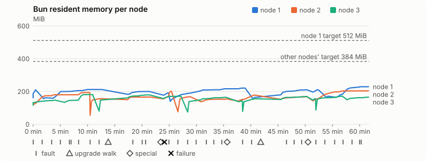
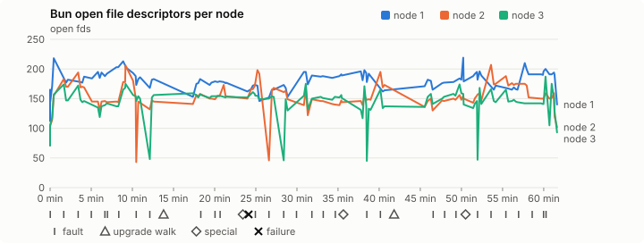
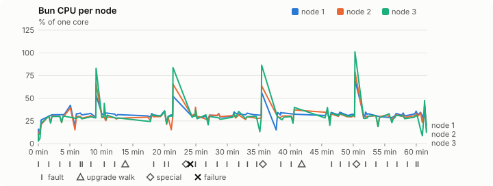
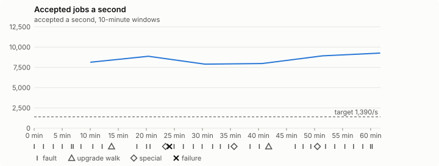

# Sustained soak (V02): FAIL

10 November 2026. fast tier, compressed schedule, 1 h 01 min of soak on a three-node quickstart cluster.

**Fast tier: not clean.** Fix what failed and run the fast tier again before a final-tier run.

## Candidate and host

| | |
|---|---|
| Staged base URL | <https://github.com/reliaburger/reliaburger/releases/download/staging-v0.2.8-42847458141-3> |
| `candidate.json` SHA-256 | `f3a34fdee0a866c1a288fc66e056baac4dc8bd7d43d6a631d33cb01acfeb3e81` |
| Running versions | v0.2.8 x3 |
| Soak build | `bun-v0.2.8-soak.1`, SHA-256 `8c3ec0aa66fdb30bbabf7aa2633ea852876e2fd2826e3ed506769dc160c35d75` |
| Walks roll back to | 0.2.8 |
| Host | macOS 27.2, Apple M5 Max, 128 GiB |
| Lima | limactl version 2.2.1 |
| Guest | Ubuntu 24.04.5 LTS, kernel 6.8.0-139-generic |
| RELIABURGER_HOME | `/tmp/rbq.Go0wrW` |
| Evidence | `/Users/miko/github/rb-wt/gate-028-data/qual/ev-jobs-fast` |

## Configuration deviations

- node.toml `[testing] allowed_operations` adds `provision_isolated_workloads` (quickstart allows only inject_workload_faults and alter_node_state), so the catalogue pulse can lease test namespaces
- node.toml `[logs]`/`[metrics]` export to file:///var/lib/reliaburger/soak-export every 60 s with max_storage_mb = 8 (the harness deletes a metrics export 30 minutes after its source has gone), `[storage.snapshots]` every 900 s (compressed: 120 s), retain 4, uploaded to the same directory
- node.toml `[ingress] tls_cert/tls_key` point at an operator pair from a soak CA, 45-minute leaves rotated by the harness
- Bun runs with auto/mixed; host jobs opt in to a single pinned BusyBox copy under /var/lib/reliaburger/soak-jobs, mount_isolation=false. The independent verifier listens on each private VM address, TCP 8189, with a separate run token
- node.toml `[node.labels] soak-volume` = "writer" on node 2 and "redis" on node 3, to pin the volume apps
- node.toml `[upgrades] external_signing_key` = a throwaway operator key the harness made for this run (`ed25519:AUtwSMbop7APVFdubgk0uJZ+XS1bBE/JvLyDEq9RB90=`); the soak build's `.sig` gets that key's external signature beside the release one (D2)
- node.toml `[security] leaf_lifetime_override_secs = 3600` (D1)

## Timeline

- Started 2026-11-10 19:39:46 UTC, finished 2026-11-10 20:41:31 UTC
- Cycles completed: 5
- Fault and node choices: 27, from seed 1591451385 (`--seed 1591451385` repeats them)
- Teardown: `relish local destroy --yes` and `relish uninstall --yes` succeeded

## Faults and slots

| Class | Runs | Settled/ok | Failed | Skipped | Settle (median / max) |
|---|---|---|---|---|---|
| fault:bun-kill-follower | 5 | 5 | 0 | 0 | 32 s / 32 s |
| fault:bun-kill-leader | 5 | 5 | 0 | 0 | 37 s / 41 s |
| fault:chaos-cpu | 1 | 2 | 0 | 0 | 17 s / 17 s |
| fault:chaos-delay | 1 | 2 | 0 | 0 | 16 s / 16 s |
| fault:chaos-dns | 1 | 2 | 0 | 0 | 17 s / 17 s |
| fault:chaos-drop | 1 | 2 | 0 | 0 | 22 s / 22 s |
| fault:chaos-kill | 2 | 4 | 0 | 0 | 17 s / 17 s |
| fault:chaos-memory | 1 | 2 | 0 | 0 | 18 s / 18 s |
| fault:chaos-partition | 1 | 2 | 0 | 0 | 17 s / 17 s |
| fault:chaos-pause | 1 | 2 | 0 | 0 | 18 s / 18 s |
| fault:chaos-scenario | 1 | 2 | 0 | 0 | 36 s / 36 s |
| fault:deploy-kill | 3 | 3 | 0 | 0 | 47 s / 88 s |
| fault:node-delay | 2 | 2 | 0 | 0 | 30 s / 30 s |
| fault:node-disk-full | 2 | 2 | 0 | 0 | 21 s / 21 s |
| fault:node-slow-fsync | 1 | 1 | 0 | 0 | 17 s / 17 s |
| fault:power-off | 3 | 3 | 0 | 0 | 31 s / 33 s |
| pulse | 1 | 1 | 0 | 0 | n/a |
| pulse:settle | 0 | 1 | 0 | 0 | 22 s / 22 s |
| special:all-off | 1 | 1 | 0 | 0 | 31 s / 31 s |
| special:graceful-stop | 1 | 1 | 0 | 0 | 57 s / 57 s |
| special:quorum-back | 1 | 1 | 0 | 0 | n/a |
| special:quorum-loss | 1 | 1 | 0 | 0 | 43 s / 43 s |
| storage:offline-export | 2 | 2 | 0 | 0 | n/a |
| storage:registry-push | 5 | 0 | 0 | 0 | n/a |
| tls:invalid-expired | 3 | 3 | 0 | 0 | n/a |
| tls:invalid-torn | 3 | 3 | 0 | 0 | n/a |
| tls:reload | 29 | 29 | 0 | 0 | n/a |
| upgrade:rollback | 2 | 2 | 0 | 0 | n/a |
| upgrade:settle | 0 | 2 | 0 | 0 | 61 s / 61 s |
| upgrade:upgrade | 2 | 2 | 0 | 0 | n/a |

## Execution inventory (recorded, not gated)

What the run completed, from its events and kept bytes, against what its schedule owes. A fault counts once it was injected and the cluster settled after it.

| Item | Required | Completed | Verdict |
|---|---|---|---|
| candidate.json bytes match the qualified digest | 1 | 1 | ok |
| app workloads settled at the baseline | 1 | 1 | ok |
| upgrade walk (to the soak build and back) | 2 | 2 | ok |
| fault:bun-kill-follower | 1 | 5 | ok |
| fault:bun-kill-leader | 1 | 5 | ok |
| fault:deploy-kill | 1 | 3 | ok |
| fault:power-off | 1 | 3 | ok |
| fault:chaos-kill | 1 | 2 | ok |
| fault:chaos-delay | 1 | 1 | ok |
| fault:chaos-partition | 1 | 1 | ok |
| fault:chaos-scenario | 1 | 1 | ok |
| fault:chaos-pause | 1 | 1 | ok |
| fault:chaos-drop | 1 | 1 | ok |
| fault:chaos-dns | 1 | 1 | ok |
| fault:chaos-cpu | 1 | 1 | ok |
| fault:node-delay | 1 | 2 | ok |
| fault:node-disk-full | 1 | 2 | ok |
| fault:node-slow-fsync | 1 | 1 | ok |
| special:graceful-stop | 1 | 1 | ok |
| special:quorum-loss | 1 | 1 | ok |
| special:all-off | 1 | 1 | ok |
| catalogue pulse | 1 | 1 | ok |
| offline export | 2 | 2 | ok |
| job campaign drained in its final two minutes | 1 | 1 | ok |

## Observed fault effects

What each injected fault was seen to do, read back from the node.

| Fault | Target | Observed |
|---|---|---|
| effect:bun-kill-follower | rb-c338f6ffd457-2 | MainPID 2467 -> 4788 |
| effect:bun-kill-leader | rb-c338f6ffd457-1 | MainPID 8956 -> 306512 |
| effect:deploy-kill | rb-c338f6ffd457-1 | MainPID 306512 -> 678729 |
| effect:power-off | rb-c338f6ffd457-3 | Lima status Stopped |
| effect:node-delay | rb-c338f6ffd457-1 | netem 8001: root refcnt 2 limit 1000 delay 200ms  50ms  |
| effect:bun-kill-follower | rb-c338f6ffd457-2 | MainPID 4788 -> 2393614 |
| effect:bun-kill-leader | rb-c338f6ffd457-3 | MainPID 681 -> 1539502 |
| effect:node-disk-full | rb-c338f6ffd457-2 | available 66998272 bytes  |
| effect:bun-kill-follower | rb-c338f6ffd457-1 | MainPID 680 -> 260652 |
| effect:bun-kill-leader | rb-c338f6ffd457-2 | MainPID 682 -> 671461 |
| effect:deploy-kill | rb-c338f6ffd457-3 | MainPID 680 -> 1150307 |
| effect:power-off | rb-c338f6ffd457-2 | Lima status Stopped |
| effect:node-slow-fsync | rb-c338f6ffd457-3 | IOWriteBandwidthMax=/dev/vda 1000000 IOWriteIOPSMax=/dev/vda 20  |
| effect:bun-kill-follower | rb-c338f6ffd457-3 | MainPID 680 -> 209505 |
| effect:bun-kill-leader | rb-c338f6ffd457-1 | MainPID 260652 -> 3728930 |
| effect:node-delay | rb-c338f6ffd457-2 | netem 8001: root refcnt 2 limit 1000 delay 200ms  50ms  |
| effect:bun-kill-follower | rb-c338f6ffd457-3 | MainPID 685 -> 189882 |
| effect:bun-kill-leader | rb-c338f6ffd457-1 | MainPID 680 -> 586300 |
| effect:deploy-kill | rb-c338f6ffd457-1 | MainPID 586300 -> 1010358 |
| effect:power-off | rb-c338f6ffd457-3 | Lima status Stopped |
| effect:node-disk-full | rb-c338f6ffd457-3 | available 66977792 bytes  |

## Renewals and rotations

| Measure | Observed | Required | Verdict |
|---|---|---|---|
| workload identity rotations (soak-identity, per node) | 7 | ≥ 1 | PASS |
| node leaf renewals (per node) | 2 | ≥ 1 | PASS |
| operator ingress reloads (all nodes) | 29 | ≥ 11 | PASS |
| mixed job campaign and positive drain | 0 missing/failing checks | 0 | PASS |

## Latency SLOs

What a user should feel on a quiet three-node cluster (#1400). Every sample is taken outside fault windows and through a host forward that works; each p99 is the upper bound of its histogram bucket.

| SLO | p99 | Threshold | Samples | Mode | Verdict |
|---|---|---|---|---|---|
| API read p99 | 150 ms | ≤ 1,000 ms | 216 | record only | PASS |
| API write p99 | 1,500 ms | ≤ 2,000 ms | 7 | record only | PASS |
| App start p99 | 1 ms | ≤ 5,000 ms | 21 | record only | PASS |
| Rolling update p99 | 30,000 ms | ≤ 30,000 ms | 7 | record only | PASS |
| Job task start p99 | 32 ms | ≤ 256 ms | 69,545 | gated | PASS |

- API read p99: `GET /v1/status?cluster=true` and `GET /v1/cluster/nodes` on every node, at every light check
- API write p99: `relish apply` of the soak workloads, from the call to the commit
- App start p99: each node's deploy of a new `soak-identity` instance, from its start to the instance running
- Rolling update p99: from `relish apply` returning to every node's `soak-identity` running the new spec
- Job task start p99: a job task's start lag on a pooled executor, from the job campaign's buckets, in runs no fault window overlapped
- Record only from 28 October 2026 (#1400): no soak before 0.2.4 measured it. The threshold is provisional; the first 0.2.4 fast and final records set the gate.

## Jobs

| Runtime | Accepted successes | Retries | Last accepted progress |
|---|---|---|---|
| runc | 10230 | 2 | 1794343281 |
| shared-runc | 8389758 | 1 | 1794343281 |
| process | 23138953 | 1 | 1794343281 |

The bounded campaign shares the app soak's fault schedule. These counts are reliability evidence, not a saturation rate or a 100-million-per-day qualification.

- Independent verifier execution attempts: 24
- Explicit test-operator acknowledgements for known replay-safe fenced fixtures: 109

- rb-c338f6ffd457-1: latest complete job storage (KiB) {'instances': 3012, 'job-state': 8, 'task-arrays': 18592}; free 5156920 KiB; live/peak owners 0/32; peak storage {'instances': 25504, 'job-state': 8, 'task-arrays': 48884}
- rb-c338f6ffd457-2: latest complete job storage (KiB) {'instances': 884, 'job-state': 8, 'task-arrays': 18656}; free 6303064 KiB; live/peak owners 0/31; peak storage {'instances': 24364, 'job-state': 8, 'task-arrays': 49040}
- rb-c338f6ffd457-3: latest complete job storage (KiB) {'instances': 3772, 'job-state': 8, 'task-arrays': 14112}; free 6302720 KiB; live/peak owners 0/32; peak storage {'instances': 27464, 'job-state': 8, 'task-arrays': 45740}

Complete disk inventories are recorded. Global retention bounds and the 12-hour job qualification remain #668; this gate cannot certify an unimplemented retention policy.

## Job qualification (D18-C)

Load: target; 3 nodes; accepted 8,517.1/s against a 1390.0/s target: PASS.

The September plan set its targets for one 1M-task batch on a quiet cluster. A soak runs for hours with restarts, upgrades and apps, so its storage, Bun memory and Raft targets are restated (maintainer decision, 15 October 2026, [#668](https://github.com/reliaburger/reliaburger/issues/668)). Bun's steady state is the median RSS of each process once it has been seen for 10 minutes; the gated memory checks are unchanged (`leak-rss`, and Mayo's 70% `memory_high` alert through `wtf`).

| Measure (recorded, not gated) | Observed | Target |
|---|---|---|
| Wall time of a 1,048,576-task array (median / max of 30) | 159 s / 510 s | ≤ 600 s |
| p99 start lag, pooled executors | 32 ms (bucket upper bound) | < 1,000 ms |
| Raft entries per second, all cluster writes | 5.48 | recorded only; the batch target counts only task-array writes |
| Raft state of one run, largest seen | 9,160 B | ≤ 256 KiB per 1M tasks |
| Bun steady-state RSS per process, worst node against its target | rb-c338f6ffd457-2: 204.50 MiB steady, 204.50 MiB peak | ≤ 384 MiB (≤ 512 MiB on node 1, which serves the API) |
| Bun CPU, busiest node | 0.31 cores | ≤ 1 core (leader batch control) |
| Executor helper CPU, busiest node | 0.08 cores | ≤ 0.5 core |
| Node task-array storage per 1M accepted tasks (peaks summed) | 4.45 MiB | ≤ 64 MiB, deleted after retirement |
| Retained log volume, all nodes | 5.95 MB | ≤ 50 MB |

- Bun RSS on rb-c338f6ffd457-1 (serves the API, target ≤ 512 MiB): pid 8956: 210.54 MiB peak (seen for under 10 minutes); pid 306512: 162.03 MiB peak (seen for under 10 minutes); pid 678729: 212.70 MiB peak (seen for under 10 minutes); pid 678729: 200.34 MiB peak (seen for under 10 minutes); pid 680: 191.59 MiB peak (seen for under 10 minutes); pid 260652: 219.94 MiB steady, 221.64 MiB peak; pid 3728930: 163.84 MiB peak (seen for under 10 minutes); pid 3728930: 211.21 MiB peak (seen for under 10 minutes); pid 680: 210.35 MiB peak (seen for under 10 minutes); pid 586300: 171.59 MiB peak (seen for under 10 minutes); pid 1010358: 229.50 MiB peak (seen for under 10 minutes)
- Bun RSS on rb-c338f6ffd457-2 (node, target ≤ 384 MiB): pid 2467: 127.49 MiB peak (seen for under 10 minutes); pid 4788: 194.07 MiB steady, 194.07 MiB peak; pid 2393614: 156.47 MiB peak (seen for under 10 minutes); pid 2393614: 167.30 MiB peak (seen for under 10 minutes); pid 682: 201.14 MiB peak (seen for under 10 minutes); pid 671461: 168.71 MiB peak (seen for under 10 minutes); pid 678: 155.27 MiB peak (seen for under 10 minutes); pid 679: 178.93 MiB peak (seen for under 10 minutes); pid 683: 169.54 MiB peak (seen for under 10 minutes); pid 680: 204.50 MiB steady, 204.50 MiB peak
- Bun RSS on rb-c338f6ffd457-3 (node, target ≤ 384 MiB): pid 2315: 146.84 MiB peak (seen for under 10 minutes); pid 681: 181.36 MiB peak (seen for under 10 minutes); pid 1539502: 148.67 MiB peak (seen for under 10 minutes); pid 2034900: 179.61 MiB peak (seen for under 10 minutes); pid 680: 171.07 MiB peak (seen for under 10 minutes); pid 1150307: 164.91 MiB peak (seen for under 10 minutes); pid 680: 144.25 MiB peak (seen for under 10 minutes); pid 209505: 156.26 MiB peak (seen for under 10 minutes); pid 209505: 169.50 MiB peak (seen for under 10 minutes); pid 685: 156.92 MiB peak (seen for under 10 minutes); pid 189882: 171.57 MiB peak (seen for under 10 minutes); pid 678: 165.59 MiB peak (seen for under 10 minutes)

- runc retry causes: exit_code 1, launch 0, signal 0, timeout 0, unknown 0, unrecorded 1
- shared-runc retry causes: exit_code 1, launch 0, signal 0, timeout 0, unknown 0, unrecorded 0
- process retry causes: exit_code 1, launch 0, signal 0, timeout 0, unknown 0, unrecorded 0
- Audited executions: 24; operator replay decisions: 109
- Job controller API fallbacks: rb-c338f6ffd457-1 missed 205, rb-c338f6ffd457-2 missed 13; rb-c338f6ffd457-2 answered 192, rb-c338f6ffd457-3 answered 13 (requests a node didn't answer, and the node that took them instead)

## Data

- Volume writer: highest ACK 28034 in the log view; the writer file checks (writer-lost, writer-regression) decide data loss, and `*-log-order` failures are about the order the log view returned lines in
- Redis counter: highest INCR 2920 in the log view
- Export rb-c338f6ffd457-1: 116 source files, 114 at the destination
- Export rb-c338f6ffd457-2: 126 source files, 126 at the destination
- Export rb-c338f6ffd457-3: 104 source files, 94 at the destination
- Registry images pushed and re-verified: 6
- Agent-loop turns over the 1 s budget: rb-c338f6ffd457-1 0, rb-c338f6ffd457-2 0, rb-c338f6ffd457-3 1
- Soak policies checked in force: 117 times, policy generation 36 at the last check
- Guest clock steps by Lima's guest agent: rb-c338f6ffd457-1 3, rb-c338f6ffd457-2 5, rb-c338f6ffd457-3 4
- Checks evaluated: 178 (heavy 15, light 61, settle 102)
- Last observed progress: redis-counter 2920, writer-ack 28034

## Council history (linearizability)

Every test-lease grant, renew, read and release the history client made, checked against a model of the council's leases. A write with no answer may or may not have happened; the check allows both.

- Operations checked: 19224 of 19224, in 2 namespaces; 1316 writes had no answer
- Verdict: linearizable

## Leak-checker exposure (recorded, not gated)

How long each leak checker could judge each node's Bun. `leak-rss` arms at its warm sample: 60 minutes into one process in a final, and otherwise at the first heavy check where the log and metrics stores are each 90% full, between 60 minutes and 6 hours in (#1417). `leak-fd` arms after 50 minutes; a restart, kill or upgrade exec starts the warm-up again. A final needs each armed for 60 minutes on every node, with one unbroken window of 30 (#1062); its quiet tail gives them that.

| Node | Checker | Armed | Longest armed window | Evaluated samples | Processes armed | Verdict |
|---|---|---|---|---|---|---|
| rb-c338f6ffd457-1 | leak-rss | 0 min | 0 min | 0 | 0 | short |
| rb-c338f6ffd457-1 | leak-fd | 0 min | 0 min | 0 | 0 | short |
| rb-c338f6ffd457-2 | leak-rss | 0 min | 0 min | 0 | 0 | short |
| rb-c338f6ffd457-2 | leak-fd | 0 min | 0 min | 0 | 0 | short |
| rb-c338f6ffd457-3 | leak-rss | 0 min | 0 min | 0 | 0 | short |
| rb-c338f6ffd457-3 | leak-fd | 0 min | 0 min | 0 | 0 | short |


## Resource trends

| Node | Measure | First | Last | Max |
|---|---|---|---|---|
| rb-c338f6ffd457-1 | disk_kb data | 1382900 | 1314596 | 1506952 |
| rb-c338f6ffd457-1 | disk_kb images | 342456 | 464112 | 464112 |
| rb-c338f6ffd457-1 | disk_kb logs | 40 | 3316 | 3316 |
| rb-c338f6ffd457-1 | disk_kb metrics | 88 | 4392 | 4392 |
| rb-c338f6ffd457-1 | disk_kb soak-export | 4 | 7560 | 7560 |
| rb-c338f6ffd457-1 | disk_kb volumes | 248 | 228 | 276 |
| rb-c338f6ffd457-1 | fd | 112 | 140 | 219 |
| rb-c338f6ffd457-1 | rss_anon_kb | 89784 | 154332 | 154332 |
| rb-c338f6ffd457-1 | rss_file_kb | 75612 | 80672 | 80800 |
| rb-c338f6ffd457-1 | rss_kb | 165396 | 235004 | 235004 |
| rb-c338f6ffd457-2 | disk_kb data | 71840 | 281428 | 437360 |
| rb-c338f6ffd457-2 | disk_kb images | 175368 | 342484 | 342484 |
| rb-c338f6ffd457-2 | disk_kb logs | 24 | 1216 | 1216 |
| rb-c338f6ffd457-2 | disk_kb metrics | 72 | 3632 | 3632 |
| rb-c338f6ffd457-2 | disk_kb soak-export | 4 | 5992 | 5992 |
| rb-c338f6ffd457-2 | disk_kb volumes | 16760 | 17328 | 17328 |
| rb-c338f6ffd457-2 | fd | 71 | 102 | 207 |
| rb-c338f6ffd457-2 | rss_anon_kb | 49536 | 129120 | 129120 |
| rb-c338f6ffd457-2 | rss_file_kb | 74016 | 80284 | 80344 |
| rb-c338f6ffd457-2 | rss_kb | 123552 | 209404 | 209404 |
| rb-c338f6ffd457-3 | disk_kb data | 234588 | 214460 | 664784 |
| rb-c338f6ffd457-3 | disk_kb images | 339124 | 342432 | 342432 |
| rb-c338f6ffd457-3 | disk_kb logs | 24 | 1280 | 1280 |
| rb-c338f6ffd457-3 | disk_kb metrics | 72 | 2868 | 2868 |
| rb-c338f6ffd457-3 | disk_kb soak-export | 4 | 3940 | 3940 |
| rb-c338f6ffd457-3 | disk_kb volumes | 16784 | 17032 | 17140 |
| rb-c338f6ffd457-3 | fd | 71 | 93 | 187 |
| rb-c338f6ffd457-3 | rss_anon_kb | 45532 | 90400 | 106240 |
| rb-c338f6ffd457-3 | rss_file_kb | 73440 | 79160 | 80284 |
| rb-c338f6ffd457-3 | rss_kb | 118972 | 169560 | 185708 |

## Bun memory by kind

From each node's `/proc/PID/smaps` at the settle and heavy checks (`memory.jsonl`, #1417). Sizes in MiB; arenas are glibc thread arenas, with the number of 64 MiB arena heaps in brackets. Time is h:mm since the node's first sample.

### rb-c338f6ffd457-1

| Time | Pid | RSS | Heap | Arenas | Stacks | Other anonymous | File | Threads |
|---|---|---|---|---|---|---|---|---|
| 0:00 | 8956 | 161.5 | 41.6 | 39.3 (1) | 2.9 | 0.1 | 77.6 | 49 |
| 1:00 | 1010358 | 226.5 | 79.5 | 61.5 (1) | 3.2 | 0.0 | 82.3 | 68 |
| 1:02 | 1010358 | 229.5 | 79.5 | 64.0 (1) | 3.4 | 0.0 | 82.5 | 68 |

- rb-c338f6ffd457-1: not enough data: the last Bun process (pid 1010358) has no samples after its first hour.
- rb-c338f6ffd457-1: no 6-hour RSS slope: the last Bun process (pid 1010358) ran for 0:05 h:mm.

### rb-c338f6ffd457-2

| Time | Pid | RSS | Heap | Arenas | Stacks | Other anonymous | File | Threads |
|---|---|---|---|---|---|---|---|---|
| 0:00 | 2467 | 120.7 | 22.0 | 20.5 (1) | 2.0 | 0.2 | 76.0 | 34 |
| 1:00 | 680 | 204.2 | 65.6 | 51.2 (1) | 5.2 | 0.0 | 82.1 | 109 |
| 1:02 | 680 | 204.5 | 65.6 | 51.2 (1) | 5.5 | 0.0 | 82.1 | 109 |

- rb-c338f6ffd457-2: not enough data: the last Bun process (pid 680) has no samples after its first hour.
- rb-c338f6ffd457-2: no 6-hour RSS slope: the last Bun process (pid 680) ran for 0:10 h:mm.

### rb-c338f6ffd457-3

| Time | Pid | RSS | Heap | Arenas | Stacks | Other anonymous | File | Threads |
|---|---|---|---|---|---|---|---|---|
| 0:00 | 2315 | 116.2 | 29.4 | 9.3 (1) | 1.8 | 0.2 | 75.4 | 29 |
| 1:00 | 678 | 162.4 | 52.7 | 25.1 (1) | 3.6 | 0.0 | 81.0 | 77 |
| 1:02 | 678 | 165.6 | 53.5 | 27.4 (1) | 3.6 | 0.0 | 81.0 | 77 |

- rb-c338f6ffd457-3: not enough data: the last Bun process (pid 678) has no samples after its first hour.
- rb-c338f6ffd457-3: no 6-hour RSS slope: the last Bun process (pid 678) ran for 0:03 h:mm.

## Agent loop stalls

From the stall watchdog's journal blocks (`loop-stalls.jsonl`, #1707). Each snapshot lists every Bun thread; here are the stall line, threads in uninterruptible sleep and the thread that ran the loop.

- Stalls: rb-c338f6ffd457-3 1

```
Nov 10 20:02:00 lima-rb-c338f6ffd457-3 bun[2034900]: bun: agent loop stalled 807 ms in deploy_op (finish_fresh_instance), 307 ms past its turn deadline; thread snapshot (pid 2034900, 80 threads):
Nov 10 20:02:00 lima-rb-c338f6ffd457-3 bun[2034900]: bun:   tid 2710631 tokio-rt-worker R syscall=running [ran the agent loop]
Nov 10 20:02:00 lima-rb-c338f6ffd457-3 bun[2034900]: bun:   tid 2710997 tokio-rt-worker D wchan=folio_wait_bit_common syscall=fdatasync(0x6b, 0x0, 0xf1844f39ee88)
Nov 10 20:02:00 lima-rb-c338f6ffd457-3 bun[2034900]: bun:   tid 2711005 tokio-rt-worker D wchan=folio_wait_bit_common syscall=fdatasync(0x10, 0x0, 0xf1844e31ee88)
Nov 10 20:02:00 lima-rb-c338f6ffd457-3 bun[2034900]: bun:   tid 2725337 tokio-rt-worker D wchan=folio_wait_bit_common syscall=fsync(0x4a, 0x0, 0xf184496cee88)
Nov 10 20:02:00 lima-rb-c338f6ffd457-3 bun[2034900]: bun:   tid 2725347 tokio-rt-worker D wchan=jbd2_log_wait_commit syscall=fsync(0x4f, 0x0, 0xf1844822ee88)
```

## Charts

Time runs from the start of the soak. The marks under each chart are its faults, upgrade walks, specials and recorded failures; the dashed lines are targets.









## Failures

| # | First seen | Check | Symptom | Class | Cause | Action |
|---|---|---|---|---|---|---|
| 1 | 20:03:49 | settle-check | fail: agent-loop-turn rb-c338f6ffd457-3: 1 deploy_op turn(s) over the 1 s budget, the worst between 1 and 2.5 s; | unclassified | open | open |

Evidence: `/Users/miko/github/rb-wt/gate-028-data/qual/ev-jobs-fast` (events.jsonl, snapshots/, failures/<n>/).
