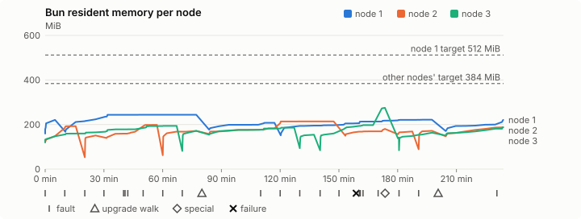
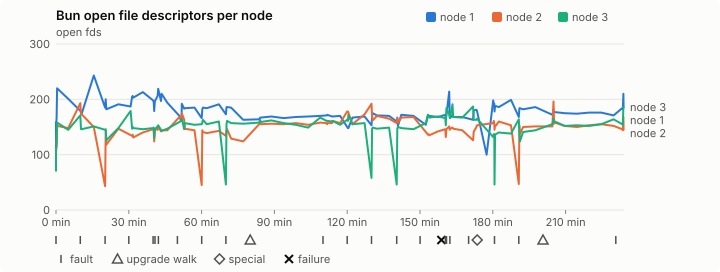
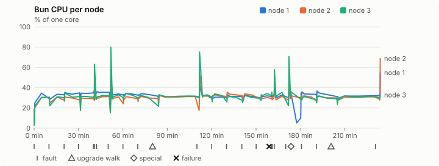
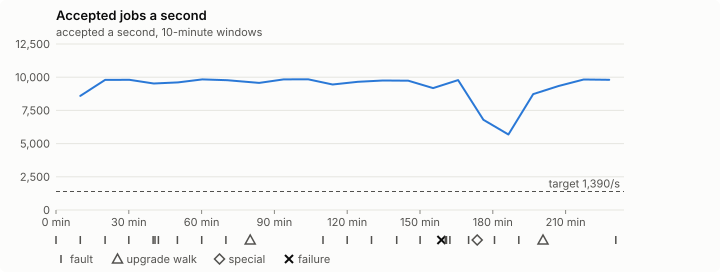

# Sustained soak (V02): FAIL

10 November 2026. final tier, full schedule, 3 h 54 min of soak on a three-node quickstart cluster.

**Final tier: not clean. The V02 gate does not pass.** A product fix means a fresh fast-tier run, then a fresh final-tier run. It is incomplete too: missing from the execution inventory: upgrade walk (to the soak build and back), fault:chaos-dns, fault:chaos-cpu, fault:chaos-memory, special:graceful-stop, special:quorum-loss, special:all-off, catalogue pulse, offline export, quiet tail with no faults, walks or specials, job campaign drained in its final two minutes; leak-checker exposure too short: rb-28b24c99c1bb-1 leak-rss, rb-28b24c99c1bb-1 leak-fd, rb-28b24c99c1bb-2 leak-rss, rb-28b24c99c1bb-2 leak-fd, rb-28b24c99c1bb-3 leak-rss, rb-28b24c99c1bb-3 leak-fd.

## Candidate and host

| | |
|---|---|
| Staged base URL | <https://github.com/reliaburger/reliaburger/releases/download/staging-v0.2.8-42847458141-3> |
| `candidate.json` SHA-256 | `f3a34fdee0a866c1a288fc66e056baac4dc8bd7d43d6a631d33cb01acfeb3e81` |
| Running versions | v0.2.8 x3 |
| Soak build | `bun-v0.2.8-soak.1`, SHA-256 `8c3ec0aa66fdb30bbabf7aa2633ea852876e2fd2826e3ed506769dc160c35d75` |
| Walks roll back to | 0.2.8 |
| Host | macOS 27.2, Apple M5 Max, 128 GiB |
| Lima | limactl version 2.2.1 |
| Guest | Ubuntu 24.04.5 LTS, kernel 6.8.0-139-generic |
| RELIABURGER_HOME | `/tmp/rbq.LrcCeD` |
| Evidence | `/Users/miko/github/rb-wt/gate-028-data/qual/ev-jobs-final` |

## Configuration deviations

- node.toml `[testing] allowed_operations` adds `provision_isolated_workloads` (quickstart allows only inject_workload_faults and alter_node_state), so the catalogue pulse can lease test namespaces
- node.toml `[logs]`/`[metrics]` export to file:///var/lib/reliaburger/soak-export every 60 s with max_storage_mb = 8 (the harness deletes a metrics export 30 minutes after its source has gone), `[storage.snapshots]` every 900 s (compressed: 120 s), retain 4, uploaded to the same directory
- node.toml `[ingress] tls_cert/tls_key` point at an operator pair from a soak CA, 45-minute leaves rotated by the harness
- Bun runs with auto/mixed; host jobs opt in to a single pinned BusyBox copy under /var/lib/reliaburger/soak-jobs, mount_isolation=false. The independent verifier listens on each private VM address, TCP 8189, with a separate run token
- node.toml `[node.labels] soak-volume` = "writer" on node 2 and "redis" on node 3, to pin the volume apps
- node.toml `[upgrades] external_signing_key` = a throwaway operator key the harness made for this run (`ed25519:YYvGi9mXhacKPVD3aMqzH/AXeXWZVsGggBUwzUzuYOo=`); the soak build's `.sig` gets that key's external signature beside the release one (D2)
- node.toml `[security] leaf_lifetime_override_secs = 3600` (D1)

## Timeline

- Started 2026-11-10 20:44:59 UTC, finished 2026-11-11 00:39:02 UTC
- Cycles completed: 3
- Fault and node choices: 17, from seed 3986718550 (`--seed 3986718550` repeats them)
- Teardown: `relish local destroy --yes` and `relish uninstall --yes` succeeded

## Faults and slots

| Class | Runs | Settled/ok | Failed | Skipped | Settle (median / max) |
|---|---|---|---|---|---|
| fault:bun-kill-follower | 4 | 4 | 0 | 0 | 33 s / 33 s |
| fault:bun-kill-leader | 4 | 4 | 0 | 0 | 34 s / 39 s |
| fault:chaos-delay | 1 | 2 | 0 | 0 | 17 s / 17 s |
| fault:chaos-drop | 1 | 2 | 0 | 0 | 19 s / 19 s |
| fault:chaos-kill | 1 | 2 | 0 | 0 | 46 s / 46 s |
| fault:chaos-partition | 1 | 2 | 0 | 0 | 18 s / 18 s |
| fault:chaos-pause | 1 | 2 | 0 | 0 | 18 s / 18 s |
| fault:chaos-scenario | 1 | 2 | 0 | 0 | 31 s / 31 s |
| fault:deploy-kill | 2 | 2 | 0 | 0 | 39 s / 39 s |
| fault:node-delay | 2 | 2 | 0 | 0 | 33 s / 33 s |
| fault:node-disk-full | 1 | 1 | 0 | 0 | 19 s / 19 s |
| fault:node-slow-fsync | 1 | 1 | 0 | 0 | 20 s / 20 s |
| fault:power-off | 2 | 2 | 0 | 0 | 32 s / 32 s |
| pulse | 3 | 3 | 0 | 0 | n/a |
| pulse:settle | 0 | 3 | 0 | 0 | 19 s / 19 s |
| special:quorum-back | 1 | 1 | 0 | 0 | n/a |
| special:quorum-loss | 1 | 1 | 0 | 0 | 31 s / 31 s |
| storage:registry-push | 3 | 0 | 0 | 0 | n/a |
| tls:invalid-expired | 3 | 3 | 0 | 0 | n/a |
| tls:invalid-torn | 6 | 6 | 0 | 0 | n/a |
| tls:reload | 43 | 43 | 0 | 0 | n/a |
| upgrade:rollback | 2 | 2 | 0 | 0 | n/a |
| upgrade:settle | 0 | 2 | 0 | 0 | 59 s / 59 s |
| upgrade:upgrade | 2 | 2 | 0 | 0 | n/a |

## Execution inventory (gated)

What the run completed, from its events and kept bytes, against what its schedule owes. A fault counts once it was injected and the cluster settled after it.

| Item | Required | Completed | Verdict |
|---|---|---|---|
| candidate.json bytes match the qualified digest | 1 | 1 | ok |
| app workloads settled at the baseline | 1 | 1 | ok |
| upgrade walk (to the soak build and back) | 4 | 2 | MISSING |
| fault:bun-kill-follower | 1 | 4 | ok |
| fault:bun-kill-leader | 1 | 4 | ok |
| fault:deploy-kill | 1 | 2 | ok |
| fault:power-off | 1 | 2 | ok |
| fault:chaos-kill | 1 | 1 | ok |
| fault:chaos-delay | 1 | 1 | ok |
| fault:chaos-partition | 1 | 1 | ok |
| fault:chaos-scenario | 1 | 1 | ok |
| fault:chaos-pause | 1 | 1 | ok |
| fault:chaos-drop | 1 | 1 | ok |
| fault:chaos-dns | 1 | 0 | MISSING |
| fault:chaos-cpu | 1 | 0 | MISSING |
| fault:chaos-memory | 1 | 0 | MISSING |
| fault:node-delay | 1 | 2 | ok |
| fault:node-disk-full | 1 | 1 | ok |
| fault:node-slow-fsync | 1 | 1 | ok |
| special:graceful-stop | 2 | 0 | MISSING |
| special:quorum-loss | 2 | 1 | MISSING |
| special:all-off | 1 | 0 | MISSING |
| catalogue pulse | 8 | 3 | MISSING |
| offline export | 1 | 0 | MISSING |
| quiet tail with no faults, walks or specials | 1 | 0 | MISSING |
| job campaign drained in its final two minutes | 1 | 0 | MISSING |

## Observed fault effects

What each injected fault was seen to do, read back from the node.

| Fault | Target | Observed |
|---|---|---|
| effect:bun-kill-follower | rb-28b24c99c1bb-2 | MainPID 2526 -> 4824 |
| effect:bun-kill-leader | rb-28b24c99c1bb-1 | MainPID 8881 -> 2184841 |
| effect:deploy-kill | rb-28b24c99c1bb-2 | MainPID 4824 -> 800302 |
| effect:power-off | rb-28b24c99c1bb-2 | Lima status Stopped |
| effect:node-delay | rb-28b24c99c1bb-1 | netem 8001: root refcnt 2 limit 1000 delay 200ms  50ms  |
| effect:bun-kill-follower | rb-28b24c99c1bb-2 | MainPID 686 -> 3243952 |
| effect:bun-kill-leader | rb-28b24c99c1bb-3 | MainPID 2240 -> 1458543 |
| effect:node-disk-full | rb-28b24c99c1bb-2 | available 66981888 bytes  |
| effect:bun-kill-follower | rb-28b24c99c1bb-1 | MainPID 2184841 -> 107970 |
| effect:bun-kill-leader | rb-28b24c99c1bb-3 | MainPID 68081 -> 135040 |
| effect:deploy-kill | rb-28b24c99c1bb-3 | MainPID 135040 -> 2819028 |
| effect:power-off | rb-28b24c99c1bb-2 | Lima status Stopped |
| effect:node-slow-fsync | rb-28b24c99c1bb-3 | IOWriteBandwidthMax=/dev/vda 1000000 IOWriteIOPSMax=/dev/vda 20  |
| effect:bun-kill-follower | rb-28b24c99c1bb-3 | MainPID 679 -> 165553 |
| effect:bun-kill-leader | rb-28b24c99c1bb-2 | MainPID 673 -> 2701068 |
| effect:node-delay | rb-28b24c99c1bb-2 | netem 8001: root refcnt 2 limit 1000 delay 200ms  50ms  |

## Renewals and rotations

| Measure | Observed | Required | Verdict |
|---|---|---|---|
| workload identity rotations (soak-identity, per node) | 7 | ≥ 6 | PASS |
| node leaf renewals (per node) | 8 | ≥ 6 | PASS |
| operator ingress reloads (all nodes) | 43 | ≥ 14 | PASS |
| mixed job campaign and positive drain | 5 missing/failing checks | 0 | FAIL |

## Latency SLOs

What a user should feel on a quiet three-node cluster (#1400). Every sample is taken outside fault windows and through a host forward that works; each p99 is the upper bound of its histogram bucket.

| SLO | p99 | Threshold | Samples | Mode | Verdict |
|---|---|---|---|---|---|
| API read p99 | 150 ms | ≤ 1,000 ms | 2,352 | record only | PASS |
| API write p99 | 1,000 ms | ≤ 2,000 ms | 8 | record only | PASS |
| App start p99 | 1 ms | ≤ 5,000 ms | 24 | record only | PASS |
| Rolling update p99 | 30,000 ms | ≤ 30,000 ms | 8 | record only | PASS |
| Job task start p99 | 32 ms | ≤ 256 ms | 66,060,308 | gated | PASS |

- API read p99: `GET /v1/status?cluster=true` and `GET /v1/cluster/nodes` on every node, at every light check
- API write p99: `relish apply` of the soak workloads, from the call to the commit
- App start p99: each node's deploy of a new `soak-identity` instance, from its start to the instance running
- Rolling update p99: from `relish apply` returning to every node's `soak-identity` running the new spec
- Job task start p99: a job task's start lag on a pooled executor, from the job campaign's buckets, in runs no fault window overlapped
- Record only from 28 October 2026 (#1400): no soak before 0.2.4 measured it. The threshold is provisional; the first 0.2.4 fast and final records set the gate.

## Jobs

| Runtime | Accepted successes | Retries | Last accepted progress |
|---|---|---|---|
| runc | 38404 | 1 | 1794357541 |
| shared-runc | 34627972 | 1 | 1794357541 |
| process | 95763410 | 1 | 1794357541 |

The bounded campaign shares the app soak's fault schedule. These counts are reliability evidence, not a saturation rate or a 100-million-per-day qualification.

- job campaign did not positively drain before teardown
- the harness never asked the job campaign to drain
- rb-28b24c99c1bb-1 lacks a complete empty owner inventory after campaign drain
- rb-28b24c99c1bb-2 lacks a complete empty owner inventory after campaign drain
- rb-28b24c99c1bb-3 lacks a complete empty owner inventory after campaign drain
- Independent verifier execution attempts: 24
- Explicit test-operator acknowledgements for known replay-safe fenced fixtures: 85

- rb-28b24c99c1bb-1: latest complete job storage (KiB) {'instances': 21652, 'job-state': 8, 'task-arrays': 27708}; free 5050504 KiB; live/peak owners 30/32; peak storage {'instances': 23708, 'job-state': 8, 'task-arrays': 49472}
- rb-28b24c99c1bb-2: latest complete job storage (KiB) {'instances': 21808, 'job-state': 8, 'task-arrays': 28360}; free 6151312 KiB; live/peak owners 30/31; peak storage {'instances': 24700, 'job-state': 8, 'task-arrays': 48048}
- rb-28b24c99c1bb-3: latest complete job storage (KiB) {'instances': 23928, 'job-state': 8, 'task-arrays': 28476}; free 6171396 KiB; live/peak owners 30/31; peak storage {'instances': 25400, 'job-state': 8, 'task-arrays': 50396}

Complete disk inventories are recorded. Global retention bounds and the 12-hour job qualification remain #668; this gate cannot certify an unimplemented retention policy.

## Job qualification (D18-C)

Load: target; 3 nodes; accepted 9,280.0/s against a 1390.0/s target: PASS.

The September plan set its targets for one 1M-task batch on a quiet cluster. A soak runs for hours with restarts, upgrades and apps, so its storage, Bun memory and Raft targets are restated (maintainer decision, 15 October 2026, [#668](https://github.com/reliaburger/reliaburger/issues/668)). Bun's steady state is the median RSS of each process once it has been seen for 10 minutes; the gated memory checks are unchanged (`leak-rss`, and Mayo's 70% `memory_high` alert through `wtf`).

| Measure (recorded, not gated) | Observed | Target |
|---|---|---|
| Wall time of a 1,048,576-task array (median / max of 64) | 148 s / 759 s | ≤ 600 s |
| p99 start lag, pooled executors | 32 ms (bucket upper bound) | < 1,000 ms |
| Raft entries per second, all cluster writes | 5.67 | recorded only; the batch target counts only task-array writes |
| Raft state of one run, largest seen | 9,825 B | ≤ 256 KiB per 1M tasks |
| Bun steady-state RSS per process, worst node against its target | rb-28b24c99c1bb-2: 213.55 MiB steady, 213.99 MiB peak | ≤ 384 MiB (≤ 512 MiB on node 1, which serves the API) |
| Bun CPU, busiest node | 0.32 cores | ≤ 1 core (leader batch control) |
| Executor helper CPU, busiest node | 0.04 cores | ≤ 0.5 core |
| Node task-array storage per 1M accepted tasks (peaks summed) | 1.11 MiB | ≤ 64 MiB, deleted after retirement |
| Retained log volume, all nodes | 21.86 MB | ≤ 50 MB |

- Bun RSS on rb-28b24c99c1bb-1 (serves the API, target ≤ 512 MiB): pid 8881: 220.82 MiB peak (seen for under 10 minutes); pid 2184841: 243.61 MiB steady, 244.03 MiB peak; pid 2184841: 205.79 MiB steady, 207.76 MiB peak; pid 107970: 213.10 MiB steady, 221.41 MiB peak; pid 107970: 199.70 MiB steady, 219.82 MiB peak
- Bun RSS on rb-28b24c99c1bb-2 (node, target ≤ 384 MiB): pid 2526: 128.55 MiB peak (seen for under 10 minutes); pid 4824: 192.42 MiB steady, 192.80 MiB peak; pid 800302: 150.61 MiB peak (seen for under 10 minutes); pid 686: 197.66 MiB steady, 198.49 MiB peak; pid 3243952: 168.07 MiB steady, 171.25 MiB peak; pid 3243952: 213.55 MiB steady, 213.99 MiB peak; pid 681: 171.55 MiB steady, 180.27 MiB peak; pid 673: 168.64 MiB peak (seen for under 10 minutes); pid 2701068: 171.83 MiB peak (seen for under 10 minutes); pid 2701068: 186.43 MiB steady, 187.79 MiB peak
- Bun RSS on rb-28b24c99c1bb-3 (node, target ≤ 384 MiB): pid 2240: 178.12 MiB steady, 194.08 MiB peak; pid 1458543: 171.62 MiB peak (seen for under 10 minutes); pid 68081: 181.93 MiB steady, 185.89 MiB peak; pid 135040: 154.19 MiB peak (seen for under 10 minutes); pid 2819028: 196.93 MiB steady, 274.89 MiB peak; pid 679: 141.85 MiB peak (seen for under 10 minutes); pid 165553: 154.54 MiB steady, 163.39 MiB peak; pid 165553: 181.24 MiB steady, 187.56 MiB peak

- runc retry causes: exit_code 1, launch 0, signal 0, timeout 0, unknown 0, unrecorded 0
- shared-runc retry causes: exit_code 1, launch 0, signal 0, timeout 0, unknown 0, unrecorded 0
- process retry causes: exit_code 1, launch 0, signal 0, timeout 0, unknown 0, unrecorded 0
- Audited executions: 24; operator replay decisions: 85
- Job controller API fallbacks: rb-28b24c99c1bb-1 missed 232, rb-28b24c99c1bb-2 missed 13; rb-28b24c99c1bb-2 answered 219, rb-28b24c99c1bb-3 answered 13 (requests a node didn't answer, and the node that took them instead)

## Data

- Volume writer: highest ACK 107871 in the log view; the writer file checks (writer-lost, writer-regression) decide data loss, and `*-log-order` failures are about the order the log view returned lines in
- Redis counter: highest INCR 12718 in the log view
- Export rb-28b24c99c1bb-1: 224 source files, 282 at the destination
- Export rb-28b24c99c1bb-2: 356 source files, 386 at the destination
- Export rb-28b24c99c1bb-3: 213 source files, 259 at the destination
- Registry images pushed and re-verified: 4
- Agent-loop turns over the 1 s budget: rb-28b24c99c1bb-1 0, rb-28b24c99c1bb-2 0, rb-28b24c99c1bb-3 0
- Soak policies checked in force: 121 times, policy generation 36 at the last check
- Guest clock steps by Lima's guest agent: rb-28b24c99c1bb-1 1, rb-28b24c99c1bb-2 4, rb-28b24c99c1bb-3 2
- Checks evaluated: 515 (heavy 47, light 394, settle 74)
- Last observed progress: redis-counter 12718, writer-ack 107871

## Council history (linearizability)

- Not checked: the soak recorded a council history but never checked it

## Leak-checker exposure (gated)

How long each leak checker could judge each node's Bun. `leak-rss` arms at its warm sample: 60 minutes into one process in a final, and otherwise at the first heavy check where the log and metrics stores are each 90% full, between 60 minutes and 6 hours in (#1417). `leak-fd` arms after 50 minutes; a restart, kill or upgrade exec starts the warm-up again. A final needs each armed for 60 minutes on every node, with one unbroken window of 30 (#1062); its quiet tail gives them that.

| Node | Checker | Armed | Longest armed window | Evaluated samples | Processes armed | Verdict |
|---|---|---|---|---|---|---|
| rb-28b24c99c1bb-1 | leak-rss | 23 min | 17 min | 15 | 2 | SHORT |
| rb-28b24c99c1bb-1 | leak-fd | 42 min | 25 min | 28 | 2 | SHORT |
| rb-28b24c99c1bb-2 | leak-rss | 0 min | 0 min | 1 | 1 | SHORT |
| rb-28b24c99c1bb-2 | leak-fd | 10 min | 10 min | 6 | 1 | SHORT |
| rb-28b24c99c1bb-3 | leak-rss | 7 min | 7 min | 5 | 1 | SHORT |
| rb-28b24c99c1bb-3 | leak-fd | 16 min | 16 min | 12 | 1 | SHORT |

## Resource trends

| Node | Measure | First | Last | Max |
|---|---|---|---|---|
| rb-28b24c99c1bb-1 | disk_kb data | 1382780 | 1233484 | 1596380 |
| rb-28b24c99c1bb-1 | disk_kb images | 342456 | 463960 | 463976 |
| rb-28b24c99c1bb-1 | disk_kb logs | 32 | 8420 | 8716 |
| rb-28b24c99c1bb-1 | disk_kb metrics | 80 | 8444 | 8852 |
| rb-28b24c99c1bb-1 | disk_kb soak-export | 4 | 20836 | 21328 |
| rb-28b24c99c1bb-1 | disk_kb volumes | 248 | 144 | 300 |
| rb-28b24c99c1bb-1 | fd | 112 | 210 | 243 |
| rb-28b24c99c1bb-1 | rss_anon_kb | 88260 | 144432 | 168912 |
| rb-28b24c99c1bb-1 | rss_file_kb | 75144 | 80660 | 80976 |
| rb-28b24c99c1bb-1 | rss_kb | 163404 | 225092 | 249888 |
| rb-28b24c99c1bb-2 | disk_kb data | 71816 | 103104 | 452352 |
| rb-28b24c99c1bb-2 | disk_kb images | 172188 | 346604 | 346604 |
| rb-28b24c99c1bb-2 | disk_kb logs | 24 | 7596 | 7596 |
| rb-28b24c99c1bb-2 | disk_kb metrics | 64 | 8632 | 8972 |
| rb-28b24c99c1bb-2 | disk_kb soak-export | 4 | 17784 | 18092 |
| rb-28b24c99c1bb-2 | disk_kb volumes | 16760 | 18760 | 18760 |
| rb-28b24c99c1bb-2 | fd | 73 | 168 | 196 |
| rb-28b24c99c1bb-2 | rss_anon_kb | 49732 | 111896 | 138264 |
| rb-28b24c99c1bb-2 | rss_file_kb | 73824 | 80404 | 80864 |
| rb-28b24c99c1bb-2 | rss_kb | 123556 | 192300 | 219128 |
| rb-28b24c99c1bb-3 | disk_kb data | 234564 | 617280 | 865160 |
| rb-28b24c99c1bb-3 | disk_kb images | 339124 | 346588 | 346588 |
| rb-28b24c99c1bb-3 | disk_kb logs | 24 | 5040 | 5040 |
| rb-28b24c99c1bb-3 | disk_kb metrics | 28 | 8376 | 8992 |
| rb-28b24c99c1bb-3 | disk_kb soak-export | 4 | 16888 | 16888 |
| rb-28b24c99c1bb-3 | disk_kb volumes | 16784 | 17936 | 17936 |
| rb-28b24c99c1bb-3 | fd | 72 | 186 | 191 |
| rb-28b24c99c1bb-3 | rss_anon_kb | 49592 | 112796 | 200432 |
| rb-28b24c99c1bb-3 | rss_file_kb | 73440 | 79264 | 81056 |
| rb-28b24c99c1bb-3 | rss_kb | 123032 | 192060 | 281488 |

## Bun memory by kind

From each node's `/proc/PID/smaps` at the settle and heavy checks (`memory.jsonl`, #1417). Sizes in MiB; arenas are glibc thread arenas, with the number of 64 MiB arena heaps in brackets. Time is h:mm since the node's first sample.

### rb-28b24c99c1bb-1

| Time | Pid | RSS | Heap | Arenas | Stacks | Other anonymous | File | Threads |
|---|---|---|---|---|---|---|---|---|
| 0:00 | 8881 | 159.6 | 47.7 | 32.1 (1) | 2.6 | 0.1 | 77.1 | 43 |
| 1:00 | 2184841 | 244.0 | 79.8 | 72.6 (2) | 8.2 | 0.6 | 82.8 | 107 |
| 2:00 | 107970 | 151.5 | 50.4 | 19.9 (1) | 3.2 | 0.0 | 77.9 | 71 |
| 3:00 | 107970 | 218.6 | 74.4 | 56.4 (1) | 5.0 | 0.0 | 82.7 | 85 |
| 3:54 | 107970 | 219.8 | 71.9 | 61.2 (1) | 3.6 | 0.6 | 82.5 | 71 |

- rb-28b24c99c1bb-1: **arenas** grew most after the first hour: +2.9 MiB over 0:53 h:mm (others, MiB: heap -2.6, stacks -1.4, other anonymous +0.6, file -0.2).
- rb-28b24c99c1bb-1: no 6-hour RSS slope: the last Bun process (pid 107970) ran for 1:53 h:mm.

### rb-28b24c99c1bb-2

| Time | Pid | RSS | Heap | Arenas | Stacks | Other anonymous | File | Threads |
|---|---|---|---|---|---|---|---|---|
| 0:00 | 2526 | 120.7 | 21.1 | 21.8 (1) | 1.8 | 0.2 | 75.8 | 28 |
| 1:00 | 3243952 | 62.3 | 16.3 | 3.1 (1) | 0.5 | 0.0 | 42.3 | 10 |
| 2:00 | 3243952 | 205.7 | 67.3 | 51.5 (1) | 4.5 | 0.0 | 82.3 | 83 |
| 3:00 | 673 | 156.0 | 34.9 | 36.4 (1) | 2.7 | 0.3 | 81.8 | 57 |
| 3:54 | 2701068 | 187.8 | 22.6 | 78.5 (2) | 3.7 | 0.6 | 82.2 | 84 |

- rb-28b24c99c1bb-2: not enough data: the last Bun process (pid 2701068) has no samples after its first hour.
- rb-28b24c99c1bb-2: no 6-hour RSS slope: the last Bun process (pid 2701068) ran for 0:43 h:mm.

### rb-28b24c99c1bb-3

| Time | Pid | RSS | Heap | Arenas | Stacks | Other anonymous | File | Threads |
|---|---|---|---|---|---|---|---|---|
| 0:00 | 2240 | 120.1 | 17.5 | 25.0 (1) | 2.1 | 0.2 | 75.4 | 36 |
| 1:00 | 2240 | 193.2 | 51.0 | 54.0 (1) | 5.1 | 0.9 | 82.2 | 79 |
| 2:00 | 68081 | 182.0 | 54.4 | 42.8 (1) | 2.5 | 0.0 | 82.3 | 51 |
| 3:00 | 679 | 137.6 | 35.9 | 21.7 (1) | 1.9 | 0.2 | 77.8 | 38 |
| 3:54 | 165553 | 187.6 | 57.1 | 45.2 (1) | 3.5 | 0.6 | 81.1 | 64 |

- rb-28b24c99c1bb-3: not enough data: the last Bun process (pid 165553) has no samples after its first hour.
- rb-28b24c99c1bb-3: no 6-hour RSS slope: the last Bun process (pid 165553) ran for 0:53 h:mm.

## Agent loop stalls

From the stall watchdog's journal blocks (`loop-stalls.jsonl`, #1707). Each snapshot lists every Bun thread; here are the stall line, threads in uninterruptible sleep and the thread that ran the loop.

- None recorded.

## Charts

Time runs from the start of the soak. The marks under each chart are its faults, upgrade walks, specials and recorded failures; the dashed lines are targets.

## Failures

| # | First seen | Check | Symptom | Class | Cause | Action |
|---|---|---|---|---|---|---|
| 1 | 23:23:41 | light-check | fail: ingress-http: podinfo answered 502 0.001031; | unclassified | open | open |

## Notes

- Job controller was still running at teardown; positive drain must be present to pass
- The harness stopped early (exit 1) during 3:settle

Evidence: `/Users/miko/github/rb-wt/gate-028-data/qual/ev-jobs-final` (events.jsonl, snapshots/, failures/<n>/).
