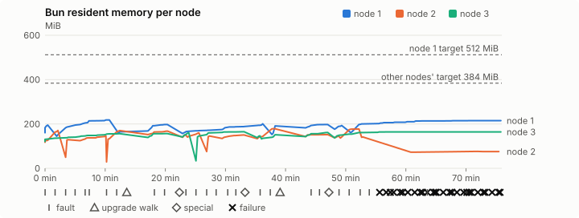
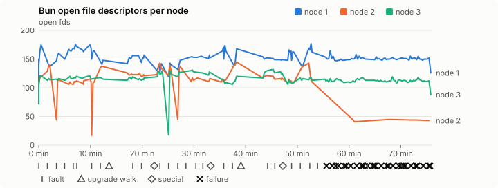
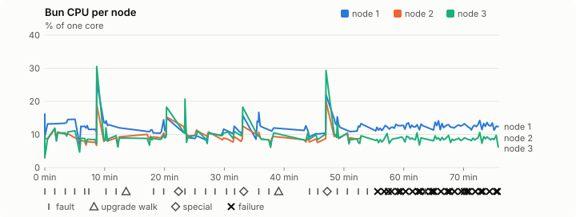
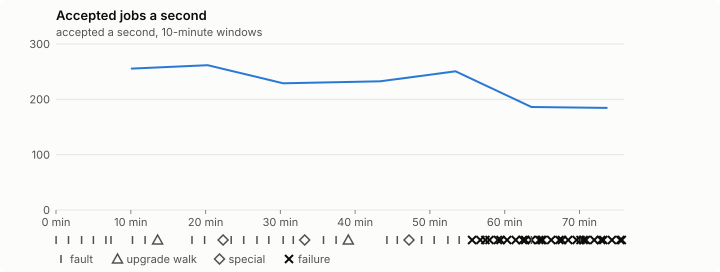

# Sustained soak (V02): FAIL

10 November 2026. fast tier, compressed schedule, 1 h 15 min of soak on a three-node quickstart cluster.

**Fast tier: not clean.** Fix what failed and run the fast tier again before a final-tier run.

## Candidate and host

| | |
|---|---|
| Staged base URL | <https://github.com/reliaburger/reliaburger/releases/download/staging-v0.2.8-42847458141-3> |
| `candidate.json` SHA-256 | `f3a34fdee0a866c1a288fc66e056baac4dc8bd7d43d6a631d33cb01acfeb3e81` |
| Running versions | v0.2.8 x3 |
| Soak build | `bun-v0.2.8-soak.1`, SHA-256 `8c3ec0aa66fdb30bbabf7aa2633ea852876e2fd2826e3ed506769dc160c35d75` |
| Walks roll back to | 0.2.8 |
| Host | macOS 27.2, Apple M5 Max, 128 GiB |
| Lima | limactl version 2.2.1 |
| Guest | Ubuntu 24.04.5 LTS, kernel 6.8.0-139-generic |
| RELIABURGER_HOME | `/tmp/rbq.cKg4Ii` |
| Evidence | `/Users/miko/github/rb-wt/gate-028-data/qual/ev-v02-fast` |

## Configuration deviations

- node.toml `[testing] allowed_operations` adds `provision_isolated_workloads` (quickstart allows only inject_workload_faults and alter_node_state), so the catalogue pulse can lease test namespaces
- node.toml `[logs]`/`[metrics]` export to file:///var/lib/reliaburger/soak-export every 60 s with max_storage_mb = 8 (the harness deletes a metrics export 30 minutes after its source has gone), `[storage.snapshots]` every 900 s (compressed: 120 s), retain 4, uploaded to the same directory
- node.toml `[ingress] tls_cert/tls_key` point at an operator pair from a soak CA, 45-minute leaves rotated by the harness
- Bun runs with auto/mixed; host jobs opt in to a single pinned BusyBox copy under /var/lib/reliaburger/soak-jobs, mount_isolation=false. The independent verifier listens on each private VM address, TCP 8189, with a separate run token
- node.toml `[node.labels] soak-volume` = "writer" on node 2 and "redis" on node 3, to pin the volume apps
- node.toml `[upgrades] external_signing_key` = a throwaway operator key the harness made for this run (`ed25519:Xfu1z0kCrMD+dqiT/o4Spg+CYj79YJJgLWsPLfre5N8=`); the soak build's `.sig` gets that key's external signature beside the release one (D2)
- node.toml `[security] leaf_lifetime_override_secs = 3600` (D1)

## Timeline

- Started 2026-11-10 18:16:38 UTC, finished 2026-11-10 19:32:35 UTC
- Cycles completed: 5
- Fault and node choices: 22, from seed 3139726783 (`--seed 3139726783` repeats them)
- Teardown: `relish local destroy --yes` and `relish uninstall --yes` succeeded

## Faults and slots

| Class | Runs | Settled/ok | Failed | Skipped | Settle (median / max) |
|---|---|---|---|---|---|
| fault:bun-kill-follower | 5 | 5 | 0 | 0 | 29 s / 31 s |
| fault:bun-kill-leader | 5 | 5 | 0 | 0 | 32 s / 37 s |
| fault:chaos-cpu | 1 | 2 | 0 | 0 | 16 s / 16 s |
| fault:chaos-delay | 1 | 2 | 0 | 0 | 15 s / 15 s |
| fault:chaos-dns | 1 | 2 | 0 | 0 | 17 s / 17 s |
| fault:chaos-drop | 1 | 2 | 0 | 0 | 16 s / 16 s |
| fault:chaos-kill | 2 | 3 | 1 | 0 | 314 s / 314 s |
| fault:chaos-memory | 1 | 1 | 1 | 0 | 306 s / 306 s |
| fault:chaos-partition | 1 | 2 | 0 | 0 | 15 s / 15 s |
| fault:chaos-pause | 1 | 2 | 0 | 0 | 16 s / 16 s |
| fault:chaos-scenario | 1 | 2 | 0 | 0 | 29 s / 29 s |
| fault:deploy-kill | 3 | 3 | 0 | 0 | 30 s / 30 s |
| fault:power-off | 4 | 2 | 2 | 0 | 29 s / 490 s |
| pulse | 1 | 1 | 0 | 0 | n/a |
| pulse:settle | 0 | 1 | 0 | 0 | 21 s / 21 s |
| special:all-off | 1 | 1 | 0 | 0 | 44 s / 44 s |
| special:graceful-stop | 1 | 1 | 0 | 0 | 34 s / 34 s |
| special:quorum-back | 1 | 1 | 0 | 0 | n/a |
| special:quorum-loss | 1 | 1 | 0 | 0 | 27 s / 27 s |
| storage:offline-export | 2 | 2 | 0 | 0 | n/a |
| storage:registry-push | 5 | 0 | 0 | 0 | n/a |
| tls:invalid-expired | 3 | 3 | 0 | 0 | n/a |
| tls:invalid-torn | 6 | 5 | 1 | 0 | n/a |
| tls:reload | 35 | 32 | 3 | 0 | n/a |
| upgrade:rollback | 2 | 2 | 0 | 0 | n/a |
| upgrade:settle | 0 | 2 | 0 | 0 | 63 s / 63 s |
| upgrade:upgrade | 2 | 2 | 0 | 0 | n/a |

## Execution inventory (recorded, not gated)

What the run completed, from its events and kept bytes, against what its schedule owes. A fault counts once it was injected and the cluster settled after it.

| Item | Required | Completed | Verdict |
|---|---|---|---|
| candidate.json bytes match the qualified digest | 1 | 1 | ok |
| app workloads settled at the baseline | 1 | 1 | ok |
| upgrade walk (to the soak build and back) | 2 | 2 | ok |
| fault:bun-kill-follower | 1 | 5 | ok |
| fault:bun-kill-leader | 1 | 5 | ok |
| fault:deploy-kill | 1 | 3 | ok |
| fault:power-off | 1 | 2 | ok |
| fault:chaos-kill | 1 | 1 | ok |
| fault:chaos-delay | 1 | 1 | ok |
| fault:chaos-partition | 1 | 1 | ok |
| fault:chaos-scenario | 1 | 1 | ok |
| fault:chaos-pause | 1 | 1 | ok |
| fault:chaos-drop | 1 | 1 | ok |
| fault:chaos-dns | 1 | 1 | ok |
| fault:chaos-cpu | 1 | 1 | ok |
| special:graceful-stop | 1 | 1 | ok |
| special:quorum-loss | 1 | 1 | ok |
| special:all-off | 1 | 1 | ok |
| catalogue pulse | 1 | 1 | ok |
| offline export | 2 | 2 | ok |
| job campaign drained in its final two minutes | 1 | 1 | ok |

## Observed fault effects

What each injected fault was seen to do, read back from the node.

| Fault | Target | Observed |
|---|---|---|
| effect:bun-kill-follower | rb-60d6064046d1-2 | MainPID 2554 -> 4911 |
| effect:bun-kill-leader | rb-60d6064046d1-1 | MainPID 8864 -> 40525 |
| effect:deploy-kill | rb-60d6064046d1-2 | MainPID 4911 -> 66926 |
| effect:power-off | rb-60d6064046d1-2 | Lima status Stopped |
| effect:bun-kill-follower | rb-60d6064046d1-2 | MainPID 683 -> 71126 |
| effect:bun-kill-leader | rb-60d6064046d1-1 | MainPID 40525 -> 216963 |
| effect:bun-kill-follower | rb-60d6064046d1-2 | MainPID 683 -> 18250 |
| effect:bun-kill-leader | rb-60d6064046d1-3 | MainPID 679 -> 43057 |
| effect:deploy-kill | rb-60d6064046d1-2 | MainPID 18250 -> 78376 |
| effect:power-off | rb-60d6064046d1-2 | Lima status Stopped |
| effect:bun-kill-follower | rb-60d6064046d1-3 | MainPID 679 -> 12599 |
| effect:bun-kill-leader | rb-60d6064046d1-1 | MainPID 681 -> 244903 |
| effect:bun-kill-follower | rb-60d6064046d1-2 | MainPID 684 -> 21040 |
| effect:bun-kill-leader | rb-60d6064046d1-1 | MainPID 683 -> 56737 |
| effect:deploy-kill | rb-60d6064046d1-2 | MainPID 21040 -> 85548 |
| effect:power-off | rb-60d6064046d1-2 | Lima status Stopped |

## Renewals and rotations

| Measure | Observed | Required | Verdict |
|---|---|---|---|
| workload identity rotations (soak-identity, per node) | 7 | ≥ 1 | PASS |
| node leaf renewals (per node) | 2 | ≥ 1 | PASS |
| operator ingress reloads (all nodes) | 32 | ≥ 14 | PASS |
| mixed job campaign and positive drain | 0 missing/failing checks | 0 | PASS |

## Latency SLOs

What a user should feel on a quiet three-node cluster (#1400). Every sample is taken outside fault windows and through a host forward that works; each p99 is the upper bound of its histogram bucket.

| SLO | p99 | Threshold | Samples | Mode | Verdict |
|---|---|---|---|---|---|
| API read p99 | 150 ms | ≤ 1,000 ms | 264 (4 failed) | record only | PASS |
| API write p99 | 1,000 ms | ≤ 2,000 ms | 6 | record only | PASS |
| App start p99 | 1 ms | ≤ 5,000 ms | 18 | record only | PASS |
| Rolling update p99 | 30,000 ms | ≤ 30,000 ms | 6 | record only | PASS |
| Job task start p99 | 2,048 ms | ≤ 256 ms | 20 | record only | too few samples |

- API read p99: `GET /v1/status?cluster=true` and `GET /v1/cluster/nodes` on every node, at every light check
- API write p99: `relish apply` of the soak workloads, from the call to the commit
- App start p99: each node's deploy of a new `soak-identity` instance, from its start to the instance running
- Rolling update p99: from `relish apply` returning to every node's `soak-identity` running the new spec
- Job task start p99: a job task's start lag on a pooled executor, from the job campaign's buckets, in runs no fault window overlapped
- Record only from 28 October 2026 (#1400): no soak before 0.2.4 measured it. The threshold is provisional; the first 0.2.4 fast and final records set the gate.
- Job task start p99 not judged: only 20 job task start samples, fewer than the 1,000 a p99 needs
- api-read failed call: rb-60d6064046d1-2 /v1/cluster/nodes: ConnectionRefusedError: [Errno 61] Connection refused
- api-read failed call: rb-60d6064046d1-2 /v1/status?cluster=true: ConnectionRefusedError: [Errno 61] Connection refused
- api-read failed call: rb-60d6064046d1-2 /v1/cluster/nodes: ConnectionRefusedError: [Errno 61] Connection refused

## Jobs

| Runtime | Accepted successes | Retries | Last accepted progress |
|---|---|---|---|
| runc | 14950 | 1 | 1794339141 |
| shared-runc | 504263 | 1 | 1794339141 |
| process | 516578 | 1 | 1794339141 |

The bounded campaign shares the app soak's fault schedule. These counts are reliability evidence, not a saturation rate or a 100-million-per-day qualification.

- Independent verifier execution attempts: 24
- Explicit test-operator acknowledgements for known replay-safe fenced fixtures: 112

- rb-60d6064046d1-1: latest complete job storage (KiB) {'instances': 2692, 'job-state': 8, 'task-arrays': 7264}; free 5180976 KiB; live/peak owners 0/11; peak storage {'instances': 9324, 'job-state': 8, 'task-arrays': 17832}
- rb-60d6064046d1-2: latest complete job storage (KiB) {'instances': 4536, 'job-state': 8, 'task-arrays': 9976}; free 6299284 KiB; live/peak owners 0/8; peak storage {'instances': 7872, 'job-state': 8, 'task-arrays': 16064}
- rb-60d6064046d1-3: latest complete job storage (KiB) {'instances': 424, 'job-state': 8, 'task-arrays': 7092}; free 6297008 KiB; live/peak owners 0/8; peak storage {'instances': 9284, 'job-state': 8, 'task-arrays': 17500}

Complete disk inventories are recorded. Global retention bounds and the 12-hour job qualification remain #668; this gate cannot certify an unimplemented retention policy.

## Job qualification (D18-C)

Load: calibration; 3 nodes; accepted 227.5/s (calibration load: not gated).

The September plan set its targets for one 1M-task batch on a quiet cluster. A soak runs for hours with restarts, upgrades and apps, so its storage, Bun memory and Raft targets are restated (maintainer decision, 15 October 2026, [#668](https://github.com/reliaburger/reliaburger/issues/668)). Bun's steady state is the median RSS of each process once it has been seen for 10 minutes; the gated memory checks are unchanged (`leak-rss`, and Mayo's 70% `memory_high` alert through `wtf`).

| Measure (recorded, not gated) | Observed | Target |
|---|---|---|
| Wall time of a 1,048,576-task array (median / max of 0) | not measured / not measured | ≤ 600 s |
| p99 start lag, pooled executors | 2 ms (bucket upper bound) | < 1,000 ms |
| Raft entries per second, all cluster writes | 5.25 | recorded only; the batch target counts only task-array writes |
| Raft state of one run, largest seen | 44,086 B | ≤ 256 KiB per 1M tasks |
| Bun steady-state RSS per process, worst node against its target | rb-60d6064046d1-3: 163.95 MiB steady, 165.02 MiB peak | ≤ 384 MiB (≤ 512 MiB on node 1, which serves the API) |
| Bun CPU, busiest node | 0.12 cores | ≤ 1 core (leader batch control) |
| Executor helper CPU, busiest node | 0.00 cores | ≤ 0.5 core |
| Node task-array storage per 1M accepted tasks (peaks summed) | 48.46 MiB | ≤ 64 MiB, deleted after retirement |
| Retained log volume, all nodes | 7.34 MB | ≤ 50 MB |

- Bun RSS on rb-60d6064046d1-1 (serves the API, target ≤ 512 MiB): pid 8864: 194.87 MiB peak (seen for under 10 minutes); pid 40525: 218.03 MiB peak (seen for under 10 minutes); pid 216963: 164.62 MiB peak (seen for under 10 minutes); pid 258642: 197.31 MiB peak (seen for under 10 minutes); pid 681: 194.19 MiB steady, 200.70 MiB peak; pid 244903: 191.20 MiB peak (seen for under 10 minutes); pid 244903: 197.24 MiB peak (seen for under 10 minutes); pid 683: 193.16 MiB peak (seen for under 10 minutes); pid 56737: 214.60 MiB steady, 215.23 MiB peak
- Bun RSS on rb-60d6064046d1-2 (node, target ≤ 384 MiB): pid 2554: 129.29 MiB peak (seen for under 10 minutes); pid 4911: 170.54 MiB peak (seen for under 10 minutes); pid 66926: 129.12 MiB peak (seen for under 10 minutes); pid 683: 145.21 MiB peak (seen for under 10 minutes); pid 71126: 170.21 MiB peak (seen for under 10 minutes); pid 71126: 168.12 MiB peak (seen for under 10 minutes); pid 683: 150.32 MiB peak (seen for under 10 minutes); pid 18250: 159.96 MiB peak (seen for under 10 minutes); pid 78376: 145.56 MiB peak (seen for under 10 minutes); pid 680: 150.37 MiB peak (seen for under 10 minutes); pid 677: 178.32 MiB peak (seen for under 10 minutes); pid 677: 152.25 MiB peak (seen for under 10 minutes); pid 684: 146.71 MiB peak (seen for under 10 minutes); pid 21040: 177.08 MiB peak (seen for under 10 minutes); pid 85548: 141.36 MiB peak (seen for under 10 minutes); pid 10617: 73.02 MiB peak (seen for under 10 minutes); pid 11009: 72.75 MiB peak (seen for under 10 minutes); pid 21216: 74.95 MiB peak (seen for under 10 minutes); pid 27036: 76.31 MiB peak (seen for under 10 minutes); pid 28321: 75.70 MiB peak (seen for under 10 minutes); pid 32777: 75.70 MiB peak (seen for under 10 minutes)
- Bun RSS on rb-60d6064046d1-3 (node, target ≤ 384 MiB): pid 2229: 155.25 MiB steady, 156.16 MiB peak; pid 2229: 156.43 MiB peak (seen for under 10 minutes); pid 679: 160.75 MiB peak (seen for under 10 minutes); pid 43057: 165.02 MiB peak (seen for under 10 minutes); pid 679: 146.54 MiB peak (seen for under 10 minutes); pid 12599: 151.36 MiB peak (seen for under 10 minutes); pid 681: 161.50 MiB peak (seen for under 10 minutes); pid 683: 163.95 MiB steady, 164.22 MiB peak

- runc retry causes: exit_code 1, launch 0, signal 0, timeout 0, unknown 0, unrecorded 0
- shared-runc retry causes: exit_code 1, launch 0, signal 0, timeout 0, unknown 0, unrecorded 0
- process retry causes: exit_code 1, launch 0, signal 0, timeout 0, unknown 0, unrecorded 0
- Audited executions: 24; operator replay decisions: 112
- Job controller API fallbacks: rb-60d6064046d1-1 missed 120, rb-60d6064046d1-2 missed 5; rb-60d6064046d1-2 answered 115, rb-60d6064046d1-3 answered 5 (requests a node didn't answer, and the node that took them instead)

## Data

- Volume writer: highest ACK 21093 in the log view; the writer file checks (writer-lost, writer-regression) decide data loss, and `*-log-order` failures are about the order the log view returned lines in
- Redis counter: highest INCR 3743 in the log view
- Export rb-60d6064046d1-1: 148 source files, 148 at the destination
- Export rb-60d6064046d1-2: 109 source files, 60 at the destination
- Export rb-60d6064046d1-3: 110 source files, 107 at the destination
- Registry images pushed and re-verified: 6
- Agent-loop turns over the 1 s budget: rb-60d6064046d1-1 0, rb-60d6064046d1-2 0, rb-60d6064046d1-3 0
- Soak policies checked in force: 160 times, policy generation 33 at the last check
- Guest clock steps by Lima's guest agent: rb-60d6064046d1-1 2, rb-60d6064046d1-2 7, rb-60d6064046d1-3 5
- Checks evaluated: 219 (heavy 18, light 59, settle 142)
- Last observed progress: redis-counter 3743, writer-ack 21093

## Council history (linearizability)

Every test-lease grant, renew, read and release the history client made, checked against a model of the council's leases. A write with no answer may or may not have happened; the check allows both.

- Operations checked: 21953 of 21953, in 2 namespaces; 2553 writes had no answer
- Verdict: linearizable

## Leak-checker exposure (recorded, not gated)

How long each leak checker could judge each node's Bun. `leak-rss` arms at its warm sample: 60 minutes into one process in a final, and otherwise at the first heavy check where the log and metrics stores are each 90% full, between 60 minutes and 6 hours in (#1417). `leak-fd` arms after 50 minutes; a restart, kill or upgrade exec starts the warm-up again. A final needs each armed for 60 minutes on every node, with one unbroken window of 30 (#1062); its quiet tail gives them that.

| Node | Checker | Armed | Longest armed window | Evaluated samples | Processes armed | Verdict |
|---|---|---|---|---|---|---|
| rb-60d6064046d1-1 | leak-rss | 0 min | 0 min | 0 | 0 | short |
| rb-60d6064046d1-1 | leak-fd | 0 min | 0 min | 0 | 0 | short |
| rb-60d6064046d1-2 | leak-rss | 0 min | 0 min | 0 | 0 | short |
| rb-60d6064046d1-2 | leak-fd | 0 min | 0 min | 0 | 0 | short |
| rb-60d6064046d1-3 | leak-rss | 0 min | 0 min | 0 | 0 | short |
| rb-60d6064046d1-3 | leak-fd | 0 min | 0 min | 0 | 0 | short |

## Resource trends

| Node | Measure | First | Last | Max |
|---|---|---|---|---|
| rb-60d6064046d1-1 | disk_kb data | 1382852 | 1527748 | 1543044 |
| rb-60d6064046d1-1 | disk_kb images | 342456 | 464112 | 464112 |
| rb-60d6064046d1-1 | disk_kb logs | 32 | 5372 | 5372 |
| rb-60d6064046d1-1 | disk_kb metrics | 92 | 6344 | 6344 |
| rb-60d6064046d1-1 | disk_kb soak-export | 4 | 11736 | 11736 |
| rb-60d6064046d1-1 | disk_kb volumes | 248 | 300 | 300 |
| rb-60d6064046d1-1 | fd | 113 | 126 | 177 |
| rb-60d6064046d1-1 | rss_anon_kb | 89024 | 139672 | 142720 |
| rb-60d6064046d1-1 | rss_file_kb | 75144 | 80720 | 80720 |
| rb-60d6064046d1-1 | rss_kb | 164168 | 220392 | 223264 |
| rb-60d6064046d1-2 | disk_kb data | 71840 | 28676 | 624312 |
| rb-60d6064046d1-2 | disk_kb images | 172188 | 342464 | 342464 |
| rb-60d6064046d1-2 | disk_kb logs | 24 | 1192 | 1192 |
| rb-60d6064046d1-2 | disk_kb metrics | 68 | 2092 | 2092 |
| rb-60d6064046d1-2 | disk_kb soak-export | 4 | 2324 | 2324 |
| rb-60d6064046d1-2 | disk_kb volumes | 16760 | 16896 | 17144 |
| rb-60d6064046d1-2 | fd | 72 | 43 | 145 |
| rb-60d6064046d1-2 | rss_anon_kb | 46344 | 14256 | 102748 |
| rb-60d6064046d1-2 | rss_file_kb | 73808 | 63264 | 80340 |
| rb-60d6064046d1-2 | rss_kb | 120152 | 77520 | 182596 |
| rb-60d6064046d1-3 | disk_kb data | 234596 | 198680 | 724568 |
| rb-60d6064046d1-3 | disk_kb images | 339124 | 342464 | 342464 |
| rb-60d6064046d1-3 | disk_kb logs | 24 | 604 | 604 |
| rb-60d6064046d1-3 | disk_kb metrics | 32 | 3052 | 3052 |
| rb-60d6064046d1-3 | disk_kb soak-export | 4 | 3644 | 3644 |
| rb-60d6064046d1-3 | disk_kb volumes | 16784 | 17096 | 17168 |
| rb-60d6064046d1-3 | fd | 72 | 88 | 132 |
| rb-60d6064046d1-3 | rss_anon_kb | 50436 | 89064 | 89064 |
| rb-60d6064046d1-3 | rss_file_kb | 73504 | 79100 | 80672 |
| rb-60d6064046d1-3 | rss_kb | 123940 | 168164 | 168984 |

## Bun memory by kind

From each node's `/proc/PID/smaps` at the settle and heavy checks (`memory.jsonl`, #1417). Sizes in MiB; arenas are glibc thread arenas, with the number of 64 MiB arena heaps in brackets. Time is h:mm since the node's first sample.

### rb-60d6064046d1-1

| Time | Pid | RSS | Heap | Arenas | Stacks | Other anonymous | File | Threads |
|---|---|---|---|---|---|---|---|---|
| 0:00 | 8864 | 160.3 | 41.6 | 39.0 (1) | 2.5 | 0.1 | 77.1 | 40 |
| 1:00 | 56737 | 207.9 | 63.0 | 58.6 (1) | 3.8 | 0.0 | 82.4 | 79 |
| 1:16 | 56737 | 215.2 | 64.2 | 64.0 (1) | 4.5 | 0.0 | 82.6 | 85 |

- rb-60d6064046d1-1: not enough data: the last Bun process (pid 56737) has no samples after its first hour.
- rb-60d6064046d1-1: no 6-hour RSS slope: the last Bun process (pid 56737) ran for 0:24 h:mm.

### rb-60d6064046d1-2

| Time | Pid | RSS | Heap | Arenas | Stacks | Other anonymous | File | Threads |
|---|---|---|---|---|---|---|---|---|
| 0:00 | 2554 | 117.3 | 28.0 | 11.3 (1) | 2.1 | 0.2 | 75.8 | 36 |
| 1:01 | 10617 | 73.0 | 5.3 | 0.6 (1) | 0.8 | 0.5 | 65.8 | 15 |
| 1:15 | 32777 | 75.7 | 6.0 | 3.1 (1) | 0.6 | 0.5 | 65.5 | 10 |

- rb-60d6064046d1-2: not enough data: the last Bun process (pid 32777) has no samples after its first hour.
- rb-60d6064046d1-2: no 6-hour RSS slope: the last Bun process (pid 32777) ran for 0:00 h:mm.

### rb-60d6064046d1-3

| Time | Pid | RSS | Heap | Arenas | Stacks | Other anonymous | File | Threads |
|---|---|---|---|---|---|---|---|---|
| 0:00 | 2229 | 121.0 | 28.2 | 15.3 (1) | 1.8 | 0.2 | 75.5 | 25 |
| 1:00 | 683 | 163.9 | 47.9 | 32.4 (1) | 2.6 | 0.0 | 81.0 | 42 |
| 1:16 | 683 | 164.2 | 47.9 | 32.4 (1) | 2.9 | 0.0 | 81.0 | 49 |

- rb-60d6064046d1-3: not enough data: the last Bun process (pid 683) has no samples after its first hour.
- rb-60d6064046d1-3: no 6-hour RSS slope: the last Bun process (pid 683) ran for 0:27 h:mm.

## Agent loop stalls

From the stall watchdog's journal blocks (`loop-stalls.jsonl`, #1707). Each snapshot lists every Bun thread; here are the stall line, threads in uninterruptible sleep and the thread that ran the loop.

- None recorded.

## Charts

Time runs from the start of the soak. The marks under each chart are its faults, upgrade walks, specials and recorded failures; the dashed lines are targets.

## Failures

| # | First seen | Check | Symptom | Class | Cause | Action |
|---|---|---|---|---|---|---|
| 1 | 19:12:11 | settle-check | fail: bun-restart rb-60d6064046d1-2: 5 systemd restart(s) of bun without a harness kill (NRestarts now 24); | unclassified | open | open |
| 2 | 19:12:28 | settle-check | fail: bun-restart rb-60d6064046d1-2: 6 systemd restart(s) of bun without a harness kill (NRestarts now 30); | unclassified | open | open |
| 3 | 19:12:45 | settle-check | fail: bun-restart rb-60d6064046d1-2: 6 systemd restart(s) of bun without a harness kill (NRestarts now 36); | unclassified | open | open |
| 4 | 19:13:01 | settle-check | fail: bun-restart rb-60d6064046d1-2: 7 systemd restart(s) of bun without a harness kill (NRestarts now 43); | unclassified | open | open |
| 5 | 19:13:18 | settle-check | fail: bun-restart rb-60d6064046d1-2: 6 systemd restart(s) of bun without a harness kill (NRestarts now 49); | unclassified | open | open |
| 6 | 19:13:35 | settle-check | fail: bun-restart rb-60d6064046d1-2: 6 systemd restart(s) of bun without a harness kill (NRestarts now 55); | unclassified | open | open |
| 7 | 19:13:58 | heavy-check | fail: bun-restart rb-60d6064046d1-2: 9 systemd restart(s) of bun without a harness kill (NRestarts now 64); | unclassified | open | open |
| 8 | 19:14:16 | settle-check | fail: bun-restart rb-60d6064046d1-2: 8 systemd restart(s) of bun without a harness kill (NRestarts now 72); | unclassified | open | open |
| 9 | 19:14:32 | settle-check | fail: bun-restart rb-60d6064046d1-2: 5 systemd restart(s) of bun without a harness kill (NRestarts now 77); | unclassified | open | open |
| 10 | 19:14:48 | settle-check | fail: bun-restart rb-60d6064046d1-2: 6 systemd restart(s) of bun without a harness kill (NRestarts now 83); | unclassified | open | open |
| 11 | 19:15:05 | settle-check | fail: bun-restart rb-60d6064046d1-2: 8 systemd restart(s) of bun without a harness kill (NRestarts now 91); | unclassified | open | open |
| 12 | 19:15:22 | settle-check | fail: bun-restart rb-60d6064046d1-2: 6 systemd restart(s) of bun without a harness kill (NRestarts now 97); | unclassified | open | open |
| 13 | 19:15:39 | settle-check | fail: bun-restart rb-60d6064046d1-2: 7 systemd restart(s) of bun without a harness kill (NRestarts now 104); | unclassified | open | open |
| 14 | 19:16:00 | ingress-reload | rb-60d6064046d1-2 served nothing 15 s after the 100D pair landed | unclassified | open | open |
| 15 | 19:16:18 | settle-check | fail: bun-restart rb-60d6064046d1-2: 16 systemd restart(s) of bun without a harness kill (NRestarts now 120); | unclassified | open | open |
| 16 | 19:16:36 | settle-check | fail: bun-restart rb-60d6064046d1-2: 7 systemd restart(s) of bun without a harness kill (NRestarts now 127); | unclassified | open | open |
| 17 | 19:16:52 | settle-check | fail: bun-restart rb-60d6064046d1-2: 6 systemd restart(s) of bun without a harness kill (NRestarts now 133); | unclassified | open | open |
| 18 | 19:17:10 | settle-check | fail: bun-restart rb-60d6064046d1-2: 6 systemd restart(s) of bun without a harness kill (NRestarts now 139); | unclassified | open | open |
| 19 | 19:17:27 | settle-check | fail: bun-restart rb-60d6064046d1-2: 8 systemd restart(s) of bun without a harness kill (NRestarts now 147); | unclassified | open | open |
| 20 | 19:17:44 | settle-check | fail: bun-restart rb-60d6064046d1-2: 6 systemd restart(s) of bun without a harness kill (NRestarts now 153); | unclassified | open | open |
| 21 | 19:18:01 | settle-check | fail: bun-restart rb-60d6064046d1-2: 6 systemd restart(s) of bun without a harness kill (NRestarts now 159); | unclassified | open | open |
| 22 | 19:18:18 | settle-check | fail: bun-restart rb-60d6064046d1-2: 7 systemd restart(s) of bun without a harness kill (NRestarts now 166); | unclassified | open | open |
| 23 | 19:18:37 | settle-check | fail: bun-restart rb-60d6064046d1-2: 7 systemd restart(s) of bun without a harness kill (NRestarts now 173); | unclassified | open | open |
| 24 | 19:18:58 | heavy-check | fail: bun-restart rb-60d6064046d1-2: 8 systemd restart(s) of bun without a harness kill (NRestarts now 181); | unclassified | open | open |
| 25 | 19:19:16 | settle-check | fail: bun-restart rb-60d6064046d1-2: 8 systemd restart(s) of bun without a harness kill (NRestarts now 189); | unclassified | open | open |
| 26 | 19:19:35 | settle-check | fail: bun-restart rb-60d6064046d1-2: 7 systemd restart(s) of bun without a harness kill (NRestarts now 196); | unclassified | open | open |
| 27 | 19:19:52 | settle-check | fail: bun-restart rb-60d6064046d1-2: 7 systemd restart(s) of bun without a harness kill (NRestarts now 203); | unclassified | open | open |
| 28 | 19:20:07 | settle | fault:power-off did not settle within 480 s | unclassified | open | open |
| 29 | 19:21:11 | ingress-invalid-pair | rb-60d6064046d1-2 served nothing after a torn pair; expected the last good 100D | unclassified | open | open |
| 30 | 19:21:38 | settle-check | fail: bun-restart rb-60d6064046d1-2: 41 systemd restart(s) of bun without a harness kill (NRestarts now 244); | unclassified | open | open |
| 31 | 19:21:55 | settle-check | fail: bun-restart rb-60d6064046d1-2: 7 systemd restart(s) of bun without a harness kill (NRestarts now 251); | unclassified | open | open |
| 32 | 19:22:11 | settle-check | fail: bun-restart rb-60d6064046d1-2: 6 systemd restart(s) of bun without a harness kill (NRestarts now 257); | unclassified | open | open |
| 33 | 19:22:30 | settle-check | fail: bun-restart rb-60d6064046d1-2: 8 systemd restart(s) of bun without a harness kill (NRestarts now 265); | unclassified | open | open |
| 34 | 19:22:47 | settle-check | fail: bun-restart rb-60d6064046d1-2: 7 systemd restart(s) of bun without a harness kill (NRestarts now 272); | unclassified | open | open |
| 35 | 19:23:03 | settle-check | fail: bun-restart rb-60d6064046d1-2: 7 systemd restart(s) of bun without a harness kill (NRestarts now 279); | unclassified | open | open |
| 36 | 19:23:20 | settle-check | fail: bun-restart rb-60d6064046d1-2: 7 systemd restart(s) of bun without a harness kill (NRestarts now 286); | unclassified | open | open |
| 37 | 19:23:36 | settle-check | fail: bun-restart rb-60d6064046d1-2: 7 systemd restart(s) of bun without a harness kill (NRestarts now 293); | unclassified | open | open |
| 38 | 19:23:53 | settle-check | fail: bun-restart rb-60d6064046d1-2: 7 systemd restart(s) of bun without a harness kill (NRestarts now 300); | unclassified | open | open |
| 39 | 19:24:13 | heavy-check | fail: bun-restart rb-60d6064046d1-2: 7 systemd restart(s) of bun without a harness kill (NRestarts now 307); | unclassified | open | open |
| 40 | 19:24:30 | settle-check | fail: bun-restart rb-60d6064046d1-2: 8 systemd restart(s) of bun without a harness kill (NRestarts now 315); | unclassified | open | open |
| 41 | 19:24:46 | settle-check | fail: bun-restart rb-60d6064046d1-2: 6 systemd restart(s) of bun without a harness kill (NRestarts now 321); | unclassified | open | open |
| 42 | 19:25:03 | settle-check | fail: bun-restart rb-60d6064046d1-2: 7 systemd restart(s) of bun without a harness kill (NRestarts now 328); | unclassified | open | open |
| 43 | 19:25:19 | settle-check | fail: bun-restart rb-60d6064046d1-2: 7 systemd restart(s) of bun without a harness kill (NRestarts now 335); | unclassified | open | open |
| 44 | 19:25:35 | settle-check | fail: bun-restart rb-60d6064046d1-2: 6 systemd restart(s) of bun without a harness kill (NRestarts now 341); | unclassified | open | open |
| 45 | 19:25:53 | settle-check | fail: bun-restart rb-60d6064046d1-2: 7 systemd restart(s) of bun without a harness kill (NRestarts now 348); | unclassified | open | open |
| 46 | 19:26:11 | settle-check | fail: bun-restart rb-60d6064046d1-2: 7 systemd restart(s) of bun without a harness kill (NRestarts now 355); | unclassified | open | open |
| 47 | 19:26:27 | settle-check | fail: bun-restart rb-60d6064046d1-2: 7 systemd restart(s) of bun without a harness kill (NRestarts now 362); | unclassified | open | open |
| 48 | 19:26:42 | settle | fault:chaos-memory did not settle within 300 s | unclassified | open | open |
| 49 | 19:26:50 | settle-check | fail: bun-restart rb-60d6064046d1-2: 9 systemd restart(s) of bun without a harness kill (NRestarts now 371); | unclassified | open | open |
| 50 | 19:27:25 | settle-check | fail: bun-restart rb-60d6064046d1-2: 14 systemd restart(s) of bun without a harness kill (NRestarts now 385); | unclassified | open | open |
| 51 | 19:27:41 | settle-check | fail: bun-restart rb-60d6064046d1-2: 7 systemd restart(s) of bun without a harness kill (NRestarts now 392); | unclassified | open | open |
| 52 | 19:27:58 | settle-check | fail: bun-restart rb-60d6064046d1-2: 7 systemd restart(s) of bun without a harness kill (NRestarts now 399); | unclassified | open | open |
| 53 | 19:28:15 | settle-check | fail: bun-restart rb-60d6064046d1-2: 6 systemd restart(s) of bun without a harness kill (NRestarts now 405); | unclassified | open | open |
| 54 | 19:28:31 | settle-check | fail: bun-restart rb-60d6064046d1-2: 7 systemd restart(s) of bun without a harness kill (NRestarts now 412); | unclassified | open | open |
| 55 | 19:28:48 | settle-check | fail: bun-restart rb-60d6064046d1-2: 6 systemd restart(s) of bun without a harness kill (NRestarts now 418); | unclassified | open | open |
| 56 | 19:29:05 | settle-check | fail: bun-restart rb-60d6064046d1-2: 7 systemd restart(s) of bun without a harness kill (NRestarts now 425); | unclassified | open | open |
| 57 | 19:29:27 | heavy-check | fail: bun-restart rb-60d6064046d1-2: 9 systemd restart(s) of bun without a harness kill (NRestarts now 434); | unclassified | open | open |
| 58 | 19:29:44 | settle-check | fail: bun-restart rb-60d6064046d1-2: 8 systemd restart(s) of bun without a harness kill (NRestarts now 442); | unclassified | open | open |
| 59 | 19:30:02 | settle-check | fail: bun-restart rb-60d6064046d1-2: 7 systemd restart(s) of bun without a harness kill (NRestarts now 449); | unclassified | open | open |
| 60 | 19:30:18 | settle-check | fail: bun-restart rb-60d6064046d1-2: 7 systemd restart(s) of bun without a harness kill (NRestarts now 456); | unclassified | open | open |
| 61 | 19:30:35 | settle-check | fail: bun-restart rb-60d6064046d1-2: 7 systemd restart(s) of bun without a harness kill (NRestarts now 463); | unclassified | open | open |
| 62 | 19:30:54 | settle-check | fail: bun-restart rb-60d6064046d1-2: 8 systemd restart(s) of bun without a harness kill (NRestarts now 471); | unclassified | open | open |
| 63 | 19:31:11 | settle-check | fail: bun-restart rb-60d6064046d1-2: 6 systemd restart(s) of bun without a harness kill (NRestarts now 477); | unclassified | open | open |
| 64 | 19:31:29 | settle-check | fail: bun-restart rb-60d6064046d1-2: 8 systemd restart(s) of bun without a harness kill (NRestarts now 485); | unclassified | open | open |
| 65 | 19:31:46 | settle-check | fail: bun-restart rb-60d6064046d1-2: 7 systemd restart(s) of bun without a harness kill (NRestarts now 492); | unclassified | open | open |
| 66 | 19:32:01 | settle | fault:chaos-kill did not settle within 300 s | unclassified | open | open |
| 67 | 19:32:13 | heavy-check | fail: wtf-warning council: council-member-down for 1208 s: 1 of 3 council members did not answer;fail: node-alive rb-60d6064046d1-2: not alive: missing;fail: bun-restart rb-60d6064046d1-2: 11 systemd restart(s) of bun without a harness kill (NRestarts now 503);fail: leak-runc rb-60d6064046d1-2: defa | unclassified | open | open |
| 68 | 19:32:31 | heavy-check | fail: bun-restart rb-60d6064046d1-2: 8 systemd restart(s) of bun without a harness kill (NRestarts now 511); | unclassified | open | open |

Evidence: `/Users/miko/github/rb-wt/gate-028-data/qual/ev-v02-fast` (events.jsonl, snapshots/, failures/<n>/).
