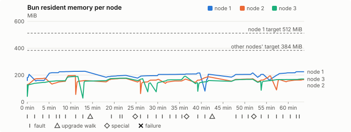
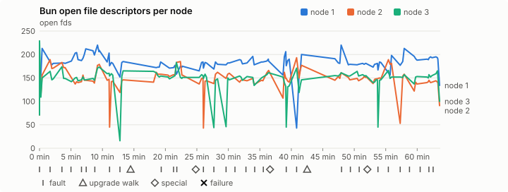
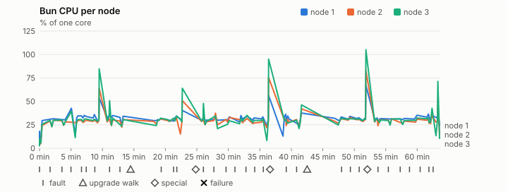
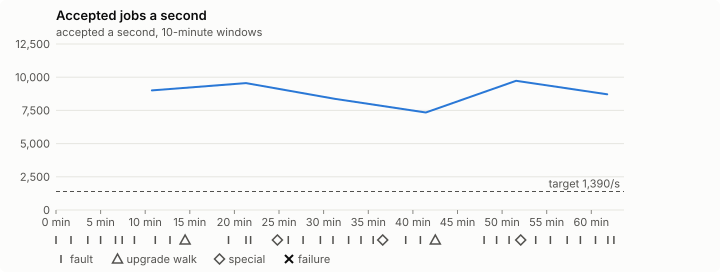

# Sustained soak (V02): PASS

11 November 2026. fast tier, compressed schedule, 1 h 03 min of soak on a three-node quickstart cluster.

**Fast tier: clean.** The iteration loop only, not acceptance: the V02 gate needs a clean final-tier run (8 h, full schedule) on the final candidate.

## Candidate and host

| | |
|---|---|
| Staged base URL | <https://github.com/reliaburger/reliaburger/releases/download/staging-v0.2.8-42927004563-1> |
| `candidate.json` SHA-256 | `700071d536ef66354ee701e6b09d5a0233beeadcd8ef14bcddf2e1e15b9b8ff8` |
| Running versions | v0.2.8 x3 |
| Soak build | `bun-v0.2.8-soak.1`, SHA-256 `413aadcf93225af75e25fac041339094a5c7d2546591a517aba16620cf8dd3fb` |
| Walks roll back to | 0.2.8 |
| Host | macOS 27.2, Apple M5 Max, 128 GiB |
| Lima | limactl version 2.2.1 |
| Guest | Ubuntu 24.04.5 LTS, kernel 6.8.0-139-generic |
| RELIABURGER_HOME | `/tmp/rbq.IrunW5` |
| Evidence | `/Users/miko/github/rb-wt/gate-028-c2/qual/ev-jobs-fast` |

## Configuration deviations

- node.toml `[testing] allowed_operations` adds `provision_isolated_workloads` (quickstart allows only inject_workload_faults and alter_node_state), so the catalogue pulse can lease test namespaces
- node.toml `[logs]`/`[metrics]` export to file:///var/lib/reliaburger/soak-export every 60 s with max_storage_mb = 8 (the harness deletes a metrics export 30 minutes after its source has gone), `[storage.snapshots]` every 900 s (compressed: 120 s), retain 4, uploaded to the same directory
- node.toml `[ingress] tls_cert/tls_key` point at an operator pair from a soak CA, 45-minute leaves rotated by the harness
- Bun runs with auto/mixed; host jobs opt in to a single pinned BusyBox copy under /var/lib/reliaburger/soak-jobs, mount_isolation=false. The independent verifier listens on each private VM address, TCP 8189, with a separate run token
- node.toml `[node.labels] soak-volume` = "writer" on node 2 and "redis" on node 3, to pin the volume apps
- node.toml `[upgrades] external_signing_key` = a throwaway operator key the harness made for this run (`ed25519:1TQhtAWTiO/7hZZ4KBnnG3kzyDO8CpKpOzavuuW3BuM=`); the soak build's `.sig` gets that key's external signature beside the release one (D2)
- node.toml `[security] leaf_lifetime_override_secs = 3600` (D1)

## Timeline

- Started 2026-11-11 02:54:04 UTC, finished 2026-11-11 03:57:44 UTC
- Cycles completed: 5
- Fault and node choices: 27, from seed 1310215243 (`--seed 1310215243` repeats them)
- Teardown: `relish local destroy --yes` and `relish uninstall --yes` succeeded

## Faults and slots

| Class | Runs | Settled/ok | Failed | Skipped | Settle (median / max) |
|---|---|---|---|---|---|
| fault:bun-kill-follower | 5 | 5 | 0 | 0 | 31 s / 34 s |
| fault:bun-kill-leader | 5 | 5 | 0 | 0 | 34 s / 40 s |
| fault:chaos-cpu | 1 | 2 | 0 | 0 | 18 s / 18 s |
| fault:chaos-delay | 1 | 2 | 0 | 0 | 16 s / 16 s |
| fault:chaos-dns | 1 | 2 | 0 | 0 | 18 s / 18 s |
| fault:chaos-drop | 1 | 2 | 0 | 0 | 16 s / 16 s |
| fault:chaos-kill | 2 | 4 | 0 | 0 | 44 s / 44 s |
| fault:chaos-memory | 1 | 2 | 0 | 0 | 19 s / 19 s |
| fault:chaos-partition | 1 | 2 | 0 | 0 | 17 s / 17 s |
| fault:chaos-pause | 1 | 2 | 0 | 0 | 17 s / 17 s |
| fault:chaos-scenario | 1 | 2 | 0 | 0 | 31 s / 31 s |
| fault:deploy-kill | 3 | 3 | 0 | 0 | 34 s / 42 s |
| fault:node-delay | 2 | 2 | 0 | 0 | 31 s / 31 s |
| fault:node-disk-full | 2 | 2 | 0 | 0 | 18 s / 18 s |
| fault:node-slow-fsync | 1 | 1 | 0 | 0 | 17 s / 17 s |
| fault:power-off | 3 | 3 | 0 | 0 | 30 s / 30 s |
| pulse | 1 | 1 | 0 | 0 | n/a |
| pulse:settle | 0 | 1 | 0 | 0 | 22 s / 22 s |
| special:all-off | 1 | 1 | 0 | 0 | 45 s / 45 s |
| special:graceful-stop | 1 | 1 | 0 | 0 | 39 s / 39 s |
| special:quorum-back | 1 | 1 | 0 | 0 | n/a |
| special:quorum-loss | 1 | 1 | 0 | 0 | 30 s / 30 s |
| storage:offline-export | 2 | 2 | 0 | 0 | n/a |
| storage:registry-push | 5 | 0 | 0 | 0 | n/a |
| tls:invalid-expired | 3 | 3 | 0 | 0 | n/a |
| tls:invalid-torn | 3 | 3 | 0 | 0 | n/a |
| tls:reload | 29 | 29 | 0 | 0 | n/a |
| upgrade:rollback | 2 | 2 | 0 | 0 | n/a |
| upgrade:settle | 0 | 2 | 0 | 0 | 72 s / 72 s |
| upgrade:upgrade | 2 | 2 | 0 | 0 | n/a |

## Execution inventory (recorded, not gated)

What the run completed, from its events and kept bytes, against what its schedule owes. A fault counts once it was injected and the cluster settled after it.

| Item | Required | Completed | Verdict |
|---|---|---|---|
| candidate.json bytes match the qualified digest | 1 | 1 | ok |
| app workloads settled at the baseline | 1 | 1 | ok |
| upgrade walk (to the soak build and back) | 2 | 2 | ok |
| fault:bun-kill-follower | 1 | 5 | ok |
| fault:bun-kill-leader | 1 | 5 | ok |
| fault:deploy-kill | 1 | 3 | ok |
| fault:power-off | 1 | 3 | ok |
| fault:chaos-kill | 1 | 2 | ok |
| fault:chaos-delay | 1 | 1 | ok |
| fault:chaos-partition | 1 | 1 | ok |
| fault:chaos-scenario | 1 | 1 | ok |
| fault:chaos-pause | 1 | 1 | ok |
| fault:chaos-drop | 1 | 1 | ok |
| fault:chaos-dns | 1 | 1 | ok |
| fault:chaos-cpu | 1 | 1 | ok |
| fault:node-delay | 1 | 2 | ok |
| fault:node-disk-full | 1 | 2 | ok |
| fault:node-slow-fsync | 1 | 1 | ok |
| special:graceful-stop | 1 | 1 | ok |
| special:quorum-loss | 1 | 1 | ok |
| special:all-off | 1 | 1 | ok |
| catalogue pulse | 1 | 1 | ok |
| offline export | 2 | 2 | ok |
| job campaign drained in its final two minutes | 1 | 1 | ok |

## Observed fault effects

What each injected fault was seen to do, read back from the node.

| Fault | Target | Observed |
|---|---|---|
| effect:bun-kill-follower | rb-15562237b9a1-3 | MainPID 2221 -> 3815 |
| effect:bun-kill-leader | rb-15562237b9a1-1 | MainPID 8950 -> 413018 |
| effect:deploy-kill | rb-15562237b9a1-1 | MainPID 413018 -> 820585 |
| effect:power-off | rb-15562237b9a1-2 | Lima status Stopped |
| effect:node-delay | rb-15562237b9a1-1 | netem 8001: root refcnt 2 limit 1000 delay 200ms  50ms  |
| effect:bun-kill-follower | rb-15562237b9a1-2 | MainPID 680 -> 1417057 |
| effect:bun-kill-leader | rb-15562237b9a1-3 | MainPID 3815 -> 3238621 |
| effect:node-disk-full | rb-15562237b9a1-2 | available 66969600 bytes  |
| effect:bun-kill-follower | rb-15562237b9a1-2 | MainPID 683 -> 202360 |
| effect:bun-kill-leader | rb-15562237b9a1-3 | MainPID 678 -> 635588 |
| effect:deploy-kill | rb-15562237b9a1-3 | MainPID 635588 -> 1115162 |
| effect:power-off | rb-15562237b9a1-2 | Lima status Stopped |
| effect:node-slow-fsync | rb-15562237b9a1-3 | IOWriteBandwidthMax=/dev/vda 1000000 IOWriteIOPSMax=/dev/vda 20  |
| effect:bun-kill-follower | rb-15562237b9a1-3 | MainPID 676 -> 123250 |
| effect:bun-kill-leader | rb-15562237b9a1-1 | MainPID 681 -> 3446794 |
| effect:node-delay | rb-15562237b9a1-2 | netem 8001: root refcnt 2 limit 1000 delay 200ms  50ms  |
| effect:bun-kill-follower | rb-15562237b9a1-3 | MainPID 683 -> 228152 |
| effect:bun-kill-leader | rb-15562237b9a1-1 | MainPID 681 -> 593987 |
| effect:deploy-kill | rb-15562237b9a1-2 | MainPID 679 -> 1089367 |
| effect:power-off | rb-15562237b9a1-2 | Lima status Stopped |
| effect:node-disk-full | rb-15562237b9a1-3 | available 67051520 bytes  |

## Renewals and rotations

| Measure | Observed | Required | Verdict |
|---|---|---|---|
| workload identity rotations (soak-identity, per node) | 7 | ≥ 1 | PASS |
| node leaf renewals (per node) | 2 | ≥ 1 | PASS |
| operator ingress reloads (all nodes) | 29 | ≥ 11 | PASS |
| mixed job campaign and positive drain | 0 missing/failing checks | 0 | PASS |

## Latency SLOs

What a user should feel on a quiet three-node cluster (#1400). Every sample is taken outside fault windows and through a host forward that works; each p99 is the upper bound of its histogram bucket.

| SLO | p99 | Threshold | Samples | Mode | Verdict |
|---|---|---|---|---|---|
| API read p99 | 150 ms | ≤ 1,000 ms | 228 | record only | PASS |
| API write p99 | 500 ms | ≤ 2,000 ms | 7 | record only | PASS |
| App start p99 | 1 ms | ≤ 5,000 ms | 21 | record only | PASS |
| Rolling update p99 | 30,000 ms | ≤ 30,000 ms | 7 | record only | PASS |
| Job task start p99 | 1,024 ms | ≤ 256 ms | 20 | record only | too few samples |

- API read p99: `GET /v1/status?cluster=true` and `GET /v1/cluster/nodes` on every node, at every light check
- API write p99: `relish apply` of the soak workloads, from the call to the commit
- App start p99: each node's deploy of a new `soak-identity` instance, from its start to the instance running
- Rolling update p99: from `relish apply` returning to every node's `soak-identity` running the new spec
- Job task start p99: a job task's start lag on a pooled executor, from the job campaign's buckets, in runs no fault window overlapped
- Record only from 28 October 2026 (#1400): no soak before 0.2.4 measured it. The threshold is provisional; the first 0.2.4 fast and final records set the gate.
- Job task start p99 not judged: only 20 job task start samples, fewer than the 1,000 a p99 needs

## Jobs

| Runtime | Accepted successes | Retries | Last accepted progress |
|---|---|---|---|
| runc | 9805 | 1 | 1794369454 |
| shared-runc | 8845553 | 1 | 1794369454 |
| process | 24765330 | 1 | 1794369454 |

The bounded campaign shares the app soak's fault schedule. These counts are reliability evidence, not a saturation rate or a 100-million-per-day qualification.

- Independent verifier execution attempts: 24
- Explicit test-operator acknowledgements for known replay-safe fenced fixtures: 113

- rb-15562237b9a1-1: latest complete job storage (KiB) {'instances': 2180, 'job-state': 8, 'task-arrays': 17732}; free 5157676 KiB; live/peak owners 0/32; peak storage {'instances': 24368, 'job-state': 8, 'task-arrays': 44404}
- rb-15562237b9a1-2: latest complete job storage (KiB) {'instances': 460, 'job-state': 8, 'task-arrays': 17908}; free 6272596 KiB; live/peak owners 0/32; peak storage {'instances': 24228, 'job-state': 8, 'task-arrays': 46440}
- rb-15562237b9a1-3: latest complete job storage (KiB) {'instances': 6320, 'job-state': 8, 'task-arrays': 16712}; free 6292764 KiB; live/peak owners 0/32; peak storage {'instances': 28880, 'job-state': 8, 'task-arrays': 48400}

Complete disk inventories are recorded. Global retention bounds and the 12-hour job qualification remain #668; this gate cannot certify an unimplemented retention policy.

## Job qualification (D18-C)

Load: target; 3 nodes; accepted 8,803.5/s against a 1390.0/s target: PASS.

The September plan set its targets for one 1M-task batch on a quiet cluster. A soak runs for hours with restarts, upgrades and apps, so its storage, Bun memory and Raft targets are restated (maintainer decision, 15 October 2026, [#668](https://github.com/reliaburger/reliaburger/issues/668)). Bun's steady state is the median RSS of each process once it has been seen for 10 minutes; the gated memory checks are unchanged (`leak-rss`, and Mayo's 70% `memory_high` alert through `wtf`).

| Measure (recorded, not gated) | Observed | Target |
|---|---|---|
| Wall time of a 1,048,576-task array (median / max of 31) | 151 s / 516 s | ≤ 600 s |
| p99 start lag, pooled executors | 32 ms (bucket upper bound) | < 1,000 ms |
| Raft entries per second, all cluster writes | 5.36 | recorded only; the batch target counts only task-array writes |
| Raft state of one run, largest seen | 9,206 B | ≤ 256 KiB per 1M tasks |
| Bun steady-state RSS per process, worst node against its target | rb-15562237b9a1-3: 189.23 MiB steady, 190.58 MiB peak | ≤ 384 MiB (≤ 512 MiB on node 1, which serves the API) |
| Bun CPU, busiest node | 0.30 cores | ≤ 1 core (leader batch control) |
| Executor helper CPU, busiest node | 0.08 cores | ≤ 0.5 core |
| Node task-array storage per 1M accepted tasks (peaks summed) | 4.04 MiB | ≤ 64 MiB, deleted after retirement |
| Retained log volume, all nodes | 6.32 MB | ≤ 50 MB |

- Bun RSS on rb-15562237b9a1-1 (serves the API, target ≤ 512 MiB): pid 8950: 205.14 MiB peak (seen for under 10 minutes); pid 413018: 160.60 MiB peak (seen for under 10 minutes); pid 820585: 227.91 MiB peak (seen for under 10 minutes); pid 820585: 197.49 MiB peak (seen for under 10 minutes); pid 681: 208.20 MiB steady, 215.46 MiB peak; pid 3446794: 206.46 MiB peak (seen for under 10 minutes); pid 3446794: 215.73 MiB peak (seen for under 10 minutes); pid 681: 205.56 MiB peak (seen for under 10 minutes); pid 593987: 224.92 MiB peak (seen for under 10 minutes)
- Bun RSS on rb-15562237b9a1-2 (node, target ≤ 384 MiB): pid 2517: 177.27 MiB peak (seen for under 10 minutes); pid 680: 196.12 MiB peak (seen for under 10 minutes); pid 1417057: 159.48 MiB peak (seen for under 10 minutes); pid 1417057: 174.86 MiB peak (seen for under 10 minutes); pid 683: 158.71 MiB peak (seen for under 10 minutes); pid 202360: 168.50 MiB peak (seen for under 10 minutes); pid 679: 169.79 MiB peak (seen for under 10 minutes); pid 684: 187.28 MiB peak (seen for under 10 minutes); pid 684: 172.50 MiB peak (seen for under 10 minutes); pid 679: 193.45 MiB peak (seen for under 10 minutes); pid 1089367: 167.07 MiB peak (seen for under 10 minutes); pid 681: 165.93 MiB peak (seen for under 10 minutes)
- Bun RSS on rb-15562237b9a1-3 (node, target ≤ 384 MiB): pid 2221: 127.33 MiB peak (seen for under 10 minutes); pid 3815: 189.23 MiB steady, 189.24 MiB peak; pid 3238621: 154.84 MiB peak (seen for under 10 minutes); pid 3753160: 177.61 MiB peak (seen for under 10 minutes); pid 678: 173.07 MiB peak (seen for under 10 minutes); pid 635588: 141.72 MiB peak (seen for under 10 minutes); pid 1115162: 190.58 MiB peak (seen for under 10 minutes); pid 676: 142.46 MiB peak (seen for under 10 minutes); pid 123250: 159.40 MiB peak (seen for under 10 minutes); pid 682: 168.40 MiB peak (seen for under 10 minutes); pid 683: 152.67 MiB peak (seen for under 10 minutes); pid 228152: 170.68 MiB peak (seen for under 10 minutes)

- runc retry causes: exit_code 1, launch 0, signal 0, timeout 0, unknown 0, unrecorded 0
- shared-runc retry causes: exit_code 1, launch 0, signal 0, timeout 0, unknown 0, unrecorded 0
- process retry causes: exit_code 1, launch 0, signal 0, timeout 0, unknown 0, unrecorded 0
- Audited executions: 24; operator replay decisions: 113
- Job controller API fallbacks: rb-15562237b9a1-1 missed 195, rb-15562237b9a1-2 missed 20; rb-15562237b9a1-2 answered 175, rb-15562237b9a1-3 answered 20 (requests a node didn't answer, and the node that took them instead)

## Data

- Volume writer: highest ACK 27317 in the log view; the writer file checks (writer-lost, writer-regression) decide data loss, and `*-log-order` failures are about the order the log view returned lines in
- Redis counter: highest INCR 3110 in the log view
- Export rb-15562237b9a1-1: 127 source files, 123 at the destination
- Export rb-15562237b9a1-2: 128 source files, 117 at the destination
- Export rb-15562237b9a1-3: 100 source files, 96 at the destination
- Registry images pushed and re-verified: 6
- Agent-loop turns over the 1 s budget: rb-15562237b9a1-1 0, rb-15562237b9a1-2 0, rb-15562237b9a1-3 0
- Soak policies checked in force: 117 times, policy generation 36 at the last check
- Guest clock steps by Lima's guest agent: rb-15562237b9a1-1 1, rb-15562237b9a1-2 7, rb-15562237b9a1-3 4
- Checks evaluated: 179 (heavy 15, light 62, settle 102)
- Last observed progress: redis-counter 3110, writer-ack 27317

## Council history (linearizability)

Every test-lease grant, renew, read and release the history client made, checked against a model of the council's leases. A write with no answer may or may not have happened; the check allows both.

- Operations checked: 18634 of 18634, in 2 namespaces; 1393 writes had no answer
- Verdict: linearizable

## Leak-checker exposure (recorded, not gated)

How long each leak checker could judge each node's Bun. `leak-rss` arms at its warm sample: 60 minutes into one process in a final, and otherwise at the first heavy check where the log and metrics stores are each 90% full, between 60 minutes and 6 hours in (#1417). `leak-fd` arms after 50 minutes; a restart, kill or upgrade exec starts the warm-up again. A final needs each armed for 60 minutes on every node, with one unbroken window of 30 (#1062); its quiet tail gives them that.

| Node | Checker | Armed | Longest armed window | Evaluated samples | Processes armed | Verdict |
|---|---|---|---|---|---|---|
| rb-15562237b9a1-1 | leak-rss | 0 min | 0 min | 0 | 0 | short |
| rb-15562237b9a1-1 | leak-fd | 0 min | 0 min | 0 | 0 | short |
| rb-15562237b9a1-2 | leak-rss | 0 min | 0 min | 0 | 0 | short |
| rb-15562237b9a1-2 | leak-fd | 0 min | 0 min | 0 | 0 | short |
| rb-15562237b9a1-3 | leak-rss | 0 min | 0 min | 0 | 0 | short |
| rb-15562237b9a1-3 | leak-fd | 0 min | 0 min | 0 | 0 | short |

## Resource trends

| Node | Measure | First | Last | Max |
|---|---|---|---|---|
| rb-15562237b9a1-1 | disk_kb data | 1382904 | 1366552 | 1578980 |
| rb-15562237b9a1-1 | disk_kb images | 342456 | 464144 | 464144 |
| rb-15562237b9a1-1 | disk_kb logs | 44 | 4132 | 4132 |
| rb-15562237b9a1-1 | disk_kb metrics | 84 | 4620 | 4620 |
| rb-15562237b9a1-1 | disk_kb soak-export | 4 | 8468 | 8468 |
| rb-15562237b9a1-1 | disk_kb volumes | 248 | 228 | 300 |
| rb-15562237b9a1-1 | fd | 110 | 134 | 220 |
| rb-15562237b9a1-1 | rss_anon_kb | 87812 | 149968 | 152836 |
| rb-15562237b9a1-1 | rss_file_kb | 75168 | 80352 | 80544 |
| rb-15562237b9a1-1 | rss_kb | 162980 | 230320 | 233380 |
| rb-15562237b9a1-2 | disk_kb data | 71840 | 51020 | 437596 |
| rb-15562237b9a1-2 | disk_kb images | 172188 | 342512 | 342512 |
| rb-15562237b9a1-2 | disk_kb logs | 24 | 1148 | 1148 |
| rb-15562237b9a1-2 | disk_kb metrics | 64 | 3064 | 3064 |
| rb-15562237b9a1-2 | disk_kb soak-export | 4 | 3748 | 3748 |
| rb-15562237b9a1-2 | disk_kb volumes | 16760 | 17192 | 17228 |
| rb-15562237b9a1-2 | fd | 72 | 91 | 193 |
| rb-15562237b9a1-2 | rss_anon_kb | 49124 | 91076 | 121704 |
| rb-15562237b9a1-2 | rss_file_kb | 73432 | 78840 | 80092 |
| rb-15562237b9a1-2 | rss_kb | 122556 | 169916 | 200832 |
| rb-15562237b9a1-3 | disk_kb data | 234596 | 389212 | 622900 |
| rb-15562237b9a1-3 | disk_kb images | 339124 | 339196 | 339196 |
| rb-15562237b9a1-3 | disk_kb logs | 24 | 896 | 896 |
| rb-15562237b9a1-3 | disk_kb metrics | 60 | 3320 | 3320 |
| rb-15562237b9a1-3 | disk_kb soak-export | 4 | 4764 | 4764 |
| rb-15562237b9a1-3 | disk_kb volumes | 16784 | 17120 | 17148 |
| rb-15562237b9a1-3 | fd | 74 | 100 | 229 |
| rb-15562237b9a1-3 | rss_anon_kb | 44724 | 95580 | 114740 |
| rb-15562237b9a1-3 | rss_file_kb | 73368 | 79200 | 80416 |
| rb-15562237b9a1-3 | rss_kb | 118092 | 174780 | 195156 |

## Bun memory by kind

From each node's `/proc/PID/smaps` at the settle and heavy checks (`memory.jsonl`, #1417). Sizes in MiB; arenas are glibc thread arenas, with the number of 64 MiB arena heaps in brackets. Time is h:mm since the node's first sample.

### rb-15562237b9a1-1

| Time | Pid | RSS | Heap | Arenas | Stacks | Other anonymous | File | Threads |
|---|---|---|---|---|---|---|---|---|
| 0:00 | 8950 | 159.2 | 34.9 | 44.1 (1) | 2.9 | 0.1 | 77.1 | 52 |
| 1:00 | 593987 | 214.6 | 71.6 | 57.7 (1) | 3.2 | 0.0 | 82.0 | 66 |
| 1:04 | 593987 | 224.9 | 73.7 | 65.2 (2) | 3.8 | 0.0 | 82.2 | 74 |

- rb-15562237b9a1-1: not enough data: the last Bun process (pid 593987) has no samples after its first hour.
- rb-15562237b9a1-1: no 6-hour RSS slope: the last Bun process (pid 593987) ran for 0:07 h:mm.

### rb-15562237b9a1-2

| Time | Pid | RSS | Heap | Arenas | Stacks | Other anonymous | File | Threads |
|---|---|---|---|---|---|---|---|---|
| 0:00 | 2517 | 119.7 | 5.1 | 37.2 (1) | 1.8 | 0.1 | 75.4 | 30 |
| 1:00 | 681 | 150.2 | 50.8 | 19.3 (1) | 2.1 | 0.0 | 77.9 | 44 |
| 1:04 | 681 | 165.9 | 51.9 | 29.7 (1) | 3.5 | 0.0 | 80.7 | 72 |

- rb-15562237b9a1-2: not enough data: the last Bun process (pid 681) has no samples after its first hour.
- rb-15562237b9a1-2: no 6-hour RSS slope: the last Bun process (pid 681) ran for 0:04 h:mm.

### rb-15562237b9a1-3

| Time | Pid | RSS | Heap | Arenas | Stacks | Other anonymous | File | Threads |
|---|---|---|---|---|---|---|---|---|
| 0:00 | 2221 | 115.3 | 14.6 | 23.5 (1) | 1.7 | 0.1 | 75.4 | 29 |
| 1:00 | 228152 | 166.7 | 52.3 | 31.1 (1) | 2.5 | 0.0 | 80.8 | 48 |
| 1:04 | 228152 | 170.7 | 52.3 | 34.1 (1) | 3.2 | 0.0 | 81.1 | 66 |

- rb-15562237b9a1-3: not enough data: the last Bun process (pid 228152) has no samples after its first hour.
- rb-15562237b9a1-3: no 6-hour RSS slope: the last Bun process (pid 228152) ran for 0:09 h:mm.

## Agent loop stalls

From the stall watchdog's journal blocks (`loop-stalls.jsonl`, #1707). Each snapshot lists every Bun thread; here are the stall line, threads in uninterruptible sleep and the thread that ran the loop.

- None recorded.

## Charts

Time runs from the start of the soak. The marks under each chart are its faults, upgrade walks, specials and recorded failures; the dashed lines are targets.

## Failures

None.

Evidence: `/Users/miko/github/rb-wt/gate-028-c2/qual/ev-jobs-fast` (events.jsonl, snapshots/, failures/<n>/).
