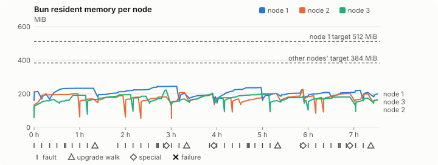
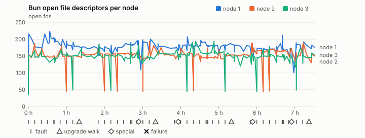
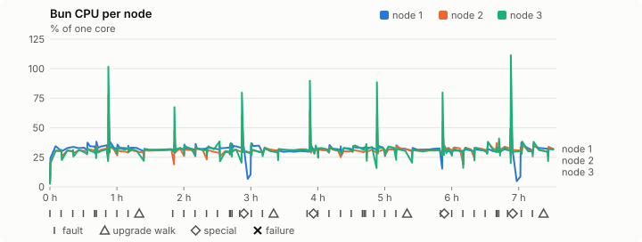
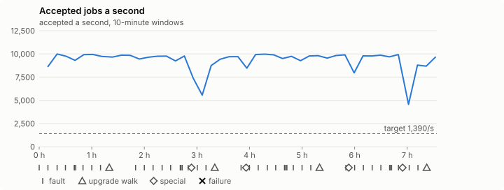

# Sustained soak (V02): FAIL

11 November 2026. final tier, full schedule, 7 h 33 min of soak on a three-node quickstart cluster.

**Final tier: not clean. The V02 gate does not pass.** A product fix means a fresh fast-tier run, then a fresh final-tier run. It is incomplete too: missing from the execution inventory: special:graceful-stop, catalogue pulse, quiet tail with no faults, walks or specials, job campaign drained in its final two minutes; leak-checker exposure too short: rb-86d9c1dfddda-1 leak-rss, rb-86d9c1dfddda-2 leak-rss, rb-86d9c1dfddda-2 leak-fd, rb-86d9c1dfddda-3 leak-rss, rb-86d9c1dfddda-3 leak-fd.

## Candidate and host

| | |
|---|---|
| Staged base URL | <https://github.com/reliaburger/reliaburger/releases/download/staging-v0.2.8-42927004563-1> |
| `candidate.json` SHA-256 | `700071d536ef66354ee701e6b09d5a0233beeadcd8ef14bcddf2e1e15b9b8ff8` |
| Running versions | v0.2.8 x3 |
| Soak build | `bun-v0.2.8-soak.1`, SHA-256 `413aadcf93225af75e25fac041339094a5c7d2546591a517aba16620cf8dd3fb` |
| Walks roll back to | 0.2.8 |
| Host | macOS 27.2, Apple M5 Max, 128 GiB |
| Lima | limactl version 2.2.1 |
| Guest | Ubuntu 24.04.5 LTS, kernel 6.8.0-139-generic |
| RELIABURGER_HOME | `/tmp/rbq.qCNn5B` |
| Evidence | `/Users/miko/github/rb-wt/gate-028-c2/qual/ev-jobs-final` |

## Configuration deviations

- node.toml `[testing] allowed_operations` adds `provision_isolated_workloads` (quickstart allows only inject_workload_faults and alter_node_state), so the catalogue pulse can lease test namespaces
- node.toml `[logs]`/`[metrics]` export to file:///var/lib/reliaburger/soak-export every 60 s with max_storage_mb = 8 (the harness deletes a metrics export 30 minutes after its source has gone), `[storage.snapshots]` every 900 s (compressed: 120 s), retain 4, uploaded to the same directory
- node.toml `[ingress] tls_cert/tls_key` point at an operator pair from a soak CA, 45-minute leaves rotated by the harness
- Bun runs with auto/mixed; host jobs opt in to a single pinned BusyBox copy under /var/lib/reliaburger/soak-jobs, mount_isolation=false. The independent verifier listens on each private VM address, TCP 8189, with a separate run token
- node.toml `[node.labels] soak-volume` = "writer" on node 2 and "redis" on node 3, to pin the volume apps
- node.toml `[upgrades] external_signing_key` = a throwaway operator key the harness made for this run (`ed25519:v1khSYdl36WLuzY5o3EB1WiWLpRKpSvUGrZfPn3o1rg=`); the soak build's `.sig` gets that key's external signature beside the release one (D2)
- node.toml `[security] leaf_lifetime_override_secs = 3600` (D1)

## Timeline

- Started 2026-11-11 05:11:31 UTC, finished 2026-11-11 12:45:21 UTC
- Cycles completed: 7
- Fault and node choices: 34, from seed 1024744514 (`--seed 1024744514` repeats them)
- Teardown: `relish local destroy --yes` and `relish uninstall --yes` succeeded

## Faults and slots

| Class | Runs | Settled/ok | Failed | Skipped | Settle (median / max) |
|---|---|---|---|---|---|
| fault:bun-kill-follower | 8 | 8 | 0 | 0 | 32 s / 35 s |
| fault:bun-kill-leader | 8 | 8 | 0 | 0 | 34 s / 39 s |
| fault:chaos-cpu | 1 | 2 | 0 | 0 | 18 s / 18 s |
| fault:chaos-delay | 2 | 4 | 0 | 0 | 19 s / 19 s |
| fault:chaos-dns | 1 | 2 | 0 | 0 | 18 s / 18 s |
| fault:chaos-drop | 1 | 2 | 0 | 0 | 18 s / 18 s |
| fault:chaos-kill | 2 | 4 | 0 | 0 | 48 s / 48 s |
| fault:chaos-memory | 1 | 2 | 0 | 0 | 18 s / 18 s |
| fault:chaos-partition | 2 | 4 | 0 | 0 | 18 s / 18 s |
| fault:chaos-pause | 1 | 2 | 0 | 0 | 17 s / 17 s |
| fault:chaos-scenario | 1 | 2 | 0 | 0 | 48 s / 48 s |
| fault:deploy-kill | 4 | 4 | 0 | 0 | 35 s / 42 s |
| fault:node-delay | 3 | 3 | 0 | 0 | 32 s / 41 s |
| fault:node-disk-full | 2 | 2 | 0 | 0 | 19 s / 19 s |
| fault:node-slow-fsync | 2 | 2 | 0 | 0 | 19 s / 19 s |
| fault:power-off | 4 | 4 | 0 | 0 | 33 s / 43 s |
| pulse | 7 | 7 | 0 | 0 | n/a |
| pulse:settle | 0 | 7 | 0 | 0 | 18 s / 19 s |
| special:all-off | 1 | 1 | 0 | 0 | 45 s / 45 s |
| special:graceful-stop | 1 | 1 | 0 | 0 | 31 s / 31 s |
| special:quorum-back | 2 | 2 | 0 | 0 | n/a |
| special:quorum-loss | 2 | 2 | 0 | 0 | 44 s / 44 s |
| storage:offline-export | 1 | 1 | 0 | 0 | n/a |
| storage:registry-push | 7 | 0 | 0 | 0 | n/a |
| tls:invalid-expired | 9 | 9 | 0 | 0 | n/a |
| tls:invalid-torn | 12 | 12 | 0 | 0 | n/a |
| tls:reload | 86 | 86 | 0 | 0 | n/a |
| upgrade:rollback | 4 | 4 | 0 | 0 | n/a |
| upgrade:settle | 0 | 4 | 0 | 0 | 57 s / 58 s |
| upgrade:upgrade | 4 | 4 | 0 | 0 | n/a |

## Execution inventory (gated)

What the run completed, from its events and kept bytes, against what its schedule owes. A fault counts once it was injected and the cluster settled after it.

| Item | Required | Completed | Verdict |
|---|---|---|---|
| candidate.json bytes match the qualified digest | 1 | 1 | ok |
| app workloads settled at the baseline | 1 | 1 | ok |
| upgrade walk (to the soak build and back) | 4 | 4 | ok |
| fault:bun-kill-follower | 1 | 8 | ok |
| fault:bun-kill-leader | 1 | 8 | ok |
| fault:deploy-kill | 1 | 4 | ok |
| fault:power-off | 1 | 4 | ok |
| fault:chaos-kill | 1 | 2 | ok |
| fault:chaos-delay | 1 | 2 | ok |
| fault:chaos-partition | 1 | 2 | ok |
| fault:chaos-scenario | 1 | 1 | ok |
| fault:chaos-pause | 1 | 1 | ok |
| fault:chaos-drop | 1 | 1 | ok |
| fault:chaos-dns | 1 | 1 | ok |
| fault:chaos-cpu | 1 | 1 | ok |
| fault:chaos-memory | 1 | 1 | ok |
| fault:node-delay | 1 | 3 | ok |
| fault:node-disk-full | 1 | 2 | ok |
| fault:node-slow-fsync | 1 | 2 | ok |
| special:graceful-stop | 2 | 1 | MISSING |
| special:quorum-loss | 2 | 2 | ok |
| special:all-off | 1 | 1 | ok |
| catalogue pulse | 8 | 7 | MISSING |
| offline export | 1 | 1 | ok |
| quiet tail with no faults, walks or specials | 1 | 0 | MISSING |
| job campaign drained in its final two minutes | 1 | 0 | MISSING |

## Observed fault effects

What each injected fault was seen to do, read back from the node.

| Fault | Target | Observed |
|---|---|---|
| effect:bun-kill-follower | rb-86d9c1dfddda-3 | MainPID 2290 -> 3871 |
| effect:bun-kill-leader | rb-86d9c1dfddda-1 | MainPID 8766 -> 2178763 |
| effect:deploy-kill | rb-86d9c1dfddda-1 | MainPID 2178763 -> 562313 |
| effect:power-off | rb-86d9c1dfddda-3 | Lima status Stopped |
| effect:node-delay | rb-86d9c1dfddda-1 | netem 8001: root refcnt 2 limit 1000 delay 200ms  50ms  |
| effect:bun-kill-follower | rb-86d9c1dfddda-2 | MainPID 2558 -> 3046590 |
| effect:bun-kill-leader | rb-86d9c1dfddda-3 | MainPID 679 -> 1333215 |
| effect:node-disk-full | rb-86d9c1dfddda-2 | available 67014656 bytes  |
| effect:bun-kill-follower | rb-86d9c1dfddda-2 | MainPID 3046590 -> 1356642 |
| effect:bun-kill-leader | rb-86d9c1dfddda-3 | MainPID 4028972 -> 4084334 |
| effect:deploy-kill | rb-86d9c1dfddda-2 | MainPID 1356642 -> 2273099 |
| effect:power-off | rb-86d9c1dfddda-3 | Lima status Stopped |
| effect:node-slow-fsync | rb-86d9c1dfddda-3 | IOWriteBandwidthMax=/dev/vda 1000000 IOWriteIOPSMax=/dev/vda 20  |
| effect:bun-kill-follower | rb-86d9c1dfddda-2 | MainPID 680 -> 306169 |
| effect:bun-kill-leader | rb-86d9c1dfddda-1 | MainPID 562313 -> 3113711 |
| effect:node-delay | rb-86d9c1dfddda-2 | netem 8001: root refcnt 2 limit 1000 delay 200ms  50ms  |
| effect:bun-kill-follower | rb-86d9c1dfddda-1 | MainPID 680 -> 869437 |
| effect:bun-kill-leader | rb-86d9c1dfddda-3 | MainPID 680 -> 3483484 |
| effect:deploy-kill | rb-86d9c1dfddda-2 | MainPID 685 -> 2028428 |
| effect:power-off | rb-86d9c1dfddda-2 | Lima status Stopped |
| effect:node-disk-full | rb-86d9c1dfddda-3 | available 67031040 bytes  |
| effect:bun-kill-follower | rb-86d9c1dfddda-1 | MainPID 869437 -> 3656948 |
| effect:bun-kill-leader | rb-86d9c1dfddda-3 | MainPID 3483484 -> 1456489 |
| effect:node-slow-fsync | rb-86d9c1dfddda-1 | IOWriteBandwidthMax=/dev/vda 1000000 IOWriteIOPSMax=/dev/vda 20  |
| effect:bun-kill-follower | rb-86d9c1dfddda-3 | MainPID 684 -> 1333726 |
| effect:bun-kill-leader | rb-86d9c1dfddda-2 | MainPID 680 -> 3827186 |
| effect:deploy-kill | rb-86d9c1dfddda-2 | MainPID 3827186 -> 2178879 |
| effect:power-off | rb-86d9c1dfddda-1 | Lima status Stopped |
| effect:node-delay | rb-86d9c1dfddda-3 | netem 8001: root refcnt 2 limit 1000 delay 200ms  50ms  |
| effect:bun-kill-follower | rb-86d9c1dfddda-3 | MainPID 677 -> 202278 |
| effect:bun-kill-leader | rb-86d9c1dfddda-1 | MainPID 679 -> 271657 |

## Renewals and rotations

| Measure | Observed | Required | Verdict |
|---|---|---|---|
| workload identity rotations (soak-identity, per node) | 17 | ≥ 14 | PASS |
| node leaf renewals (per node) | 16 | ≥ 14 | PASS |
| operator ingress reloads (all nodes) | 86 | ≥ 29 | PASS |
| mixed job campaign and positive drain | 5 missing/failing checks | 0 | FAIL |

## Latency SLOs

What a user should feel on a quiet three-node cluster (#1400). Every sample is taken outside fault windows and through a host forward that works; each p99 is the upper bound of its histogram bucket.

| SLO | p99 | Threshold | Samples | Mode | Verdict |
|---|---|---|---|---|---|
| API read p99 | 150 ms | ≤ 1,000 ms | 4,524 | record only | PASS |
| API write p99 | 3,000 ms | ≤ 2,000 ms | 15 | record only | over (record only) |
| App start p99 | 1 ms | ≤ 5,000 ms | 45 | record only | PASS |
| Rolling update p99 | 30,000 ms | ≤ 30,000 ms | 15 | record only | PASS |
| Job task start p99 | 32 ms | ≤ 256 ms | 119,537,684 | gated | PASS |

- API read p99: `GET /v1/status?cluster=true` and `GET /v1/cluster/nodes` on every node, at every light check
- API write p99: `relish apply` of the soak workloads, from the call to the commit
- App start p99: each node's deploy of a new `soak-identity` instance, from its start to the instance running
- Rolling update p99: from `relish apply` returning to every node's `soak-identity` running the new spec
- Job task start p99: a job task's start lag on a pooled executor, from the job campaign's buckets, in runs no fault window overlapped
- Record only from 28 October 2026 (#1400): no soak before 0.2.4 measured it. The threshold is provisional; the first 0.2.4 fast and final records set the gate.

## Jobs

| Runtime | Accepted successes | Retries | Last accepted progress |
|---|---|---|---|
| runc | 74176 | 1 | 1794401116 |
| shared-runc | 65970352 | 1 | 1794401121 |
| process | 186905206 | 1 | 1794401121 |

The bounded campaign shares the app soak's fault schedule. These counts are reliability evidence, not a saturation rate or a 100-million-per-day qualification.

- job campaign did not positively drain before teardown
- the harness never asked the job campaign to drain
- rb-86d9c1dfddda-1 lacks a complete empty owner inventory after campaign drain
- rb-86d9c1dfddda-2 lacks a complete empty owner inventory after campaign drain
- rb-86d9c1dfddda-3 lacks a complete empty owner inventory after campaign drain
- Independent verifier execution attempts: 24
- Explicit test-operator acknowledgements for known replay-safe fenced fixtures: 180

- rb-86d9c1dfddda-1: latest complete job storage (KiB) {'instances': 21568, 'job-state': 8, 'task-arrays': 35832}; free 4922648 KiB; live/peak owners 30/32; peak storage {'instances': 24372, 'job-state': 8, 'task-arrays': 49332}
- rb-86d9c1dfddda-2: latest complete job storage (KiB) {'instances': 21676, 'job-state': 8, 'task-arrays': 36244}; free 6036172 KiB; live/peak owners 29/32; peak storage {'instances': 24832, 'job-state': 8, 'task-arrays': 49404}
- rb-86d9c1dfddda-3: latest complete job storage (KiB) {'instances': 24700, 'job-state': 8, 'task-arrays': 37392}; free 6022640 KiB; live/peak owners 30/32; peak storage {'instances': 24700, 'job-state': 8, 'task-arrays': 51984}

Complete disk inventories are recorded. Global retention bounds and the 12-hour job qualification remain #668; this gate cannot certify an unimplemented retention policy.

## Job qualification (D18-C)

Load: target; 3 nodes; accepted 9,285.6/s against a 1390.0/s target: PASS.

The September plan set its targets for one 1M-task batch on a quiet cluster. A soak runs for hours with restarts, upgrades and apps, so its storage, Bun memory and Raft targets are restated (maintainer decision, 15 October 2026, [#668](https://github.com/reliaburger/reliaburger/issues/668)). Bun's steady state is the median RSS of each process once it has been seen for 10 minutes; the gated memory checks are unchanged (`leak-rss`, and Mayo's 70% `memory_high` alert through `wtf`).

| Measure (recorded, not gated) | Observed | Target |
|---|---|---|
| Wall time of a 1,048,576-task array (median / max of 64) | 146 s / 808 s | ≤ 600 s |
| p99 start lag, pooled executors | 32 ms (bucket upper bound) | < 1,000 ms |
| Raft entries per second, all cluster writes | 5.27 | recorded only; the batch target counts only task-array writes |
| Raft state of one run, largest seen | 10,259 B | ≤ 256 KiB per 1M tasks |
| Bun steady-state RSS per process, worst node against its target | rb-86d9c1dfddda-2: 215.16 MiB steady, 225.28 MiB peak | ≤ 384 MiB (≤ 512 MiB on node 1, which serves the API) |
| Bun CPU, busiest node | 0.31 cores | ≤ 1 core (leader batch control) |
| Executor helper CPU, busiest node | 0.04 cores | ≤ 0.5 core |
| Node task-array storage per 1M accepted tasks (peaks summed) | 0.58 MiB | ≤ 64 MiB, deleted after retirement |
| Retained log volume, all nodes | 23.18 MB | ≤ 50 MB |

- Bun RSS on rb-86d9c1dfddda-1 (serves the API, target ≤ 512 MiB): pid 8766: 213.58 MiB peak (seen for under 10 minutes); pid 2178763: 200.31 MiB peak (seen for under 10 minutes); pid 562313: 232.57 MiB steady, 233.13 MiB peak; pid 562313: 229.52 MiB steady, 244.55 MiB peak; pid 3113711: 204.18 MiB peak (seen for under 10 minutes); pid 3113711: 196.83 MiB steady, 200.98 MiB peak; pid 680: 182.73 MiB peak (seen for under 10 minutes); pid 869437: 236.14 MiB steady, 237.23 MiB peak; pid 3656948: 199.82 MiB steady, 202.41 MiB peak; pid 3656948: 224.03 MiB steady, 225.04 MiB peak; pid 679: 203.91 MiB steady, 208.95 MiB peak; pid 679: 207.97 MiB steady, 221.29 MiB peak; pid 271657: 208.14 MiB peak (seen for under 10 minutes); pid 271657: 198.99 MiB peak (seen for under 10 minutes)
- Bun RSS on rb-86d9c1dfddda-2 (node, target ≤ 384 MiB): pid 2558: 195.22 MiB steady, 201.47 MiB peak; pid 3046590: 168.63 MiB steady, 169.04 MiB peak; pid 3046590: 187.93 MiB steady, 188.61 MiB peak; pid 1356642: 178.20 MiB steady, 181.15 MiB peak; pid 2273099: 180.15 MiB steady, 181.72 MiB peak; pid 680: 152.55 MiB peak (seen for under 10 minutes); pid 306169: 206.52 MiB steady, 207.73 MiB peak; pid 306169: 194.79 MiB steady, 196.75 MiB peak; pid 685: 176.79 MiB steady, 176.92 MiB peak; pid 2028428: 170.06 MiB peak (seen for under 10 minutes); pid 683: 174.42 MiB steady, 201.78 MiB peak; pid 683: 215.16 MiB steady, 225.28 MiB peak; pid 680: 188.58 MiB steady, 188.58 MiB peak; pid 3827186: 178.12 MiB peak (seen for under 10 minutes); pid 2178879: 197.94 MiB steady, 203.89 MiB peak; pid 679: 198.49 MiB steady, 199.69 MiB peak; pid 679: 163.79 MiB peak (seen for under 10 minutes)
- Bun RSS on rb-86d9c1dfddda-3 (node, target ≤ 384 MiB): pid 2290: 124.07 MiB peak (seen for under 10 minutes); pid 3871: 158.09 MiB steady, 166.44 MiB peak; pid 679: 191.49 MiB steady, 191.71 MiB peak; pid 1333215: 166.60 MiB peak (seen for under 10 minutes); pid 4028972: 194.23 MiB steady, 194.29 MiB peak; pid 4084334: 185.43 MiB steady, 185.43 MiB peak; pid 683: 171.77 MiB steady, 221.80 MiB peak; pid 680: 158.58 MiB steady, 169.35 MiB peak; pid 680: 198.18 MiB steady, 204.64 MiB peak; pid 680: 173.85 MiB steady, 173.85 MiB peak; pid 3483484: 191.85 MiB steady, 197.89 MiB peak; pid 1456489: 158.98 MiB peak (seen for under 10 minutes); pid 681: 178.45 MiB steady, 184.96 MiB peak; pid 684: 160.52 MiB peak (seen for under 10 minutes); pid 1333726: 180.96 MiB steady, 181.36 MiB peak; pid 677: 145.83 MiB peak (seen for under 10 minutes); pid 202278: 163.04 MiB steady, 174.65 MiB peak; pid 202278: 164.11 MiB peak (seen for under 10 minutes)

- runc retry causes: exit_code 1, launch 0, signal 0, timeout 0, unknown 0, unrecorded 0
- shared-runc retry causes: exit_code 1, launch 0, signal 0, timeout 0, unknown 0, unrecorded 0
- process retry causes: exit_code 1, launch 0, signal 0, timeout 0, unknown 0, unrecorded 0
- Audited executions: 24; operator replay decisions: 180
- Job controller API fallbacks: rb-86d9c1dfddda-1 missed 608, rb-86d9c1dfddda-2 missed 8; rb-86d9c1dfddda-2 answered 600, rb-86d9c1dfddda-3 answered 8 (requests a node didn't answer, and the node that took them instead)

## Data

- Volume writer: highest ACK 209974 in the log view; the writer file checks (writer-lost, writer-regression) decide data loss, and `*-log-order` failures are about the order the log view returned lines in
- Redis counter: highest INCR 24054 in the log view
- Export rb-86d9c1dfddda-1: 235 source files, 427 at the destination
- Export rb-86d9c1dfddda-2: 386 source files, 601 at the destination
- Export rb-86d9c1dfddda-3: 285 source files, 323 at the destination
- Registry images pushed and re-verified: 8
- Agent-loop turns over the 1 s budget: rb-86d9c1dfddda-1 0, rb-86d9c1dfddda-2 0, rb-86d9c1dfddda-3 0
- Soak policies checked in force: 246 times, policy generation 63 at the last check
- Guest clock steps by Lima's guest agent: rb-86d9c1dfddda-1 3, rb-86d9c1dfddda-2 6, rb-86d9c1dfddda-3 6
- Checks evaluated: 1000 (heavy 92, light 754, settle 154)
- Last observed progress: redis-counter 24054, writer-ack 209974

## Council history (linearizability)

- Not checked: the soak recorded a council history but never checked it

## Leak-checker exposure (gated)

How long each leak checker could judge each node's Bun. `leak-rss` arms at its warm sample: 60 minutes into one process in a final, and otherwise at the first heavy check where the log and metrics stores are each 90% full, between 60 minutes and 6 hours in (#1417). `leak-fd` arms after 50 minutes; a restart, kill or upgrade exec starts the warm-up again. A final needs each armed for 60 minutes on every node, with one unbroken window of 30 (#1062); its quiet tail gives them that.

| Node | Checker | Armed | Longest armed window | Evaluated samples | Processes armed | Verdict |
|---|---|---|---|---|---|---|
| rb-86d9c1dfddda-1 | leak-rss | 40 min | 40 min | 29 | 1 | SHORT |
| rb-86d9c1dfddda-1 | leak-fd | 61 min | 50 min | 42 | 3 | ok |
| rb-86d9c1dfddda-2 | leak-rss | 0 min | 0 min | 0 | 0 | SHORT |
| rb-86d9c1dfddda-2 | leak-fd | 6 min | 6 min | 7 | 1 | SHORT |
| rb-86d9c1dfddda-3 | leak-rss | 0 min | 0 min | 0 | 0 | SHORT |
| rb-86d9c1dfddda-3 | leak-fd | 10 min | 8 min | 11 | 2 | SHORT |


## Resource trends

| Node | Measure | First | Last | Max |
|---|---|---|---|---|
| rb-86d9c1dfddda-1 | disk_kb data | 1382820 | 1027164 | 1595872 |
| rb-86d9c1dfddda-1 | disk_kb images | 342456 | 472396 | 472396 |
| rb-86d9c1dfddda-1 | disk_kb logs | 36 | 8352 | 9168 |
| rb-86d9c1dfddda-1 | disk_kb metrics | 84 | 8436 | 9284 |
| rb-86d9c1dfddda-1 | disk_kb soak-export | 4 | 31796 | 31796 |
| rb-86d9c1dfddda-1 | disk_kb volumes | 248 | 72 | 300 |
| rb-86d9c1dfddda-1 | fd | 113 | 176 | 223 |
| rb-86d9c1dfddda-1 | rss_anon_kb | 90644 | 123860 | 169756 |
| rb-86d9c1dfddda-1 | rss_file_kb | 74708 | 79904 | 80796 |
| rb-86d9c1dfddda-1 | rss_kb | 165352 | 203764 | 250424 |
| rb-86d9c1dfddda-2 | disk_kb data | 71824 | 405272 | 483996 |
| rb-86d9c1dfddda-2 | disk_kb images | 172188 | 354980 | 354980 |
| rb-86d9c1dfddda-2 | disk_kb logs | 24 | 8600 | 9264 |
| rb-86d9c1dfddda-2 | disk_kb metrics | 72 | 8428 | 9068 |
| rb-86d9c1dfddda-2 | disk_kb soak-export | 4 | 27792 | 28244 |
| rb-86d9c1dfddda-2 | disk_kb volumes | 16760 | 21504 | 21504 |
| rb-86d9c1dfddda-2 | fd | 74 | 150 | 193 |
| rb-86d9c1dfddda-2 | rss_anon_kb | 50824 | 88716 | 150652 |
| rb-86d9c1dfddda-2 | rss_file_kb | 73504 | 79008 | 80864 |
| rb-86d9c1dfddda-2 | rss_kb | 124328 | 167724 | 230684 |
| rb-86d9c1dfddda-3 | disk_kb data | 234572 | 591224 | 636432 |
| rb-86d9c1dfddda-3 | disk_kb images | 339124 | 346668 | 346668 |
| rb-86d9c1dfddda-3 | disk_kb logs | 24 | 4200 | 4200 |
| rb-86d9c1dfddda-3 | disk_kb metrics | 32 | 8556 | 9064 |
| rb-86d9c1dfddda-3 | disk_kb soak-export | 4 | 18256 | 18344 |
| rb-86d9c1dfddda-3 | disk_kb volumes | 16784 | 18648 | 18648 |
| rb-86d9c1dfddda-3 | fd | 71 | 153 | 194 |
| rb-86d9c1dfddda-3 | rss_anon_kb | 42028 | 89104 | 147792 |
| rb-86d9c1dfddda-3 | rss_file_kb | 73248 | 78944 | 80544 |
| rb-86d9c1dfddda-3 | rss_kb | 115276 | 168048 | 227120 |

## Bun memory by kind

From each node's `/proc/PID/smaps` at the settle and heavy checks (`memory.jsonl`, #1417). Sizes in MiB; arenas are glibc thread arenas, with the number of 64 MiB arena heaps in brackets. Time is h:mm since the node's first sample.

### rb-86d9c1dfddda-1

| Time | Pid | RSS | Heap | Arenas | Stacks | Other anonymous | File | Threads |
|---|---|---|---|---|---|---|---|---|
| 0:00 | 8766 | 161.5 | 45.1 | 36.5 (1) | 3.1 | 0.1 | 76.7 | 56 |
| 1:00 | 562313 | 233.0 | 73.5 | 69.0 (2) | 7.1 | 0.9 | 82.6 | 92 |
| 2:00 | 562313 | 212.8 | 62.7 | 62.1 (1) | 5.9 | 0.0 | 82.1 | 121 |
| 3:00 | 562313 | 244.5 | 74.6 | 80.6 (2) | 6.8 | 0.0 | 82.5 | 121 |
| 4:00 | 869437 | 145.2 | 42.4 | 22.1 (1) | 2.6 | 0.0 | 78.1 | 55 |
| 5:00 | 3656948 | 160.4 | 44.6 | 34.8 (1) | 2.8 | 0.0 | 78.1 | 60 |
| 6:00 | 679 | 186.7 | 61.3 | 40.3 (1) | 3.4 | 0.0 | 81.6 | 74 |
| 7:02 | 679 | 210.1 | 63.2 | 59.9 (1) | 4.8 | 0.0 | 82.2 | 88 |
| 7:31 | 271657 | 199.0 | 55.6 | 57.3 (1) | 3.6 | 0.7 | 81.8 | 80 |

- rb-86d9c1dfddda-1: not enough data: the last Bun process (pid 271657) has no samples after its first hour.
- rb-86d9c1dfddda-1: no 6-hour RSS slope: the last Bun process (pid 271657) ran for 0:18 h:mm.

### rb-86d9c1dfddda-2

| Time | Pid | RSS | Heap | Arenas | Stacks | Other anonymous | File | Threads |
|---|---|---|---|---|---|---|---|---|
| 0:00 | 2558 | 121.4 | 21.8 | 22.2 (1) | 1.7 | 0.2 | 75.5 | 28 |
| 1:00 | 3046590 | 62.1 | 16.1 | 3.1 (1) | 0.7 | 0.0 | 42.1 | 13 |
| 2:00 | 1356642 | 61.8 | 15.8 | 3.1 (1) | 0.7 | 0.0 | 42.3 | 13 |
| 3:00 | 680 | 145.0 | 41.6 | 20.0 (1) | 3.9 | 0.0 | 79.5 | 89 |
| 4:00 | 685 | 170.0 | 41.1 | 44.1 (1) | 2.8 | 1.1 | 81.0 | 54 |
| 5:00 | 683 | 194.7 | 54.3 | 54.4 (1) | 3.9 | 0.6 | 81.5 | 83 |
| 6:00 | 680 | 183.8 | 52.1 | 46.5 (1) | 3.4 | 0.0 | 81.8 | 63 |
| 7:02 | 679 | 153.2 | 44.2 | 24.9 (1) | 3.4 | 0.3 | 80.4 | 69 |
| 7:31 | 679 | 163.8 | 41.8 | 36.8 (1) | 3.6 | 0.6 | 80.9 | 71 |

- rb-86d9c1dfddda-2: not enough data: the last Bun process (pid 679) has no samples after its first hour.
- rb-86d9c1dfddda-2: no 6-hour RSS slope: the last Bun process (pid 679) ran for 0:29 h:mm.

### rb-86d9c1dfddda-3

| Time | Pid | RSS | Heap | Arenas | Stacks | Other anonymous | File | Threads |
|---|---|---|---|---|---|---|---|---|
| 0:00 | 2290 | 112.6 | 9.4 | 26.0 (1) | 1.7 | 0.2 | 75.3 | 27 |
| 1:00 | 679 | 191.7 | 48.5 | 58.6 (1) | 3.0 | 0.0 | 81.5 | 62 |
| 2:00 | 4028972 | 194.3 | 55.9 | 51.6 (1) | 4.7 | 0.0 | 82.0 | 109 |
| 3:00 | 680 | 133.5 | 27.1 | 26.9 (1) | 1.5 | 0.1 | 78.0 | 28 |
| 4:00 | 680 | 162.0 | 32.3 | 44.2 (1) | 3.2 | 1.1 | 81.2 | 67 |
| 5:00 | 3483484 | 197.8 | 54.0 | 56.5 (1) | 4.9 | 0.0 | 82.4 | 80 |
| 6:00 | 1333726 | 103.0 | 25.5 | 9.5 (1) | 2.0 | 0.0 | 66.1 | 46 |
| 7:02 | 677 | 134.3 | 25.4 | 28.5 (1) | 2.3 | 0.0 | 78.2 | 44 |
| 7:31 | 202278 | 164.1 | 43.2 | 35.8 (1) | 3.7 | 0.6 | 80.8 | 73 |

- rb-86d9c1dfddda-3: not enough data: the last Bun process (pid 202278) has no samples after its first hour.
- rb-86d9c1dfddda-3: no 6-hour RSS slope: the last Bun process (pid 202278) ran for 0:28 h:mm.

## Agent loop stalls

From the stall watchdog's journal blocks (`loop-stalls.jsonl`, #1707). Each snapshot lists every Bun thread; here are the stall line, threads in uninterruptible sleep and the thread that ran the loop.

- Stalls: rb-86d9c1dfddda-2 1

```
Nov 11 08:35:33 lima-rb-86d9c1dfddda-2 bun[306169]: bun: agent loop stalled 802 ms in follow_up, 302 ms past its turn deadline; thread snapshot (pid 306169, 55 threads):
Nov 11 08:35:33 lima-rb-86d9c1dfddda-2 bun[306169]: bun:   tid 1274716 tokio-rt-worker S wchan=futex_wait_queue syscall=futex(0xe6f79fc8f888, 0x80, 0x1) [ran the agent loop]
Nov 11 08:35:33 lima-rb-86d9c1dfddda-2 bun[306169]: bun:   tid 1274963 tokio-rt-worker D wchan=folio_wait_bit_common syscall=fdatasync(0x58, 0x0, 0xe6f79eb08e88)
Nov 11 08:35:33 lima-rb-86d9c1dfddda-2 bun[306169]: bun:   tid 1275193 tokio-rt-worker D wchan=jbd2_log_wait_commit syscall=fdatasync(0x3b, 0x0, 0xe6f79c7f8e88)
Nov 11 08:35:33 lima-rb-86d9c1dfddda-2 bun[306169]: bun:   tid 1275198 tokio-rt-worker D wchan=jbd2_log_wait_commit syscall=fsync(0x30, 0x0, 0xe6f797ffee88)
Nov 11 08:35:33 lima-rb-86d9c1dfddda-2 bun[306169]: bun:   tid 1275201 tokio-rt-worker D wchan=jbd2_log_wait_commit syscall=fsync(0x63, 0x0, 0xe6f7979cee88)
Nov 11 08:35:33 lima-rb-86d9c1dfddda-2 bun[306169]: bun:   tid 1275209 tokio-rt-worker D wchan=folio_wait_bit_common syscall=fdatasync(0x4a, 0x0, 0xe6f79694ee88)
Nov 11 08:35:33 lima-rb-86d9c1dfddda-2 bun[306169]: bun:   tid 1275210 tokio-rt-worker D wchan=submit_bio_wait syscall=fdatasync(0x10, 0x0, 0xe6f79673ee88)
```

## Charts

Time runs from the start of the soak. The marks under each chart are its faults, upgrade walks, specials and recorded failures; the dashed lines are targets.









## Failures

None.

## Notes

- Job controller was still running at teardown; positive drain must be present to pass
- The harness stopped early (exit 1) during 7:node-fault

Evidence: `/Users/miko/github/rb-wt/gate-028-c2/qual/ev-jobs-final` (events.jsonl, snapshots/, failures/<n>/).
