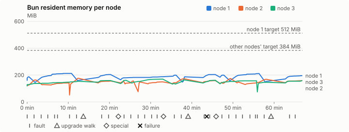
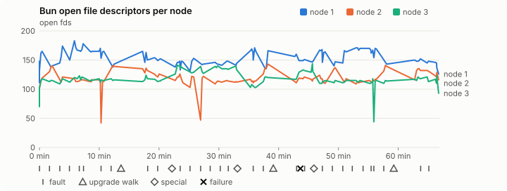
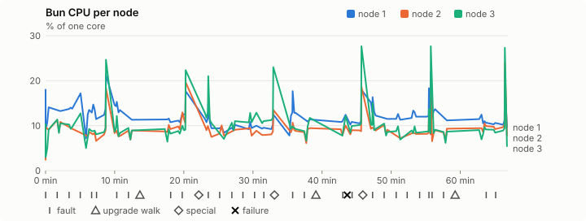
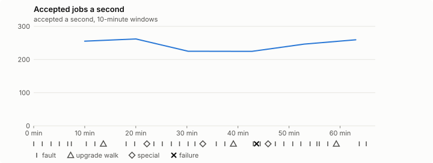

# Sustained soak (V02): FAIL

11 November 2026. fast tier, compressed schedule, 1 h 06 min of soak on a three-node quickstart cluster.

**Fast tier: not clean.** Fix what failed and run the fast tier again before a final-tier run.

## Candidate and host

| | |
|---|---|
| Staged base URL | <https://github.com/reliaburger/reliaburger/releases/download/staging-v0.2.8-42927004563-1> |
| `candidate.json` SHA-256 | `700071d536ef66354ee701e6b09d5a0233beeadcd8ef14bcddf2e1e15b9b8ff8` |
| Running versions | v0.2.8 x3 |
| Soak build | `bun-v0.2.8-soak.1`, SHA-256 `413aadcf93225af75e25fac041339094a5c7d2546591a517aba16620cf8dd3fb` |
| Walks roll back to | 0.2.8 |
| Host | macOS 27.2, Apple M5 Max, 128 GiB |
| Lima | limactl version 2.2.1 |
| Guest | Ubuntu 24.04.5 LTS, kernel 6.8.0-139-generic |
| RELIABURGER_HOME | `/tmp/rbq.VjPWjE` |
| Evidence | `/Users/miko/github/rb-wt/gate-028-c2/qual/ev-v02-fast-seed-3139726783` |

## Configuration deviations

- node.toml `[testing] allowed_operations` adds `provision_isolated_workloads` (quickstart allows only inject_workload_faults and alter_node_state), so the catalogue pulse can lease test namespaces
- node.toml `[logs]`/`[metrics]` export to file:///var/lib/reliaburger/soak-export every 60 s with max_storage_mb = 8 (the harness deletes a metrics export 30 minutes after its source has gone), `[storage.snapshots]` every 900 s (compressed: 120 s), retain 4, uploaded to the same directory
- node.toml `[ingress] tls_cert/tls_key` point at an operator pair from a soak CA, 45-minute leaves rotated by the harness
- Bun runs with auto/mixed; host jobs opt in to a single pinned BusyBox copy under /var/lib/reliaburger/soak-jobs, mount_isolation=false. The independent verifier listens on each private VM address, TCP 8189, with a separate run token
- node.toml `[node.labels] soak-volume` = "writer" on node 2 and "redis" on node 3, to pin the volume apps
- node.toml `[upgrades] external_signing_key` = a throwaway operator key the harness made for this run (`ed25519:u2s5KpMSjQl72UjaSOPoMrC9s9+lCb/302xi7jnzAkU=`); the soak build's `.sig` gets that key's external signature beside the release one (D2)
- node.toml `[security] leaf_lifetime_override_secs = 3600` (D1)

## Timeline

- Started 2026-11-11 04:01:08 UTC, finished 2026-11-11 05:08:01 UTC
- Cycles completed: 6
- Fault and node choices: 26, from seed 3139726783 (`--seed 3139726783` repeats them)
- Teardown: `relish local destroy --yes` and `relish uninstall --yes` succeeded

## Faults and slots

| Class | Runs | Settled/ok | Failed | Skipped | Settle (median / max) |
|---|---|---|---|---|---|
| fault:bun-kill-follower | 6 | 6 | 0 | 0 | 29 s / 31 s |
| fault:bun-kill-leader | 6 | 6 | 0 | 0 | 32 s / 40 s |
| fault:chaos-cpu | 1 | 2 | 0 | 0 | 16 s / 16 s |
| fault:chaos-delay | 2 | 4 | 0 | 0 | 16 s / 16 s |
| fault:chaos-dns | 1 | 2 | 0 | 0 | 15 s / 15 s |
| fault:chaos-drop | 1 | 2 | 0 | 0 | 17 s / 17 s |
| fault:chaos-kill | 2 | 4 | 0 | 0 | 41 s / 41 s |
| fault:chaos-memory | 1 | 2 | 0 | 0 | 15 s / 15 s |
| fault:chaos-partition | 2 | 4 | 0 | 0 | 15 s / 15 s |
| fault:chaos-pause | 1 | 2 | 0 | 0 | 16 s / 16 s |
| fault:chaos-scenario | 1 | 2 | 0 | 0 | 28 s / 28 s |
| fault:deploy-kill | 3 | 3 | 0 | 0 | 30 s / 37 s |
| fault:power-off | 3 | 3 | 0 | 0 | 30 s / 46 s |
| pulse | 1 | 1 | 0 | 0 | n/a |
| pulse:settle | 0 | 1 | 0 | 0 | 19 s / 19 s |
| special:all-off | 1 | 1 | 0 | 0 | 28 s / 28 s |
| special:graceful-stop | 1 | 1 | 0 | 0 | 48 s / 48 s |
| special:quorum-back | 1 | 1 | 0 | 0 | n/a |
| special:quorum-loss | 1 | 1 | 0 | 0 | 27 s / 27 s |
| storage:offline-export | 3 | 3 | 0 | 0 | n/a |
| storage:registry-push | 6 | 0 | 0 | 0 | n/a |
| tls:invalid-expired | 3 | 3 | 0 | 0 | n/a |
| tls:invalid-torn | 6 | 6 | 0 | 0 | n/a |
| tls:reload | 33 | 33 | 0 | 0 | n/a |
| upgrade:rollback | 3 | 3 | 0 | 0 | n/a |
| upgrade:settle | 0 | 3 | 0 | 0 | 50 s / 61 s |
| upgrade:upgrade | 3 | 3 | 0 | 0 | n/a |

## Execution inventory (recorded, not gated)

What the run completed, from its events and kept bytes, against what its schedule owes. A fault counts once it was injected and the cluster settled after it.

| Item | Required | Completed | Verdict |
|---|---|---|---|
| candidate.json bytes match the qualified digest | 1 | 1 | ok |
| app workloads settled at the baseline | 1 | 1 | ok |
| upgrade walk (to the soak build and back) | 2 | 3 | ok |
| fault:bun-kill-follower | 1 | 6 | ok |
| fault:bun-kill-leader | 1 | 6 | ok |
| fault:deploy-kill | 1 | 3 | ok |
| fault:power-off | 1 | 3 | ok |
| fault:chaos-kill | 1 | 2 | ok |
| fault:chaos-delay | 1 | 2 | ok |
| fault:chaos-partition | 1 | 2 | ok |
| fault:chaos-scenario | 1 | 1 | ok |
| fault:chaos-pause | 1 | 1 | ok |
| fault:chaos-drop | 1 | 1 | ok |
| fault:chaos-dns | 1 | 1 | ok |
| fault:chaos-cpu | 1 | 1 | ok |
| special:graceful-stop | 1 | 1 | ok |
| special:quorum-loss | 1 | 1 | ok |
| special:all-off | 1 | 1 | ok |
| catalogue pulse | 1 | 1 | ok |
| offline export | 2 | 3 | ok |
| job campaign drained in its final two minutes | 1 | 1 | ok |

## Observed fault effects

What each injected fault was seen to do, read back from the node.

| Fault | Target | Observed |
|---|---|---|
| effect:bun-kill-follower | rb-0b1d26f06697-2 | MainPID 2472 -> 4791 |
| effect:bun-kill-leader | rb-0b1d26f06697-1 | MainPID 8814 -> 41105 |
| effect:deploy-kill | rb-0b1d26f06697-2 | MainPID 4791 -> 67549 |
| effect:power-off | rb-0b1d26f06697-2 | Lima status Stopped |
| effect:bun-kill-follower | rb-0b1d26f06697-2 | MainPID 679 -> 77343 |
| effect:bun-kill-leader | rb-0b1d26f06697-1 | MainPID 41105 -> 229747 |
| effect:bun-kill-follower | rb-0b1d26f06697-2 | MainPID 680 -> 21535 |
| effect:bun-kill-leader | rb-0b1d26f06697-3 | MainPID 682 -> 50754 |
| effect:deploy-kill | rb-0b1d26f06697-2 | MainPID 21535 -> 77268 |
| effect:power-off | rb-0b1d26f06697-2 | Lima status Stopped |
| effect:bun-kill-follower | rb-0b1d26f06697-3 | MainPID 681 -> 14122 |
| effect:bun-kill-leader | rb-0b1d26f06697-1 | MainPID 681 -> 239843 |
| effect:bun-kill-follower | rb-0b1d26f06697-2 | MainPID 679 -> 16205 |
| effect:bun-kill-leader | rb-0b1d26f06697-1 | MainPID 684 -> 51579 |
| effect:deploy-kill | rb-0b1d26f06697-2 | MainPID 16205 -> 79428 |
| effect:power-off | rb-0b1d26f06697-2 | Lima status Stopped |
| effect:bun-kill-follower | rb-0b1d26f06697-3 | MainPID 681 -> 159180 |
| effect:bun-kill-leader | rb-0b1d26f06697-1 | MainPID 51579 -> 200271 |

## Renewals and rotations

| Measure | Observed | Required | Verdict |
|---|---|---|---|
| workload identity rotations (soak-identity, per node) | 9 | ≥ 1 | PASS |
| node leaf renewals (per node) | 2 | ≥ 1 | PASS |
| operator ingress reloads (all nodes) | 33 | ≥ 12 | PASS |
| mixed job campaign and positive drain | 0 missing/failing checks | 0 | PASS |

## Latency SLOs

What a user should feel on a quiet three-node cluster (#1400). Every sample is taken outside fault windows and through a host forward that works; each p99 is the upper bound of its histogram bucket.

| SLO | p99 | Threshold | Samples | Mode | Verdict |
|---|---|---|---|---|---|
| API read p99 | 150 ms | ≤ 1,000 ms | 288 | record only | PASS |
| API write p99 | 150 ms | ≤ 2,000 ms | 8 | record only | PASS |
| App start p99 | 1 ms | ≤ 5,000 ms | 24 | record only | PASS |
| Rolling update p99 | 30,000 ms | ≤ 30,000 ms | 8 | record only | PASS |
| Job task start p99 | 1,024 ms | ≤ 256 ms | 20 | record only | too few samples |

- API read p99: `GET /v1/status?cluster=true` and `GET /v1/cluster/nodes` on every node, at every light check
- API write p99: `relish apply` of the soak workloads, from the call to the commit
- App start p99: each node's deploy of a new `soak-identity` instance, from its start to the instance running
- Rolling update p99: from `relish apply` returning to every node's `soak-identity` running the new spec
- Job task start p99: a job task's start lag on a pooled executor, from the job campaign's buckets, in runs no fault window overlapped
- Record only from 28 October 2026 (#1400): no soak before 0.2.4 measured it. The threshold is provisional; the first 0.2.4 fast and final records set the gate.
- Job task start p99 not judged: only 20 job task start samples, fewer than the 1,000 a p99 needs

## Jobs

| Runtime | Accepted successes | Retries | Last accepted progress |
|---|---|---|---|
| runc | 14569 | 1 | 1794373670 |
| shared-runc | 479258 | 1 | 1794373670 |
| process | 492816 | 1 | 1794373670 |

The bounded campaign shares the app soak's fault schedule. These counts are reliability evidence, not a saturation rate or a 100-million-per-day qualification.

- Independent verifier execution attempts: 24
- Explicit test-operator acknowledgements for known replay-safe fenced fixtures: 138

- rb-0b1d26f06697-1: latest complete job storage (KiB) {'instances': 300, 'job-state': 8, 'task-arrays': 6580}; free 5166620 KiB; live/peak owners 0/11; peak storage {'instances': 8680, 'job-state': 8, 'task-arrays': 16488}
- rb-0b1d26f06697-2: latest complete job storage (KiB) {'instances': 2840, 'job-state': 8, 'task-arrays': 6344}; free 6278400 KiB; live/peak owners 0/8; peak storage {'instances': 7588, 'job-state': 8, 'task-arrays': 15844}
- rb-0b1d26f06697-3: latest complete job storage (KiB) {'instances': 572, 'job-state': 8, 'task-arrays': 6432}; free 6315108 KiB; live/peak owners 0/8; peak storage {'instances': 8560, 'job-state': 8, 'task-arrays': 16340}

Complete disk inventories are recorded. Global retention bounds and the 12-hour job qualification remain #668; this gate cannot certify an unimplemented retention policy.

## Job qualification (D18-C)

Load: calibration; 3 nodes; accepted 246.2/s (calibration load: not gated).

The September plan set its targets for one 1M-task batch on a quiet cluster. A soak runs for hours with restarts, upgrades and apps, so its storage, Bun memory and Raft targets are restated (maintainer decision, 15 October 2026, [#668](https://github.com/reliaburger/reliaburger/issues/668)). Bun's steady state is the median RSS of each process once it has been seen for 10 minutes; the gated memory checks are unchanged (`leak-rss`, and Mayo's 70% `memory_high` alert through `wtf`).

| Measure (recorded, not gated) | Observed | Target |
|---|---|---|
| Wall time of a 1,048,576-task array (median / max of 0) | not measured / not measured | ≤ 600 s |
| p99 start lag, pooled executors | 2 ms (bucket upper bound) | < 1,000 ms |
| Raft entries per second, all cluster writes | 6.05 | recorded only; the batch target counts only task-array writes |
| Raft state of one run, largest seen | 43,648 B | ≤ 256 KiB per 1M tasks |
| Bun steady-state RSS per process, worst node against its target | rb-0b1d26f06697-3: 149.19 MiB steady, 169.84 MiB peak | ≤ 384 MiB (≤ 512 MiB on node 1, which serves the API) |
| Bun CPU, busiest node | 0.11 cores | ≤ 1 core (leader batch control) |
| Executor helper CPU, busiest node | 0.00 cores | ≤ 0.5 core |
| Node task-array storage per 1M accepted tasks (peaks summed) | 48.17 MiB | ≤ 64 MiB, deleted after retirement |
| Retained log volume, all nodes | 6.41 MB | ≤ 50 MB |

- Bun RSS on rb-0b1d26f06697-1 (serves the API, target ≤ 512 MiB): pid 8814: 186.74 MiB peak (seen for under 10 minutes); pid 41105: 212.38 MiB peak (seen for under 10 minutes); pid 229747: 160.50 MiB peak (seen for under 10 minutes); pid 272629: 203.72 MiB peak (seen for under 10 minutes); pid 681: 195.25 MiB steady, 199.27 MiB peak; pid 239843: 186.97 MiB peak (seen for under 10 minutes); pid 239843: 203.89 MiB peak (seen for under 10 minutes); pid 684: 199.61 MiB peak (seen for under 10 minutes); pid 51579: 211.20 MiB peak (seen for under 10 minutes); pid 200271: 152.43 MiB peak (seen for under 10 minutes); pid 200271: 195.27 MiB peak (seen for under 10 minutes)
- Bun RSS on rb-0b1d26f06697-2 (node, target ≤ 384 MiB): pid 2472: 127.54 MiB peak (seen for under 10 minutes); pid 4791: 163.71 MiB peak (seen for under 10 minutes); pid 67549: 129.06 MiB peak (seen for under 10 minutes); pid 679: 141.12 MiB peak (seen for under 10 minutes); pid 77343: 175.99 MiB peak (seen for under 10 minutes); pid 77343: 155.80 MiB peak (seen for under 10 minutes); pid 680: 152.55 MiB peak (seen for under 10 minutes); pid 21535: 156.18 MiB peak (seen for under 10 minutes); pid 77268: 148.54 MiB peak (seen for under 10 minutes); pid 681: 149.29 MiB peak (seen for under 10 minutes); pid 678: 171.98 MiB peak (seen for under 10 minutes); pid 678: 158.58 MiB peak (seen for under 10 minutes); pid 679: 146.47 MiB peak (seen for under 10 minutes); pid 16205: 174.23 MiB peak (seen for under 10 minutes); pid 79428: 148.07 MiB peak (seen for under 10 minutes); pid 676: 168.58 MiB peak (seen for under 10 minutes); pid 684: 158.18 MiB peak (seen for under 10 minutes)
- Bun RSS on rb-0b1d26f06697-3 (node, target ≤ 384 MiB): pid 2292: 149.19 MiB steady, 153.48 MiB peak; pid 2292: 159.17 MiB peak (seen for under 10 minutes); pid 682: 161.29 MiB peak (seen for under 10 minutes); pid 50754: 169.84 MiB peak (seen for under 10 minutes); pid 681: 136.96 MiB peak (seen for under 10 minutes); pid 14122: 163.41 MiB peak (seen for under 10 minutes); pid 679: 161.41 MiB peak (seen for under 10 minutes); pid 681: 157.17 MiB peak (seen for under 10 minutes); pid 159180: 145.98 MiB peak (seen for under 10 minutes); pid 159180: 158.27 MiB peak (seen for under 10 minutes)

- runc retry causes: exit_code 1, launch 0, signal 0, timeout 0, unknown 0, unrecorded 0
- shared-runc retry causes: exit_code 1, launch 0, signal 0, timeout 0, unknown 0, unrecorded 0
- process retry causes: exit_code 1, launch 0, signal 0, timeout 0, unknown 0, unrecorded 0
- Audited executions: 24; operator replay decisions: 138
- Job controller API fallbacks: rb-0b1d26f06697-1 missed 108, rb-0b1d26f06697-2 missed 14; rb-0b1d26f06697-2 answered 94, rb-0b1d26f06697-3 answered 14 (requests a node didn't answer, and the node that took them instead)

## Data

- Volume writer: highest ACK 26238 in the log view; the writer file checks (writer-lost, writer-regression) decide data loss, and `*-log-order` failures are about the order the log view returned lines in
- Redis counter: highest INCR 3104 in the log view
- Export rb-0b1d26f06697-1: 119 source files, 107 at the destination
- Export rb-0b1d26f06697-2: 129 source files, 128 at the destination
- Export rb-0b1d26f06697-3: 103 source files, 88 at the destination
- Registry images pushed and re-verified: 7
- Agent-loop turns over the 1 s budget: rb-0b1d26f06697-1 0, rb-0b1d26f06697-2 0, rb-0b1d26f06697-3 1
- Soak policies checked in force: 119 times, policy generation 39 at the last check
- Guest clock steps by Lima's guest agent: rb-0b1d26f06697-1 3, rb-0b1d26f06697-2 5, rb-0b1d26f06697-3 5
- Checks evaluated: 189 (heavy 16, light 70, settle 103)
- Last observed progress: redis-counter 3104, writer-ack 26238

## Council history (linearizability)

Every test-lease grant, renew, read and release the history client made, checked against a model of the council's leases. A write with no answer may or may not have happened; the check allows both.

- Operations checked: 20474 of 20474, in 2 namespaces; 1321 writes had no answer
- Verdict: linearizable

## Leak-checker exposure (recorded, not gated)

How long each leak checker could judge each node's Bun. `leak-rss` arms at its warm sample: 60 minutes into one process in a final, and otherwise at the first heavy check where the log and metrics stores are each 90% full, between 60 minutes and 6 hours in (#1417). `leak-fd` arms after 50 minutes; a restart, kill or upgrade exec starts the warm-up again. A final needs each armed for 60 minutes on every node, with one unbroken window of 30 (#1062); its quiet tail gives them that.

| Node | Checker | Armed | Longest armed window | Evaluated samples | Processes armed | Verdict |
|---|---|---|---|---|---|---|
| rb-0b1d26f06697-1 | leak-rss | 0 min | 0 min | 0 | 0 | short |
| rb-0b1d26f06697-1 | leak-fd | 0 min | 0 min | 0 | 0 | short |
| rb-0b1d26f06697-2 | leak-rss | 0 min | 0 min | 0 | 0 | short |
| rb-0b1d26f06697-2 | leak-fd | 0 min | 0 min | 0 | 0 | short |
| rb-0b1d26f06697-3 | leak-rss | 0 min | 0 min | 0 | 0 | short |
| rb-0b1d26f06697-3 | leak-fd | 0 min | 0 min | 0 | 0 | short |


## Resource trends

| Node | Measure | First | Last | Max |
|---|---|---|---|---|
| rb-0b1d26f06697-1 | disk_kb data | 1382808 | 944888 | 1536188 |
| rb-0b1d26f06697-1 | disk_kb images | 342456 | 464136 | 464136 |
| rb-0b1d26f06697-1 | disk_kb logs | 36 | 3448 | 3448 |
| rb-0b1d26f06697-1 | disk_kb metrics | 92 | 4784 | 4784 |
| rb-0b1d26f06697-1 | disk_kb soak-export | 4 | 7324 | 7324 |
| rb-0b1d26f06697-1 | disk_kb volumes | 248 | 72 | 300 |
| rb-0b1d26f06697-1 | fd | 111 | 126 | 183 |
| rb-0b1d26f06697-1 | rss_anon_kb | 89660 | 119928 | 137248 |
| rb-0b1d26f06697-1 | rss_file_kb | 74720 | 80032 | 80320 |
| rb-0b1d26f06697-1 | rss_kb | 164380 | 199960 | 217472 |
| rb-0b1d26f06697-2 | disk_kb data | 71792 | 556692 | 570020 |
| rb-0b1d26f06697-2 | disk_kb images | 172188 | 342480 | 342480 |
| rb-0b1d26f06697-2 | disk_kb logs | 24 | 1444 | 1444 |
| rb-0b1d26f06697-2 | disk_kb metrics | 32 | 2320 | 2320 |
| rb-0b1d26f06697-2 | disk_kb soak-export | 4 | 4636 | 4636 |
| rb-0b1d26f06697-2 | disk_kb volumes | 16760 | 17412 | 17412 |
| rb-0b1d26f06697-2 | fd | 71 | 116 | 143 |
| rb-0b1d26f06697-2 | rss_anon_kb | 50928 | 82844 | 100820 |
| rb-0b1d26f06697-2 | rss_file_kb | 73504 | 79128 | 79604 |
| rb-0b1d26f06697-2 | rss_kb | 124432 | 161972 | 180212 |
| rb-0b1d26f06697-3 | disk_kb data | 234540 | 255296 | 731232 |
| rb-0b1d26f06697-3 | disk_kb images | 339124 | 342448 | 342448 |
| rb-0b1d26f06697-3 | disk_kb logs | 24 | 1368 | 1368 |
| rb-0b1d26f06697-3 | disk_kb metrics | 32 | 3036 | 3036 |
| rb-0b1d26f06697-3 | disk_kb soak-export | 4 | 5224 | 5224 |
| rb-0b1d26f06697-3 | disk_kb volumes | 16784 | 17060 | 17168 |
| rb-0b1d26f06697-3 | fd | 71 | 93 | 144 |
| rb-0b1d26f06697-3 | rss_anon_kb | 48880 | 83060 | 93568 |
| rb-0b1d26f06697-3 | rss_file_kb | 73248 | 79008 | 80352 |
| rb-0b1d26f06697-3 | rss_kb | 122128 | 162068 | 173920 |

## Bun memory by kind

From each node's `/proc/PID/smaps` at the settle and heavy checks (`memory.jsonl`, #1417). Sizes in MiB; arenas are glibc thread arenas, with the number of 64 MiB arena heaps in brackets. Time is h:mm since the node's first sample.

### rb-0b1d26f06697-1

| Time | Pid | RSS | Heap | Arenas | Stacks | Other anonymous | File | Threads |
|---|---|---|---|---|---|---|---|---|
| 0:00 | 8814 | 160.5 | 49.5 | 31.3 (1) | 2.9 | 0.1 | 76.7 | 49 |
| 1:03 | 200271 | 171.0 | 47.8 | 41.1 (1) | 2.7 | 0.1 | 79.3 | 56 |
| 1:07 | 200271 | 195.3 | 61.7 | 48.1 (1) | 2.8 | 0.7 | 81.9 | 56 |

- rb-0b1d26f06697-1: not enough data: the last Bun process (pid 200271) has no samples after its first hour.
- rb-0b1d26f06697-1: no 6-hour RSS slope: the last Bun process (pid 200271) ran for 0:08 h:mm.

### rb-0b1d26f06697-2

| Time | Pid | RSS | Heap | Arenas | Stacks | Other anonymous | File | Threads |
|---|---|---|---|---|---|---|---|---|
| 0:00 | 2472 | 121.5 | 19.0 | 24.7 (1) | 2.1 | 0.2 | 75.5 | 35 |
| 1:03 | 684 | 143.3 | 38.6 | 20.8 (1) | 2.8 | 0.6 | 80.5 | 57 |
| 1:07 | 684 | 158.2 | 43.1 | 29.8 (1) | 3.7 | 0.7 | 81.0 | 63 |

- rb-0b1d26f06697-2: not enough data: the last Bun process (pid 684) has no samples after its first hour.
- rb-0b1d26f06697-2: no 6-hour RSS slope: the last Bun process (pid 684) ran for 0:04 h:mm.

### rb-0b1d26f06697-3

| Time | Pid | RSS | Heap | Arenas | Stacks | Other anonymous | File | Threads |
|---|---|---|---|---|---|---|---|---|
| 0:00 | 2292 | 119.3 | 24.9 | 16.8 (1) | 2.1 | 0.2 | 75.3 | 32 |
| 1:03 | 159180 | 141.6 | 32.2 | 27.6 (1) | 3.0 | 0.4 | 78.3 | 66 |
| 1:07 | 159180 | 158.3 | 39.5 | 34.1 (1) | 3.2 | 0.7 | 80.9 | 66 |

- rb-0b1d26f06697-3: not enough data: the last Bun process (pid 159180) has no samples after its first hour.
- rb-0b1d26f06697-3: no 6-hour RSS slope: the last Bun process (pid 159180) ran for 0:10 h:mm.

## Agent loop stalls

From the stall watchdog's journal blocks (`loop-stalls.jsonl`, #1707). Each snapshot lists every Bun thread; here are the stall line, threads in uninterruptible sleep and the thread that ran the loop.

- Stalls: rb-0b1d26f06697-3 1

```
Nov 11 04:44:27 lima-rb-0b1d26f06697-3 bun[679]: bun: agent loop stalled 843 ms in deploy_op (health_probe_result), 343 ms past its turn deadline; thread snapshot (pid 679, 49 threads):
Nov 11 04:44:27 lima-rb-0b1d26f06697-3 bun[679]: bun:   tid 13606 tokio-rt-worker D wchan=ext4_llseek syscall=syscall_62(0x6f, 0x1badd, 0x3) [ran the agent loop]
Nov 11 04:44:27 lima-rb-0b1d26f06697-3 bun[679]: bun:   tid 13607 tokio-rt-worker D wchan=ext4_llseek syscall=syscall_62(0x7e, 0x268, 0x3)
Nov 11 04:44:27 lima-rb-0b1d26f06697-3 bun[679]: bun:   tid 13608 tokio-rt-worker D wchan=__wait_on_buffer syscall=write(0x57, 0xb9f704b4a320, 0xb8)
Nov 11 04:44:27 lima-rb-0b1d26f06697-3 bun[679]: bun:   tid 13609 tokio-rt-worker D wchan=submit_bio_wait syscall=fdatasync(0x63, 0x0, 0xf1f90716ee88)
Nov 11 04:44:27 lima-rb-0b1d26f06697-3 bun[679]: bun:   tid 29538 tokio-rt-worker D wchan=__jbd2_log_wait_for_space syscall=write(0x53, 0xf1f9000036e0, 0xb8)
Nov 11 04:44:27 lima-rb-0b1d26f06697-3 bun[679]: bun:   tid 38595 tokio-rt-worker D wchan=submit_bio_wait syscall=fdatasync(0x10, 0x0, 0xf1f8feb5ee88)
Nov 11 04:44:27 lima-rb-0b1d26f06697-3 bun[679]: bun:   tid 42721 tokio-rt-worker D wchan=__jbd2_log_wait_for_space syscall=openat(0xffffffffffffff9c, 0xf1f8fdefd5c8, 0x800c2)
```

## Charts

Time runs from the start of the soak. The marks under each chart are its faults, upgrade walks, specials and recorded failures; the dashed lines are targets.









## Failures

| # | First seen | Check | Symptom | Class | Cause | Action |
|---|---|---|---|---|---|---|
| 1 | 04:44:40 | heavy-check | fail: agent-loop-turn rb-0b1d26f06697-3: 1 deploy_op turn(s) over the 1 s budget, the worst between 1 and 2.5 s; | unclassified | open | open |

Evidence: `/Users/miko/github/rb-wt/gate-028-c2/qual/ev-v02-fast-seed-3139726783` (events.jsonl, snapshots/, failures/<n>/).
