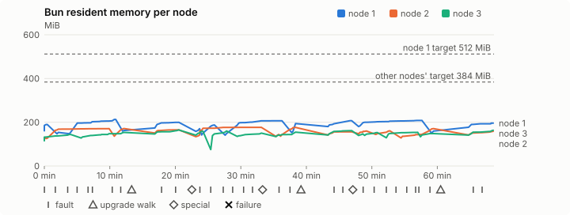
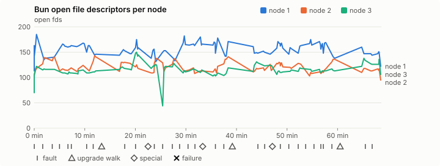
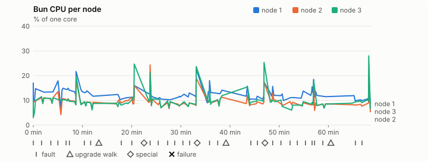
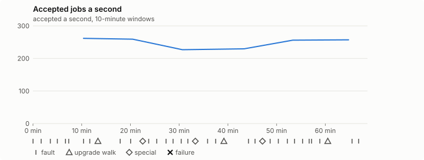

# Sustained soak (V02): PASS

11 November 2026. fast tier, compressed schedule, 1 h 08 min of soak on a three-node quickstart cluster.

**Fast tier: clean.** The iteration loop only, not acceptance: the V02 gate needs a clean final-tier run (8 h, full schedule) on the final candidate.

## Candidate and host

| | |
|---|---|
| Staged base URL | <https://github.com/reliaburger/reliaburger/releases/download/staging-v0.2.8-42927004563-1> |
| `candidate.json` SHA-256 | `700071d536ef66354ee701e6b09d5a0233beeadcd8ef14bcddf2e1e15b9b8ff8` |
| Running versions | v0.2.8 x3 |
| Soak build | `bun-v0.2.8-soak.1`, SHA-256 `413aadcf93225af75e25fac041339094a5c7d2546591a517aba16620cf8dd3fb` |
| Walks roll back to | 0.2.8 |
| Host | macOS 27.2, Apple M5 Max, 128 GiB |
| Lima | limactl version 2.2.1 |
| Guest | Ubuntu 24.04.5 LTS, kernel 6.8.0-139-generic |
| RELIABURGER_HOME | `/tmp/rbq.IzQXW7` |
| Evidence | `/Users/miko/github/rb-wt/gate-028-c2/qual/ev-v02-fast` |

## Configuration deviations

- node.toml `[testing] allowed_operations` adds `provision_isolated_workloads` (quickstart allows only inject_workload_faults and alter_node_state), so the catalogue pulse can lease test namespaces
- node.toml `[logs]`/`[metrics]` export to file:///var/lib/reliaburger/soak-export every 60 s with max_storage_mb = 8 (the harness deletes a metrics export 30 minutes after its source has gone), `[storage.snapshots]` every 900 s (compressed: 120 s), retain 4, uploaded to the same directory
- node.toml `[ingress] tls_cert/tls_key` point at an operator pair from a soak CA, 45-minute leaves rotated by the harness
- Bun runs with auto/mixed; host jobs opt in to a single pinned BusyBox copy under /var/lib/reliaburger/soak-jobs, mount_isolation=false. The independent verifier listens on each private VM address, TCP 8189, with a separate run token
- node.toml `[node.labels] soak-volume` = "writer" on node 2 and "redis" on node 3, to pin the volume apps
- node.toml `[upgrades] external_signing_key` = a throwaway operator key the harness made for this run (`ed25519:2oLH+lJG1HJ1/DKTYQE/cl9yQi3mJZmpxdaTDGtksqU=`); the soak build's `.sig` gets that key's external signature beside the release one (D2)
- node.toml `[security] leaf_lifetime_override_secs = 3600` (D1)

## Timeline

- Started 2026-11-11 01:41:43 UTC, finished 2026-11-11 02:50:22 UTC
- Cycles completed: 6
- Fault and node choices: 26, from seed 352556864 (`--seed 352556864` repeats them)
- Teardown: `relish local destroy --yes` and `relish uninstall --yes` succeeded

## Faults and slots

| Class | Runs | Settled/ok | Failed | Skipped | Settle (median / max) |
|---|---|---|---|---|---|
| fault:bun-kill-follower | 6 | 6 | 0 | 0 | 31 s / 36 s |
| fault:bun-kill-leader | 6 | 6 | 0 | 0 | 32 s / 36 s |
| fault:chaos-cpu | 1 | 2 | 0 | 0 | 15 s / 15 s |
| fault:chaos-delay | 2 | 4 | 0 | 0 | 17 s / 17 s |
| fault:chaos-dns | 1 | 2 | 0 | 0 | 15 s / 15 s |
| fault:chaos-drop | 1 | 2 | 0 | 0 | 16 s / 16 s |
| fault:chaos-kill | 2 | 4 | 0 | 0 | 40 s / 40 s |
| fault:chaos-memory | 1 | 2 | 0 | 0 | 15 s / 15 s |
| fault:chaos-partition | 2 | 4 | 0 | 0 | 16 s / 16 s |
| fault:chaos-pause | 1 | 2 | 0 | 0 | 17 s / 17 s |
| fault:chaos-scenario | 1 | 2 | 0 | 0 | 29 s / 29 s |
| fault:deploy-kill | 3 | 3 | 0 | 0 | 32 s / 35 s |
| fault:power-off | 3 | 3 | 0 | 0 | 28 s / 29 s |
| pulse | 1 | 1 | 0 | 0 | n/a |
| pulse:settle | 0 | 1 | 0 | 0 | 16 s / 16 s |
| special:all-off | 1 | 1 | 0 | 0 | 41 s / 41 s |
| special:graceful-stop | 1 | 1 | 0 | 0 | 36 s / 36 s |
| special:quorum-back | 1 | 1 | 0 | 0 | n/a |
| special:quorum-loss | 1 | 1 | 0 | 0 | 28 s / 28 s |
| storage:offline-export | 3 | 3 | 0 | 0 | n/a |
| storage:registry-push | 6 | 0 | 0 | 0 | n/a |
| tls:invalid-expired | 3 | 3 | 0 | 0 | n/a |
| tls:invalid-torn | 6 | 6 | 0 | 0 | n/a |
| tls:reload | 32 | 32 | 0 | 0 | n/a |
| upgrade:rollback | 3 | 3 | 0 | 0 | n/a |
| upgrade:settle | 0 | 3 | 0 | 0 | 56 s / 61 s |
| upgrade:upgrade | 3 | 3 | 0 | 0 | n/a |

## Execution inventory (recorded, not gated)

What the run completed, from its events and kept bytes, against what its schedule owes. A fault counts once it was injected and the cluster settled after it.

| Item | Required | Completed | Verdict |
|---|---|---|---|
| candidate.json bytes match the qualified digest | 1 | 1 | ok |
| app workloads settled at the baseline | 1 | 1 | ok |
| upgrade walk (to the soak build and back) | 2 | 3 | ok |
| fault:bun-kill-follower | 1 | 6 | ok |
| fault:bun-kill-leader | 1 | 6 | ok |
| fault:deploy-kill | 1 | 3 | ok |
| fault:power-off | 1 | 3 | ok |
| fault:chaos-kill | 1 | 2 | ok |
| fault:chaos-delay | 1 | 2 | ok |
| fault:chaos-partition | 1 | 2 | ok |
| fault:chaos-scenario | 1 | 1 | ok |
| fault:chaos-pause | 1 | 1 | ok |
| fault:chaos-drop | 1 | 1 | ok |
| fault:chaos-dns | 1 | 1 | ok |
| fault:chaos-cpu | 1 | 1 | ok |
| special:graceful-stop | 1 | 1 | ok |
| special:quorum-loss | 1 | 1 | ok |
| special:all-off | 1 | 1 | ok |
| catalogue pulse | 1 | 1 | ok |
| offline export | 2 | 3 | ok |
| job campaign drained in its final two minutes | 1 | 1 | ok |

## Observed fault effects

What each injected fault was seen to do, read back from the node.

| Fault | Target | Observed |
|---|---|---|
| effect:bun-kill-follower | rb-efbd7173963c-2 | MainPID 2703 -> 5112 |
| effect:bun-kill-leader | rb-efbd7173963c-1 | MainPID 8995 -> 41826 |
| effect:deploy-kill | rb-efbd7173963c-1 | MainPID 41826 -> 80787 |
| effect:power-off | rb-efbd7173963c-3 | Lima status Stopped |
| effect:bun-kill-follower | rb-efbd7173963c-2 | MainPID 5112 -> 205416 |
| effect:bun-kill-leader | rb-efbd7173963c-1 | MainPID 80787 -> 236059 |
| effect:bun-kill-follower | rb-efbd7173963c-1 | MainPID 675 -> 19774 |
| effect:bun-kill-leader | rb-efbd7173963c-3 | MainPID 683 -> 46389 |
| effect:deploy-kill | rb-efbd7173963c-1 | MainPID 19774 -> 82968 |
| effect:power-off | rb-efbd7173963c-3 | Lima status Stopped |
| effect:bun-kill-follower | rb-efbd7173963c-2 | MainPID 680 -> 22302 |
| effect:bun-kill-leader | rb-efbd7173963c-1 | MainPID 82968 -> 249003 |
| effect:bun-kill-follower | rb-efbd7173963c-3 | MainPID 686 -> 18784 |
| effect:bun-kill-leader | rb-efbd7173963c-2 | MainPID 684 -> 53985 |
| effect:deploy-kill | rb-efbd7173963c-3 | MainPID 18784 -> 79411 |
| effect:power-off | rb-efbd7173963c-2 | Lima status Stopped |
| effect:bun-kill-follower | rb-efbd7173963c-3 | MainPID 79411 -> 158332 |
| effect:bun-kill-leader | rb-efbd7173963c-1 | MainPID 681 -> 202595 |

## Renewals and rotations

| Measure | Observed | Required | Verdict |
|---|---|---|---|
| workload identity rotations (soak-identity, per node) | 10 | ≥ 1 | PASS |
| node leaf renewals (per node) | 2 | ≥ 1 | PASS |
| operator ingress reloads (all nodes) | 32 | ≥ 12 | PASS |
| mixed job campaign and positive drain | 0 missing/failing checks | 0 | PASS |

## Latency SLOs

What a user should feel on a quiet three-node cluster (#1400). Every sample is taken outside fault windows and through a host forward that works; each p99 is the upper bound of its histogram bucket.

| SLO | p99 | Threshold | Samples | Mode | Verdict |
|---|---|---|---|---|---|
| API read p99 | 150 ms | ≤ 1,000 ms | 306 | record only | PASS |
| API write p99 | 150 ms | ≤ 2,000 ms | 8 | record only | PASS |
| App start p99 | 1 ms | ≤ 5,000 ms | 24 | record only | PASS |
| Rolling update p99 | 30,000 ms | ≤ 30,000 ms | 8 | record only | PASS |
| Job task start p99 | 2,048 ms | ≤ 256 ms | 20 | record only | too few samples |

- API read p99: `GET /v1/status?cluster=true` and `GET /v1/cluster/nodes` on every node, at every light check
- API write p99: `relish apply` of the soak workloads, from the call to the commit
- App start p99: each node's deploy of a new `soak-identity` instance, from its start to the instance running
- Rolling update p99: from `relish apply` returning to every node's `soak-identity` running the new spec
- Job task start p99: a job task's start lag on a pooled executor, from the job campaign's buckets, in runs no fault window overlapped
- Record only from 28 October 2026 (#1400): no soak before 0.2.4 measured it. The threshold is provisional; the first 0.2.4 fast and final records set the gate.
- Job task start p99 not judged: only 20 job task start samples, fewer than the 1,000 a p99 needs

## Jobs

| Runtime | Accepted successes | Retries | Last accepted progress |
|---|---|---|---|
| runc | 15507 | 1 | 1794365411 |
| shared-runc | 498401 | 1 | 1794365411 |
| process | 511026 | 1 | 1794365408 |

The bounded campaign shares the app soak's fault schedule. These counts are reliability evidence, not a saturation rate or a 100-million-per-day qualification.

- Independent verifier execution attempts: 24
- Explicit test-operator acknowledgements for known replay-safe fenced fixtures: 138

- rb-efbd7173963c-1: latest complete job storage (KiB) {'instances': 304, 'job-state': 8, 'task-arrays': 7120}; free 5184652 KiB; live/peak owners 0/11; peak storage {'instances': 9296, 'job-state': 8, 'task-arrays': 16428}
- rb-efbd7173963c-2: latest complete job storage (KiB) {'instances': 1316, 'job-state': 8, 'task-arrays': 6920}; free 6322196 KiB; live/peak owners 0/8; peak storage {'instances': 7672, 'job-state': 8, 'task-arrays': 16472}
- rb-efbd7173963c-3: latest complete job storage (KiB) {'instances': 2660, 'job-state': 8, 'task-arrays': 6936}; free 6299892 KiB; live/peak owners 0/8; peak storage {'instances': 8548, 'job-state': 8, 'task-arrays': 16028}

Complete disk inventories are recorded. Global retention bounds and the 12-hour job qualification remain #668; this gate cannot certify an unimplemented retention policy.

## Job qualification (D18-C)

Load: calibration; 3 nodes; accepted 249.3/s (calibration load: not gated).

The September plan set its targets for one 1M-task batch on a quiet cluster. A soak runs for hours with restarts, upgrades and apps, so its storage, Bun memory and Raft targets are restated (maintainer decision, 15 October 2026, [#668](https://github.com/reliaburger/reliaburger/issues/668)). Bun's steady state is the median RSS of each process once it has been seen for 10 minutes; the gated memory checks are unchanged (`leak-rss`, and Mayo's 70% `memory_high` alert through `wtf`).

| Measure (recorded, not gated) | Observed | Target |
|---|---|---|
| Wall time of a 1,048,576-task array (median / max of 0) | not measured / not measured | ≤ 600 s |
| p99 start lag, pooled executors | 2 ms (bucket upper bound) | < 1,000 ms |
| Raft entries per second, all cluster writes | 5.95 | recorded only; the batch target counts only task-array writes |
| Raft state of one run, largest seen | 43,259 B | ≤ 256 KiB per 1M tasks |
| Bun steady-state RSS per process, worst node against its target | rb-efbd7173963c-2: 176.82 MiB steady, 176.82 MiB peak | ≤ 384 MiB (≤ 512 MiB on node 1, which serves the API) |
| Bun CPU, busiest node | 0.12 cores | ≤ 1 core (leader batch control) |
| Executor helper CPU, busiest node | 0.00 cores | ≤ 0.5 core |
| Node task-array storage per 1M accepted tasks (peaks summed) | 46.62 MiB | ≤ 64 MiB, deleted after retirement |
| Retained log volume, all nodes | 7.02 MB | ≤ 50 MB |

- Bun RSS on rb-efbd7173963c-1 (serves the API, target ≤ 512 MiB): pid 8995: 189.73 MiB peak (seen for under 10 minutes); pid 41826: 153.65 MiB peak (seen for under 10 minutes); pid 80787: 212.91 MiB peak (seen for under 10 minutes); pid 236059: 162.26 MiB peak (seen for under 10 minutes); pid 266035: 199.98 MiB peak (seen for under 10 minutes); pid 675: 170.68 MiB peak (seen for under 10 minutes); pid 19774: 187.54 MiB peak (seen for under 10 minutes); pid 82968: 206.71 MiB peak (seen for under 10 minutes); pid 249003: 194.07 MiB peak (seen for under 10 minutes); pid 249003: 207.24 MiB peak (seen for under 10 minutes); pid 681: 208.08 MiB peak (seen for under 10 minutes); pid 202595: 159.62 MiB peak (seen for under 10 minutes); pid 202595: 195.92 MiB peak (seen for under 10 minutes)
- Bun RSS on rb-efbd7173963c-2 (node, target ≤ 384 MiB): pid 2703: 131.20 MiB peak (seen for under 10 minutes); pid 5112: 170.79 MiB peak (seen for under 10 minutes); pid 205416: 171.30 MiB peak (seen for under 10 minutes); pid 205416: 165.39 MiB peak (seen for under 10 minutes); pid 681: 176.82 MiB steady, 176.82 MiB peak; pid 680: 144.28 MiB peak (seen for under 10 minutes); pid 22302: 176.35 MiB peak (seen for under 10 minutes); pid 22302: 156.11 MiB peak (seen for under 10 minutes); pid 684: 159.96 MiB peak (seen for under 10 minutes); pid 53985: 160.82 MiB peak (seen for under 10 minutes); pid 680: 170.80 MiB peak (seen for under 10 minutes); pid 685: 158.50 MiB peak (seen for under 10 minutes)
- Bun RSS on rb-efbd7173963c-3 (node, target ≤ 384 MiB): pid 2227: 144.38 MiB peak (seen for under 10 minutes); pid 679: 153.46 MiB peak (seen for under 10 minutes); pid 679: 164.66 MiB peak (seen for under 10 minutes); pid 683: 158.67 MiB peak (seen for under 10 minutes); pid 46389: 160.25 MiB peak (seen for under 10 minutes); pid 681: 150.25 MiB peak (seen for under 10 minutes); pid 675: 154.75 MiB peak (seen for under 10 minutes); pid 681: 161.79 MiB peak (seen for under 10 minutes); pid 686: 146.82 MiB peak (seen for under 10 minutes); pid 18784: 152.85 MiB peak (seen for under 10 minutes); pid 79411: 153.93 MiB peak (seen for under 10 minutes); pid 158332: 148.26 MiB peak (seen for under 10 minutes); pid 158332: 163.23 MiB peak (seen for under 10 minutes)

- runc retry causes: exit_code 1, launch 0, signal 0, timeout 0, unknown 0, unrecorded 0
- shared-runc retry causes: exit_code 1, launch 0, signal 0, timeout 0, unknown 0, unrecorded 0
- process retry causes: exit_code 1, launch 0, signal 0, timeout 0, unknown 0, unrecorded 0
- Audited executions: 24; operator replay decisions: 138
- Job controller API fallbacks: rb-efbd7173963c-1 missed 115, rb-efbd7173963c-2 missed 8; rb-efbd7173963c-2 answered 107, rb-efbd7173963c-3 answered 8 (requests a node didn't answer, and the node that took them instead)

## Data

- Volume writer: highest ACK 28845 in the log view; the writer file checks (writer-lost, writer-regression) decide data loss, and `*-log-order` failures are about the order the log view returned lines in
- Redis counter: highest INCR 3229 in the log view
- Export rb-efbd7173963c-1: 137 source files, 127 at the destination
- Export rb-efbd7173963c-2: 140 source files, 132 at the destination
- Export rb-efbd7173963c-3: 111 source files, 111 at the destination
- Registry images pushed and re-verified: 7
- Agent-loop turns over the 1 s budget: rb-efbd7173963c-1 0, rb-efbd7173963c-2 0, rb-efbd7173963c-3 0
- Soak policies checked in force: 118 times, policy generation 39 at the last check
- Guest clock steps by Lima's guest agent: rb-efbd7173963c-1 2, rb-efbd7173963c-2 5, rb-efbd7173963c-3 7
- Checks evaluated: 187 (heavy 16, light 69, settle 102)
- Last observed progress: redis-counter 3229, writer-ack 28845

## Council history (linearizability)

Every test-lease grant, renew, read and release the history client made, checked against a model of the council's leases. A write with no answer may or may not have happened; the check allows both.

- Operations checked: 20988 of 20988, in 2 namespaces; 1297 writes had no answer
- Verdict: linearizable

## Leak-checker exposure (recorded, not gated)

How long each leak checker could judge each node's Bun. `leak-rss` arms at its warm sample: 60 minutes into one process in a final, and otherwise at the first heavy check where the log and metrics stores are each 90% full, between 60 minutes and 6 hours in (#1417). `leak-fd` arms after 50 minutes; a restart, kill or upgrade exec starts the warm-up again. A final needs each armed for 60 minutes on every node, with one unbroken window of 30 (#1062); its quiet tail gives them that.

| Node | Checker | Armed | Longest armed window | Evaluated samples | Processes armed | Verdict |
|---|---|---|---|---|---|---|
| rb-efbd7173963c-1 | leak-rss | 0 min | 0 min | 0 | 0 | short |
| rb-efbd7173963c-1 | leak-fd | 0 min | 0 min | 0 | 0 | short |
| rb-efbd7173963c-2 | leak-rss | 0 min | 0 min | 0 | 0 | short |
| rb-efbd7173963c-2 | leak-fd | 0 min | 0 min | 0 | 0 | short |
| rb-efbd7173963c-3 | leak-rss | 0 min | 0 min | 0 | 0 | short |
| rb-efbd7173963c-3 | leak-fd | 0 min | 0 min | 0 | 0 | short |

## Resource trends

| Node | Measure | First | Last | Max |
|---|---|---|---|---|
| rb-efbd7173963c-1 | disk_kb data | 1382944 | 945108 | 1537036 |
| rb-efbd7173963c-1 | disk_kb images | 342456 | 464136 | 464136 |
| rb-efbd7173963c-1 | disk_kb logs | 44 | 4624 | 4624 |
| rb-efbd7173963c-1 | disk_kb metrics | 96 | 5272 | 5272 |
| rb-efbd7173963c-1 | disk_kb soak-export | 4 | 9200 | 9200 |
| rb-efbd7173963c-1 | disk_kb volumes | 248 | 72 | 300 |
| rb-efbd7173963c-1 | fd | 116 | 122 | 185 |
| rb-efbd7173963c-1 | rss_anon_kb | 89696 | 120588 | 137796 |
| rb-efbd7173963c-1 | rss_file_kb | 75168 | 80032 | 80416 |
| rb-efbd7173963c-1 | rss_kb | 164864 | 200620 | 218020 |
| rb-efbd7173963c-2 | disk_kb data | 71888 | 93860 | 561108 |
| rb-efbd7173963c-2 | disk_kb images | 172188 | 342464 | 342464 |
| rb-efbd7173963c-2 | disk_kb logs | 24 | 1092 | 1092 |
| rb-efbd7173963c-2 | disk_kb metrics | 72 | 2692 | 2692 |
| rb-efbd7173963c-2 | disk_kb soak-export | 4 | 3980 | 3980 |
| rb-efbd7173963c-2 | disk_kb volumes | 16760 | 17460 | 17460 |
| rb-efbd7173963c-2 | fd | 71 | 95 | 143 |
| rb-efbd7173963c-2 | rss_anon_kb | 50448 | 83292 | 101708 |
| rb-efbd7173963c-2 | rss_file_kb | 73568 | 79008 | 79904 |
| rb-efbd7173963c-2 | rss_kb | 124016 | 162300 | 181064 |
| rb-efbd7173963c-3 | disk_kb data | 234636 | 720496 | 734540 |
| rb-efbd7173963c-3 | disk_kb images | 339124 | 342464 | 342464 |
| rb-efbd7173963c-3 | disk_kb logs | 24 | 1140 | 1140 |
| rb-efbd7173963c-3 | disk_kb metrics | 68 | 2640 | 2640 |
| rb-efbd7173963c-3 | disk_kb soak-export | 4 | 4844 | 4844 |
| rb-efbd7173963c-3 | disk_kb volumes | 16784 | 17248 | 17248 |
| rb-efbd7173963c-3 | fd | 70 | 106 | 150 |
| rb-efbd7173963c-3 | rss_anon_kb | 44664 | 88088 | 89168 |
| rb-efbd7173963c-3 | rss_file_kb | 73376 | 79064 | 79776 |
| rb-efbd7173963c-3 | rss_kb | 118040 | 167152 | 168608 |

## Bun memory by kind

From each node's `/proc/PID/smaps` at the settle and heavy checks (`memory.jsonl`, #1417). Sizes in MiB; arenas are glibc thread arenas, with the number of 64 MiB arena heaps in brackets. Time is h:mm since the node's first sample.

### rb-efbd7173963c-1

| Time | Pid | RSS | Heap | Arenas | Stacks | Other anonymous | File | Threads |
|---|---|---|---|---|---|---|---|---|
| 0:00 | 8995 | 161.0 | 35.1 | 45.7 (1) | 2.9 | 0.1 | 77.1 | 50 |
| 1:05 | 202595 | 177.1 | 64.5 | 0.0 (0) | 2.2 | 31.1 | 79.3 | 45 |
| 1:08 | 202595 | 195.9 | 66.7 | 0.0 (0) | 2.5 | 44.8 | 81.9 | 48 |

- rb-efbd7173963c-1: not enough data: the last Bun process (pid 202595) has no samples after its first hour.
- rb-efbd7173963c-1: no 6-hour RSS slope: the last Bun process (pid 202595) ran for 0:09 h:mm.

### rb-efbd7173963c-2

| Time | Pid | RSS | Heap | Arenas | Stacks | Other anonymous | File | Threads |
|---|---|---|---|---|---|---|---|---|
| 0:00 | 2703 | 121.1 | 17.5 | 26.0 (1) | 1.8 | 0.2 | 75.6 | 33 |
| 1:05 | 685 | 141.7 | 30.4 | 29.5 (1) | 2.9 | 0.4 | 78.4 | 60 |
| 1:08 | 685 | 158.5 | 34.3 | 39.7 (1) | 2.9 | 0.7 | 80.9 | 60 |

- rb-efbd7173963c-2: not enough data: the last Bun process (pid 685) has no samples after its first hour.
- rb-efbd7173963c-2: no 6-hour RSS slope: the last Bun process (pid 685) ran for 0:03 h:mm.

### rb-efbd7173963c-3

| Time | Pid | RSS | Heap | Arenas | Stacks | Other anonymous | File | Threads |
|---|---|---|---|---|---|---|---|---|
| 0:00 | 2227 | 115.3 | 25.7 | 11.8 (1) | 2.1 | 0.2 | 75.4 | 31 |
| 1:05 | 158332 | 141.4 | 31.4 | 27.0 (1) | 1.9 | 0.6 | 80.5 | 34 |
| 1:08 | 158332 | 163.2 | 43.7 | 34.9 (1) | 3.1 | 0.6 | 80.9 | 58 |

- rb-efbd7173963c-3: not enough data: the last Bun process (pid 158332) has no samples after its first hour.
- rb-efbd7173963c-3: no 6-hour RSS slope: the last Bun process (pid 158332) ran for 0:11 h:mm.

## Agent loop stalls

From the stall watchdog's journal blocks (`loop-stalls.jsonl`, #1707). Each snapshot lists every Bun thread; here are the stall line, threads in uninterruptible sleep and the thread that ran the loop.

- None recorded.

## Charts

Time runs from the start of the soak. The marks under each chart are its faults, upgrade walks, specials and recorded failures; the dashed lines are targets.

## Failures

None.

Evidence: `/Users/miko/github/rb-wt/gate-028-c2/qual/ev-v02-fast` (events.jsonl, snapshots/, failures/<n>/).
