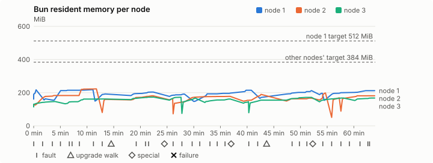
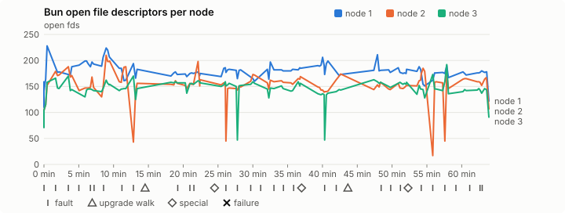
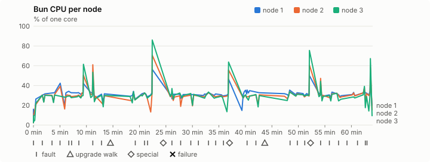
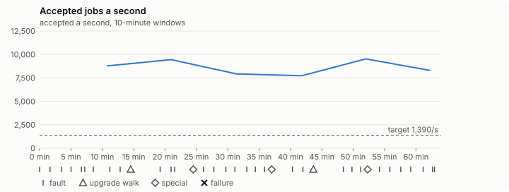

# Sustained soak (V02): PASS

11 November 2026. fast tier, compressed schedule, 1 h 04 min of soak on a three-node quickstart cluster.

**Fast tier: clean.** The iteration loop only, not acceptance: the V02 gate needs a clean final-tier run (8 h, full schedule) on the final candidate.

## Candidate and host

| | |
|---|---|
| Staged base URL | <https://github.com/reliaburger/reliaburger/releases/download/staging-v0.2.8-43017213259-1> |
| `candidate.json` SHA-256 | `d9d04a7708e06fb444e8ca880a73321539e2300f29bb141ba80e7781a4bbe9f8` |
| Running versions | v0.2.8 x3 |
| Soak build | `bun-v0.2.8-soak.1`, SHA-256 `9e8ec8795faee3e49cd4f2e0071fd92f8df215834f49b4833e2e24ed4e764da0` |
| Walks roll back to | 0.2.8 |
| Host | macOS 27.2, Apple M5 Max, 128 GiB |
| Lima | limactl version 2.2.1 |
| Guest | Ubuntu 24.04.5 LTS, kernel 6.8.0-139-generic |
| RELIABURGER_HOME | `/tmp/rbq.5KjJxz` |
| Evidence | `/Users/miko/github/rb-wt/gate-028-c3/qual/ev-jobs-fast` |

## Configuration deviations

- node.toml `[testing] allowed_operations` adds `provision_isolated_workloads` (quickstart allows only inject_workload_faults and alter_node_state), so the catalogue pulse can lease test namespaces
- node.toml `[logs]`/`[metrics]` export to file:///var/lib/reliaburger/soak-export every 60 s with max_storage_mb = 8 (the harness deletes a metrics export 30 minutes after its source has gone), `[storage.snapshots]` every 900 s (compressed: 120 s), retain 4, uploaded to the same directory
- node.toml `[ingress] tls_cert/tls_key` point at an operator pair from a soak CA, 45-minute leaves rotated by the harness
- Bun runs with auto/mixed; host jobs opt in to a single pinned BusyBox copy under /var/lib/reliaburger/soak-jobs, mount_isolation=false. The independent verifier listens on each private VM address, TCP 8189, with a separate run token
- node.toml `[node.labels] soak-volume` = "writer" on node 2 and "redis" on node 3, to pin the volume apps
- node.toml `[upgrades] external_signing_key` = a throwaway operator key the harness made for this run (`ed25519:i5tvqbakoU5TR0/te0M5qwSwDmGqREYTt/qJ0iYPkhg=`); the soak build's `.sig` gets that key's external signature beside the release one (D2)
- node.toml `[security] leaf_lifetime_override_secs = 3600` (D1)

## Timeline

- Started 2026-11-11 15:25:07 UTC, finished 2026-11-11 16:29:08 UTC
- Cycles completed: 5
- Fault and node choices: 27, from seed 1018230452 (`--seed 1018230452` repeats them)
- Teardown: `relish local destroy --yes` and `relish uninstall --yes` succeeded

## Faults and slots

| Class | Runs | Settled/ok | Failed | Skipped | Settle (median / max) |
|---|---|---|---|---|---|
| fault:bun-kill-follower | 5 | 5 | 0 | 0 | 32 s / 37 s |
| fault:bun-kill-leader | 5 | 5 | 0 | 0 | 34 s / 41 s |
| fault:chaos-cpu | 1 | 2 | 0 | 0 | 19 s / 19 s |
| fault:chaos-delay | 1 | 2 | 0 | 0 | 16 s / 16 s |
| fault:chaos-dns | 1 | 2 | 0 | 0 | 17 s / 17 s |
| fault:chaos-drop | 1 | 2 | 0 | 0 | 23 s / 23 s |
| fault:chaos-kill | 2 | 4 | 0 | 0 | 32 s / 32 s |
| fault:chaos-memory | 1 | 2 | 0 | 0 | 24 s / 24 s |
| fault:chaos-partition | 1 | 2 | 0 | 0 | 17 s / 17 s |
| fault:chaos-pause | 1 | 2 | 0 | 0 | 17 s / 17 s |
| fault:chaos-scenario | 1 | 2 | 0 | 0 | 34 s / 34 s |
| fault:deploy-kill | 3 | 3 | 0 | 0 | 34 s / 36 s |
| fault:node-delay | 2 | 2 | 0 | 0 | 31 s / 31 s |
| fault:node-disk-full | 2 | 2 | 0 | 0 | 17 s / 17 s |
| fault:node-slow-fsync | 1 | 1 | 0 | 0 | 18 s / 18 s |
| fault:power-off | 3 | 3 | 0 | 0 | 30 s / 30 s |
| pulse | 1 | 1 | 0 | 0 | n/a |
| pulse:settle | 0 | 1 | 0 | 0 | 22 s / 22 s |
| special:all-off | 1 | 1 | 0 | 0 | 36 s / 36 s |
| special:graceful-stop | 1 | 1 | 0 | 0 | 40 s / 40 s |
| special:quorum-back | 1 | 1 | 0 | 0 | n/a |
| special:quorum-loss | 1 | 1 | 0 | 0 | 57 s / 57 s |
| storage:offline-export | 2 | 2 | 0 | 0 | n/a |
| storage:registry-push | 5 | 0 | 0 | 0 | n/a |
| tls:invalid-expired | 3 | 3 | 0 | 0 | n/a |
| tls:invalid-torn | 3 | 3 | 0 | 0 | n/a |
| tls:reload | 29 | 29 | 0 | 0 | n/a |
| upgrade:rollback | 2 | 2 | 0 | 0 | n/a |
| upgrade:settle | 0 | 2 | 0 | 0 | 63 s / 63 s |
| upgrade:upgrade | 2 | 2 | 0 | 0 | n/a |

## Execution inventory (recorded, not gated)

What the run completed, from its events and kept bytes, against what its schedule owes. A fault counts once it was injected and the cluster settled after it.

| Item | Required | Completed | Verdict |
|---|---|---|---|
| candidate.json bytes match the qualified digest | 1 | 1 | ok |
| app workloads settled at the baseline | 1 | 1 | ok |
| upgrade walk (to the soak build and back) | 2 | 2 | ok |
| fault:bun-kill-follower | 1 | 5 | ok |
| fault:bun-kill-leader | 1 | 5 | ok |
| fault:deploy-kill | 1 | 3 | ok |
| fault:power-off | 1 | 3 | ok |
| fault:chaos-kill | 1 | 2 | ok |
| fault:chaos-delay | 1 | 1 | ok |
| fault:chaos-partition | 1 | 1 | ok |
| fault:chaos-scenario | 1 | 1 | ok |
| fault:chaos-pause | 1 | 1 | ok |
| fault:chaos-drop | 1 | 1 | ok |
| fault:chaos-dns | 1 | 1 | ok |
| fault:chaos-cpu | 1 | 1 | ok |
| fault:node-delay | 1 | 2 | ok |
| fault:node-disk-full | 1 | 2 | ok |
| fault:node-slow-fsync | 1 | 1 | ok |
| special:graceful-stop | 1 | 1 | ok |
| special:quorum-loss | 1 | 1 | ok |
| special:all-off | 1 | 1 | ok |
| catalogue pulse | 1 | 1 | ok |
| offline export | 2 | 2 | ok |
| job campaign drained in its final two minutes | 1 | 1 | ok |

## Observed fault effects

What each injected fault was seen to do, read back from the node.

| Fault | Target | Observed |
|---|---|---|
| effect:bun-kill-follower | rb-c4d33dfc6c35-2 | MainPID 2954 -> 5407 |
| effect:bun-kill-leader | rb-c4d33dfc6c35-1 | MainPID 9479 -> 300590 |
| effect:deploy-kill | rb-c4d33dfc6c35-1 | MainPID 300590 -> 691099 |
| effect:power-off | rb-c4d33dfc6c35-3 | Lima status Stopped |
| effect:node-delay | rb-c4d33dfc6c35-1 | netem 8001: root refcnt 2 limit 1000 delay 200ms  50ms  |
| effect:bun-kill-follower | rb-c4d33dfc6c35-1 | MainPID 691099 -> 2516799 |
| effect:bun-kill-leader | rb-c4d33dfc6c35-2 | MainPID 5407 -> 3156562 |
| effect:node-disk-full | rb-c4d33dfc6c35-2 | available 66920448 bytes  |
| effect:bun-kill-follower | rb-c4d33dfc6c35-2 | MainPID 684 -> 207129 |
| effect:bun-kill-leader | rb-c4d33dfc6c35-3 | MainPID 681 -> 608589 |
| effect:deploy-kill | rb-c4d33dfc6c35-1 | MainPID 681 -> 1073312 |
| effect:power-off | rb-c4d33dfc6c35-3 | Lima status Stopped |
| effect:node-slow-fsync | rb-c4d33dfc6c35-3 | IOWriteBandwidthMax=/dev/vda 1000000 IOWriteIOPSMax=/dev/vda 20  |
| effect:bun-kill-follower | rb-c4d33dfc6c35-3 | MainPID 673 -> 256812 |
| effect:bun-kill-leader | rb-c4d33dfc6c35-1 | MainPID 1073312 -> 3776351 |
| effect:node-delay | rb-c4d33dfc6c35-2 | netem 8001: root refcnt 2 limit 1000 delay 200ms  50ms  |
| effect:bun-kill-follower | rb-c4d33dfc6c35-1 | MainPID 683 -> 204436 |
| effect:bun-kill-leader | rb-c4d33dfc6c35-2 | MainPID 685 -> 633334 |
| effect:deploy-kill | rb-c4d33dfc6c35-2 | MainPID 633334 -> 1030326 |
| effect:power-off | rb-c4d33dfc6c35-3 | Lima status Stopped |
| effect:node-disk-full | rb-c4d33dfc6c35-3 | available 67072000 bytes  |

## Renewals and rotations

| Measure | Observed | Required | Verdict |
|---|---|---|---|
| workload identity rotations (soak-identity, per node) | 8 | ≥ 1 | PASS |
| node leaf renewals (per node) | 2 | ≥ 1 | PASS |
| operator ingress reloads (all nodes) | 29 | ≥ 11 | PASS |
| mixed job campaign and positive drain | 0 missing/failing checks | 0 | PASS |

## Latency SLOs

What a user should feel on a quiet three-node cluster (#1400). Every sample is taken outside fault windows and through a host forward that works; each p99 is the upper bound of its histogram bucket.

| SLO | p99 | Threshold | Samples | Mode | Verdict |
|---|---|---|---|---|---|
| API read p99 | 150 ms | ≤ 1,000 ms | 234 | record only | PASS |
| API write p99 | 3,000 ms | ≤ 2,000 ms | 7 | record only | over (record only) |
| App start p99 | 1 ms | ≤ 5,000 ms | 21 | record only | PASS |
| Rolling update p99 | 30,000 ms | ≤ 30,000 ms | 7 | record only | PASS |
| Job task start p99 | 1,024 ms | ≤ 256 ms | 20 | record only | too few samples |

- API read p99: `GET /v1/status?cluster=true` and `GET /v1/cluster/nodes` on every node, at every light check
- API write p99: `relish apply` of the soak workloads, from the call to the commit
- App start p99: each node's deploy of a new `soak-identity` instance, from its start to the instance running
- Rolling update p99: from `relish apply` returning to every node's `soak-identity` running the new spec
- Job task start p99: a job task's start lag on a pooled executor, from the job campaign's buckets, in runs no fault window overlapped
- Record only from 28 October 2026 (#1400): no soak before 0.2.4 measured it. The threshold is provisional; the first 0.2.4 fast and final records set the gate.
- Job task start p99 not judged: only 20 job task start samples, fewer than the 1,000 a p99 needs

## Jobs

| Runtime | Accepted successes | Retries | Last accepted progress |
|---|---|---|---|
| runc | 10005 | 1 | 1794414537 |
| shared-runc | 8668195 | 1 | 1794414537 |
| process | 24443690 | 1 | 1794414537 |

The bounded campaign shares the app soak's fault schedule. These counts are reliability evidence, not a saturation rate or a 100-million-per-day qualification.

- Independent verifier execution attempts: 24
- Explicit test-operator acknowledgements for known replay-safe fenced fixtures: 118

- rb-c4d33dfc6c35-1: latest complete job storage (KiB) {'instances': 2564, 'job-state': 8, 'task-arrays': 20948}; free 5155536 KiB; live/peak owners 0/32; peak storage {'instances': 24480, 'job-state': 8, 'task-arrays': 47140}
- rb-c4d33dfc6c35-2: latest complete job storage (KiB) {'instances': 944, 'job-state': 8, 'task-arrays': 21508}; free 6321168 KiB; live/peak owners 0/32; peak storage {'instances': 22696, 'job-state': 8, 'task-arrays': 49540}
- rb-c4d33dfc6c35-3: latest complete job storage (KiB) {'instances': 436, 'job-state': 8, 'task-arrays': 17208}; free 6264168 KiB; live/peak owners 0/31; peak storage {'instances': 25580, 'job-state': 8, 'task-arrays': 47000}

Complete disk inventories are recorded. Global retention bounds and the 12-hour job qualification remain #668; this gate cannot certify an unimplemented retention policy.

## Job qualification (D18-C)

Load: target; 3 nodes; accepted 8,630.0/s against a 1390.0/s target: PASS.

The September plan set its targets for one 1M-task batch on a quiet cluster. A soak runs for hours with restarts, upgrades and apps, so its storage, Bun memory and Raft targets are restated (maintainer decision, 15 October 2026, [#668](https://github.com/reliaburger/reliaburger/issues/668)). Bun's steady state is the median RSS of each process once it has been seen for 10 minutes; the gated memory checks are unchanged (`leak-rss`, and Mayo's 70% `memory_high` alert through `wtf`).

| Measure (recorded, not gated) | Observed | Target |
|---|---|---|
| Wall time of a 1,048,576-task array (median / max of 31) | 151 s / 502 s | ≤ 600 s |
| p99 start lag, pooled executors | 32 ms (bucket upper bound) | < 1,000 ms |
| Raft entries per second, all cluster writes | 5.37 | recorded only; the batch target counts only task-array writes |
| Raft state of one run, largest seen | 8,869 B | ≤ 256 KiB per 1M tasks |
| Bun steady-state RSS per process, worst node against its target | rb-c4d33dfc6c35-2: 222.39 MiB steady, 223.16 MiB peak | ≤ 384 MiB (≤ 512 MiB on node 1, which serves the API) |
| Bun CPU, busiest node | 0.30 cores | ≤ 1 core (leader batch control) |
| Executor helper CPU, busiest node | 0.08 cores | ≤ 0.5 core |
| Node task-array storage per 1M accepted tasks (peaks summed) | 4.24 MiB | ≤ 64 MiB, deleted after retirement |
| Retained log volume, all nodes | 6.40 MB | ≤ 50 MB |

- Bun RSS on rb-c4d33dfc6c35-1 (serves the API, target ≤ 512 MiB): pid 9479: 217.39 MiB peak (seen for under 10 minutes); pid 300590: 163.04 MiB peak (seen for under 10 minutes); pid 691099: 218.00 MiB peak (seen for under 10 minutes); pid 2516799: 192.12 MiB peak (seen for under 10 minutes); pid 2516799: 203.87 MiB peak (seen for under 10 minutes); pid 681: 191.56 MiB peak (seen for under 10 minutes); pid 1073312: 214.69 MiB steady, 214.70 MiB peak; pid 3776351: 171.50 MiB peak (seen for under 10 minutes); pid 3776351: 212.23 MiB peak (seen for under 10 minutes); pid 683: 196.18 MiB peak (seen for under 10 minutes); pid 204436: 212.16 MiB peak (seen for under 10 minutes)
- Bun RSS on rb-c4d33dfc6c35-2 (node, target ≤ 384 MiB): pid 2954: 127.49 MiB peak (seen for under 10 minutes); pid 5407: 222.39 MiB steady, 223.16 MiB peak; pid 3156562: 159.77 MiB peak (seen for under 10 minutes); pid 3816765: 181.25 MiB peak (seen for under 10 minutes); pid 684: 164.04 MiB peak (seen for under 10 minutes); pid 207129: 177.96 MiB steady, 177.96 MiB peak; pid 679: 189.72 MiB peak (seen for under 10 minutes); pid 679: 166.96 MiB peak (seen for under 10 minutes); pid 685: 197.96 MiB peak (seen for under 10 minutes); pid 633334: 169.28 MiB peak (seen for under 10 minutes); pid 1030326: 181.52 MiB peak (seen for under 10 minutes)
- Bun RSS on rb-c4d33dfc6c35-3 (node, target ≤ 384 MiB): pid 2730: 146.68 MiB peak (seen for under 10 minutes); pid 684: 162.11 MiB peak (seen for under 10 minutes); pid 684: 173.85 MiB peak (seen for under 10 minutes); pid 681: 172.29 MiB peak (seen for under 10 minutes); pid 608589: 168.07 MiB peak (seen for under 10 minutes); pid 678: 161.93 MiB peak (seen for under 10 minutes); pid 673: 145.77 MiB peak (seen for under 10 minutes); pid 256812: 155.10 MiB peak (seen for under 10 minutes); pid 681: 171.86 MiB peak (seen for under 10 minutes); pid 678: 167.75 MiB peak (seen for under 10 minutes); pid 681: 167.82 MiB peak (seen for under 10 minutes)

- runc retry causes: exit_code 1, launch 0, signal 0, timeout 0, unknown 0, unrecorded 0
- shared-runc retry causes: exit_code 1, launch 0, signal 0, timeout 0, unknown 0, unrecorded 0
- process retry causes: exit_code 1, launch 0, signal 0, timeout 0, unknown 0, unrecorded 0
- Audited executions: 24; operator replay decisions: 118
- Job controller API fallbacks: rb-c4d33dfc6c35-1 missed 225, rb-c4d33dfc6c35-2 missed 2; rb-c4d33dfc6c35-2 answered 223, rb-c4d33dfc6c35-3 answered 2 (requests a node didn't answer, and the node that took them instead)

## Data

- Volume writer: highest ACK 28846 in the log view; the writer file checks (writer-lost, writer-regression) decide data loss, and `*-log-order` failures are about the order the log view returned lines in
- Redis counter: highest INCR 2983 in the log view
- Export rb-c4d33dfc6c35-1: 127 source files, 122 at the destination
- Export rb-c4d33dfc6c35-2: 131 source files, 129 at the destination
- Export rb-c4d33dfc6c35-3: 99 source files, 95 at the destination
- Registry images pushed and re-verified: 6
- Agent-loop turns over the 1 s budget: rb-c4d33dfc6c35-1 0, rb-c4d33dfc6c35-2 0, rb-c4d33dfc6c35-3 0
- Soak policies checked in force: 116 times, policy generation 36 at the last check
- Guest clock steps by Lima's guest agent: rb-c4d33dfc6c35-1 3, rb-c4d33dfc6c35-2 4, rb-c4d33dfc6c35-3 4
- Checks evaluated: 179 (heavy 15, light 63, settle 101)
- Last observed progress: redis-counter 2983, writer-ack 28846

## Council history (linearizability)

Every test-lease grant, renew, read and release the history client made, checked against a model of the council's leases. A write with no answer may or may not have happened; the check allows both.

- Operations checked: 19466 of 19466, in 2 namespaces; 1616 writes had no answer
- Verdict: linearizable

## Leak-checker exposure (recorded, not gated)

How long each leak checker could judge each node's Bun. `leak-rss` arms at its warm sample: 60 minutes into one process in a final, and otherwise at the first heavy check where the log and metrics stores are each 90% full, between 60 minutes and 6 hours in (#1417). `leak-fd` arms after 50 minutes; a restart, kill or upgrade exec starts the warm-up again. A final needs each armed for 60 minutes on every node, with one unbroken window of 30 (#1062); its quiet tail gives them that.

| Node | Checker | Armed | Longest armed window | Evaluated samples | Processes armed | Verdict |
|---|---|---|---|---|---|---|
| rb-c4d33dfc6c35-1 | leak-rss | 0 min | 0 min | 0 | 0 | short |
| rb-c4d33dfc6c35-1 | leak-fd | 0 min | 0 min | 0 | 0 | short |
| rb-c4d33dfc6c35-2 | leak-rss | 0 min | 0 min | 0 | 0 | short |
| rb-c4d33dfc6c35-2 | leak-fd | 0 min | 0 min | 0 | 0 | short |
| rb-c4d33dfc6c35-3 | leak-rss | 0 min | 0 min | 0 | 0 | short |
| rb-c4d33dfc6c35-3 | leak-fd | 0 min | 0 min | 0 | 0 | short |


## Resource trends

| Node | Measure | First | Last | Max |
|---|---|---|---|---|
| rb-c4d33dfc6c35-1 | disk_kb data | 1382940 | 1368404 | 1567624 |
| rb-c4d33dfc6c35-1 | disk_kb images | 342456 | 464176 | 464176 |
| rb-c4d33dfc6c35-1 | disk_kb logs | 36 | 4264 | 4264 |
| rb-c4d33dfc6c35-1 | disk_kb metrics | 48 | 4300 | 4300 |
| rb-c4d33dfc6c35-1 | disk_kb soak-export | 4 | 8276 | 8276 |
| rb-c4d33dfc6c35-1 | disk_kb volumes | 248 | 228 | 300 |
| rb-c4d33dfc6c35-1 | fd | 111 | 122 | 228 |
| rb-c4d33dfc6c35-1 | rss_anon_kb | 90296 | 137544 | 143024 |
| rb-c4d33dfc6c35-1 | rss_file_kb | 74788 | 79708 | 80228 |
| rb-c4d33dfc6c35-1 | rss_kb | 165084 | 217252 | 223228 |
| rb-c4d33dfc6c35-2 | disk_kb data | 71864 | 233016 | 331000 |
| rb-c4d33dfc6c35-2 | disk_kb images | 175368 | 342464 | 342464 |
| rb-c4d33dfc6c35-2 | disk_kb logs | 28 | 788 | 788 |
| rb-c4d33dfc6c35-2 | disk_kb metrics | 44 | 3424 | 3424 |
| rb-c4d33dfc6c35-2 | disk_kb soak-export | 4 | 4440 | 4440 |
| rb-c4d33dfc6c35-2 | disk_kb volumes | 16760 | 17368 | 17368 |
| rb-c4d33dfc6c35-2 | fd | 73 | 107 | 210 |
| rb-c4d33dfc6c35-2 | rss_anon_kb | 51664 | 105588 | 148676 |
| rb-c4d33dfc6c35-2 | rss_file_kb | 73572 | 80284 | 80284 |
| rb-c4d33dfc6c35-2 | rss_kb | 125236 | 185872 | 228520 |
| rb-c4d33dfc6c35-3 | disk_kb data | 234608 | 212696 | 611760 |
| rb-c4d33dfc6c35-3 | disk_kb images | 339124 | 342432 | 342432 |
| rb-c4d33dfc6c35-3 | disk_kb logs | 28 | 1196 | 1196 |
| rb-c4d33dfc6c35-3 | disk_kb metrics | 44 | 2896 | 2896 |
| rb-c4d33dfc6c35-3 | disk_kb soak-export | 4 | 5120 | 5120 |
| rb-c4d33dfc6c35-3 | disk_kb volumes | 16784 | 17032 | 17136 |
| rb-c4d33dfc6c35-3 | fd | 71 | 91 | 192 |
| rb-c4d33dfc6c35-3 | rss_anon_kb | 43672 | 93120 | 99528 |
| rb-c4d33dfc6c35-3 | rss_file_kb | 73188 | 78732 | 79600 |
| rb-c4d33dfc6c35-3 | rss_kb | 116860 | 171852 | 178024 |

## Bun memory by kind

From each node's `/proc/PID/smaps` at the settle and heavy checks (`memory.jsonl`, #1417). Sizes in MiB; arenas are glibc thread arenas, with the number of 64 MiB arena heaps in brackets. Time is h:mm since the node's first sample.

### rb-c4d33dfc6c35-1

| Time | Pid | RSS | Heap | Arenas | Stacks | Other anonymous | File | Threads |
|---|---|---|---|---|---|---|---|---|
| 0:00 | 9479 | 161.2 | 50.4 | 30.9 (1) | 3.0 | 0.1 | 76.8 | 55 |
| 1:00 | 204436 | 201.8 | 70.3 | 46.8 (1) | 3.3 | 0.0 | 81.4 | 70 |
| 1:04 | 204436 | 212.2 | 72.0 | 54.8 (1) | 3.8 | 0.0 | 81.6 | 81 |

- rb-c4d33dfc6c35-1: not enough data: the last Bun process (pid 204436) has no samples after its first hour.
- rb-c4d33dfc6c35-1: no 6-hour RSS slope: the last Bun process (pid 204436) ran for 0:09 h:mm.

### rb-c4d33dfc6c35-2

| Time | Pid | RSS | Heap | Arenas | Stacks | Other anonymous | File | Threads |
|---|---|---|---|---|---|---|---|---|
| 0:00 | 2954 | 122.3 | 28.9 | 15.8 (1) | 1.9 | 0.2 | 75.6 | 33 |
| 1:00 | 1030326 | 175.9 | 54.6 | 35.6 (1) | 3.8 | 0.0 | 81.9 | 76 |
| 1:04 | 1030326 | 181.5 | 58.4 | 37.0 (1) | 3.9 | 0.0 | 82.1 | 76 |

- rb-c4d33dfc6c35-2: not enough data: the last Bun process (pid 1030326) has no samples after its first hour.
- rb-c4d33dfc6c35-2: no 6-hour RSS slope: the last Bun process (pid 1030326) ran for 0:06 h:mm.

### rb-c4d33dfc6c35-3

| Time | Pid | RSS | Heap | Arenas | Stacks | Other anonymous | File | Threads |
|---|---|---|---|---|---|---|---|---|
| 0:00 | 2730 | 114.1 | 11.7 | 25.2 (1) | 1.9 | 0.2 | 75.2 | 28 |
| 1:00 | 681 | 152.9 | 36.9 | 35.2 (1) | 3.2 | 0.0 | 77.6 | 69 |
| 1:04 | 681 | 167.8 | 45.7 | 38.2 (1) | 3.3 | 0.0 | 80.6 | 69 |

- rb-c4d33dfc6c35-3: not enough data: the last Bun process (pid 681) has no samples after its first hour.
- rb-c4d33dfc6c35-3: no 6-hour RSS slope: the last Bun process (pid 681) ran for 0:38 h:mm.

## Agent loop stalls

From the stall watchdog's journal blocks (`loop-stalls.jsonl`, #1707). Each snapshot lists every Bun thread; here are the stall line, threads in uninterruptible sleep and the thread that ran the loop.

- Stalls: rb-c4d33dfc6c35-3 1

```
Nov 11 15:41:58 lima-rb-c4d33dfc6c35-3 bun[684]: bun: agent loop stalled 798 ms in follow_up, 298 ms past its turn deadline; thread snapshot (pid 684, 62 threads):
Nov 11 15:41:58 lima-rb-c4d33dfc6c35-3 bun[684]: bun:   tid 2385843 tokio-rt-worker S wchan=ep_poll syscall=epoll_pwait(0x3, 0xb9c40d92e240, 0x400) [ran the agent loop]
Nov 11 15:41:58 lima-rb-c4d33dfc6c35-3 bun[684]: bun:   tid 2385861 audit-writer D wchan=jbd2_log_wait_commit syscall=fdatasync(0x6c, 0x0, 0xe764b5a7ee88)
Nov 11 15:41:58 lima-rb-c4d33dfc6c35-3 bun[684]: bun:   tid 2386151 tokio-rt-worker D wchan=folio_wait_bit_common syscall=fdatasync(0x5f, 0x0, 0xe764aed6ee88)
Nov 11 15:41:58 lima-rb-c4d33dfc6c35-3 bun[684]: bun:   tid 2386158 tokio-rt-worker D wchan=folio_wait_bit_common syscall=fdatasync(0x39, 0x0, 0xe764adefee88)
Nov 11 15:41:58 lima-rb-c4d33dfc6c35-3 bun[684]: bun:   tid 2386174 tokio-rt-worker D wchan=folio_wait_bit_common syscall=fdatasync(0x30, 0x0, 0xe764abdfee88)
Nov 11 15:41:58 lima-rb-c4d33dfc6c35-3 bun[684]: bun:   tid 2386177 tokio-rt-worker D wchan=jbd2_log_wait_commit syscall=fsync(0x57, 0x0, 0xe764ab7cee88)
```

## Charts

Time runs from the start of the soak. The marks under each chart are its faults, upgrade walks, specials and recorded failures; the dashed lines are targets.









## Failures

None.

Evidence: `/Users/miko/github/rb-wt/gate-028-c3/qual/ev-jobs-fast` (events.jsonl, snapshots/, failures/<n>/).
