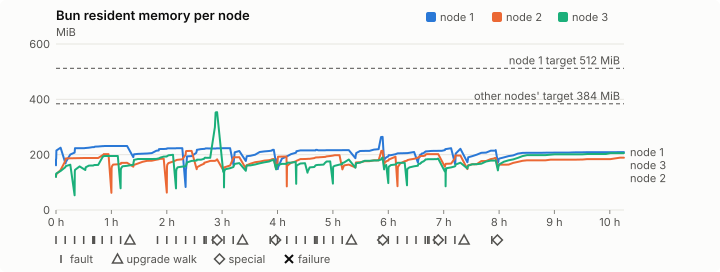
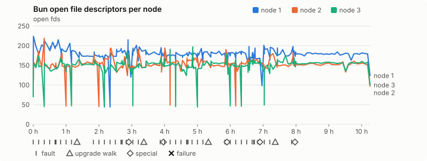
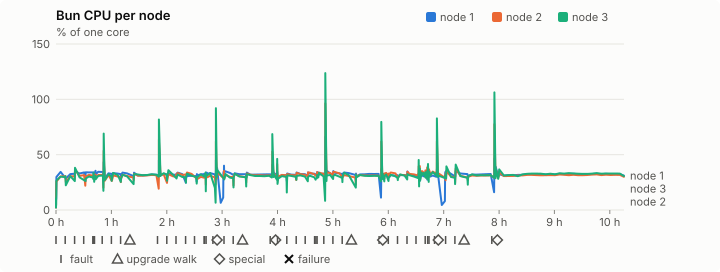
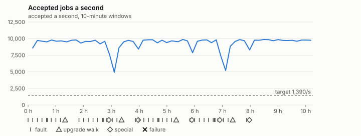

# Sustained soak (V02): PASS

11 November 2026. final tier, full schedule, 10 h 15 min of soak on a three-node quickstart cluster.

**Final job tier: clean. The release gate's final soak passes** for the candidate whose `candidate.json` has SHA-256 `d9d04a7708e06fb444e8ca880a73321539e2300f29bb141ba80e7781a4bbe9f8`, if it is the final candidate.

## Candidate and host

| | |
|---|---|
| Staged base URL | <https://github.com/reliaburger/reliaburger/releases/download/staging-v0.2.8-43017213259-1> |
| `candidate.json` SHA-256 | `d9d04a7708e06fb444e8ca880a73321539e2300f29bb141ba80e7781a4bbe9f8` |
| Running versions | v0.2.8 x3 |
| Soak build | `bun-v0.2.8-soak.1`, SHA-256 `9e8ec8795faee3e49cd4f2e0071fd92f8df215834f49b4833e2e24ed4e764da0` |
| Walks roll back to | 0.2.8 |
| Host | macOS 27.2, Apple M5 Max, 128 GiB |
| Lima | limactl version 2.2.1 |
| Guest | Ubuntu 24.04.5 LTS, kernel 6.8.0-139-generic |
| RELIABURGER_HOME | `/tmp/rbq.esFdtl` |
| Evidence | `/Users/miko/github/rb-wt/gate-028-c3/qual/ev-jobs-final` |

## Configuration deviations

- node.toml `[testing] allowed_operations` adds `provision_isolated_workloads` (quickstart allows only inject_workload_faults and alter_node_state), so the catalogue pulse can lease test namespaces
- node.toml `[logs]`/`[metrics]` export to file:///var/lib/reliaburger/soak-export every 60 s with max_storage_mb = 8 (the harness deletes a metrics export 30 minutes after its source has gone), `[storage.snapshots]` every 900 s (compressed: 120 s), retain 4, uploaded to the same directory
- node.toml `[ingress] tls_cert/tls_key` point at an operator pair from a soak CA, 45-minute leaves rotated by the harness
- Bun runs with auto/mixed; host jobs opt in to a single pinned BusyBox copy under /var/lib/reliaburger/soak-jobs, mount_isolation=false. The independent verifier listens on each private VM address, TCP 8189, with a separate run token
- node.toml `[node.labels] soak-volume` = "writer" on node 2 and "redis" on node 3, to pin the volume apps
- node.toml `[upgrades] external_signing_key` = a throwaway operator key the harness made for this run (`ed25519:+vna4YNEXjUdRRvHjYE053rDugUVbc0uzyLnIGY3Crc=`); the soak build's `.sig` gets that key's external signature beside the release one (D2)
- node.toml `[security] leaf_lifetime_override_secs = 3600` (D1)

## Timeline

- Started 2026-11-11 17:47:50 UTC, finished 2026-11-12 04:03:11 UTC
- Cycles completed: 8
- Fault and node choices: 35, from seed 1934107683 (`--seed 1934107683` repeats them)
- Teardown: `relish local destroy --yes` and `relish uninstall --yes` succeeded

## Faults and slots

| Class | Runs | Settled/ok | Failed | Skipped | Settle (median / max) |
|---|---|---|---|---|---|
| fault:bun-kill-follower | 8 | 8 | 0 | 0 | 33 s / 36 s |
| fault:bun-kill-leader | 8 | 8 | 0 | 0 | 34 s / 39 s |
| fault:chaos-cpu | 1 | 2 | 0 | 0 | 18 s / 18 s |
| fault:chaos-delay | 2 | 4 | 0 | 0 | 18 s / 18 s |
| fault:chaos-dns | 1 | 2 | 0 | 0 | 19 s / 19 s |
| fault:chaos-drop | 1 | 2 | 0 | 0 | 18 s / 18 s |
| fault:chaos-kill | 2 | 4 | 0 | 0 | 159 s / 159 s |
| fault:chaos-memory | 1 | 2 | 0 | 0 | 18 s / 18 s |
| fault:chaos-partition | 2 | 4 | 0 | 0 | 19 s / 19 s |
| fault:chaos-pause | 1 | 2 | 0 | 0 | 18 s / 18 s |
| fault:chaos-scenario | 1 | 2 | 0 | 0 | 32 s / 32 s |
| fault:deploy-kill | 4 | 4 | 0 | 0 | 35 s / 38 s |
| fault:node-delay | 3 | 3 | 0 | 0 | 33 s / 33 s |
| fault:node-disk-full | 3 | 3 | 0 | 0 | 18 s / 18 s |
| fault:node-slow-fsync | 2 | 2 | 0 | 0 | 20 s / 20 s |
| fault:power-off | 4 | 4 | 0 | 0 | 36 s / 285 s |
| pulse | 8 | 8 | 0 | 0 | n/a |
| pulse:settle | 0 | 8 | 0 | 0 | 18 s / 19 s |
| special:all-off | 1 | 1 | 0 | 0 | 32 s / 32 s |
| special:graceful-stop | 2 | 2 | 0 | 0 | 59 s / 59 s |
| special:quorum-back | 2 | 2 | 0 | 0 | n/a |
| special:quorum-loss | 2 | 2 | 0 | 0 | 54 s / 54 s |
| storage:offline-export | 1 | 1 | 0 | 0 | n/a |
| storage:registry-push | 8 | 0 | 0 | 0 | n/a |
| tls:invalid-expired | 15 | 15 | 0 | 0 | n/a |
| tls:invalid-torn | 15 | 15 | 0 | 0 | n/a |
| tls:reload | 118 | 118 | 0 | 0 | n/a |
| upgrade:rollback | 4 | 4 | 0 | 0 | n/a |
| upgrade:settle | 0 | 4 | 0 | 0 | 58 s / 68 s |
| upgrade:upgrade | 4 | 4 | 0 | 0 | n/a |

## Execution inventory (gated)

What the run completed, from its events and kept bytes, against what its schedule owes. A fault counts once it was injected and the cluster settled after it.

| Item | Required | Completed | Verdict |
|---|---|---|---|
| candidate.json bytes match the qualified digest | 1 | 1 | ok |
| app workloads settled at the baseline | 1 | 1 | ok |
| upgrade walk (to the soak build and back) | 4 | 4 | ok |
| fault:bun-kill-follower | 1 | 8 | ok |
| fault:bun-kill-leader | 1 | 8 | ok |
| fault:deploy-kill | 1 | 4 | ok |
| fault:power-off | 1 | 4 | ok |
| fault:chaos-kill | 1 | 2 | ok |
| fault:chaos-delay | 1 | 2 | ok |
| fault:chaos-partition | 1 | 2 | ok |
| fault:chaos-scenario | 1 | 1 | ok |
| fault:chaos-pause | 1 | 1 | ok |
| fault:chaos-drop | 1 | 1 | ok |
| fault:chaos-dns | 1 | 1 | ok |
| fault:chaos-cpu | 1 | 1 | ok |
| fault:chaos-memory | 1 | 1 | ok |
| fault:node-delay | 1 | 3 | ok |
| fault:node-disk-full | 1 | 3 | ok |
| fault:node-slow-fsync | 1 | 2 | ok |
| special:graceful-stop | 2 | 2 | ok |
| special:quorum-loss | 2 | 2 | ok |
| special:all-off | 1 | 1 | ok |
| catalogue pulse | 8 | 8 | ok |
| offline export | 1 | 1 | ok |
| quiet tail with no faults, walks or specials | 1 | 1 | ok |
| job campaign drained in its final two minutes | 1 | 1 | ok |

## Observed fault effects

What each injected fault was seen to do, read back from the node.

| Fault | Target | Observed |
|---|---|---|
| effect:bun-kill-follower | rb-e6a93f66715b-2 | MainPID 2986 -> 5518 |
| effect:bun-kill-leader | rb-e6a93f66715b-1 | MainPID 9143 -> 2166710 |
| effect:deploy-kill | rb-e6a93f66715b-3 | MainPID 2730 -> 829654 |
| effect:power-off | rb-e6a93f66715b-3 | Lima status Stopped |
| effect:node-delay | rb-e6a93f66715b-1 | netem 8001: root refcnt 2 limit 1000 delay 200ms  50ms  |
| effect:bun-kill-follower | rb-e6a93f66715b-2 | MainPID 5518 -> 2613275 |
| effect:bun-kill-leader | rb-e6a93f66715b-3 | MainPID 679 -> 1704868 |
| effect:node-disk-full | rb-e6a93f66715b-2 | available 67072000 bytes  |
| effect:bun-kill-follower | rb-e6a93f66715b-2 | MainPID 2613275 -> 685592 |
| effect:bun-kill-leader | rb-e6a93f66715b-3 | MainPID 243616 -> 211511 |
| effect:deploy-kill | rb-e6a93f66715b-1 | MainPID 2166710 -> 582951 |
| effect:power-off | rb-e6a93f66715b-2 | Lima status Stopped |
| effect:node-slow-fsync | rb-e6a93f66715b-3 | IOWriteBandwidthMax=/dev/vda 1000000 IOWriteIOPSMax=/dev/vda 20  |
| effect:bun-kill-follower | rb-e6a93f66715b-3 | MainPID 681 -> 250598 |
| effect:bun-kill-leader | rb-e6a93f66715b-1 | MainPID 582951 -> 3267841 |
| effect:node-delay | rb-e6a93f66715b-2 | netem 8001: root refcnt 2 limit 1000 delay 200ms  50ms  |
| effect:bun-kill-follower | rb-e6a93f66715b-1 | MainPID 682 -> 414705 |
| effect:bun-kill-leader | rb-e6a93f66715b-2 | MainPID 677 -> 3025975 |
| effect:deploy-kill | rb-e6a93f66715b-3 | MainPID 682 -> 1419450 |
| effect:power-off | rb-e6a93f66715b-3 | Lima status Stopped |
| effect:node-disk-full | rb-e6a93f66715b-3 | available 67022848 bytes  |
| effect:bun-kill-follower | rb-e6a93f66715b-3 | MainPID 683 -> 2572942 |
| effect:bun-kill-leader | rb-e6a93f66715b-2 | MainPID 3025975 -> 1727141 |
| effect:node-slow-fsync | rb-e6a93f66715b-1 | IOWriteBandwidthMax=/dev/vda 1000000 IOWriteIOPSMax=/dev/vda 20  |
| effect:bun-kill-follower | rb-e6a93f66715b-3 | MainPID 683 -> 1194285 |
| effect:bun-kill-leader | rb-e6a93f66715b-2 | MainPID 687 -> 3662608 |
| effect:deploy-kill | rb-e6a93f66715b-3 | MainPID 1194285 -> 2254337 |
| effect:power-off | rb-e6a93f66715b-1 | Lima status Stopped |
| effect:node-delay | rb-e6a93f66715b-3 | netem 8001: root refcnt 2 limit 1000 delay 200ms  50ms  |
| effect:bun-kill-follower | rb-e6a93f66715b-3 | MainPID 680 -> 215427 |
| effect:bun-kill-leader | rb-e6a93f66715b-1 | MainPID 684 -> 4110139 |
| effect:node-disk-full | rb-e6a93f66715b-1 | available 67051520 bytes  |

## Renewals and rotations

| Measure | Observed | Required | Verdict |
|---|---|---|---|
| workload identity rotations (soak-identity, per node) | 24 | ≥ 19 | PASS |
| node leaf renewals (per node) | 22 | ≥ 19 | PASS |
| operator ingress reloads (all nodes) | 118 | ≥ 40 | PASS |
| mixed job campaign and positive drain | 0 missing/failing checks | 0 | PASS |

## Latency SLOs

What a user should feel on a quiet three-node cluster (#1400). Every sample is taken outside fault windows and through a host forward that works; each p99 is the upper bound of its histogram bucket.

| SLO | p99 | Threshold | Samples | Mode | Verdict |
|---|---|---|---|---|---|
| API read p99 | 150 ms | ≤ 1,000 ms | 6,336 | record only | PASS |
| API write p99 | 1,500 ms | ≤ 2,000 ms | 20 | record only | PASS |
| App start p99 | 1 ms | ≤ 5,000 ms | 60 | record only | PASS |
| Rolling update p99 | 30,000 ms | ≤ 30,000 ms | 20 | record only | PASS |
| Job task start p99 | 32 ms | ≤ 256 ms | 213,544,346 | gated | PASS |

- API read p99: `GET /v1/status?cluster=true` and `GET /v1/cluster/nodes` on every node, at every light check
- API write p99: `relish apply` of the soak workloads, from the call to the commit
- App start p99: each node's deploy of a new `soak-identity` instance, from its start to the instance running
- Rolling update p99: from `relish apply` returning to every node's `soak-identity` running the new spec
- Job task start p99: a job task's start lag on a pooled executor, from the job campaign's buckets, in runs no fault window overlapped
- Record only from 28 October 2026 (#1400): no soak before 0.2.4 measured it. The threshold is provisional; the first 0.2.4 fast and final records set the gate.

## Jobs

| Runtime | Accepted successes | Retries | Last accepted progress |
|---|---|---|---|
| runc | 100508 | 1 | 1794456173 |
| shared-runc | 90746113 | 1 | 1794456173 |
| process | 252838023 | 1 | 1794456173 |

The bounded campaign shares the app soak's fault schedule. These counts are reliability evidence, not a saturation rate or a 100-million-per-day qualification.

- Independent verifier execution attempts: 24
- Explicit test-operator acknowledgements for known replay-safe fenced fixtures: 200

- rb-e6a93f66715b-1: latest complete job storage (KiB) {'instances': 2780, 'job-state': 8, 'task-arrays': 21220}; free 5001556 KiB; live/peak owners 0/32; peak storage {'instances': 24804, 'job-state': 8, 'task-arrays': 52616}
- rb-e6a93f66715b-2: latest complete job storage (KiB) {'instances': 1428, 'job-state': 8, 'task-arrays': 21980}; free 6023136 KiB; live/peak owners 0/32; peak storage {'instances': 25288, 'job-state': 8, 'task-arrays': 53668}
- rb-e6a93f66715b-3: latest complete job storage (KiB) {'instances': 596, 'job-state': 8, 'task-arrays': 21352}; free 5552988 KiB; live/peak owners 0/32; peak storage {'instances': 24264, 'job-state': 8, 'task-arrays': 51888}

Complete disk inventories are recorded. Global retention bounds and the 12-hour job qualification remain #668; this gate cannot certify an unimplemented retention policy.

## Job qualification (D18-C)

Load: target; 3 nodes; accepted 9,311.2/s against a 1390.0/s target: PASS.

The September plan set its targets for one 1M-task batch on a quiet cluster. A soak runs for hours with restarts, upgrades and apps, so its storage, Bun memory and Raft targets are restated (maintainer decision, 15 October 2026, [#668](https://github.com/reliaburger/reliaburger/issues/668)). Bun's steady state is the median RSS of each process once it has been seen for 10 minutes; the gated memory checks are unchanged (`leak-rss`, and Mayo's 70% `memory_high` alert through `wtf`).

| Measure (recorded, not gated) | Observed | Target |
|---|---|---|
| Wall time of a 1,048,576-task array (median / max of 64) | 145 s / 411 s | ≤ 600 s |
| p99 start lag, pooled executors | 32 ms (bucket upper bound) | < 1,000 ms |
| Raft entries per second, all cluster writes | 5.21 | recorded only; the batch target counts only task-array writes |
| Raft state of one run, largest seen | 16,274 B | ≤ 256 KiB per 1M tasks |
| Bun steady-state RSS per process, worst node against its target | rb-e6a93f66715b-2: 208.41 MiB steady, 214.08 MiB peak | ≤ 384 MiB (≤ 512 MiB on node 1, which serves the API) |
| Bun CPU, busiest node | 0.31 cores | ≤ 1 core (leader batch control) |
| Executor helper CPU, busiest node | 0.03 cores | ≤ 0.5 core |
| Node task-array storage per 1M accepted tasks (peaks summed) | 0.45 MiB | ≤ 64 MiB, deleted after retirement |
| Retained log volume, all nodes | 27.28 MB | ≤ 50 MB |

- Bun RSS on rb-e6a93f66715b-1 (serves the API, target ≤ 512 MiB): pid 9143: 225.19 MiB peak (seen for under 10 minutes); pid 2166710: 231.04 MiB steady, 231.42 MiB peak; pid 2166710: 220.83 MiB steady, 223.47 MiB peak; pid 582951: 222.71 MiB steady, 223.46 MiB peak; pid 3267841: 213.36 MiB peak (seen for under 10 minutes); pid 3267841: 215.18 MiB steady, 217.75 MiB peak; pid 682: 183.66 MiB peak (seen for under 10 minutes); pid 414705: 215.79 MiB steady, 217.29 MiB peak; pid 414705: 263.61 MiB steady, 264.35 MiB peak; pid 680: 205.45 MiB steady, 209.74 MiB peak; pid 684: 213.57 MiB steady, 223.32 MiB peak; pid 4110139: 221.06 MiB peak (seen for under 10 minutes); pid 4110139: 214.24 MiB steady, 216.34 MiB peak; pid 685: 207.38 MiB steady, 209.38 MiB peak
- Bun RSS on rb-e6a93f66715b-2 (node, target ≤ 384 MiB): pid 2986: 127.21 MiB peak (seen for under 10 minutes); pid 5518: 187.94 MiB steady, 202.04 MiB peak; pid 2613275: 170.28 MiB steady, 170.42 MiB peak; pid 2613275: 183.41 MiB steady, 185.60 MiB peak; pid 685592: 191.12 MiB steady, 213.66 MiB peak; pid 685: 178.23 MiB steady, 183.32 MiB peak; pid 680: 190.39 MiB steady, 190.66 MiB peak; pid 680: 183.28 MiB steady, 184.36 MiB peak; pid 677: 193.20 MiB steady, 193.20 MiB peak; pid 3025975: 190.27 MiB steady, 198.13 MiB peak; pid 1727141: 164.13 MiB peak (seen for under 10 minutes); pid 1727141: 208.41 MiB steady, 214.08 MiB peak; pid 687: 192.72 MiB steady, 192.72 MiB peak; pid 3662608: 195.19 MiB steady, 202.20 MiB peak; pid 679: 197.01 MiB steady, 197.17 MiB peak; pid 679: 186.14 MiB steady, 188.05 MiB peak; pid 680: 181.85 MiB steady, 188.96 MiB peak
- Bun RSS on rb-e6a93f66715b-3 (node, target ≤ 384 MiB): pid 2730: 157.42 MiB steady, 163.68 MiB peak; pid 829654: 157.57 MiB peak (seen for under 10 minutes); pid 679: 195.05 MiB steady, 195.28 MiB peak; pid 1704868: 159.81 MiB peak (seen for under 10 minutes); pid 243616: 189.61 MiB steady, 199.46 MiB peak; pid 211511: 188.82 MiB steady, 353.54 MiB peak; pid 681: 144.90 MiB peak (seen for under 10 minutes); pid 250598: 158.80 MiB steady, 169.61 MiB peak; pid 250598: 179.67 MiB steady, 181.59 MiB peak; pid 682: 170.71 MiB steady, 173.91 MiB peak; pid 1419450: 169.04 MiB peak (seen for under 10 minutes); pid 683: 167.42 MiB steady, 175.49 MiB peak; pid 2572942: 170.36 MiB steady, 182.66 MiB peak; pid 679: 182.68 MiB steady, 189.45 MiB peak; pid 683: 163.19 MiB peak (seen for under 10 minutes); pid 1194285: 170.48 MiB steady, 170.71 MiB peak; pid 2254337: 182.48 MiB steady, 185.62 MiB peak; pid 680: 149.36 MiB peak (seen for under 10 minutes); pid 215427: 159.02 MiB steady, 171.09 MiB peak; pid 215427: 178.56 MiB steady, 179.38 MiB peak; pid 678: 201.43 MiB steady, 205.74 MiB peak

- runc retry causes: exit_code 1, launch 0, signal 0, timeout 0, unknown 0, unrecorded 0
- shared-runc retry causes: exit_code 1, launch 0, signal 0, timeout 0, unknown 0, unrecorded 0
- process retry causes: exit_code 1, launch 0, signal 0, timeout 0, unknown 0, unrecorded 0
- Audited executions: 24; operator replay decisions: 200
- Job controller API fallbacks: rb-e6a93f66715b-1 missed 687, rb-e6a93f66715b-2 missed 22; rb-e6a93f66715b-2 answered 665, rb-e6a93f66715b-3 answered 22 (requests a node didn't answer, and the node that took them instead)

## Data

- Volume writer: highest ACK 285844 in the log view; the writer file checks (writer-lost, writer-regression) decide data loss, and `*-log-order` failures are about the order the log view returned lines in
- Redis counter: highest INCR 32911 in the log view
- Export rb-e6a93f66715b-1: 255 source files, 640 at the destination
- Export rb-e6a93f66715b-2: 612 source files, 762 at the destination
- Export rb-e6a93f66715b-3: 303 source files, 420 at the destination
- Registry images pushed and re-verified: 9
- Agent-loop turns over the 1 s budget: rb-e6a93f66715b-1 0, rb-e6a93f66715b-2 0, rb-e6a93f66715b-3 0
- Soak policies checked in force: 316 times, policy generation 78 at the last check
- Guest clock steps by Lima's guest agent: rb-e6a93f66715b-1 5, rb-e6a93f66715b-2 7, rb-e6a93f66715b-3 9
- Checks evaluated: 1346 (heavy 125, light 1030, settle 191)
- Last observed progress: redis-counter 32911, writer-ack 285844

## Council history (linearizability)

Every test-lease grant, renew, read and release the history client made, checked against a model of the council's leases. A write with no answer may or may not have happened; the check allows both.

- Operations checked: 213407 of 213407, in 2 namespaces; 5324 writes had no answer
- Verdict: linearizable

## Leak-checker exposure (gated)

How long each leak checker could judge each node's Bun. `leak-rss` arms at its warm sample: 60 minutes into one process in a final, and otherwise at the first heavy check where the log and metrics stores are each 90% full, between 60 minutes and 6 hours in (#1417). `leak-fd` arms after 50 minutes; a restart, kill or upgrade exec starts the warm-up again. A final needs each armed for 60 minutes on every node, with one unbroken window of 30 (#1062); its quiet tail gives them that.

| Node | Checker | Armed | Longest armed window | Evaluated samples | Processes armed | Verdict |
|---|---|---|---|---|---|---|
| rb-e6a93f66715b-1 | leak-rss | 97 min | 74 min | 27 | 3 | ok |
| rb-e6a93f66715b-1 | leak-fd | 126 min | 84 min | 43 | 4 | ok |
| rb-e6a93f66715b-2 | leak-rss | 74 min | 74 min | 16 | 1 | ok |
| rb-e6a93f66715b-2 | leak-fd | 97 min | 84 min | 29 | 3 | ok |
| rb-e6a93f66715b-3 | leak-rss | 74 min | 74 min | 16 | 1 | ok |
| rb-e6a93f66715b-3 | leak-fd | 84 min | 84 min | 18 | 1 | ok |

- rb-e6a93f66715b-1: the last Bun process's `leak-rss` warm sample was 212,296 kB, 1:01 h:mm in.
- rb-e6a93f66715b-2: the last Bun process's `leak-rss` warm sample was 186,208 kB, 1:01 h:mm in.
- rb-e6a93f66715b-3: the last Bun process's `leak-rss` warm sample was 206,264 kB, 1:01 h:mm in.

## Resource trends

| Node | Measure | First | Last | Max |
|---|---|---|---|---|
| rb-e6a93f66715b-1 | disk_kb data | 1382720 | 1411056 | 1615864 |
| rb-e6a93f66715b-1 | disk_kb images | 342456 | 346844 | 464172 |
| rb-e6a93f66715b-1 | disk_kb logs | 44 | 8580 | 8924 |
| rb-e6a93f66715b-1 | disk_kb metrics | 48 | 8636 | 8892 |
| rb-e6a93f66715b-1 | disk_kb soak-export | 4 | 47208 | 47208 |
| rb-e6a93f66715b-1 | disk_kb volumes | 248 | 228 | 300 |
| rb-e6a93f66715b-1 | fd | 113 | 124 | 224 |
| rb-e6a93f66715b-1 | rss_anon_kb | 90480 | 134348 | 190720 |
| rb-e6a93f66715b-1 | rss_file_kb | 74904 | 80056 | 80608 |
| rb-e6a93f66715b-1 | rss_kb | 165384 | 214404 | 270692 |
| rb-e6a93f66715b-2 | disk_kb data | 71776 | 204720 | 454008 |
| rb-e6a93f66715b-2 | disk_kb images | 175368 | 350872 | 350872 |
| rb-e6a93f66715b-2 | disk_kb logs | 24 | 8732 | 8764 |
| rb-e6a93f66715b-2 | disk_kb metrics | 44 | 8492 | 9132 |
| rb-e6a93f66715b-2 | disk_kb soak-export | 4 | 22860 | 22860 |
| rb-e6a93f66715b-2 | disk_kb volumes | 16760 | 22940 | 22940 |
| rb-e6a93f66715b-2 | fd | 74 | 97 | 219 |
| rb-e6a93f66715b-2 | rss_anon_kb | 49984 | 114528 | 139056 |
| rb-e6a93f66715b-2 | rss_file_kb | 73508 | 78968 | 80356 |
| rb-e6a93f66715b-2 | rss_kb | 123492 | 193496 | 219220 |
| rb-e6a93f66715b-3 | disk_kb data | 234524 | 319852 | 658640 |
| rb-e6a93f66715b-3 | disk_kb images | 339124 | 363292 | 363292 |
| rb-e6a93f66715b-3 | disk_kb logs | 24 | 8532 | 8952 |
| rb-e6a93f66715b-3 | disk_kb metrics | 44 | 8452 | 8944 |
| rb-e6a93f66715b-3 | disk_kb soak-export | 4 | 27824 | 28640 |
| rb-e6a93f66715b-3 | disk_kb volumes | 16776 | 19148 | 19148 |
| rb-e6a93f66715b-3 | fd | 71 | 100 | 197 |
| rb-e6a93f66715b-3 | rss_anon_kb | 49348 | 130852 | 282512 |
| rb-e6a93f66715b-3 | rss_file_kb | 73188 | 79824 | 79840 |
| rb-e6a93f66715b-3 | rss_kb | 122536 | 210676 | 362028 |

## Bun memory by kind

From each node's `/proc/PID/smaps` at the settle and heavy checks (`memory.jsonl`, #1417). Sizes in MiB; arenas are glibc thread arenas, with the number of 64 MiB arena heaps in brackets. Time is h:mm since the node's first sample.

### rb-e6a93f66715b-1

| Time | Pid | RSS | Heap | Arenas | Stacks | Other anonymous | File | Threads |
|---|---|---|---|---|---|---|---|---|
| 0:00 | 9143 | 161.5 | 38.0 | 43.1 (1) | 3.4 | 0.1 | 76.9 | 63 |
| 1:00 | 2166710 | 231.4 | 78.9 | 63.8 (1) | 6.2 | 0.0 | 82.4 | 80 |
| 2:00 | 2166710 | 221.2 | 65.4 | 68.1 (2) | 6.0 | 0.0 | 81.8 | 122 |
| 3:01 | 582951 | 223.4 | 72.5 | 63.8 (1) | 4.3 | 0.6 | 82.2 | 79 |
| 4:00 | 682 | 183.7 | 50.1 | 48.6 (1) | 2.8 | 0.5 | 81.6 | 49 |
| 5:00 | 414705 | 216.2 | 65.7 | 64.0 (1) | 4.2 | 0.6 | 81.6 | 82 |
| 6:00 | 680 | 193.8 | 65.5 | 43.4 (1) | 3.3 | 0.0 | 81.5 | 60 |
| 7:01 | 684 | 216.4 | 68.9 | 60.2 (1) | 5.2 | 0.0 | 82.1 | 93 |
| 8:00 | 685 | 183.3 | 51.1 | 46.9 (1) | 2.9 | 0.9 | 81.6 | 52 |
| 9:01 | 685 | 207.3 | 60.2 | 60.9 (1) | 3.7 | 0.6 | 81.9 | 72 |
| 10:01 | 685 | 208.9 | 60.4 | 62.2 (1) | 3.7 | 0.6 | 81.9 | 72 |
| 10:15 | 685 | 209.4 | 60.5 | 62.6 (1) | 3.8 | 0.6 | 81.9 | 72 |

- rb-e6a93f66715b-1: **arenas** grew most after the first hour: +1.7 MiB over 1:14 h:mm (others, MiB: heap +0.3, stacks +0.1, other anonymous +0.0, file +0.0).
- rb-e6a93f66715b-1: no 6-hour RSS slope: the last Bun process (pid 685) ran for 2:16 h:mm.

### rb-e6a93f66715b-2

| Time | Pid | RSS | Heap | Arenas | Stacks | Other anonymous | File | Threads |
|---|---|---|---|---|---|---|---|---|
| 0:00 | 2986 | 120.6 | 28.8 | 14.2 (1) | 1.9 | 0.1 | 75.5 | 31 |
| 1:00 | 2613275 | 62.3 | 16.1 | 3.2 (1) | 0.9 | 0.0 | 42.1 | 19 |
| 2:00 | 685592 | 63.0 | 17.1 | 3.1 (1) | 0.5 | 0.0 | 42.2 | 10 |
| 3:01 | 680 | 143.7 | 29.8 | 30.9 (1) | 2.5 | 0.3 | 80.2 | 53 |
| 4:00 | 677 | 165.1 | 37.3 | 43.3 (1) | 2.5 | 1.0 | 81.0 | 45 |
| 5:00 | 3025975 | 196.8 | 61.1 | 50.5 (1) | 3.0 | 0.0 | 82.2 | 59 |
| 6:00 | 687 | 178.8 | 48.1 | 45.2 (1) | 3.9 | 0.0 | 81.6 | 85 |
| 7:01 | 679 | 156.0 | 41.0 | 31.8 (1) | 2.8 | 0.0 | 80.4 | 55 |
| 8:00 | 680 | 161.6 | 40.7 | 37.0 (1) | 2.4 | 0.9 | 80.5 | 43 |
| 9:01 | 680 | 181.8 | 48.5 | 49.0 (1) | 2.8 | 0.6 | 80.8 | 53 |
| 10:01 | 680 | 183.8 | 49.9 | 49.6 (1) | 2.8 | 0.6 | 80.8 | 53 |
| 10:15 | 680 | 189.0 | 52.5 | 52.0 (1) | 3.0 | 0.6 | 80.8 | 57 |

- rb-e6a93f66715b-2: **arenas** grew most after the first hour: +17.8 MiB over 2:16 h:mm (others, MiB: heap +15.1, stacks +0.9, other anonymous -0.0, file +2.7).
- rb-e6a93f66715b-2: RSS slope over the last 6 hours: +11.35 MiB/h (least squares; recorded, not gated).

### rb-e6a93f66715b-3

| Time | Pid | RSS | Heap | Arenas | Stacks | Other anonymous | File | Threads |
|---|---|---|---|---|---|---|---|---|
| 0:00 | 2730 | 119.7 | 28.3 | 14.1 (1) | 1.9 | 0.1 | 75.2 | 28 |
| 1:00 | 679 | 195.1 | 55.6 | 55.3 (1) | 3.2 | 0.0 | 80.9 | 67 |
| 2:00 | 243616 | 193.2 | 63.2 | 44.7 (1) | 3.6 | 0.0 | 81.7 | 80 |
| 3:01 | 681 | 137.9 | 33.2 | 25.0 (1) | 2.2 | 0.0 | 77.5 | 46 |
| 4:00 | 682 | 163.0 | 39.3 | 38.6 (1) | 3.5 | 1.1 | 80.4 | 73 |
| 5:00 | 2572942 | 95.3 | 25.6 | 3.1 (1) | 0.8 | 0.0 | 65.9 | 15 |
| 6:00 | 1194285 | 97.2 | 22.9 | 7.0 (1) | 1.4 | 0.0 | 65.8 | 31 |
| 7:01 | 680 | 138.8 | 32.7 | 26.1 (1) | 2.3 | 0.0 | 77.7 | 47 |
| 8:00 | 678 | 159.0 | 39.0 | 37.9 (1) | 2.7 | 0.9 | 78.6 | 52 |
| 9:01 | 678 | 201.4 | 61.6 | 53.1 (1) | 4.5 | 0.6 | 81.7 | 96 |
| 10:01 | 678 | 205.7 | 62.6 | 56.3 (1) | 4.5 | 0.6 | 81.7 | 96 |
| 10:15 | 678 | 205.7 | 62.6 | 56.3 (1) | 4.5 | 0.6 | 81.7 | 96 |

- rb-e6a93f66715b-3: **arenas** grew most after the first hour: +3.3 MiB over 1:14 h:mm (others, MiB: heap +1.0, stacks +0.0, other anonymous +0.0, file +0.0).
- rb-e6a93f66715b-3: no 6-hour RSS slope: the last Bun process (pid 678) ran for 2:16 h:mm.

## Agent loop stalls

From the stall watchdog's journal blocks (`loop-stalls.jsonl`, #1707). Each snapshot lists every Bun thread; here are the stall line, threads in uninterruptible sleep and the thread that ran the loop.

- None recorded.

## Charts

Time runs from the start of the soak. The marks under each chart are its faults, upgrade walks, specials and recorded failures; the dashed lines are targets.

## Failures

None.

Evidence: `/Users/miko/github/rb-wt/gate-028-c3/qual/ev-jobs-final` (events.jsonl, snapshots/, failures/<n>/).
