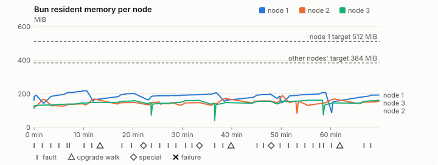
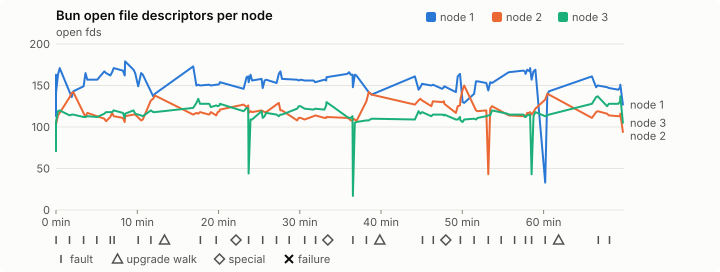
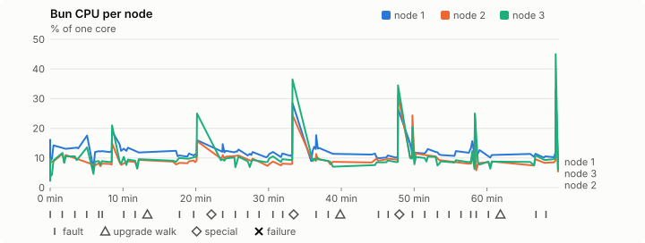
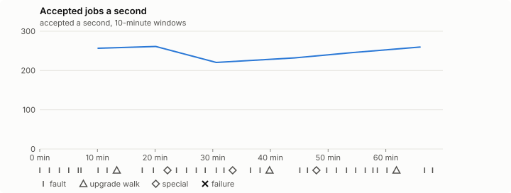

# Sustained soak (V02): PASS

11 November 2026. fast tier, compressed schedule, 1 h 09 min of soak on a three-node quickstart cluster.

**Fast tier: clean.** The iteration loop only, not acceptance: the V02 gate needs a clean final-tier run (8 h, full schedule) on the final candidate.

## Candidate and host

| | |
|---|---|
| Staged base URL | <https://github.com/reliaburger/reliaburger/releases/download/staging-v0.2.8-43017213259-1> |
| `candidate.json` SHA-256 | `d9d04a7708e06fb444e8ca880a73321539e2300f29bb141ba80e7781a4bbe9f8` |
| Running versions | v0.2.8 x3 |
| Soak build | `bun-v0.2.8-soak.1`, SHA-256 `9e8ec8795faee3e49cd4f2e0071fd92f8df215834f49b4833e2e24ed4e764da0` |
| Walks roll back to | 0.2.8 |
| Host | macOS 27.2, Apple M5 Max, 128 GiB |
| Lima | limactl version 2.2.1 |
| Guest | Ubuntu 24.04.5 LTS, kernel 6.8.0-139-generic |
| RELIABURGER_HOME | `/tmp/rbq.GAi7Zj` |
| Evidence | `/Users/miko/github/rb-wt/gate-028-c3/qual/ev-v02-fast-seed-3139726783` |

## Configuration deviations

- node.toml `[testing] allowed_operations` adds `provision_isolated_workloads` (quickstart allows only inject_workload_faults and alter_node_state), so the catalogue pulse can lease test namespaces
- node.toml `[logs]`/`[metrics]` export to file:///var/lib/reliaburger/soak-export every 60 s with max_storage_mb = 8 (the harness deletes a metrics export 30 minutes after its source has gone), `[storage.snapshots]` every 900 s (compressed: 120 s), retain 4, uploaded to the same directory
- node.toml `[ingress] tls_cert/tls_key` point at an operator pair from a soak CA, 45-minute leaves rotated by the harness
- Bun runs with auto/mixed; host jobs opt in to a single pinned BusyBox copy under /var/lib/reliaburger/soak-jobs, mount_isolation=false. The independent verifier listens on each private VM address, TCP 8189, with a separate run token
- node.toml `[node.labels] soak-volume` = "writer" on node 2 and "redis" on node 3, to pin the volume apps
- node.toml `[upgrades] external_signing_key` = a throwaway operator key the harness made for this run (`ed25519:+Dzbeh4abhTJXNIkP8XrckAL0nqMh6i05v3RhaF91Z4=`); the soak build's `.sig` gets that key's external signature beside the release one (D2)
- node.toml `[security] leaf_lifetime_override_secs = 3600` (D1)

## Timeline

- Started 2026-11-11 16:33:37 UTC, finished 2026-11-11 17:43:31 UTC
- Cycles completed: 6
- Fault and node choices: 26, from seed 3139726783 (`--seed 3139726783` repeats them)
- Teardown: `relish local destroy --yes` and `relish uninstall --yes` succeeded

## Faults and slots

| Class | Runs | Settled/ok | Failed | Skipped | Settle (median / max) |
|---|---|---|---|---|---|
| fault:bun-kill-follower | 6 | 6 | 0 | 0 | 30 s / 37 s |
| fault:bun-kill-leader | 6 | 6 | 0 | 0 | 31 s / 42 s |
| fault:chaos-cpu | 1 | 2 | 0 | 0 | 16 s / 16 s |
| fault:chaos-delay | 2 | 4 | 0 | 0 | 16 s / 16 s |
| fault:chaos-dns | 1 | 2 | 0 | 0 | 15 s / 15 s |
| fault:chaos-drop | 1 | 2 | 0 | 0 | 15 s / 15 s |
| fault:chaos-kill | 2 | 4 | 0 | 0 | 34 s / 34 s |
| fault:chaos-memory | 1 | 2 | 0 | 0 | 16 s / 16 s |
| fault:chaos-partition | 2 | 4 | 0 | 0 | 16 s / 16 s |
| fault:chaos-pause | 1 | 2 | 0 | 0 | 15 s / 15 s |
| fault:chaos-scenario | 1 | 2 | 0 | 0 | 27 s / 27 s |
| fault:deploy-kill | 3 | 3 | 0 | 0 | 30 s / 44 s |
| fault:power-off | 3 | 3 | 0 | 0 | 16 s / 28 s |
| pulse | 1 | 1 | 0 | 0 | n/a |
| pulse:settle | 0 | 1 | 0 | 0 | 15 s / 15 s |
| special:all-off | 1 | 1 | 0 | 0 | 33 s / 33 s |
| special:graceful-stop | 1 | 1 | 0 | 0 | 36 s / 36 s |
| special:quorum-back | 1 | 1 | 0 | 0 | n/a |
| special:quorum-loss | 1 | 1 | 0 | 0 | 40 s / 40 s |
| storage:offline-export | 3 | 3 | 0 | 0 | n/a |
| storage:registry-push | 6 | 0 | 0 | 0 | n/a |
| tls:invalid-expired | 3 | 3 | 0 | 0 | n/a |
| tls:invalid-torn | 6 | 6 | 0 | 0 | n/a |
| tls:reload | 33 | 33 | 0 | 0 | n/a |
| upgrade:rollback | 3 | 3 | 0 | 0 | n/a |
| upgrade:settle | 0 | 3 | 0 | 0 | 53 s / 55 s |
| upgrade:upgrade | 3 | 3 | 0 | 0 | n/a |

## Execution inventory (recorded, not gated)

What the run completed, from its events and kept bytes, against what its schedule owes. A fault counts once it was injected and the cluster settled after it.

| Item | Required | Completed | Verdict |
|---|---|---|---|
| candidate.json bytes match the qualified digest | 1 | 1 | ok |
| app workloads settled at the baseline | 1 | 1 | ok |
| upgrade walk (to the soak build and back) | 2 | 3 | ok |
| fault:bun-kill-follower | 1 | 6 | ok |
| fault:bun-kill-leader | 1 | 6 | ok |
| fault:deploy-kill | 1 | 3 | ok |
| fault:power-off | 1 | 3 | ok |
| fault:chaos-kill | 1 | 2 | ok |
| fault:chaos-delay | 1 | 2 | ok |
| fault:chaos-partition | 1 | 2 | ok |
| fault:chaos-scenario | 1 | 1 | ok |
| fault:chaos-pause | 1 | 1 | ok |
| fault:chaos-drop | 1 | 1 | ok |
| fault:chaos-dns | 1 | 1 | ok |
| fault:chaos-cpu | 1 | 1 | ok |
| special:graceful-stop | 1 | 1 | ok |
| special:quorum-loss | 1 | 1 | ok |
| special:all-off | 1 | 1 | ok |
| catalogue pulse | 1 | 1 | ok |
| offline export | 2 | 3 | ok |
| job campaign drained in its final two minutes | 1 | 1 | ok |

## Observed fault effects

What each injected fault was seen to do, read back from the node.

| Fault | Target | Observed |
|---|---|---|
| effect:bun-kill-follower | rb-42c3c21052e2-2 | MainPID 2987 -> 5284 |
| effect:bun-kill-leader | rb-42c3c21052e2-1 | MainPID 9382 -> 41358 |
| effect:deploy-kill | rb-42c3c21052e2-2 | MainPID 5284 -> 67981 |
| effect:power-off | rb-42c3c21052e2-2 | Lima status Stopped |
| effect:bun-kill-follower | rb-42c3c21052e2-2 | MainPID 684 -> 73864 |
| effect:bun-kill-leader | rb-42c3c21052e2-1 | MainPID 41358 -> 223823 |
| effect:bun-kill-follower | rb-42c3c21052e2-3 | MainPID 685 -> 17693 |
| effect:bun-kill-leader | rb-42c3c21052e2-2 | MainPID 683 -> 54768 |
| effect:deploy-kill | rb-42c3c21052e2-2 | MainPID 54768 -> 85798 |
| effect:power-off | rb-42c3c21052e2-2 | Lima status Stopped |
| effect:bun-kill-follower | rb-42c3c21052e2-3 | MainPID 682 -> 19447 |
| effect:bun-kill-leader | rb-42c3c21052e2-1 | MainPID 682 -> 273825 |
| effect:bun-kill-follower | rb-42c3c21052e2-1 | MainPID 684 -> 17696 |
| effect:bun-kill-leader | rb-42c3c21052e2-2 | MainPID 684 -> 50938 |
| effect:deploy-kill | rb-42c3c21052e2-2 | MainPID 50938 -> 85914 |
| effect:power-off | rb-42c3c21052e2-2 | Lima status Stopped |
| effect:bun-kill-follower | rb-42c3c21052e2-3 | MainPID 680 -> 166227 |
| effect:bun-kill-leader | rb-42c3c21052e2-1 | MainPID 17696 -> 207710 |

## Renewals and rotations

| Measure | Observed | Required | Verdict |
|---|---|---|---|
| workload identity rotations (soak-identity, per node) | 9 | ≥ 1 | PASS |
| node leaf renewals (per node) | 2 | ≥ 1 | PASS |
| operator ingress reloads (all nodes) | 33 | ≥ 12 | PASS |
| mixed job campaign and positive drain | 0 missing/failing checks | 0 | PASS |

## Latency SLOs

What a user should feel on a quiet three-node cluster (#1400). Every sample is taken outside fault windows and through a host forward that works; each p99 is the upper bound of its histogram bucket.

| SLO | p99 | Threshold | Samples | Mode | Verdict |
|---|---|---|---|---|---|
| API read p99 | 150 ms | ≤ 1,000 ms | 306 | record only | PASS |
| API write p99 | 1,500 ms | ≤ 2,000 ms | 8 | record only | PASS |
| App start p99 | 1 ms | ≤ 5,000 ms | 24 | record only | PASS |
| Rolling update p99 | 30,000 ms | ≤ 30,000 ms | 8 | record only | PASS |
| Job task start p99 | 1,024 ms | ≤ 256 ms | 20 | record only | too few samples |

- API read p99: `GET /v1/status?cluster=true` and `GET /v1/cluster/nodes` on every node, at every light check
- API write p99: `relish apply` of the soak workloads, from the call to the commit
- App start p99: each node's deploy of a new `soak-identity` instance, from its start to the instance running
- Rolling update p99: from `relish apply` returning to every node's `soak-identity` running the new spec
- Job task start p99: a job task's start lag on a pooled executor, from the job campaign's buckets, in runs no fault window overlapped
- Record only from 28 October 2026 (#1400): no soak before 0.2.4 measured it. The threshold is provisional; the first 0.2.4 fast and final records set the gate.
- Job task start p99 not judged: only 20 job task start samples, fewer than the 1,000 a p99 needs

## Jobs

| Runtime | Accepted successes | Retries | Last accepted progress |
|---|---|---|---|
| runc | 15363 | 1 | 1794419000 |
| shared-runc | 502261 | 1 | 1794419000 |
| process | 516815 | 1 | 1794419000 |

The bounded campaign shares the app soak's fault schedule. These counts are reliability evidence, not a saturation rate or a 100-million-per-day qualification.

- Independent verifier execution attempts: 24
- Explicit test-operator acknowledgements for known replay-safe fenced fixtures: 139

- rb-42c3c21052e2-1: latest complete job storage (KiB) {'instances': 300, 'job-state': 8, 'task-arrays': 7532}; free 5188004 KiB; live/peak owners 0/9; peak storage {'instances': 8076, 'job-state': 8, 'task-arrays': 16552}
- rb-42c3c21052e2-2: latest complete job storage (KiB) {'instances': 608, 'job-state': 8, 'task-arrays': 6996}; free 6276032 KiB; live/peak owners 0/8; peak storage {'instances': 7828, 'job-state': 8, 'task-arrays': 16144}
- rb-42c3c21052e2-3: latest complete job storage (KiB) {'instances': 2712, 'job-state': 8, 'task-arrays': 7076}; free 6318768 KiB; live/peak owners 0/8; peak storage {'instances': 7836, 'job-state': 8, 'task-arrays': 16460}

Complete disk inventories are recorded. Global retention bounds and the 12-hour job qualification remain #668; this gate cannot certify an unimplemented retention policy.

## Job qualification (D18-C)

Load: calibration; 3 nodes; accepted 246.8/s (calibration load: not gated).

The September plan set its targets for one 1M-task batch on a quiet cluster. A soak runs for hours with restarts, upgrades and apps, so its storage, Bun memory and Raft targets are restated (maintainer decision, 15 October 2026, [#668](https://github.com/reliaburger/reliaburger/issues/668)). Bun's steady state is the median RSS of each process once it has been seen for 10 minutes; the gated memory checks are unchanged (`leak-rss`, and Mayo's 70% `memory_high` alert through `wtf`).

| Measure (recorded, not gated) | Observed | Target |
|---|---|---|
| Wall time of a 1,048,576-task array (median / max of 0) | not measured / not measured | ≤ 600 s |
| p99 start lag, pooled executors | 2 ms (bucket upper bound) | < 1,000 ms |
| Raft entries per second, all cluster writes | 5.81 | recorded only; the batch target counts only task-array writes |
| Raft state of one run, largest seen | 44,166 B | ≤ 256 KiB per 1M tasks |
| Bun steady-state RSS per process, worst node against its target | rb-42c3c21052e2-1: 202.43 MiB steady, 217.54 MiB peak | ≤ 512 MiB (≤ 512 MiB on node 1, which serves the API) |
| Bun CPU, busiest node | 0.11 cores | ≤ 1 core (leader batch control) |
| Executor helper CPU, busiest node | 0.00 cores | ≤ 0.5 core |
| Node task-array storage per 1M accepted tasks (peaks summed) | 46.41 MiB | ≤ 64 MiB, deleted after retirement |
| Retained log volume, all nodes | 7.02 MB | ≤ 50 MB |

- Bun RSS on rb-42c3c21052e2-1 (serves the API, target ≤ 512 MiB): pid 9382: 191.48 MiB peak (seen for under 10 minutes); pid 41358: 217.54 MiB peak (seen for under 10 minutes); pid 223823: 165.16 MiB peak (seen for under 10 minutes); pid 266650: 202.92 MiB peak (seen for under 10 minutes); pid 682: 202.43 MiB steady, 205.80 MiB peak; pid 273825: 162.02 MiB peak (seen for under 10 minutes); pid 273825: 199.22 MiB peak (seen for under 10 minutes); pid 684: 185.70 MiB peak (seen for under 10 minutes); pid 17696: 207.03 MiB peak (seen for under 10 minutes); pid 207710: 154.14 MiB peak (seen for under 10 minutes); pid 207710: 192.63 MiB peak (seen for under 10 minutes)
- Bun RSS on rb-42c3c21052e2-2 (node, target ≤ 384 MiB): pid 2987: 124.28 MiB peak (seen for under 10 minutes); pid 5284: 166.39 MiB peak (seen for under 10 minutes); pid 67981: 130.07 MiB peak (seen for under 10 minutes); pid 684: 141.15 MiB peak (seen for under 10 minutes); pid 73864: 169.00 MiB peak (seen for under 10 minutes); pid 73864: 149.70 MiB peak (seen for under 10 minutes); pid 683: 151.40 MiB peak (seen for under 10 minutes); pid 54768: 143.86 MiB peak (seen for under 10 minutes); pid 85798: 148.25 MiB peak (seen for under 10 minutes); pid 683: 148.47 MiB peak (seen for under 10 minutes); pid 680: 171.33 MiB peak (seen for under 10 minutes); pid 680: 157.70 MiB peak (seen for under 10 minutes); pid 684: 189.62 MiB peak (seen for under 10 minutes); pid 50938: 156.12 MiB peak (seen for under 10 minutes); pid 85914: 154.76 MiB peak (seen for under 10 minutes); pid 683: 169.66 MiB peak (seen for under 10 minutes); pid 681: 155.43 MiB peak (seen for under 10 minutes)
- Bun RSS on rb-42c3c21052e2-3 (node, target ≤ 384 MiB): pid 2743: 147.15 MiB steady, 148.95 MiB peak; pid 2743: 160.37 MiB peak (seen for under 10 minutes); pid 685: 148.96 MiB peak (seen for under 10 minutes); pid 17693: 161.55 MiB peak (seen for under 10 minutes); pid 682: 142.70 MiB peak (seen for under 10 minutes); pid 19447: 147.86 MiB peak (seen for under 10 minutes); pid 681: 155.50 MiB peak (seen for under 10 minutes); pid 680: 161.80 MiB peak (seen for under 10 minutes); pid 166227: 145.78 MiB peak (seen for under 10 minutes); pid 166227: 161.97 MiB peak (seen for under 10 minutes)

- runc retry causes: exit_code 1, launch 0, signal 0, timeout 0, unknown 0, unrecorded 0
- shared-runc retry causes: exit_code 1, launch 0, signal 0, timeout 0, unknown 0, unrecorded 0
- process retry causes: exit_code 1, launch 0, signal 0, timeout 0, unknown 0, unrecorded 0
- Audited executions: 24; operator replay decisions: 139
- Job controller API fallbacks: rb-42c3c21052e2-1 missed 102, rb-42c3c21052e2-2 missed 20; rb-42c3c21052e2-2 answered 82, rb-42c3c21052e2-3 answered 20 (requests a node didn't answer, and the node that took them instead)

## Data

- Volume writer: highest ACK 27782 in the log view; the writer file checks (writer-lost, writer-regression) decide data loss, and `*-log-order` failures are about the order the log view returned lines in
- Redis counter: highest INCR 3367 in the log view
- Export rb-42c3c21052e2-1: 138 source files, 129 at the destination
- Export rb-42c3c21052e2-2: 137 source files, 128 at the destination
- Export rb-42c3c21052e2-3: 105 source files, 105 at the destination
- Registry images pushed and re-verified: 7
- Agent-loop turns over the 1 s budget: rb-42c3c21052e2-1 0, rb-42c3c21052e2-2 0, rb-42c3c21052e2-3 0
- Soak policies checked in force: 117 times, policy generation 39 at the last check
- Guest clock steps by Lima's guest agent: rb-42c3c21052e2-1 1, rb-42c3c21052e2-2 5, rb-42c3c21052e2-3 4
- Checks evaluated: 186 (heavy 17, light 69, settle 100)
- Last observed progress: redis-counter 3367, writer-ack 27782

## Council history (linearizability)

Every test-lease grant, renew, read and release the history client made, checked against a model of the council's leases. A write with no answer may or may not have happened; the check allows both.

- Operations checked: 21501 of 21501, in 2 namespaces; 1571 writes had no answer
- Verdict: linearizable

## Leak-checker exposure (recorded, not gated)

How long each leak checker could judge each node's Bun. `leak-rss` arms at its warm sample: 60 minutes into one process in a final, and otherwise at the first heavy check where the log and metrics stores are each 90% full, between 60 minutes and 6 hours in (#1417). `leak-fd` arms after 50 minutes; a restart, kill or upgrade exec starts the warm-up again. A final needs each armed for 60 minutes on every node, with one unbroken window of 30 (#1062); its quiet tail gives them that.

| Node | Checker | Armed | Longest armed window | Evaluated samples | Processes armed | Verdict |
|---|---|---|---|---|---|---|
| rb-42c3c21052e2-1 | leak-rss | 0 min | 0 min | 0 | 0 | short |
| rb-42c3c21052e2-1 | leak-fd | 0 min | 0 min | 0 | 0 | short |
| rb-42c3c21052e2-2 | leak-rss | 0 min | 0 min | 0 | 0 | short |
| rb-42c3c21052e2-2 | leak-fd | 0 min | 0 min | 0 | 0 | short |
| rb-42c3c21052e2-3 | leak-rss | 0 min | 0 min | 0 | 0 | short |
| rb-42c3c21052e2-3 | leak-fd | 0 min | 0 min | 0 | 0 | short |

## Resource trends

| Node | Measure | First | Last | Max |
|---|---|---|---|---|
| rb-42c3c21052e2-1 | disk_kb data | 1382848 | 945116 | 1536420 |
| rb-42c3c21052e2-1 | disk_kb images | 342456 | 464200 | 464200 |
| rb-42c3c21052e2-1 | disk_kb logs | 44 | 4676 | 4676 |
| rb-42c3c21052e2-1 | disk_kb metrics | 52 | 5392 | 5392 |
| rb-42c3c21052e2-1 | disk_kb soak-export | 4 | 9476 | 9476 |
| rb-42c3c21052e2-1 | disk_kb volumes | 248 | 72 | 300 |
| rb-42c3c21052e2-1 | fd | 113 | 127 | 179 |
| rb-42c3c21052e2-1 | rss_anon_kb | 90704 | 117604 | 142788 |
| rb-42c3c21052e2-1 | rss_file_kb | 74980 | 79652 | 80292 |
| rb-42c3c21052e2-1 | rss_kb | 165684 | 197256 | 222760 |
| rb-42c3c21052e2-2 | disk_kb data | 71808 | 93820 | 559868 |
| rb-42c3c21052e2-2 | disk_kb images | 175368 | 342492 | 342492 |
| rb-42c3c21052e2-2 | disk_kb logs | 32 | 1092 | 1092 |
| rb-42c3c21052e2-2 | disk_kb metrics | 40 | 2240 | 2240 |
| rb-42c3c21052e2-2 | disk_kb soak-export | 4 | 3828 | 3828 |
| rb-42c3c21052e2-2 | disk_kb volumes | 16760 | 17392 | 17392 |
| rb-42c3c21052e2-2 | fd | 71 | 94 | 150 |
| rb-42c3c21052e2-2 | rss_anon_kb | 47656 | 80788 | 114444 |
| rb-42c3c21052e2-2 | rss_file_kb | 73508 | 78372 | 79732 |
| rb-42c3c21052e2-2 | rss_kb | 121164 | 159160 | 194176 |
| rb-42c3c21052e2-3 | disk_kb data | 234556 | 721560 | 735664 |
| rb-42c3c21052e2-3 | disk_kb images | 339124 | 339220 | 339220 |
| rb-42c3c21052e2-3 | disk_kb logs | 28 | 1076 | 1084 |
| rb-42c3c21052e2-3 | disk_kb metrics | 40 | 2868 | 2868 |
| rb-42c3c21052e2-3 | disk_kb soak-export | 4 | 5024 | 5024 |
| rb-42c3c21052e2-3 | disk_kb volumes | 16784 | 17260 | 17260 |
| rb-42c3c21052e2-3 | fd | 71 | 105 | 137 |
| rb-42c3c21052e2-3 | rss_anon_kb | 43944 | 87168 | 87168 |
| rb-42c3c21052e2-3 | rss_file_kb | 73060 | 78692 | 79972 |
| rb-42c3c21052e2-3 | rss_kb | 117004 | 165860 | 165860 |

## Bun memory by kind

From each node's `/proc/PID/smaps` at the settle and heavy checks (`memory.jsonl`, #1417). Sizes in MiB; arenas are glibc thread arenas, with the number of 64 MiB arena heaps in brackets. Time is h:mm since the node's first sample.

### rb-42c3c21052e2-1

| Time | Pid | RSS | Heap | Arenas | Stacks | Other anonymous | File | Threads |
|---|---|---|---|---|---|---|---|---|
| 0:00 | 9382 | 161.8 | 37.3 | 44.5 (1) | 2.9 | 0.1 | 77.0 | 53 |
| 1:00 | 207710 | 84.6 | 6.3 | 3.2 (1) | 0.6 | 0.1 | 64.0 | 10 |
| 1:10 | 207710 | 192.6 | 62.3 | 45.5 (1) | 2.7 | 0.7 | 81.5 | 53 |

- rb-42c3c21052e2-1: not enough data: the last Bun process (pid 207710) has no samples after its first hour.
- rb-42c3c21052e2-1: no 6-hour RSS slope: the last Bun process (pid 207710) ran for 0:09 h:mm.

### rb-42c3c21052e2-2

| Time | Pid | RSS | Heap | Arenas | Stacks | Other anonymous | File | Threads |
|---|---|---|---|---|---|---|---|---|
| 0:00 | 2987 | 118.3 | 5.2 | 35.7 (1) | 1.8 | 0.2 | 75.5 | 28 |
| 1:00 | 683 | 165.1 | 42.4 | 38.5 (1) | 2.2 | 0.8 | 81.1 | 38 |
| 1:10 | 681 | 155.4 | 44.8 | 27.2 (1) | 2.5 | 0.7 | 80.3 | 52 |

- rb-42c3c21052e2-2: not enough data: the last Bun process (pid 681) has no samples after its first hour.
- rb-42c3c21052e2-2: no 6-hour RSS slope: the last Bun process (pid 681) ran for 0:03 h:mm.

### rb-42c3c21052e2-3

| Time | Pid | RSS | Heap | Arenas | Stacks | Other anonymous | File | Threads |
|---|---|---|---|---|---|---|---|---|
| 0:00 | 2743 | 114.3 | 5.2 | 32.0 (1) | 1.9 | 0.2 | 75.1 | 29 |
| 1:00 | 166227 | 144.4 | 29.6 | 31.8 (1) | 2.2 | 0.6 | 80.1 | 45 |
| 1:10 | 166227 | 162.0 | 38.6 | 38.1 (1) | 4.0 | 0.7 | 80.6 | 78 |

- rb-42c3c21052e2-3: not enough data: the last Bun process (pid 166227) has no samples after its first hour.
- rb-42c3c21052e2-3: no 6-hour RSS slope: the last Bun process (pid 166227) ran for 0:11 h:mm.

## Agent loop stalls

From the stall watchdog's journal blocks (`loop-stalls.jsonl`, #1707). Each snapshot lists every Bun thread; here are the stall line, threads in uninterruptible sleep and the thread that ran the loop.

- None recorded.

## Charts

Time runs from the start of the soak. The marks under each chart are its faults, upgrade walks, specials and recorded failures; the dashed lines are targets.

## Failures

None.

Evidence: `/Users/miko/github/rb-wt/gate-028-c3/qual/ev-v02-fast-seed-3139726783` (events.jsonl, snapshots/, failures/<n>/).
