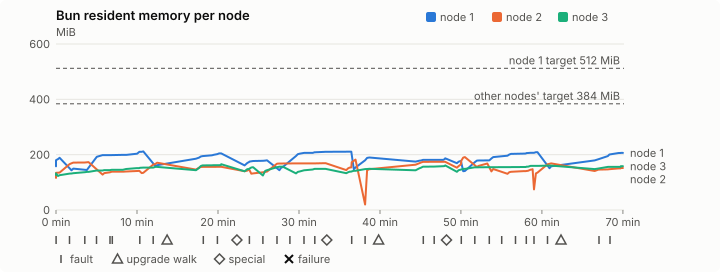
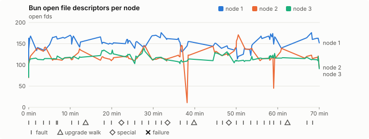
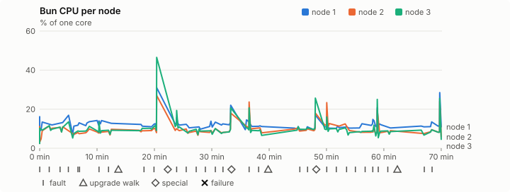
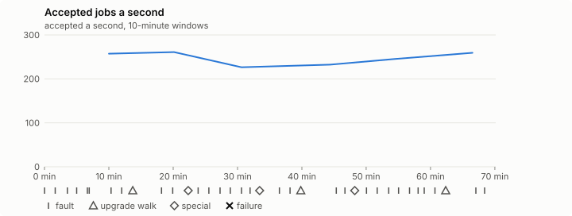

# Sustained soak (V02): PASS

11 November 2026. fast tier, compressed schedule, 1 h 10 min of soak on a three-node quickstart cluster.

**Fast tier: clean.** The iteration loop only, not acceptance: the V02 gate needs a clean final-tier run (8 h, full schedule) on the final candidate.

## Candidate and host

| | |
|---|---|
| Staged base URL | <https://github.com/reliaburger/reliaburger/releases/download/staging-v0.2.8-43017213259-1> |
| `candidate.json` SHA-256 | `d9d04a7708e06fb444e8ca880a73321539e2300f29bb141ba80e7781a4bbe9f8` |
| Running versions | v0.2.8 x3 |
| Soak build | `bun-v0.2.8-soak.1`, SHA-256 `9e8ec8795faee3e49cd4f2e0071fd92f8df215834f49b4833e2e24ed4e764da0` |
| Walks roll back to | 0.2.8 |
| Host | macOS 27.2, Apple M5 Max, 128 GiB |
| Lima | limactl version 2.2.1 |
| Guest | Ubuntu 24.04.5 LTS, kernel 6.8.0-139-generic |
| RELIABURGER_HOME | `/tmp/rbq.iU8DT7` |
| Evidence | `/Users/miko/github/rb-wt/gate-028-c3/qual/ev-v02-fast` |

## Configuration deviations

- node.toml `[testing] allowed_operations` adds `provision_isolated_workloads` (quickstart allows only inject_workload_faults and alter_node_state), so the catalogue pulse can lease test namespaces
- node.toml `[logs]`/`[metrics]` export to file:///var/lib/reliaburger/soak-export every 60 s with max_storage_mb = 8 (the harness deletes a metrics export 30 minutes after its source has gone), `[storage.snapshots]` every 900 s (compressed: 120 s), retain 4, uploaded to the same directory
- node.toml `[ingress] tls_cert/tls_key` point at an operator pair from a soak CA, 45-minute leaves rotated by the harness
- Bun runs with auto/mixed; host jobs opt in to a single pinned BusyBox copy under /var/lib/reliaburger/soak-jobs, mount_isolation=false. The independent verifier listens on each private VM address, TCP 8189, with a separate run token
- node.toml `[node.labels] soak-volume` = "writer" on node 2 and "redis" on node 3, to pin the volume apps
- node.toml `[upgrades] external_signing_key` = a throwaway operator key the harness made for this run (`ed25519:hNF7yie6uf/JOZ+ieFRaRR0JWH3rJ3ChTGxVD8CqBa4=`); the soak build's `.sig` gets that key's external signature beside the release one (D2)
- node.toml `[security] leaf_lifetime_override_secs = 3600` (D1)

## Timeline

- Started 2026-11-11 14:10:12 UTC, finished 2026-11-11 15:20:20 UTC
- Cycles completed: 6
- Fault and node choices: 26, from seed 323793498 (`--seed 323793498` repeats them)
- Teardown: `relish local destroy --yes` and `relish uninstall --yes` succeeded

## Faults and slots

| Class | Runs | Settled/ok | Failed | Skipped | Settle (median / max) |
|---|---|---|---|---|---|
| fault:bun-kill-follower | 6 | 6 | 0 | 0 | 29 s / 30 s |
| fault:bun-kill-leader | 6 | 6 | 0 | 0 | 32 s / 39 s |
| fault:chaos-cpu | 1 | 2 | 0 | 0 | 15 s / 15 s |
| fault:chaos-delay | 2 | 4 | 0 | 0 | 16 s / 16 s |
| fault:chaos-dns | 1 | 2 | 0 | 0 | 15 s / 15 s |
| fault:chaos-drop | 1 | 2 | 0 | 0 | 15 s / 15 s |
| fault:chaos-kill | 2 | 4 | 0 | 0 | 46 s / 46 s |
| fault:chaos-memory | 1 | 2 | 0 | 0 | 15 s / 15 s |
| fault:chaos-partition | 2 | 4 | 0 | 0 | 15 s / 15 s |
| fault:chaos-pause | 1 | 2 | 0 | 0 | 15 s / 15 s |
| fault:chaos-scenario | 1 | 2 | 0 | 0 | 28 s / 28 s |
| fault:deploy-kill | 3 | 3 | 0 | 0 | 31 s / 45 s |
| fault:power-off | 3 | 3 | 0 | 0 | 29 s / 30 s |
| pulse | 1 | 1 | 0 | 0 | n/a |
| pulse:settle | 0 | 1 | 0 | 0 | 19 s / 19 s |
| special:all-off | 1 | 1 | 0 | 0 | 32 s / 32 s |
| special:graceful-stop | 1 | 1 | 0 | 0 | 35 s / 35 s |
| special:quorum-back | 1 | 1 | 0 | 0 | n/a |
| special:quorum-loss | 1 | 1 | 0 | 0 | 39 s / 39 s |
| storage:offline-export | 3 | 3 | 0 | 0 | n/a |
| storage:registry-push | 6 | 0 | 0 | 0 | n/a |
| tls:invalid-expired | 3 | 3 | 0 | 0 | n/a |
| tls:invalid-torn | 6 | 6 | 0 | 0 | n/a |
| tls:reload | 33 | 33 | 0 | 0 | n/a |
| upgrade:rollback | 3 | 3 | 0 | 0 | n/a |
| upgrade:settle | 0 | 3 | 0 | 0 | 52 s / 57 s |
| upgrade:upgrade | 3 | 3 | 0 | 0 | n/a |

## Execution inventory (recorded, not gated)

What the run completed, from its events and kept bytes, against what its schedule owes. A fault counts once it was injected and the cluster settled after it.

| Item | Required | Completed | Verdict |
|---|---|---|---|
| candidate.json bytes match the qualified digest | 1 | 1 | ok |
| app workloads settled at the baseline | 1 | 1 | ok |
| upgrade walk (to the soak build and back) | 2 | 3 | ok |
| fault:bun-kill-follower | 1 | 6 | ok |
| fault:bun-kill-leader | 1 | 6 | ok |
| fault:deploy-kill | 1 | 3 | ok |
| fault:power-off | 1 | 3 | ok |
| fault:chaos-kill | 1 | 2 | ok |
| fault:chaos-delay | 1 | 2 | ok |
| fault:chaos-partition | 1 | 2 | ok |
| fault:chaos-scenario | 1 | 1 | ok |
| fault:chaos-pause | 1 | 1 | ok |
| fault:chaos-drop | 1 | 1 | ok |
| fault:chaos-dns | 1 | 1 | ok |
| fault:chaos-cpu | 1 | 1 | ok |
| special:graceful-stop | 1 | 1 | ok |
| special:quorum-loss | 1 | 1 | ok |
| special:all-off | 1 | 1 | ok |
| catalogue pulse | 1 | 1 | ok |
| offline export | 2 | 3 | ok |
| job campaign drained in its final two minutes | 1 | 1 | ok |

## Observed fault effects

What each injected fault was seen to do, read back from the node.

| Fault | Target | Observed |
|---|---|---|
| effect:bun-kill-follower | rb-4c67cff052a4-3 | MainPID 2741 -> 4462 |
| effect:bun-kill-leader | rb-4c67cff052a4-1 | MainPID 9390 -> 41920 |
| effect:deploy-kill | rb-4c67cff052a4-1 | MainPID 41920 -> 79504 |
| effect:power-off | rb-4c67cff052a4-2 | Lima status Stopped |
| effect:bun-kill-follower | rb-4c67cff052a4-2 | MainPID 683 -> 81689 |
| effect:bun-kill-leader | rb-4c67cff052a4-1 | MainPID 79504 -> 229610 |
| effect:bun-kill-follower | rb-4c67cff052a4-2 | MainPID 680 -> 17963 |
| effect:bun-kill-leader | rb-4c67cff052a4-3 | MainPID 682 -> 49294 |
| effect:deploy-kill | rb-4c67cff052a4-1 | MainPID 685 -> 83843 |
| effect:power-off | rb-4c67cff052a4-3 | Lima status Stopped |
| effect:bun-kill-follower | rb-4c67cff052a4-1 | MainPID 83843 -> 238690 |
| effect:bun-kill-leader | rb-4c67cff052a4-2 | MainPID 680 -> 66273 |
| effect:bun-kill-follower | rb-4c67cff052a4-1 | MainPID 685 -> 17574 |
| effect:bun-kill-leader | rb-4c67cff052a4-2 | MainPID 681 -> 55783 |
| effect:deploy-kill | rb-4c67cff052a4-2 | MainPID 55783 -> 94259 |
| effect:power-off | rb-4c67cff052a4-2 | Lima status Stopped |
| effect:bun-kill-follower | rb-4c67cff052a4-2 | MainPID 680 -> 59593 |
| effect:bun-kill-leader | rb-4c67cff052a4-1 | MainPID 17574 -> 208216 |

## Renewals and rotations

| Measure | Observed | Required | Verdict |
|---|---|---|---|
| workload identity rotations (soak-identity, per node) | 9 | ≥ 1 | PASS |
| node leaf renewals (per node) | 2 | ≥ 1 | PASS |
| operator ingress reloads (all nodes) | 33 | ≥ 13 | PASS |
| mixed job campaign and positive drain | 0 missing/failing checks | 0 | PASS |

## Latency SLOs

What a user should feel on a quiet three-node cluster (#1400). Every sample is taken outside fault windows and through a host forward that works; each p99 is the upper bound of its histogram bucket.

| SLO | p99 | Threshold | Samples | Mode | Verdict |
|---|---|---|---|---|---|
| API read p99 | 300 ms | ≤ 1,000 ms | 288 | record only | PASS |
| API write p99 | 2,000 ms | ≤ 2,000 ms | 9 | record only | PASS |
| App start p99 | 1 ms | ≤ 5,000 ms | 27 | record only | PASS |
| Rolling update p99 | 30,000 ms | ≤ 30,000 ms | 9 | record only | PASS |
| Job task start p99 | 1,024 ms | ≤ 256 ms | 20 | record only | too few samples |

- API read p99: `GET /v1/status?cluster=true` and `GET /v1/cluster/nodes` on every node, at every light check
- API write p99: `relish apply` of the soak workloads, from the call to the commit
- App start p99: each node's deploy of a new `soak-identity` instance, from its start to the instance running
- Rolling update p99: from `relish apply` returning to every node's `soak-identity` running the new spec
- Job task start p99: a job task's start lag on a pooled executor, from the job campaign's buckets, in runs no fault window overlapped
- Record only from 28 October 2026 (#1400): no soak before 0.2.4 measured it. The threshold is provisional; the first 0.2.4 fast and final records set the gate.
- Job task start p99 not judged: only 20 job task start samples, fewer than the 1,000 a p99 needs

## Jobs

| Runtime | Accepted successes | Retries | Last accepted progress |
|---|---|---|---|
| runc | 15614 | 1 | 1794410409 |
| shared-runc | 506738 | 1 | 1794410409 |
| process | 519696 | 1 | 1794410409 |

The bounded campaign shares the app soak's fault schedule. These counts are reliability evidence, not a saturation rate or a 100-million-per-day qualification.

- Independent verifier execution attempts: 24
- Explicit test-operator acknowledgements for known replay-safe fenced fixtures: 136

- rb-4c67cff052a4-1: latest complete job storage (KiB) {'instances': 2844, 'job-state': 8, 'task-arrays': 7328}; free 5187676 KiB; live/peak owners 0/10; peak storage {'instances': 8984, 'job-state': 8, 'task-arrays': 16948}
- rb-4c67cff052a4-2: latest complete job storage (KiB) {'instances': 608, 'job-state': 8, 'task-arrays': 7112}; free 6318352 KiB; live/peak owners 0/8; peak storage {'instances': 8656, 'job-state': 8, 'task-arrays': 16376}
- rb-4c67cff052a4-3: latest complete job storage (KiB) {'instances': 1168, 'job-state': 8, 'task-arrays': 7184}; free 6284980 KiB; live/peak owners 0/8; peak storage {'instances': 7848, 'job-state': 8, 'task-arrays': 16560}

Complete disk inventories are recorded. Global retention bounds and the 12-hour job qualification remain #668; this gate cannot certify an unimplemented retention policy.

## Job qualification (D18-C)

Load: calibration; 3 nodes; accepted 247.9/s (calibration load: not gated).

The September plan set its targets for one 1M-task batch on a quiet cluster. A soak runs for hours with restarts, upgrades and apps, so its storage, Bun memory and Raft targets are restated (maintainer decision, 15 October 2026, [#668](https://github.com/reliaburger/reliaburger/issues/668)). Bun's steady state is the median RSS of each process once it has been seen for 10 minutes; the gated memory checks are unchanged (`leak-rss`, and Mayo's 70% `memory_high` alert through `wtf`).

| Measure (recorded, not gated) | Observed | Target |
|---|---|---|
| Wall time of a 1,048,576-task array (median / max of 0) | not measured / not measured | ≤ 600 s |
| p99 start lag, pooled executors | 2 ms (bucket upper bound) | < 1,000 ms |
| Raft entries per second, all cluster writes | 5.95 | recorded only; the batch target counts only task-array writes |
| Raft state of one run, largest seen | 43,838 B | ≤ 256 KiB per 1M tasks |
| Bun steady-state RSS per process, worst node against its target | rb-4c67cff052a4-3: 160.46 MiB steady, 165.57 MiB peak | ≤ 384 MiB (≤ 512 MiB on node 1, which serves the API) |
| Bun CPU, busiest node | 0.11 cores | ≤ 1 core (leader batch control) |
| Executor helper CPU, busiest node | 0.00 cores | ≤ 0.5 core |
| Node task-array storage per 1M accepted tasks (peaks summed) | 46.75 MiB | ≤ 64 MiB, deleted after retirement |
| Retained log volume, all nodes | 7.01 MB | ≤ 50 MB |

- Bun RSS on rb-4c67cff052a4-1 (serves the API, target ≤ 512 MiB): pid 9390: 188.60 MiB peak (seen for under 10 minutes); pid 41920: 149.54 MiB peak (seen for under 10 minutes); pid 79504: 211.69 MiB peak (seen for under 10 minutes); pid 229610: 161.89 MiB peak (seen for under 10 minutes); pid 274241: 204.45 MiB peak (seen for under 10 minutes); pid 685: 179.77 MiB peak (seen for under 10 minutes); pid 83843: 210.66 MiB peak (seen for under 10 minutes); pid 238690: 189.60 MiB peak (seen for under 10 minutes); pid 238690: 186.79 MiB peak (seen for under 10 minutes); pid 685: 177.41 MiB peak (seen for under 10 minutes); pid 17574: 208.82 MiB peak (seen for under 10 minutes); pid 208216: 157.83 MiB peak (seen for under 10 minutes); pid 208216: 206.54 MiB peak (seen for under 10 minutes)
- Bun RSS on rb-4c67cff052a4-2 (node, target ≤ 384 MiB): pid 2993: 173.00 MiB peak (seen for under 10 minutes); pid 683: 141.50 MiB peak (seen for under 10 minutes); pid 81689: 170.93 MiB peak (seen for under 10 minutes); pid 81689: 156.07 MiB peak (seen for under 10 minutes); pid 680: 147.63 MiB peak (seen for under 10 minutes); pid 17963: 169.34 MiB peak (seen for under 10 minutes); pid 680: 182.13 MiB peak (seen for under 10 minutes); pid 66273: 147.43 MiB peak (seen for under 10 minutes); pid 66273: 174.34 MiB peak (seen for under 10 minutes); pid 681: 191.35 MiB peak (seen for under 10 minutes); pid 55783: 168.15 MiB peak (seen for under 10 minutes); pid 94259: 148.05 MiB peak (seen for under 10 minutes); pid 680: 147.30 MiB peak (seen for under 10 minutes); pid 59593: 168.49 MiB peak (seen for under 10 minutes); pid 683: 151.84 MiB peak (seen for under 10 minutes)
- Bun RSS on rb-4c67cff052a4-3 (node, target ≤ 384 MiB): pid 2741: 132.37 MiB peak (seen for under 10 minutes); pid 4462: 153.31 MiB steady, 155.73 MiB peak; pid 4462: 165.57 MiB peak (seen for under 10 minutes); pid 682: 154.80 MiB peak (seen for under 10 minutes); pid 49294: 156.56 MiB peak (seen for under 10 minutes); pid 683: 148.68 MiB peak (seen for under 10 minutes); pid 686: 148.93 MiB peak (seen for under 10 minutes); pid 686: 161.07 MiB peak (seen for under 10 minutes); pid 683: 160.46 MiB steady, 160.46 MiB peak; pid 683: 158.29 MiB peak (seen for under 10 minutes)

- runc retry causes: exit_code 1, launch 0, signal 0, timeout 0, unknown 0, unrecorded 0
- shared-runc retry causes: exit_code 1, launch 0, signal 0, timeout 0, unknown 0, unrecorded 0
- process retry causes: exit_code 1, launch 0, signal 0, timeout 0, unknown 0, unrecorded 0
- Audited executions: 24; operator replay decisions: 136
- Job controller API fallbacks: rb-4c67cff052a4-1 missed 146, rb-4c67cff052a4-2 missed 2; rb-4c67cff052a4-2 answered 144, rb-4c67cff052a4-3 answered 2 (requests a node didn't answer, and the node that took them instead)

## Data

- Volume writer: highest ACK 28329 in the log view; the writer file checks (writer-lost, writer-regression) decide data loss, and `*-log-order` failures are about the order the log view returned lines in
- Redis counter: highest INCR 3297 in the log view
- Export rb-4c67cff052a4-1: 134 source files, 125 at the destination
- Export rb-4c67cff052a4-2: 142 source files, 107 at the destination
- Export rb-4c67cff052a4-3: 112 source files, 101 at the destination
- Registry images pushed and re-verified: 7
- Agent-loop turns over the 1 s budget: rb-4c67cff052a4-1 0, rb-4c67cff052a4-2 0, rb-4c67cff052a4-3 0
- Soak policies checked in force: 117 times, policy generation 42 at the last check
- Guest clock steps by Lima's guest agent: rb-4c67cff052a4-1 1, rb-4c67cff052a4-2 6, rb-4c67cff052a4-3 5
- Checks evaluated: 183 (heavy 17, light 66, settle 100)
- Last observed progress: redis-counter 3297, writer-ack 28329

## Council history (linearizability)

Every test-lease grant, renew, read and release the history client made, checked against a model of the council's leases. A write with no answer may or may not have happened; the check allows both.

- Operations checked: 21661 of 21661, in 2 namespaces; 1557 writes had no answer
- Verdict: linearizable

## Leak-checker exposure (recorded, not gated)

How long each leak checker could judge each node's Bun. `leak-rss` arms at its warm sample: 60 minutes into one process in a final, and otherwise at the first heavy check where the log and metrics stores are each 90% full, between 60 minutes and 6 hours in (#1417). `leak-fd` arms after 50 minutes; a restart, kill or upgrade exec starts the warm-up again. A final needs each armed for 60 minutes on every node, with one unbroken window of 30 (#1062); its quiet tail gives them that.

| Node | Checker | Armed | Longest armed window | Evaluated samples | Processes armed | Verdict |
|---|---|---|---|---|---|---|
| rb-4c67cff052a4-1 | leak-rss | 0 min | 0 min | 0 | 0 | short |
| rb-4c67cff052a4-1 | leak-fd | 0 min | 0 min | 0 | 0 | short |
| rb-4c67cff052a4-2 | leak-rss | 0 min | 0 min | 0 | 0 | short |
| rb-4c67cff052a4-2 | leak-fd | 0 min | 0 min | 0 | 0 | short |
| rb-4c67cff052a4-3 | leak-rss | 0 min | 0 min | 0 | 0 | short |
| rb-4c67cff052a4-3 | leak-fd | 0 min | 0 min | 0 | 0 | short |

## Resource trends

| Node | Measure | First | Last | Max |
|---|---|---|---|---|
| rb-4c67cff052a4-1 | disk_kb data | 1382876 | 1467992 | 1536060 |
| rb-4c67cff052a4-1 | disk_kb images | 342468 | 464232 | 464232 |
| rb-4c67cff052a4-1 | disk_kb logs | 44 | 4480 | 4480 |
| rb-4c67cff052a4-1 | disk_kb metrics | 56 | 4736 | 4736 |
| rb-4c67cff052a4-1 | disk_kb soak-export | 4 | 8548 | 8548 |
| rb-4c67cff052a4-1 | disk_kb volumes | 248 | 276 | 300 |
| rb-4c67cff052a4-1 | fd | 106 | 152 | 176 |
| rb-4c67cff052a4-1 | rss_anon_kb | 86844 | 131844 | 136796 |
| rb-4c67cff052a4-1 | rss_file_kb | 74788 | 79652 | 80292 |
| rb-4c67cff052a4-1 | rss_kb | 161632 | 211496 | 216768 |
| rb-4c67cff052a4-2 | disk_kb data | 71816 | 92652 | 624168 |
| rb-4c67cff052a4-2 | disk_kb images | 122424 | 342464 | 342464 |
| rb-4c67cff052a4-2 | disk_kb logs | 32 | 1300 | 1300 |
| rb-4c67cff052a4-2 | disk_kb metrics | 44 | 2500 | 2500 |
| rb-4c67cff052a4-2 | disk_kb soak-export | 4 | 3712 | 3712 |
| rb-4c67cff052a4-2 | disk_kb volumes | 16760 | 17484 | 17484 |
| rb-4c67cff052a4-2 | fd | 70 | 94 | 171 |
| rb-4c67cff052a4-2 | rss_anon_kb | 45436 | 76852 | 116112 |
| rb-4c67cff052a4-2 | rss_file_kb | 73500 | 78628 | 79860 |
| rb-4c67cff052a4-2 | rss_kb | 118936 | 155480 | 195944 |
| rb-4c67cff052a4-3 | disk_kb data | 234568 | 196596 | 724796 |
| rb-4c67cff052a4-3 | disk_kb images | 339124 | 342432 | 342432 |
| rb-4c67cff052a4-3 | disk_kb logs | 28 | 1068 | 1068 |
| rb-4c67cff052a4-3 | disk_kb metrics | 44 | 2964 | 2964 |
| rb-4c67cff052a4-3 | disk_kb soak-export | 4 | 4492 | 4492 |
| rb-4c67cff052a4-3 | disk_kb volumes | 16776 | 17044 | 17172 |
| rb-4c67cff052a4-3 | fd | 71 | 91 | 139 |
| rb-4c67cff052a4-3 | rss_anon_kb | 56236 | 83656 | 91104 |
| rb-4c67cff052a4-3 | rss_file_kb | 73380 | 78436 | 79588 |
| rb-4c67cff052a4-3 | rss_kb | 129616 | 162092 | 169540 |

## Bun memory by kind

From each node's `/proc/PID/smaps` at the settle and heavy checks (`memory.jsonl`, #1417). Sizes in MiB; arenas are glibc thread arenas, with the number of 64 MiB arena heaps in brackets. Time is h:mm since the node's first sample.

### rb-4c67cff052a4-1

| Time | Pid | RSS | Heap | Arenas | Stacks | Other anonymous | File | Threads |
|---|---|---|---|---|---|---|---|---|
| 0:00 | 9390 | 157.8 | 43.2 | 35.2 (1) | 2.6 | 0.1 | 76.8 | 44 |
| 1:00 | 17574 | 208.8 | 21.8 | 100.8 (2) | 4.0 | 0.0 | 82.1 | 75 |
| 1:10 | 208216 | 206.5 | 69.2 | 52.3 (1) | 2.9 | 0.6 | 81.5 | 58 |

- rb-4c67cff052a4-1: not enough data: the last Bun process (pid 208216) has no samples after its first hour.
- rb-4c67cff052a4-1: no 6-hour RSS slope: the last Bun process (pid 208216) ran for 0:09 h:mm.

### rb-4c67cff052a4-2

| Time | Pid | RSS | Heap | Arenas | Stacks | Other anonymous | File | Threads |
|---|---|---|---|---|---|---|---|---|
| 0:00 | 2993 | 116.1 | 25.5 | 13.1 (1) | 1.9 | 0.2 | 75.5 | 32 |
| 1:00 | 59593 | 135.1 | 25.8 | 28.9 (1) | 2.2 | 0.2 | 78.0 | 40 |
| 1:10 | 683 | 151.8 | 41.7 | 26.6 (1) | 2.4 | 0.6 | 80.5 | 46 |

- rb-4c67cff052a4-2: **heap** grew most after the first hour: +6.6 MiB over 0:03 h:mm (others, MiB: arenas +3.7, stacks +0.3, other anonymous +0.1, file +0.1).
- rb-4c67cff052a4-2: no 6-hour RSS slope: the last Bun process (pid 683) ran for 1:04 h:mm.

### rb-4c67cff052a4-3

| Time | Pid | RSS | Heap | Arenas | Stacks | Other anonymous | File | Threads |
|---|---|---|---|---|---|---|---|---|
| 0:00 | 2741 | 126.6 | 5.0 | 44.0 (1) | 1.9 | 0.2 | 75.4 | 34 |
| 1:00 | 683 | 159.6 | 39.5 | 36.8 (1) | 2.6 | 0.0 | 80.6 | 44 |
| 1:10 | 683 | 158.3 | 40.9 | 33.6 (1) | 2.8 | 0.6 | 80.3 | 60 |

- rb-4c67cff052a4-3: not enough data: the last Bun process (pid 683) has no samples after its first hour.
- rb-4c67cff052a4-3: no 6-hour RSS slope: the last Bun process (pid 683) ran for 0:40 h:mm.

## Agent loop stalls

From the stall watchdog's journal blocks (`loop-stalls.jsonl`, #1707). Each snapshot lists every Bun thread; here are the stall line, threads in uninterruptible sleep and the thread that ran the loop.

- None recorded.

## Charts

Time runs from the start of the soak. The marks under each chart are its faults, upgrade walks, specials and recorded failures; the dashed lines are targets.

## Failures

None.

Evidence: `/Users/miko/github/rb-wt/gate-028-c3/qual/ev-v02-fast` (events.jsonl, snapshots/, failures/<n>/).
