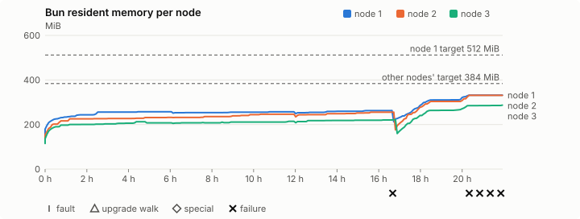
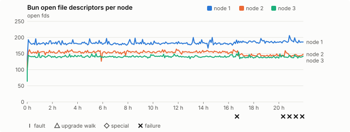
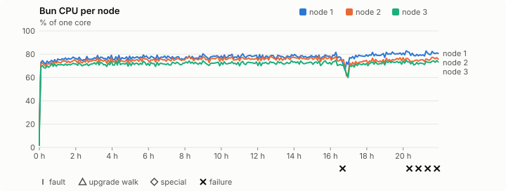
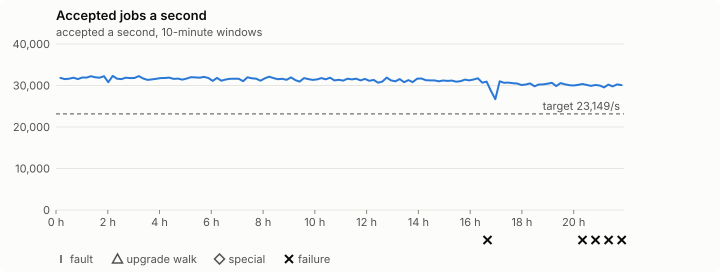

# Sustained soak (V02): FAIL

12 November 2026. day tier, no fault schedule, 21 h 56 min of soak on a three-node quickstart cluster.

**Day tier: not clean.** The day run doesn't hold; the record says what failed. It is incomplete too: it ran for 21 h 56 min, not a whole day.

> **What this run was for: whether Bun's memory levels off over a day on
> the published 0.2.8 ([#1417](https://github.com/reliaburger/reliaburger/issues/1417)),
> with two new diagnostics: malloc_stats and malloc_trim at hours 6, 12, 18
> and 24, and a log-store A/B on node 3. It can't answer that question.**
> Ubuntu's unattended upgrades restarted Bun on every node at hour
> 16.7–16.8, and the maintainer had the run stopped at 21 h 56 min and
> re-run with upgrades off: [the 14 November record](2026-11-14-v0.2.8-memory-run.md)
> is the one that counts.
>
> **The restarts.** At about 06:00 GMT on 13 November `apt-daily-upgrade`
> ran in each guest, upgraded packages (tzdata, glib, systemd, openssh and
> others) and needrestart restarted `reliaburger.service`: node 1 stopped
> at 06:03:49 and was back at 06:03:57 (hour 16.67), node 2 at 06:11:24 /
> 06:11:34 (16.80) and node 3 at 06:12:58 / 06:13:05 (16.82), after its
> systemd upgrade. The harness's own gdb install had run `apt-get update`
> in each guest, which most likely gave the upgrade a package list to work
> from; the 0.2.7 run never ran apt and its Buns lived the day. The harness
> now disables those timers in every tier and checks them before the
> baseline.
>
> **What the restarts broke.** Failure 1 (`ingress-http`, podinfo answered
> 000 at 06:03:51) is node 1's restart. Node 1's restart moved
> `soak-spammer` to node 2, so the log-store A/B is broken from hour 16.7.
> Failures 2–5 (`leak-rss` on node 2 from 09:44 GMT) judge node 2's second
> process, which ran with the spammer's store.
>
> **What hours 0–16.7 show.** The first processes are judged up to the
> restarts, with the hour-6 and hour-12 malloc points. Malloc's in-use bytes
> didn't grow from hour 6 to hour 12 (113.4 → 98.9, 105.9 → 104.9 and
> 97.2 → 93.1 MiB), while the free memory it kept did, and `malloc_trim(0)`
> gave 14–35 MiB back each time. Node 2 grew 2.2 MiB an hour to the restart,
> nodes 1 and 3 less. The 14 November run repeats this over a whole day.

## Candidate and host

| | |
|---|---|
| Staged base URL | <https://github.com/reliaburger/reliaburger/releases/download/v0.2.8> |
| `candidate.json` SHA-256 | `d9d04a7708e06fb444e8ca880a73321539e2300f29bb141ba80e7781a4bbe9f8` |
| Running versions | v0.2.8 x3 |
| Soak build | not supplied: upgrade slots skipped |
| Host | macOS 27.2, Apple M5 Max, 128 GiB |
| Lima | limactl version 2.2.1 |
| Guest | Ubuntu 24.04.5 LTS, kernel 6.8.0-139-generic |
| RELIABURGER_HOME | `/tmp/rbq.3i4lwY` |
| Evidence | `/Users/miko/github/rb-wt/mem-028/ev` |

## Configuration deviations

- Each quickstart VM resized from 2 vCPU / 2 GiB to 4 vCPU / 6 GiB before configuring, the size the scale-out record measured (maintainer decision, 27 October 2026)
- node.toml `[testing] allowed_operations` adds `provision_isolated_workloads` (quickstart allows only inject_workload_faults and alter_node_state), so the catalogue pulse can lease test namespaces
- node.toml `[logs]`/`[metrics]` export to file:///var/lib/reliaburger/soak-export every 60 s with max_storage_mb = 8 (the harness deletes a metrics export 30 minutes after its source has gone), `[storage.snapshots]` every 900 s (compressed: 120 s), retain 4, uploaded to the same directory
- node.toml `[ingress] tls_cert/tls_key` point at an operator pair from a soak CA, 45-minute leaves rotated by the harness
- Bun runs with auto/mixed; host jobs opt in to a single pinned BusyBox copy under /var/lib/reliaburger/soak-jobs, mount_isolation=false. The independent verifier listens on each private VM address, TCP 8189, with a separate run token
- node.toml `[node.labels] soak-volume` = "writer" on node 2 and "redis" on node 3, to pin the volume apps
- node.toml `[security] leaf_lifetime_override_secs = 3600` (D1)
- gdb installed in each guest (GNU gdb (Ubuntu 15.1-1ubuntu1~24.04.1) 15.1) for the malloc points: at hours 6, 12, 18 and 24 it attaches to Bun and calls `malloc_stats()` and `malloc_trim(0)` (#1417); a failure first seen inside an attach window, or up to 180 s after it, is put down to the attach (`EXCUSE_AFTER` in malloc_points.py)
- Log-store A/B (#1417): `soak-quiet` logs about 8 lines a second on node 3 (pinned by `soak-volume=redis`) and nothing queries it; `soak-redis-client` is pinned to node 1 (node.toml `[node.labels] soak-logs = "client"`); each check tails `soak-writer` and `soak-redis-client` through `/v1/logs/entries` on node 2 and node 1, the per-node query `relish logs` fans out to, so node 3's log store is never read
- Host jobs run Ubuntu's busybox-static 1:1.36.1-6ubuntu3.1 (`52151e7f…`), the scale-out record's binary, instead of the image's

## Timeline

- Started 2026-11-12 13:23:49 UTC, finished 2026-11-13 11:20:25 UTC
- Cycles completed: 0
- Fault and node choices: 0, from seed 3194345103 (`--seed 3194345103` repeats them)
- Teardown: `relish local destroy --yes` and `relish uninstall --yes` succeeded

## Faults and slots

| Class | Runs | Settled/ok | Failed | Skipped | Settle (median / max) |
|---|---|---|---|---|---|
| tls:invalid-expired | 30 | 30 | 0 | 0 | n/a |
| tls:invalid-torn | 33 | 33 | 0 | 0 | n/a |
| tls:reload | 261 | 261 | 0 | 0 | n/a |

## Execution inventory (gated)

What the run completed, from its events and kept bytes, against what its schedule owes. A fault counts once it was injected and the cluster settled after it.

| Item | Required | Completed | Verdict |
|---|---|---|---|
| candidate.json bytes match the qualified digest | 1 | 1 | ok |
| app workloads settled at the baseline | 1 | 1 | ok |
| job campaign drained in its final two minutes | 1 | 1 | ok |

## Renewals and rotations

| Measure | Observed | Required | Verdict |
|---|---|---|---|
| workload identity rotations (soak-identity, per node) | 44 | ≥ 42 | PASS |
| node leaf renewals (per node) | 48 | ≥ 42 | PASS |
| operator ingress reloads (all nodes) | 261 | ≥ 86 | PASS |
| mixed job campaign and positive drain | 5 missing/failing checks | 0 | FAIL |

## Latency SLOs

What a user should feel on a quiet three-node cluster (#1400). Every sample is taken outside fault windows and through a host forward that works; each p99 is the upper bound of its histogram bucket.

| SLO | p99 | Threshold | Samples | Mode | Verdict |
|---|---|---|---|---|---|
| API read p99 | 200 ms | ≤ 1,000 ms | 16,080 (2 failed) | record only | PASS |
| API write p99 | 1,500 ms | ≤ 2,000 ms | 44 | record only | PASS |
| App start p99 | 1 ms | ≤ 5,000 ms | 132 | record only | PASS |
| Rolling update p99 | 50,000 ms | ≤ 30,000 ms | 44 | record only | over (record only) |
| Job task start p99 | 8 ms | ≤ 256 ms | 2,458,844,000 | record only | PASS |

- API read p99: `GET /v1/status?cluster=true` and `GET /v1/cluster/nodes` on every node, at every light check
- API write p99: `relish apply` of the soak workloads, from the call to the commit
- App start p99: each node's deploy of a new `soak-identity` instance, from its start to the instance running
- Rolling update p99: from `relish apply` returning to every node's `soak-identity` running the new spec
- Job task start p99: a job task's start lag on a pooled executor, from the job campaign's buckets, in runs no fault window overlapped
- Record only from 28 October 2026 (#1400): no soak before 0.2.4 measured it. The threshold is provisional; the first 0.2.4 fast and final records set the gate.
- api-read failed call: rb-14ed3daacff1-1 /v1/status?cluster=true: ConnectionRefusedError: [Errno 61] Connection refused
- api-read failed call: rb-14ed3daacff1-1 /v1/cluster/nodes: ConnectionRefusedError: [Errno 61] Connection refused

## Jobs

| Runtime | Accepted successes | Retries | Last accepted progress |
|---|---|---|---|
| runc | 182544 | 1 | 1794568802 |
| shared-runc | 10010937 | 1 | 1794568802 |
| process | 2451770213 | 1 | 1794568802 |

The bounded campaign shares the app soak's fault schedule. These counts are reliability evidence, not a saturation rate or a 100-million-per-day qualification.

- shared-runc missing coverage: hook
- process missing coverage: hook
- rb-14ed3daacff1-1 lacks a complete empty owner inventory after campaign drain
- rb-14ed3daacff1-2 lacks a complete empty owner inventory after campaign drain
- rb-14ed3daacff1-3 lacks a complete empty owner inventory after campaign drain
- Independent verifier execution attempts: 24
- Explicit test-operator acknowledgements for known replay-safe fenced fixtures: 10

- rb-14ed3daacff1-1: latest complete job storage (KiB) {'instances': 27376, 'job-state': 8, 'task-arrays': 116164}; free 4287456 KiB; live/peak owners 34/37; peak storage {'instances': 29140, 'job-state': 8, 'task-arrays': 284092}
- rb-14ed3daacff1-2: latest complete job storage (KiB) {'instances': 25948, 'job-state': 8, 'task-arrays': 116120}; free 5167304 KiB; live/peak owners 34/34; peak storage {'instances': 28076, 'job-state': 8, 'task-arrays': 325940}
- rb-14ed3daacff1-3: latest complete job storage (KiB) {'instances': 25924, 'job-state': 8, 'task-arrays': 122296}; free 5326796 KiB; live/peak owners 34/34; peak storage {'instances': 27268, 'job-state': 8, 'task-arrays': 335880}

Complete disk inventories are recorded. Global retention bounds and the 12-hour job qualification remain #668; this gate cannot certify an unimplemented retention policy.

## Job qualification (D18-C)

Load: day; 3 nodes; accepted 31,171.6/s against a 23149.0/s target: PASS.

The September plan set its targets for one 1M-task batch on a quiet cluster. A soak runs for hours with restarts, upgrades and apps, so its storage, Bun memory and Raft targets are restated (maintainer decision, 15 October 2026, [#668](https://github.com/reliaburger/reliaburger/issues/668)). Bun's steady state is the median RSS of each process once it has been seen for 10 minutes; the gated memory checks are unchanged (`leak-rss`, and Mayo's 70% `memory_high` alert through `wtf`).

| Measure (recorded, not gated) | Observed | Target |
|---|---|---|
| Wall time of a 1,048,576-task array (median / max of 0) | not measured / not measured | ≤ 600 s |
| p99 start lag, pooled executors | 8 ms (bucket upper bound) | < 1,000 ms |
| Raft entries per second, all cluster writes | 5.05 | recorded only; the batch target counts only task-array writes |
| Raft state of one run, largest seen | 45,343 B | ≤ 256 KiB per 1M tasks |
| Bun steady-state RSS per process, worst node against its target | rb-14ed3daacff1-2: 303.62 MiB steady, 331.06 MiB peak | ≤ 384 MiB (≤ 512 MiB on node 1, which serves the API) |
| Bun CPU, busiest node | 0.78 cores | ≤ 1 core (leader batch control) |
| Executor helper CPU, busiest node | 0.30 cores | ≤ 0.5 core |
| Node task-array storage per 1M accepted tasks (peaks summed) | 0.38 MiB | ≤ 64 MiB, deleted after retirement |
| Retained log volume, all nodes | 29.06 MB | ≤ 50 MB |

- Bun RSS on rb-14ed3daacff1-1 (serves the API, target ≤ 512 MiB): pid 3494: 255.50 MiB steady, 262.70 MiB peak; pid 1005381: 310.53 MiB steady, 331.78 MiB peak
- Bun RSS on rb-14ed3daacff1-2 (node, target ≤ 384 MiB): pid 1820: 235.70 MiB steady, 255.59 MiB peak; pid 668576: 303.62 MiB steady, 331.06 MiB peak
- Bun RSS on rb-14ed3daacff1-3 (node, target ≤ 384 MiB): pid 1678: 211.07 MiB steady, 221.75 MiB peak; pid 1215187: 263.74 MiB steady, 286.81 MiB peak

- runc retry causes: exit_code 1, launch 0, signal 0, timeout 0, unknown 0, unrecorded 0
- shared-runc retry causes: exit_code 1, launch 0, signal 0, timeout 0, unknown 0, unrecorded 0
- process retry causes: exit_code 1, launch 0, signal 0, timeout 0, unknown 0, unrecorded 0
- Audited executions: 24; operator replay decisions: 10
- Job controller API fallbacks: rb-14ed3daacff1-1 missed 26; rb-14ed3daacff1-2 answered 26 (requests a node didn't answer, and the node that took them instead)

## Day run (#1032)

2,451,770,213 accepted host-job tasks in 21 h 56 min: 31,042.5/s against the 23149.0/s target (PASS). The billion-a-day floor is 11,575/s (met). At this rate a day is 2,682,074,757 tasks.

| Node | Slots | Host-job successes | Rate | Share | Fair share | Verdict |
|---|---|---|---|---|---|---|
| rb-14ed3daacff1-1 | 27 | 824,694,368 | 10,441.7/s | 33.6% | 33.3% | ok (restarted) |
| rb-14ed3daacff1-2 | 27 | 805,888,983 | 10,203.6/s | 32.9% | 33.3% | ok (restarted) |
| rb-14ed3daacff1-3 | 27 | 821,134,491 | 10,396.6/s | 33.5% | 33.3% | ok (restarted) |

A node may take up to 20% more than its fair share by slots, as `relish bench` allows (#1362).

| Hour | Host jobs a second | |
|---|---|---|
| Hour 1 | 31,560.1 | ████████████████████ |
| Hour 2 | 31,715.9 | ████████████████████ |
| Hour 3 | 31,694.2 | ████████████████████ |
| Hour 4 | 31,572.9 | ████████████████████ |
| Hour 5 | 31,592.2 | ████████████████████ |
| Hour 6 | 31,679.3 | ████████████████████ |
| Hour 7 | 31,343.3 | ████████████████████ |
| Hour 8 | 31,397.8 | ████████████████████ |
| Hour 9 | 31,640.4 | ████████████████████ |
| Hour 10 | 31,332.0 | ████████████████████ |
| Hour 11 | 31,318.0 | ████████████████████ |
| Hour 12 | 31,308.9 | ████████████████████ |
| Hour 13 | 31,145.1 | ████████████████████ |
| Hour 14 | 31,073.8 | ████████████████████ |
| Hour 15 | 31,059.9 | ████████████████████ |
| Hour 16 | 31,103.8 | ████████████████████ |
| Hour 17 | 29,853.8 | ███████████████████ |
| Hour 18 | 30,451.9 | ███████████████████ |
| Hour 19 | 30,120.7 | ███████████████████ |
| Hour 20 | 30,108.2 | ███████████████████ |
| Hour 21 | 29,981.8 | ███████████████████ |

Last hour against the first: 29,981.8/s against 31,560.1/s, ok (at most 10% slower; the first hour includes the campaign's start and its host-job probes).

## Data

- Volume writer: highest ACK 592623 in the log view; the writer file checks (writer-lost, writer-regression) decide data loss, and `*-log-order` failures are about the order the log view returned lines in
- Redis counter: highest INCR 74727 in the log view
- Export rb-14ed3daacff1-1: 207 source files, 1486 at the destination
- Export rb-14ed3daacff1-2: 1318 source files, 1533 at the destination
- Export rb-14ed3daacff1-3: 1399 source files, 1594 at the destination
- Registry images pushed and re-verified: 1
- Agent-loop turns over the 1 s budget: rb-14ed3daacff1-1 0, rb-14ed3daacff1-2 0, rb-14ed3daacff1-3 0
- Soak policies checked in force: 264 times, policy generation 138 at the last check
- Guest clock steps by Lima's guest agent: rb-14ed3daacff1-1 4, rb-14ed3daacff1-2 4, rb-14ed3daacff1-3 3
- Checks evaluated: 2682 (heavy 263, light 2418, settle 1)
- Last observed progress: redis-counter 74727, writer-ack 592623

## Leak-checker exposure (gated)

How long each leak checker could judge each node's Bun. `leak-rss` arms at its warm sample: 60 minutes into one process in a final, and otherwise at the first heavy check where the log and metrics stores are each 90% full, between 60 minutes and 6 hours in (#1417). `leak-fd` arms after 50 minutes; a restart, kill or upgrade exec starts the warm-up again. A final needs each armed for 60 minutes on every node, with one unbroken window of 30 (#1062); its quiet tail gives them that.

| Node | Checker | Armed | Longest armed window | Evaluated samples | Processes armed | Verdict |
|---|---|---|---|---|---|---|
| rb-14ed3daacff1-1 | leak-rss | 1164 min | 912 min | 233 | 2 | ok |
| rb-14ed3daacff1-1 | leak-fd | 1209 min | 947 min | 242 | 2 | ok |
| rb-14ed3daacff1-2 | leak-rss | 886 min | 639 min | 178 | 2 | ok |
| rb-14ed3daacff1-2 | leak-fd | 1209 min | 952 min | 242 | 2 | ok |
| rb-14ed3daacff1-3 | leak-rss | 886 min | 644 min | 178 | 2 | ok |
| rb-14ed3daacff1-3 | leak-fd | 1209 min | 957 min | 242 | 2 | ok |

- rb-14ed3daacff1-1: the last Bun process's `leak-rss` warm sample was 277,276 kB, 1:00 h:mm in.
- rb-14ed3daacff1-2: the last Bun process's `leak-rss` warm sample was 266,460 kB, 1:00 h:mm in.
- rb-14ed3daacff1-3: the last Bun process's `leak-rss` warm sample was 239,720 kB, 1:00 h:mm in.

## Resource trends

| Node | Measure | First | Last | Max |
|---|---|---|---|---|
| rb-14ed3daacff1-1 | disk_kb data | 1441348 | 1737740 | 1884932 |
| rb-14ed3daacff1-1 | disk_kb images | 342456 | 342480 | 342516 |
| rb-14ed3daacff1-1 | disk_kb logs | 60 | 8396 | 8840 |
| rb-14ed3daacff1-1 | disk_kb metrics | 72 | 8376 | 8916 |
| rb-14ed3daacff1-1 | disk_kb soak-export | 4 | 127700 | 127700 |
| rb-14ed3daacff1-1 | disk_kb volumes | 272 | 272 | 272 |
| rb-14ed3daacff1-1 | fd | 107 | 186 | 206 |
| rb-14ed3daacff1-1 | rss_anon_kb | 85596 | 259616 | 259616 |
| rb-14ed3daacff1-1 | rss_file_kb | 74468 | 80124 | 80148 |
| rb-14ed3daacff1-1 | rss_kb | 160064 | 339740 | 339740 |
| rb-14ed3daacff1-2 | disk_kb data | 72008 | 490128 | 827608 |
| rb-14ed3daacff1-2 | disk_kb images | 342304 | 342400 | 342400 |
| rb-14ed3daacff1-2 | disk_kb logs | 52 | 9948 | 9948 |
| rb-14ed3daacff1-2 | disk_kb metrics | 132 | 8732 | 8916 |
| rb-14ed3daacff1-2 | disk_kb soak-export | 4 | 22288 | 22288 |
| rb-14ed3daacff1-2 | disk_kb volumes | 16776 | 26800 | 26800 |
| rb-14ed3daacff1-2 | fd | 79 | 148 | 164 |
| rb-14ed3daacff1-2 | rss_anon_kb | 52488 | 259888 | 259892 |
| rb-14ed3daacff1-2 | rss_file_kb | 74916 | 79116 | 80100 |
| rb-14ed3daacff1-2 | rss_kb | 127404 | 339004 | 339004 |
| rb-14ed3daacff1-3 | disk_kb data | 180540 | 438728 | 734908 |
| rb-14ed3daacff1-3 | disk_kb images | 339124 | 339220 | 339220 |
| rb-14ed3daacff1-3 | disk_kb logs | 40 | 9580 | 9588 |
| rb-14ed3daacff1-3 | disk_kb metrics | 140 | 8704 | 8944 |
| rb-14ed3daacff1-3 | disk_kb soak-export | 4 | 20984 | 20984 |
| rb-14ed3daacff1-3 | disk_kb volumes | 16800 | 22688 | 22688 |
| rb-14ed3daacff1-3 | fd | 64 | 142 | 155 |
| rb-14ed3daacff1-3 | rss_anon_kb | 49636 | 219248 | 219248 |
| rb-14ed3daacff1-3 | rss_file_kb | 68132 | 74444 | 74572 |
| rb-14ed3daacff1-3 | rss_kb | 117768 | 293692 | 293692 |

## Bun memory by kind

From each node's `/proc/PID/smaps` at the settle and heavy checks (`memory.jsonl`, #1417). Sizes in MiB; arenas are glibc thread arenas, with the number of 64 MiB arena heaps in brackets. Time is h:mm since the node's first sample.

### rb-14ed3daacff1-1

| Time | Pid | RSS | Heap | Arenas | Stacks | Other anonymous | File | Threads |
|---|---|---|---|---|---|---|---|---|
| 0:00 | 3494 | 156.3 | 37.0 | 39.4 (1) | 3.3 | 0.2 | 76.5 | 55 |
| 1:01 | 3494 | 233.6 | 68.4 | 75.6 (2) | 7.2 | 0.6 | 81.8 | 92 |
| 2:01 | 3494 | 243.5 | 73.0 | 80.9 (2) | 7.2 | 0.6 | 81.8 | 92 |
| 3:02 | 3494 | 256.0 | 77.2 | 88.1 (2) | 8.2 | 0.6 | 81.8 | 105 |
| 4:02 | 3494 | 256.0 | 77.2 | 88.1 (2) | 8.2 | 0.6 | 81.8 | 105 |
| 5:03 | 3494 | 257.3 | 78.5 | 88.1 (2) | 8.2 | 0.6 | 81.8 | 105 |
| 6:03 | 3494 | 257.3 | 78.5 | 88.1 (2) | 8.2 | 0.6 | 81.8 | 105 |
| 7:04 | 3494 | 253.3 | 77.5 | 85.2 (2) | 8.2 | 0.6 | 81.8 | 105 |
| 8:04 | 3494 | 253.4 | 77.5 | 85.2 (2) | 8.2 | 0.6 | 81.8 | 105 |
| 9:00 | 3494 | 255.4 | 78.4 | 86.3 (2) | 8.2 | 0.6 | 81.8 | 105 |
| 10:00 | 3494 | 255.5 | 78.5 | 86.4 (2) | 8.2 | 0.6 | 81.8 | 105 |
| 11:01 | 3494 | 256.8 | 79.8 | 86.4 (2) | 8.2 | 0.6 | 81.8 | 105 |
| 12:01 | 3494 | 249.0 | 74.8 | 83.5 (2) | 8.2 | 0.6 | 81.8 | 105 |
| 13:02 | 3494 | 254.9 | 78.5 | 85.8 (2) | 8.2 | 0.6 | 81.8 | 105 |
| 14:02 | 3494 | 259.4 | 82.4 | 86.3 (2) | 8.2 | 0.6 | 81.8 | 105 |
| 15:02 | 3494 | 259.4 | 82.4 | 86.3 (2) | 8.2 | 0.6 | 81.8 | 105 |
| 16:03 | 3494 | 262.5 | 82.5 | 89.4 (2) | 8.2 | 0.6 | 81.8 | 105 |
| 17:03 | 1005381 | 233.9 | 88.0 | 59.4 (1) | 4.5 | 0.0 | 82.0 | 80 |
| 18:04 | 1005381 | 290.4 | 111.5 | 92.4 (2) | 4.6 | 0.0 | 82.0 | 80 |
| 19:04 | 1005381 | 310.5 | 120.7 | 102.5 (2) | 5.2 | 0.0 | 82.0 | 96 |
| 20:00 | 1005381 | 321.5 | 121.6 | 112.6 (2) | 5.3 | 0.0 | 82.0 | 96 |
| 21:00 | 1005381 | 331.7 | 129.5 | 114.9 (2) | 5.3 | 0.0 | 82.0 | 96 |
| 21:56 | 1005381 | 331.8 | 129.5 | 114.9 (2) | 5.4 | 0.0 | 82.0 | 96 |

- rb-14ed3daacff1-1: **arenas** grew most after the first hour: +31.9 MiB over 4:12 h:mm (others, MiB: heap +28.3, stacks +0.8, other anonymous +0.0, file +0.0).
- rb-14ed3daacff1-1: no 6-hour RSS slope: the last Bun process (pid 1005381) ran for 5:12 h:mm.

### rb-14ed3daacff1-2

| Time | Pid | RSS | Heap | Arenas | Stacks | Other anonymous | File | Threads |
|---|---|---|---|---|---|---|---|---|
| 0:00 | 1820 | 124.4 | 35.2 | 10.0 (1) | 2.2 | 0.2 | 76.9 | 32 |
| 1:01 | 1820 | 216.5 | 75.0 | 50.9 (1) | 8.0 | 0.7 | 81.9 | 103 |
| 2:01 | 1820 | 225.7 | 84.0 | 50.9 (1) | 8.0 | 0.8 | 82.0 | 103 |
| 3:02 | 1820 | 226.8 | 85.1 | 50.9 (1) | 8.0 | 0.8 | 82.0 | 103 |
| 4:02 | 1820 | 227.0 | 85.3 | 50.9 (1) | 8.0 | 0.8 | 82.0 | 103 |
| 5:03 | 1820 | 231.2 | 86.4 | 54.0 (1) | 8.0 | 0.9 | 82.0 | 103 |
| 6:03 | 1820 | 232.2 | 87.4 | 54.0 (1) | 8.0 | 0.9 | 82.0 | 103 |
| 7:04 | 1820 | 231.7 | 86.9 | 54.0 (1) | 8.0 | 0.9 | 82.0 | 103 |
| 8:04 | 1820 | 235.7 | 90.9 | 54.0 (1) | 8.0 | 0.9 | 82.0 | 103 |
| 9:00 | 1820 | 238.8 | 90.9 | 57.1 (1) | 8.0 | 0.9 | 82.0 | 103 |
| 10:00 | 1820 | 244.4 | 94.5 | 59.1 (1) | 8.0 | 0.9 | 82.0 | 103 |
| 11:01 | 1820 | 246.1 | 96.2 | 59.1 (1) | 8.0 | 0.9 | 82.0 | 103 |
| 12:01 | 1820 | 234.6 | 86.8 | 57.0 (1) | 8.0 | 0.9 | 82.0 | 103 |
| 13:02 | 1820 | 244.2 | 94.3 | 59.1 (1) | 8.0 | 0.9 | 82.0 | 103 |
| 14:02 | 1820 | 248.8 | 94.3 | 63.6 (1) | 8.0 | 0.9 | 82.0 | 103 |
| 15:02 | 1820 | 251.9 | 95.0 | 66.0 (2) | 8.0 | 0.9 | 82.0 | 103 |
| 16:03 | 1820 | 255.5 | 100.7 | 64.0 (1) | 8.0 | 0.9 | 82.0 | 103 |
| 17:03 | 668576 | 209.7 | 66.0 | 57.8 (1) | 3.9 | 1.1 | 80.9 | 71 |
| 18:04 | 668576 | 279.9 | 100.5 | 92.9 (2) | 4.5 | 1.1 | 80.9 | 87 |
| 19:04 | 668576 | 303.6 | 110.6 | 106.8 (2) | 4.5 | 0.6 | 81.0 | 87 |
| 20:00 | 668576 | 307.6 | 114.6 | 106.8 (2) | 4.5 | 0.6 | 81.0 | 87 |
| 21:00 | 668576 | 331.1 | 122.0 | 122.9 (2) | 4.5 | 0.6 | 81.0 | 87 |
| 21:56 | 668576 | 331.1 | 122.0 | 122.9 (2) | 4.5 | 0.6 | 81.0 | 87 |

- rb-14ed3daacff1-2: **arenas** grew most after the first hour: +40.9 MiB over 4:07 h:mm (others, MiB: heap +30.3, stacks +0.0, other anonymous -0.5, file +0.1).
- rb-14ed3daacff1-2: no 6-hour RSS slope: the last Bun process (pid 668576) ran for 5:07 h:mm.

### rb-14ed3daacff1-3

| Time | Pid | RSS | Heap | Arenas | Stacks | Other anonymous | File | Threads |
|---|---|---|---|---|---|---|---|---|
| 0:00 | 1678 | 115.0 | 18.0 | 24.7 (1) | 1.8 | 0.2 | 70.3 | 31 |
| 1:01 | 1678 | 197.5 | 52.8 | 62.0 (1) | 5.7 | 0.6 | 76.3 | 75 |
| 2:01 | 1678 | 200.6 | 55.7 | 62.0 (1) | 6.0 | 0.6 | 76.3 | 78 |
| 3:02 | 1678 | 202.8 | 56.6 | 62.0 (1) | 7.0 | 0.6 | 76.5 | 92 |
| 4:02 | 1678 | 205.9 | 57.8 | 64.0 (1) | 7.0 | 0.6 | 76.5 | 92 |
| 5:03 | 1678 | 207.6 | 59.5 | 64.0 (1) | 7.0 | 0.6 | 76.5 | 92 |
| 6:03 | 1678 | 207.6 | 59.5 | 64.0 (1) | 7.0 | 0.6 | 76.5 | 92 |
| 7:04 | 1678 | 207.8 | 59.6 | 64.0 (1) | 7.0 | 0.6 | 76.5 | 92 |
| 8:04 | 1678 | 207.8 | 59.6 | 64.0 (1) | 7.0 | 0.6 | 76.5 | 92 |
| 9:00 | 1678 | 211.1 | 62.7 | 64.0 (1) | 7.2 | 0.6 | 76.5 | 95 |
| 10:00 | 1678 | 211.1 | 62.7 | 64.0 (1) | 7.2 | 0.6 | 76.5 | 95 |
| 11:01 | 1678 | 211.1 | 62.7 | 64.0 (1) | 7.2 | 0.6 | 76.5 | 95 |
| 12:01 | 1678 | 208.2 | 61.5 | 60.9 (2) | 8.7 | 0.6 | 76.5 | 115 |
| 13:02 | 1678 | 217.5 | 61.6 | 70.2 (2) | 8.7 | 0.6 | 76.5 | 115 |
| 14:02 | 1678 | 218.2 | 62.2 | 70.2 (2) | 8.7 | 0.6 | 76.5 | 115 |
| 15:02 | 1678 | 219.3 | 63.2 | 70.3 (2) | 8.7 | 0.6 | 76.5 | 115 |
| 16:03 | 1678 | 219.5 | 63.4 | 70.3 (2) | 8.7 | 0.6 | 76.5 | 115 |
| 17:03 | 1215187 | 175.5 | 70.6 | 23.7 (1) | 4.1 | 1.1 | 76.0 | 87 |
| 18:04 | 1215187 | 240.3 | 100.5 | 58.4 (1) | 4.1 | 1.1 | 76.3 | 87 |
| 19:04 | 1215187 | 263.7 | 111.5 | 71.0 (2) | 4.2 | 0.6 | 76.5 | 90 |
| 20:00 | 1215187 | 270.9 | 111.8 | 77.8 (2) | 4.2 | 0.6 | 76.5 | 90 |
| 21:00 | 1215187 | 285.0 | 118.4 | 85.0 (2) | 4.5 | 0.6 | 76.5 | 97 |
| 21:56 | 1215187 | 286.8 | 119.8 | 85.4 (2) | 4.5 | 0.6 | 76.5 | 97 |

- rb-14ed3daacff1-3: **arenas** grew most after the first hour: +31.4 MiB over 4:01 h:mm (others, MiB: heap +21.1, stacks +0.4, other anonymous -0.5, file +0.2).
- rb-14ed3daacff1-3: no 6-hour RSS slope: the last Bun process (pid 1215187) ran for 5:02 h:mm.

### Log stores against RSS

Each node's `disk logs` and `disk metrics` and the Parquet files in its log store, from the same samples. RSS in MiB.

| Node | Time | RSS | Logs (KiB) | Log files | Metrics (KiB) |
|---|---|---|---|---|---|
| rb-14ed3daacff1-1 | 0:00 | 156.3 | 60 | 6 | 72 |
| rb-14ed3daacff1-1 | 1:01 | 233.6 | 5,472 | 68 | 6,120 |
| rb-14ed3daacff1-1 | 2:01 | 243.5 | 8,564 | 97 | 8,536 |
| rb-14ed3daacff1-1 | 3:02 | 256.0 | 8,656 | 98 | 8,624 |
| rb-14ed3daacff1-1 | 4:02 | 256.0 | 8,668 | 98 | 8,652 |
| rb-14ed3daacff1-1 | 5:03 | 257.3 | 8,756 | 99 | 8,800 |
| rb-14ed3daacff1-1 | 6:03 | 257.3 | 8,748 | 99 | 8,716 |
| rb-14ed3daacff1-1 | 7:04 | 253.3 | 8,840 | 100 | 8,824 |
| rb-14ed3daacff1-1 | 8:04 | 253.4 | 8,316 | 94 | 8,388 |
| rb-14ed3daacff1-1 | 9:00 | 255.4 | 8,400 | 95 | 8,472 |
| rb-14ed3daacff1-1 | 10:00 | 255.5 | 8,480 | 96 | 8,456 |
| rb-14ed3daacff1-1 | 11:01 | 256.8 | 8,492 | 96 | 8,404 |
| rb-14ed3daacff1-1 | 12:01 | 249.0 | 8,580 | 97 | 8,500 |
| rb-14ed3daacff1-1 | 13:02 | 254.9 | 8,576 | 97 | 8,640 |
| rb-14ed3daacff1-1 | 14:02 | 259.4 | 8,660 | 98 | 8,632 |
| rb-14ed3daacff1-1 | 15:02 | 259.4 | 8,652 | 98 | 8,620 |
| rb-14ed3daacff1-1 | 16:03 | 262.5 | 8,824 | 100 | 8,856 |
| rb-14ed3daacff1-1 | 17:03 | 233.9 | 8,716 | 109 | 8,576 |
| rb-14ed3daacff1-1 | 18:04 | 290.4 | 8,716 | 109 | 8,656 |
| rb-14ed3daacff1-1 | 19:04 | 310.5 | 8,748 | 99 | 8,724 |
| rb-14ed3daacff1-1 | 20:00 | 321.5 | 8,756 | 99 | 8,768 |
| rb-14ed3daacff1-1 | 21:00 | 331.7 | 8,396 | 95 | 8,356 |
| rb-14ed3daacff1-1 | 21:56 | 331.8 | 8,396 | 95 | 8,376 |
| rb-14ed3daacff1-2 | 0:00 | 124.4 | 52 | 7 | 132 |
| rb-14ed3daacff1-2 | 1:01 | 216.5 | 556 | 69 | 3,372 |
| rb-14ed3daacff1-2 | 2:01 | 225.7 | 1,040 | 129 | 6,632 |
| rb-14ed3daacff1-2 | 3:02 | 226.8 | 1,544 | 190 | 8,688 |
| rb-14ed3daacff1-2 | 4:02 | 227.0 | 2,028 | 250 | 8,708 |
| rb-14ed3daacff1-2 | 5:03 | 231.2 | 2,532 | 311 | 8,772 |
| rb-14ed3daacff1-2 | 6:03 | 232.2 | 3,020 | 371 | 8,716 |
| rb-14ed3daacff1-2 | 7:04 | 231.7 | 3,512 | 432 | 8,536 |
| rb-14ed3daacff1-2 | 8:04 | 235.7 | 4,000 | 492 | 8,512 |
| rb-14ed3daacff1-2 | 9:00 | 238.8 | 4,456 | 548 | 8,576 |
| rb-14ed3daacff1-2 | 10:00 | 244.4 | 4,948 | 608 | 8,572 |
| rb-14ed3daacff1-2 | 11:01 | 246.1 | 5,440 | 668 | 8,664 |
| rb-14ed3daacff1-2 | 12:01 | 234.6 | 5,932 | 729 | 8,624 |
| rb-14ed3daacff1-2 | 13:02 | 244.2 | 6,424 | 790 | 8,652 |
| rb-14ed3daacff1-2 | 14:02 | 248.8 | 6,912 | 850 | 8,632 |
| rb-14ed3daacff1-2 | 15:02 | 251.9 | 7,396 | 910 | 8,680 |
| rb-14ed3daacff1-2 | 16:03 | 255.5 | 7,892 | 971 | 8,724 |
| rb-14ed3daacff1-2 | 17:03 | 209.7 | 9,024 | 1,032 | 8,520 |
| rb-14ed3daacff1-2 | 18:04 | 279.9 | 9,516 | 1,093 | 8,516 |
| rb-14ed3daacff1-2 | 19:04 | 303.6 | 9,916 | 1,140 | 8,568 |
| rb-14ed3daacff1-2 | 20:00 | 307.6 | 9,932 | 1,142 | 8,656 |
| rb-14ed3daacff1-2 | 21:00 | 331.1 | 9,932 | 1,142 | 8,692 |
| rb-14ed3daacff1-2 | 21:56 | 331.1 | 9,948 | 1,144 | 8,732 |
| rb-14ed3daacff1-3 | 0:00 | 115.0 | 40 | 6 | 140 |
| rb-14ed3daacff1-3 | 1:01 | 197.5 | 544 | 68 | 2,348 |
| rb-14ed3daacff1-3 | 2:01 | 200.6 | 1,028 | 128 | 4,544 |
| rb-14ed3daacff1-3 | 3:02 | 202.8 | 1,532 | 189 | 6,756 |
| rb-14ed3daacff1-3 | 4:02 | 205.9 | 2,016 | 249 | 8,920 |
| rb-14ed3daacff1-3 | 5:03 | 207.6 | 2,520 | 310 | 8,904 |
| rb-14ed3daacff1-3 | 6:03 | 207.6 | 3,008 | 370 | 8,848 |
| rb-14ed3daacff1-3 | 7:04 | 207.8 | 3,500 | 431 | 8,696 |
| rb-14ed3daacff1-3 | 8:04 | 207.8 | 3,988 | 491 | 8,700 |
| rb-14ed3daacff1-3 | 9:00 | 211.1 | 4,448 | 547 | 8,712 |
| rb-14ed3daacff1-3 | 10:00 | 211.1 | 4,936 | 607 | 8,712 |
| rb-14ed3daacff1-3 | 11:01 | 211.1 | 5,432 | 668 | 8,784 |
| rb-14ed3daacff1-3 | 12:01 | 208.2 | 5,920 | 728 | 8,776 |
| rb-14ed3daacff1-3 | 13:02 | 217.5 | 6,412 | 789 | 8,812 |
| rb-14ed3daacff1-3 | 14:02 | 218.2 | 6,900 | 849 | 8,816 |
| rb-14ed3daacff1-3 | 15:02 | 219.3 | 7,384 | 909 | 8,852 |
| rb-14ed3daacff1-3 | 16:03 | 219.5 | 7,880 | 970 | 8,840 |
| rb-14ed3daacff1-3 | 17:03 | 175.5 | 8,520 | 1,032 | 8,772 |
| rb-14ed3daacff1-3 | 18:04 | 240.3 | 9,004 | 1,092 | 8,800 |
| rb-14ed3daacff1-3 | 19:04 | 263.7 | 9,504 | 1,153 | 8,644 |
| rb-14ed3daacff1-3 | 20:00 | 270.9 | 9,580 | 1,159 | 8,652 |
| rb-14ed3daacff1-3 | 21:00 | 285.0 | 9,580 | 1,159 | 8,708 |
| rb-14ed3daacff1-3 | 21:56 | 286.8 | 9,580 | 1,159 | 8,704 |

## malloc_stats and malloc_trim

At hours 6, 12, 18 and 24 the harness attached gdb to each node's Bun and called glibc's `malloc_stats()` and `malloc_trim(0)` (`malloc.jsonl`, #1417). In use is what Bun's allocations held; system is what malloc had taken from the kernel. RSS and the heap and arena split are from smaps just before the attach and about 5 s after the trim. Sizes in MiB; times UTC. Pause is the whole gdb run, attach and symbol loading included.

| Node | Hour | Pid | Attach | Pause | RSS before | RSS after | Given back | Heap | Arenas | In use | System |
|---|---|---|---|---|---|---|---|---|---|---|---|
| rb-14ed3daacff1-1 | 6 | 3494 | 2026-11-12 19:27:34 | 0.1 s | 257.3 | 231.7 | 25.6 | 78.5 → 68.8 | 88.1 → 72.2 | 113.4 | 169.8 |
| rb-14ed3daacff1-2 | 6 | 1820 | 2026-11-12 19:27:39 | 0.1 s | 232.2 | 215.3 | 16.9 | 87.4 → 77.0 | 54.0 → 47.4 | 105.9 | 144.9 |
| rb-14ed3daacff1-3 | 6 | 1678 | 2026-11-12 19:27:45 | 0.1 s | 207.6 | 193.3 | 14.2 | 59.5 → 50.8 | 64.0 → 58.4 | 97.2 | 126.3 |
| rb-14ed3daacff1-1 | 12 | 3494 | 2026-11-13 01:24:34 | 0.1 s | 256.8 | 222.1 | 34.8 | 79.8 → 59.8 | 86.4 → 71.6 | 98.9 | 170.5 |
| rb-14ed3daacff1-2 | 12 | 1820 | 2026-11-13 01:24:39 | 0.1 s | 246.1 | 215.3 | 30.8 | 96.2 → 77.8 | 59.1 → 46.8 | 104.9 | 156.6 |
| rb-14ed3daacff1-3 | 12 | 1678 | 2026-11-13 01:24:45 | 0.1 s | 214.4 | 192.2 | 22.1 | 62.7 → 49.9 | 65.8 → 56.5 | 93.1 | 132.2 |
| rb-14ed3daacff1-1 | 18 | 1005381 | 2026-11-13 07:24:18 | 0.1 s | 286.9 | 262.4 | 24.5 | 112.0 → 95.8 | 88.2 → 79.9 | 149.1 | 203.0 |
| rb-14ed3daacff1-2 | 18 | 668576 | 2026-11-13 07:24:23 | 0.1 s | 277.6 | 244.3 | 33.3 | 97.0 → 78.7 | 94.1 → 79.1 | 134.7 | 193.4 |
| rb-14ed3daacff1-3 | 18 | 1215187 | 2026-11-13 07:24:28 | 0.1 s | 242.0 | 229.3 | 12.7 | 102.4 → 91.8 | 58.1 → 55.9 | 133.5 | 163.8 |

- rb-14ed3daacff1-1, hour 6: arena 0 54.1 of 79.9 MiB in use; arena 1 58.7 of 89.4 MiB in use
- rb-14ed3daacff1-2, hour 6: arena 0 69.3 of 88.2 MiB in use; arena 1 35.8 of 55.8 MiB in use
- rb-14ed3daacff1-3, hour 6: arena 0 45.9 of 61.5 MiB in use; arena 1 50.5 of 64.0 MiB in use
- rb-14ed3daacff1-1, hour 12: arena 0 45.6 of 80.5 MiB in use; arena 1 52.8 of 89.4 MiB in use
- rb-14ed3daacff1-2, hour 12: arena 0 68.0 of 96.4 MiB in use; arena 1 36.1 of 59.4 MiB in use
- rb-14ed3daacff1-3, hour 12: arena 0 44.1 of 64.8 MiB in use; arena 1 48.2 of 66.7 MiB in use
- rb-14ed3daacff1-1, hour 18: arena 0 82.7 of 113.0 MiB in use; arena 1 66.4 of 90.0 MiB in use
- rb-14ed3daacff1-2, hour 18: arena 0 68.1 of 97.5 MiB in use; arena 1 65.5 of 94.8 MiB in use
- rb-14ed3daacff1-3, hour 18: arena 0 83.0 of 104.6 MiB in use; arena 1 49.5 of 58.1 MiB in use

## What the growth is

The first Bun processes, from `memory.jsonl` and `malloc.jsonl`, up to the
restarts. Hours count from the soak's start; the hour-6 trim lowers RSS, so
the slopes are over the samples as they came.

| Node | Hour 1 | Before the hour-6 trim | Last sample before the restart | RSS slope, last 12 / 6 / 3 h to the restart |
|---|---|---|---|---|
| rb-14ed3daacff1-1 | 233.6 MiB | 257.3 MiB | 262.7 MiB (hour 16.64) | +0.56 / +1.48 / +1.66 MiB/h |
| rb-14ed3daacff1-2 | 216.5 MiB | 232.2 MiB | 255.6 MiB (hour 16.72) | +2.20 / +2.16 / +3.11 MiB/h |
| rb-14ed3daacff1-3 | 197.5 MiB | 207.6 MiB | 221.8 MiB (hour 16.80) | +1.33 / +1.70 / +0.99 MiB/h |

The malloc points on the first processes (MiB; held free is system − in
use):

| Node | Hour | RSS before → after the trim | In use | System | Held free |
|---|---|---|---|---|---|
| 1 | 6 | 257.3 → 231.7 | 113.4 | 169.8 | 56.5 |
| 1 | 12 | 256.8 → 222.1 | 98.9 | 170.5 | 71.5 |
| 2 | 6 | 232.2 → 215.3 | 105.9 | 144.9 | 39.0 |
| 2 | 12 | 246.1 → 215.3 | 104.9 | 156.6 | 51.7 |
| 3 | 6 | 207.6 → 193.3 | 97.2 | 126.3 | 29.2 |
| 3 | 12 | 214.4 → 192.2 | 93.1 | 132.2 | 39.1 |

Between the two points every node's live heap held or shrank while malloc's
free memory grew, which is what the 14 November run then showed over the
whole day.

Until the restart the A/B behaved as designed: nodes 2 and 3 filled their
log stores alike (971 and 970 files at hour 16), and node 2, the queried
one, grew faster (+2.2 against +1.3 MiB an hour over the last 12 hours).

### The hour-18 point and the second processes

The hour-18 point measured processes 1.2 to 1.3 hours old. Their in-use
bytes (149.1, 134.7 and 133.5 MiB) are a warm-up, not growth in a
long-lived process. Node 3's looked like a jump from hour 12 until its pid
showed the restart: its workload didn't change otherwise. From 06:06 to
06:17 it briefly took `frontend`, `backend`, `hello`, `loadgen`, `redis` and
`soak-spammer` while node 1 restarted, and the council's leadership moved
from node 2 to node 1 at 06:12. Its job share stayed at 33%, its Bun at
0.70–0.72 cores and its instances at four.

The second processes grew fast: 212.6 → 331.8, 175.9 → 331.1 and
159.8 → 286.8 MiB in about five hours, against 208–257 MiB for the first
processes at hour 6. Node 1's store held about 100 files then, so the log
store doesn't explain it on its own; a restarted node's catch-up under full
load is a likelier part. Node 2's second process failed `leak-rss` against
its own hour-1 warm sample. Nobody has looked further; the 14 November run
had no restart.

### Host load

Another agent ran `make ci` on the Studio from about 15:17 to 15:20 GMT on
12 November, about 1 h 55 min into the soak. Nothing lines up with it: no
failure, no agent-loop turn over budget, Bun's RSS flat on all three nodes
from 15:10 to 15:25 (+0.0 MiB between samples), and hour 2 ran 31,715.9
host jobs a second against 31,560.1 in hour 1.

## Agent loop stalls

From the stall watchdog's journal blocks (`loop-stalls.jsonl`, #1707). Each snapshot lists every Bun thread; here are the stall line, threads in uninterruptible sleep and the thread that ran the loop.

- None recorded.

## Charts

Time runs from the start of the soak. The marks under each chart are its faults, upgrade walks, specials and recorded failures; the dashed lines are targets.

## Failures

| # | First seen | Check | Symptom | Class | Cause | Action |
|---|---|---|---|---|---|---|
| 1 | 06:03:51 | light-check | fail: ingress-http: podinfo answered 000 0.000243; | unclassified | open | open |
| 2 | 09:44:10 | heavy-check | fail: leak-rss rb-14ed3daacff1-2: bun RSS 339004 kB is over 125% of the warm 266460 kB; | unclassified | open | open |
| 3 | 10:14:20 | heavy-check | fail: leak-rss rb-14ed3daacff1-2: bun RSS 339004 kB is over 125% of the warm 266460 kB; | unclassified | open | open |
| 4 | 10:44:36 | heavy-check | fail: leak-rss rb-14ed3daacff1-2: bun RSS 339004 kB is over 125% of the warm 266460 kB; | unclassified | open | open |
| 5 | 11:14:54 | heavy-check | fail: leak-rss rb-14ed3daacff1-2: bun RSS 339004 kB is over 125% of the warm 266460 kB; | unclassified | open | open |

## Notes

- Stopped early at the maintainer's decision (13 November, 11:19:57 GMT): unattended-upgrades restarted Bun on every node at hour 16.7-16.8; the drain was requested by setting job_stop_at, then the harness was sent SIGTERM
- Job controller exited with status 1
- The harness stopped early (exit 1) during final

Evidence: `/Users/miko/github/rb-wt/mem-028/ev` (events.jsonl, snapshots/, failures/<n>/).
