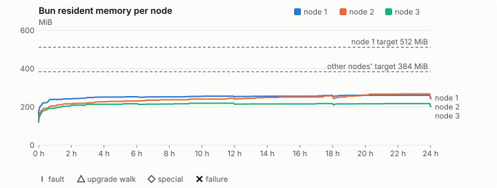
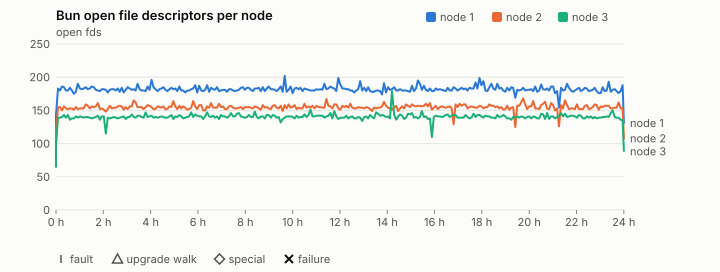
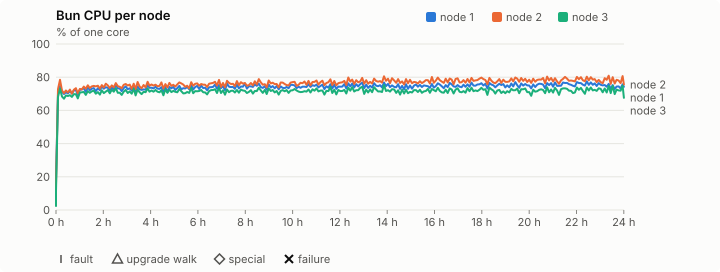
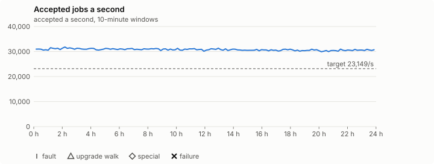

# Sustained soak (V02): FAIL

13 November 2026. day tier, no fault schedule, 24 h 00 min of soak on a three-node quickstart cluster.

**Day tier: not clean.** The day run doesn't hold; the record says what failed.

> **What this run was for: whether Bun's memory levels off over a whole day
> at full load on the published 0.2.8, and what the growth is
> ([#1417](https://github.com/reliaburger/reliaburger/issues/1417)).** It
> ran the full 24 hours on the quiet Mac Studio, from 11:29:58 GMT on
> 13 November to 11:29:58 GMT on 14 November, with no Bun restart, no fault
> schedule and nothing else on the host. It's the clean re-run of
> [the 13 November run](2026-11-13-v0.2.8-memory-run.md), which Ubuntu's
> unattended upgrades cut short. 2,649,391,295 host-job tasks were
> accepted, 30,654 a second.
>
> **`leak-rss` passed on every node, and no check failed.** The record's
> verdict is FAIL for one reason, outside the memory question: the job
> campaign never saw the `shared-runc` and `process` deploy hooks finish
> ([below](#the-campaign-check)).
>
> **The growth isn't live heap.** At hours 6, 12, 18 and 24 the harness
> called glibc's `malloc_stats()` and `malloc_trim(0)` in each node's Bun.
> The bytes Bun's allocations held fell on every node, from 112.7 / 117.0 /
> 105.4 MiB at hour 6 to 78.7 / 83.6 / 71.3 MiB at hour 24. What grew is the
> free memory malloc keeps: on node 2 from 27.6 to 95.0 MiB, and
> `malloc_trim(0)` gave 32–56 MiB back to the kernel at hours 18 and 24.
>
> **It follows the queried log store, and stops with it.** Node 2's log
> store, which every check tails, filled slowly (1,237 small Parquet files)
> and its RSS rose with it, then levelled at 266.9–268.4 MiB once the store
> stopped growing at hour 20.3. Node 3 got the same kind of store from a
> source nothing queries (1,179 files): its RSS stayed within 209–219 MiB
> from hour 2 to the end, and malloc's system bytes at about 136 MiB.
> Node 1's store, full of the spammer's lines in about 100 large files from
> hour 1.6, grew 11.6 MiB from hour 3 to the end, 0.34 MiB an hour over the
> last six.
>
> **Every node ended under target and inside `leak-rss`:** 260.8 / 268.4 /
> 217.4 MiB just before the hour-24 trim (109%, 116% and 100% of the warm
> samples), against 512 / 384 / 384 MiB.

## Candidate and host

| | |
|---|---|
| Staged base URL | <https://github.com/reliaburger/reliaburger/releases/download/v0.2.8> |
| `candidate.json` SHA-256 | `d9d04a7708e06fb444e8ca880a73321539e2300f29bb141ba80e7781a4bbe9f8` |
| Running versions | v0.2.8 x3 |
| Soak build | not supplied: upgrade slots skipped |
| Host | macOS 27.2, Apple M5 Max, 128 GiB |
| Lima | limactl version 2.2.1 |
| Guest | Ubuntu 24.04.5 LTS, kernel 6.8.0-139-generic |
| RELIABURGER_HOME | `/tmp/rbq.LODVDa` |
| Evidence | `/Users/miko/github/rb-wt/mem-028b/ev` |

## Configuration deviations

- Ubuntu's apt-daily and apt-daily-upgrade timers stopped and disabled in each guest, so unattended upgrades can't restart Bun during the soak (#1417)
- Each quickstart VM resized from 2 vCPU / 2 GiB to 4 vCPU / 6 GiB before configuring, the size the scale-out record measured (maintainer decision, 27 October 2026)
- node.toml `[testing] allowed_operations` adds `provision_isolated_workloads` (quickstart allows only inject_workload_faults and alter_node_state), so the catalogue pulse can lease test namespaces
- node.toml `[logs]`/`[metrics]` export to file:///var/lib/reliaburger/soak-export every 60 s with max_storage_mb = 8 (the harness deletes a metrics export 30 minutes after its source has gone), `[storage.snapshots]` every 900 s (compressed: 120 s), retain 4, uploaded to the same directory
- node.toml `[ingress] tls_cert/tls_key` point at an operator pair from a soak CA, 45-minute leaves rotated by the harness
- Bun runs with auto/mixed; host jobs opt in to a single pinned BusyBox copy under /var/lib/reliaburger/soak-jobs, mount_isolation=false. The independent verifier listens on each private VM address, TCP 8189, with a separate run token
- node.toml `[node.labels] soak-volume` = "writer" on node 2 and "redis" on node 3, to pin the volume apps
- node.toml `[security] leaf_lifetime_override_secs = 3600` (D1)
- gdb installed in each guest (GNU gdb (Ubuntu 15.1-1ubuntu1~24.04.1) 15.1) for the malloc points: at hours 6, 12, 18 and 24 it attaches to Bun and calls `malloc_stats()` and `malloc_trim(0)` (#1417); a failure first seen inside an attach window, or up to 180 s after it, is put down to the attach (`EXCUSE_AFTER` in malloc_points.py)
- apt-daily, apt-daily-upgrade and unattended-upgrades verified inactive on every node before the baseline (snapshots/upgrades-verified-N.txt)
- Log-store A/B (#1417): `soak-quiet` logs about 8 lines a second on node 3 (pinned by `soak-volume=redis`) and nothing queries it; `soak-redis-client` is pinned to node 1 (node.toml `[node.labels] soak-logs = "client"`); each check tails `soak-writer` and `soak-redis-client` through `/v1/logs/entries` on node 2 and node 1, the per-node query `relish logs` fans out to, so node 3's log store is never read
- Host jobs run Ubuntu's busybox-static 1:1.36.1-6ubuntu3.1 (`52151e7f…`), the scale-out record's binary, instead of the image's

## Timeline

- Started 2026-11-13 11:29:58 UTC, finished 2026-11-14 11:30:31 UTC
- Cycles completed: 0
- Fault and node choices: 0, from seed 1222728322 (`--seed 1222728322` repeats them)
- Teardown: `relish local destroy --yes` and `relish uninstall --yes` succeeded

## Faults and slots

| Class | Runs | Settled/ok | Failed | Skipped | Settle (median / max) |
|---|---|---|---|---|---|
| tls:invalid-expired | 33 | 33 | 0 | 0 | n/a |
| tls:invalid-torn | 36 | 36 | 0 | 0 | n/a |
| tls:reload | 285 | 285 | 0 | 0 | n/a |

## Execution inventory (gated)

What the run completed, from its events and kept bytes, against what its schedule owes. A fault counts once it was injected and the cluster settled after it.

| Item | Required | Completed | Verdict |
|---|---|---|---|
| candidate.json bytes match the qualified digest | 1 | 1 | ok |
| app workloads settled at the baseline | 1 | 1 | ok |
| job campaign drained in its final two minutes | 1 | 1 | ok |

## Renewals and rotations

| Measure | Observed | Required | Verdict |
|---|---|---|---|
| workload identity rotations (soak-identity, per node) | 48 | ≥ 47 | PASS |
| node leaf renewals (per node) | 52 | ≥ 47 | PASS |
| operator ingress reloads (all nodes) | 285 | ≥ 95 | PASS |
| mixed job campaign and positive drain | 2 missing/failing checks | 0 | FAIL |

## Latency SLOs

What a user should feel on a quiet three-node cluster (#1400). Every sample is taken outside fault windows and through a host forward that works; each p99 is the upper bound of its histogram bucket.

| SLO | p99 | Threshold | Samples | Mode | Verdict |
|---|---|---|---|---|---|
| API read p99 | 150 ms | ≤ 1,000 ms | 17,574 | record only | PASS |
| API write p99 | 2,000 ms | ≤ 2,000 ms | 48 | record only | PASS |
| App start p99 | 1 ms | ≤ 5,000 ms | 144 | record only | PASS |
| Rolling update p99 | 50,000 ms | ≤ 30,000 ms | 48 | record only | over (record only) |
| Job task start p99 | 8 ms | ≤ 256 ms | 2,660,368,503 | record only | PASS |

- API read p99: `GET /v1/status?cluster=true` and `GET /v1/cluster/nodes` on every node, at every light check
- API write p99: `relish apply` of the soak workloads, from the call to the commit
- App start p99: each node's deploy of a new `soak-identity` instance, from its start to the instance running
- Rolling update p99: from `relish apply` returning to every node's `soak-identity` running the new spec
- Job task start p99: a job task's start lag on a pooled executor, from the job campaign's buckets, in runs no fault window overlapped
- Record only from 28 October 2026 (#1400): no soak before 0.2.4 measured it. The threshold is provisional; the first 0.2.4 fast and final records set the gate.

## Jobs

| Runtime | Accepted successes | Retries | Last accepted progress |
|---|---|---|---|
| runc | 192715 | 2 | 1794655817 |
| shared-runc | 10977184 | 1 | 1794655817 |
| process | 2649391295 | 1 | 1794655817 |

The bounded campaign shares the app soak's fault schedule. These counts are reliability evidence, not a saturation rate or a 100-million-per-day qualification.

- shared-runc missing coverage: hook
- process missing coverage: hook
- Independent verifier execution attempts: 24
- Explicit test-operator acknowledgements for known replay-safe fenced fixtures: 1

- rb-6369b2d0e9bb-1: latest complete job storage (KiB) {'instances': 3736, 'job-state': 8, 'task-arrays': 76776}; free 4715424 KiB; live/peak owners 0/37; peak storage {'instances': 29000, 'job-state': 8, 'task-arrays': 273744}
- rb-6369b2d0e9bb-2: latest complete job storage (KiB) {'instances': 1636, 'job-state': 8, 'task-arrays': 76180}; free 5539640 KiB; live/peak owners 0/34; peak storage {'instances': 26000, 'job-state': 8, 'task-arrays': 277760}
- rb-6369b2d0e9bb-3: latest complete job storage (KiB) {'instances': 1736, 'job-state': 8, 'task-arrays': 78544}; free 5732784 KiB; live/peak owners 0/34; peak storage {'instances': 26072, 'job-state': 8, 'task-arrays': 344600}

Complete disk inventories are recorded. Global retention bounds and the 12-hour job qualification remain #668; this gate cannot certify an unimplemented retention policy.

## Job qualification (D18-C)

Load: day; 3 nodes; accepted 30,783.6/s against a 23149.0/s target: PASS.

The September plan set its targets for one 1M-task batch on a quiet cluster. A soak runs for hours with restarts, upgrades and apps, so its storage, Bun memory and Raft targets are restated (maintainer decision, 15 October 2026, [#668](https://github.com/reliaburger/reliaburger/issues/668)). Bun's steady state is the median RSS of each process once it has been seen for 10 minutes; the gated memory checks are unchanged (`leak-rss`, and Mayo's 70% `memory_high` alert through `wtf`).

| Measure (recorded, not gated) | Observed | Target |
|---|---|---|
| Wall time of a 1,048,576-task array (median / max of 0) | not measured / not measured | ≤ 600 s |
| p99 start lag, pooled executors | 8 ms (bucket upper bound) | < 1,000 ms |
| Raft entries per second, all cluster writes | 6.13 | recorded only; the batch target counts only task-array writes |
| Raft state of one run, largest seen | 45,564 B | ≤ 256 KiB per 1M tasks |
| Bun steady-state RSS per process, worst node against its target | rb-6369b2d0e9bb-2: 243.06 MiB steady, 268.37 MiB peak | ≤ 384 MiB (≤ 512 MiB on node 1, which serves the API) |
| Bun CPU, busiest node | 0.77 cores | ≤ 1 core (leader batch control) |
| Executor helper CPU, busiest node | 0.30 cores | ≤ 0.5 core |
| Node task-array storage per 1M accepted tasks (peaks summed) | 0.33 MiB | ≤ 64 MiB, deleted after retirement |
| Retained log volume, all nodes | 29.20 MB | ≤ 50 MB |

- Bun RSS on rb-6369b2d0e9bb-1 (serves the API, target ≤ 512 MiB): pid 2824: 255.68 MiB steady, 260.75 MiB peak
- Bun RSS on rb-6369b2d0e9bb-2 (node, target ≤ 384 MiB): pid 1795: 243.06 MiB steady, 268.37 MiB peak
- Bun RSS on rb-6369b2d0e9bb-3 (node, target ≤ 384 MiB): pid 1653: 215.32 MiB steady, 219.28 MiB peak

- runc retry causes: exit_code 1, launch 0, signal 0, timeout 0, unknown 1, unrecorded 0
- shared-runc retry causes: exit_code 1, launch 0, signal 0, timeout 0, unknown 0, unrecorded 0
- process retry causes: exit_code 1, launch 0, signal 0, timeout 0, unknown 0, unrecorded 0
- Audited executions: 24; operator replay decisions: 1
- Job controller API fallbacks: none (requests a node didn't answer, and the node that took them instead)

## Day run (#1032)

2,649,391,295 accepted host-job tasks in 24 h 00 min: 30,654.3/s against the 23149.0/s target (PASS). The billion-a-day floor is 11,575/s (met). At this rate a day is 2,648,532,974 tasks.

| Node | Slots | Host-job successes | Rate | Share | Fair share | Verdict |
|---|---|---|---|---|---|---|
| rb-6369b2d0e9bb-1 | 27 | 867,639,620 | 10,038.9/s | 32.7% | 33.3% | ok |
| rb-6369b2d0e9bb-2 | 27 | 881,745,424 | 10,202.1/s | 33.3% | 33.3% | ok |
| rb-6369b2d0e9bb-3 | 27 | 900,006,251 | 10,413.4/s | 34.0% | 33.3% | ok |

A node may take up to 20% more than its fair share by slots, as `relish bench` allows (#1362).

| Hour | Host jobs a second | |
|---|---|---|
| Hour 1 | 30,615.0 | ████████████████████ |
| Hour 2 | 31,140.5 | ████████████████████ |
| Hour 3 | 31,246.1 | ████████████████████ |
| Hour 4 | 30,895.4 | ████████████████████ |
| Hour 5 | 30,795.5 | ████████████████████ |
| Hour 6 | 30,919.3 | ████████████████████ |
| Hour 7 | 30,857.1 | ████████████████████ |
| Hour 8 | 30,750.4 | ████████████████████ |
| Hour 9 | 30,942.0 | ████████████████████ |
| Hour 10 | 30,668.2 | ████████████████████ |
| Hour 11 | 30,796.8 | ████████████████████ |
| Hour 12 | 30,571.2 | ████████████████████ |
| Hour 13 | 30,784.7 | ████████████████████ |
| Hour 14 | 30,710.7 | ████████████████████ |
| Hour 15 | 30,384.4 | ███████████████████ |
| Hour 16 | 30,518.6 | ████████████████████ |
| Hour 17 | 30,398.7 | ███████████████████ |
| Hour 18 | 30,531.2 | ████████████████████ |
| Hour 19 | 30,268.4 | ███████████████████ |
| Hour 20 | 30,489.7 | ████████████████████ |
| Hour 21 | 30,073.8 | ███████████████████ |
| Hour 22 | 30,353.2 | ███████████████████ |
| Hour 23 | 30,457.9 | ███████████████████ |
| Hour 24 | 30,516.5 | ████████████████████ |

Last hour against the first: 30,516.5/s against 30,615.0/s, ok (at most 10% slower; the first hour includes the campaign's start and its host-job probes).

## Data

- Volume writer: highest ACK 652339 in the log view; the writer file checks (writer-lost, writer-regression) decide data loss, and `*-log-order` failures are about the order the log view returned lines in
- Redis counter: highest INCR 81811 in the log view
- Export rb-6369b2d0e9bb-1: 208 source files, 1602 at the destination
- Export rb-6369b2d0e9bb-2: 1413 source files, 1665 at the destination
- Export rb-6369b2d0e9bb-3: 1419 source files, 1720 at the destination
- Registry images pushed and re-verified: 1
- Agent-loop turns over the 1 s budget: rb-6369b2d0e9bb-1 0, rb-6369b2d0e9bb-2 0, rb-6369b2d0e9bb-3 0
- Soak policies checked in force: 289 times, policy generation 150 at the last check
- Guest clock steps by Lima's guest agent: rb-6369b2d0e9bb-1 4, rb-6369b2d0e9bb-2 3, rb-6369b2d0e9bb-3 4
- Checks evaluated: 2931 (heavy 287, light 2642, settle 2)
- Last observed progress: redis-counter 81811, writer-ack 652339

## Leak-checker exposure (gated)

How long each leak checker could judge each node's Bun. `leak-rss` arms at its warm sample: 60 minutes into one process in a final, and otherwise at the first heavy check where the log and metrics stores are each 90% full, between 60 minutes and 6 hours in (#1417). `leak-fd` arms after 50 minutes; a restart, kill or upgrade exec starts the warm-up again. A final needs each armed for 60 minutes on every node, with one unbroken window of 30 (#1062); its quiet tail gives them that.

| Node | Checker | Armed | Longest armed window | Evaluated samples | Processes armed | Verdict |
|---|---|---|---|---|---|---|
| rb-6369b2d0e9bb-1 | leak-rss | 1354 min | 1354 min | 270 | 1 | ok |
| rb-6369b2d0e9bb-1 | leak-fd | 1390 min | 1390 min | 277 | 1 | ok |
| rb-6369b2d0e9bb-2 | leak-rss | 1077 min | 1077 min | 215 | 1 | ok |
| rb-6369b2d0e9bb-2 | leak-fd | 1390 min | 1390 min | 277 | 1 | ok |
| rb-6369b2d0e9bb-3 | leak-rss | 1077 min | 1077 min | 215 | 1 | ok |
| rb-6369b2d0e9bb-3 | leak-fd | 1390 min | 1390 min | 277 | 1 | ok |

- rb-6369b2d0e9bb-1: the last Bun process's `leak-rss` warm sample was 245,100 kB, 1:26 h:mm in.
- rb-6369b2d0e9bb-2: the last Bun process's `leak-rss` warm sample was 236,176 kB, 6:03 h:mm in.
- rb-6369b2d0e9bb-3: the last Bun process's `leak-rss` warm sample was 221,808 kB, 6:03 h:mm in.

## Resource trends

| Node | Measure | First | Last | Max |
|---|---|---|---|---|
| rb-6369b2d0e9bb-1 | disk_kb data | 1441280 | 1559452 | 1780252 |
| rb-6369b2d0e9bb-1 | disk_kb images | 342456 | 342428 | 342516 |
| rb-6369b2d0e9bb-1 | disk_kb logs | 64 | 8564 | 8828 |
| rb-6369b2d0e9bb-1 | disk_kb metrics | 136 | 8372 | 8868 |
| rb-6369b2d0e9bb-1 | disk_kb soak-export | 4 | 139388 | 139388 |
| rb-6369b2d0e9bb-1 | disk_kb volumes | 272 | 272 | 272 |
| rb-6369b2d0e9bb-1 | fd | 107 | 131 | 202 |
| rb-6369b2d0e9bb-1 | rss_anon_kb | 85648 | 173748 | 187064 |
| rb-6369b2d0e9bb-1 | rss_file_kb | 74468 | 79948 | 79972 |
| rb-6369b2d0e9bb-1 | rss_kb | 160116 | 253696 | 267012 |
| rb-6369b2d0e9bb-2 | disk_kb data | 71904 | 385228 | 604484 |
| rb-6369b2d0e9bb-2 | disk_kb images | 339124 | 339144 | 339144 |
| rb-6369b2d0e9bb-2 | disk_kb logs | 52 | 10060 | 10076 |
| rb-6369b2d0e9bb-2 | disk_kb metrics | 144 | 8540 | 8844 |
| rb-6369b2d0e9bb-2 | disk_kb soak-export | 4 | 22444 | 22452 |
| rb-6369b2d0e9bb-2 | disk_kb volumes | 16784 | 25488 | 25488 |
| rb-6369b2d0e9bb-2 | fd | 78 | 108 | 168 |
| rb-6369b2d0e9bb-2 | rss_anon_kb | 63272 | 166132 | 194732 |
| rb-6369b2d0e9bb-2 | rss_file_kb | 74788 | 80076 | 80100 |
| rb-6369b2d0e9bb-2 | rss_kb | 138060 | 246208 | 274808 |
| rb-6369b2d0e9bb-3 | disk_kb data | 180604 | 299040 | 577172 |
| rb-6369b2d0e9bb-3 | disk_kb images | 339124 | 342348 | 342348 |
| rb-6369b2d0e9bb-3 | disk_kb logs | 52 | 9592 | 9608 |
| rb-6369b2d0e9bb-3 | disk_kb metrics | 128 | 8736 | 8920 |
| rb-6369b2d0e9bb-3 | disk_kb soak-export | 4 | 21860 | 21860 |
| rb-6369b2d0e9bb-3 | disk_kb volumes | 16808 | 23240 | 23240 |
| rb-6369b2d0e9bb-3 | fd | 65 | 89 | 179 |
| rb-6369b2d0e9bb-3 | rss_anon_kb | 54004 | 131436 | 149968 |
| rb-6369b2d0e9bb-3 | rss_file_kb | 68900 | 74572 | 74596 |
| rb-6369b2d0e9bb-3 | rss_kb | 122904 | 206008 | 224540 |

## Bun memory by kind

From each node's `/proc/PID/smaps` at the settle and heavy checks (`memory.jsonl`, #1417). Sizes in MiB; arenas are glibc thread arenas, with the number of 64 MiB arena heaps in brackets. Time is h:mm since the node's first sample.

### rb-6369b2d0e9bb-1

| Time | Pid | RSS | Heap | Arenas | Stacks | Other anonymous | File | Threads |
|---|---|---|---|---|---|---|---|---|
| 0:00 | 2824 | 156.4 | 30.4 | 45.9 (1) | 3.4 | 0.2 | 76.5 | 56 |
| 1:00 | 2824 | 239.3 | 71.4 | 78.1 (2) | 7.4 | 0.6 | 81.8 | 95 |
| 2:01 | 2824 | 242.1 | 74.0 | 78.3 (2) | 7.4 | 0.6 | 81.8 | 95 |
| 3:02 | 2824 | 249.2 | 81.0 | 78.3 (2) | 7.4 | 0.6 | 81.8 | 95 |
| 4:02 | 2824 | 251.4 | 81.0 | 80.5 (2) | 7.4 | 0.6 | 81.8 | 95 |
| 5:03 | 2824 | 251.4 | 81.0 | 80.5 (2) | 7.4 | 0.6 | 81.8 | 95 |
| 6:03 | 2824 | 253.1 | 81.0 | 82.0 (2) | 7.7 | 0.6 | 81.8 | 98 |
| 7:04 | 2824 | 252.5 | 80.2 | 82.2 (2) | 7.7 | 0.6 | 81.8 | 98 |
| 8:04 | 2824 | 252.7 | 80.4 | 82.2 (2) | 7.7 | 0.6 | 81.8 | 98 |
| 9:05 | 2824 | 253.5 | 81.2 | 82.2 (2) | 7.7 | 0.6 | 81.8 | 98 |
| 10:00 | 2824 | 255.0 | 81.2 | 83.7 (2) | 7.7 | 0.6 | 81.8 | 98 |
| 11:01 | 2824 | 256.4 | 81.2 | 85.0 (2) | 7.7 | 0.6 | 81.8 | 98 |
| 12:01 | 2824 | 251.8 | 76.9 | 84.7 (2) | 7.7 | 0.6 | 81.8 | 98 |
| 13:02 | 2824 | 255.7 | 80.5 | 85.0 (2) | 7.7 | 0.6 | 81.8 | 98 |
| 14:02 | 2824 | 255.8 | 80.6 | 85.0 (2) | 7.7 | 0.6 | 81.8 | 98 |
| 15:03 | 2824 | 255.8 | 80.6 | 85.0 (2) | 7.7 | 0.6 | 81.8 | 98 |
| 16:03 | 2824 | 255.8 | 80.7 | 85.0 (2) | 7.7 | 0.6 | 81.8 | 98 |
| 17:04 | 2824 | 257.0 | 80.7 | 86.2 (2) | 7.7 | 0.6 | 81.8 | 98 |
| 18:04 | 2824 | 253.9 | 78.2 | 84.9 (2) | 8.3 | 0.6 | 81.8 | 107 |
| 19:04 | 2824 | 260.4 | 82.7 | 87.0 (2) | 8.3 | 0.6 | 81.8 | 107 |
| 20:00 | 2824 | 260.5 | 82.7 | 87.0 (2) | 8.3 | 0.6 | 81.8 | 107 |
| 21:01 | 2824 | 260.6 | 82.7 | 87.0 (2) | 8.5 | 0.6 | 81.8 | 109 |
| 22:01 | 2824 | 260.8 | 82.7 | 87.1 (2) | 8.5 | 0.6 | 81.8 | 109 |
| 23:01 | 2824 | 260.8 | 82.7 | 87.1 (2) | 8.5 | 0.6 | 81.8 | 109 |
| 24:00 | 2824 | 247.8 | 77.3 | 79.5 (2) | 8.5 | 0.6 | 81.8 | 109 |

- rb-6369b2d0e9bb-1: **heap** grew most after the first hour: +5.9 MiB over 22:59 h:mm (others, MiB: arenas +1.4, stacks +1.1, other anonymous +0.0, file +0.0).
- rb-6369b2d0e9bb-1: RSS slope over the last 6 hours: +0.17 MiB/h (least squares; recorded, not gated).

### rb-6369b2d0e9bb-2

| Time | Pid | RSS | Heap | Arenas | Stacks | Other anonymous | File | Threads |
|---|---|---|---|---|---|---|---|---|
| 0:00 | 1795 | 134.8 | 25.0 | 30.6 (1) | 2.3 | 0.2 | 76.8 | 36 |
| 1:00 | 1795 | 205.1 | 57.3 | 58.9 (1) | 6.3 | 0.7 | 81.8 | 80 |
| 2:01 | 1795 | 216.7 | 64.2 | 63.6 (1) | 6.3 | 0.7 | 81.9 | 80 |
| 3:02 | 1795 | 221.4 | 67.0 | 64.0 (1) | 7.7 | 0.8 | 81.9 | 99 |
| 4:02 | 1795 | 227.0 | 67.0 | 69.5 (2) | 7.7 | 0.8 | 82.0 | 99 |
| 5:03 | 1795 | 228.9 | 68.9 | 69.5 (2) | 7.7 | 0.9 | 82.0 | 99 |
| 6:03 | 1795 | 230.6 | 70.6 | 69.5 (2) | 7.7 | 0.9 | 82.0 | 99 |
| 7:04 | 1795 | 235.1 | 75.0 | 69.5 (2) | 7.7 | 0.9 | 82.0 | 99 |
| 8:04 | 1795 | 237.5 | 75.0 | 71.9 (2) | 7.7 | 0.9 | 82.0 | 99 |
| 9:05 | 1795 | 237.5 | 75.0 | 71.9 (2) | 7.7 | 0.9 | 82.0 | 99 |
| 10:00 | 1795 | 241.0 | 75.0 | 75.4 (2) | 7.7 | 0.9 | 82.0 | 99 |
| 11:01 | 1795 | 241.0 | 75.0 | 75.4 (2) | 7.7 | 0.9 | 82.0 | 99 |
| 12:01 | 1795 | 239.7 | 74.0 | 74.9 (2) | 8.0 | 0.9 | 82.0 | 102 |
| 13:02 | 1795 | 245.3 | 76.1 | 78.4 (2) | 8.0 | 0.9 | 82.0 | 102 |
| 14:02 | 1795 | 249.4 | 80.3 | 78.4 (2) | 8.0 | 0.9 | 82.0 | 102 |
| 15:03 | 1795 | 251.7 | 80.3 | 80.6 (2) | 8.0 | 0.9 | 82.0 | 102 |
| 16:03 | 1795 | 251.7 | 80.3 | 80.6 (2) | 8.0 | 0.9 | 82.0 | 102 |
| 17:04 | 1795 | 251.9 | 80.5 | 80.6 (2) | 8.0 | 0.9 | 82.0 | 102 |
| 18:04 | 1795 | 243.3 | 76.7 | 75.8 (2) | 8.0 | 0.9 | 82.0 | 102 |
| 19:04 | 1795 | 256.6 | 82.0 | 83.8 (2) | 8.0 | 0.9 | 82.0 | 102 |
| 20:00 | 1795 | 261.9 | 87.4 | 83.8 (2) | 8.0 | 0.9 | 82.0 | 102 |
| 21:01 | 1795 | 266.9 | 92.4 | 83.8 (2) | 8.0 | 0.9 | 82.0 | 102 |
| 22:01 | 1795 | 266.9 | 92.4 | 83.8 (2) | 8.0 | 0.9 | 82.0 | 102 |
| 23:01 | 1795 | 268.0 | 92.4 | 84.8 (2) | 8.0 | 0.9 | 82.0 | 102 |
| 24:00 | 1795 | 240.4 | 71.4 | 78.2 (2) | 8.0 | 0.9 | 82.0 | 102 |

- rb-6369b2d0e9bb-2: **arenas** grew most after the first hour: +19.3 MiB over 22:59 h:mm (others, MiB: heap +14.1, stacks +1.7, other anonymous +0.2, file +0.1).
- rb-6369b2d0e9bb-2: RSS slope over the last 6 hours: +2.96 MiB/h (least squares; recorded, not gated).

### rb-6369b2d0e9bb-3

| Time | Pid | RSS | Heap | Arenas | Stacks | Other anonymous | File | Threads |
|---|---|---|---|---|---|---|---|---|
| 0:00 | 1653 | 120.0 | 28.0 | 18.8 (1) | 2.0 | 0.2 | 71.0 | 33 |
| 1:00 | 1653 | 193.8 | 60.6 | 49.1 (1) | 6.9 | 0.6 | 76.6 | 91 |
| 2:01 | 1653 | 208.9 | 67.6 | 57.1 (1) | 6.9 | 0.6 | 76.6 | 91 |
| 3:02 | 1653 | 213.5 | 67.6 | 61.2 (1) | 7.4 | 0.6 | 76.6 | 98 |
| 4:02 | 1653 | 213.8 | 68.0 | 61.2 (1) | 7.5 | 0.6 | 76.6 | 98 |
| 5:03 | 1653 | 213.9 | 68.0 | 61.2 (1) | 7.5 | 0.6 | 76.6 | 98 |
| 6:03 | 1653 | 216.6 | 70.7 | 61.2 (1) | 7.5 | 0.6 | 76.6 | 98 |
| 7:04 | 1653 | 214.3 | 67.5 | 62.1 (1) | 7.5 | 0.6 | 76.6 | 98 |
| 8:04 | 1653 | 215.2 | 68.4 | 62.1 (1) | 7.5 | 0.6 | 76.6 | 98 |
| 9:05 | 1653 | 216.2 | 69.4 | 62.1 (1) | 7.5 | 0.6 | 76.6 | 98 |
| 10:00 | 1653 | 218.9 | 72.1 | 62.1 (1) | 7.5 | 0.7 | 76.6 | 98 |
| 11:01 | 1653 | 219.3 | 72.5 | 62.1 (1) | 7.5 | 0.6 | 76.6 | 98 |
| 12:01 | 1653 | 213.4 | 67.0 | 61.7 (1) | 7.5 | 0.6 | 76.6 | 98 |
| 13:02 | 1653 | 215.3 | 68.0 | 62.6 (1) | 7.5 | 0.6 | 76.6 | 98 |
| 14:02 | 1653 | 215.3 | 68.0 | 62.6 (1) | 7.5 | 0.6 | 76.6 | 98 |
| 15:03 | 1653 | 215.3 | 68.0 | 62.6 (1) | 7.5 | 0.6 | 76.6 | 98 |
| 16:03 | 1653 | 215.3 | 68.0 | 62.6 (1) | 7.5 | 0.6 | 76.6 | 98 |
| 17:04 | 1653 | 217.6 | 70.3 | 62.6 (1) | 7.5 | 0.7 | 76.6 | 98 |
| 18:04 | 1653 | 210.1 | 66.0 | 59.3 (1) | 7.5 | 0.7 | 76.6 | 98 |
| 19:04 | 1653 | 215.8 | 68.5 | 62.6 (1) | 7.5 | 0.7 | 76.6 | 98 |
| 20:00 | 1653 | 216.0 | 68.8 | 62.6 (1) | 7.5 | 0.7 | 76.6 | 98 |
| 21:01 | 1653 | 216.0 | 68.8 | 62.6 (1) | 7.5 | 0.7 | 76.6 | 98 |
| 22:01 | 1653 | 217.4 | 70.1 | 62.6 (1) | 7.5 | 0.7 | 76.6 | 98 |
| 23:01 | 1653 | 217.4 | 70.1 | 62.6 (1) | 7.5 | 0.7 | 76.6 | 98 |
| 24:00 | 1653 | 201.2 | 62.4 | 54.1 (1) | 7.5 | 0.7 | 76.6 | 98 |

- rb-6369b2d0e9bb-3: **arenas** grew most after the first hour: +5.1 MiB over 22:59 h:mm (others, MiB: heap +1.8, stacks +0.5, other anonymous +0.0, file +0.0).
- rb-6369b2d0e9bb-3: RSS slope over the last 6 hours: +0.27 MiB/h (least squares; recorded, not gated).

### Log stores against RSS

Each node's `disk logs` and `disk metrics` and the Parquet files in its log store, from the same samples. RSS in MiB.

| Node | Time | RSS | Logs (KiB) | Log files | Metrics (KiB) |
|---|---|---|---|---|---|
| rb-6369b2d0e9bb-1 | 0:00 | 156.4 | 64 | 6 | 136 |
| rb-6369b2d0e9bb-1 | 1:00 | 239.3 | 5,376 | 67 | 6,088 |
| rb-6369b2d0e9bb-1 | 2:01 | 242.1 | 8,576 | 97 | 8,540 |
| rb-6369b2d0e9bb-1 | 3:02 | 249.2 | 8,600 | 97 | 8,668 |
| rb-6369b2d0e9bb-1 | 4:02 | 251.4 | 8,588 | 97 | 8,596 |
| rb-6369b2d0e9bb-1 | 5:03 | 251.4 | 8,656 | 98 | 8,756 |
| rb-6369b2d0e9bb-1 | 6:03 | 253.1 | 8,748 | 99 | 8,752 |
| rb-6369b2d0e9bb-1 | 7:04 | 252.5 | 8,744 | 99 | 8,808 |
| rb-6369b2d0e9bb-1 | 8:04 | 252.7 | 8,400 | 95 | 8,344 |
| rb-6369b2d0e9bb-1 | 9:05 | 253.5 | 8,388 | 95 | 8,436 |
| rb-6369b2d0e9bb-1 | 10:00 | 255.0 | 8,476 | 96 | 8,424 |
| rb-6369b2d0e9bb-1 | 11:01 | 256.4 | 8,476 | 96 | 8,496 |
| rb-6369b2d0e9bb-1 | 12:01 | 251.8 | 8,564 | 97 | 8,568 |
| rb-6369b2d0e9bb-1 | 13:02 | 255.7 | 8,568 | 97 | 8,492 |
| rb-6369b2d0e9bb-1 | 14:02 | 255.8 | 8,652 | 98 | 8,580 |
| rb-6369b2d0e9bb-1 | 15:03 | 255.8 | 8,740 | 99 | 8,760 |
| rb-6369b2d0e9bb-1 | 16:03 | 255.8 | 8,824 | 100 | 8,784 |
| rb-6369b2d0e9bb-1 | 17:04 | 257.0 | 8,824 | 100 | 8,840 |
| rb-6369b2d0e9bb-1 | 18:04 | 253.9 | 8,472 | 96 | 8,332 |
| rb-6369b2d0e9bb-1 | 19:04 | 260.4 | 8,472 | 96 | 8,292 |
| rb-6369b2d0e9bb-1 | 20:00 | 260.5 | 8,560 | 97 | 8,416 |
| rb-6369b2d0e9bb-1 | 21:01 | 260.6 | 8,560 | 97 | 8,476 |
| rb-6369b2d0e9bb-1 | 22:01 | 260.8 | 8,648 | 98 | 8,504 |
| rb-6369b2d0e9bb-1 | 23:01 | 260.8 | 8,652 | 98 | 8,480 |
| rb-6369b2d0e9bb-1 | 24:00 | 247.8 | 8,564 | 97 | 8,372 |
| rb-6369b2d0e9bb-2 | 0:00 | 134.8 | 52 | 6 | 144 |
| rb-6369b2d0e9bb-2 | 1:00 | 205.1 | 548 | 67 | 3,372 |
| rb-6369b2d0e9bb-2 | 2:01 | 216.7 | 1,040 | 128 | 6,588 |
| rb-6369b2d0e9bb-2 | 3:02 | 221.4 | 1,544 | 189 | 8,668 |
| rb-6369b2d0e9bb-2 | 4:02 | 227.0 | 2,028 | 249 | 8,676 |
| rb-6369b2d0e9bb-2 | 5:03 | 228.9 | 2,532 | 310 | 8,764 |
| rb-6369b2d0e9bb-2 | 6:03 | 230.6 | 3,020 | 370 | 8,772 |
| rb-6369b2d0e9bb-2 | 7:04 | 235.1 | 3,552 | 431 | 8,796 |
| rb-6369b2d0e9bb-2 | 8:04 | 237.5 | 4,000 | 491 | 8,568 |
| rb-6369b2d0e9bb-2 | 9:05 | 237.5 | 4,500 | 552 | 8,564 |
| rb-6369b2d0e9bb-2 | 10:00 | 241.0 | 4,948 | 607 | 8,584 |
| rb-6369b2d0e9bb-2 | 11:01 | 241.0 | 5,436 | 667 | 8,672 |
| rb-6369b2d0e9bb-2 | 12:01 | 239.7 | 5,928 | 728 | 8,708 |
| rb-6369b2d0e9bb-2 | 13:02 | 245.3 | 6,416 | 788 | 8,744 |
| rb-6369b2d0e9bb-2 | 14:02 | 249.4 | 6,912 | 849 | 8,696 |
| rb-6369b2d0e9bb-2 | 15:03 | 251.7 | 7,408 | 910 | 8,760 |
| rb-6369b2d0e9bb-2 | 16:03 | 251.7 | 7,892 | 970 | 8,760 |
| rb-6369b2d0e9bb-2 | 17:04 | 251.9 | 8,384 | 1,030 | 8,844 |
| rb-6369b2d0e9bb-2 | 18:04 | 243.3 | 8,880 | 1,091 | 8,540 |
| rb-6369b2d0e9bb-2 | 19:04 | 256.6 | 9,364 | 1,151 | 8,548 |
| rb-6369b2d0e9bb-2 | 20:00 | 261.9 | 9,828 | 1,207 | 8,564 |
| rb-6369b2d0e9bb-2 | 21:01 | 266.9 | 10,068 | 1,236 | 8,652 |
| rb-6369b2d0e9bb-2 | 22:01 | 266.9 | 10,068 | 1,236 | 8,640 |
| rb-6369b2d0e9bb-2 | 23:01 | 268.0 | 10,060 | 1,235 | 8,704 |
| rb-6369b2d0e9bb-2 | 24:00 | 240.4 | 10,060 | 1,235 | 8,540 |
| rb-6369b2d0e9bb-3 | 0:00 | 120.0 | 52 | 6 | 128 |
| rb-6369b2d0e9bb-3 | 1:00 | 193.8 | 556 | 68 | 2,328 |
| rb-6369b2d0e9bb-3 | 2:01 | 208.9 | 1,040 | 128 | 4,508 |
| rb-6369b2d0e9bb-3 | 3:02 | 213.5 | 1,544 | 189 | 6,704 |
| rb-6369b2d0e9bb-3 | 4:02 | 213.8 | 2,028 | 249 | 8,864 |
| rb-6369b2d0e9bb-3 | 5:03 | 213.9 | 2,532 | 310 | 8,884 |
| rb-6369b2d0e9bb-3 | 6:03 | 216.6 | 3,020 | 370 | 8,836 |
| rb-6369b2d0e9bb-3 | 7:04 | 214.3 | 3,512 | 431 | 8,696 |
| rb-6369b2d0e9bb-3 | 8:04 | 215.2 | 4,000 | 491 | 8,704 |
| rb-6369b2d0e9bb-3 | 9:05 | 216.2 | 4,500 | 552 | 8,748 |
| rb-6369b2d0e9bb-3 | 10:00 | 218.9 | 4,948 | 607 | 8,752 |
| rb-6369b2d0e9bb-3 | 11:01 | 219.3 | 5,444 | 668 | 8,768 |
| rb-6369b2d0e9bb-3 | 12:01 | 213.4 | 5,932 | 728 | 8,760 |
| rb-6369b2d0e9bb-3 | 13:02 | 215.3 | 6,424 | 789 | 8,768 |
| rb-6369b2d0e9bb-3 | 14:02 | 215.3 | 6,912 | 849 | 8,796 |
| rb-6369b2d0e9bb-3 | 15:03 | 215.3 | 7,404 | 910 | 8,840 |
| rb-6369b2d0e9bb-3 | 16:03 | 215.3 | 7,892 | 970 | 8,820 |
| rb-6369b2d0e9bb-3 | 17:04 | 217.6 | 8,388 | 1,031 | 8,688 |
| rb-6369b2d0e9bb-3 | 18:04 | 210.1 | 8,880 | 1,091 | 8,664 |
| rb-6369b2d0e9bb-3 | 19:04 | 215.8 | 9,372 | 1,152 | 8,668 |
| rb-6369b2d0e9bb-3 | 20:00 | 216.0 | 9,592 | 1,177 | 8,656 |
| rb-6369b2d0e9bb-3 | 21:01 | 216.0 | 9,592 | 1,177 | 8,732 |
| rb-6369b2d0e9bb-3 | 22:01 | 217.4 | 9,600 | 1,178 | 8,712 |
| rb-6369b2d0e9bb-3 | 23:01 | 217.4 | 9,608 | 1,179 | 8,760 |
| rb-6369b2d0e9bb-3 | 24:00 | 201.2 | 9,592 | 1,177 | 8,736 |

## malloc_stats and malloc_trim

At hours 6, 12, 18 and 24 the harness attached gdb to each node's Bun and called glibc's `malloc_stats()` and `malloc_trim(0)` (`malloc.jsonl`, #1417). In use is what Bun's allocations held; system is what malloc had taken from the kernel. RSS and the heap and arena split are from smaps just before the attach and about 5 s after the trim. Sizes in MiB; times UTC. Pause is the whole gdb run, attach and symbol loading included.

| Node | Hour | Pid | Attach | Pause | RSS before | RSS after | Given back | Heap | Arenas | In use | System |
|---|---|---|---|---|---|---|---|---|---|---|---|
| rb-6369b2d0e9bb-1 | 6 | 2824 | 2026-11-13 17:33:38 | 0.1 s | 253.1 | 222.6 | 30.5 | 81.0 → 61.9 | 82.0 → 70.6 | 112.7 | 164.8 |
| rb-6369b2d0e9bb-2 | 6 | 1795 | 2026-11-13 17:33:44 | 0.1 s | 230.6 | 220.2 | 10.4 | 70.6 → 64.0 | 69.5 → 65.7 | 117.0 | 144.6 |
| rb-6369b2d0e9bb-3 | 6 | 1653 | 2026-11-13 17:33:49 | 0.1 s | 216.6 | 204.8 | 11.8 | 70.7 → 64.0 | 61.2 → 56.1 | 105.4 | 135.6 |
| rb-6369b2d0e9bb-1 | 12 | 2824 | 2026-11-13 23:29:59 | 0.1 s | 256.4 | 220.0 | 36.3 | 81.2 → 60.3 | 85.0 → 69.6 | 101.8 | 167.7 |
| rb-6369b2d0e9bb-2 | 12 | 1795 | 2026-11-13 23:30:04 | 0.1 s | 245.2 | 227.2 | 18.0 | 79.0 → 69.0 | 75.4 → 67.4 | 112.0 | 155.6 |
| rb-6369b2d0e9bb-3 | 12 | 1653 | 2026-11-13 23:30:09 | 0.1 s | 219.3 | 202.1 | 17.2 | 72.5 → 60.4 | 62.1 → 57.1 | 95.9 | 137.0 |
| rb-6369b2d0e9bb-1 | 18 | 2824 | 2026-11-14 05:30:48 | 0.1 s | 260.5 | 205.9 | 54.6 | 82.7 → 52.7 | 87.0 → 62.4 | 79.0 | 171.4 |
| rb-6369b2d0e9bb-2 | 18 | 1795 | 2026-11-14 05:30:53 | 0.1 s | 257.6 | 206.9 | 50.7 | 83.6 → 59.6 | 83.2 → 56.4 | 87.2 | 168.3 |
| rb-6369b2d0e9bb-3 | 18 | 1653 | 2026-11-14 05:30:58 | 0.1 s | 217.6 | 185.1 | 32.5 | 70.3 → 52.6 | 62.6 → 47.7 | 70.5 | 136.3 |
| rb-6369b2d0e9bb-1 | 24 | 2824 | 2026-11-14 11:29:58 | 0.1 s | 260.8 | 207.1 | 53.6 | 82.7 → 54.3 | 87.1 → 61.8 | 78.7 | 172.1 |
| rb-6369b2d0e9bb-2 | 24 | 1795 | 2026-11-14 11:30:03 | 0.2 s | 268.4 | 212.3 | 56.1 | 92.8 → 60.2 | 84.8 → 61.3 | 83.6 | 178.7 |
| rb-6369b2d0e9bb-3 | 24 | 1653 | 2026-11-14 11:30:08 | 0.2 s | 217.4 | 185.4 | 32.0 | 70.1 → 51.1 | 62.6 → 49.6 | 71.3 | 136.1 |

- rb-6369b2d0e9bb-1, hour 6: arena 0 54.5 of 81.7 MiB in use; arena 1 57.7 of 82.5 MiB in use
- rb-6369b2d0e9bb-2, hour 6: arena 0 60.2 of 72.6 MiB in use; arena 1 56.0 of 71.2 MiB in use
- rb-6369b2d0e9bb-3, hour 6: arena 0 60.4 of 71.8 MiB in use; arena 1 44.1 of 63.0 MiB in use
- rb-6369b2d0e9bb-1, hour 12: arena 0 49.6 of 82.1 MiB in use; arena 1 51.6 of 85.0 MiB in use
- rb-6369b2d0e9bb-2, hour 12: arena 0 59.4 of 79.1 MiB in use; arena 1 51.8 of 75.6 MiB in use
- rb-6369b2d0e9bb-3, hour 12: arena 0 53.3 of 73.1 MiB in use; arena 1 41.8 of 63.0 MiB in use
- rb-6369b2d0e9bb-1, hour 18: arena 0 39.3 of 83.8 MiB in use; arena 1 39.1 of 87.0 MiB in use
- rb-6369b2d0e9bb-2, hour 18: arena 0 46.6 of 84.2 MiB in use; arena 1 39.8 of 83.2 MiB in use
- rb-6369b2d0e9bb-3, hour 18: arena 0 41.7 of 72.3 MiB in use; arena 1 28.0 of 63.2 MiB in use
- rb-6369b2d0e9bb-1, hour 24: arena 0 38.3 of 83.8 MiB in use; arena 1 39.8 of 87.8 MiB in use
- rb-6369b2d0e9bb-2, hour 24: arena 0 41.8 of 93.0 MiB in use; arena 1 41.1 of 84.8 MiB in use
- rb-6369b2d0e9bb-3, hour 24: arena 0 38.5 of 72.1 MiB in use; arena 1 31.9 of 63.2 MiB in use

## What the growth is

Figures from `memory.jsonl` (one row a node at every heavy check, every 5
minutes) and `malloc.jsonl` in the evidence. Hours count from the soak's
start. The trims at hours 6, 12 and 18 knock RSS down, so the slopes below
end at the last sample before the hour-24 trim, and each trim is compared
on RSS just before it.

| Node | Runs | Warm sample | `leak-rss` limit | Before the hour-24 trim | Against warm | RSS slope, last 12 / 6 / 3 h |
|---|---|---|---|---|---|---|
| rb-6369b2d0e9bb-1 | the Redis client, the log spammer, the API | 239.4 MiB, hour 1.4 | 299.2 MiB | 260.8 MiB | 109% | +0.67 / +0.34 / +0.02 MiB/h |
| rb-6369b2d0e9bb-2 | the volume writer, tailed at every check | 230.6 MiB, hour 6.1 | 288.3 MiB | 268.4 MiB | 116% | +2.33 / +3.33 / +0.61 MiB/h |
| rb-6369b2d0e9bb-3 | Redis and `soak-quiet`, never queried | 216.6 MiB, hour 6.1 | 270.8 MiB | 217.4 MiB | 100% | +0.23 / +0.46 / +0.14 MiB/h |

### Live heap or malloc's free memory?

Just before each trim, with in use and system from `malloc_stats` (both
arenas and mmap; MiB):

| Node | | Hour 6 | Hour 12 | Hour 18 | Hour 24 |
|---|---|---|---|---|---|
| 1 | RSS | 253.1 | 256.4 | 260.5 | 260.8 |
| 1 | in use | 112.7 | 101.8 | 79.0 | 78.7 |
| 1 | held free (system − in use) | 52.0 | 65.9 | 92.4 | 93.5 |
| 2 | RSS | 230.6 | 245.2 | 257.6 | 268.4 |
| 2 | in use | 117.0 | 112.0 | 87.2 | 83.6 |
| 2 | held free | 27.6 | 43.6 | 81.1 | 95.0 |
| 3 | RSS | 216.6 | 219.3 | 217.6 | 217.4 |
| 3 | in use | 105.4 | 95.9 | 70.5 | 71.3 |
| 3 | held free | 30.3 | 41.1 | 65.8 | 64.9 |

The live heap didn't grow on any node; it fell by a third from hour 6 to
hour 24. Over the same hours malloc kept more and more of what Bun freed:
node 2's system bytes rose 144.6 → 178.7 MiB while its in-use bytes fell.
`malloc_trim(0)` handed 10–18 MiB back at hours 6 and 12 and 32–56 MiB at
hours 18 and 24, so most of it is free pages malloc can return, not data.
That's the allocator high-water mark the issue's first comment suspected,
not a leaked structure, and a heap profile isn't needed to say so.

### Does it follow the log store? (the A/B)

Node 3 ran `soak-quiet`, a source like the writer (about 8 lines a second)
that nothing ever queried: each check tailed the writer through node 2's
own `/v1/logs/entries` and the Redis client through node 1's, instead of
`relish logs`, which fans out to every node.

| Hour | Node 2 log files | Node 2 RSS | Node 3 log files | Node 3 RSS |
|---|---|---|---|---|
| 2 | 128 | 216.7 | 128 | 208.9 |
| 6 | 370 | 230.6 | 370 | 216.6 |
| 12 | 728 | 239.7 | 728 | 213.4 |
| 17 | 1,030 | 251.9 | 1,031 | 217.6 |
| 20 | 1,207 (stops at 1,237, hour 20.3) | 261.9 | 1,177 (stopped at 1,179, hour 19.4) | 216.0 |
| 23 | 1,235 | 268.0 | 1,179 | 217.4 |

The two stores filled alike, file for file, until the 8 MiB cap; only node
2's was queried, and only node 2's RSS grew with it. Node 2 then levelled:
266.9 MiB at hour 21, 268.0 at hour 23, +0.61 MiB an hour over the last
three. So the growth is bounded by what bounds the store, `max_storage_mb`,
and the mechanism the 0.2.7 record put forward fits: a tail is a DataFusion
query over every Parquet file in the store, so its transient allocations
grow with the file count, and malloc keeps the high-water mark. Node 1 runs
the same queries over a store of about 100 large files and grew 0.34 MiB an
hour over the last six hours.

One thing this run doesn't cover: a Bun restarted under full load. In the
[13 November run](2026-11-13-v0.2.8-memory-run.md#what-the-growth-is)
unattended upgrades restarted every Bun at hour 16.7, and the new processes
reached 287–332 MiB within five hours, against 208–257 MiB for the first
processes at hour 6. That includes node 1, whose store held about 100
files, so the store doesn't explain it on its own; a restarted node's
catch-up is a likelier part. It wasn't investigated.

### The campaign check

`mixed job campaign and positive drain` failed on "missing coverage: hook"
for `shared-runc` and `process` (and the job controller exited 1 for it).
The deploy-hook fixtures run before `soak-identity` deploys; a day tier
never redeploys it after the campaign starts, so each hook gets one chance.
The `runc` hook was seen, the other two weren't. The 0.2.7 day run saw all
three, both 0.2.8 runs miss the same two, and 0.2.8's 8-hour job final, which
redeploys `soak-identity` every cycle, passed it. It isn't a memory result
and was not investigated here; it needs its own issue.

### Host and diagnostics

- The malloc points paused Bun for 0.07–0.25 s (the whole gdb run). No
  check failed in or near any attach window, so none was excused.
- Ubuntu's `apt-daily`, `apt-daily-upgrade` and `unattended-upgrades` were
  disabled and checked inactive in every guest before the baseline
  (`snapshots/upgrades-verified-N.txt`); no Bun restarted.
- Nothing else ran on the Studio.

## Next steps

1. #1417's "done when" holds: `leak-rss` passed on every node, and the
   growth is bounded: it's malloc's free memory, it follows the queried
   log store, and it levels when the store does.
2. To shrink the high-water mark rather than bound it: measure a log tail's
   peak allocation against the file count (100 against 1,200 small Parquet
   files, as the 0.2.7 record proposed). If it grows with the count,
   compact small log files or let a tail read only the newest ones. A
   periodic `malloc_trim(0)` in Bun would return 30–55 MiB a node at no
   measured cost (the attaches took under 0.25 s).
3. A new issue for the day tier's missing `shared-runc` and `process` hook
   coverage.

## Agent loop stalls

From the stall watchdog's journal blocks (`loop-stalls.jsonl`, #1707). Each snapshot lists every Bun thread; here are the stall line, threads in uninterruptible sleep and the thread that ran the loop.

- None recorded.

## Charts

Time runs from the start of the soak. The marks under each chart are its faults, upgrade walks, specials and recorded failures; the dashed lines are targets.

## Failures

None.

## Notes

- Job controller exited with status 1
- The harness stopped early (exit 1) during final

Evidence: `/Users/miko/github/rb-wt/mem-028b/ev` (events.jsonl, snapshots/, failures/<n>/).
